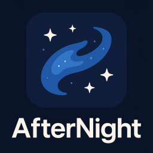
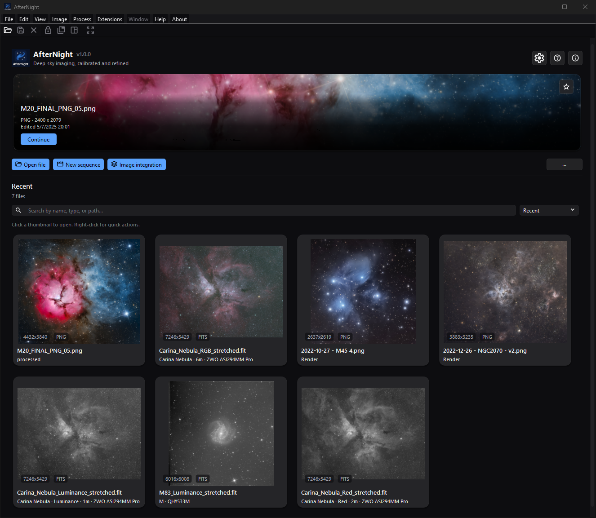
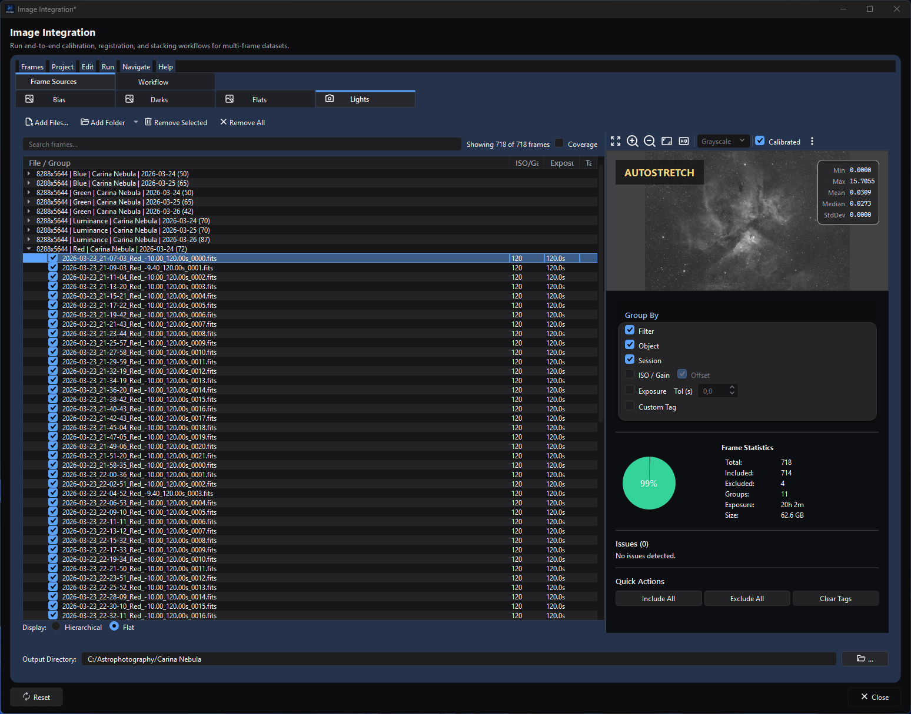
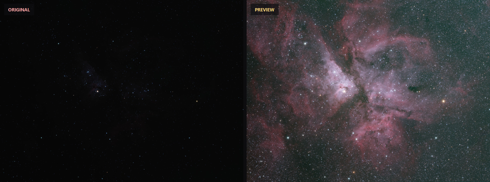
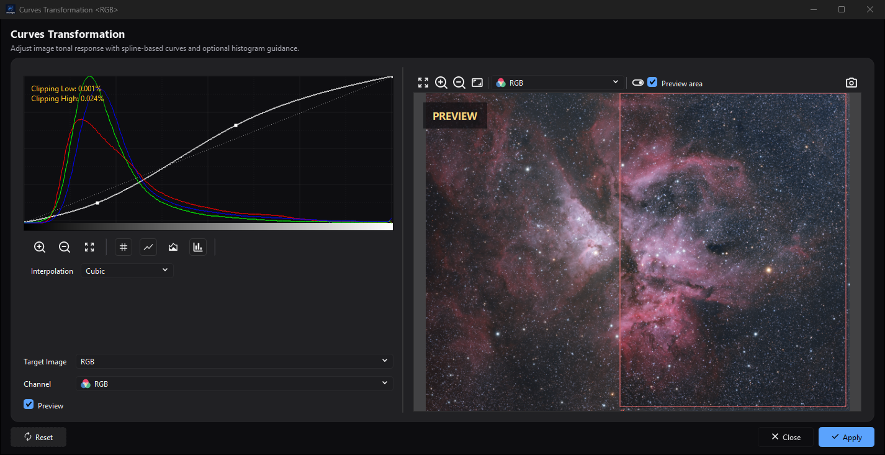
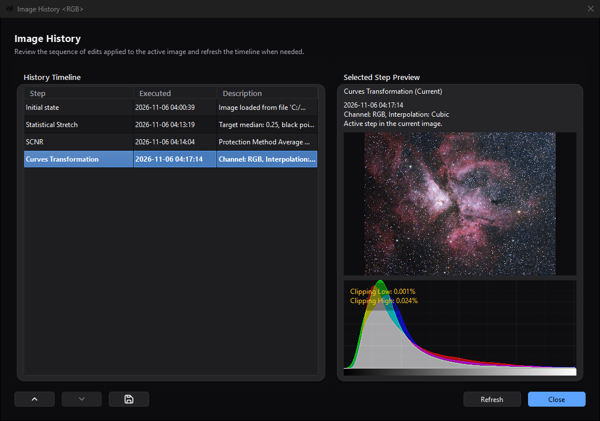
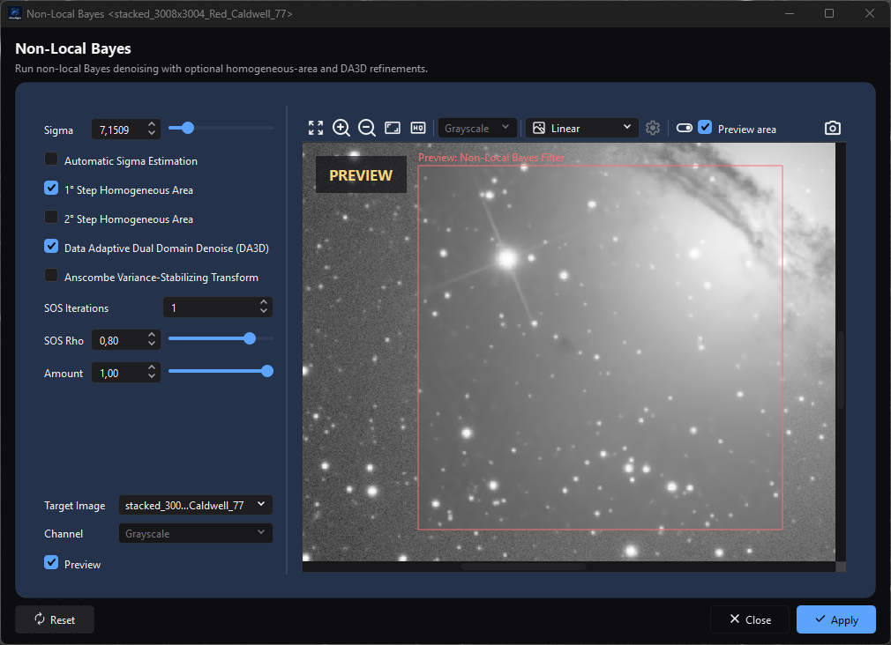
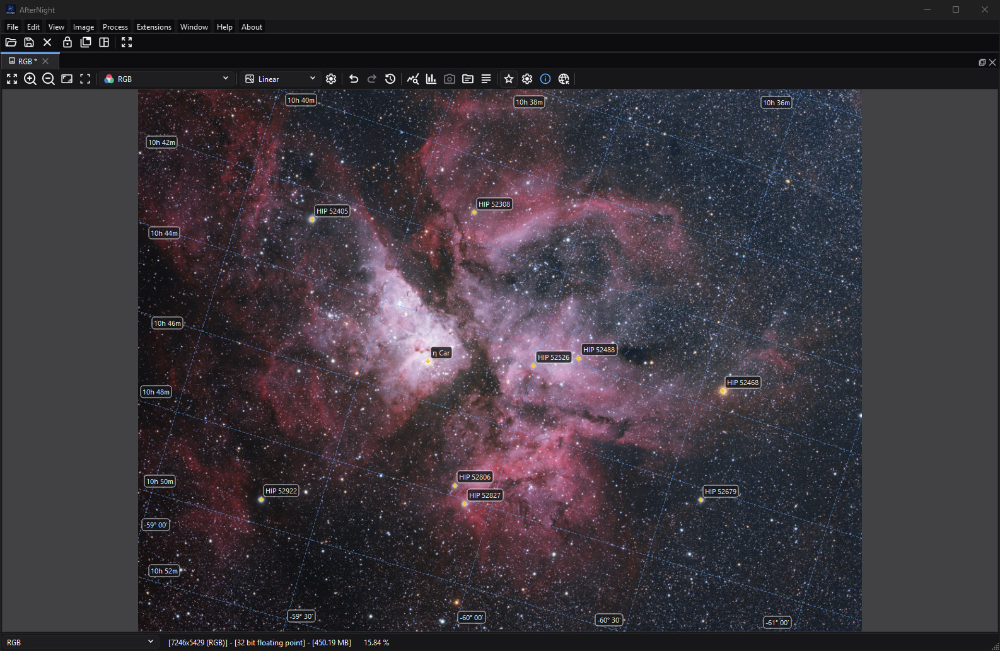
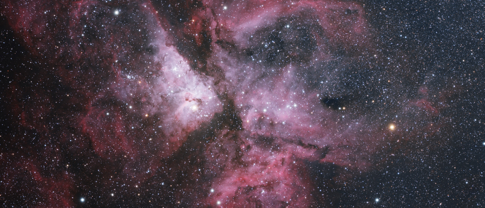

<p align="center">
  
</p>

<h1 align="center">AfterNight</h1>

<p align="center">
  <strong>From a night of raw frames to a finished picture of the sky.</strong><br>
  Astronomical image processing for Windows and Linux, free and open source.
</p>

<p align="center">
  <a href="https://github.com/emruiz81/afternight/releases"></a>
  <a href="https://github.com/emruiz81/afternight/actions/workflows/ci.yml"></a>
  <a href="LICENSE"></a>
  
  <a href="https://isocpp.org/"></a>
  <a href="https://www.qt.io/"></a>
</p>

<p align="center">
  <a href="https://afternightastro.org/"><strong>Website</strong></a> &nbsp;·&nbsp;
  <a href="https://github.com/emruiz81/afternight/releases"><strong>Download</strong></a> &nbsp;·&nbsp;
  <a href="https://docs.afternightastro.org/"><strong>User guide</strong></a> &nbsp;·&nbsp;
  <a href="https://docs.afternightastro.org/getting-started/quick-start.html"><strong>Quick start</strong></a> &nbsp;·&nbsp;
  <a href="BUILD.md"><strong>Build from source</strong></a> &nbsp;·&nbsp;
  <a href="CONTRIBUTING.md"><strong>Contribute</strong></a>
</p>



AfterNight is a desktop application for processing astronomical images. It calibrates, registers and stacks a
night's frames into a master, and then carries the master through the processes that finish it: background
extraction, colour calibration, stretching, noise reduction, sharpening, star operations and the rest. Most steps
are previewed on the image before they are applied, and every applied step is kept in the image's history. It is
written in C++20 and Qt 6, on an image engine of its own.

## See it work

### Stack a night - or three



**Image Integration** takes the bias, dark, flat and light frames as they came off the camera, groups them by
filter, object and night, matches the lights to their calibration frames and runs the whole chain: calibration
masters, calibration, star detection, registration, alignment, normalization and stacking, with rejection, weighting
and drizzle. A stage whose inputs and settings have not changed is reused rather than run again, and the run ends in
a report. The window above holds 718 frames of the Carina Nebula through four filters, taken over three nights:
twenty hours of exposure in 62.6 GB of files. **Image Integration Lite** is the same workflow behind a simpler
window.

### The picture is already in the data



What a stack holds is linear: hours of light that still look like an empty frame. On the left, the colour master
combined from that integration's stacks, as its file holds it. On the right, the same pixels in the live preview of
**Statistical Stretch** at its default settings. Nothing has been applied yet - the left is the image, and the right
is what **Apply** would make of it.

### Every change shows on the image while you make it



A process window previews on the image as its controls move: drag a point of the curve and the picture follows.
**Preview area** keeps the preview to a part of the frame, so one view holds both states - inside the red frame, the
curve being drawn; outside it, the image as it is. **Apply** then runs on the whole image.

|  |  |
| :---: | :---: |
| Every applied step goes into the image's history, where an earlier state can be looked at again and returned to. | Noise reduction, previewed on part of a stacked master before it is applied. |

### An image that knows where it is



Plate solving against Gaia catalogs gives an image its place in the sky - a WCS solution with SIP distortion terms -
and the view can draw it: the equatorial grid, catalog stars and deep-sky objects by name, the distortion map, the
stars that were detected. Photometric and spectrophotometric colour calibration start from the same solution, and
measure the image's stars against Gaia DR3.

### And then there is a picture



The Carina Nebula, NGC 3372, from the integration above: stacked, combined into colour, stretched and finished in
AfterNight. The stretch, the curve and the history shown above are this picture being made.

## What is in it

- **Integration.** The Image Integration workflow, from frames to masters: grouping and calibration matching,
  calibration masters, calibration, star detection, registration, alignment, normalization and stacking, with
  rejection, weighting and drizzle, and a report of the run. A stage whose inputs and settings have not changed is
  reused rather than run again. Image Integration Lite is a simplified front end over the same workflow.
- **Processes.** About eighty, in the families below. Most preview their result on the open image before it is
  applied, and every applied step is kept in the image's history.
- **Astrometry.** Plate solving against Gaia catalogs, WCS with SIP distortion, and overlays of the solved field.
- **Masks.** An image can mask another, so that a process acts only where the mask lets it. Masks are generated from
  the image - range selection, star masks - or drawn by hand.
- **Files.** FITS, XISF, camera RAW, TIFF, PNG and JPEG images, and SER and video sequences.
- **Extensions.** Python extensions add processes of their own, live preview included, and run in a separate,
  supervised host process, so an extension that fails does not take the application with it.
- **The command line.** `AfterNightCLI` reads an image, stretches it for display and writes the result;
  `AfterNightCLI --help` lists its options.

| Family | Some of its processes |
| --- | --- |
| Stretching | Histogram Transformation, Generalized Hyperbolic Transformation, ArcSinh Stretch, Statistical Stretch, Curves Transformation |
| Background | Background Extraction, Auto Gradient Removal |
| Colour calibration | Photometric Color Calibration, Spectrophotometric Color Calibration, Background Neutralization, SCNR, Linear Match |
| Colour and composition | LRGB Combination, NBRGB Combination, Channel Composition, Narrowband Palette Composer, NB Color Mapper, Color Saturation, Pixel Math |
| Noise reduction | Non-Local Bayes, Patch PCA Denoise, Total Variation Denoise, Wavelet Denoise, GRAYCstoration, DeepSNR, Bilateral Filter, Median Filter |
| Detail | Multiscale Linear Transform, Unsharp Mask, Local Contrast Enhancement, CLA Histogram Equalization, High Pass, Dark Structure Enhance |
| Stars | Starnet++, Star Mask, Star Reduction, Starmask Recombination, Star Profiler |
| Preprocessing and geometry | Image Calibration, Cosmetic Correction, Debayer, Image Registration, Image Stacking, Crop, Rotate, Resize |

The [process catalog](https://docs.afternightastro.org/processes/index.html) of the user guide has a page for
every one of them.

## Get AfterNight

Each release publishes a Windows installer and a Linux AppImage on the
[Releases page](https://github.com/emruiz81/afternight/releases). AfterNight 1.0.0 is the first public version; when
no release is listed there yet, build from source as [BUILD.md](BUILD.md) describes.

The user guide's [installation page](https://docs.afternightastro.org/getting-started/installation.html) and
[system requirements](https://docs.afternightastro.org/reference/system-requirements.html) say what a machine
needs, and its [quick start](https://docs.afternightastro.org/getting-started/quick-start.html) takes a first
set of frames to a master.

## Documentation

- The [AfterNight website](https://afternightastro.org/) is the project's home page.
- The [user guide](https://docs.afternightastro.org/) covers installation, the interface, every process and the
  common workflows. The installers carry it too, and **Help > User Guide** opens that copy without a network
  connection.
- [BUILD.md](BUILD.md) is how to build, test and package AfterNight from source.
- [AGENTS.md](AGENTS.md) is the contributor guide: the build order, the coding standards, the theme rules, the test
  policy and the definition of done. [docs/dev/README.md](docs/dev/README.md) indexes the developer documentation,
  and [docs/dev/guides/](docs/dev/guides/README.md) describes how the engine and the product are built and why.

## Extensions

AfterNight is extended in Python. An extension is a package that adds processes to the application; it runs in a
host process of its own, which the application supervises. **Extensions > Manage Extensions** browses and installs
the packages of the [official repository](https://github.com/emruiz81/afternight-extensions), and
[docs/extension-examples/](docs/extension-examples/README.md) has templates to start one from. An extension that
uses only the protocol half of the SDK is not bound by the GPL - see [Licence](#licence).

## Building

AfterNight is built with Premake5-generated projects and the numbered scripts under `build/scripts/`, in a fixed
order: generate the projects, install the dependencies, build the third-party libraries, build AfterNight, deploy
its runtime dependencies. On Windows, from a Visual Studio 2026 Developer Command Prompt:

```cmd
git clone https://github.com/emruiz81/afternight.git
cd afternight
git submodule update --init --recursive
build\scripts\msvc\build_all_release.bat
bin\msvc\release\AfterNight.exe
```

On Linux:

```bash
git clone https://github.com/emruiz81/afternight.git
cd afternight
git submodule update --init --recursive
build/scripts/linux/build_all_release.sh
./bin/clang/release/run_AfterNight.sh
```

The first build installs and compiles every dependency and takes a long time, an hour or more on Windows.
[BUILD.md](BUILD.md) has the requirements, the step-by-step order, the tests and the installers. Continuous
integration builds and tests on Linux (`ubuntu-26.04`) and on Windows (Visual Studio 2026).

<details>
<summary><strong>Repository layout</strong></summary>

```text
src/AfterNightEngine/        the image engine: images and metadata, codecs, processing, astrometry, stacking
src/AfterNightPlatform/      logging, the crash handler and process services
src/AfterNightConsumerRuntime/
                             the engine session, operation admission and image assets the product shares
src/AfterNightControls/      reusable Qt controls, application services and the theme
src/AfterNightProcesses/     every user-facing process and the ImageIntegration workflow
src/AfterNightShellCore/     the application without a window: its stores, services, views and actions
src/AfterNightShellClassic/  the classic shell, the main window of AfterNight 1.1
src/AfterNightApp/           the application, which starts a shell
src/AfterNightCLI/           the command-line tool
src/AfterNightExtension*/    the extension protocol, the two extension hosts and the runtime backend
src/AfterNightTests/         the Google Test suites, one Test_* executable per area
src/AfterNightBench/         the benchmark runners
build/                       Premake definitions, platform scripts and the repository's checks
docs/user-guide/             the user guide (MkDocs)
docs/dev/                    developer documentation
docs/extension-examples/     extension authoring examples
docs/readme/                 the images of this page
python/modules/              the Python SDK extensions import
installer/                   the Windows installer and the Linux AppImage packaging
```

</details>

## Contributing

Contributions are welcome. [CONTRIBUTING.md](CONTRIBUTING.md) explains how: the Developer Certificate of Origin
sign-off, the test-first rule, the formatting and licence-header checks, and what a pull request carries. Everyone
taking part is expected to follow the [code of conduct](CODE_OF_CONDUCT.md).

## Security

Report a vulnerability privately, as [SECURITY.md](SECURITY.md) describes, not in a public issue.

## Licence

AfterNight is distributed under the GNU General Public License, version 3 or (at your option) any later version; see
[LICENSE](LICENSE). The extension protocol boundary - the protocol library, the Lite extension host and the protocol
half of the Python SDK - is distributed under the Apache License 2.0
([LICENSES/Apache-2.0.txt](LICENSES/Apache-2.0.txt)), so an extension that uses only the protocol is not bound by the
GPL. Every source file states its licence in an SPDX line.
[docs/dev/EXTENSION_HOST_MODES_AND_LICENSING.md](docs/dev/EXTENSION_HOST_MODES_AND_LICENSING.md) describes the
boundary in full.

## Acknowledgments

AfterNight builds on Qt, KDDockWidgets, oneTBB, Highway, FFTW, GSL, LibRaw, RawSpeed, G'MIC, OpenFITS, OpenXISF,
FFmpeg, Exiv2, Crashpad, Google Test and the wider open-source astronomy and imaging community.

Code derived from other projects carries their credit and licence in the files that hold it, in a provenance note
under [docs/dev/](docs/dev/README.md) and in the About dialog:

- the demosaic methods and the median networks are ported from RawTherapee, as librtprocess carries them;
- the star finder and its profile fit, and the background sampling and model, are adapted from Siril;
- Auto Gradient Removal is derived from Siril's AutoGradientRemoval script, by Cyril Richard;
- the drizzle's corner interpolation is derived from Siril's routine of the same name, itself derived from STScI's
  drizzle under its BSD 3-Clause licence;
- the narrowband palettes are derived from Seti Astro Suite Pro, by Franklin Marek;
- the NBColorMapper layer mapping is derived from Cosmic Photons' NBColorMapper, by Mike Cranfield;
- the patch denoiser's estimator is derived from the IPOL implementation of Non-Local Bayes;
- the auto-adaptive weighted mean and the star mask's shapes are derived from DeepSkyStacker, under its BSD 3-Clause
  licence;
- the busy indicator is QtWaitingSpinner, under its MIT licence.
