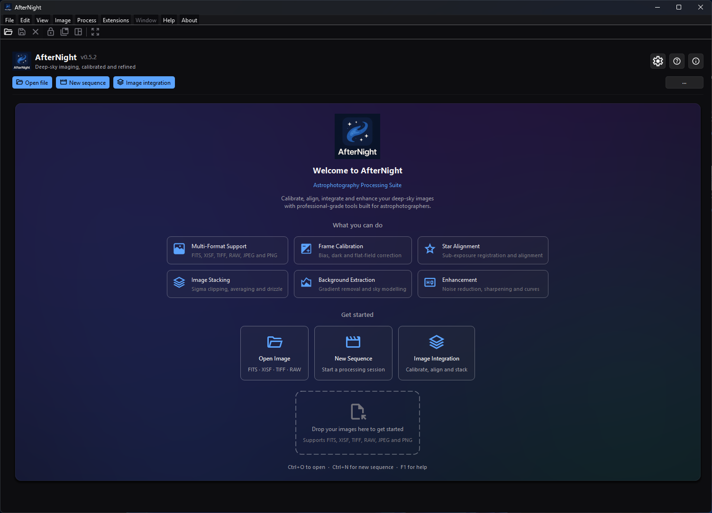

# First Launch

*A fresh profile opens on the Dashboard, where the start cards and drop zone
provide the first routes into a project.*

## Purpose, audience, prerequisites, and expected result

Use this page immediately after installation to confirm the application version,
choose safe storage/defaults, open one known small file, and understand the
transition from the dashboard to the processing workspace. It is for a new user
or a user starting with a fresh profile.

You need a successfully installed/deployed AfterNight 1.0.0 runtime and a local
file that the authoritative [File Formats](../reference/file-formats.md) page
lists as readable. At the end, the image/sequence view should open without
altering the source file, and closing the last view should return to the
dashboard with a recent-file entry after a successful load.

## Reachability and availability

| Item | Current behavior |
| --- | --- |
| Startup surface | The dashboard is the first widget added to the central stack. On the dashboard, the normal status bar/dock toolbar are hidden or disabled and the Window menu is disabled. |
| Fresh-profile state | With no recent files, the empty-state onboarding panel shows the welcome text, six capability summaries, three action cards, local-file drop zone, and keyboard hints. There is no modal welcome tour to dismiss. |
| Returning-profile state | With recent files, the recent grid appears immediately instead of briefly showing onboarding. Search/sort and featured-file behavior are described in [Dashboard](../interface/dashboard.md). |
| Workspace transition | A successfully created standard image/sequence view switches to the dock workspace. Closing the final view returns to the dashboard unless the Session Console is open. |
| Always-available dashboard utilities | Identity-bar **Settings (Ctrl+,)**, **User Guide (F1)**, and **About** buttons; primary and overflow quick actions. |

The first-launch page covers only the learning path. [Dashboard](../interface/dashboard.md)
holds the exhaustive recent-file, pinning, customization, persistence,
empty/error-state, and transition reference.

## Before you start

- Keep the source file read-only or backed up if it is important. Opening does
  not write it, but later process and save actions can create other files/views.
- Choose a small, known local still or sequence. Do not use a cloud-only URL,
  folder, or unsupported suffix for the first checkpoint.
- Decide where temporary files may be created. With no stored directory, each
  session works in its own directory below the application's local data,
  guarded by a lock file; **Settings > General** shows the system temporary
  folder's `AfterNight` directory as its default, and saving Settings stores the
  directory the page shows. **Clear temporary files on exit** (on by default)
  removes this session's directory at exit, and the next start removes the
  directories of sessions that have ended, never those of a running one.
- If offline-only policy matters, decide whether the default background
  extension-update check should remain enabled before connecting the workstation.
- External CLI/model/catalog paths start unconfigured or need readiness checks;
  they are not required to open an ordinary local image.

## Procedure

1. Start AfterNight. In the identity bar, compare the displayed version with
   the installed package/build you intended to run. The application shows
   v1.0.0, the version the installer and the AppImage name.
2. Identify the state:
   - No recents: confirm **Welcome to AfterNight**, the **Open Image**, **New
     Sequence**, and **Image Integration** cards, and the drop zone.
   - Existing recents: do not expect the onboarding panel. Use the primary
     **Open file** action for this check.
3. Open **Settings (Ctrl+,)** and check only the first-session decisions:
   - **General**: the temporary directory exists and is writable; **Default Save
     Format** starts at TIFF on a fresh profile; unsaved-close confirmation and
     temporary cleanup start enabled.
   - **Raw Images**: a fresh profile reads Daylight white balance and EXIF
     auto-rotate on (the page's **Reset Page** selects None for the white
     balance), and the **Demosaic Algorithm** starts at RCD. The list offers the
     engine's six methods (RCD, AMaZE, LMMSE, AHD, VNG4, Bilinear).
   - **Interface**: choose a comfortable theme/animation policy if required.
   - **External Tools** and **Catalogs & Data**: configure only features the
     next workflow actually uses.
4. Save/close Settings. If the selected temporary directory cannot be created
   or is not writable, correct it before continuing.
5. Choose **Open file**/the empty-state **Open Image** card or press `Ctrl+O`.
   Select one file from the readable formats summarized in [Supported
   Formats](supported-formats.md). The chooser also recognizes native and
   FFmpeg-backed sequence suffixes. It has no all-files filter, and a selection
   holding any unrecognized suffix is refused whole with **Unsupported File
   Type**. When a file is a colour-filter-array mosaic, **Open CFA file** asks
   whether to debayer it: **Yes** demosaics it by the Raw Images **Demosaic
   Algorithm**; **No** opens the mosaic as recorded.
6. Checkpoint: a **File Open** progress window appears while loading, then the
   processing workspace and a new view appear. Opening alone does not overwrite
   the source.
7. Close the view. Checkpoint: when it was the last view and the Session
   Console is closed, the dashboard returns; after a successful load the file is
   available in recents. Leave exhaustive
   recent-file actions for the Dashboard reference.
8. Open **User Guide (F1)** once to confirm bundled-first Help, then continue to
   [Quick Start](quick-start.md).

### Optional drag-and-drop check

Drag one or more local files onto the dashboard. The dashboard accepts a drag
when it contains at least one local URL, then the file manager keeps only paths
with recognized still/sequence suffixes. An all-unsupported drop is ignored.
With three or more retained paths, progress becomes determinate; one or two use
an indeterminate progress bar.

## Complete control and action reference

| UI label/action | Type and unit | Default | Valid values/constraints | Effect | Enabled, hidden, or ignored rules | Trade-off or side effect | Scope | Persistence |
| --- | --- | --- | --- | --- | --- | --- | --- | --- |
| Settings (Ctrl+,) | Identity-bar icon button | Visible | Dashboard available | Opens Settings | No active image required | Saving settings can change later load/export/network behavior | Application | Settings persist independently |
| User Guide (F1) | Identity-bar icon button | Visible | Local HTML or allowed online fallback | Opens bundled-first Help | No active image required | May open network URL if bundled guide is unavailable | Application | None |
| About | Identity-bar icon button | Visible | Dashboard available | Opens version/project information | No active image required | Modal information dialog | Application | None |
| Open file | Primary quick action; `Ctrl+O` | First in default order | File chooser; supported still/sequence suffix | Opens File dialog and async load path | Available on dashboard | Successful loads add recents/thumbnails and switch workspace | Selected files | Last open directory and recents persist |
| New sequence | Primary quick action | Second | Opens New Sequence workflow | Starts sequence creation | Available without active image | May allocate/write sequence storage after confirmation | New sequence | Workflow-specific |
| Image integration | Primary quick action | Third | Opens full Image Integration | Starts multi-frame workflow UI | Available without active image | Workflow may use substantial disk/memory after configured execution | New integration project/session | Process/project persistence |
| Extension Manager | Overflow quick action | Visible | Extension subsystem available | Opens extension management | No active image required | Can use network/disk and modify extension environments | Application | Extension state persists |
| Clear recents | Overflow quick action | Disabled with no recents | Confirmation with nonempty recent list | Clears dashboard recent list | Enabled only when recents exist | Does not delete source image files | Dashboard list | Recent store/thumb state updated |
| System info | Overflow quick action | Visible | Dashboard available | Opens runtime diagnostics | No active image required | May reveal machine/runtime details if copied into a report | Application | None |
| More actions (`···`) | Menu button | Visible | Dashboard toolbar | Opens secondary actions and **Customize quick actions** | No active image required | Reordering/hiding changes discoverability | Dashboard | Order/hidden IDs persist |
| Open Image | Empty-state card | Visible only with no recents | Same open action; subtitle is an abbreviated format list | Opens File dialog | Hidden when recent grid replaces onboarding | Same as **Open file** | Selected files | Same as **Open file** |
| New Sequence | Empty-state card | Visible only with no recents | Same new-sequence action | Starts New Sequence | Hidden when recent grid replaces onboarding | Same as toolbar action | New sequence | Workflow-specific |
| Image Integration | Empty-state card | Visible only with no recents | Same integration action | Opens Image Integration | Hidden when recent grid replaces onboarding | Same as toolbar action | Integration session | Process/project persistence |
| Drop your images here to get started | Dashboard/local-URL drop | Empty until drag | One or more local paths; recognized suffixes retained | Starts batched File Open | Unsupported/nonlocal-only drop ignored | Multiple loads can consume memory and create multiple views | Dropped files | Last directory and successful recents update |
| `Ctrl+O to open` | Keyboard hint/shortcut | Active | Application shortcut | Invokes Open | Available on dashboard | Same as Open | Application | None |
| `Ctrl+N for new sequence` | Displayed keyboard hint | Stale | No current application shortcut is assigned | Does nothing through current action wiring | Text is visible in empty onboarding but not backed by a shortcut | Use the card, toolbar, or **File > New Sequence...** | None | None |
| `F1 for help` | Keyboard hint/shortcut | Active | Application shortcut | Opens User Guide | Available on dashboard | Bundled-first/online-fallback behavior | Application | None |
| Search by name, type, or path... | Recent search; `Ctrl+F` | Hidden with no recents | Partial text; visible recent list | Filters recents only | Not a general file search; hidden in empty state | Persisted filter can produce **No matches found** later | Dashboard recents | Search text persists |

## Behavior and state model

The dashboard is a navigation surface, not an image view. A fresh recent list
selects the onboarding state. A nonempty recent list selects the thumbnail grid;
a nonempty search with no result selects a separate **No matches found** state.
This is why a returning user may never see the first-launch onboarding card.

Open and drop actions pass paths to `FileManager`. The open dialog limits visible
choices; drag-and-drop performs a suffix prefilter. Loading runs on a worker with
the **File Open** progress control. Each successful image/sequence produces a
standard view, switches the central stack to the dock workspace, and updates
recent bookkeeping. Cancellation/failure does not prove a usable view. Closing
the last view switches back to the dashboard.

Dashboard quick-action order, hidden actions, recent search/sort, pins, and last
action have persistent keys. Their complete persistence and conflict behavior
is out of this first-session page and is described in
[Dashboard](../interface/dashboard.md).

## Inputs, outputs, and metadata

Input is a local readable still/sequence or a workflow choice. Opening creates
an in-memory image/sequence view and a persisted recent-file entry/thumbnail; it
does not rewrite the source or add processing history to it. RAW decoding can
change the opened representation according to load settings, while source RAW
bytes remain unchanged.

New Sequence and Image Integration create their own sessions/artifacts only
after their dialogs proceed. Settings change global persistence, not image
metadata. The dashboard itself produces no astronomical output.

## Performance and responsiveness

Dashboard thumbnail work is asynchronous and the empty-state layout reflows for
narrower widths. Opening cost depends on file size, codec, storage, RAW decode,
and sequence indexing. Begin with one small file rather than a full acquisition
folder. A multi-file drop can create multiple views; cancel from **File Open** if
the chosen batch was accidental.

## Worked example

- Evidence mode: Source-and-test-derived; no approved onboarding image was
  opened.
- Starting state: AfterNight 1.0.0, a fresh or known profile, and one backed-up
  small local still listed as readable in File Formats.
- Actions: verify the identity-bar version; confirm/write-test the temporary
  directory in Settings; open the file; wait for **File Open** to close; close
  the resulting view.
- Checkpoints: the workspace replaces the dashboard only after view creation;
  the source path remains unchanged; closing the last view returns to the
  dashboard; a successful open appears in recents.
- Limitation: this proves the documented state transitions and source safety,
  not decoder compatibility for every camera, image correctness, rendering,
  performance, or output quality.

## Warnings and limitations

- The onboarding `Ctrl+N` hint is stale; use **New sequence** or **File > New
  Sequence...**.
- Card/drop-zone format subtitles are abbreviated UI copy, not compatibility
  authority. Use [File Formats](../reference/file-formats.md).
- The Raw Images **Demosaic Algorithm** is the one method every open path
  uses - Open, drag-and-drop, and a recent item - when you answer **Yes** to
  **Open CFA file**, and a mosaic sequence that states no method takes it when
  its view shows it. Use the [Debayer](../processes/calibration/debayer.md)
  process for explicit control.
- The default extension-update check can contact the configured official
  repository after startup. Disable it before network-isolated work if policy
  requires.
- Dashboard layout/rendering at target resolutions and screenshots remain later
  GUI/media work. No runtime visual inspection was used for this source audit.

## Troubleshooting

| Symptom or exact error | Verified cause/enablement path | Recovery | Evidence source |
| --- | --- | --- | --- |
| The welcome/onboarding panel is absent | The profile has at least one recent file, so startup selects the recent grid. | Use **Open file**; clear recents only if you intentionally want an empty list. | `MainDashboard.cpp` |
| `Ctrl+N` does nothing | The empty-state hint is stale and `actionNew_Sequence` has no shortcut. | Use **New sequence** or **File > New Sequence...**. | `DashboardOnboardingPanel.cpp`; `AfterNightAppUiBuilder.h` |
| `Ctrl+F` does not focus search | Search controls are hidden when there are no recents. | Open a supported file successfully first; use `Ctrl+F` only when the recent row is visible. | `MainDashboard.cpp` |
| Dropping a folder/URL does nothing | Drag acceptance requires a local URL and FileManager retains only recognized file suffixes. | Drop local files, or use **Open file** and consult Supported Formats. | `MainDashboard.cpp`; `FileManager.cpp`; `FileDialogUtils.h` |
| File Open closes without a view | Decode/open failed or was cancelled; a suffix match alone does not prove content support. | Preserve the logged error, retry one known small file, and verify the actual stream/codec in File Formats. | `FileWorkflowRunner.cpp` |
| Settings refuses the temporary location | The directory cannot be created or is not writable. | Choose a writable local directory with adequate headroom, then save Settings again. | `GeneralSettingsPage.cpp` |
| A RAW file differs from expected | The Raw Images white balance, auto-rotate, and Demosaic Algorithm settings published when the open was asked for decide the opened representation; an X-Trans RAW is demosaiced by the setting's X-Trans counterpart (the fast X-Trans estimate for Bilinear, three-pass Markesteijn for every other method). | Review Raw Images settings and use Debayer explicitly when CFA control matters. | `FilePolicies.cpp`; `DemosaicTextMaps.h`; `FileWorkflowRunner.cpp` |

## Related workflow steps

If startup itself fails, return to [Installation](installation.md). Before
opening unfamiliar data, use [Supported Formats](supported-formats.md) and its
authoritative File Formats link. Once the state transitions above pass, follow
[Quick Start](quick-start.md). The complete dashboard and processing-workspace
surfaces are covered by [Dashboard](../interface/dashboard.md) and [Interface
Overview](../interface/overview.md).

## References and provenance

- Startup/dashboard wiring: `UiBootstrapCoordinator.cpp`,
  `WindowLayoutCoordinator.cpp`, and view-control/creation coordinators.
- Empty-state labels/actions: `DashboardOnboardingPanel.cpp`.
- Identity/quick actions and persistence: `DashboardIdentityBar.cpp`,
  `DashboardToolbar.cpp`, `DashboardPreferences.h`, and `MainDashboard.cpp`.
- File/open/drop behavior: `FileDialogUtils.h`, `FileManager.cpp`, and
  `FileWorkflowRunner.cpp`.
- Default first-session settings: `SettingsDefaults.h`, `FilePolicies.h`
  (`RawOpenSettings`), `DemosaicTextMaps.h`, and the reviewed Settings
  implementation/page.
- Version: `kProductVersion` in `ApplicationSession.h`, read through
  `productVersion()` in `EngineVersionReport.cpp`.
- Focused state/wiring coverage: the file-workflow, dashboard, settings,
  version-dialog, and application-menu tests.
