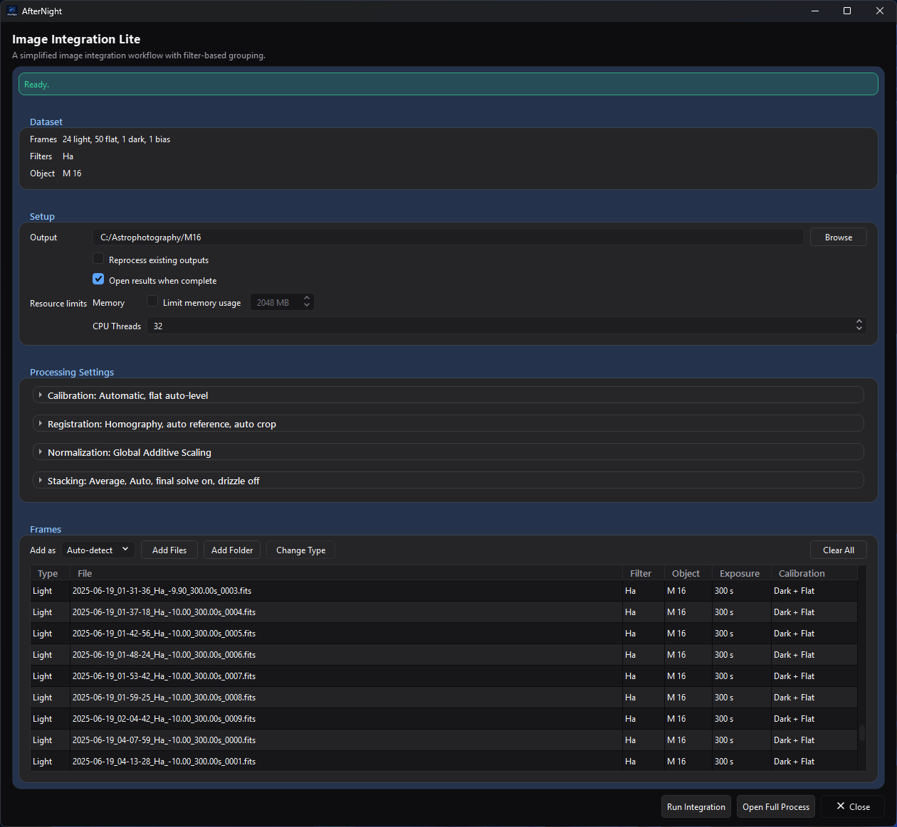
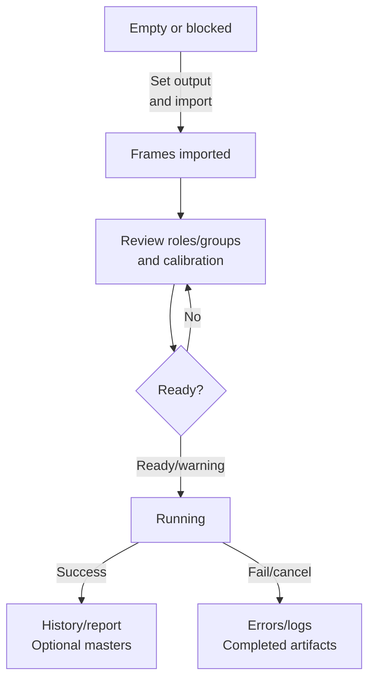
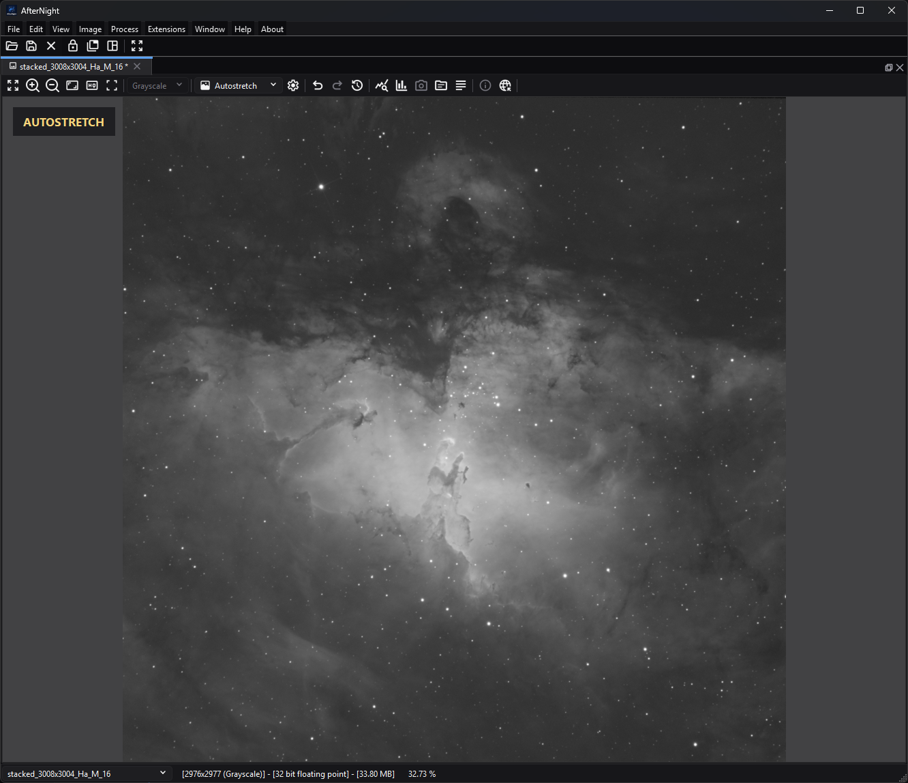

# Quick Start

Source and focused tests establish the
labels, routes, state transitions, and branch behavior claimed below. The
retained screenshots illustrate the documented ready and result states; they do
not establish output quality or production performance.

*Image Integration Lite after import and validation. The green **Ready.** banner,
dataset summary, planned calibration assignments, and **Run Integration** action
show the state to reach before starting the workflow.*

## Purpose, audience, prerequisites, and expected result

Use this walkthrough to turn a small, consistent set of deep-sky acquisition
frames into a first linear stacked master with **Image Integration Lite**. It is
for a new user who wants a bounded first run before learning the full project
workflow.

You need one target's still light frames, optional matching calibration frames,
and a dedicated writable output directory. Use either the OSC/CFA branch or the
mono branch below. At the end, AfterNight should report at least one generated
master and write a workflow report under the output directory. Keep **Open
results when complete** selected if you also want each successful light master
opened in the workspace. This source-derived walkthrough does not promise a
particular visual result.

## Reachability and availability

| Item | Current behavior |
| --- | --- |
| Path | **Process > Preprocess > Image Integration Lite**. The Dashboard **Image Integration** card opens the full process, not Lite. |
| Enabled/visible when | The top-level Lite window is available without an active image. **Run Integration** is disabled while import is active or readiness has a blocking error. |
| Supported inputs/state | Engine-supported still images classified as Light, Flat, Dark, Dark Flat, or Bias. Use one target for this walkthrough. Sequences, videos, active-view masks, and multiple effective object names are outside Lite's first-run path. |
| Outputs/side effects | Calibration masters and intermediates as needed, one stacked FITS light master per integration group, workflow state, history, logs, and Markdown/HTML reports. Successful masters open only when **Open results when complete** was selected at run start. Source files are unchanged. |
| Persistence | The last valid output directory and Lite window size are restored. Imported frames and processing choices are window/run state rather than a saved Lite project. |
| External dependencies | Deployed codecs for the selected still formats. **Plate solve final masters** starts off in Lite and this walkthrough leaves it off, so no solver or catalog is required. |

## Before you start

Keep all input files at stable paths and use a new or dedicated output directory
with enough free space for intermediate and final files. Do not place unrelated
supported images beneath a folder you plan to import recursively.

Choose one branch:

| Branch | Prepare | Check after import | Expected successful master |
| --- | --- | --- | --- |
| OSC/CFA | Original linear camera RAW or CFA FITS lights from one target and camera setup; matching dark/bias/flat frames when available. Do not debayer copies before this workflow. | Every acquisition row has the intended type and the effective Object is one value. The table has no size or filter-array column: lights of different sizes form separate integration groups, and a calibration frame whose size, channels, sample type, or filter array differs from its group's first readable frame is skipped and named during the run. Lite calibrates raw CFA samples before registration demosaics them. | A linear color light master for each effective integration group. Registration demosaics a light only when its file states a filter array, and its **Auto** pattern is the file's own, never guessed. If the colors look wrong, use **Open Full Process** and check Registration's CFA Pattern/Method: a stated pattern corrects a wrong arrangement, but it cannot turn a light whose file states no filter array into color; such lights are processed as monochrome. |
| Mono | Linear monochrome lights from one target and one filter for the first run; matching flats for that filter and matching dark/bias frames when available. | **Filters** shows the intended single label and rows have the correct type. Separate filters form separate integration groups, so add only one for this first pass. | One linear monochrome light master for the selected filter group. |

Calibration frames improve the scientific usefulness of the result, but a
lights-only run is allowed with a warning. Do not interpret a structurally
successful uncalibrated run as a calibrated result.

## Procedure

1. Start AfterNight and open **Process > Preprocess > Image Integration Lite**.
   **Checkpoint:** the window starts blocked with **No light frames
   available.** The last output directory used is restored when it still
   exists; otherwise **Output directory is required.** also blocks.
2. Set **Output** with **Browse** to the dedicated directory. Existing matching
   artifacts can be reused, so prefer a new directory for a first run.
   Registration records written by a newer version stop the run with a
   **Registration Records** warning and are left unchanged.
3. Leave **Add as** on **Auto-detect** when the files' headers, or the folders
   they sit in, name their frame type, then select **Add Files**. Use **Add Folder** only when that folder tree contains
   nothing unrelated. **Checkpoint:** the banner says frames are importing;
   controls are temporarily disabled; then the Frames, Filters, and Object
   summaries and table populate.
4. Apply the branch checks above. Select any misclassified rows and use
   **Change Type**, or the row context menu's **Set as** action. Inspect each
   row's **Calibration** cell; its tooltip identifies the planned master files
   and uses.
5. For this first pass, retain **Automatic** calibration matching,
   **Homography**, **Auto-select reference**, **Global Additive Scaling**,
   **Average**, **Auto** rejection, **None** weighting, and drizzle off. Leave
   **Normalize master flat** on and **Optimize dark frames** and **Auto crop to
   common area** off. Keep **Open results when complete** on. Leave **Plate solve
   final masters** off, as Lite opens it, so the run has no solver dependency.
6. Read the readiness banner. Resolve every red error. A green **Ready.** banner,
   an amber **Ready with _n_ warning(s).** banner, or the amber **No calibration
   frames provided. Lights will be integrated without bias, dark, or flat
   calibration.** banner enables **Run Integration**; open the warning tooltip
   and decide whether each warning is acceptable.
7. Select **Run Integration**. **Checkpoint:** the banner changes to
   **Preparing integration...**, the run button disables, and the shared
   progress dialog appears. Keep the input paths and output directory available.
   **Cancel** requests cooperative cancellation; already completed group work
   can be retained and reported.
8. On success, check for **Integration complete. Generated _n_ master image(s).**
   With **Open results when complete** selected at run start, the successful
   masters open in the workspace. A cancelled run ends with **Integration
   cancelled.**; a failed one shows its error, or **Integration failed.** On
   failure or cancellation, preserve the output directory and read the reported
   error/log before retrying.
9. In the output directory, locate `stacked_<integration-group>.fit` and the
   latest `history/<execution-id>/workflow_report.html` or
   `workflow_report.md`. Confirm that the report's input groups, calibration
   assignments, warnings, stage results, and output path match the intended
   branch.
10. Inspect the opened master at 100% zoom before continuing. If you cleared
    **Open results when complete**, open the generated `stacked_*.fit` first. A
    linear master often looks dark until display stretching is applied; display
    appearance is not proof of calibration or integration quality.

## Complete control and action reference

| UI label/action | Type and unit | Default | Valid values/constraints | Effect | Enabled, hidden, or ignored rules | Trade-off or side effect | Scope | Persistence |
| --- | --- | --- | --- | --- | --- | --- | --- | --- |
| **Output** / **Browse** | Directory field/action | Last valid remembered directory, otherwise empty | Existing or creatable writable directory | Sets every workflow output and history path | Disabled during import | Existing matching artifacts may be reused unless reprocessing is enabled | Whole run | Remembered for later Lite windows |
| **Add as** | Import classification selector | **Auto-detect** | Auto-detect, Light, Flat, Dark, Dark Flat, Bias | Classifies the next import; Auto-detect reads the frame-type header cards, then a folder on the path named for a frame type (flat(s), dark(s), bias(es)/offset(s), light(s)), and otherwise adds the frame as Light. File names are not read, as the item's tooltip says | Disabled during import | A forced wrong role produces bad grouping/matching | Next import | Window only |
| **Add Files** / **Add Folder** | File/directory actions | — | Supported still files; folder scan is recursive | Imports metadata asynchronously and ignores duplicate absolute paths in one batch | Disabled during import | Folder import can collect unrelated supported files | Model | Chooser location remembered |
| **Change Type** / **Set as** | Selected-row action | Imported role | One supported frame role | Reclassifies model records without modifying files | Requires selected rows; disabled during import | Rebuilds grouping/calibration plans | Selected rows | Window only |
| Processing settings used here | Selectors/check boxes | Automatic; Homography; auto reference on; Global Additive Scaling; Average; Auto rejection; no weighting; final plate solve off; drizzle off | See [Image Integration Lite](../processes/stacking-integration/image-integration-lite.md) for the exhaustive ranges and interactions | Defines calibration, registration, normalization, stacking, and resources | Disabled during import; some rejection/drizzle fields depend on parent choices | Changes quality, runtime, memory, disk use, or external requirements | Whole run/groups | Window/run only |
| **Plate solve final masters** | Check box | Off | On/off | Attempts final WCS solving when needed | Solver used only when on and valid WCS cannot be propagated | This walkthrough leaves it off to avoid an external solver dependency | Final masters | Window/run only |
| **Open results when complete** | Check box | On | On/off | Opens each successfully generated light master after a successful run | Disabled during import; snapshotted when execution starts | Does not change generated files or reports; when off, open `stacked_*.fit` manually | Completion behavior | Window/run only |
| **Run Integration** | Primary action | Disabled | Requires import idle and no validation errors | Snapshots the model, reapplies Lite policy, builds the manifest, and runs asynchronously | Enabled for Ready or Ready-with-warning states | Writes files and can use substantial CPU, memory, and disk | Whole run | Artifacts/history persist |
| **Cancel** | Progress action | — | Cooperative request | Stops future work when the executing stage observes cancellation | Visible during execution | Completed group outputs/report history can remain | Active run | Not persisted |
| **Open Full Process** | Handoff action | — | Current Lite model | Copies the current setup into full Image Integration | Available outside blocked import operations | Use for manual assignments, CFA overrides, multiple targets, or advanced diagnostics | Current model | Full process can then save a project |

## Behavior and state model

Lite derives grouping and calibration matching from metadata, then applies a
fixed beginner-oriented policy before building the same manifest used by full
Image Integration. OSC/CFA calibration occurs before demosaic; registration
loads and demosaics CFA data for star matching/alignment. Mono data remains
single-channel, and different effective filter labels produce different light
integration groups.

Readiness is structural. A Ready banner means the model has no blocking
validation error; it does not prove good calibration matches, registration,
focus, sampling, or output quality. Execution is asynchronous, and its immutable
manifest separates the running workflow from later UI edits.

## Inputs, outputs, and metadata

Lite's import reads each supported still file's type, dimensions, exposure,
temperature, ISO/gain, offset, filter, object, capture time, and readout mode
without rewriting the source; the filter array and WCS are read from the files
when registration runs. Automatic classification falls back to Light; always
verify the table.

Generated products include `master_bias_<group>.fit`,
`master_dark_<group>.fit`, and `master_flat_<group>.fit` when those masters must
be built; registered/normalization intermediates; and
`stacked_<integration-group>.fit` for each successful light group. A stable
short hash is added if an output name would collide. Workflow state lives under
`.afternight/image_integration/`, while each archived run can contain its
manifest, log, Markdown/HTML report, group summaries, and retained outputs below
`history/<execution-id>/`.

## Performance and responsiveness

Import and execution run asynchronously, but integration can still consume
substantial CPU, memory, and storage. A smaller representative set, one target,
one filter/group, drizzle off, and a dedicated output directory make the first
run easier to inspect. **Limit memory usage** selects tiled stacking; it does not
cap every codec, registration, or reporting allocation. Do not infer production
timing or peak memory from this source-derived walkthrough.

## Worked example

- Evidence mode: **Source-and-test-derived**.
- Starting state, actions, settings, checkpoints, result, and limitations:

| Stage | OSC/CFA branch | Mono branch | Shared checkpoint |
| --- | --- | --- | --- |
| Input | One target's original linear CFA lights plus matching calibration frames when available | One target's linear lights from one filter plus matching calibration frames when available | Imported row count and roles match the selected files; Object is a single effective value |
| Branch check | CFA metadata is consistent; uncertain CFA interpretation is handed to the full process | Filters shows the intended single filter | Calibration cells identify the intended automatic assignments |
| Settings | Beginner settings from step 5; final plate solving off | Same | Ready or Ready-with-warning banner; **Run Integration** enabled |
| Execution | Raw-sample calibration precedes CFA demosaic and registration | Mono frames register and stack within the filter group | Preparing banner and progress dialog appear; source paths remain stable |
| Result | At least one successful linear light master for the effective OSC group | One successful linear light master for the selected mono filter group | Completion banner reports generated master count; output opens when **Open results when complete** was selected; history report names inputs, warnings, stages, and output |

The walkthrough and branch behavior are source-and-test-derived. The retained
result capture demonstrates that Lite can open a generated master, but does not
validate either branch's output quality or performance.

*A successful Lite run can open its generated linear master in the workspace.
This capture uses **Autostretch** for display only; it does not alter the linear
image data or demonstrate a quality threshold.*

## Warnings and limitations

- Lite accepts one effective object. Multiple nonblank object names are a
  blocking error; use full Image Integration for multi-target work.
- **Auto-detect** and a Ready banner are not substitutes for checking frame
  roles, filter/object metadata, CFA interpretation, and calibration matches.
- A lights-only run is allowed but warned as uncalibrated. Flats without Bias or
  Dark Flat calibration also warn.
- Source files are preserved, but output/history files consume storage and new
  runs can reuse or replace current matching artifacts while archiving prior
  state.
- Sequence/video input, masks, comet tracking, manual calibration assignment,
  per-group advanced settings, and persistent Lite projects are unsupported.
- Do not judge a linear integration solely from its unstretched display.

## Troubleshooting

| Symptom or exact error | Verified cause/enablement path | Recovery | Evidence source |
| --- | --- | --- | --- |
| **Run Integration** remains disabled | Import is active, or readiness reports a missing, non-directory, unwritable, or uncreatable output directory, **No light frames available.**, or multiple objects; the banner shows up to three errors | Wait for import; read the red banner; correct roles, paths, or object metadata | `ImageIntegrationLiteProcess.cpp`; `test_image_integration_lite_process.cpp`; `test_lite_integration_profile.cpp` |
| An import adds no rows | No selected/scanned file passed the still-image extension/import checks. The import's own message is replaced at once by the readiness banner, so into an empty list it shows **No light frames available.** | Use a readable still format from [File Formats](../reference/file-formats.md), or extract sequence frames first | `ImageIntegrationLiteProcess.cpp`; `FileImport.cpp` |
| The run fails with **Invalid workflow manifest.** | Size or format problems among the frames are found only when the run prepares | Read the warning it shows, remove or correct the named frames, and run again | `WorkflowExecutionController.cpp`; `IntegrationDataModel.cpp` |
| **No calibration frames** warning | Lights exist but no calibration frames are loaded | Add matching frames, accept an explicitly uncalibrated structural run, or stop | `ImageIntegrationLiteProcess.cpp`; focused UI readiness tests |
| Missing flat calibration match warning | Flat metadata/filter does not match the Light group under the active policy, or bias/dark frames are loaded with no flats at all | Correct frame roles/metadata choice, use matching flats, or hand off to the full process | `CalibrationMatcher.cpp`; `test_image_integration_lite_process.cpp` |
| CFA color/pattern looks wrong | The filter array the files state is wrong for the camera, or the files state none and are processed as monochrome | Stop judging the result; use **Open Full Process** and set Registration's CFA Pattern/Method explicitly. A stated pattern corrects a wrong arrangement; it cannot make a light whose file states no filter array into color | `RegistrationFrames.cpp`; `DemosaicTextMaps.h`; full Image Integration registration controls |
| Integration failed or was cancelled | A workflow stage returned an error or observed cancellation | Preserve the output directory and read the banner/log. If at least one integration group completed, also inspect its retained outputs and archived report; an earlier failure or cancellation may not create an archive. Correct the cause and rerun. | `WorkflowExecutor.cpp`; `WorkflowArchiver.cpp` |
| Existing result was reused unexpectedly | Matching artifacts exist and **Reprocess existing outputs** is off | Enable reprocessing or choose a fresh output directory | `ImageIntegrationLiteProcess.cpp`; `WorkflowExecutor.cpp` |
| **Registration Records** warning and the run does not start | The directory's `registration_metrics.db` was written by a newer AfterNight version | Use that newer version, or choose a fresh output directory; the records are left unchanged | `ImageIntegrationProcessShared.cpp` |

## Related workflow steps

Start with [First Launch](first-launch.md) if the application and file-opening
path are not yet verified. Use [Image Integration Lite](../processes/stacking-integration/image-integration-lite.md)
for the exhaustive control/policy reference, or hand the model to full
[Image Integration](../processes/stacking-integration/image-integration.md) for
manual grouping, assignments, diagnostics, projects, and advanced outputs.

After a successful stack, use the [Image Viewer](../interface/image-viewer.md) to
inspect it and distinguish its temporary Autostretch from a pixel-changing
process such as [Statistical Stretch](../processes/stretching/statistical-stretch.md).
Choose a save/export path through [Supported Formats](supported-formats.md),
whose detailed capability authority is [File Formats](../reference/file-formats.md).

## References and provenance

- The implementation and focused tests are the primary
  sources for this source-derived walkthrough.
- [Image Integration Lite](../processes/stacking-integration/image-integration-lite.md)
  retains the exhaustive Lite policy, parameter, output, and limitation record.
- [Image Integration](../processes/stacking-integration/image-integration.md)
  retains the shared workflow, engine, report, and advanced-process record.
- No external algorithm or format contract is introduced here; detailed format
  provenance is centralized in [File Formats](../reference/file-formats.md).
