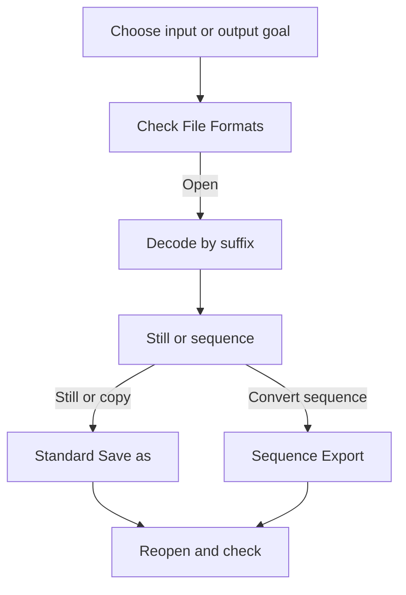

# Supported Formats

Source and focused tests establish the
routes and decision boundaries used here. No current-platform codec readiness,
interoperability, output quality, or production performance is claimed.

## Purpose, audience, prerequisites, and expected result

Use this page to decide what kind of file to open and what kind of artifact to
save. It is a beginner decision guide, not a second codec specification. The
single detailed authority for extensions, sample precision, compression,
metadata, sequence layouts, and current implementation limitations is
[File Formats](../reference/file-formats.md).

You need a local source file or an active AfterNight image/sequence and a
writable destination when saving. At the end, you should have selected a format
for a stated purpose, checked its authoritative capability row, written to a new
path, and reopened/verified the result when it matters.

## Reachability and availability

| Item | Current behavior |
| --- | --- |
| Path | Open with **File > Open**, the Open toolbar action, a recent-file entry, or supported local drag-and-drop. Save with **File > Save as...** or **Image > Actions > Save File...**. Export an active sequence with **Image > Sequence > Export...**. |
| Enabled/visible when | Open is application-wide. Standard save needs an active image or sequence view. Sequence Export applies to an active sequence. Settings routes are application-wide. |
| Supported inputs/state | Astronomy/display stills, camera RAW acquisition stills, native SER and AfterNight image-list sequences, and recognized FFmpeg-backed video containers. Exact extensions and constraints live only in [File Formats](../reference/file-formats.md). |
| Outputs/side effects | Standard still files, sequences written frame by frame into the container the destination path names, or Sequence Export output. A successful standard save adds the written file to recent files and, when the view still shows what was written, clears its pending changes and records the written file as the view's source path. |
| Persistence | The last open/save directory is remembered. **Settings > General** stores the initial still save format; **Settings > Export** stores global still encoding/metadata preferences. Sequence Export stores its own format/codec choices. |
| External dependencies | The deployed still codecs (camera RAW through LibRaw, with a private RawSpeed build used where it is qualified for the file) and, for video decode/encode, the deployed FFmpeg libraries and codec support. A recognized container suffix does not prove that its stream can be decoded. |

## Before you start

Decide which artifact you are making:

| Purpose | Beginner choice | Mandatory follow-up |
| --- | --- | --- |
| Astronomy processing master | FITS or XISF | Check the authority's sample-type and metadata row, then reopen and inspect required headers. |
| External-editor handoff | TIFF | Check sample type and selected compression in the authority and **Settings > Export**. |
| Lossless display copy | PNG | Confirm the authority's precision conversion is acceptable; do not treat it as the only high-precision master. |
| Small sharing copy | JPEG | Accept lossy, reduced-precision delivery; keep a separate master. |
| Original camera acquisition | Camera RAW as input | Preserve the RAW source and save processed work in another format; AfterNight does not write camera RAW. |
| Undemosaiced colour filter array mosaic | FITS, XISF, or TIFF | These record the filter array; PNG and JPEG cannot, and a save refuses them. |
| Native planetary/lucky-imaging sequence | SER | Verify CFA/debayer state, sample layout, frame count, and timing after writing. |
| Reopenable frame manifest | AfterNight image list (`.anseq`) | Keep its referenced/sibling frame files with the manifest. |
| Delivery video | Sequence Export to its offered AVI/MP4/WebM output | Treat it as decoded/re-encoded delivery, not a science master; verify codec, geometry, FPS, and boundary frames. |

Preserve every acquisition source. Use a new destination rather than relying on
replacement: standard output replacement is not a backup workflow. Ensure the
destination has enough free space, especially for high-precision stills,
intermediate frame sets, SER, or raw AVI.

## Procedure

1. Identify the source as a still, camera RAW, native sequence, image list, or
   video. Open [File Formats](../reference/file-formats.md) and verify its exact
   extension, dependency, and input constraints before relying on it.
2. Open with **File > Open** (or a supported recent/drop route).
   **Checkpoint:** the load progress finishes and a still or sequence view opens.
   A suffix appearing in the chooser is only the first gate; a damaged file,
   unsupported camera variant, or unsupported video stream can still fail.
3. Work on the underlying image/sequence. Viewer Autostretch, selected channel,
   zoom, overlays, and masks are display state and are not flattened into a
   standard still save. Apply a processing operation only when you intend to
   change the pixels.
4. Choose the artifact purpose from the table above, then read that format's
   authoritative precision, compression, metadata, and dependency row. For a
   still, set any global defaults under **Settings > General** and
   **Settings > Export** before opening the save dialog.
5. For a still, or to write a sequence into another sequence file, use
   **File > Save as...** or **Image > Actions > Save File...**. Both routes prompt. Select a new path and
   ensure the suffix agrees with the intended codec; the suffix controls still
   codec dispatch, not merely the selected filter.
6. For a delivery/converted sequence, use **Image > Sequence > Export...** and
   review output family/codec, destination, FPS, CFA debayer, Autostretch, and
   resize choices. **Checkpoint:** controls lock while export runs and the
   progress/cancellation path is visible.
7. Wait for success before using the artifact. A cancelled or failed write is
   not a verified result. Preserve the original and inspect the error/progress
   message before retrying.
8. Reopen important output. For a still, check dimensions, channels, sample
   type, and required metadata. For a sequence, check family/container, frame
   count, geometry, sample/CFA state, FPS, and first/last frame. AfterNight does
   not automatically perform this verification or checksum the output.

## Complete control and action reference

| UI label/action | Type and unit | Default | Valid values/constraints | Effect | Enabled, hidden, or ignored rules | Trade-off or side effect | Scope | Persistence |
| --- | --- | --- | --- | --- | --- | --- | --- | --- |
| **File > Open** / Open toolbar | File chooser; `Ctrl+O` | Last open directory | Supported still and sequence filters; there is no all-files filter, and a selection holding any unrecognized suffix is refused whole with **Unsupported File Type** | Dispatches by suffix to a still or sequence loader and opens progress; a colour-filter-array mosaic asks **Open CFA file** before it is shown | Application-wide | Recognition does not guarantee decoder/camera support | Selected local files | Directory remembered |
| Recent file / local drag-and-drop | Direct open action | — | Existing local paths accepted by the app's filter/path checks | Uses the shared open workflow | Recent entry or accepted drop required | A moved/missing recent file fails; unsupported drops are ignored/rejected | Selected paths | Successful loads update recents |
| **File > Save as...** | Prompted save action; `Ctrl+Shift+S` | Filename from the active view; clean-profile initial still format is TIFF | Active still, or a sequence written to SER, AVI, an image list (`.anseq`), MP4/MOV, MKV, or WebM | Writes the underlying data through the chosen suffix/container | Requires active view | May convert precision/metadata; a mosaic is refused for PNG and JPEG; existing-path replacement has no automatic backup | Active view | Directory, recents, pending state, and the view's source path updated on success |
| **Image > Actions > Save File...** | Alias action | Same as **Save as...** | Same constraints | Calls the same standard save workflow | Requires active image/sequence context | Same side effects as **Save as...** | Active view | Same |
| **Image > Sequence > Export...** | Sequence export dialog | Stored choices; current source provides defaults | Offered SER, raw AVI, MP4/H.264/H.265, or WebM/VP9 combinations and their constraints | Decodes and rewrites frames with optional CFA debayer, Autostretch, and resize | Active sequence; output path required; controls lock while running | Can change pixels, precision, geometry, timing representation, file size, and compatibility | Whole sequence | Export selections/path context persist as implemented |
| **Settings > General** default format | Global selector | TIFF on a clean profile | Current still save choices | Selects the initial still filter/suffix | A suffix typed in the dialog can select another codec | Does not retroactively convert existing data | Later still saves | Global setting |
| **Settings > Export** | Global option page | See [File Formats](../reference/file-formats.md) | TIFF/XISF/JPEG/PNG and metadata preferences implemented by the save path | Supplies options to later standard still saves | The standard save dialog has no per-save option panel | Global choices can silently affect precision, compression, size, and metadata | Later still saves | Global settings |

## Behavior and state model

Still codecs are selected by the final filename suffix, case-insensitively. A
file-dialog filter does not override a conflicting typed suffix. Standard still
save receives the underlying image data, not the viewer rendering. A successful
save updates bookkeeping and, when the view still shows what was written,
records the new file as the view's source path.

Standard sequence save reads every frame of the source sequence and writes it
into the container the destination path names: SER, AVI, an image list, MP4 or
MOV, MKV, or WebM. A path naming another container is refused before anything
is written. Sequence Export is different: it offers its own output families and
codecs, and optional debayer/stretch/resize and output codec constraints can
change the result. Those exact transformations and known implementation limitations are
documented only in [Saving And Exporting](../interface/saving-and-exporting.md)
and [File Formats](../reference/file-formats.md).

## Inputs, outputs, and metadata

AfterNight accepts the current still and sequence families listed by the
authoritative matrix. Camera RAW is acquisition input only. Standard still
outputs are FITS, XISF, TIFF, PNG, or JPEG; sequence routes depend on the source
family and the Export choices. Do not infer compatibility merely from a broad
format name—check extension, channels/sample type, compression, metadata,
camera/stream variant, and deployed dependencies.

FITS/XISF are the astronomy-oriented metadata paths; TIFF/PNG/JPEG carry a more
limited EXIF subset when Embed EXIF is on; its date is never the moment of the
save, and a FITS `GAIN` card is not written as its gain-control field.
Every XISF property is read whole and saved back as the type it was - a number,
a vector, a matrix - and the processing history a file carries is kept; when an
XISF file's FITS keywords state no plate solution, a solution stored in its
properties is read and the file opens solved.

A camera RAW opens under the RAW settings in effect when the open was asked
for; it is decoded by LibRaw, or by a private RawSpeed build where that decoder
is qualified for the file, with the same samples and metadata either way. Under
Auto White Balance its balance is measured from the frame itself. A full-colour
RAW frame, such as a linear DNG, opens with each colour in its own plane. An
X-Trans RAW (Fujifilm RAF) opens in colour, demosaiced in camera RGB by the
engine's X-Trans methods - the fast X-Trans estimate under the **Bilinear**
setting, three-pass Markesteijn under every other. Only a camera RAW frame is
turned as it opens, by its recorded orientation when Auto-rotate is on.

A save that narrows the samples rounds each to the nearest code. A signed image
saved as XISF keeps its width, written as the unsigned representation of that
width. Geometry-changing processing can make prior WCS/SIP invalid. Exact
retained/generated fields, numeric conversions, source modification behavior,
history behavior, naming, overwrite, and recovery are intentionally centralized
in [File Formats](../reference/file-formats.md).

## Performance and responsiveness

Open, standard save, and sequence export use progress/background work, but
decode/encode time, memory, and disk use depend on dimensions, channels, sample
type, compression, frame count, transformations, and deployed codecs. Lossless
or uncompressed output can be much larger than a delivery copy. Prototype an
unfamiliar sequence export to a new path and verify it before committing to a
long run. This guide records no current production timing, memory peak, size
ratio, or cross-application interoperability result.

## Worked example

- Evidence mode: **Source-and-test-derived**.
- Starting state, actions, settings, checkpoints, result, and limitations:

Suppose a Quick Start integration is open and you need both a processing master
and a sharing copy. First select FITS or XISF in the decision table, check its
current row in File Formats, use **Save as...** with a new path, and reopen it to
check dimensions, channels, sample type, and required astronomy metadata. Then
create a separate PNG or JPEG delivery copy only after checking its precision
and metadata consequences. The master and delivery copy have different jobs;
the latter does not replace the former.

The implementation and focused tests establish the routing, conversions, and
verification need, but no project-owned file was encoded/reopened. No
actual size, fidelity, metadata interoperability, or visual result is claimed.

## Warnings and limitations

- [File Formats](../reference/file-formats.md) is the sole detailed compatibility
  authority. Do not copy its extension/precision tables into other pages.
- Camera RAW output is unsupported. Preserve the source and save processed data
  in a different format.
- A recognized video container does not guarantee support for its internal
  stream. Video/sequence export is not a precision-preserving science master.
- Display Autostretch, masks, annotations, zoom, and overlays are not flattened
  into a standard still save.
- Existing-file replacement is not a backup, and AfterNight does not
  automatically reopen or checksum saved/exported output. A still save replaces
  an existing file only once the new one is complete.
- Metadata support differs by family; pixel-write success does not by itself
  prove every optional metadata field was written.
- A standard Save of a video sequence decodes and re-encodes every frame into
  the container the path names; it is not a byte copy of the source. MPG and
  MPEG cannot be written; use Sequence Export to a new destination instead.
- An X-Trans mosaic cannot be saved as FITS, which states only a two-by-two
  pattern; save it as XISF or TIFF, or demosaic it first.
- A `BITPIX = 64` FITS image opens as 64-bit floating point only when every
  stored integer fits within 2^53; one with a larger integer is refused, since
  a 64-bit float cannot hold it exactly. A palette TIFF and a white-is-zero grey
  TIFF are refused by name (a palette PNG opens in its own colours), and an
  XISF file whose pixel data fail their checksum is refused.

## Troubleshooting

| Symptom or exact error | Verified cause/enablement path | Recovery | Evidence source |
| --- | --- | --- | --- |
| A file appears in the chooser but does not open | The suffix passed the first filter/dispatch gate, but content, camera variant (a four-colour CMYG or CYGM sensor), stream, or deployed decoder is unsupported/damaged | Check the exact authority row; preserve the source and test a verified copy/transcode when appropriate | `FileManager.cpp`; `ImageViewFiles.cpp`; `CodecIO.h`; `SequenceContainers.cpp` |
| Save does not offer camera RAW | RAW is input-only | Save a processing master as FITS/XISF/TIFF and retain the RAW source | `FilePolicies.cpp`; `RawCodec.h` |
| Reopened output has different precision or channels | The chosen codec/export path converted an unsupported input representation | Use the authority matrix to select a retaining master format; repeat to a new path and verify | `ImageViewFiles.cpp`; `FileSaveTest.cpp`; engine codec tests |
| Saved image does not include the visible stretch/overlay | Standard save writes underlying pixels, not viewer display state | Apply the intended pixel process, or use an explicit delivery/export workflow | `FileWorkflowRunner.cpp`; `ImageViewControl.cpp` |
| Sequence Export action is unavailable | The active context is not a sequence | Activate/open a sequence view, then use **Image > Sequence > Export...** | menu/action wiring; `ExportSequenceControl.cpp` |
| Sequence Save is refused for the chosen path | The path names a container the product does not write (for example `.mpg` or `.mpeg`) | Choose SER, AVI, `.anseq`, MP4/MOV, MKV, or WebM, or use Sequence Export to a new path | `SequenceContainers.cpp`; `SequenceCompanions.cpp`; `FileSaveTest.cpp` |
| Output cannot be trusted after cancellation/failure | The write/export did not reach a verified success state | Preserve source, discard or quarantine the partial destination, inspect the error, then retry to a new path | `FileWorkflowRunner.cpp`; `OutputTransaction.h`; `ExportSequenceWindowTest.cpp` |

## Related workflow steps

Use [First Launch](first-launch.md) to verify a known small input and
[Quick Start](quick-start.md) to produce a first linear master. Use
[Saving And Exporting](../interface/saving-and-exporting.md) for the complete
task workflow and Sequence Export controls.

Use [File Formats](../reference/file-formats.md) for every detailed compatibility
decision. [Sequences](../interface/sequences.md), [Settings](../interface/settings-dialog.md),
and [System Requirements](../reference/system-requirements.md) explain the
related application state, global preferences, and deployed-environment needs.

## References and provenance

- The current source and focused tests establish the
  beginner decision path and current routing.
- [File Formats](../reference/file-formats.md) is the single detailed authority
  and retains the codec/standard provenance, exact capability matrix, and known
  limitations.
- [Saving And Exporting](../interface/saving-and-exporting.md) is the authoritative
  action-level workflow for standard save and Sequence Export.
- No separate external format/codec contract is asserted on this page.
