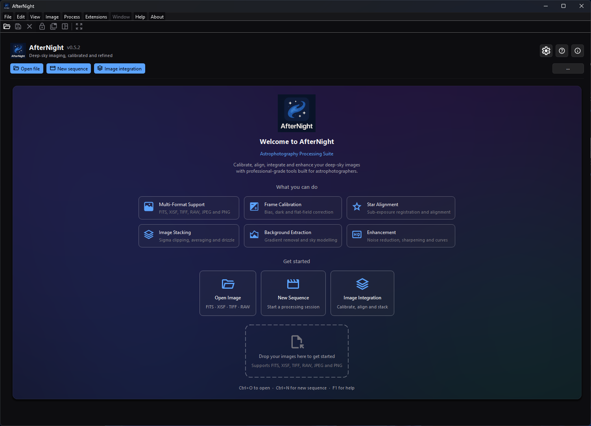

# AfterNight Documentation

## Purpose, audience, prerequisites, and expected result

This is the entry point for the AfterNight 1.0.0 desktop-application guide. It
is for new users choosing a first task and experienced users looking for an
interface, process, workflow, or reference page. No image or configured
external tool is required to use the guide. Follow one of the paths below and
you should arrive at a page that names its inputs, prerequisites, actions,
outputs, and current limitations.

The guide covers the packaged Windows and Linux desktop application. The
packages also carry `AfterNightCLI`, a command-line tool that reads one image,
stretches it for display and writes the result
(`AfterNightCLI [options] <input> <output>`); this guide does not document it.
Run `AfterNightCLI --help` for its options and exit codes.

!!! warning "Work in progress"
    This user guide is still being written. Many features and pages are not
    finished yet, and documented behavior may change as AfterNight develops.
    Treat this guide as a helpful preview and verify important workflows in the
    application.

## Reachability and availability

| Item | Current behavior |
| --- | --- |
| Path | Open the published or bundled guide root; in AfterNight use **Help > User Guide**, dashboard **User Guide (F1)**, or `F1`. |
| Enabled/visible when | The guide itself is always navigable. In-app Help first needs a readable bundled `index.html`; otherwise it tries the published guide unless online fallback is disabled by policy. |
| Supported inputs/state | No active image, sequence, project, mask, or catalog is required. |
| Outputs/side effects | Navigation only. Opening Help asks the operating system to open local HTML or the online URL; it does not modify image data or application settings. |
| Persistence | None on this page. Browser history/bookmarks are outside AfterNight. |
| External dependencies | A browser or other HTML handler; network access only when bundled documentation is unavailable and online fallback is allowed. |

## Before you start

Confirm the application version in **About > About AfterNight** when exact
behavior matters. This guide covers 1.0.0. Keep a writable output folder and
copies of acquisition data before following any processing workflow; individual
pages identify their additional disk, catalog, model, or external-tool needs.

AfterNight 1.0.0 user guide

## Process, refine, and finish your astronomical images

AfterNight gathers the pieces of a deep-sky processing session into one
application workspace: calibration frames, registration, stacking, color work,
stretching, masks, process windows, logs, history, automation, and extensions.

{ .an-hero__screenshot }

*Start from the fresh-profile Dashboard to open images, begin an integration,
or review the guided first steps.*

Use this guide in the same order you work. Start with installation and first
launch when the application is new, use the interface pages to find your way
around the workspace, then jump into a workflow or process reference when you
need the next processing step.

Process pages focus on what is visible in the app: required inputs, important
controls, expected outputs, where files are written, and what to check when a
result looks wrong.

[Install AfterNight](getting-started/installation.md){ .md-button .md-button--primary }
[Run the quick start](getting-started/quick-start.md){ .md-button }

[Deep-sky workflows](workflows/broadband-imaging.md){ .an-hero__link }
[Process reference](processes/index.md){ .an-hero__link }
[Interface guide](interface/overview.md){ .an-hero__link }

## Procedure

### Choose your path

<a class="an-card an-card--teal" href="getting-started/installation.html">
GET
First session
<strong>Install and launch</strong>
Set up the right build for your platform, open AfterNight, and confirm the expected runtime pieces are present.
</a>

<a class="an-card an-card--indigo" href="interface/overview.html">
UI
Workspace map
<strong>Learn the interface</strong>
Get oriented around the dashboard, image viewer, docking panels, process windows, logs, masks, history, and statistics.
</a>

<a class="an-card an-card--rose" href="processes/stacking-integration/image-integration.html">
INT
Deep-sky pipeline
<strong>Run Image Integration</strong>
Use the flagship workflow for calibration, registration, normalization, stacking, drizzle, and final reporting.
</a>

<a class="an-card an-card--gold" href="processes/index.html">
CAT
Process catalog
<strong>Find the next tool</strong>
Browse every built-in process by category and decide where it belongs in the processing chain.
</a>

<a class="an-card an-card--violet" href="extensions/using-extensions.html">
EXT
Extensibility
<strong>Add extensions</strong>
Understand the bundled Python runtime, the separate extension host processes, package discovery, and extension-driven process windows.
</a>

### Key capabilities

### 🌌 Astronomy images and sequences
Open astronomy and interchange images, camera RAW input, native sequences, and
supported FFmpeg-backed video streams. Begin with [Supported
Formats](getting-started/supported-formats.md); use [File
Formats](reference/file-formats.md) as the single authority for exact read,
write, precision, compression, sequence, and metadata behavior.

### 🔭 Precision Registration & Astrometry
Align images with sub-pixel accuracy. AfterNight features automatic star detection, projective geometric transforms, and full support for **SIP** (Simple Imaging Polynomial) distortion correction. Resolve celestial coordinates using **Plate Solving** to enable WCS-aware alignment and color calibration.

### ⚙️ Flagship Image Integration
Automate your pre-processing pipeline from raw frames to master stacks. The flagship **Image Integration** workflow handles dark optimization, cosmetic correction, flat normalization, registration, outlier rejection stacking, and high-resolution **Drizzle**. Track progress with interactive steps and detailed HTML reports.

### 🎨 Non-Linear Finishing & Compositing
Sculpt the visible image after stretching with contrast, color, star, mask, and compositing tools. Shape details with phase-appropriate noise reduction, sharpening, deconvolution, **Pixel Math**, and custom **Masks** so finishing edits stay targeted.

## Behavior and state model

### Typical deep-sky flow

The processing of deep-sky astronomical images follows a rigorous sequence to transition raw sensor data into a finalized, high-fidelity image. This journey is divided into two distinct phases:

### The Linear Phase (Pre-processing)
During this phase, pixel values remain directly proportional to the physical photon counts captured by your sensor. Calibration, registration, stacking, background or gradient correction, color calibration, and some denoise or deconvolution workflows are usually performed while the data is still linear.

### The Non-Linear Phase (Post-processing)
After the image is stretched with Histogram, GHT, or other tone tools, the data is no longer linear and the goal shifts toward visible detail, contrast, color, stars, and export. Noise reduction and deconvolution can still be useful here, but they are handled with tools and settings intended for non-linear data.

<strong class="an-flow-row__label">Linear phase</strong>
<ol class="an-flow-steps an-flow-steps--linear">
<li class="an-flow-step">Calibration</li>
<li class="an-flow-step">Registration</li>
<li class="an-flow-step">Stacking & Drizzle</li>
<li class="an-flow-step">Background Extraction</li>
<li class="an-flow-step">Color Calibration</li>
<li class="an-flow-step">Linear Denoise / Deconvolution</li>
</ol>

Stretching handoff

<strong class="an-flow-row__label">Non-linear phase</strong>
<ol class="an-flow-steps an-flow-steps--nonlinear">
<li class="an-flow-step">Stretching</li>
<li class="an-flow-step">Curves & Contrast</li>
<li class="an-flow-step">Non-linear Denoise</li>
<li class="an-flow-step">Sharpen / Deconvolution</li>
<li class="an-flow-step">Stars & Export</li>
</ol>

The guide is organized around that flow. If you are new to the application, start with [Quick Start Tutorial](getting-started/quick-start.md). If you already know the data you need to process, jump directly to the [Process Catalog](processes/index.md).

## Complete control and action reference

The landing page has navigation actions rather than image-processing controls.
Each link changes only the displayed documentation page.

### Guide at a glance

| Need | Start here | Best next page |
| --- | --- | --- |
| **Install the app** | [Installation](getting-started/installation.md) | [First Launch](getting-started/first-launch.md) |
| **Navigate the workspace** | [Interface Overview](interface/overview.md) | [Image Viewer](interface/image-viewer.md) |
| **Pre-process & stack images** | [Image Integration](processes/stacking-integration/image-integration.md) | [Image Stacking](processes/stacking-integration/image-stacking.md) |
| **Master the workflows** | [Broadband Imaging](workflows/broadband-imaging.md) | [Narrowband Imaging](workflows/narrowband-imaging.md) |
| **Explore individual tools** | [Process Catalog](processes/index.md) | [Glossary](reference/glossary.md) |
| **Add extension tools** | [Using Extensions](extensions/using-extensions.md) | [Extension Marketplace](extensions/extension-marketplace.md) |

!!! info "About this guide"
    This guide targets AfterNight 1.0.0 and focuses on using the application.
    For supported platforms, disk space, and hardware guidance, see
    [System Requirements](reference/system-requirements.md).

## Inputs, outputs, and metadata

This page consumes no image input and creates no view, file, history item, or
metadata change. The processing pages it links to distinguish source images
from new result views and state when they write files, preserve metadata, or
append history. Keep FITS, XISF, or another suitable high-precision master until
the authoritative [File Formats](reference/file-formats.md) page confirms that
a chosen output preserves what the next step needs.

## Performance and responsiveness

The page is static HTML. Opening the bundled guide avoids network access;
opening the published guide depends on the browser and connection. Image,
catalog, model, memory, and processing costs belong to the linked task pages
and are not implied by this landing page.

## Worked example

- Evidence mode: Source-and-documentation-derived.
- Starting state: AfterNight 1.0.0 is installed and no image is open.
- Actions: open **Help > User Guide**, choose **Run the quick start**, follow
  the OSC or mono branch, then use the linked saving page to verify an output.
- Checkpoints: the guide root opens locally when bundled; Quick Start identifies
  the branch before processing; every major step links to its detailed process;
  the final step reopens the saved artifact.
- Limitation: this navigation example verifies the documented route, not image
  quality, runtime, or compatibility with a particular camera dataset.

## Warnings and limitations

- The version number is a review boundary, not a promise that every later build
  behaves identically. Recheck a page against the application after a product change.
- Display autostretch changes only what is shown; it does not make linear pixel
  data nonlinear. Processing pages call out the point where a real stretch is
  applied.
- Do not treat JPEG or delivery video as the only processing master. Confirm
  precision and metadata behavior in the authoritative format reference.
- Media additions or replacements remain governed by the media
  manifest/provenance workflow.

## Troubleshooting

| Symptom or exact error | Verified cause/enablement path | Recovery | Evidence source |
| --- | --- | --- | --- |
| **Help > User Guide** opens the online guide | No readable bundled candidate was opened and online fallback is allowed. | Use the online guide, or install/build the bundled documentation artifact. | `DialogOrchestrationCoordinator.cpp`; packaging scripts |
| “The offline AfterNight User Guide could not be opened, and online fallback is disabled by policy.” | No bundled candidate opened and `AFTERNIGHT_DISABLE_ONLINE_USER_GUIDE` disables fallback. | Restore the packaged `{app}/docs/index.html` on Windows or `usr/share/doc/AfterNight/index.html` inside the AppImage on Linux, then retry. | `DialogOrchestrationCoordinator.h/.cpp`; focused test |
| A capability or label differs from the application | The page may describe another version. | Check the application version, then use the current process/reference page and report the mismatch. | `ApplicationSession.h`; `EngineVersionReport.cpp` |

## Related workflow steps

Start with [Installation](getting-started/installation.md), continue through
[First Launch](getting-started/first-launch.md), then use [Quick
Start](getting-started/quick-start.md). After the tutorial, choose a complete
[workflow](workflows/broadband-imaging.md) or look up a tool in the [Process
Catalog](processes/index.md). Verify final output choices in [Saving and
Exporting](interface/saving-and-exporting.md) and [File
Formats](reference/file-formats.md).

## References and provenance

- Version: the application states its own version, `kProductVersion` in
  `src/AfterNightApp/app/ApplicationSession.h` (1.0.0), which `main.cpp`
  sets as the application version and `productVersion()` in
  `src/AfterNightControls/controls/EngineVersionReport.cpp` gives the About
  dialog and the dashboard; the Windows installer definitions and the Linux
  AppImage packaging identify the same 1.0.0.
- Platforms and application scope: `README.md`, installer scripts, and the
  current build playbooks.
- Reachability: `AfterNightAppUiBuilder.h`,
  `DialogOrchestrationCoordinator.h/.cpp`, and the focused Help-resolution test.
- Capability destinations: `ProcessRegistryBuiltins.cpp`, the Process Catalog,
  and the authoritative File Formats reference.
