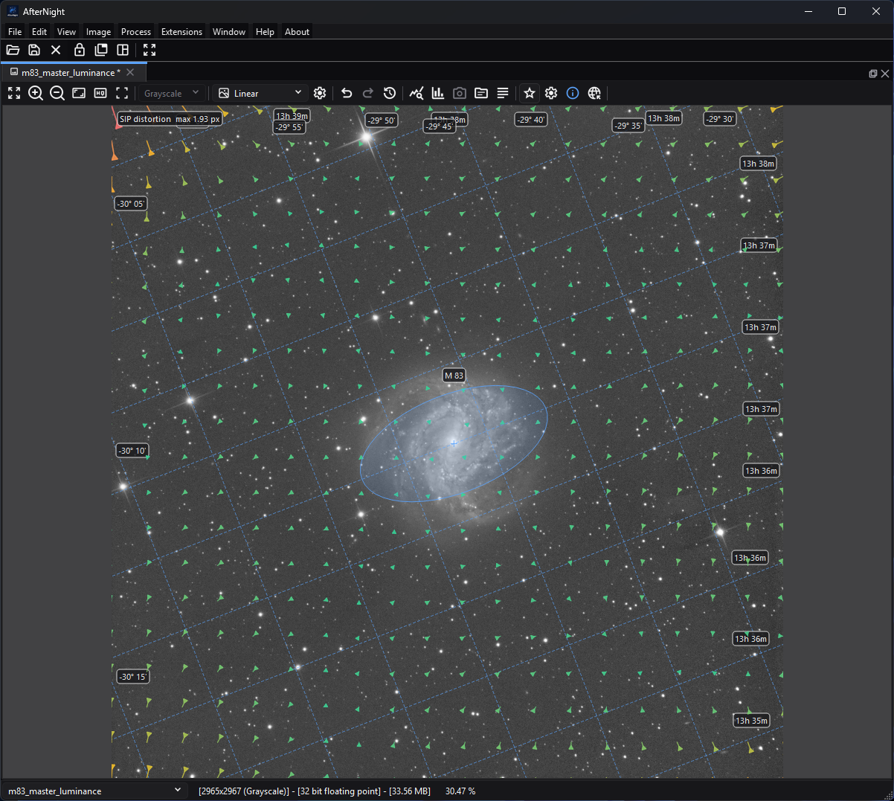

# Astrometry Overlays

*The overlays share the viewer without changing image pixels: the grid provides
coordinates, the outline identifies M83, and the vector field visualizes the
SIP correction.*

## Purpose, audience, prerequisites, and expected result

Astrometry overlays place sky coordinates, catalog objects, bright-star names,
detected-star shapes, and optical-distortion vectors over a still image without
changing its pixels. They are intended for checking a plate solution, orienting
the field, identifying objects, and diagnosing whether a SIP distortion model
looks plausible.

The image must contain a celestial World Coordinate System (WCS) that AfterNight
can parse. A successful [Plate Solve](../processes/registration-alignment/plate-solving.md)
can write one into the current image metadata. Once WCS is available, the
**Show Astrometry** and **Astrometry Settings** actions appear in that image
view. Enabling the master switch draws only the layers currently selected in
the settings popup.

## Reachability and availability

| Item | Current behavior |
| --- | --- |
| Path | Open a solved still image, then use **Show Astrometry** and **Astrometry Settings** in that image view's toolbar. If no WCS is present, use the adjacent **Plate Solve** action or **Image > Plate Solve** first. |
| Enabled/visible when | **Show Astrometry** and **Astrometry Settings** are visible only for a non-sequence image with a parsable celestial WCS. Settings is enabled only while the master switch is on. **Astrometry Info** remains visible for a still image but is disabled without WCS. Focused-view shortcuts honor the same visible/enabled gates. |
| Supported inputs/state | A standard still-image view whose in-memory metadata contains a valid celestial WCS. Pixel type, channel count, linear/nonlinear state, display channel, autostretch, masks, and zoom do not alter the stored solution. Sequence views do not expose these overlays. |
| Outputs/side effects | Display-only painter layers in the current image view. Overlay changes do not edit pixels, metadata, image history, masks, or files. Plate Solve and Clear Astrometry are separate metadata-changing actions. |
| Persistence | The master switch starts off in each newly created image view and is not saved. Grid, deep-sky annotations, bright-star labels, detected stars, SIP map, and the level of detail, labels, palette and text size are written immediately to global settings for later image views. Other already-open views keep their own current action state. |
| External dependencies | Grid, deep-sky annotations, and bright-star labels work offline from WCS plus bundled catalogs. The SIP map needs forward `A`/`B` SIP coefficients. Detected-star markers need the stars the view detected after an in-app solve, or copied with a duplicated view; no catalog is used for them. A solver/catalog/network may be needed only to create the WCS in the first place. |

## Before you start

- Confirm that **Astrometry Info** reports a solution. Merely having a FITS
  header is not enough; the header must contain a celestial WCS the engine
  reads: a tangent-plane projection (`RA---TAN`/`DEC--TAN`, optionally with the
  `-SIP` suffix) in degrees, in the ICRS or at the J2000 equinox with no frame.
  Another projection, axis order or frame is refused and shows no solution.
- For newly solved images, keep **Write WCS to the current image metadata** on
  if the solution should remain available to the current view. Save to an
  appropriate metadata-capable format if it must survive closing the image.
- A normal WCS is sufficient for the grid and both bundled catalog layers. The
  SIP map remains empty unless `CRPIX1/2`, a valid order from 2 through 6, and
  forward `A` or `B` coefficients are present.
- The managed Gaia catalog under **Settings > Catalogs & Data** is used by the
  internal solver. It is not the source for **Deep-Sky Annotations**, **Star
  Labels** or **Detected Stars**: the detected stars are not matched against it.
- Start with the default grid alone. Add one dense layer at a time so labels and
  markers remain interpretable.

## Procedure

1. Open a still image and click inside its image view. If **Show Astrometry** is
   absent, run [Plate Solve](../processes/registration-alignment/plate-solving.md)
   or reopen an image whose metadata contains a valid celestial WCS.
2. Select **Show Astrometry** or press `Ctrl+Shift+W`. The default configuration
   draws the equatorial grid only.
3. Select **Astrometry Settings**. Enable **Deep-Sky Annotations**, **Star
   Labels**, **Detected Stars**, or **SIP Distortion Map** as needed. A checked
   layer is still gated by the master switch and its own data prerequisite.
4. Choose a **Level of Detail**, the **Labels** and a **Palette** - the choices
   [Annotate Image](annotate-image.md) offers for a picture - and a **Text
   Size**. **Essential** names the Messier and Caldwell objects and the named
   ones; **Standard**, the default, every catalogue to magnitude 12;
   **Detailed** and **Complete** fainter and smaller objects. Fuller levels make
   wide fields crowded and slower to lay out. The palette and the text size also
   apply to the grid; none of the choices affects detected stars or SIP vectors.
5. Pan or zoom to the region of interest. The grid is laid out again for what
   the view shows, and the catalog labels for each zoom. Check object outlines and names
   against image structure, but treat them as WCS/catalog projections rather
   than proof that the plate solution is correct.
6. Turn individual layers off to isolate a discrepancy. Turn **Show
   Astrometry** off when processing or judging the underlying pixels; the
   selected sub-layer preferences remain saved.

## Complete control and action reference

| UI label/action | Type and unit | Default | Valid values/constraints | Effect | Enabled, hidden, or ignored rules | Trade-off or side effect | Scope | Persistence |
| --- | --- | --- | --- | --- | --- | --- | --- | --- |
| Show Astrometry (`Ctrl+Shift+W`) | Checkable toolbar action | Off | Off/On | Master-enables every checked overlay layer. Turning it off hides all astrometry painters without changing their selections. | Visible and enabled only for a solved still image. It does not create a solution. | Several active layers can obscure the image and add redraw work. | Current standard image view, display only | View lifetime only; every new view starts off. |
| Astrometry Settings | Toolbar popup action | Disabled until the master is on | Click action | Opens the layers and the **Level of Detail**, **Labels**, **Palette** and **Text Size** choices. | Visible only for a solved still; enabled only while **Show Astrometry** is on. Focused-view shortcuts can toggle individual settings without opening the popup. | No image change. | Current view controls | Popup state is transient; sub-options persist as described below. |
| Equatorial Grid (`Ctrl+1`) | Checkable layer | On | Off/On | Draws Annotate Image's grid of the part shown: right-ascension and declination lines at round steps for that part, labelled where they meet the view's edges. | Drawn only when WCS parses and the master plus this option are on. | Dense fine-field grids add projection and label work. | Current viewport | Global key `platesolve/coordinateGridEnabled`; immediate write. |
| Deep-Sky Annotations (`Ctrl+2`) | Checkable layer | Off | Off/On | Queries the bundled NGC/IC catalog plus Messier and Caldwell entries, keeps the objects the level of detail names, projects their centers/outlines, and labels them as **Labels** says. | Requires WCS and the bundled object catalog; gated by the master. | Wide fields and the fuller levels increase markers; labels never overlap, so more of them are set on leader lines or left out. Catalog sizes/position angles include project-curated approximations, and the Caldwell rows have the provenance limitation recorded below. | Current viewport | Global key `platesolve/catalogAnnotationsEnabled`; immediate write. |
| Star Labels (`Ctrl+3`) | Checkable layer | Off | Off/On | Projects the stars of the bundled bright-star catalog the level of detail names and labels them as **Labels** says: a designation (`α Lyr`), a proper name (`Vega`), or both. | Requires WCS and the bundled HYG-derived catalog; gated by the master. This is not a label switch for detected-star ellipses. | Stars are labelled in the order Annotate Image labels them - a proper name before a designation alone, each brighter before fainter - and a star whose label finds no room beside it or on a leader line is not drawn, so a rich field shows its most prominent stars legibly; a star the level marks without a name is drawn without a label. Bundled coordinates are J2000 ICRS and this display path does not apply proper-motion correction. | Current viewport | Global key `platesolve/starLabelsEnabled`; immediate write. |
| Detected Stars (`Ctrl+4`) | Checkable layer | Off | Off/On | Draws fitted ellipses around the stars the view detected; saturated detections use the error color. | Requires the view's detected stars as well as the master. The normal population path runs asynchronously after Plate Solve writes WCS; simply opening an already-solved file does not start this detection pass. | Up to 5,000 markers may be painted. These are image detections, not the bundled bright-star labels. | Current image/detected stars | Global key `platesolve/detectedStarsEnabled`; immediate write. The detected stars themselves are in-memory view state, not this preference. |
| SIP Distortion Map (`Ctrl+5`) | Checkable layer | Off | Off/On | Draws sampled forward SIP displacement arrows and a legend containing the largest actual displacement in pixels. | Requires a valid forward SIP model (`A_ORDER`/`B_ORDER` and coefficients); inverse-only `AP`/`BP` data is insufficient. Gated by the master. | Arrow lengths are display-scaled for legibility and are not a literal screen-length measurement; use the legend for the actual maximum. | Whole image model, filtered to current viewport | Global key `platesolve/distortionMapEnabled`; immediate write. |
| Level of Detail | Exclusive choice | **Standard** | **Essential**, **Standard**, **Detailed**, **Complete** | Names the bundled catalogs as Annotate Image's levels do. **Essential**: the Messier and Caldwell objects and the named ones, and the stars to magnitude 2.5 by proper name. **Standard**: every catalog to magnitude 12 and objects large enough to show, and the stars to 4.5 by name and designation. **Detailed**: every catalog to magnitude 14, smaller objects and objects of no measured magnitude, and the stars to 6, the unnamed ones marked. **Complete**: every galaxy, nebula and cluster the catalogs hold in the field, and every bright star, by catalog number when it has no name. | Does not filter detected stars, grid lines, or SIP vectors. The smallest object a level names is a share of the part of the image the view shows, so zooming in names smaller objects; a Messier, Caldwell or named object is named whatever its size. | Fuller levels increase density and layout work; labels never overlap, so more of them are set on leader lines or left out. | Current view's two bundled catalog layers | Global key `annotation/view`, with the labels, the palette and the text size; immediate write for later views. A view that kept a magnitude limit before levels existed starts at the level naming about as much: 6 or brighter **Essential**, 8 to 12 **Standard**, 14 **Detailed**, 16 or all objects **Complete**. |
| Labels | Exclusive choice | **Designation** | **Designation**, **Name**, **Designation and Name** | What every catalog label says, as Annotate Image's label text: an object's designation, else its name (`M 42`, `α Lyr`); its common name, else its designation (`Orion Nebula`, `Vega`); or its designation with its common name on a second line, as large as the designation. | Applies to both catalog layers; the grid's labels are coordinates. | Two-line labels take more room, so fewer of them fit in a crowded field. | Current view's two bundled catalog layers | Global key `annotation/view`; immediate write for later views. |
| Palette | Exclusive choice | **Aurora** | Annotate Image's palettes: Aurora, Moonlight, Glacier, Amethyst, Amber, Verdant, Rose, Atlas, Ember, Ink | The colours the grid, the outlines, the star rings and the labels are drawn in, a colour for each kind of object: **Ember** red for a dark-adapted eye, **Ink** dark lines for a bright image. | The view's own choice: choosing a palette in Annotate Image does not recolour a view. | Display only. | Current view's grid and catalog layers | Global key `annotation/view`; immediate write for later views. |
| Text Size | Exclusive choice | **Medium** | **Small**, **Medium**, **Large** | How large the catalog labels and the grid's labels are drawn on the screen, at every zoom alike: **Small** as large as the interface's captions, **Medium** a quarter larger and **Large** half as large again. Star rings and lines grow with the text. | The view's own choice: Annotate Image's text size sets a picture's text, which follows the picture rather than the screen. | Larger text takes more room, so fewer labels fit in a crowded field. | Current view's grid and catalog layers | Global key `annotation/view`; immediate write for later views. A view whose choices were kept before sizes existed starts at **Medium**. |
| Astrometry Info (`Ctrl+Shift+P`) | Toolbar action | Visible, disabled when unsolved | Click action | Opens the solution summary for the current image. | Still images only; enabled when WCS parses. | Inspection only. | Current image metadata | No overlay preference change. See [FITS Header, EXIF, And Astrometry Metadata](fits-header-viewer.md). |
| Plate Solve (`Ctrl+P`) | Toolbar action | Visible for a still image | Click action | Opens the solver workflow that can write WCS/SIP metadata and then launch post-solve star detection. | Hidden for sequences and requires a current image. The dialog still opens when no solver is configured; its **Solve** button remains disabled until a supported backend and required catalog/path are configured. | Solving can use CPU, disk catalogs, an external program, or network upload depending on backend. | Current still image | Solver settings persist separately; written metadata marks the image pending. |

## Behavior and state model

### Master and per-view state

Each standard image view owns its overlay painters and action state. The master
switch gates every painter and deliberately starts off for a new view. Changing
a sub-layer or an annotation choice writes its global preference immediately, but it also
changes only the view where the action was triggered. A later-created view
loads the saved choices; another view that is already open is not synchronized.

If WCS is added or removed, the image view reparses the metadata, updates action
visibility, and invalidates the relevant caches. **Clear Astrometry** also
clears the detected stars, as does any later edit of the image or a new image
shown in the view. Overlay preference changes alone never mark
the image as modified.

### Equatorial coordinate grid

The grid is [Annotate Image](annotate-image.md)'s grid of the part of the image
the view shows. AfterNight measures the sky that part covers - from the part's
own centre, sampling its edges and interior through the WCS - and draws lines of
constant right ascension and declination at the round step that puts about six
of each across it: hours, minutes and seconds of time for right ascension, and
degrees, arcminutes and arcseconds for declination. Every zoom and every scroll
lays the grid out again for what is shown, so a view zoomed into a corner of a
wide field takes a grid spaced for that corner. Right ascension is continuous
across 0h, and a part that holds a pole opens right ascension to the whole
circle. A line's projected samples that the WCS cannot place are skipped
rather than joined across the view.

Each line is labelled where it meets the edge of the view, as Annotate Image
labels a picture's grid: `08h 00m` or `+10° 00′`, with a true minus sign, primes
and double primes, and seconds at the finer steps. A label is rounded once and
the rounding carries into every field: a right ascension of 10h 29m 59.7s is
labelled `10h 30m 00s`, never with sixty seconds under the same minute. The
lines and labels are drawn in the view's **Palette**, and a label keeps its size
on the screen - the view's **Text Size** - at every zoom.

### Bundled catalog annotations and labels

Both catalog layers read their bundled catalog on a worker the first time they
are drawn and ask it, on the worker, for the entries inside the whole image's
field and a margin - two degrees for deep-sky objects, one for bright stars -
that the level of detail names. The detailed and complete levels name objects no
catalog measured a magnitude for, so their deep-sky query states no magnitude
limit. Each paint projects the last answer through the WCS, so the labels appear
on the paint after the answer lands, and panning or zooming projects them again
without asking.

- **Deep-Sky Annotations** use the bundled NGC 2000.0-derived NGC/IC rows,
  Messier aliases, 109 project-maintained Caldwell rows, and curated common
  names/extents. An object with known size is drawn as a projected ellipse
  using its major/minor axes and position angle; an object without extent is
  drawn as a small point outline. NGC 2000.0 states one diameter and no
  orientation, so an object whose extent is not curated is drawn as a circle
  of that diameter; only the curated objects and the Caldwell rows carry an
  axis ratio and a position angle. A label says what **Labels** says.
  Objects are kept, merged and named as [Annotate Image](annotate-image.md)
  does: the entries of one object in several catalogues - M 42 and NGC 1976,
  or the Carina Nebula as NGC 3372 and C 92 - are one annotation under the
  designation people use most, Messier, then NGC, then IC, then Caldwell. The
  current generator recreates the NGC/IC and Messier portion but not the
  directly maintained Caldwell rows.
- **Star Labels** use the bundled HYG 4.2 subset filtered at generation time to
  visual magnitude 9 or brighter: 83,479 stars, where HYG's Hipparcos core is
  still close to complete. The marker is a ring. The level decides which stars
  are named and by what - proper names at the essential level, designations too
  at the standard and detailed levels, catalog numbers at the complete level -
  and a label says what **Labels** says. Stars are labelled in the order Annotate Image
  labels them: a star with a proper name before one with a designation alone,
  each brighter before fainter.

The two layers are one overlay, laid out together as Annotate Image lays out a
picture's labels. No label covers another: a label that finds no room beside
its object is set farther away on a leader line, or left out. A deep-sky object
whose label is left out keeps its outline; a star whose label is left out is not
drawn, and a star the level marks without a name is drawn without a label. The
smallest object a level names is a share of the part of the image the view
shows, as a picture's is of its frame, so zooming in names the smaller objects,
as a map does. Labels keep their size on the screen at every zoom: they are laid
out again on a worker when the zoom, the labels or the level changes, and until
that layout lands the previous one is drawn, while scrolling draws the layout
there is. Outlines, markers and labels are drawn in the view's **Palette**,
Aurora by default.

For catalog magnitude, lower numeric values are brighter. Deep-sky entries with
an unknown magnitude but a curated common name are named at every level, so
important named objects are not silently lost; the detailed and complete levels
name the unnamed ones of unknown magnitude too. Catalog projection confirms
where the current WCS places an entry; it does not validate that the visible
feature is truly that object.

### Detected-star markers

After Plate Solve writes WCS, AfterNight launches star detection on a worker.
Mono images use channel 0. Multi-channel images try green first and try red when
the first pass finds fewer than 25 stars that the solution places on the sky.
The fixed overlay detection setup uses a five-pixel search radius, noise sigma
1.0, roundness 0.4, Gaussian PSF fits, and a 5,000-star cap. A mosaic
(undemosaiced filter-array image) is not detected and draws no markers. The
completed detection is shown only if the view still shows the image it read and
no newer detection was asked for; a failure is logged and leaves no markers.

Marker centers, axes, and angles come from those fitted image stars; the stars
are not matched against a catalog. Opening a pre-solved image does not currently
trigger this post-solve detection path, so **Detected Stars** may remain empty
while the other WCS layers work.

### SIP distortion vectors

For image pixel `(x, y)`, measured so that the first pixel's center is at
`(0.5, 0.5)`, AfterNight forms coordinates relative to the SIP reference pixel.
The header's `CRPIX1`/`CRPIX2` count from one at the first pixel's center, so the
card reader restates the reference pixel once, half a pixel lower, in the same
convention as `(x, y)`:

\[
u = x - (\mathrm{CRPIX1} - 0.5), \qquad v = y - (\mathrm{CRPIX2} - 0.5)
\]

and evaluates the forward polynomials:

\[
x' = x + A(u,v), \qquad y' = y + B(u,v).
\]

The map samples this displacement on a fixed 20 by 20 grid of pixel centers,
from the first pixel's to the last's. Arrow direction
shows `(x'-x, y'-y)` and color progresses from the theme's success color toward
warning/error as magnitude approaches the largest sampled displacement. The
legend reports that largest magnitude in source-image pixels. To keep tiny or
large distortions readable, displayed arrow length is normalized toward 12%
of the shorter viewport dimension, clamped to a 24-96 pixel target and a
0.75-40 scale factor. Therefore compare direction, relative color, and the
legend—not the raw on-screen arrow length.

## Inputs, outputs, and metadata

- Input is the current still image plus its in-memory FITS-style metadata,
  read once into one solution: the projection, the reference, the matrix and
  the SIP polynomials every layer draws through. A header that states the J2000
  equinox and no reference frame is read in the ICRS; one that states FK5, or
  another equinox and no frame, shows no solution and no overlay.
- Every layer draws a position at the center of the pixel it names: an image
  position is measured with the first pixel's center at `(0.5, 0.5)` and drawn at
  that position times the zoom.
- Overlay painters operate on the current zoomed widget. They do not resample,
  recolor, clip, stretch, mask, or otherwise modify the source image.
- No overlay action creates a new view, file, history step, metadata card, or
  auxiliary map. The SIP map is a visualization, not an exported distortion
  image.
- Plate Solve can write WCS metadata as a step of the image's history and mark
  the image pending. Clear Astrometry removes the WCS/SIP cards and solver tag
  as another history step, clears the detected-star profile, and also marks the
  image pending. Follow [Saving And Exporting](saving-and-exporting.md) to
  preserve and verify metadata.
- Duplicating an image can copy the view's detected stars and metadata;
  overlay master state remains a property of each view.

## Performance and responsiveness

- The grid is laid out again for every zoom, scroll and resize of the view;
  the catalogue labels' layout is made again on a worker for every zoom and
  every choice of labels, and the catalogue answers for every solution and
  level of detail. Renaming or
  updating the image sets the cached display work aside.
- Each catalog layer reads its bundled catalog on a worker the first time it
  is drawn, and keeps it while the view lives; drawing never waits for it. The
  catalog is queried on a worker once per solution and level of detail, and
  requires no network.
- A paint projects only the entries the last query answered. Choose a lower
  level of detail or disable one label layer if a wide field becomes cluttered.
- The detected-star pass is asynchronous, but drawing can still iterate up to
  5,000 ellipses on each repaint. Disable **Detected Stars** when it is not the
  layer being inspected.
- SIP polynomial samples are cached as 400 vectors for the image dimensions and
  metadata; each repaint filters them to the visible viewport. This layer does
  not perform a full-image warp.
- Overlay controls do not use the GPU directly and do not block on a network
  request. Plate solving and managed catalog operations have separate costs.

## Worked example

- Starting state, actions, settings, checkpoints, result, and limitations: The
  focused tests construct a 1000 by 800 synthetic TAN WCS centered on M 31,
  verify that the bundled catalog finds M 31, and verify that its catalog center
  projects to pixel `(499.5, 399.5)`: the header's one-based reference pixel
  `CRPIX = (500, 400)` restated with the first pixel's center at `(0.5, 0.5)`. Separate synthetic SIP metadata is sampled on a 5 by 4 grid; all
  20 sampled displacements match direct forward-polynomial evaluation. Grid
  tests cover spacing for the part shown, RA wrap, a field about the pole, and
  label formats. Catalog tests cover what each level of detail names, objects
  of no measured magnitude, the smallest size of the part shown, the label
  choices, the palette, the text size of both layers and the grid, a name under
  a designation drawn as large as it, and the saved magnitude limit a view
  starts from.
  This verifies projection/filter mechanics only. It does not claim that a GUI
  rendering was inspected, that a real sky image was solved, that annotations
  align visually with project-owned data, or that a particular frame rate was
  achieved.

## Warnings and limitations

- An overlay can be internally consistent with an incorrect WCS. Confirm scale,
  rotation, field center, and several known objects before trusting it.
- The master switch is intentionally not persisted. Seeing saved sub-layer
  checks does not mean overlays will start enabled in a new view.
- **Detected Stars** can be empty on a valid pre-solved file because automatic
  overlay detection is currently invoked after an in-app solve, not on every
  file load.
- Bright-star labels use a static J2000 ICRS HYG subset with no display-time
  proper-motion correction. High-proper-motion stars and observations far from
  J2000 can show a small catalog-position offset.
- The deep-sky catalog contains derived or curated extents and position angles;
  outlines are orientation aids, not precision isophotes or scientific region
  boundaries.
- The repository records the Caldwell rows as direct project additions but does
  not record their original upstream dataset or license, and the current
  deep-sky generator does not recreate them. Treat their positions, magnitudes,
  extents, and names as project-maintained orientation data rather than a
  reproducible scientific catalog source.
- The level of detail sets both bundled catalog layers, and the bright-star
  source contains nothing fainter than magnitude 9: the complete level names
  every star of it.
- SIP arrows are deliberately rescaled. Only the legend is an actual maximum
  displacement measurement in source-image pixels.
- Overlays are not supported in sequence views, real-time preview views, or
  static embedded previews.

## Troubleshooting

| Symptom | Cause | Fix |
| --- | --- | --- |
| **Show Astrometry** is absent | The active view is a sequence, has no image, or its metadata does not parse as celestial WCS (for example a non-`TAN` projection, or a header that states FK5). | Activate a still image; inspect Astrometry Info/FITS headers; run Plate Solve and write WCS. |
| **Astrometry Settings** is visible but disabled | The WCS is valid, but the master switch is off. | Turn on **Show Astrometry** or press `Ctrl+Shift+W`. |
| Grid appears but no catalog objects | The relevant catalog layer is off, the level of detail names none of the field's objects, no bundled entries intersect the visible WCS footprint, or the bundled resource failed to load. | Enable one catalog layer, choose a fuller level, pan to a known field, and inspect the Session Console for the one-time catalog warning. |
| A small object is named only when the view is zoomed in | The smallest object a level names is a share of the part of the image the view shows. | Zoom in, or choose **Detailed** or **Complete**, which name smaller objects. |
| Star Labels stop getting denser at **Complete** | The bundled bright-star subset was generated through visual magnitude 9, which the complete level names in full. | This is expected; choose a lower level for fewer star labels. |
| Some stars of a rich field have no label | Its label found no room beside it or on a leader line - the room went to a named or brighter star - and a star without a label is not drawn. | Zoom in: the stars spread apart and more of them are labelled. |
| Detected Stars is checked but no ellipses appear | The view holds no detected stars: opening a pre-solved file does not launch post-solve detection, any later edit of the image clears them, a mosaic is not detected, and a detection that found nothing or failed (see the Session Console) draws nothing. | Run Plate Solve in AfterNight to detect the stars again (demosaic a mosaic first), or use the grid/catalog layers. |
| SIP map is checked but empty | WCS has no valid forward SIP `A`/`B` model, only inverse coefficients, zero displacement, or no visible vectors. | Inspect SIP status/header cards. A valid ordinary WCS can still drive the other layers. |
| SIP arrows look much larger than the reported distortion | Display arrows are normalized and clamped for visibility. | Read **SIP distortion max _n_ px**; use direction/color for relative interpretation. |
| Labels shift or redraw while panning/zooming | Grid spacing follows the visible field, and catalogue labels are laid out again on a worker when the zoom changes - not when panning; the previous layout is drawn at the new zoom until the new one lands. | Let the layout land; choose a lower level of detail or turn a label layer off for a lighter layout. |

## Related workflow steps

- First create or verify WCS with [Plate Solving](../processes/registration-alignment/plate-solving.md).
  Its handoff is the in-memory celestial WCS and optional SIP metadata used here.
- Inspect raw cards and the solution summary with
  [FITS Header, EXIF, And Astrometry Metadata](fits-header-viewer.md). That page
  covers metadata fields and preservation; this page covers only overlay
  prerequisites and interpretation.
- Use the broader [Image Viewer](image-viewer.md) guide for display mode,
  channels, zoom/pan, status coordinates, and toolbar overflow behavior.
- Make a picture with the objects, stars and coordinates named on it, to share
  or print, with [Annotate Image](annotate-image.md). The overlays here are drawn
  over the view only; that window writes a file or opens a new image.
- Preserve a newly written solution with [Saving And Exporting](saving-and-exporting.md),
  then reopen and verify the WCS before downstream
  [Image Registration](../processes/registration-alignment/image-registration.md)
  or color-calibration work.

## Credits

- NASA/HEASARC, [FITS World Coordinate System papers and resources](https://fits.gsfc.nasa.gov/fits_wcs.html),
  including Greisen & Calabretta (2002) and Calabretta & Greisen (2002).
- Shupe & Hook, [The SIP Convention for Representing Distortion in FITS Image
  Headers, version 1.0](https://fits.gsfc.nasa.gov/registry/sip/SIP_distortion_v1_0.pdf),
  IAU FITS convention registry submission.
- Shupe et al. (2005), [The SIP Convention for Representing Distortion in FITS
  Image Headers](https://authors.library.caltech.edu/records/fqnyw-qdw79/latest),
  ADASS XIV.
- CDS/VizieR, [NGC 2000.0 catalog VII/118](https://cdsarc.cds.unistra.fr/viz-bin/cat/VII/118),
  the primary catalog input named by AfterNight's deep-sky generator; Messier
  aliases, common names, and selected extents are project-maintained additions.
- Astronexus, [HYG Database 4.2](https://www.astronexus.com/projects/hyg),
  source of the bundled bright-star subset under CC BY-SA 4.0.
