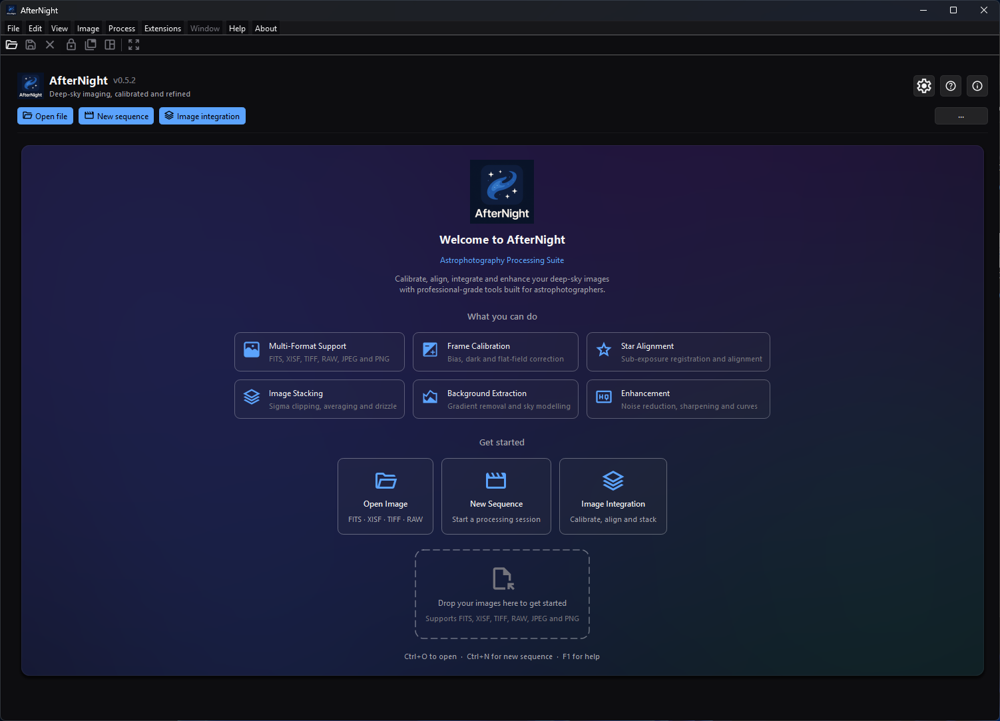
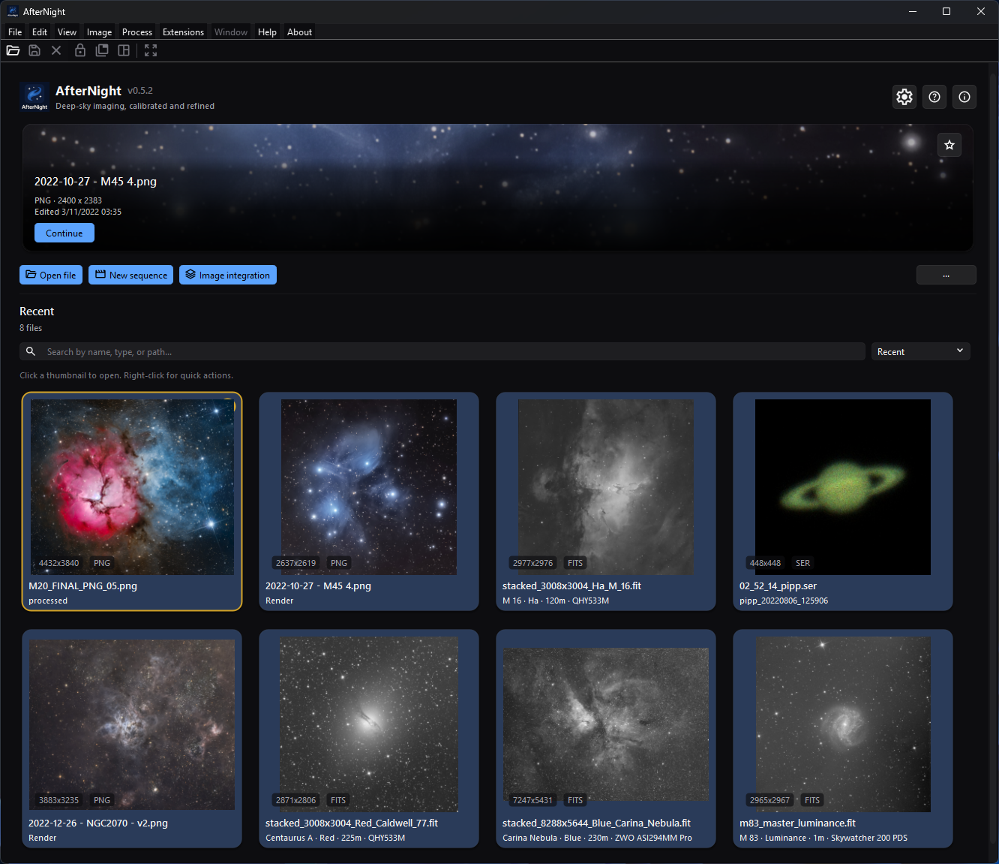

# Dashboard

## Purpose, audience, prerequisites, and expected result

The dashboard is AfterNight's startup and return surface. Use it to learn the
application, open local images or sequences, resume recent work, start common
no-image workflows, and customize the six dashboard quick actions.

This page is for first-time users and anyone managing recent work. No active
image is required. A supported local file is needed only to exercise recent,
thumbnail, and workspace behavior. The expected result is that you can choose
the correct entry action, understand every empty/error state, and control what
the dashboard remembers without confusing list removal with source deletion.

*The fresh-profile Dashboard keeps onboarding visible until recent images are
available.*

*The returning-user Dashboard replaces onboarding with a featured recent file
and a searchable, sortable recent-files grid.*

## Reachability and availability

| Item | Current behavior |
| --- | --- |
| Path | Start AfterNight. The dashboard also returns when the final image view and Session Console are closed. |
| Enabled/visible when | Identity utilities and toolbar actions need no active image. **Clear recents** disables when the list is empty. Search/sort appear only when at least one recent path exists. Onboarding appears only with no recents. |
| Supported inputs/state | Local still/sequence paths accepted by the open workflow; empty, results, and filtered-empty recent states; stored thumbnails and best-effort image metadata. Active masks and image selections do not affect dashboard actions. |
| Outputs/side effects | Opens dialogs/top-level workflows or creates standard views. **Open file** and a drop store the folder as the last open directory when the open starts and again when it ends, whatever its outcome; a recent-file open stores it after its view is made. Successful loads update recents, thumbnails, and workspace state. Search/sort/action order/pins/last action update settings. |
| Persistence | Recent paths are stored in the application data `recent_files` list; thumbnail mappings use SQLite and thumbnail images use application storage. Dashboard settings store action order, hidden IDs, grid pins, featured pin, sort, search, and last-action text. |
| External dependencies | None for the dashboard shell. Launched codecs, Image Integration, Extension Manager, Help fallback, and other workflows own their file/network/tool requirements. |

## Before you start

- Use one known small local file first. A file-name suffix can pass the drop
  filter even when the file content is invalid or unsupported by the decoder.
- **Remove from recent files** and **Clear recents** remove dashboard history and
  stored thumbnails, not source files. **Show in File Browser** and **Copy path**
  can expose private folder names or paths.
- A multi-file drop is processed sequentially on a worker path. Earlier files
  can remain open if a later file fails or you cancel.
- The dashboard records local paths and extracted display metadata. Remove
  private paths before sharing screenshots or diagnostics.
- The dashboard **Image integration** action opens the full Image Integration
  workflow. The beginner [Quick Start](../getting-started/quick-start.md) instead
  uses **Process > Preprocess > Image Integration Lite**.

## Procedure

### Start with no recents

1. Start with an empty recent list. Checkpoint: the featured card, **Recent**
   header, search/sort row, hint, and recent grid are hidden. The welcome panel
   shows six capability summaries, three start cards, the drop zone, and keyboard
   hints.
2. Choose **Open Image**, toolbar **Open file**, `Ctrl+O`, or drop one supported
   local file anywhere on the dashboard. The visible drop-zone highlight appears
   only while the no-recents onboarding panel is visible.
3. Check **File Open**. One or two files use an indeterminate progress bar; three
   or more use percentage progress. CFA input can add a debayer prompt.
4. On successful view creation, check that the dock workspace opens. Cancelling
   before a view or a decode failure does not create a successful recent result.

### Return to recent work

1. Close the final image and Session Console. Checkpoint: the dashboard refreshes
   from the persisted recent list without briefly showing onboarding first.
2. If an existing/decodable candidate has a usable stored or direct thumbnail,
   the featured card shows a filename, technical/astronomy metadata, **Continue**,
   and its own pin button. The recent grid shows available thumbnail cards.
3. Enter a partial, case-insensitive path or filename in **Search by name, type,
   or path...**. A suffix such as `fits` matches because it is filename/path text;
   the filter does not query an independent decoded-type or metadata field.
4. Select **Recent**, **Name**, or **Type**. Then right-click one item and choose
   **Pin to top**. Grid-pinned items remain above unpinned items in every sort.
5. Clear the search. Left-click a card or choose **Open**. The dashboard promotes
   it optimistically; a successful load persists it at the recent-list front.
   Any failure other than a stop you asked for - a file the engine cannot read, a
   demosaic failure, or a view that cannot be made - reports **File open error**
   and removes the recent path; a stop removes nothing.
6. Use **Remove from recent files** for one entry, or overflow **Clear recents**
   and confirm for all entries. Verify that the source file still exists.

### Customize quick actions

1. Open **More actions** (`···`) > **Customize quick actions**.
2. Open one of the six action submenus and choose **Move earlier**, **Move
   later**, or **Hide action**. At least one toolbar action must remain visible.
3. Recover an action through **Show hidden action**, or choose **Reset quick
   actions** for the canonical order and no hidden actions.
4. Check the placement rule: the three start actions always render in the
   primary row and the other three in overflow. A move across that group boundary
   can persist without a visible position change until relative order within the
   same group changes.

## Complete control and action reference

| UI label/action | Type and unit | Default | Valid values/constraints | Effect | Enabled, hidden, or ignored rules | Trade-off or side effect | Scope | Persistence |
| --- | --- | --- | --- | --- | --- | --- | --- | --- |
| AfterNight identity/version/tagline | Informational identity bar | Visible | Running application/version | Identifies product, version, and dashboard purpose | Always visible on dashboard | Display only | Application | None |
| Settings (`Ctrl+,`) | Identity utility button | Visible/enabled | Application available | Opens Settings | No active image required; not part of quick-action customization | Settings can change file, UI, network, and processing behavior | Application | Settings-specific |
| User Guide (`F1`) | Identity utility button | Visible/enabled | Bundled guide or allowed online fallback | Opens Help | No active image required; not customizable | May open network fallback when bundled docs are absent | Application | None |
| About | Identity utility button | Visible/enabled | Application available | Opens About AfterNight | No active image required; not customizable | Modal information only | Application | None |
| Open file (`Ctrl+O`) | Primary toolbar button | First primary action | File chooser and supported decoder path | Opens File dialog and background load | Available without active image; can be hidden but one action must remain visible overall | The open directory is stored when the open starts; successful loads update recents, thumbnails, and workspace | Selected files | Order/hidden state; open directory and successful recents |
| New sequence | Primary toolbar button | Second primary action | New Sequence workflow | Opens the top-level New Sequence window | Available without active image | Creating a sequence can allocate/write storage after confirmation | New sequence | Order/hidden state; workflow-specific state |
| Image integration | Primary toolbar button | Third primary action | Full Image Integration workflow | Opens full calibration/alignment/stacking/reporting process | Available without active image | Workflow can use substantial memory/disk | Integration project/session | Order/hidden state; process/project state |
| Extension Manager | Overflow action | First secondary action | Extension subsystem | Opens the separate **Extensions** dialog on its **Browse** tab | Available without active image | Can use network/disk and modify environments | Application | Order/hidden state; extension state |
| Clear recents | Overflow action | Second secondary action; disabled empty | Nonempty recent list and confirmation | Clears recent paths, persisted thumbnail files/mappings, grid pins, and featured pin | Disabled with no recents; No cancels | Does not delete source files; confirmation default is Yes | Dashboard history | Order/hidden state; clears recent/thumb/pin state |
| System info | Overflow action | Third secondary action | Application available | Opens runtime/system diagnostics | Available without active image | Copied diagnostics may reveal system details | Application | Order/hidden state |
| More actions (`···`) | Menu button | Visible | Dashboard toolbar | Opens secondary and customization actions | Always visible; it is not one of the six customizable actions | Controls discoverability | Dashboard | None |
| Customize quick actions | Overflow submenu | Available | Six canonical action IDs | Opens one submenu per quick action | Identity utilities are excluded | Reordering/hiding can make entry paths harder to find | Dashboard toolbar | Uses action-order/hidden-ID settings |
| Move earlier | Per-action menu item | First action disabled | Position greater than zero | Swaps action with prior canonical-list item | Disabled at list start | Cross primary/secondary group swaps can be visually inert | Selected quick action | Immediate persistent order |
| Move later | Per-action menu item | Last action disabled | Position before list end | Swaps action with next canonical-list item | Disabled at list end | Same group-boundary limitation | Selected quick action | Immediate persistent order |
| Hide action / Show action | Per-action menu item | Actions shown | Canonical action; at least one visible overall | Hides or restores action | Hide disabled for the final visible action | Hidden actions remain callable through menus elsewhere when such a route exists | Selected quick action | Immediate hidden-ID setting |
| Show hidden action | Customization submenu | Disabled with none hidden | Hidden canonical actions | Restores selected hidden action | Enabled only when hidden set is nonempty | Restores to its persisted/canonical relative position | Dashboard toolbar | Immediate hidden-ID setting |
| Reset quick actions | Customization action | Enabled | Any nondefault order/hidden set | Restores Open/New/Integration, then Extension/Clear/System; shows all | No-op when already canonical | Discards custom layout | Dashboard toolbar | Immediate action settings |
| Welcome to AfterNight / What you can do | Informational onboarding panel | Visible with no recents | Empty recent list | Shows identity, description, and six capability cards | Hidden as soon as recents exist; not restored by search-empty state | Capability text is orientation, not proof a specific input supports every process | No-recents dashboard | Determined by recent list |
| Open Image | Onboarding action card | Visible with no recents | Same open workflow | Emits the same open request as toolbar **Open file** | Hidden when any recent path exists | Subtitle lists only FITS/XISF/TIFF/RAW, not exhaustive formats | Selected files | Successful recents/open directory |
| New Sequence | Onboarding action card | Visible with no recents | Same New Sequence workflow | Opens New Sequence | Hidden when recents exist | Same as toolbar action | New sequence | Workflow-specific |
| Image Integration | Onboarding action card | Visible with no recents | Full Image Integration | Opens full process | Hidden when recents exist | Not the Lite Quick Start path | Integration session | Process/project-specific |
| Drop your images here to get started | Informational drop zone | Visible with no recents | Dashboard accepts local URLs; open service retains recognized suffixes | Highlights during an accepted local drag and opens retained files on drop | Highlight hidden with recents; nonlocal/unsupported-only drops do nothing | Multi-open can be partial; suffix acceptance is not decoder proof | Dropped local paths | Successful paths update recents; last directory becomes final retained file's folder |
| `Ctrl+O to open` | Onboarding hint/shortcut | Active | Application shortcut | Opens file chooser | Hint visible only with no recents; shortcut works through application action | Same open side effects | Application | None |
| `Ctrl+N for new sequence` | Onboarding hint | Stale | No assigned application shortcut | No current shortcut action | Text remains visible with no recents | Use card, toolbar, or **File > New Sequence...** | None | None |
| `F1 for help` | Onboarding hint/shortcut | Active | Application shortcut | Opens User Guide | Hint visible only with no recents | May use online fallback | Application | None |
| Featured file | Hero card | Hidden empty | Existing recent source and decodable stored/direct thumbnail candidate | Shows most-relevant recent filename and metadata | Hidden with no candidate; search does not filter it | Best-effort metadata/thumbnail may be absent or stale | Dashboard recents | Selection follows recent order unless hero pinned |
| Continue | Featured-card button | Enabled with featured path | Current featured path | Opens featured recent file and promotes it | Hidden with card | Load can prompt/fail; success updates recent state | Featured file | Successful recent promotion |
| Pin featured file / Unpin featured file | Featured-card icon button | Most recent unpinned | Existing file in recents | Makes one file override automatic featured selection, or releases it | A pin whose path leaves recents is cleared on refresh | Independent of grid **Pin to top** | Featured card | `interface/dashboardPinnedHeroFile` |
| Recent | Section header/count | Hidden empty | Nonempty recent list | Shows total or filtered count | Hidden only for no-recents state | Count reflects filtered path entries, even if some lack usable thumbnail cards | Dashboard recents | Derived |
| Search by name, type, or path... | Search field | Empty on fresh profile | Trimmed partial text; case-insensitive filename/path match | Filters recent path entries after 120 ms debounce | Hidden when no recents; clear button empties text | Persisted text can reopen directly into **No matches found**; no metadata-field search | Dashboard recents | `interface/dashboardRecentSearchText` |
| `Ctrl+F` | Dashboard shortcut | Active only when search visible | Dashboard with recents | Focuses search and selects all text | Does nothing when search is hidden | No file-system search | Dashboard | None |
| Recent sort | Combo option | Fresh default | Stored recent order, then stable grid-pin partition | Keeps recent-list order | Hidden when no recents | Grid pins appear first | Dashboard recents | `interface/dashboardRecentSortMode=recent` |
| Name sort | Combo option | Not fresh default | Locale-aware filename ascending, then stable grid-pin partition | Sorts visible matches by name | Hidden when no recents | Folder/path is not a tie-breaker | Dashboard recents | `...=name` |
| Type sort | Combo option | Not fresh default | Lowercase suffix ascending; locale-aware filename tie-break; grid pins first | Groups visible matches by extension | Hidden when no recents | Uses suffix text, not decoded content type | Dashboard recents | `...=type` |
| Recent thumbnail left-click | Card action | Available per rendered card | Stored path with usable thumbnail | Previews/promotes featured state and starts recent open | Card is absent if no usable thumbnail was loaded | Open may fail; any failure other than a stop removes the recent entry | Recent path | Success promotes/persists recent path |
| Open | Thumbnail context action | Available | Recent card | Same recent-file open | Requires rendered card | Same open prompts/failure | Recent path | Success promotion |
| Pin to top / Unpin from top | Thumbnail context action | Unpinned | Recent path | Stable-partitions pinned cards above unpinned cards | Requires rendered card | Does not select featured hero | Recent grid | `interface/dashboardPinnedRecents` |
| Show in File Browser | Thumbnail context action | Available | Existing local source path | Reveals source in platform file manager | Missing path shows **File Not Found** | External file-manager action exposes path | Recent path | None |
| Copy path | Thumbnail context action | Available | Recent path | Copies normalized path to clipboard | Requires rendered card | Clipboard can disclose private path | Recent path | Clipboard only |
| Remove from recent files | Thumbnail context action | Available | Recent path | Removes path, its stored thumbnail, and its grid pin; refreshes dashboard/menu | Requires rendered card | Does not delete source file | One recent item | Persists recent list and thumbnail mapping |
| No matches found | Filtered-empty panel | Hidden | Nonempty list with zero search matches | Replaces grid and suggests another term | Featured card can remain visible | Not the no-recents onboarding state | Dashboard recents | Derived from persisted search/list |
| No recent files state | Empty state | Fresh/cleared list | Zero recent paths | Shows onboarding; hides recent header/controls/hint/grid/featured | Clear recents or profile state controls it | Search/sort/action layout settings remain stored | Dashboard | Recent/thumb/pin history cleared; other dashboard settings retained |
| File Open progress / Cancel | Progress dialog/action | Opens after selection/drop/recent click | One or more retained paths | Reports background loading; Cancel stops the current read, sequence open, or demosaic and reads no further file | Fewer than three files indeterminate; three or more percent; a recent-file open is always indeterminate | Already opened files remain after later error/cancel; a file that cannot be read is reported and the open goes on, while a view that cannot be made stops the batch | Current open batch | Successful items update recents |
| Clear-recents confirmation Yes / No | Modal confirmation | Yes is default | **Are you sure you want to delete the recent opened files?** | Yes clears history/thumbnails; No preserves it | Shown only after enabled Clear action | The phrase “delete” refers to recent history, not source files | Entire recent list | Yes persists cleared state |
| General > Recent files limit | Settings spin box, files | 20 files | 1–100 | Caps stored recents; applying a lower value removes oldest excess paths/thumbnails | Future additions also trim to limit | Removed history is not recoverable from dashboard; source files remain | Application recent list | `general/recentFilesLimit` |

## Behavior and state model

### Dashboard states

| State | Visible recent area | Transition condition |
| --- | --- | --- |
| No recents | Onboarding only; featured/header/search/sort/hint/grid hidden | Persisted recent list is empty or **Clear recents** succeeds |
| Results | Optional featured card, **Recent** count, search/sort, hint, thumbnail grid | Nonempty list and search has one or more path/name matches |
| Filtered empty | Optional featured card, **Recent** with **No matches in N files**, search/sort, no-match card | Nonempty list and trimmed search has zero path/name matches |

The recent store normalizes paths, removes empty/duplicate entries when loading,
and keeps the most recently successful file first, up to **Recent files limit**;
a successful save also adds each file it wrote.
A file on another machine is never a recent file: a Windows network (UNC) path,
whether spelled `\\server\share\...`, `//server/share/...`, in its long form
`\\?\UNC\server\...` or as a file URL naming a host, is not added. The
last-open folder is not remembered for such a path either. Grid pins
are then stable-partitioned above unpinned matches after search and selected sort.
Grid pinning never changes the independent featured-file pin.

The featured presenter tries the persisted hero pin first, then recent-list
order. A candidate must still exist and have a usable cached, stored, or directly
decodable image. It falls forward when a candidate cannot produce a hero image.
When metadata is available, the card can show object, date, filter, exposure,
camera, telescope, type, dimensions, and edit time; otherwise it falls back to
technical file information. The date is the night the frame was taken - the day
of `DATE-OBS` or the EXIF original date - and, failing those, the day the file
says it was made, never the day the file was written. The camera is the EXIF
model or `INSTRUME`, and for a camera RAW the make and model its decoder states.
Placeholder values such as `-` or `N/A` are left out. A recent card's summary is
the target, filter, exposure, and camera, each shown only when the file states
it. The facts are read by background work that runs only when the session has
a free thread, so they can be missing. Extraction does not edit source
metadata.

Six onboarding capability cards are informational: **Multi-Format Support**,
**Frame Calibration**, **Star Alignment**, **Image Stacking**, **Background
Extraction**, and **Enhancement**. Their grid reflows from three to two to one
column as width narrows. They are not actions and do not assert that every file
supports every capability.

Runtime refresh removes grid pins and the hero pin when their paths leave
recents. `interface/dashboardLastAction` records a
human-readable audit string; no current dashboard control displays or restores
behavior from that value.

## Inputs, outputs, and metadata

The dashboard reads local paths, recent settings, thumbnail mappings/files,
source timestamps, image dimensions, and best-effort FITS/XISF/TIFF/RAW metadata.
It never changes source pixels or embedded metadata.

A successful open can create a still/sequence view and history, persist the last
directory, add/promote one recent path, and write a display thumbnail. The
thumbnail is reduced with Lanczos-4 to at most 2,400 pixels on its longer axis
and written on a worker as an 8-bit JPEG at quality 95, whole or not at all; only
the last request for a file is recorded. An image that is linear data receives
the thumbnail autostretch, measured exactly over its samples, each colour
channel stretched on its own: an image recorded linear, a stack whose header
counts the frames it combines (`STACKCNT` or `NCOMBINE`, as AfterNight's stacks
write), a frame whose header records its frame type (`IMAGETYP`), or a camera
RAW frame. An image whose processing-state cards record it stretched, as every
AfterNight stretch does, or that is sRGB or gamma encoded, is shown as it is; a
mosaic's thumbnail is the grey picture of its codes. Each thumbnail byte is
rounded to the nearest value. Source images remain unchanged. Remove/clear
deletes dashboard thumbnail artifacts and mappings only.

Search, sort, quick-action layout, pins, and last-action state are global
application settings. There is no project-specific dashboard state and no
restore of open image views from the previous session.

## Performance and responsiveness

Recent filtering waits 120 ms after typing. Thumbnail work is batched four at a
time with at most four worker loads in flight; decoded dashboard cache is capped
at 256 entries and invalidates an entry when the persisted thumbnail timestamp
changes. The featured presenter also uses worker decoding when no cache result
exists. Grid layout and state transitions remain GUI work.

Opening images/sequences is background work, but decoder cost, CFA prompts, view
creation, and many simultaneous views can still affect responsiveness and
memory. Use one file first. A persisted thumbnail can lag source-file edits until
the successful-open/save path regenerates it; the cache watches the thumbnail,
not the source image timestamp.

## Worked example

- Starting state: empty recent list, Session Console closed, and one known small
  supported local still.
- Actions and checkpoints: verify onboarding; use **Open Image**; observe **File
  Open** and successful workspace view; close the view; verify results state and
  featured/recent entry; search by part of its filename; select **Name**; use
  **Pin to top**, then **Remove from recent files**; verify onboarding returns and
  the source remains on disk.
- Result and limitations: source/tests establish signals, states, persistence,
  filtering/sorting/pinning, and transitions. No approved file was executed, so
  actual decoding, thumbnail appearance, platform layout, timing, memory, and
  visual quality are unclaimed.

## Warnings and limitations

- The displayed `Ctrl+N` hint is stale. There is no current application shortcut
  assigned to New Sequence.
- Search reads filename/path text only. “Type” in the placeholder is satisfied
  only when the typed suffix/text occurs in that string; decoded format and
  extracted metadata are not independent search fields.
- Primary and overflow actions are rendered as separate groups. Moving an item
  across that boundary can persist while producing no visible reordering.
- A recent path without a usable stored/direct thumbnail can count in the section
  total but lack a rendered card. The featured presenter may skip it for another
  candidate.
- Thumbnail/featured metadata is best-effort and may be missing, stale, or
  incomplete. It is not an authoritative FITS/EXIF inspection.
- Unsupported or nonlocal-only drops are silently ignored. Mixed drops discard
  unrecognized suffixes and open the retained paths; suffix filtering does not
  validate content.
- Multi-open is not transactional. Earlier views and recents can survive a later
  decoder error or cancellation.
- **Clear recents** uses a modal confirmation and defaults to Yes. Read the prompt
  before accepting; source files are not deleted.
- The fresh-profile and returning-profile states shown here were validated on
  the capture platform. This does not establish identical rendering on every
  platform, scale factor, or window size.

## Troubleshooting

| Symptom | Cause | Fix |
| --- | --- | --- |
| Onboarding is absent | At least one recent path exists, even if no card renders. | Use search/recents, remove stale entries, or clear recents intentionally. |
| Search/sort is absent or `Ctrl+F` does nothing | The recent list is empty, so the controls are hidden. | Open one supported file successfully first. |
| **No matches found** appears immediately after restart | Search text persists and matches no current filename/path. | Use the field's clear button or enter a matching path/name fragment. |
| **Recent** count exceeds visible cards | One or more matching paths lack a usable thumbnail mapping/file/decoder result. | Open the source through **File > Open** to regenerate a thumbnail, or remove the stale entry. |
| Featured file is unexpected | A separate hero pin overrides recent order, or earlier candidates are missing/undecodable. | Use **Unpin featured file**; verify candidate source and thumbnail files. |
| **Clear recents** is disabled | No recent paths exist. | No action is required; opening a file successfully will enable it. |
| A recent card reports **File open error** and disappears | The path is stale, the engine refused to read the file, its demosaic failed, or its view could not be made; any recent-open failure other than a stop removes it. | Locate the file and reopen from its new path; inspect Session Console/File Formats. |
| **File Not Found** from **Show in File Browser** | The stored source path no longer exists. | Remove the entry or restore/reopen the file at its current location. |
| A dropped file is ignored | It is nonlocal or lacks one of the exact recognized still/RAW/sequence/video suffixes (compared case-insensitively). | Drop a local supported file or use **Open file** and consult File Formats. |
| Some dropped files open before a failure/cancel | Multi-open processes retained files sequentially and is not atomic: a file that cannot be read is reported and the next one opens, while a view that cannot be made stops the batch. | Keep wanted views; close unwanted partial results; retry the failed file alone. |
| Moving a quick action seems to do nothing | The swap crossed the primary/secondary rendering boundary rather than another item in the same visible group. | Continue moving until its relative order changes within primary or overflow, or reset. |
| Hidden action cannot be hidden | It is the final visible quick action. | Show another action first, then hide this one. |
| Lowering Recent files limit removes entries | Applying Settings trims oldest paths and thumbnails immediately. | Reopen source files to add them again; increase the limit for future retention. |

## Related workflow steps

- [First Launch](../getting-started/first-launch.md) provides the learning path;
  this page is the exhaustive dashboard reference.
- [Quick Start](../getting-started/quick-start.md) uses Image Integration Lite,
  not the dashboard's full **Image integration** action.
- [Interface Overview](overview.md) explains dashboard/workspace transitions and
  global action state.
- [Sequences](sequences.md) owns New Sequence and sequence behavior.
- [Image Integration](../processes/stacking-integration/image-integration.md)
  owns the full dashboard-launched integration workflow.
- [Settings](settings-dialog.md) owns **Recent files limit** and other application
  persistence controls.
- [Supported Formats](../getting-started/supported-formats.md) helps choose a
  source; [File Formats](../reference/file-formats.md) is the compatibility
  authority.
