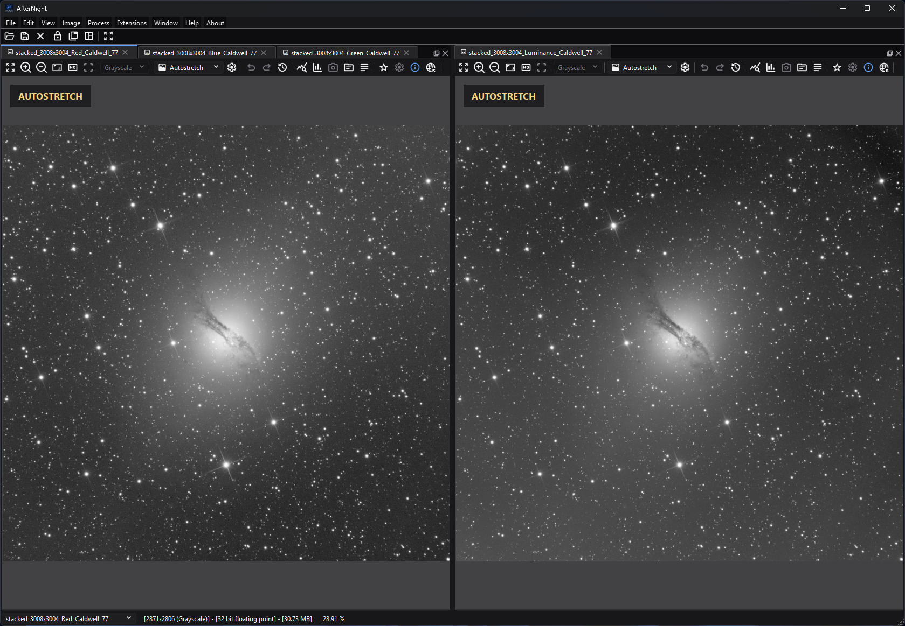

# Docking Panels

*Tabbed views share the left dock group while a separate split keeps another
image visible for comparison.*

## Purpose, audience, prerequisites, and expected result

Docking Panels explains how AfterNight arranges standard image and sequence
views and the dockable **Session Console**. Use it when you need tabbed targets,
side-by-side comparisons, a detached floating group, or one temporarily
maximized image.

Start with at least one successfully opened or created view. Rearranging a dock
changes only window organization and display scale; it does not resample image
data, change metadata or history, or mark an image for saving. The expected
result is a workspace arrangement that makes the required targets visible while
preserving each view's image state.

## Reachability and availability

| Item | Current behavior |
| --- | --- |
| Path | Open or create an image/sequence to enter the dock workspace. Use the layout toolbar, **Window**, **Image > View**, the standard image-view toolbar, or right-click a standard image view. With at least one image open, right-clicking the main window outside any view offers **Lock Layout** and **Unlock Layout**. |
| Enabled/visible when | The layout toolbar exists but is disabled on the Dashboard; **Window** is disabled there. Image-dependent actions require an active view. |
| Supported inputs/state | Standard still-image and sequence views; the Session Console can occupy another dock. Process preview views do not become main-workspace docks. |
| Outputs/side effects | Reorders, tabs, splits, detaches, fits, or temporarily maximizes views. Closing a tab can close its image/sequence and attached processes after confirmation. |
| Persistence | The `interface/lockLayoutByDefault` setting persists whether startup should lock movement, and the main window's size and position persist while **Remember window size and position** (`interface/rememberWindowSize`, on by default) is on. Dock positions, tab groups, splits, floating geometry, and the current lock toggle are not serialized or restored by the current application code. |
| External dependencies | Bundled KDDockWidgets runtime; no network, catalog, or external executable. |

The status bar and its active-image selector appear in the dock workspace and
are hidden or disabled on the Dashboard. Selecting a name activates that view;
clicking a dock tab or group also makes its image active. Hovering a real image
tab or title bar shows the summary of a still image, a SER sequence, or an image
list; a video sequence shows none, and neither does a still while an edit holds
its image at that moment. Empty tab-bar space does not reuse a stale tooltip.

## Before you start

- Save or identify pending changes before closing tabs or whole tab groups.
- Unlock the layout before dragging, reordering, detaching, redocking, or using
  double-click layout gestures.
- Decide whether an operation should affect every main-workspace view or only
  the views in the clicked main/floating window. The menu and toolbar scope is
  different from the context-menu scope.
- Remember that **Fit** changes display magnification. Inspect at 100% again
  before judging pixel-scale noise, registration, or sharpening.

## Procedure

### Arrange all main-workspace images

1. Open or create the required views. AfterNight leaves the Dashboard. A view
   made with no neighbour is added to the right side of the main dock
   workspace; every later file of one open, and any view made beside another, is
   tabbed onto that neighbour. Making a view while another docked view is
   maximized restores that view first.
2. Choose **Window > Group All Images** or the matching layout-toolbar button.
   Checkpoint: all registered image/sequence views are tabs in one main-window
   group, and the previously active image remains active.
3. Choose **Window > Split All Images**. Checkpoint: the views occupy equalized
   cells rather than tabs. The split helper uses explicit balanced layouts for
   one through sixteen views and continues in additional four-item runs above
   sixteen.
4. Choose **Window > Fit Images To Window**. Checkpoint: every registered image
   view recalculates its display scale for its current viewport.

The global Group and Split commands move image views into the main dock window.
They do not include the Session Console in the generated image layout.

### Arrange only one main or floating window

1. Right-click inside a standard image view.
2. Open **Current Window**.
3. Choose **Group All Images**, **Split All Images**, or **Fit All Images to
   Window**.
4. Checkpoint: only image views sharing the clicked view's containing window
   change. If it is floating, image views in other floating windows and in the
   main dock workspace remain unchanged.

### Maximize and restore one docked view

1. Activate a standard docked image or sequence.
2. Choose **Image > View > Maximize View**, click **Maximize image view** in the
   image-view toolbar, or press `F11` while that view has focus.
3. Checkpoint: the selected view becomes the central workspace content; the
   action changes to **Restore View**. Lock, Group, and Split controls are
   disabled.
4. Invoke **Restore View** or press `F11` again. The view returns to its original
   dock, and the prior layout is shown.

If the layout was unlocked, maximizing temporarily locks it and restoring
unlocks it. If it was already locked, restoring leaves it locked. Maximizing is
disabled in the visible controls while a view is detached in a floating window;
dock it before maximizing.

Current limitation: when the layout was already locked before maximizing,
restore re-enables the toolbar button but leaves both **Window > Lock Layout**
and **Window > Unlock Layout** disabled. The first toolbar click reasserts the
locked state and restores the normal menu-action state; click the toolbar a
second time, or then choose **Window > Unlock Layout**, to unlock.

### Lock and unlock movement

1. Choose **Window > Lock Layout** or click the lock button in the layout
   toolbar. The toolbar icon and tooltip change to the corresponding unlock
   state.
2. Checkpoint: dock drag/drop indicators are inhibited, drag start is rejected,
   and tab/title/group double-click layout changes are consumed.
3. Choose **Window > Unlock Layout** or click the same toolbar button to allow
   movement again.

Locking protects interactive movement. It does not disable **Group All Images**,
**Split All Images**, **Fit Images To Window**, tab selection, or close buttons.

## Complete control and action reference

| UI label/action | Type and unit | Default | Valid values/constraints | Effect | Enabled, hidden, or ignored rules | Trade-off or side effect | Scope | Persistence |
| --- | --- | --- | --- | --- | --- | --- | --- | --- |
| Layout-toolbar lock button: **Lock layout** / **Unlock layout** | Two-state tool button | Unlocked; locked at startup only when the saved default is on | Click | Calls the same lock/unlock behavior as the Window actions | Toolbar disabled on Dashboard; while a view is maximized the lock button and Group/Split are disabled and **Fit Images To Window** stays enabled; after restoring an already-locked layout, the first click only restores normal menu-action state | Blocks interactive movement, not programmatic layout commands | All dock widgets | Current state is session-only; startup default uses `interface/lockLayoutByDefault` |
| **Window > Lock Layout** | Menu action | Enabled when unlocked | Trigger | Inhibits drop indicators and rejects dock drag start | **Window** disabled on Dashboard; action disabled when already locked or maximized | Prevents accidental drag/detach/reorder; Group/Split still work | All dock widgets | Session-only |
| **Window > Unlock Layout** | Menu action | Disabled when unlocked | Trigger | Restores dock dragging and drop indicators | **Window** disabled on Dashboard; normally enabled when locked; disabled while maximized and remains disabled after restoring a layout that was already locked until the toolbar is clicked once | Allows accidental layout changes again | All dock widgets | Session-only |
| **Window > Group All Images** | Menu/toolbar action | Available with active image data | Trigger | Moves every registered image/sequence view into one tab group in the main dock window | Disabled without an active image and while any view is maximized | Floating image views are pulled into the main group; console is excluded | All registered image views | Not persisted |
| **Window > Split All Images** | Menu/toolbar action | Available with active image data | Trigger | Moves every registered image/sequence view into an equalized deterministic split layout | Disabled without an active image and while any view is maximized | Many views create small cells; the active view is retained | All registered image views | Not persisted |
| **Window > Fit Images To Window** | Menu/toolbar action | Available with active image data | Trigger | Fits every registered image view to its current viewport | Disabled without an active image; not disabled merely because a view is maximized | Display resampling can hide pixel-scale detail | All registered image views, including floating windows | Display scale lasts for the view lifetime only |
| **Current Window > Group All Images** | Context submenu action | Available in a standard view context menu | Trigger | Tabs image views that share the clicked view's main or floating window | Group and Split disabled when the clicked view is maximized | Does not pull views from other windows | Containing window only | Not persisted |
| **Current Window > Split All Images** | Context submenu action | Available in a standard view context menu | Trigger | Splits and equalizes image views in the same containing window | Disabled when the clicked view is maximized; one view is effectively unchanged | Small cells with many local views | Containing window only | Not persisted |
| **Current Window > Fit All Images to Window** | Context submenu action | Available in a standard view context menu | Trigger | Fits image views in the same containing window | Remains available while the clicked view is maximized | Display-only scale change | Containing window only | View lifetime |
| **Image > View > Maximize View** / **Restore View** | Dynamic menu action | Restore state off | Toggle | Removes the active control from its dock into the central maximized slot, then returns it | Requires an active standard view; disabled when the active view is floating | Hides other workspace content; temporarily locks an unlocked layout | Active standard view | Session-only |
| **Maximize image view** / **Restore image view** | Image-view toolbar action | Restore state off | Toggle or `F11` | Same maximize/restore state as the main-menu action | Standard dock-capable views only; toolbar action disabled while floating | See `F11` limitation below | Focused view | Session-only |
| `F11` | Focused-view shortcut | None | Key press without Ctrl/Shift | Toggles maximize/restore directly in the focused view | Standard image-view key handler; not a global QAction shortcut | The handler does not recheck the disabled floating-view action; dock floating views before using it | Focused view | None |
| Image tab | Selectable, draggable tab | Current tab selected | Click; drag/reorder when unlocked | Activates the image; drag can reorder or move it to another group | Movement blocked by layout lock; selection remains allowed | Changes the target used by active-image actions | One image/sequence view | Tab position not persisted |
| Tab close button | Per-tab close action | Available for normal image docks | Click | Requests closure of that image/sequence | Pending changes or attached processes can require confirmation; cancellation keeps it open | Stops sequence playback and closes the view on acceptance | One view | Destructive view closure; image save state remains governed by its own workflow |
| **Close Tab Group** | Group-corner close action | Available on a dock group | Click | Requests closure of each closable tab in order | Stops at the first tab whose close confirmation is cancelled | Can close several images and attached processes | Current tab group | Destructive view closure |
| **Float / Detach** | Group-corner layout action | Docked | Click | Moves the dock group to a native floating window or returns it through KDDockWidgets controls | Interactive layout changes require an unlocked layout | Floating groups have separate window scope; visible maximize action is disabled there | Current dock group | Position/state not persisted |
| Drag tab/title/group | Pointer layout gesture | Docked | Drag while unlocked | Reorders, groups, splits, floats, or redocks according to the drop target | Drag start rejected while locked | Can substantially reorganize the workspace | Dragged dock/group | Not persisted |
| Double-click tab/title/group area | Pointer layout gesture | No action recorded by AfterNight itself | Double-click while unlocked | Delegates the layout gesture to KDDockWidgets | Explicitly consumed while locked | Exact native gesture result is library/platform controlled | Clicked dock/group | Not persisted |
| Status-bar active-image selector | Non-editable selector | Disabled on Dashboard; current view in workspace | Choose an open view name | Activates the corresponding image dock without emitting a recursive selection change | Enabled in dock workspace while it lists a view, and when the Session Console was opened from the Dashboard with no image; disabled after the last image closes while the console keeps the workspace open. Session Console focus does not replace the selected image | Convenient with many tabs or floating groups | Registered image/sequence views | Session-only |

There is no main-layout shortcut for Lock, Unlock, Group, Split, or Fit All.
`Ctrl+Shift+F` belongs to the focused image view's single-view **Fit To Window**
command, not **Fit Images To Window**.

## Behavior and state model

AfterNight creates a KDDockWidgets main window behind the Dashboard and enables
always-visible tabs, tab reordering, per-tab close controls, tab-bar group
buttons, native floating title bars, and menu-based tab switching. Every image
and sequence uses a deletable dock with a minimum logical size of 100 x 100.
The Session Console is the only other current `DockableControl`; process windows,
Image History, metadata viewers, and Settings are separate windows or dialogs.

Global Group and Split read the image-view manager's registered view list. Group
adds the first view to the main dock and adds the remaining views as tabs. Split
adds the views at explicit left/right/bottom positions, then asks the containing
drop area to equalize cell sizes. Both operations restore the previously active
image after rearrangement.

Context Group, Split, and Fit first compare each dock's floating-window owner.
Views with the same owner are in scope; a null floating owner means the main
dock window. This is why a command invoked from one detached group does not
change another detached group.

Maximize is not a KDDockWidgets window maximize. AfterNight temporarily replaces
the image dock's widget with a placeholder and shows the image control in a
dedicated central stack slot. Restore puts the same control back in the same
dock. No image copy, conversion, history step, metadata edit, or file write is
performed.

## Inputs, outputs, and metadata

The inputs are existing image/sequence views and, for local context commands,
the clicked view's containing window. The output is only Qt/KDDockWidgets UI
state plus display magnification after Fit. Image pixels, channel data, masks,
WCS/SIP metadata, sequence frames, file names, and processing history remain
unchanged.

Closing is the exception: an accepted close removes the view, stops sequence
playback, and can close attached process windows. It does not silently save
pending image changes. Cancel either confirmation to keep the view open.

## Performance and responsiveness

Grouping and fitting are lightweight UI operations. Splitting many views causes
layout recalculation for every dock, and fitting every image causes every view
to recompute display scale. The source pixels are not reprocessed, but many
simultaneously visible image widgets can increase display memory and repaint
cost. Group views into tabs or maximize one view when interaction becomes slow.

The explicit split helper is optimized for practical comparison counts rather
than semantic pairing. Above sixteen views it continues adding cells in
four-item runs; use smaller manual groups when relative placement matters.

## Worked example

- Starting state: three standard docked views named `linear`, `processed`, and
  `mask`; `processed` is active and the layout is unlocked.
- Choose **Group All Images**. Check that one tab group contains all three and
  `processed` remains the active target.
- Choose **Split All Images**. The three-view branch places one view left, one
  below it, and one right, then equalizes the layout.
- Choose **Fit Images To Window**. Each view changes only its display scale;
  histories and pending-save states remain unchanged.
- Maximize `processed`, verify **Restore View** and disabled Lock/Group/Split
  controls, then restore it. Because the example started unlocked, the layout
  becomes unlocked again.
- Limitation: the captured tabbed and split workspace was validated, but no
  live drag/drop interaction was recorded. The checkpoints do not promise
  identical pixel geometry on every platform or window size.

## Warnings and limitations

- The current source contains no `LayoutSaver`, serialization, or restore path.
  The Interface Settings note that the window layout is automatically saved on
  exit is true only for the main window's size and position, not for dock
  positions/groups in this revision.
- **Lock dock layout by default** persists only the startup lock preference. It
  does not save the current dock arrangement and changing it does not
  immediately lock or unlock the running workspace.
- Locking does not protect against Group, Split, Fit, or Close. Use the lock as
  drag prevention, not as a read-only workspace mode.
- Global Group/Split can pull detached image views back into the main window.
  Use the context menu inside a floating group for local changes.
- The `F11` key handler calls maximize directly and does not consult the
  disabled floating-view toolbar action. Dock the view before using `F11`.
- Restoring a view that was maximized while the layout was already locked leaves
  both Window lock actions disabled. The first toolbar click restores their
  normal locked-state enablement; a second click unlocks.
- Fit is a display operation. A fitted overview can conceal pixel-scale
  defects, interpolation artifacts, or noise.
- Process preview windows are not main-workspace docks and are not affected by
  these Group/Split commands.

## Troubleshooting

| Symptom | Cause | Fix |
| --- | --- | --- |
| **Window** and layout toolbar are unavailable | The Dashboard is current; the toolbar is disabled and the Window menu is disabled until the dock workspace is selected | Open/create a valid image or sequence |
| A dock cannot be dragged, reordered, detached, or changed by double-click | Layout lock inhibits drag/drop and consumes double-click layout gestures | Use **Window > Unlock Layout** or the layout-toolbar toggle |
| Group or Split still changes a locked layout | Lock affects interactive movement, not those connected programmatic actions | Avoid Group/Split while preserving a locked arrangement; there is no undo-layout command |
| A context Group/Split command ignores images in another window | Context commands intentionally select only docks with the same floating-window owner | Use the global Window/toolbar command, or invoke a context command inside the other window |
| Group All Images unexpectedly redocks floating views | The global command rebuilds the group in the main dock window | Use **Current Window > Group All Images** for floating-local grouping |
| **Maximize View** is disabled | The active standard view is floating, or no active image view is available | Dock/select a standard view first |
| Lock/Group/Split become disabled after maximizing | Maximize temporarily locks layout and disables arrangement actions | Use **Restore View** or `F11` on the maximized view |
| Restore leaves both Window lock actions disabled | The layout was already locked before maximize, so restore preserves the lock but does not re-enable the QAction pair | Click the toolbar lock button once to restore normal locked-state actions, then click it again or choose **Window > Unlock Layout** |
| Closing a tab group stops before all tabs close | One image's pending-change or attached-process confirmation was cancelled | Resolve/save that view, then close the group again |
| A restored session does not reproduce the prior dock layout | No application layout serialization/restore implementation exists | Recreate the grouping manually; use the startup lock preference only after arranging |
| Fine detail looks different after Fit | Fit changed display magnification and resampling, not source pixels | Inspect at 100% and compare the image history/pending state |

## Related workflow steps

- Begin with [Dashboard](dashboard.md) to open or create the first workspace
  view.
- Use [Image Viewer](image-viewer.md) for per-view channels, zoom, autostretch,
  overlays, and the single-view Fit/Maximize toolbar controls.
- Use [Toolbar and Menus](toolbar-and-menus.md) for the complete application
  menu hierarchy and action availability rules.
- Use [Session Console](log-viewer.md) for the content and controls inside the
  dockable console, and [Image History](image-history.md) for data-state undo/
  redo rather than layout changes.
- Use [Settings](settings-dialog.md) for the persisted startup lock preference.

## Credits

- [KDDockWidgets documentation](https://docs.kdab.com/kddockwidgets/): upstream
  docking framework behavior. AfterNight overrides tab sizing/tooltips,
  close-group safety, theming, activation, and lock-aware double-click handling.
