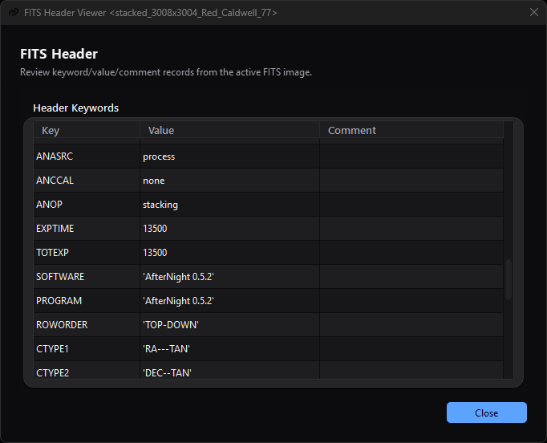
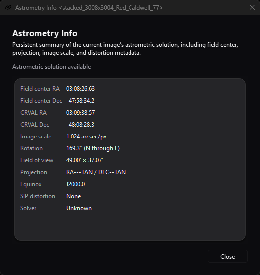

# FITS Header, EXIF, And Astrometry Metadata

*The read-only table exposes stored FITS records directly. This solved example
contains a celestial WCS but no accepted SIP coefficient set.*

*Astrometry Info interprets the active image's solution in reader-friendly
fields; **SIP distortion: None** records the selected file's actual metadata
state.*

## Purpose, audience, prerequisites, and expected result

These three read-only tools inspect different layers of the active image's
in-memory metadata:

- **FITS Header** shows parsed FITS cards as keyword, value, and comment rows.
- **EXIF Viewer** shows camera-oriented EXIF tags that AfterNight retained for
  display.
- **Astrometry Info** interprets celestial WCS and SIP cards as a compact
  solution summary.

Use them to diagnose acquisition metadata, check a plate-solve handoff, or
inspect a reopened output. You need an active image; FITS Header and EXIF Viewer
also require the image to carry at least one card of the corresponding kind. The expected
result is an inspection window only. None of these tools edits pixels, metadata,
history, files, or the pending-save state.

[Image and Sequence Summary](image-summary.md) owns the fixed common image/file/
sequence report. [Image Statistics](image-statistics.md) and
[Histogram Analysis](image-histogram.md) own pixel measurements. This page does
not reproduce those field inventories, and
[Astrometry Overlays](astrometry-overlays.md) owns overlay rendering and catalog
behavior.

## Reachability and availability

| Item | Current behavior |
| --- | --- |
| Path | **Image > Information > FITS Header**, **EXIF Viewer**, or **Astrometry Info**. Standard image-view toolbars expose the same three labels. Focused-view shortcuts are `Ctrl+Shift+H`, `Ctrl+Shift+X`, and `Ctrl+Shift+P`. |
| Enabled/visible when | FITS Header requires at least one FITS card among the image's header cards. EXIF Viewer requires at least one EXIF field the window shows a row for: an `Exif.` field of a JPEG, TIFF, PNG or camera-RAW file that the window does not hide. A container's own entries alone, such as a PNG's bit depth or a JPEG comment, do not enable it. When the view refreshes its actions while an edit holds the image, both are disabled until the next update. Main-menu Astrometry Info requires any active image and can show an unsolved state. Toolbar Astrometry Info is visible only for stills and enabled only when the view has parsed WCS; it is hidden for sequences. |
| Supported inputs/state | Still images and the current decoded frame of a sequence. FITS-style metadata can also originate from XISF or processing; availability does not prove the current file extension. Masks, selections, display channel, zoom, autostretch, overlays, and pixel statistics do not affect the metadata shown. |
| Outputs/side effects | Modeless read-only dialogs. FITS/EXIF allow one selected row; Astrometry labels allow mouse text selection. There is no report file, table export, table copy action, metadata edit, or history entry. |
| Persistence | None. Window geometry, column widths, selection, and scroll position are dialog-local and are not stored. |
| External dependencies | None at inspection time: the engine's FITS (CFITSIO), XISF and EXIF (Exiv2) readers stored the cards when the file was opened, and the solution is read by the engine's own WCS card reader. Opening these panels uses no network, catalog, solver, or external executable. |

The menu and toolbar gates are independent. In particular, the main-menu
Astrometry action deliberately remains enabled for an unsolved active image so
the panel can report **No astrometric solution**, while its image-toolbar action
requires parsed WCS.

## Before you start

- Activate the exact view or pause on the exact sequence frame to inspect.
  FITS and EXIF dialogs stay attached to their originating view. Astrometry Info
  follows the application's active image while it remains open.
- Reopen a saved output before treating these panels as file verification. They
  read current in-memory metadata and do not reread the file on every refresh.
- Treat camera, observer, object, location, and time fields as potentially
  private and as claims from the source file, not independently measured facts.
- For WCS interpretation, distinguish the image-center sky coordinate from the
  WCS reference coordinate. They need not be equal.

## Procedure

1. Activate the target view. If it is a sequence, pause on the frame whose
   metadata you want to inspect.
2. Open [Image and Sequence Summary](image-summary.md) first when you need common
   dimensions, pixel type, file identity, frame count, or FPS. It is intentionally
   not a full metadata dump.
3. Open **Image > Information > FITS Header**. Confirm the title names the
   intended view, then inspect the original row order and the **Key**, **Value**,
   and **Comment** columns. Resize columns or scroll as needed.
4. For a solved image, locate `CTYPE1/2`, `CRPIX1/2`, `CRVAL1/2`, the CD or
   PC/CDELT matrix, and any `A`/`B` or `AP`/`BP` SIP cards. Then open
   **Astrometry Info** and compare its interpreted fields with those raw cards.
5. Open **EXIF Viewer** when enabled. Read **Tag**, **Value**, and **Key**
   together; the **Key** column is the field's full EXIF key, such as
   `Exif.Photo.ExposureTime`. The table is for reading, not a machine-readable
   export.
6. If the image changes, wait for the normal image load/update notification.
   The panels refresh automatically; there is no **Refresh** button. A rename
   updates each window title.
7. To verify preservation, save in the intended format, reopen the output, and
   inspect again. Use [Saving And Exporting](saving-and-exporting.md) and
   [File Formats](../reference/file-formats.md) for the authoritative
   format-specific preservation contract.

## Complete control and action reference

| UI label/action | Type and unit | Default | Valid values/constraints | Effect | Enabled, hidden, or ignored rules | Trade-off or side effect | Scope | Persistence |
| --- | --- | --- | --- | --- | --- | --- | --- | --- |
| **Image > Information > FITS Header** | Main-menu action | Disabled | Click | Opens FITS Header for the active view. | Enabled only when the current image has at least one FITS card. Opening a dialog disables this main-menu action for that originating active view until a FITS dialog closes. | Inspection only. | Active image/current frame | None |
| **FITS Header** | Standard-view toolbar action | Disabled without FITS cards | Click | Opens the same FITS dialog for that view. | Standard view only; follows that view's current image metadata. The local toolbar action is not disabled by an already-open dialog. | More than one FITS dialog can be opened for one view. | Originating view | None |
| `Ctrl+Shift+H` | Focused-view shortcut | Advertised by FITS toolbar tooltip | Key press | Opens FITS Header. | The reviewed shortcut calls the dialog directly and does not check the action's enabled state. | On metadata without FITS cards it can open an empty dialog; repeated use can open duplicates. | Focused standard view | None |
| **Key / Value / Comment** | Read-only three-column table | Source order; no selection | The image's FITS cards | Displays the keyword, the stored value text - a string value with its quotes - and the comment text of every FITS card the image was read with - a FITS file's, or the FITS keywords an XISF file carries. A string continued over `CONTINUE` cards is one row holding the whole value. | All rows are presented; the viewer does not group HDUs. A file with no FITS card shows an empty table. | Values/comments can be long; row order may include structural and repeated cards. | Originating image/current frame | Dialog lifetime |
| FITS row selection | Single whole-row selection | None | One row | Highlights one row for visual comparison. | Cell editing is disabled. | There is no built-in table copy/export command. | FITS table | Dialog lifetime |
| FITS column resize/scroll | Header drag and scroll gestures | Interactive columns; last column stretches | Normal platform table interaction | Reveals long values and navigates rows. | Sorting is not enabled; clicking a heading does not reorder rows. | Presentation only. | FITS table | Dialog lifetime |
| FITS automatic refresh | Image listener action | Initial calculation on open | Image loaded/updated | Clears and rebuilds rows from the originating view's current image, an empty table when it states no FITS card. | No manual refresh control. Asked while an edit holds the image, the window keeps what it shows and rebuilds at the next update; it never waits for the edit. | None. | Originating view | None |
| FITS title refresh | Image listener action | `FITS Header Viewer <view>` | View rename | Updates only the window title. | Does not reread a file. | None. | Dialog title | None |
| FITS **Close** | Default primary button/window close | Available | Click, Enter, or close window | Closes the dialog and re-enables the originating view's main-menu FITS action. | Always available. | If duplicate dialogs exist, closing either can re-enable the main action while another remains open. | This dialog | None |
| **Image > Information > EXIF Viewer** | Main-menu action | Disabled | Click | Opens EXIF Viewer for the active view. | Enabled only when the current image carries at least one EXIF field the window shows, from a JPEG, TIFF, PNG or camera-RAW file - the rule the window's rows read. Opening disables this main-menu action for the originating active view until an EXIF dialog closes. | Inspection only. | Active image/current frame | None |
| **EXIF Viewer** | Standard-view toolbar action | Disabled without EXIF entries | Click | Opens the same EXIF dialog for that view. | Standard view only. The local toolbar action is not disabled by an already-open dialog. | More than one EXIF dialog can be opened for one view. | Originating view | None |
| `Ctrl+Shift+X` | Focused-view shortcut | Advertised by EXIF toolbar tooltip | Key press | Opens EXIF Viewer. | The reviewed shortcut does not check the action's enabled state. | On metadata without EXIF it can open an empty dialog; repeated use can open duplicates. | Focused standard view | None |
| **Tag / Value / Key** | Read-only three-column table | The order the file stated the fields in; no selection | The image's EXIF fields | Shows the field's name - the last part of its key - its value as the EXIF library renders it, and its full key. A value longer than one stored card is shown whole. | Fields of a JPEG, TIFF, PNG or camera-RAW file. The maker note, the interoperability fields, the strip offsets, the subfile type, the embedded XMP, IPTC and Photoshop blocks, the colour profile and the thumbnail are omitted; an embedded XMP packet is not even read. | This is a human-readable view, not a lossless EXIF serializer. | Originating image/current frame | Dialog lifetime |
| EXIF row selection | Single whole-row selection | None | One row | Highlights one row. | Cell editing is disabled. | There is no built-in table copy/export command. | EXIF table | Dialog lifetime |
| EXIF column resize/scroll | Header drag and scroll gestures | Interactive columns; last column stretches | Normal platform table interaction | Reveals long values and navigates rows. | Sorting is not enabled. Rows follow the order the file stated its fields in, not alphabetical order of the **Tag** label. | Presentation only. | EXIF table | Dialog lifetime |
| EXIF automatic refresh | Image listener action | Initial calculation on open | Image loaded/updated | Clears and rebuilds the rows from the originating view's current image, an empty table when it states no EXIF field. | No manual refresh control. Asked while an edit holds the image, the window keeps what it shows and rebuilds at the next update; it never waits for the edit. | Current-frame changes replace the table. | Originating view | None |
| EXIF title refresh | Image listener action | `EXIF Header Viewer <view>` | View rename | Updates only the window title. | Does not reread a file. | None. | Dialog title | None |
| EXIF **Close** | Default primary button/window close | Available | Click, Enter, or close window | Closes the dialog and re-enables the originating view's main-menu EXIF action. | Always available. | Duplicate-dialog re-enable limitation matches FITS. | This dialog | None |
| **Image > Information > Astrometry Info** | Main-menu action | Disabled without active image | Click | Opens the astrometric summary for the active image. | WCS is optional; an unsolved image shows an explicit unsolved state. Main-menu source permits a sequence current frame. | Inspection only. | Active image/current frame | None |
| **Astrometry Info** | Standard-view toolbar action | Visible but disabled for unsolved still | Click | Opens or raises the originating view's existing Astrometry panel. | Hidden for sequences; enabled only when that still has parsed WCS. | The open panel then follows active-view changes rather than remaining fixed to the launch image. | Current active image | None |
| `Ctrl+Shift+P` | Focused-view shortcut | Advertised by Astrometry tooltip | Key press | Opens/raises Astrometry Info. | Honors the toolbar action's visible and enabled state. | No effect on an unsolved still or sequence toolbar context. | Focused standard view | None |
| Status | Read-only message | **No active image**, **No astrometric solution**, or **Astrometric solution available** | Derived state | Distinguishes absent image, failed/no celestial WCS, and parsed WCS. | Does not expose the card reader's detailed refusal. | A valid status does not certify solve accuracy. | Active image | Runtime |
| **Field center RA** | Selectable read-only angle | `-` | Sexagesimal hours `HH:MM:SS.ss` | Converts the geometric image-center pixel through WCS; RA is normalized to 24 hours. | Requires valid celestial WCS and a projectable center. | Can differ from CRVAL RA. | Active image | Runtime |
| **Field center Dec** | Selectable read-only angle | `-` | Signed sexagesimal degrees `±DD:MM:SS.s` | Converts the geometric image-center pixel through WCS. | Requires valid celestial WCS and a projectable center. | Can differ from CRVAL Dec. | Active image | Runtime |
| **CRVAL RA** | Selectable read-only angle | `-` | Sexagesimal hours `HH:MM:SS.ss` | Formats the right ascension of the solution's reference point. | Requires valid celestial WCS/reference axes. | It is the world coordinate at the reference pixel, not necessarily field center. | Active image | Runtime |
| **CRVAL Dec** | Selectable read-only angle | `-` | Signed sexagesimal degrees `±DD:MM:SS.s` | Formats the declination of the solution's reference point. | Requires valid celestial WCS/reference axes. | It is not necessarily field center. | Active image | Runtime |
| **Image scale** | Selectable read-only scale | `-` | Arcseconds/pixel, three decimals | The side of a square pixel covering the same solid angle as the solution's pixel, from its CD matrix or the PC/CDELT equivalent. | Requires valid WCS and positive finite scale. | One displayed scalar does not describe anisotropic/skewed scale on both axes. | Active image WCS | Runtime |
| **Rotation** | Selectable read-only angle | `-` | Degrees, one decimal, **N through E** | The solution's orientation: the direction of celestial north, measured from increasing y toward decreasing x. | Requires valid WCS and finite result. | Does not report uncertainty or parity separately. | Active image WCS | Runtime |
| **Field of view** | Selectable read-only angular size | `-` | Arcminutes, two decimals, width x height | The solution's field of view across the image's width and height. | Requires positive finite derived dimensions. | Rectangular scale estimate, not a sampled spherical footprint or overlay viewport. | Whole active image | Runtime |
| **Projection** | Selectable read-only text | `-` | `RA---TAN / DEC--TAN`, with `-SIP` when the solution carries a polynomial | The projection the solution is written with. | Requires a valid solution. | Describes the solution as read, not the stored strings. | Active image metadata | Runtime |
| **Equinox** | Selectable read-only FITS text | `-` | Numeric value formatted as `Jyyyy.y`, otherwise sanitized text; the reference frame when no equinox is stated | Shows `EQUINOX`, or `RADESYS` - `ICRS` for a solution AfterNight wrote - when the header states no equinox. | Can appear without valid complete WCS. | Does not transform coordinates to another epoch. | Active image metadata | Runtime |
| **SIP distortion** | Selectable read-only model summary | **None** | Forward `A/B`, inverse `AP/BP`, polynomial orders, and count of coefficients whose magnitude exceeds `1e-12` | Summarizes the solution's SIP model, tied to its reference pixel. | Read with the solution: the projection codes carry `-SIP` exactly when polynomial cards are present, `A` and `B` (or `AP` and `BP`) come in pairs, every order is from 2 through 6 and every coefficient a number within its order; a missing coefficient is zero. A header that breaks any of these shows no solution at all. | Reports model presence/order/count, not maximum distortion, solve residual, or correction quality. | Active image WCS | Runtime |
| **Solver** | Selectable read-only FITS text | **Unknown** | Sanitized `PLTSOLVR` value | Identifies the writer recorded by AfterNight's plate-solve path. | Can appear without a valid complete WCS; external solved files often omit this project-specific card. | **Unknown** does not mean unsolved. | Active image metadata | Runtime |
| Astrometry automatic refresh/retarget | App/image listener action | Launch image | Active view change; image load/update | Reattaches to the current active view, updates title/status, reparses metadata, and replaces all fields. | No manual refresh button. Rename changes the title. While an edit holds the image, **Equinox** and **Solver** read as unknown until its next update. | The inspected target can change simply by focusing another image. | Current active view | None |
| Astrometry **Close** | Secondary button/window close | Available | Click or close window | Closes the panel. | The panel belongs to the view it was opened from, so repeat launch through that same view raises it. After focus moves, the open panel retargets, but launch through the newly active view can create a second panel, which belongs to that view. | No metadata change. | This dialog | None |

## Behavior and state model

### FITS rows and EXIF rows

A FITS read keeps the header cards of the image it decodes - the first image
HDU, empty primary HDUs and tables skipped - with the primary header's cards that
an image extension inherits. The viewer lists them in that order, without
sorting or HDU separators. Each row holds the keyword, the value text as stored
and the comment; blank cards are not shown, a string continued over `CONTINUE`
cards is one row holding the whole value, and `HISTORY` and `COMMENT` cards are
ordinary rows. It is not a byte-for-byte 80-character card display. Processing
can also create or update FITS-style cards, and XISF can supply compatible FITS
keywords, so the panel's gate is metadata presence rather than filename type.
The processing-state cards AfterNight writes are quoted FITS strings, with a
later duplicate of a keyword removed; a long colour-calibration value continues
over `CONTINUE` cards and appears as one whole row.

EXIF load uses Exiv2. The engine keeps each field as the text the library
renders, under its fully qualified EXIF key and in the order the file states the
fields, with the field's EXIF type beside it; a field longer than one stored
card continues in the next, and the viewer shows it whole. The viewer shows the
key's last part as the tag, the value and the full key; it does not show the
library's description of a field, which the engine does not keep. MakerNote,
interoperability, strip-offset, XML/IPTC/resource/profile entries and the
thumbnail are hidden. An embedded XMP packet (`Exif.Image.XMLPacket`) is removed
before the EXIF library reads the record, so it is never shown and a later
raster save does not carry it. The other fields are written back by a later
raster save when Embed EXIF is on; the table itself is not that serializer.

Both table dialogs listen for image-load and image-update events on their
originating view and rebuild on the GUI thread, reading the image under a lease
that never waits; asked while an edit holds the image they keep what they show
until the next update. Sequence playback can therefore
replace rows with the current frame's metadata. They do not follow the globally
active view. Astrometry Info instead listens for active-view changes and
reattaches its image listener, so its fields can change when focus moves.
Ownership does not move with the displayed target: each panel belongs to the
view it was opened from. Consequently, a panel launched from view A can follow
focus to view B while a new launch through B creates another panel. Repeating
the launch through either owner raises only that owner's panel.

### WCS and SIP interpretation

Astrometry Info shows the solution the view read from the image's FITS cards
through one card reader - the same one the overlays and Plate Solve use - with
`EQUINOX` (or the reference frame) and `PLTSOLVR` text beside it. The reader
takes a header that states the J2000 equinox and no frame - what astrometry.net
and ASTAP write - as the ICRS, and refuses FK5 or any other frame. **No
astrometric solution** means the cards state no solution the reader accepts; it
does not reveal which card was missing or invalid. A solution AfterNight writes
states `RADESYS = 'ICRS'` and no `EQUINOX`, every number as the shortest decimal
that reads back as itself, the solver's name as `PLTSOLVR` and none of the
solver's comments, so **Equinox** shows `ICRS` for it.

For a valid solution, field center is the projection of the image's center,
`(width / 2, height / 2)` measured with the first pixel's center at
`(0.5, 0.5)`. CRVAL is the solution's reference point. Scale, rotation, and
field of view are the solution's own figures, derived from its CD matrix (or its
PC/CDELT equivalent) rather than stored fields. A coordinate is rounded once and
the rounding carries into every field: a field centre of 10h 29m 59.996s shows
as `10:30:00.00`, never as sixty seconds.

The SIP summary is intentionally compact. The polynomial is read with the
solution: orders from 2 through 6, `A` with `B` and `AP` with `BP`, projection
codes ending in `-SIP` exactly when polynomial cards are present, and every
coefficient a number within its order; a missing coefficient is zero. The
summary counts nonzero coefficients for display.
**None** means no model accepted by this parser, not proof that the raw header
has no distortion-related text. See
[Astrometry Overlays](astrometry-overlays.md) for the forward-model requirement
of the distortion-map layer and [Plate Solving](../processes/registration-alignment/plate-solving.md)
for how a solution is created.

### Refresh and metadata preservation

All three tools are observers: opening, selecting, resizing, scrolling, or
closing them never mutates metadata. **Image > Actions > Duplicate** takes a snapshot of
the image - its samples and every metadata object, the header cards and EXIF
fields among them - into a new image that has never been a file; focused tests
verify that the WCS, solver and projection survive two such duplicate
generations. An image a combination makes - a blend, LRGB or channel
combination - carries the exposure once, as the sum, with the sources'
`EXPOSURE`/`EXPTIME` cards dropped, and keeps the observation start, the
airmass, a shared filter and every other card only when every source states it.

That in-memory rule is not a universal file-format guarantee. A FITS save writes
the image's cards with the structural cards generated from the output and the
solution written as the engine's card bridge writes it; XISF carries FITS-style
keywords. JPEG/TIFF/PNG EXIF embedding is optional and format-filtered, and an
EXIF field the metadata library cannot write is skipped while the others are
written. Geometry-changing operations adjust or strip the solution as their own
implementation requires. Therefore, use
[Saving And Exporting](saving-and-exporting.md) and
[File Formats](../reference/file-formats.md) as the authority, then reopen the
actual output for verification.

## Inputs, outputs, and metadata

| Tool | Input | Visible output | Source modification | Durable output |
| --- | --- | --- | --- | --- |
| FITS Header | Current image/frame's FITS header cards | Read-only keyword/value/comment table | None | None |
| EXIF Viewer | Current image/frame's EXIF fields from a JPEG, TIFF, PNG or camera-RAW file, after load-time and viewer filters | Read-only tag/value/key table | None | None |
| Astrometry Info | Current active image/frame's FITS cards, read by the engine's WCS card reader with its SIP polynomial | Status plus 11 selectable summary values | None | None |

The panels do not display pixel statistics, processing history as a structured
timeline, Image Summary's filesystem/sequence fields, XMP/IPTC as separate
tables, or astrometry overlay/catalog state. A FITS **HISTORY** card may appear
as an ordinary header row; that is not the same surface as
[Image History](image-history.md).

## Performance and responsiveness

FITS and EXIF refresh work is proportional to the number of retained metadata
entries and rebuilds the table on the UI thread. Astrometry refresh formats the
solution the view already read and a fixed 11-field report. None of
the panels scans pixels, iterates an entire sequence, queries catalogs, or uses
the network.

Pause fast sequence playback if repeated current-frame metadata rebuilds are
unhelpful. Very large EXIF/FITS collections can make table rebuilding or layout
slower; close the dialog when not inspecting it. An image holds at most 8,192
metadata cards of at most 4,096 bytes each; a longer EXIF value is carried over
several cards and shown whole.

## Worked example

- Evidence mode: Source-and-test-derived.
- Starting state, actions, settings, checkpoints, result, and limitations: The
  focused formatter fixture builds 640 x 480 metadata with `RA---TAN-SIP` /
  `DEC--TAN-SIP`, CRVAL `187.5` / `-45.5`, a `0.0005` degree/pixel CD scale,
  `EQUINOX=2000.0`, `PLTSOLVR='ASTAP'`, order-2 forward SIP, and two nonzero
  coefficients. The expected panel reports **Astrometric solution available**,
  CRVAL `12:30:00.00` / `-45:30:00.0`, projection without FITS quotes,
  `J2000.0`, an arcsec/pixel scale, field-of-view and rotation units,
  **ASTAP**, and **A/B 2/2, 2 coeffs**; the figures are the solution's own:
  **1.800 arcsec/px**, a rotation of `0.0°` and a field of view starting
  `19.20′`. The unsolved fixture reports **No astrometric solution**. A
  two-generation duplicate fixture - two snapshots in turn - retains the
  solution, solver, and projection. This predicts
  deterministic fields; the source-derived example does not claim a live
  astronomical solve, table layout, clipboard round trip, or solve accuracy.

## Warnings and limitations

- Metadata is descriptive, not trusted validation. A source can contain stale,
  inconsistent, private, or incorrect cards/tags.
- FITS Header shows the decoded image's cards, with the primary header's
  inherited ones, without an HDU-name/index column and does not show exact raw
  80-character card bytes.
- EXIF Viewer deliberately omits large/binary/resource records and shows each
  field's tag - the last part of its key - beside the full key, not the EXIF
  library's description.
- FITS/EXIF tables have no sorting, search, filter, copy, export, or manual
  refresh action. Selecting a row does not create clipboard text.
- Their focused-view shortcuts do not honor availability or already-open state;
  empty or duplicate dialogs are possible. Astrometry's shortcut does honor its
  toolbar gate.
- An open Astrometry panel follows focus, but ownership remains with the view
  that launched it. Launching from another active view can therefore create a
  second panel already showing the same current image.
- An image that states no FITS card or EXIF field empties the open table; asked
  while an edit holds the image, the window keeps what it showed until the next
  update, so a table can briefly describe the image before the edit.
- An image whose only EXIF fields are ones the window hides - the maker note,
  the thumbnail, the colour profile or an embedded XMP, IPTC or Photoshop block -
  does not enable the **EXIF Viewer** action, since the window would show no row.
- Astrometry Info exposes no parse diagnostics, residual/error estimate, parity,
  per-axis scales, or SIP displacement magnitude. A formatted solution is not a
  quality certificate.
- Field center and CRVAL describe different locations. SIP model presence and
  an overlay's forward-model usability are also different questions.
- Saving or converting to another format can rewrite, subset, or discard
  metadata. Reopen important outputs before deleting their source/master.

## Troubleshooting

| Symptom or exact error | Verified cause/enablement path | Recovery | Evidence source |
| --- | --- | --- | --- |
| **FITS Header** is disabled | The current image carries no FITS card, or the view refreshed its actions while an edit held the image. This is a metadata gate, not an extension check. | Activate an image with retained FITS-style metadata, or wait for the edit; reopen a FITS/XISF output when verifying disk preservation. | `ActionStateCoordinator.cpp`; `ImageViewControl.cpp` |
| **EXIF Viewer** is disabled | The current image carries no EXIF field the window shows: the source stated no EXIF, only fields the window hides, or only the container's own entries; the source is a camera RAW whose EXIF AfterNight does not read - CR3, CRW, MRW or X3F; or the view refreshed its actions while an edit held the image. | Select a camera-originated image with retained EXIF; inspect the source format contract. | `ActionStateCoordinator.cpp`; `ImageViewControl.cpp`; `common.h` (`statesShownExifField`); `ViewToolsTest.TheExifWindowIsOfferedForAnExifFieldOfEveryRasterContainer`; `RawOpenTest.ACameraFileOpenedThroughTheFileMenuOffersItsExifWindow` |
| A shortcut opens an empty FITS/EXIF window | `Ctrl+Shift+H` and `Ctrl+Shift+X` call their dialogs without checking action availability. | Close it and use the enabled menu/toolbar state as the reliable gate. | `ImageViewControl.cpp` |
| Clicking FITS/EXIF column headings does not sort | Sorting is not enabled. | Inspect source order; use an external FITS/EXIF tool when sorting/search/export is required. | FITS/EXIF UI builders and controls |
| FITS/EXIF rows did not change while an edit ran | The window never waits for an edit; it keeps the rows it showed until the edit lands. | Wait for the edit to finish; the table rebuilds on the image's update. | `ImageFITSHeaderViewerControl.cpp`; `ImageEXIFViewerControl.cpp`; `ImageInspectorContent.cpp` |
| An expected EXIF tag is absent | It has no tag name, is a structural field the reader skips, is an embedded XMP packet, or is one of the filtered MakerNote/interoperability/offset/XML/IPTC/resource/profile entries. | Use a dedicated metadata utility on the original file; do not infer the tag was never present. | `ExifCards.cpp`; `ImageInspectorContent.cpp` |
| Astrometry menu opens but toolbar action is disabled/missing | Main menu requires any image; toolbar requires WCS and is hidden for sequences. | Use the menu to inspect the unsolved state, or plate-solve a still before using the toolbar action. | `ActionStateCoordinator.cpp`; `ImageViewControl.cpp` |
| **No astrometric solution** appears although WCS-like cards exist | The card reader refused the header: a missing, malformed or duplicated keyword, SIP cards that disagree with the projection codes, a singular matrix, or a frame other than the ICRS - FK5 stated, or an equinox other than J2000 and no frame. | Inspect `CTYPE`, `CRPIX`, `CRVAL`, `RADESYS`, `EQUINOX`, the CD or PC/CDELT cards and the SIP cards in FITS Header; rerun Plate Solve when appropriate. | `WcsCards.h`; `PlateSolveTypes.h`; `ImageAstrometryInfoFormatter.h` |
| **SIP distortion** says **None** although SIP cards are visible | The cards are other polynomial keywords than `A`, `B`, `AP` and `BP` with their orders; a header whose SIP cards the reader cannot take shows no solution rather than **None**. | Inspect the raw SIP cards and the projection codes. | `WcsCards.h`; `ImageAstrometryInfoFormatter.h` |
| **Solver** says **Unknown** on a solved image | The project-specific `PLTSOLVR` card is absent or empty. | Treat WCS validity separately; use source provenance or rerun a documented solve if solver identity matters. | `ImageAstrometryInfoFormatter.h` |
| Astrometry fields change while the panel stays open | Astrometry Info follows the application's active image. | Refocus the intended view and confirm its name in the panel title. | `ImageAstrometryInfoControl.cpp` |
| More than one Astrometry Info panel shows the same active image | Each launching view owns one panel pointer, while every open panel follows the globally active view. Launching through a newly focused view can create another panel. | Close redundant panels; repeat launch through the same owner only raises its existing panel. | `ImageViewControl.cpp`; `ImageAstrometryInfoControl.cpp` |
| Reopened output lost some metadata | The chosen codec/save path does not preserve every metadata family, Embed EXIF was off, or an EXIF field the metadata library could not write was skipped. | Keep the master, consult File Formats, choose FITS/XISF where appropriate, and verify the reopened file. | FITS/metadata codecs; Saving And Exporting |

## Related workflow steps

- Start with [Image and Sequence Summary](image-summary.md) for identity,
  dimensions, pixel representation, common acquisition fields, and native
  sequence totals; use these panels only for detailed metadata.
- Use [Plate Solving](../processes/registration-alignment/plate-solving.md) to
  create or replace WCS/SIP metadata, then inspect the raw and interpreted
  handoff here.
- Use [Astrometry Overlays](astrometry-overlays.md) to render the coordinate
  grid, catalogs, detected stars, and forward-SIP map. This page reports the
  metadata model but does not own overlay state.
- Use [Saving And Exporting](saving-and-exporting.md) and
  [File Formats](../reference/file-formats.md) to choose a preservation path;
  reopen and inspect the output before discarding the source.
- Use [Image Statistics](image-statistics.md) and
  [Histogram Analysis](image-histogram.md) for pixel evidence rather than
  metadata claims.

## References and provenance

- The IAU FITS Working Group's [FITS Standard 4.0](https://fits.gsfc.nasa.gov/fits_standard.html)
  defines FITS cards, keywords, values, and comments.
- NASA/HEASARC's [FITS WCS papers and resources](https://fits.gsfc.nasa.gov/fits_wcs.html)
  links the approved world/celestial-coordinate papers used to interpret WCS.
- Shupe and Hook's registered [SIP convention 1.0](https://fits.gsfc.nasa.gov/registry/sip/SIP_distortion_v1_0.pdf)
  defines the forward `A`/`B` and inverse `AP`/`BP` distortion families.
- CIPA's [Exif standards list](https://www.cipa.jp/e/std/std-sec.html) identifies
  the current Exif specification; AfterNight's actual visible subset is governed
  by its Exiv2 loader and viewer filters, not by every possible Exif tag.
- AfterNight's source and focused tests
  are authoritative for current reachability, formatting, filtering, refresh,
  duplicate behavior, codec preservation, and known limitations.
