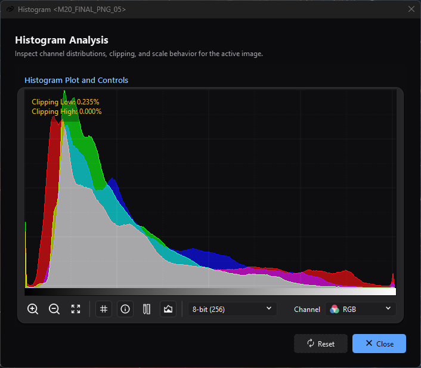

# Histogram Analysis

*Overlaid RGB distributions share the plot while clipping, channel, and
resolution controls remain available for inspection.*

## Purpose, audience, prerequisites, and expected result

Histogram Analysis plots how the active image's stored samples are distributed
from normalized black (`0`) to normalized white (`1`). Use it to inspect
clipping, channel separation, tonal concentration, and the effect of processing
without confusing the stored image with its autostretched display.

You need an active mono or RGB image. A sequence view is supported through its
current decoded frame. The expected result is a read-only white mono curve or
red/green/blue curves, an optional endpoint-clipping readout, and interactive
plot inspection. Nothing is applied to the image.

## Reachability and availability

| Item | Current behavior |
| --- | --- |
| Path | **Image > Information > Histogram**, or **Histogram** on the active image-view toolbar. `Ctrl+H` opens it while the image view has focus. |
| Enabled/visible when | A view with a valid image is active. Opening the dialog disables that view's Histogram actions until the dialog closes; `Ctrl+H` also honors that disabled state. An image load or update in that view enables the actions again, so a second Histogram window can then be opened. |
| Supported inputs/state | Mono and colour signed/unsigned integer or floating-point images; a colour image with alpha offers its three colours. On a sequence view, it plots the current decoded frame. It ignores autostretch, display channel mode, zoom, the view's mask, and selections; samples the image itself marks as holding no data are not counted. |
| Outputs/side effects | A transient plot and overlays only. No image, metadata, history, clipboard, or file output. |
| Persistence | None. A new dialog starts at 256 bins, all RGB channels, grid/clipping/areas on, shared vertical scale, and reset zoom. |
| External dependencies | None. The engine counts the histogram on a worker thread, in an operation the application's engine session admits; the plot changes when the latest count lands. |

## Before you start

- Activate the exact still or sequence frame to inspect.
- For before/after comparisons, keep **Plot resolution**, channel selection, and
  the vertical-scale mode the same. Plot zoom changes presentation only.
- Remember that endpoint percentages count samples at or beyond normalized 0
  and 1. They do not indicate why those samples exist.

## Procedure

1. Open **Image > Information > Histogram**. Confirm the title names the active
   view and that mono shows **Grayscale** while RGB starts at **RGB**.
2. Start with **8-bit (256)**. Read the horizontal axis as normalized stored
   level: left is 0, right is 1. The bottom gradient is a positional guide.
3. Keep the scale toggle off to compare channel peak heights on one shared
   vertical scale. Select **Red**, **Green**, or **Blue** to isolate a curve.
4. Read **Clipping Low** and **Clipping High** before stretching. They are
   percentages across all channel samples, not only the selected curve.
5. Increase plot resolution when narrow peaks are being merged into broad bins.
   Zoom in or use `Ctrl`+mouse wheel, then middle-drag to pan the enlarged plot.
6. Hold the left mouse button over the plot to show normalized `x` position and
   normalized displayed height `y`. This is a display-coordinate aid, not an
   exact raw pixel count.
7. Use **Reset** to restore channel, 256 bins, zoom, shared scale, clipping, and
   grid. **Draw histogram areas** intentionally keeps its current state.
8. Close the dialog when finished; the parent view's Histogram actions become
   available again.

## Complete control and action reference

| UI label/action | Type and unit | Default | Valid values/constraints | Effect | Enabled, hidden, or ignored rules | Trade-off or side effect | Scope | Persistence |
| --- | --- | --- | --- | --- | --- | --- | --- | --- |
| **Zoom in** | Tool button | Reset size | Each click multiplies plot width/height by 1.30 | Enlarges the plot inside its scroll area. | Always available. | Repeated zoom increases the widget and scrolling effort; bin data is unchanged. | Plot presentation | Dialog lifetime |
| **Zoom out** | Tool button | Reset size | Each click multiplies size by 0.70 | Shrinks the plot. | Always available. | Can make fine structure visually merge; data is unchanged. | Plot presentation | Dialog lifetime |
| **Zoom reset** | Tool button | Reset size | Click | Fits the plot widget to its parent area. | Always available. | None. | Plot presentation | Dialog lifetime |
| `Ctrl`+mouse wheel | Plot gesture | No zoom | Wheel up x1.20; wheel down x0.80 | Zooms around the pointer while preserving its approximate scroll position. | Interactive zoom is enabled in Histogram Analysis. A wheel without `Ctrl` follows normal widget/scroll behavior. | Presentation only. | Plot presentation | Dialog lifetime |
| Middle-drag | Plot gesture | Idle | Drag while middle button is held | Pans horizontal/vertical scroll bars. | Useful after enlargement; requires the plot's parent scroll area. | Presentation only. | Plot presentation | Dialog lifetime |
| Left press/drag | Plot gesture; normalized coordinates | Hidden overlay | Pointer constrained to plot | Shows `x` in `[0,1]` and each displayed curve's normalized rendered height `y`; release hides it. | Mono reports one y value; RGB reports visible R/G/B values. | When bins are aggregated to screen columns, y describes the rendered aggregate; it is not an absolute count. | Displayed channels | Dialog lifetime |
| **Show grid** | Checkable tool button | On | Off/on | Shows an 8 x 8 dotted plot grid. | Reset returns it on. | Visual guide only. | Plot presentation | Dialog lifetime |
| **Show clipping info** | Checkable tool button | On | Off/on | Shows percentages for samples `<=0` and `>=1`, summed across all image channels. | The calculation covers all channels even when one curve is selected. Reset returns it on. | Endpoint values may be valid data; the overlay diagnoses population, not cause. | Whole current image/frame | Dialog lifetime |
| **Absolute scales** | Checkable tool button; tooltip label | Off | Off/on | Despite the tooltip, the connected behavior is local channel normalization: off uses a shared maximum across displayed curves; on scales each curve to its own peak. | Mono has no practical cross-channel difference. Reset returns it off. | On makes weak channels visible but hides absolute peak-height differences. | Displayed curve height | Dialog lifetime |
| **Draw histogram areas** | Checkable tool button | On | Off/on | Fills under each curve at 60% opacity; off draws lines only. | Available for mono and RGB. Reset does not change this toggle. | Overlapping RGB fills can obscure fine crossings; line mode is clearer for exact shapes. | Plot presentation | Dialog lifetime |
| **Plot resolution** | Selector; bins/levels | **8-bit (256)** | **6-bit (64)**; **7-bit (128)**; **8-bit (256)**; **9-bit (512)**; **10-bit (1024)**; **12-bit (4096)**; **14-bit (16K)**; **16-bit (64K)**; **100 levels**; **1000 levels**; **10000 levels** | Counts the histogram again, on a worker, at the selected number of bins. | Always available for a valid image. Reset selects 256. | More bins improve level discrimination but use more memory/CPU and can look sparse/noisy; bins above plot width are aggregated for rendering. | All image channels | Dialog lifetime |
| **Channel** | Selector | **RGB** for colour; **Grayscale** for mono | RGB, Red, Green, Blue; mono has disabled Grayscale only | Chooses which curves are drawn. | RGB options appear for an image of three channels or more; an alpha channel is not drawn. Image load/update rebuilds the selector and returns to its first option. | Single-channel view removes overlap but can hide imbalance. Clipping percentages still cover all channels. | Plot curves only | Dialog lifetime |
| **Reset** | Dialog action | Available | Click | Rebuilds the channel selector; selects 256 bins; resets zoom; turns local normalization off and clipping/grid on. | Does not reset **Draw histogram areas**. | Recomputes if resolution changes; presentation state is otherwise local. | This dialog | None |
| **Close** | Dialog action/default close button | Available | Click or close window | Closes the dialog and re-enables Histogram for its parent view. | Always available. | None. | This dialog | None |

## Behavior and state model

For a selected bin count `B`, each stored component is read as a fraction `x` of
its pixel type's range: an unsigned integer over its largest code, a signed
integer from its smallest value to its largest, and a floating-point value as it
is. The engine places `x` in

`bin = floor(x * (B - 1))`

by exact interval arithmetic, so a whole code on a bin boundary lands in its own
bin, and counts a value outside `[0,1]` in the end bin it is nearest. It
separately counts **Clipping Low** for `x <= 0` and **Clipping High** for
`x >= 1`. Each percentage, shown to three decimals, divides the sum across
channels by the samples the image admits - every sample, unless the image marks
some as holding no data. A not-a-number sample of a floating-point image enters
no bin and neither clipping count, but it is among the samples the percentages
divide by.

The plot's horizontal position is normalized level, not native integer code.
The vertical axis is bin population relative to a maximum. With the scale toggle
off, displayed channels share one maximum; with it on, each channel uses its own
maximum. If there are more bins than plot pixels, adjacent bins are summed into
render columns. This preserves grouped counts for drawing but makes a high-bin
plot dependent on its current width.

Image load/update notifications count the histogram again on a worker and reset
the channel selector to its first option; a count asked for while another is on
its way replaces it, and only the latest is drawn. Renaming changes only the window title. For a
sequence, the active decoded frame is the image input; this is not an aggregate
histogram over the sequence. No display stretch, mask, or selected ROI enters
the computation.

## Inputs, outputs, and metadata

Input is the active in-memory image or current sequence frame. The engine builds
one array of 64-bit bin counters per channel plus clipping counters. The dialog
only renders those arrays and transient overlays. It does not modify the source,
create a result view, write history/metadata, or save/copy the plot.

## Performance and responsiveness

Histogram computation is proportional to width x height x channels and runs on a
worker thread, so the window stays responsive. A count may use every thread of
the Processing page's limit that is free. An 8- or 16-bit image, which is what a
camera RAW opens as, is counted once per value it can hold rather than once per
sample. Storage is approximately
`8 x bins x channels` bytes for counters, plus a plot-width render buffer when
bins exceed the visible width. The engine counts in fixed chunks merged in a fixed
order, so high resolutions increase per-chunk allocation and merge work.

Start at 256 bins. Move to 1024-4096 for fine 16-bit structure before trying
16K/64K. Pause sequence playback and avoid repeatedly changing resolution on
very large frames. Plot zoom does not recompute bins, but resizing can rebuild
the display aggregation.

## Worked example

- Evidence mode: Source-and-test-derived.
- Starting state, actions, settings, checkpoints, result, and limitations:
  `HistogramComputationTest` counts a floating-point row of -0.5, 0, 0.5, 1, 2
  and a not-a-number at **100 levels**: the first bin holds 2, bin 49 holds 1 and
  the last bin holds 2; **Clipping Low** and **Clipping High** each count 2, and
  the not-a-number enters no bin. A signed 16-bit row of -32768, -1, 0 and 32767
  at **8-bit (256)** puts one sample in the first bin, one in the last and two in
  bin 127, either side of the middle of the range. The same suite holds every
  standard fixture - every pixel type, mono and colour - to the binning rule at
  256 bins, 100 levels and 16 bits, and `HistogramTest` in `Test_EngineImageOps`
  holds the engine's counts identical at every thread count. This predicts plot
  structure but is not a captured astronomical result.

## Warnings and limitations

- This is a histogram of stored pixels, not the autostretched display.
- Clipping percentages include all channels regardless of the channel selector.
- Endpoint counts cannot distinguish intentional black borders, masks baked into
  pixels, saturated stars, or processing damage.
- The **Absolute scales** tooltip does not match the connected local-
  normalization behavior. Checked means each channel reaches its own plot peak.
- High-resolution bins may be aggregated to plot pixels; left-drag y values are
  normalized rendered heights, not raw bin counts.
- There is no logarithmic vertical scale, ROI/mask sampling, sequence aggregate,
  plot export, or persistence.
- **Reset** does not restore **Draw histogram areas**.

## Troubleshooting

| Symptom or exact error | Verified cause/enablement path | Recovery | Evidence source |
| --- | --- | --- | --- |
| Histogram is disabled | No active image exists, or this view already owns an open Histogram dialog. | Activate a loaded view, or close the existing dialog for that view. | `ActionStateCoordinator.cpp`; `ImageHistogramControl.cpp` |
| One RGB curve appears much shorter | Shared scaling uses the largest displayed channel peak. | Select the channel alone, or enable the scale toggle while remembering that relative amplitudes are then hidden. | `HistogramWidget.cpp` |
| The curve looks comb-like or noisy | Resolution is high relative to occupied levels/sample count. | Reduce **Plot resolution** and compare again. | `HistogramComputation.cpp`; `HistogramWidget.cpp` |
| The curve looks too smooth | Few bins or screen-width aggregation merges neighboring levels. | Increase resolution and/or zoom the plot. | `HistogramWidget.cpp` |
| Clipping remains after selecting one channel | The clipping overlay always sums all channels. | Use the channel plot shape plus [Image Statistics](image-statistics.md) per-channel counts/min/max. | `HistogramWidget.cpp` |
| Reset leaves filled areas enabled/disabled | Reset does not touch the areas toggle. | Set **Draw histogram areas** explicitly. | `ImageHistogramControl.cpp` |
| A sequence histogram changes during playback | The tool follows the current decoded frame. | Pause on the frame to inspect. | `ImageHistogramControl.cpp`; `ImageViewControl.cpp` |

## Related workflow steps

- Use [Image Statistics](image-statistics.md) for exact per-channel counts,
  location, spread, MAD, and background-noise estimates.
- Use [Image Summary](image-summary.md) for dimensions, pixel type, acquisition
  metadata, and sequence frame/FPS context.
- Inspect the histogram before and after
  [Histogram Transformation](../processes/stretching/histogram-transformation.md)
  while keeping resolution and scaling consistent.
- Reopen saved output through [Saving And Exporting](saving-and-exporting.md) when
  verifying whether codec precision or clipping survived the write.

## References and provenance

- `HistogramComputation.cpp` defines how each pixel type is read, the binning and
  the endpoint counters over the engine's histogram; `HistogramDisplayData.h`
  the supported resolutions and per-channel storage.
- `HistogramWidget.cpp` is authoritative for plot aggregation, scaling,
  clipping percentages, gestures, coordinate overlays, and rendering behavior.
- `ImageHistogramControl.cpp` defines menu-dialog state, choices, defaults,
  reset behavior, and image-update refresh.
- `Test_ControlsStatistics` holds the counts of every standard fixture - every
  pixel type, mono and colour - to the binning rule stated in the suite, and the
  window to counting again on a new image or resolution.
