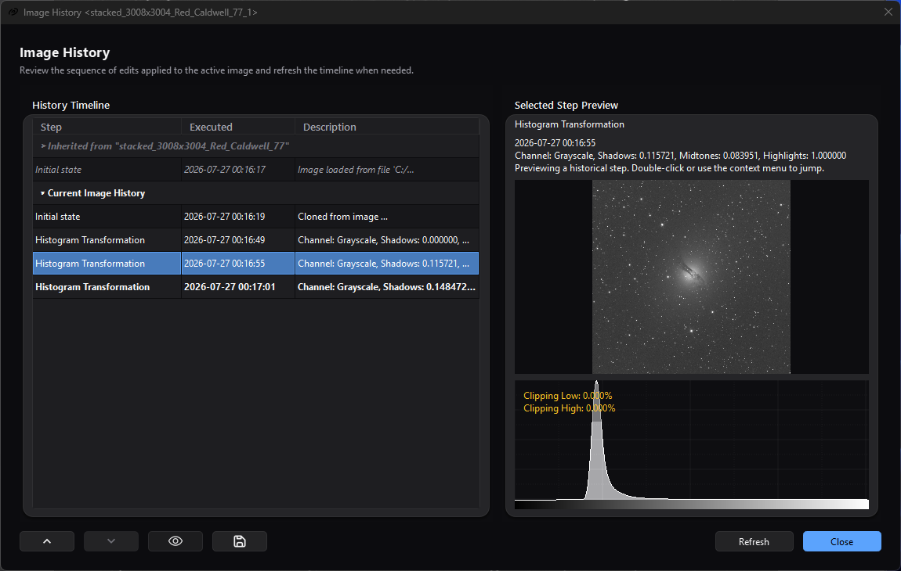

# Image History

## Purpose, audience, prerequisites, and expected result

Image History is the runtime timeline attached to each standard image or
sequence view. It lets you inspect retained step names, times, descriptions,
pixel/sequence snapshots, and inherited lineage; restore an earlier or later
retained state; clone a state into a new view; remove a non-initial state; and
export a text record.

Use it when comparing processing branches or recovering from an unwanted
operation. After the procedure below, you will know which state is active, have
previewed another state without changing the target, and have either cloned,
restored, or exported the intended state. Image History is not a project file,
an unlimited undo journal, or a replacement for saving important images.

*Selecting an older step previews that state without changing which later row
is current; the inherited lineage remains separate above the current image's
timeline.*

## Reachability and availability

| Item | Current behavior |
| --- | --- |
| Path | **Edit > Image History**; **Image History** in a standard image viewer toolbar; or viewer-focused `Ctrl+Shift+Z`. |
| Enabled/visible when | The Edit action requires an active standard view with an Image History tracker. Standard still and sequence viewers own a tracker; RT/static preview views do not. The viewer toolbar action exists in standard views. |
| Supported inputs/state | The retained initial state plus image-modification and rename steps recorded by processes/actions for one standard still or sequence view; optional inherited lineage copied when a new view is created from a parent view. |
| Outputs/side effects | Read-only preview/histogram; restoration of the source view to another retained state; a cloned standard view; immediate removal of a non-initial step; a text log; temporary backup files. |
| Persistence | Timeline, current index, lineage, and backup snapshots live only for the view/application lifetime. They are not embedded in saved images or sequences. A saved history log is descriptive text and cannot restore state. The last log-export folder is remembered. |
| External dependencies | None. Snapshot creation/restoration and log export require working temporary/output storage; sequence restoration also requires the referenced sequence file and its codec support. |

## Before you start

- Save irreplaceable work before navigating or removing steps. Jump, earlier,
  later, Undo, and Redo replace the active image/sequence state. **Remove Step**
  has no confirmation and cannot be undone through Image History.
- Treat the 20 retained states as a rolling convenience buffer. Adding more
  steps promotes the oldest remaining modification to the new initial state and
  discards the previous oldest state.
- Check the current row (bold, with **Current active step** tooltip) before
  acting. Merely selecting a row previews it; double-clicking or choosing
  **Jump To Step** changes the source view.
- For branching, clone the desired state before running another process. A new
  step recorded after moving backward deletes the later redo branch.
- Ensure temporary storage remains available. A still snapshot is copied when
  its step is recorded and written in the background; an edit, a preview, a
  clone, or a restoration can wait in the background for a snapshot still being
  written, and an edit whose undo cannot be kept is refused.

## Procedure

1. Activate the target standard view and choose **Edit > Image History**, its
   viewer toolbar action, or `Ctrl+Shift+Z`. Confirm the title is **Image History
   <_view-name_>** and the bold row is the active state.
2. Select a different row once. Confirm the **Selected Step Preview** title does
   not include **(Current)** and the source image has not changed. When its
   snapshot loads, the scaled preview and histogram appear; otherwise the panel
   says **Preview unavailable for this step.** A description too long for the
   panel ends in an ellipsis; hover over it to read all of it.
3. To preserve that state as a branch, right-click it and choose **Clone From
   Step**. Confirm a new standard view appears. The source remains on its current
   state, while the clone starts with a description naming the source view and
   selected step.
4. To restore the source, double-click a non-current own-history row or use
   **Jump To Step**. Confirm that the row becomes bold/current and the source
   view becomes active. The adjacent-step arrow tooltips now name the available
   earlier and later states.
5. If a later state should be recovered without creating a branch, use the
   later-step arrow or Redo. If you instead run a process from the restored
   state, understand that the prior later branch is removed when the new step is
   registered.
6. Use the save icon or **Save History Log...** to write the complete inherited
   and current retained timeline. Confirm the file contains an inherited section
   when lineage exists and a current-history section. The lineage visibility
   toggle does not change what the log includes.

## Complete control and action reference

| UI label/action | Type and unit | Default | Valid values/constraints | Effect | Enabled, hidden, or ignored rules | Trade-off or side effect | Scope | Persistence |
| --- | --- | --- | --- | --- | --- | --- | --- | --- |
| **Edit > Undo** | Main-menu action; `Ctrl+Z` | Disabled at initial state | Previous retained state | Restores the immediately earlier state; label becomes **Undo <_step_>** when named | Active standard view with an undo step | Replaces source pixels/sequence/name; a restore that fails changes nothing and reports the failure | Active view/current index | View lifetime |
| **Edit > Redo** | Main-menu action; `Ctrl+Y` | Disabled at latest state | Next retained state | Restores the immediately later state; label becomes **Redo <_step_>** when named | Active standard view with a redo step | Replaces source state; a restore that fails changes nothing and reports the failure | Active view/current index | View lifetime |
| **Edit > Image History** | Main-menu action | Disabled without active tracker | Action | Opens a modeless Image History dialog for the active view | Active standard view with tracker | More than one dialog can be opened for the same view | Active view | Dialog not restored |
| Viewer **Undo** | Toolbar action | Disabled at initial state | Previous retained state | Same tracker operation as main Undo | Standard viewer with undo step | Current viewer receives the restored state | Owning view | View lifetime |
| Viewer **Redo** | Toolbar action | Disabled at latest state | Next retained state | Same tracker operation as main Redo | Standard viewer with redo step | Current viewer receives the restored state | Owning view | View lifetime |
| Viewer **Image History** | Toolbar action; viewer-focused `Ctrl+Shift+Z` | Available in standard viewer | Action | Opens a modeless dialog parented to the view | Standard viewer; shortcut is handled by the focused image widget | Repeated activation can open multiple dialogs | Owning view | Dialog closes with parent view |
| **History Timeline** | Read-only, single-row table | Current row selected | Inherited headers/entries plus retained current-view steps | Displays lineage and own history in chronological retained order; not sortable | Lineage section depends on lineage toggle/data | A process decides the detail recorded in Step/Description; it may not include every parameter | One view | Runtime only |
| **Step** | Table column | **Initial state** plus recorded names | Text supplied by tracker/process | Identifies the operation; current row is bold | Inherited group headings span all columns | Names are descriptive, not executable presets | Timeline | Runtime only |
| **Executed** | Table column | Step creation time | Local `yyyy-MM-dd hh:mm:ss` | Shows when the record was created | Empty on section/separator rows | Second precision; not a duration | Timeline/log | Runtime; copied to log |
| **Description** | Table column | Initial creation/open description or process text | Free-form recorded text | Shows available parameters/context | Empty values allowed | Coverage varies by process; not guaranteed to reproduce the operation | Timeline/log | Runtime; copied to log |
| Select own-history row | Single selection | Current row after refresh | Initial or retained modification/rename row | Loads its snapshot into preview/histogram without changing source state | Inherited/header rows are read-only and non-selectable | Loading can wait on backup I/O or sequence decode | Dialog preview | Selection resets to current on refill |
| Double-click own-history row | Table gesture | — | Non-current row with valid retained index | Calls Jump To Step | Current row is a no-op; inherited/header rows do nothing | Destructive source-state restoration | Source view | Updates current index |
| **Selected Step Preview** | Scaled image pane and status text | Current selected row | Snapshot available or unavailable | Shows the step name on one line; below it, in five lines, the time, the current status and the description; and an 8-bit display of the selected still/frame, stretched for a linear step | Hidden image content when restore fails or sequence has zero frames | Display is scaled and is not proof of exact pixel equality; quick zoom is disabled. Text past its lines ends in an ellipsis and is shown whole in the tooltip, so the preview keeps its place from step to step | Selected retained state | Not persisted |
| Selected-step histogram | Read-only histogram with clipping/area overlays | Visible when snapshot loads | Snapshot image; widget default resolution | Recomputes from the full-precision selected snapshot/current sequence frame | Hidden when preview unavailable; interactive zoom disabled | Histogram computation adds CPU/memory cost | Selected retained state | Not persisted |
| Earlier-step arrow (**Jump to _name_**) | Icon button | Disabled at initial state | Exactly current index minus one | Restores the adjacent earlier state; this is not row reordering | Enabled when an earlier state exists | Replaces source state and activates the view | Source view | Current index for view lifetime |
| Later-step arrow (**Jump to _name_**) | Icon button | Disabled at latest state | Exactly current index plus one | Restores adjacent later/redo state | Enabled when a later retained state exists | Replaces source state and activates the view | Source view | Current index for view lifetime |
| **Show/hide inherited processing history from parent images** | Checkable icon button | On | On or off | Shows/hides grouped inherited rows | Button itself is hidden when lineage is empty | Display only; hidden lineage is still included in saved log | Dialog table | Not saved; defaults on per dialog |
| **Save the complete history log to a text file** | Icon button | — | Save/cancel path | Writes lineage plus retained current history | Tracker required | Log can contain filenames/descriptions; it cannot restore snapshots | Current view history | Last folder under `__IMAGE_HISTORY_SAVE__` |
| **Refresh** | Button | Enabled | Action | Rebuilds table, reselects current row, and reloads selected preview | Tracker/dialog alive | Usually redundant because tracker listeners refresh automatically; can trigger snapshot I/O | Current dialog | Not saved |
| **Close** | Default button | Enabled | Action/Enter when default | Closes this modeless dialog | Dialog open | Does not change or delete view history | Current dialog | Not saved |
| **Jump To Step** | Context action | Disabled for inherited/current/invalid row | Non-current own-history row | Restores selected state after a successful snapshot restore | `canJumpToStep` must pass | Same destructive state change as double-click; later states remain available until a new step is registered | Source view | Updates current index |
| **Clone From Step** | Context action | Enabled for any own-history row with a step | Initial, current, earlier, or later retained step | Loads snapshot and creates a new standard still/sequence view | Inherited/header rows disabled; view factory and snapshot required | Uses memory/I/O; clone inherits source pending-change status and the source's complete retained lineage/history list | New view | New view history/lineage lasts for its lifetime |
| **Remove Step** | Context action | Disabled for initial state | Any non-initial retained own-history row while total >1 | Immediately erases selected state and releases orphan temporary backup | No confirmation; inherited/initial/invalid rows disabled | Irreversible. Removing current first restores its previous state; removing an older step shifts the index but keeps same snapshot; removing future leaves current state | Source timeline/view | Permanent for remaining view lifetime |
| **Save History Log...** | Context action | Enabled when total step count >0 | Save/cancel path | Same complete text export as save icon | Inherited/header context can still expose this action when tracker has steps, though those rows are not selectable | Includes lineage even when hidden; no automatic `.txt` suffix is appended by this code | Current view history | Last folder remembered |

## Behavior and state model

Each standard view creates a tracker and an **Initial state**. A modification
step copies the still image the moment it is recorded, so later changes to the
shown image cannot reach it, and the view's background writer saves the copy
as a snapshot holding its pixels, its metadata and its mask of valid pixels.
Across all open views, at most two copies, and 1 GiB between them, wait to be
saved. An edit of the view - a mirror, a rotation, **Apply Stretch** - waits in
the background until the state it replaces is saved and there is room for its
own copy, and only then is shown; the window and the rest of the application
keep responding meanwhile. If either cannot be kept, the edit is refused, an
error says why, and the view keeps what it showed. A state a process has already
shown is recorded at once. A Rename step shares its parent snapshot and records
the new view name. A sequence step stores a reference to its sequence file when
the edit wrote a new one. When the sequence file did not change - an edit of the
frame on screen, such as **Apply Stretch** in a sequence view - the step writes
that frame, with its frame number, before the edit is shown; if the frame cannot
be written, the edit is refused and the view keeps the frame it showed before.

The current index divides earlier states from later redo states. Jump, Undo,
Redo, and the arrow buttons restore a retained snapshot and update that index;
they do not delete either side. Registering a new step while later states exist
erases that redo branch and cleans up temporary backups no longer referenced.

At most 20 states, including the initial state, are retained. When another step
would exceed the window, the oldest modification becomes the new initial state,
the prior initial state is discarded, and orphan temporary data is released.
This rollover is automatic and has no prompt.

Restoring a still reads its snapshot in the background into a new image that
replaces the shown one when it has been read - the view keeps its file name -
with the metadata and the mask of valid pixels the snapshot holds; the view then
invalidates detected-star analysis, updates supported channels, and attempts to
restore the recorded view name. The current row moves only once the restored
state is shown, and one restore runs at a time: Undo pressed again before the
first has landed does nothing. A snapshot that cannot be read changes nothing:
the view, its name, and the current row stay as they were, and an error names
the step. If another open view already
uses that name, AfterNight generates a unique replacement and stores it back in
the restored history step; later clones and propagated lineage use the
replacement. Restoring a step of another sequence opens that sequence again and
shows its frame; a step that kept a changed frame moves to that frame and shows
the kept frame, and leaving such a step moves to the same frame and shows the
sequence's own.
History does not snapshot display channel/mode, zoom/pan, mask
assignment/rendering, attached processes, pending-change flag, or the view's
detected stars.

Selecting a step reads its snapshot in the background, only for inspection; a
later selection replaces a preview still on its way. A preview is an 8-bit
rendering - grey, colour, or colour with alpha, each with its own channels. A
step that is still linear data is stretched as the dashboard's thumbnails show
it, each colour channel stretched on its own, so it does not show almost black.
Linear data is what the dashboard takes for it: an image recorded linear, a
stack whose header counts its frames, as AfterNight's stacks do, a frame whose
header records its frame type, or a camera RAW frame - unless its record says
it was stretched, as every AfterNight stretch records, or it is sRGB or gamma
encoded. A step an extension made is judged by the header the extension gave
its result: one that keeps its source's header and records no stretch is shown
as linear data. Any other step is shown as it is, at full scale. The histogram
uses the restored full-precision image either way. A sequence step that kept a
changed frame previews that frame. Any other sequence preview reads the selected
sequence's frame at the source view's current zero-based frame index, with the
source view's current auto-debayer setting. The preview is therefore
contextual, not a saved record of the original display state.

The step name takes one line, and the details below it take five: the time,
whether the step is current, **Preview unavailable for this step.** when it
applies, and then the step's description. Text past those lines is cut with an
ellipsis, and hovering over it shows all of it, so the preview stays in the same
place as you move from one step to the next.

Creating a view from another view copies the parent's existing lineage and then
appends the parent's complete retained initial/modification list, grouped by
recorded image name. These inherited rows are read-only. Clone From Step uses
that same propagation, so its lineage includes the complete source retained
list—not only steps through the selected row, and potentially including later
redo states when cloning from an earlier position.

A still clone starts as an image that has never been a file, under the step's
recorded name; the snapshot's metadata remains. A sequence clone shows the
step's sequence at the frame the step changed, or at the source view's current
frame, with the current auto-debayer choice. Both take the source's
pending-change status; a clone carries no detected stars.

## Inputs, outputs, and metadata

- History input is runtime state recorded by the owning view and processes.
  Step descriptions vary and are not guaranteed to include masks, every
  parameter, or enough data to recreate an operation.
- Restoring a still recovers its stored pixels bit for bit - every sample type,
  extreme values, infinities and subnormals included - with its metadata and its
  mask of valid pixels. It does not restore view-only display/mask/process state
  or detected stars.
- Sequence snapshots are file references, not independent copies, plus the
  kept frame of a step that changed only the frame on screen. Availability
  depends on that referenced sequence remaining valid until the tracker closes.
- Still snapshots and kept frames are written in a folder of the view's own,
  `AN_HISTORY_*` in the temporary folder, each as a checksummed snapshot file
  holding the samples, every metadata object, the mask of valid pixels and the
  step's identity, written under a pending name beside it and renamed when
  complete. The history reads one back only as the step it wrote. A shown
  image's own file, temporary or not, is never read back as one, and its file
  name is not changed by the history. Closing the view drops snapshots still
  waiting to be written, stops the one being written, closes child history
  dialogs, and removes that folder and nothing else. A temporary sequence a
  process wrote stays until the application clears its temporary folder.
- A still clone clears disk filename/size/time/format identity and the image
  filename so it starts as an unsaved derived view. A sequence clone remains
  tied to the loaded sequence representation.
- The history log contains inherited group headings and numbered entries, then
  retained current-history entries with time, name, and description. `*` marks
  the current modification row; when Initial state is current, the formatter
  does not add a current marker to that initial line.
- The history log is plain text only. It stores no pixels, restorable backup
  paths, view state, or executable parameters.

## Performance and responsiveness

An edit copies its result and waits for the background writer in the
background: when two copies, or 1 GiB of them, are already waiting across all
open views, the edit is shown only once the writer has saved one, so a burst of
edits on a large image on slow storage takes longer to appear while the
application keeps responding. A state a process has already shown is copied
when it is recorded. Preview, clone, jump, removal of the active step and
Undo/Redo read their snapshot, or decode their sequence frame, in the
background and wait there for a snapshot still being written; closing the view
stops the write in progress. Large images, long sequences and slow temporary
storage therefore delay a preview or a restore rather than pausing the window.

Select only the state needed, avoid repeatedly refreshing large snapshots, keep
fast temporary storage available, and save/close unnecessary views to release
their retained backups. There is no history-operation progress dialog or cancel
control.

## Worked example

- Evidence mode: Source-and-test-derived.
- Starting state, actions, settings, checkpoints, result, and limitations:
  Begin with a disposable standard still containing Initial state plus two
  processing steps. Open Image History; current row is the last step. Select the
  first processing row once and inspect its preview/histogram without changing
  the source. Use **Clone From Step** and confirm a new view is requested from
  that snapshot. Back in the source, choose **Jump To Step** and confirm the
  selected row becomes current and the later arrow/Redo becomes available.
  Export the log before applying a different process; that new step would remove
  the old later branch. This establishes the source/test-defined transitions,
  not actual pixel fidelity, visual quality, disk capacity, timing, or platform
  rendering.

## Warnings and limitations

- Image History is volatile and capped at 20 states. Saving an image or sequence
  does not embed it; closing the view releases its restorable snapshots.
- **Remove Step** is immediate and has no confirmation. The initial state cannot
  be removed, but any other retained step can.
- A new modification after moving backward discards the entire later redo
  branch.
- Selecting previews; double-clicking restores. Use a single click when the goal
  is inspection only.
- Preview is scaled/8-bit and uses current sequence frame/auto-debayer context.
  It does not restore or reproduce the original viewer display configuration.
- Lineage is descriptive and read-only. Current production propagation does not
  populate its optional source-file field and includes the source's complete
  retained list rather than truncating at a cloned historical row.
- A snapshot that cannot be written is reported, and its step cannot be
  restored: Undo, Redo, and Jump to it change nothing and say why. An edit of a
  sequence frame whose frame cannot be written is refused before it is shown; a
  change of the frame a process has already shown stays recorded and cannot be
  restored. There is no cancel control, and waits for a snapshot being written
  have no timeout; they happen in the background. Preserve work and inspect
  Session Console if a history action stalls.
- Jump, Remove, Undo, and Redo restore before they move the current row, so a
  failed restore leaves the view and the current row unchanged. While one
  restore is on its way, another history action and a new edit are refused.
- Rename-only steps share a snapshot. Restoring between them can change the view
  name without changing pixels.
- Restoring a recorded name that is already used by another open view assigns a
  unique replacement and updates that history step's stored name. Subsequent
  clones and lineage can therefore show the replacement rather than the
  originally recorded name.
- Saved logs may contain image names, descriptions, and source paths if lineage
  data supplied them. Review before sharing.

## Troubleshooting

| Symptom or exact error | Verified cause/enablement path | Recovery | Evidence source |
| --- | --- | --- | --- |
| **Edit > Image History** is disabled | No active standard view/tracker | Activate a standard still or sequence view. RT/static previews do not own history | `ActionStateCoordinator::updateActiveImageHistory`; `ImageViewControl::initialize` |
| **No selected image to show history from** | Coordinator was invoked without an active view | Activate the intended standard view and reopen | `ImageOperationsCoordinator::imageHistory` |
| Preview says **Preview unavailable for this step.** | Snapshot is absent or could not be written, the snapshot could not be read, the sequence frame could not be read, or sequence has zero frames | Keep source open, verify temporary/sequence files and free space, inspect Session Console, then Refresh once | `ImageHistoryControl::updateSelectedStepPreview`; `ImageHistoryTracker::stepReader` |
| **History Clone: Unable to clone the selected history step.** | The step's snapshot or frame could not be read | Do not close source; verify temp/sequence availability and retry another retained step; inspect Session Console | `ImageHistoryControl::cloneSelectedStep` |
| **Could NOT jump to the selected history step. Error message: ...** | The step's snapshot or sequence frame could not be read, or the view could not show it | Preserve current view, inspect Session Console and storage, then try Clone From Step if its snapshot remains readable | `ImageHistoryTracker::jumpToStep`; `ImageHistoryTracker::reportFailure` |
| **Could NOT remove the selected history step. Error message: ...** | Restoring the previous state before removing the active row failed | Leave the row intact, inspect Session Console/storage, and save work before retrying | `ImageHistoryTracker::removeStep`; restore-before-erase contract tests |
| **Could NOT undo the last step. Error message: ...** or **Could NOT redo the next step. Error message: ...** | The snapshot of the step to restore could not be written or read; the view and the current row did not change | Keep the view open, check temporary storage and free space, and save the current state before continuing | `ImageHistoryTracker::undoStep`; `ImageHistoryTracker::redoStep`; `test_image_history_safety.cpp` |
| **Could NOT keep the snapshot of step '_name_' of '_view_'; undo and redo cannot restore that step. Error message: ...** | The background writer could not save the step's snapshot, usually for lack of temporary storage | Free temporary storage; save the current state if it matters, because that step cannot be restored | `ImageHistoryBackupQueue.cpp`; `ImageHistoryTracker.cpp` |
| **Could NOT apply '_name_', because ... Error message: ...** | An edit of the view - a mirror, a rotation, **Apply Stretch** - was refused before anything changed: the state it replaces, its result or the sequence frame it changes could not be kept for undo, or a restore was still on its way | Nothing was applied; free temporary storage, wait for the restore, and apply again | `ImageHistoryTracker::editPreparation`; `ImageHistoryTracker::registerEditBeforePublishing` |
| **Save History Log: Unable to write the history log file.** | Selected path could not be opened writable | Choose a writable local destination and check permissions/free space | `ImageHistoryControl::saveHistoryLog` |
| Earlier/later arrow is disabled | Current index is already at that boundary | Select/preview any row, or use the available direction; arrows operate from current state, not selected row | `previousStep`; `nextStep`; `updateNavigationButtons` |
| A later branch disappeared | A new step was registered while current index was earlier than latest | It cannot be recovered from this tracker; use a saved clone/file. Clone before branching next time | `ImageHistoryTracker::annotateNewStep` |
| Oldest states disappeared | The rolling history exceeded 20 total retained states | Recover from a saved image/clone if available; history rollover is not reversible | `ImageHistoryTracker::annotateNewStep`; `m_MaxSteps = 20` |
| Inherited rows are absent | View has no propagated lineage or the eye toggle is off | Use a view created from another standard view and enable the lineage toggle | `ViewCreationCoordinator::propagateLineage`; `ImageHistoryControl::refillData` |
| Restore changed pixels but not mask/display/zoom | Those are view-only states outside snapshot scope | Reapply the intended display mode, zoom, and mask configuration manually | `ImageHistoryTracker::finishRestore`; `ImageViewControl::replaceImage` |

## Related workflow steps

- [Image Viewer](image-viewer.md) explains the owning standard view, viewer
  toolbar, display-only state, masks, and focused shortcuts.
- [Process Windows](process-windows.md) explains when a successful Apply records
  a committed history step and which process state is not part of the snapshot.
- [Toolbar & Menus](toolbar-and-menus.md) documents the shared Edit actions and
  their active-view targeting.
- [Saving & Exporting](saving-and-exporting.md) is the durable handoff after
  selecting or cloning the state you intend to keep.
- [Session Console](log-viewer.md) contains snapshot/restore diagnostics when a
  preview, clone, jump, remove, or save action fails.

## References and provenance

- AfterNight view/history control, tracker, lineage, engine snapshot, metadata,
  application wiring, and focused tests are the
  authoritative implementation provenance for this page.
- No external algorithm or file-format standard is required for the history
  state model documented here.
