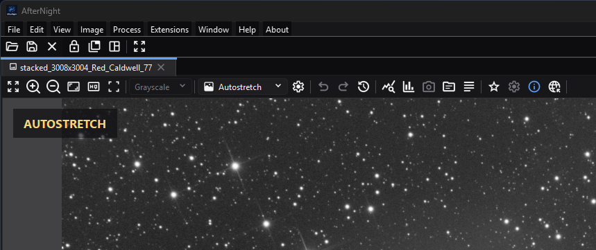

# Image Viewer

*The viewer toolbar groups display-only channel and stretch choices with zoom,
history, analysis, metadata, and overflow actions.*

## Purpose, audience, prerequisites, and expected result

The Image Viewer is the visual and interaction surface for an opened still or sequence. Use it to change the *display* of an image, inspect channels and samples, navigate at different scales, show overlays, and open analysis tools. These display operations are separate from processes that alter stored pixels.

This page is for anyone inspecting or processing an image. Start with a supported still or sequence open in the [dock workspace](overview.md). After following the worked example, the image should return to **Linear**, full-color display with its pixel data, metadata, pending-save state, and processing history unchanged.

## Reachability and availability

A successful **File > Open** creates a standard image or sequence view in the dock workspace. Processes can embed a real-time preview viewer in their own windows, and a few workflows create static preview viewers. Viewer mode determines which toolbar groups exist:

- **Standard still:** navigation, channel and display controls, history, analysis, metadata, and applicable astrometry actions.
- **Standard sequence:** navigation, channel/display/history/analysis actions and sequence status; astrometry toolbar actions are hidden. Autostretch requests that background-neutralization/color-calibration controls remain unavailable, although the current RGB-frame refresh path can re-enable them; leave them off for sequences.
- **Real-time preview:** navigation plus optional original/result switching, Preview area, snapshot, and process-approved display-autostretch controls.
- **Static preview:** navigation, optional calibration comparison, display mode/settings, and a statistics overlay. Availability is configured by its owning workflow.

When the toolbar is too narrow, **More** moves a rightmost group of actions into an overflow menu. Checkboxes and selectors in that menu keep their current enabled and checked state.

## Before you start

- Treat **Linear/Autostretch**, **View Channel**, zoom, overlays, and the quick lens as display choices. They do not stretch, crop, or replace stored data.
- Save or duplicate before using **Apply Stretch** in Autostretch Settings. That confirmation is an image operation, unlike ordinary viewer autostretch.
- A process-owned crop, area, or preview rectangle is not a generic viewer selection tool. Check the owning process page before applying it.
- An attached mask can be shown as an overlay and can also modulate a compatible process. Visibility and process enablement are separate states; see [Masks](masks.md).

## Procedure

1. Open a supported image and identify its name and type in the dock tab/status area.
2. Use **Fit To Window**, **Zoom In**, **Zoom Out**, **Zoom 100%**, the mouse wheel, or middle-button drag to frame the region you need.
3. Select **Autostretch** when a linear image is too dark for inspection. Open **Autostretch Settings** only when you need to tune the display transfer.
4. Choose a **View Channel** entry to inspect one component. Return to **RGB** or **Grayscale** for the normal composite.
5. Hold the left mouse button for about 300 ms to open the sample lens. Move while holding to inspect coordinates, channel values, a local histogram, and an assigned mask sample.
6. Enable only the overlays needed for the task. For a solved still, **Show Astrometry** is the master switch for its subordinate overlays.
7. Open **Statistics**, **Histogram**, **Summary**, or available metadata viewers when numerical inspection is required.
8. Return temporary display choices to the desired state. Use a processing tool—not viewer display controls—when stored pixels must change.

## Complete control and action reference

### Common toolbar and navigation

| Control / action | Type | Default | Range / choices | Step | Enabled when | Side effect | Scope | Persistence |
| --- | --- | --- | --- | --- | --- | --- | --- | --- |
| Fit To Window | Toolbar action; `Ctrl+Shift+F` | Standard views are fitted after creation | Scale needed to contain the whole image | Absolute | Image exists | Centers and fits; may upscale a small image | Current view display | Session only |
| Zoom In | Toolbar action | — | Up to 6400% | ×1.25 | Image exists | Zooms around viewport center | Current view display | Session only |
| Zoom Out | Toolbar action | — | Down to 1% | ×0.8 | Image exists | Zooms around viewport center | Current view display | Session only |
| Zoom 100% | Toolbar action | — | 100% | Absolute | Image exists | Shows one image pixel per display scale unit | Current view display | Session only |
| Maximize image view | Checkable toolbar action; `F11` | Off | Off / On | Toggle | Standard view is docked; disabled while floating | Hides other dock content and restores it on toggle | Dock workspace | Session only |
| View Channel | Selector | `RGB` for color; `Grayscale` for mono | Listed in the channel table below | Discrete | Image exists; mono selector is disabled | Rebuilds only the rendered display copy | Current view display | Session only |
| More | Overflow menu | Hidden while all items fit | Rightmost overflowed controls | Open menu | Toolbar is too narrow | Exposes controls without changing their state | Current viewer toolbar | Layout-derived; not persisted |
| Mouse wheel | Pointer gesture | Zooms without a modifier | 1%–6400% | Interface sensitivity; 50 gives ×1.25/÷1.25 | Pointer is over image; if **Require Ctrl** is on, `Ctrl` is held | Zooms around pointer position | Current view display | Zoom is session only; sensitivity/modifier preference persists |
| Middle-button drag | Pointer gesture | — | Scrollable image extent | Continuous | Image is larger than viewport in an axis | Changes horizontal/vertical scroll positions | Current view display | Session only |
| Close tab/window | Window action | — | Close | One action | View is open | Runs pending-change and attached-process close handling before removal | Current standard view | Closed state is not restored as an open image |

### Standard-view toolbar

| Control / action | Type | Default | Range / choices | Step | Enabled when | Side effect | Scope | Persistence |
| --- | --- | --- | --- | --- | --- | --- | --- | --- |
| Display Mode | Selector | Linear | Linear / Autostretch | Discrete | Image exists | Switches between direct display and a computed display transfer | Current view display | Session only |
| Autostretch Settings | Toolbar action; `Ctrl+Shift+A` | — | Settings window | Open | Display Mode is Autostretch | Edits per-view display parameters; **Apply Stretch** is separately destructive | Current view unless applied | Parameters are session only |
| Undo | Toolbar action | Disabled with no undo step | Label includes next step | One history step | Undo is available | Restores prior stored image state | Current image data/history | Image state |
| Redo | Toolbar action | Disabled with no redo step | Label includes next step | One history step | Redo is available | Reapplies next stored image state | Current image data/history | Image state |
| Image History | Toolbar action; `Ctrl+Shift+Z` | — | History window | Open | Image exists | Opens the history/lineage surface | Current image | Image history |
| Statistics | Toolbar action; `Ctrl+Shift+T` | — | Statistics window | Open | Image exists | Opens numerical statistics | Current image | Window/session only |
| Histogram | Toolbar action; `Ctrl+H` | — | Histogram Analysis | Open | Image exists | Opens histogram analysis | Current image | Window/session only |
| EXIF Viewer | Toolbar action; `Ctrl+Shift+X` | Disabled without EXIF | EXIF viewer | Open | EXIF metadata exists | Opens EXIF fields | Current image metadata | Window/session only |
| FITS Header | Toolbar action; `Ctrl+Shift+H` | Disabled without FITS metadata | FITS Header Viewer | Open | FITS metadata exists | Opens FITS keyword/value/comment data | Current image metadata | Window/session only |
| Summary | Toolbar action; `Ctrl+Shift+M` | — | Image/Sequence Summary | Open | Image exists | Opens the applicable summary | Current image or sequence | Window/session only |
| Show Astrometry | Checkable toolbar action; `Ctrl+Shift+W` | Off | Off / On | Toggle | Solved still with WCS; hidden for sequences/unsolved stills | Master visibility switch for astrometry overlays | Current solved still display | Session only |
| Astrometry Settings | Popup action | — | Overlay toggles and magnitude limit | Open | **Show Astrometry** is on | Configures subordinate overlays | Current solved still display | Subsettings persist globally |
| Equatorial Grid | Checkable popup action; `Ctrl+1` | Saved setting | Off / On | Toggle | Astrometry master is on | Draws the coordinate grid | Current solved still display | Global setting |
| Deep-Sky Annotations | Checkable popup action; `Ctrl+2` | Saved setting | Off / On | Toggle | Astrometry master is on | Draws catalog object annotations | Current solved still display | Global setting |
| Star Labels | Checkable popup action; `Ctrl+3` | Saved setting | Off / On | Toggle | Astrometry master is on | Draws catalog star labels | Current solved still display | Global setting |
| Detected Stars | Checkable popup action; `Ctrl+4` | Saved setting | Off / On | Toggle | Astrometry master is on | Marks detected stars; this is not an editable star selection | Current solved still display | Global setting |
| SIP Distortion Map | Checkable popup action; `Ctrl+5` | Saved setting | Off / On | Toggle | Astrometry master is on and distortion data is usable | Draws the distortion visualization | Current solved still display | Global setting |
| Star magnitude limit | Exclusive popup choices | Saved setting | ≤6, ≤8, ≤10, ≤12, ≤14, ≤16, All | Discrete | Astrometry master is on | Limits displayed catalog stars | Current solved still display | Global setting |
| Astrometry Info | Toolbar action; `Ctrl+Shift+P` | Hidden on sequences | Information window | Open | Current still has WCS | Opens solution/projection/field information | Current solved still | Window/session only |
| Plate Solve | Toolbar action; `Ctrl+P` | Visible for a still | Plate Solving process | Open | Current still satisfies plate-solving launch guard | Opens plate-solving controls for this target | Current still | Process-specific |

### Real-time and static preview controls

| Control / action | Type | Default | Range / choices | Step | Enabled when | Side effect | Scope | Persistence |
| --- | --- | --- | --- | --- | --- | --- | --- | --- |
| Switch image | RT-preview action; `Space`, right-click, or `Ctrl+Shift+O` | Process result | Original / Preview | Toggle or press/release | Alternate image is available | Changes only the comparison display | Current RT preview | Session only |
| Preview area | RT-preview checkbox | Process-specific | Off / On | Toggle | Owning process supports an area | Adds/removes a red process-owned rectangle and limits preview computation to it | Preview computation only; Apply remains full image | Session only |
| Take snapshot | RT-preview action; `Ctrl+Shift+K` | — | New standard image | One action | Owning process enables it | Re-executes at source depth and creates a new image; does not modify target | Current target/process parameters | New image/history persists in session |
| Display Mode / Autostretch Settings | Optional RT-preview controls | Process-specific | Linear / Autostretch plus viewer settings | Discrete | Owning process explicitly supports execution autostretch | Changes preview presentation; does not replace process parameters unless that process documents otherwise | Current RT preview | Session only |
| Calibrated | Static-preview checkbox | Workflow-specific | Original / calibrated presentation | Toggle | Owning workflow configured a calibration master and enables the action | Switches static preview source | Current static preview | Session only |
| Show statistics | Static-preview checkbox | On | Off / On | Toggle | Static preview provides statistics | Shows/hides the preview statistics overlay | Current static preview | Session only |

### Autostretch Settings

| Control / action | Type | Default | Range / choices | Step | Enabled when | Side effect | Scope | Persistence |
| --- | --- | --- | --- | --- | --- | --- | --- | --- |
| Target Background | Numeric | 0.25 | 0–1 | 0.02 | Autostretch settings are open | Sets the desired median display background | Current view display | Session only |
| Shadows Clipping | Numeric | -2.8 | -10–0 | 0.2 | Autostretch settings are open | Positions the dark cutoff in normalized-MAD units | Current view display | Session only |
| Linked channels | Checkbox | Off | Off / On | Toggle | RGB image | Uses one pooled transfer instead of one per RGB channel | Current view display | Session only |
| Neutralize Background | Checkbox | Off | Off / On | Toggle | RGB frame and Linked channels is on; see sequence limitation below | Adds display-only background neutralization | Current view display | Session only |
| Color Calibration | Checkbox | Off | Off / On | Toggle | RGB frame and Linked channels is on; see sequence limitation below | Adds display-only color calibration | Current view display | Session only |
| Post Processing | Non-interactive group heading | — | — | — | Autostretch settings are open | Groups the adjustments below; it is not a toggle | Current view display | None |
| Saturation | Numeric | 0 | -1–2 | 0.05 | RGB image | Adjusts display saturation | Current view display | Session only |
| Saturation Background | Numeric | 1 | 0–2 | 0.02 | RGB image | Controls background protection in saturation adjustment | Current view display | Session only |
| Brightness | Numeric | 0 | -150–150 | 1 | Autostretch settings are open | Adds display brightness adjustment | Current view display | Session only |
| Contrast | Numeric | 0 | -100–100 | 1 | Autostretch settings are open | Applies display contrast adjustment | Current view display | Session only |
| Print Autostretch Banner | Checkbox | On for the opened viewer | Off / On | Toggle | Autostretch settings are open | Shows/hides the parameter banner on the image | Current view display | Session only |
| Apply Stretch | Button; standard views only | — | Confirmation: Yes / No | One action | Standard still or sequence view is in Autostretch | Permanently applies the current stretch: computes it on a copy of the current image, records that copy in the viewer history, and only then shows it, switches to Linear, resets settings, and closes the window. When the history cannot keep the result or the state it replaces, nothing changes, an error explains why, and the window stays open. In a sequence view this is the current frame, whose stretched copy is written with its history step, not a sequence-wide operation. | Current still or current sequence frame/history | Image state |
| Reset | Button | — | Factory defaults above | One action | Settings window is open | Restores display parameters | Current view display | Session only |
| Close | Button | — | Close | One action | Settings window is open | Closes settings without applying pixels | Settings window | Session only |

## Behavior and state model

### Display versus image data

The viewer renders from an image copy. **View Channel**, **Autostretch**, zoom/pan, overlays, and the sample lens do not alter source samples, metadata, pending-save state, or history. Standard processing actions and the explicitly confirmed **Apply Stretch** path do alter image state.

For color images, **View Channel** offers 25 entries: **RGB**, **Red**, **Green**, **Blue**; **CIE L\* (Lightness)**, **CIE a\***, **CIE b\***, **CIE a\*=R / b\*=G (Chrominance)**, **CIE c\***, **CIE h\***, **CIE X**, **CIE Y (Luminance)**, **CIE Z**; **HSL Hue**, **HSL Saturation**, **HSL Lightness**; **HSV Hue**, **HSV Saturation**, **HSV Value**; **HSI Hue**, **HSI Saturation**, **HSI Intensity**; and **YCbCr Luma**, **YCbCr Blue Chroma**, **YCbCr Red Chroma**. A mono image exposes disabled **Grayscale**. The current entry is retained when still valid after an update; otherwise the viewer returns to RGB/Grayscale. The components are computed by the engine's channel scope: CIE components use the exact inverse of the XYZ conversion, YCbCr components unrounded BT.601 coefficients, and a component of an integer image is a Float32 plane, not rounded to the image's codes.

### Autostretch transfer and render precision

Autostretch measures channel medians and normalized median absolute deviation (MAD) exactly, over every sample of the image. For an ordinary image it places the shadows cutoff at `median + Shadows Clipping × MAD` and computes a midtones-transfer value that maps the median to Target Background. Linked mode pools the RGB decision; unlinked mode computes it per channel. The implementation also has an inverted-image branch, substitutes a small MAD when the measured value is zero, then applies any enabled neutralization and color calibration - the engine's background-neutralization and color-calibration rules - and saturation, brightness, and contrast to the render copy. The measurement is kept for the image as it stands and reused until the image changes, so switching channel, stretch settings, or zoom does not measure it again.

The screen result is an 8-bit display image made by the engine's display presentation, each byte rounded to the nearest code; the quick lens and recent-file thumbnails present the same way. Every view carries every sample at its full precision through the stretch; stored image precision is not changed. A signed integer image is shown as a fraction of its full scale, so zero is black and every negative sample is black too; a non-finite sample is shown black and left out of every statistic. A sample outside 0–1 is held to that interval before Autostretch measures it.

Every view, whatever its mode, presents at the size it paints. Zoomed out, the image is first reduced by averaging blocks of pixels to about the size shown on screen, then stretched and drawn. At 100% and above, only the visible part of the image, with a margin around it, is presented, and panning presents the newly visible part. Autostretch statistics (median, MAD, and color balance) are still measured on the whole image at full resolution, never on the reduced copy. None of this changes the image's samples, its history, or what **Apply Stretch** or a process Apply writes; it only affects how fast the view updates and how much memory and CPU it uses.

### Zoom, samples, selections, and overlays

Zoom is clamped to 1%–6400%. Toolbar zoom is center-anchored; wheel zoom is pointer-anchored. The Interface page controls wheel sensitivity from 1–100 and whether `Ctrl` is required.

Press and hold the left mouse button for roughly 300 ms to open the quick lens. It pauses sequence playback while active and shows a magnified 24×24 crop, a small histogram, coordinates to three decimals, normalized RGB values to five decimals (or **K** when the sampled render is mono), and assigned-mask samples. In Linear mode the numeric samples come from the source image. In Autostretch they come from the current rendered channel view, so the transfer and a mono component view can change both the displayed values and RGB/K form; do not treat those values as raw measurements. Releasing closes the lens. In RT preview, switching to the alternate/original image also changes which image the lens samples.

Selection rectangles belong to their callers:

- crop selections are yellow/dashed with a center mark;
- general area selections are accent/dashed;
- process Preview areas are red/solid and labelled.

They use source-image coordinates, stay within the image, and rescale visually with zoom. The standard viewer has no generic editable star-selection action. **Detected Stars** and catalog stars are display overlays, not selections.

An attached mask can be rendered in red, green, blue, yellow, cyan, magenta, replace, or multiply presentation modes. Showing the overlay does not by itself enable mask modulation for a process. Detailed mask assignment, channel, inversion, and persistence behavior belongs to [Masks](masks.md).

### Status and analysis state

For a still, the status area reports dimensions and RGB/Grayscale form, pixel type, estimated memory, and zoom. A sequence adds type, current/total frame, playback rate, and estimated size. On a solved still, hovering inside the image also shows right ascension and declination; moving outside or lacking WCS hides them.

Viewer display changes create no Undo/Redo entry. Processing changes do, and the buttons identify the next available step. Analysis and metadata viewers inspect the current image; they do not make a viewer display choice permanent.

### Persistence matrix

| State | Scope after change | Across application restart? |
| --- | --- | --- |
| Channel, Linear/Autostretch, zoom, pan, autostretch parameters/banner | Current view | No |
| Astrometry master visibility | Current solved view | No |
| Astrometry subordinate overlays and magnitude limit | Application | Yes |
| Mask assignment/enablement/inversion and image history | Image/view state | According to the owning image/session feature, not viewer display settings |
| Dock layout and floating/maximized placement | Workspace | See [Docking Panels](docking-panels.md) |

## Inputs, outputs, and metadata

The viewer accepts the current in-memory image or sequence frame plus optional metadata, WCS/SIP information, mask, and process preview output. Its normal output is only a rendered screen image and UI state. Display-only operations preserve the source image, metadata, file path, CFA information, history, and pending-save flag.

A file opens on a worker thread and the view shows it when it has been read; a later open in the same view replaces one still being read, and a file that cannot be read is reported and shows nothing. Opening a mosaic (single-channel filter-array) image - a camera RAW frame, or a file whose header states a filter array, such as a FITS file with a Bayer pattern - asks **Open CFA file** whether to demosaic it; Yes demosaics it by the method **Settings > Raw Images** names - over an X-Trans (Fujifilm) mosaic by that method's X-Trans counterpart, the fast X-Trans estimate for **Bilinear** and three-pass Markesteijn for every other - and No opens the mosaic, which the Debayer process can demosaic later. A static preview whose workflow asks for colour demosaics a mosaic with the fast estimate the product labels **Bilinear** (over an X-Trans mosaic, the fast X-Trans estimate), without asking. Saving writes the whole file or none, and clears the pending-save marker only if the image did not change while it was being written. The mirror and quarter-turn actions move every sample exactly; they drop the image's header cards and its plate solution, as every geometry operation does, so plate-solve a turned image again before using astrometry overlays.

**Apply Stretch**, Undo/Redo, and full process execution are different: they operate on image/history state. **Take snapshot** produces a new standard image with a process history step. See the relevant process page for output type, metadata, masks, and sequence behavior.

## Performance and responsiveness

Autostretch statistics consume CPU and memory; they are measured on the whole image at full resolution and reused until the image changes. Stretching and drawing work at the size the view paints rather than at the image's full resolution: zoomed out, a view stretches and draws a block-averaged copy about the size shown on screen, and at 100% and above it presents only its visible part and a margin, presenting the newly visible part as you pan. Every presentation of the image, including each change in Autostretch Settings, is computed on a worker thread: the view keeps showing what it showed until the new presentation is ready, a newer request replaces one still being computed, and a request for what is already shown computes nothing, so dragging a slider over a large image does not pause the view. **Apply Stretch** also computes on a worker and changes the image only after the history has recorded the step. Opening and reading a file run on a worker too. RT preview requests run asynchronously, and process pages define their own throttling/cancellation behavior. Sequence playback pauses while the quick lens is held.

No production timing or peak-memory claim is made here; those require an approved image/sequence and runtime evidence.

## Worked example

Use an already-open linear RGB still; no particular dataset is required for these source-derived checkpoints.

1. Note the current history length and pending-save marker.
2. Choose **Autostretch**. **Expected:** faint structure becomes inspectable, while history and pending-save state do not change.
3. Choose **CIE L\* (Lightness)** or **Red**. **Expected:** the view becomes a single component, while the image remains RGB data.
4. Use **Zoom 100%**, wheel zoom around a feature, then middle-drag. **Expected:** scale/pan change without a history entry.
5. Hold left-click for the quick lens. **Expected:** coordinates, values, local histogram, and any mask sample appear; release hides the lens.
6. Return **View Channel** to **RGB** and **Display Mode** to **Linear**. **Expected:** the original linear display returns and the history/pending-save observations from step 1 are unchanged.

Do not press **Apply Stretch** in this reversible inspection example.

## Warnings and limitations

!!! warning "Apply Stretch changes pixels"
    **Apply Stretch** is not a display toggle. After confirmation it permanently stretches the current still or current sequence frame, records viewer history, returns the viewer to Linear, and resets the settings. It does not apply the stretch to every sequence frame.

- Fit To Window may enlarge a small image; use **Zoom 100%** when pixel-scale inspection matters.
- Autostretch is a viewing aid, not proof that the image is scientifically calibrated or ready for export.
- Background neutralization and color calibration inside Autostretch Settings are display adjustments. Sequence views request that these controls remain unavailable, but the current refresh path can re-enable them for an RGB frame; leave them off for sequences.
- RT preview is an approximation/work surface. A process snapshot re-executes at source depth; Apply normally executes the full target, not only the Preview area.
- `Ctrl+Shift+H` and `Ctrl+Shift+X` are handled by the viewer even when their toolbar actions are unavailable. Prefer the enabled toolbar/menu state so an empty or inapplicable metadata viewer is not opened.
- Do not use mask-overlay appearance as a numerical mask-weight measurement. **Multiply** shows the image as the view displays it, stretched or not, multiplied by the mask.
- Mirroring or turning an image removes its header cards and plate solution; plate-solve it again for astrometry.
- This page does not claim exact spacing, appearance, or cross-platform equivalence.

## Troubleshooting

| Symptom | Likely cause | What to do |
| --- | --- | --- |
| Linear image appears almost black | Unstretched linear signal | Select **Autostretch** for inspection; use a documented stretching process for permanent output. |
| Autostretch Settings is disabled | Display Mode is Linear | Select **Autostretch** first. |
| Neutralize Background or Color Calibration is disabled | Mono input, sequence policy, or Linked channels is off | Use an RGB still and enable **Linked channels**, or leave the unavailable adjustment off. If an RGB sequence refresh re-enables it, keep it off; sequence color calibration is not a supported workflow. |
| Only Grayscale is available | Source is mono | This is expected; component extraction requires RGB data. |
| Wheel scroll does not zoom | Interface setting requires `Ctrl` | Hold `Ctrl` or change **Settings > Interface > Image Viewing**. |
| Image cannot zoom farther | 1% or 6400% clamp reached | Use Fit To Window or return to 100%. |
| Astrometry controls are absent/disabled | Sequence, unsolved still, missing WCS, or master overlay off | Plate-solve an eligible still; enable **Show Astrometry** before its settings. |
| Preview area is missing | Process does not support it or Preview is off | Enable that process's Preview and check its page for area support. |
| Toolbar actions disappear at narrow width | They moved into **More** | Open **More**; widen the view if simultaneous visibility is needed. |
| Undo/Redo did not record a channel/stretch-display change | Viewer display changes are non-destructive | This is expected. Only processing and **Apply Stretch** create image-history changes. |

## Related workflow steps

- [Interface Overview](overview.md) — dashboard, dock workspace, standard views, and global state.
- [Process Windows](process-windows.md) — target selection, RT preview, Apply/Reset/Close, progress, masks, and history outcomes.
- [Astrometry Overlays](astrometry-overlays.md) — overlay content and solving context.
- [Sequences](sequences.md) — playback and sequence-specific status.
- [Masks](masks.md) — mask assignment, visibility, inversion, and process modulation.
- [Image History](image-history.md) — stored steps, lineage, and restoration.
- [Settings](settings-dialog.md) — global image-view defaults.

## References and provenance

This page is derived from AfterNight's source and its focused tests, among them the viewer, presentation and file-open sources; `Test_ControlsViewer` holds the viewer's requests, presentations and file steps, and `Test_ImageViewControl` its zoom clamps/defaults/overflow, channel-display strategies, status-coordinate formatting, static-preview state synchronization, mask-channel rendering and Apply Stretch. Those tests do not validate an approved astronomical image, perceived gradient quality, runtime layout, production performance, or cross-platform rendering; such claims remain unmade.
