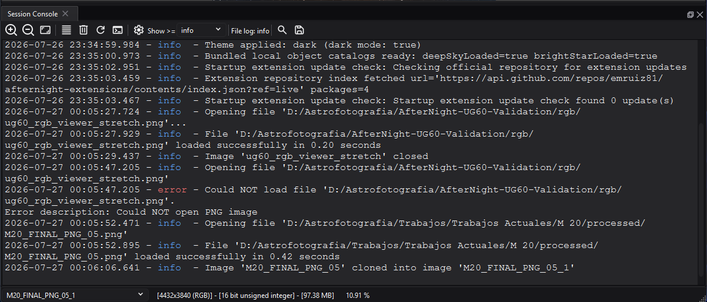

# Session Console

## Purpose, audience, prerequisites, and expected result

The Session Console is AfterNight's read-only, in-app view of messages emitted
during the current application session. Use it to correlate a failed file open,
process warning, or diagnostic event with its timestamp and severity, narrow the
visible backlog, search it, and export the current view for support.

After completing the procedure below, you will have a filtered and searchable
console view and, when requested, a plain-text `.txt` export. You do not need an
open image, a network connection, an external tool, or a writable log directory
to inspect messages already retained in memory.

*The Session Console keeps severity filtering and file-log state visible above
the session message stream. Paths shown here belong to the approved
documentation capture PC.*

## Reachability and availability

| Item | Current behavior |
| --- | --- |
| Path | **View > Session Console**. This checkable action opens or closes the bottom dock. |
| Enabled/visible when | Available from the Dashboard and dock workspace; it does not require an active image. Opening it from the Dashboard selects the dock workspace. |
| Supported inputs/state | Messages emitted after the session-console bridge is initialized, from the main thread or workers, at Trace, Debug, Info, Warn, Error, or Fatal severity. |
| Outputs/side effects | A read-only dock; optional persistent appearance settings; an optional plain-text export of exactly the visible message pane; clearing can discard the in-memory session backlog. No image, metadata, mask, sequence, or Image History state changes. |
| Persistence | Appearance, wrap mode, ANSI rendering, and maximum visible lines are `log/*` keys in AfterNight's own interface settings file (an INI file under the application's local data, never the native registry). The **ANSI Colors** toggle and the settings dialog's **Apply**/**OK** save them, and every console close saves all of them again: the wrap mode is therefore saved when the console closes, and the theme colors in force at the first close are stored as explicit values. The severity threshold, search state, zoom offset, console contents, dock visibility, and layout are session/runtime state. The export folder is remembered by the application folder tracker. |
| External dependencies | None for viewing. Export requires a writable destination. Rotating file logs have separate directory, level, size, and count settings. |

## Before you start

- Reproduce the operation first when you need its messages. The console bridge
  retains only the most recent 10,000 entries in memory and does not recover
  messages emitted before the bridge existed.
- Do not use **Clear Session** until you have exported anything needed for a
  support report. Clear removes the bridge backlog, not merely the filtered
  pane, and has no undo.
- Inspect exported text before sharing it. Messages can contain local paths,
  filenames, tool output, catalog details, or other environment information.
- The console filter is independent of **Settings > Logging > Minimum Level**.
  That setting controls the rotating file sink; the console's **Show >=** value
  controls only this view.

## Procedure

1. Choose **View > Session Console**. From the Dashboard, confirm that the dock
   workspace appears and the **Session Console** dock opens at the bottom.
2. Read the **File log: _level_** indicator as context, then choose the least
   severe entry to show in **Show >=**. The default **info** view includes Info,
   Warn, Error, and Fatal entries.
3. If new output is moving the pane, scroll upward. New retained entries keep
   arriving, but the pane stops following them until you return within four
   scrollbar units of the bottom.
4. Select **Search...** or press `Ctrl+F`. Enter a term, choose any search
   options, and select **Find next** or press `Enter`. A successful match becomes
   the text selection; a failed search reports **No occurrences found.**
5. Select **Export visible session text** or press `Ctrl+S`. Choose a path and
   confirm that the saved `.txt` contains the current severity-filtered,
   visible-line-limited plain text. Hidden session entries and rotating file-log
   contents are not added.
6. Use **Reload session lines** to rebuild the pane from the retained bridge
   backlog. This clears the current search cursor and selection and returns the
   view to the bottom; it does not reread log files. **Zoom In**, **Zoom Out**,
   **Zoom 100%**, a **Show >=** change, the **ANSI Colors** toggle, and settings
   **Apply**/**OK** rebuild the pane the same way.
7. Close the dock with **View > Session Console** or its dock close control. If
   no image view remains, AfterNight returns to the Dashboard. Reopening the
   console during the same application session rebuilds it from the retained
   bridge backlog unless that backlog was cleared.

## Complete control and action reference

| UI label/action | Type and unit | Default | Valid values/constraints | Effect | Enabled, hidden, or ignored rules | Trade-off or side effect | Scope | Persistence |
| --- | --- | --- | --- | --- | --- | --- | --- | --- |
| **View > Session Console** | Checkable menu action | Unchecked at startup | Checked or unchecked | Creates/shows or closes the Session Console dock; opening from Dashboard selects the dock workspace | Always available; independent of active image | The dock consumes workspace area and can keep the workspace open after the last image closes | Application window | Visibility/layout not restored |
| Dock close control | Dock action | Open after menu action | Close current dock | Destroys the console control and unchecks the menu action | Available while the dock exists | Returns to Dashboard when no image view remains | Current console instance | Session only |
| **Zoom In** | Toolbar action; font point increment | Stored base size | Adds 1 point per click; no explicit toolbar bound | Enlarges current console text | Message pane initialized | Very large text shows fewer characters/lines | Current console instance | Zoom offset not saved |
| **Zoom Out** | Toolbar action; font point decrement | Stored base size | Subtracts 1 point per click; no explicit toolbar bound | Shrinks current console text | Message pane initialized | Repeated use can make text impractically small | Current console instance | Zoom offset not saved |
| **Zoom 100%** | Toolbar action | Stored base size | Action | Restores the current text size to **Default font Size** | Message pane initialized | Does not reset font family/style/colors | Current console instance | Base size remains persisted |
| **Enable word wrap** / **Disable word wrap** | Dynamic toolbar action | Enabled on first run | Widget-width wrap or no wrap | Toggles long-line wrapping and changes its icon/tooltip | Message pane initialized | No-wrap adds horizontal scrolling; new auto-scrolled output keeps the horizontal position at the left edge | Visible pane | `log/line_wrap`, saved when the console closes or settings are next saved |
| **Clear Session** | Toolbar action | — | Action | Clears the session-console bridge backlog and visible pane; resets the search cursor | Bridge clear is used when available | Destructive for the in-memory backlog; does not clear rotating files or the platform logger's separate in-memory ring buffer | Current application session | Not recoverable through reload |
| **Reload session lines** | Toolbar action | — | Action | Rebuilds the pane from retained entries using current threshold, ANSI mode, font, and visible-line cap | Bridge must exist to repopulate | Clears selection/search cursor and scrolls to bottom; does not reread disk logs | Retained session backlog | No saved action state |
| **ANSI Colors** | Checkable toolbar action | On first run | On or off | Both modes remove ANSI control sequences; on additionally renders supported SGR bold/faint/italic/underline/inverse plus standard, bright, 256-color, and RGB foreground/background styles | Applies only when entries contain ANSI escape sequences | ANSI colors can reduce contrast; per-severity coloring still applies to the level word | Visible pane and future reloads | `log/render_ansi_colors` across launches; saved immediately |
| **Settings** | Toolbar action | Enabled | One settings dialog at a time | Opens **Log viewer settings** | Disabled until that dialog closes | Dialog changes affect presentation and visible retention, not file logging | Console appearance | Dialog action state is session only |
| **Show >=** | Severity selector | **info** each console initialization | **error**, **warn**, **info**, **debug**, **trace** | Shows entries whose severity is at least the selected threshold; **error** also includes Fatal | Rebuilds from retained bridge entries | Lower thresholds render more text; the choice does not change collection or disk logging | Visible pane | Not saved |
| **File log: _level_** | Read-only toolbar indicator | Loaded from `logging.conf`, fallback **info** | Current configured file-sink level, including **off** | Reports the separate rotating file-log threshold | Refreshed on initialize, reload, tab activation, and focus | It is status only; a changed setting may not appear until one of those refresh paths | File logging context | Source value persists in `logging.conf` |
| **Search...** | Toolbar action; `Ctrl+F` | Enabled | One search dialog at a time | Opens **Search log** | Disabled until the search dialog closes | Search operates only on rendered visible text | Visible pane | Dialog/search state not saved |
| **Export visible session text** | Toolbar action; `Ctrl+S` | Suggested `session_console.txt` | Text files; `.txt` appended when absent; cancel allowed | Writes `toPlainText()` from the current pane | Requires writable selected file | Excludes threshold-hidden and trimmed entries; formatting/ANSI colors are not encoded; overwrite behavior belongs to the platform dialog | Visible pane | Last folder remembered under `__SESSION_CONSOLE_FOLDER__`, stored before the file is opened, so it is kept even when the write fails |
| Message pane | Read-only selectable text | Empty until retained entries are loaded | Up to configured visible document blocks; multiline entries can consume multiple blocks | Displays `YYYY-MM-DD HH:mm:ss.mmm - level - message`, colors the severity word, supports selection/copy and scrolling | Only entries meeting **Show >=** are inserted | Default cap is 1,000 visible blocks; the bridge itself retains at most 10,000 entries | Current rendered view | Text not saved automatically |
| **Find** | Search text field | Empty | Any text; regex syntax when enabled | Supplies the search expression | **Find next** disabled while empty | Invalid regular expressions are reported only as no match | Visible pane | Not saved |
| **Case sensitive** | Search checkbox | Off | On or off | Requires matching capitalization | Applies to literal and regular-expression searches | Can hide otherwise equivalent text | Current search dialog | Not saved |
| **Match whole word** | Search checkbox | Off | On or off | Adds whole-word matching | Disabled while **Regular expression** is checked | Enabling regex does not clear an already checked value, so the current implementation can still pass the whole-word flag | Current search dialog | Not saved |
| **Regular expression** | Search checkbox | Off | Qt regular-expression syntax with the extended-pattern option: unescaped whitespace is ignored and `#` starts a comment, so `foo bar` matches `foobar` | Interprets **Find** as a pattern | Disables the **Match whole word** control | No separate invalid-pattern diagnostic | Current search dialog | Not saved |
| **Backward** | Search checkbox | Off | On or off | Searches toward the start from the current cursor | Applies to literal and regex searches | The wrap fallback searches backward from document position 0 and finds nothing, so a backward search never wraps to the bottom | Current search dialog | Not saved |
| **Find next** | Search button; `Enter` | Disabled | Enabled when **Find** is nonempty | Selects the next match; forward search wraps to the start after no later match | Search dialog open and query nonempty | Failed match moves the console cursor to the end after notifying | Visible pane | Cursor resets when dialog closes, Clear, reload, or session clear occurs |
| **Clear** | Search button | Enabled | Action | Resets the search cursor and moves the console cursor to the end | Search dialog open | Does not erase the query or console entries | Current search | Not saved |
| **Close** | Search button | Enabled | Action | Closes **Search log** and re-enables **Search...** | Search dialog open | Resets the search cursor on destruction | Current search dialog | Not saved |
| **Font color** + **Select color** | Read-only color value and picker; each picker starts from the console's applied color, not a pending value | Current theme text token | Any color accepted by the color dialog | Changes ordinary console text color in the settings preview | Applied to console only by **Apply** or **OK** | Poor contrast can make messages unreadable | Console appearance | `log/font_color` after apply |
| **Background color** + **Select color** | Read-only color value and picker | Current theme code-background token | Any color accepted by the color dialog | Changes pane background in preview | Applied by **Apply** or **OK** | Affects ANSI faint/inverse blending and contrast | Console appearance | `log/background_color` after apply |
| **Font Highlight** + **Select color** | Read-only color value and picker | Current theme text-on-accent token | Any color accepted by the color dialog | Changes selected-text foreground | Applied by **Apply** or **OK** | Poor contrast can obscure search selections | Console selection | `log/font_highlight_color` after apply |
| **Background Highlight** + **Select color** | Read-only color value and picker | Current theme highlight-background token | Any color accepted by the color dialog | Changes selection background | Applied by **Apply** or **OK** | Poor contrast can obscure selected matches | Console selection | `log/background_highlight_color` after apply |
| **Default font Size** | Integer spin box, points | 12 pt | 4–30 pt | Sets the saved base size and current console size | Preview updates immediately; console updates on **Apply**/**OK** | Larger text increases wrapping and reduces visible context | Console appearance | `log/font_size` after apply |
| **Max lines** | Integer spin box, document blocks | 1,000 loaded setting; builder fallback 10,000 is replaced by current console value | 50–50,000 | Caps rendered document blocks and reloads the pane after apply | Effective source backlog is at most 10,000 entries; multiline entries can use multiple blocks | Raising it increases rendering/memory cost but cannot restore entries already evicted from the bridge | Visible pane | `log/max_lines` after apply |
| **Font** | Font-family selector | System fixed-width font | Installed font families | Changes sample and console family | Console updates on **Apply**/**OK** | Proportional fonts can make aligned diagnostic text harder to scan | Console appearance | `log/font_family` after apply |
| **Bold** | Settings checkbox | Off | On or off | Makes base console font bold | Preview immediate; console on **Apply**/**OK** | ANSI bold may be indistinguishable when the base is already bold | Console appearance | `log/font_bold` after apply |
| **Italic** | Settings checkbox | Off | On or off | Makes base console font italic | Preview immediate; console on **Apply**/**OK** | ANSI italic may be indistinguishable when the base is already italic | Console appearance | `log/font_italic` after apply |
| Settings sample pane | Read-only preview | Six generated sample lines; two selected | Display only | Previews font, colors, severity colors, and selection | Updates while settings fields change | It is synthetic and is not the current session log | Settings dialog | Not persisted |
| **Apply** | Settings dialog action | — | Action | Applies all fields, rebuilds the console once, and saves settings without closing | Settings dialog open | A lower line cap can immediately remove rendered older blocks; retained bridge entries remain available until bridge eviction/clear | Console appearance/view | Persists settings |
| **OK** | Settings dialog action | — | Action | Applies and saves, then closes | Settings dialog open | Same side effects as Apply | Console appearance/view | Persists settings |
| **Reset** | Settings dialog action | — | Action | Restores current-theme colors, fixed-width font, 12 pt, 1,000 lines, Bold/Italic off in the dialog preview | Requires **Apply** or **OK** to affect console | Does not reset wrap, ANSI mode, filter, zoom, contents, or file logging | Pending settings fields | Not persisted until apply |
| **Cancel** | Settings dialog action | — | Action | Closes without applying pending fields | Settings dialog open | Previously applied changes remain | Current dialog | No new persistence |

## Behavior and state model

The platform logger initializes three separate sinks: rotating files, an
in-memory ring buffer of 10,000 records, and a replaceable session-console sink.
The GUI then initializes a `SessionConsoleBridge` with a 10,000-entry maximum
and attaches its sink. Every message, from a worker or the main thread, is
formatted without process/thread columns and queued onto the GUI thread. Focused tests establish that queued worker and main-thread entries keep
their arrival order, that the oldest entry is evicted at capacity, and that
clearing drops the bridge backlog.

The main logger remains open to Trace so individual sinks can filter
independently. The console bridge therefore receives all severities; **Show >=**
filters only while entries are inserted into the pane. Changing the selector or
reloading rebuilds the pane from the bridge backlog. The separate file sink uses
**Settings > Logging** and the indicator reports that configured level.

The visible cap is enforced by removing blocks from the start of the document.
It counts document blocks rather than bridge entries, so an entry containing
embedded newlines can consume more than one visible line. A configured cap above
10,000 cannot increase the bridge's fixed entry backlog.

ANSI parsing always removes recognized CSI control sequences from the displayed
and exported text. When **ANSI Colors** is on, supported SGR attributes and
colors become theme-aware rich-text formatting; when off, the same message is
plain text. The severity token is then colored separately. Fatal messages use
the visible level name `fatal` and pass the **error** threshold.

Auto-scroll is stateful: it follows appended visible entries only while the
scrollbar is at, or within four units of, its maximum. Scrolling upward pauses
following. Reload always rebuilds and moves to the bottom. In no-wrap mode,
automatic movement also returns the horizontal scrollbar to the left.

## Inputs, outputs, and metadata

- Input is formatted runtime text plus severity. The console does not parse or
  change images, metadata, masks, sequences, process parameters, or history.
- A session entry is formatted as timestamp, severity, and message. Rotating
  file lines additionally include process and thread fields and are not the
  same text representation.
- Export writes the current pane as plain text. It does not write hidden
  severities, entries trimmed by **Max lines**, bridge entries evicted past
  10,000, file-log-only history, colors, font styling, or search state.
- A missing `.txt` suffix is added. Cancel creates no file. A write-open failure
  shows **File Error: Unable to open file for writing**.
- Clearing the console does not delete or truncate `AfterNight.log` and its
  rotated files. Conversely, changing file-log retention does not change the
  current in-memory bridge capacity.

## Performance and responsiveness

Appending a visible entry updates the document on the GUI thread and trims from
its beginning when over the line cap. Lowering **Show >=** or increasing **Max
lines** can make reload, ANSI parsing, document layout, search, and memory use
more expensive. Use Info or Warn during ordinary diagnosis, keep the default
1,000 visible blocks unless older context is necessary, and export before
clearing. Worker threads do not write widgets directly; their messages use a
queued bridge callback.

## Worked example

- Starting state, actions, settings, checkpoints, result, and limitations:
  Open **View > Session Console** after reproducing a warning. Leave **Show >=**
  at **info** and confirm the warning is present. Scroll upward and confirm the
  view stays in place while later messages are retained. Search a unique word,
  then export to `session_console.txt`; the selected file contains the current
  visible plain text. Raise the threshold to **error** and observe that Info and
  Warn lines disappear from the pane; select **Reload session lines** after
  returning to **info** to rebuild them from the retained backlog. This example
  proves source/test-defined state transitions only; it does not claim a
  production log volume, disk-permission result, timing, or platform rendering.

## Warnings and limitations

- **Clear Session** is immediate, session-wide, and not undoable. It does not
  preserve threshold-hidden entries for later reload.
- The console is not a complete forensic log. Capacity eviction, visible-line
  trimming, bridge initialization time, and clearing can all omit messages.
- The filter has no Fatal item; Fatal is included by the **error** threshold.
- Search covers only currently rendered text. Forward search wraps; backward
  search never wraps from the top to the bottom.
- Enabling regular-expression mode disables but does not clear a selected
  whole-word option, and an invalid pattern has no dedicated syntax message.
- Toolbar zoom has no explicit bound and is not saved. Use **Zoom 100%** after
  an impractical zoom level.
- Appearance overrides are saved color values, and closing the console once
  stores the current theme's colors as such values, so a later theme switch
  keeps them. **Reset** followed by **Apply** is the supported way to resolve
  them to current-theme defaults again.
- Exported text can disclose private local context. Review it before sharing.

## Troubleshooting

| Symptom | Cause | Fix |
| --- | --- | --- |
| Session Console opened but older expected messages are absent | Message preceded bridge initialization, was evicted beyond 10,000 entries, was cleared, is below the selected threshold, or was trimmed from the visible pane | Lower **Show >=**, raise **Max lines** if appropriate, and reload. If still absent, inspect rotating file logs when their separate level retained the event |
| Info or Warn lines disappear after selecting **error** | The selector is an inclusive minimum-severity threshold | Select **warn**, **info**, **debug**, or **trace**, then allow the automatic reload |
| Session Console still shows messages while file **Minimum Level** is **Off** | The in-memory session sink is independent of the rotating file sink | Use **Show >=** or close/clear the console for its view; use Logging settings for disk output |
| Search reports **No occurrences found.** | Text is not in the rendered pane, options exclude it, or the regular expression is invalid | Lower the severity filter/reload; simplify the query; disable Case sensitive, Match whole word, or Regular expression |
| Backward search does not wrap to a later occurrence | The fallback restarts a backward find at document position 0, where nothing precedes it | Clear/reset search, disable **Backward**, find forward, or move the visible cursor near the end before retrying |
| Export is shorter than expected | Export writes only the visible pane after threshold filtering and block trimming | Lower the threshold, raise **Max lines** within available backlog, reload, then export; use rotating files for separate disk history |
| **File Error: Unable to open file for writing** | Destination could not be opened writable | Choose a writable local folder/name and retry; check permissions and free space |
| New output keeps jumping or stops following | Auto-scroll follows only while at the bottom | Scroll up intentionally to pause; return to the bottom or reload to resume |
| Colors or selection are unreadable | Persisted colors - including the theme colors stored when the console last closed - have poor contrast for the active theme, or ANSI formatting overrides parts of a line | Open **Settings**, use **Reset**, then **Apply**; optionally turn **ANSI Colors** off |
| File-log indicator looks stale after Logging settings changed | Indicator refresh occurs on initialize, reload, console focus, or active-tab change | Focus the console or select **Reload session lines** |

## Related workflow steps

- [Toolbar & Menus](toolbar-and-menus.md) defines the global View action and
  its availability.
- [Settings Dialog](settings-dialog.md) configures the separate rotating file
  sink, directory, level, size, and file count.
- [Process Windows](process-windows.md) explains validation, progress,
  cancellation, and failure states that can emit console diagnostics.
- The process-specific troubleshooting table for the operation that failed uses
  the exported console evidence to select the next recovery step.
