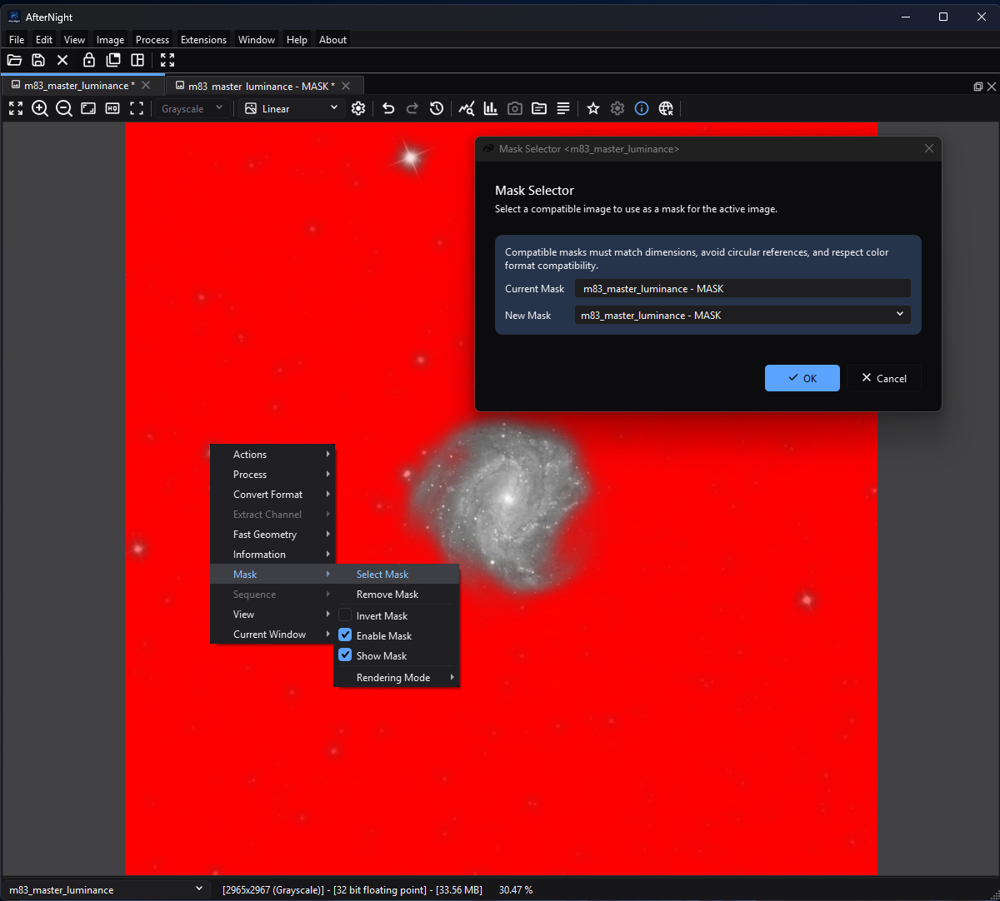

# Masks

*The target keeps mask enablement and display controls in the Image menu while
the modeless selector identifies the currently assigned mask.*

## Purpose, audience, prerequisites, and expected result

A mask is a live link from a target view to another open image view. For a
mask-aware process, normalized white mask samples admit the processed result,
black samples preserve the original, and intermediate values blend the two.
The mask can also be shown over the target without enabling it for processing,
or enabled for processing without being shown.

This page is for anyone assigning an existing mask image. To create one first,
use a mask-generation process such as [Range Selection](../processes/analysis/range-selection.md),
[Binarize](../processes/masking/binarize.md), or
[Mask Drawing](../processes/masking/mask-drawing.md). The expected result is a
runtime-only mask relationship on the target; assignment does not change,
embed, duplicate, or save either image's pixels.

## Reachability and availability

| Item | Current behavior |
| --- | --- |
| Main path | Activate an image and choose **Image > Mask > Select Mask**. The same Mask submenu is available from the image-view context menu. There is no toolbar button or default shortcut. |
| Enabled when | The Mask menu requires an active view with image data. **Select Mask** is then enabled. Remove, invert, enable, show, and rendering actions require an assigned mask. |
| Supported target/candidate | The selector supports the ordinary grayscale/RGB contract described below. Candidates must be another open view with the same width and height. |
| Outputs and side effects | A live target-to-mask reference, display overlay state, and process-blend state. No file is written and no image pixels, metadata, or history step are changed by these controls. |
| Persistence | Window-lifetime only. Save, duplicate, history navigation, application restart, and reopening a file do not restore the relationship or its flags. |
| Dependencies | No external service. The source mask view must remain open and compatible. Rendering and processing allocate mask/display buffers proportional to image dimensions and channels. |

## Before you start

1. Open or generate the mask and target as separate views. A saved mask file is
   useful when you need to recreate the relationship in a later session.
2. Match width and height exactly. AfterNight does not register, crop, scale,
   or resample a candidate during assignment.
3. Prefer a grayscale mask. It applies one weight to every target channel and
   works with grayscale or RGB targets. An RGB mask is accepted for an RGB
   target and applies R, G, and B weights independently; it is not accepted for
   a grayscale target.
4. Use a mask with one channel or three. The selector lists no other, and the
   view refuses one that stops matching when either image changes; convert an
   alpha-bearing image to ordinary grayscale or RGB first.
5. Confirm that the intended process supports masks. The shared process window
   normally does, but a process can opt out or implement a specialized mask
   path; its own page is authoritative.

The selector also accepts a compatible sequence view because it evaluates the
view's current image. There is no target-frame-to-mask-frame pairing. Use a
still mask for predictable sequence processing.

## Procedure

1. Activate the target and choose **Image > Mask > Select Mask**.
2. In **Mask Selector `<target-name>`**, verify the read-only **Current Mask**.
   Select the intended **New Mask**; each candidate tooltip reports its name,
   dimensions, channels/color space, pixel type, source, and estimated memory.
3. Select **OK**. Assignment turns **Enable Mask** and **Show Mask** on and
   clears **Invert Mask**. The target and mask remain separate open views.
4. Inspect the target with **Overlay Red** initially. Choose another colored
   overlay or **Replace** if contrast is poor. **Multiply** shows the target as
   the view displays it, multiplied by the mask.
5. Decide display and native processing state separately. Clear **Show Mask** to
   hide the overlay without changing processing. Clear **Enable Mask** to stop
   the native mask-aware blend without hiding the overlay.
6. If polarity is reversed, toggle **Invert Mask** and recheck both the overlay
   and a native process preview. Inversion changes native processing weights as
   well as the generated mask display. Extension input is different; see
   [Process blend and inversion](#process-blend-and-inversion).
7. Run the process in Preview first, then Apply/OK only after checking masked
   and unmasked regions. When finished, choose **Remove Mask**; no confirmation
   is shown, and the source mask view remains open.

## Complete control and action reference

| UI label/action | Type and unit | Runtime default | Valid values or constraints | Effect | Enable/visibility rules | Quality, runtime, or memory trade-off | Scope | Persistence |
| --- | --- | --- | --- | --- | --- | --- | --- | --- |
| **Select Mask** | Menu action | No assigned mask on a new view | Active image required | Opens a modeless selector for the active target | Enabled whenever an active view has image data | Candidate tooltips calculate an approximate memory value; no image processing occurs | Target relationship | None |
| **Remove Mask** | Menu action | Disabled with no mask | One click; no confirmation | Unlinks the current source, disables/hides/uninverts the mask, and resets rendering to Overlay Red | Assigned mask required | Frees the target's generated mask-render buffer; neither image is closed | Target relationship and mask state | None; no undo/history entry |
| **Invert Mask** | Checkable menu action | Off after assignment | Off/on | Reverses visible mask polarity and swaps protected/processed weights for the native mask path | Assigned mask required | Regenerates the render buffer; process cost is otherwise unchanged | Display and supported native-process Preview/Apply | Window lifetime only |
| **Enable Mask** | Checkable menu action | On after assignment | Off/on | Controls whether native mask-aware processing blends with the original | Assigned mask required | Adds a full mask blend when enabled; does not affect the viewer overlay | Supported native-process Preview/Apply and sequence frames | Window lifetime only |
| **Show Mask** | Checkable menu action | On after assignment | Off/on | Shows or hides the viewer overlay | Assigned mask required | Display-only rendering/allocation; it does not enable processing | Target viewer and lens display | Window lifetime only |
| **Rendering Mode** | Submenu | Overlay Red on a new/unmasked view | Exactly one of the eight actions below | Groups mutually exclusive display choices | Assigned mask required | Display only; changing mode regenerates the render buffer | Target viewer | Window lifetime; Remove resets red |
| **Overlay Red** | Checkable rendering action | Checked initially | Mutually exclusive | Draws low/protected normal-mask values with a red translucent overlay | Assigned mask required | Good default contrast; stored samples unchanged | Display only | Window lifetime |
| **Overlay Green** | Checkable rendering action | Off | Mutually exclusive | Green version of the colored overlay | Assigned mask required | Choose for contrast; stored samples unchanged | Display only | Window lifetime |
| **Overlay Blue** | Checkable rendering action | Off | Mutually exclusive | Blue version of the colored overlay | Assigned mask required | Choose for contrast; stored samples unchanged | Display only | Window lifetime |
| **Overlay Yellow** | Checkable rendering action | Off | Mutually exclusive | Yellow version of the colored overlay | Assigned mask required | Choose for contrast; stored samples unchanged | Display only | Window lifetime |
| **Overlay Magenta** | Checkable rendering action | Off | Mutually exclusive | Magenta version of the colored overlay | Assigned mask required | Choose for contrast; stored samples unchanged | Display only | Window lifetime |
| **Overlay Cyan** | Checkable rendering action | Off | Mutually exclusive | Cyan version of the colored overlay | Assigned mask required | Choose for contrast; stored samples unchanged | Display only | Window lifetime |
| **Replace** | Checkable rendering action | Off | Mutually exclusive | Displays the normalized mask instead of a colored overlay | Assigned mask required | Direct structure/polarity inspection; converts a display copy to unsigned 8-bit | Display only | Window lifetime |
| **Multiply** | Checkable rendering action | Off | Mutually exclusive | Displays the target, as the view shows it, multiplied by the current mask/channel | Assigned mask required | Follows the view's stretch and channel; it is a display, not a measurement | Display only | Window lifetime |
| **Current Mask** | Read-only text field | Mask name or `NO MASK` when selector opens | Not editable | Reports the target's assignment at dialog construction | Always shown | It can become stale if another selector changes the relation while this modeless dialog remains open | Selector information | Dialog lifetime |
| **New Mask** | Combo box | First compatible candidate | Open compatible views only | Chooses the source to assign; tooltip exposes candidate properties | Disabled with `<NO COMPATIBLE IMAGES>` | The first item is only a default selection, not a recommendation | Selector choice | Dialog lifetime |
| **OK** | Default dialog button | Enabled with at least one compatible candidate | One click | Assigns a different selected source, or closes without state change if it is already current | Disabled with `<NO COMPATIBLE IMAGES>` | Candidate is looked up again by name; if it disappeared, the dialog closes without assigning | Target relationship | Runtime only |
| **Cancel** | Dialog button | Enabled | One click | Closes without changing the target | Always available | No side effect | Selector dialog | None |

## Behavior and state model

### Selection compatibility and relationship lifetime

The selector excludes the target itself, images with different dimensions, an
image with neither one nor three channels, an RGB candidate for a grayscale
target, and a candidate whose own current mask is the target. The last rule prevents a direct two-image reciprocal reference;
it is not a general cycle detector. One source may mask multiple targets.

The target stores a live reference, not a snapshot. Compatible source pixel
updates refresh every client target. If an update changes dimensions, leaves
the source with neither one nor three channels, or makes an RGB source
incompatible with a grayscale target, AfterNight shows a **Mask Reference**
warning and removes that relationship. Closing a source
warns that it is used by other images and removes all of its client links.
Closing a target unlinks it from its source. Renaming either view does not
invalidate the object relationship.

Assigning a different source resets Enable and Show on and Invert off, while
retaining the target's current rendering choice. Removing a source resets every
flag and Overlay Red. Selecting the already-current source merely closes the
selector.

### Process blend and inversion

For original sample `A`, processed sample `P`, and mask sample `M` in `[0,1]`,
an enabled normal mask calculates

`O=(1-M)A+MP`.

Thus `M=0` preserves `A`, `M=0.5` mixes equally, and `M=1` accepts `P`. With
Invert on, it calculates `O=MA+(1-M)P`. A grayscale mask uses its single
channel for every target channel. An RGB mask uses the corresponding mask
channel for R, G, and B.

The blend runs in the result's representation: a mask of another
representation is first converted into it at full scale. Integer mask samples
are therefore normalized when read. Over a floating-point result,
floating-point mask samples are read verbatim and are not clamped or validated,
so a floating mask below `0` or above `1` extrapolates instead of blending and a
non-finite sample propagates. Over an integer result, the conversion holds a
floating mask to `[0,1]` and reads NaN as `0`, and the blended result saturates
at the representation's range. Normalize and clip a floating-point mask to
`[0,1]` before assigning it.

In shared real-time process windows the process runs first, modulation is
applied next where supported, and the mask blend is last. A Preview-area crop
uses the matching mask rectangle. The same captured mask relationship is used
for Apply/OK. **Show Mask does not enable processing**, and rendering mode does
not affect output; only assigned + enabled + process support activates the
blend.

For sequence Apply, the shared framework applies the attached view's current
mask image to every processed frame. It does not advance or synchronize a mask
sequence per target frame. An extension that declares mask-input capability
receives the assigned mask's raw, read-only image buffer. That handoff occurs
whenever a mask is assigned, regardless of **Enable Mask**, **Show Mask**, or
**Invert Mask**; those flags do not disable, hide, or invert the extension input
buffer. The extension defines how to interpret it instead of receiving the
automatic native post-blend.

### Display rendering

The engine draws the overlay. Colored modes generate an unsigned 8-bit RGBA
display copy, each byte rounded to the nearest code. For a normal mask, overlay
opacity is one minus the mask: strongest over low/black protected samples and
transparent over high/white processed samples. Invert reverses that visual polarity. On an RGB mask,
viewing a single R, G, or B target component selects the corresponding overlay
channel; the composite display draws the three channels as one layer whose
opacity is one minus the product of the channels. Replace shows the normalized
mask directly. Multiply multiplies the target as the view shows it, after its
stretch and channel choice, by the mask - by the mean of an RGB mask's channels
when the view shows one channel - and is rebuilt whenever the target, its
stretch, or the mask changes. Every mode reads each pixel type at its full
scale; a signed integer mask is read as a signed fraction of its full scale, so
every code below zero is an empty mask. A pixel the mask's validity rejects is
left clear - the viewer draws no overlay there - and a NaN sample reads as zero. The display copy is kept at the image's full
size; zooming out scales it from that copy each time, so repeated zooming does
not blur it. While a mask is drawn with the mask drawing tools, the overlay
shows every stroke that has landed since it was last painted.

## Inputs, outputs, and metadata

The input is another open view's current image. Width and height must match.
Ordinary grayscale and RGB masks may have a different numeric pixel type from
the target. Integer mask types are normalized on read; floating-point types are
assumed to be normalized but are read without clamping. Integer conversion can
still quantize a generated mask before assignment. AfterNight does not inspect
FITS keywords, WCS, pixel scale, orientation, registration, or content when
deciding compatibility. Geometrically align the images yourself.

Assignment creates no image, file, metadata field, or history entry. The mask
is not embedded in a saved target and its visible overlay is not composited
into Save/Export output. Duplicating the target copies the image and its
detected stars, not the mask link. History stores pixel-state snapshots, not assignment flags.
Save the source mask separately when it must survive closing or restart.

## Performance and responsiveness

Assignment and toggles run on the UI path. Source updates and inversion/mode
changes regenerate a full-size display buffer on a worker thread and notify
client views; each view keeps showing its previous overlay until the new one is
ready, so a large mask used by several targets costs work but does not pause the
window.
Enabled native processing adds a full-image blend after the process and
holds source/result/mask buffers. Work and memory grow approximately with pixel
count and channel count. Show-only overlays add display work but no process
blend. No production timing or peak-memory measurement was made.

## Worked example

- Evidence mode: source-, equation-, and test-derived; not an astronomical
  quality demonstration.
- Input: a same-size grayscale still mask with normalized samples `0`, `0.5`,
  and `1`; target samples `A=0.2`; hypothetical processed samples `P=0.8`.
- Normal expected result: `0.2`, `0.5`, and `0.8` respectively from
  `O=(1-M)A+MP`.
- Inverted expected result: `0.8`, `0.5`, and `0.2` respectively.
- Workflow checkpoint: after assignment, Enable and Show are checked, Invert is
  clear, and Overlay Red is visible over the low/protected portion. Clear Show
  and confirm Preview results remain the same; then clear Enable and confirm a
  mask-aware Preview becomes the unmasked process result.
- Limitation: the approved target/mask capture demonstrates assignment and
  Overlay Red presentation only; no sequence run, visual-quality comparison,
  production timing, or peak-memory result was executed.

## Warnings and limitations

- A mask is not a selection saved inside the target. Save mask images
  separately and reassign them after reopening.
- Same dimensions do not prove registration. A shifted, rotated, or optically
  distorted mask will affect the wrong pixels.
- Use ordinary one- or three-channel images. An image with any other channel
  count is neither listed nor kept as a mask; assigning one through another
  route shows a **Mask Reference** warning naming why, and assigns nothing.
- RGB masks are per-channel, not automatically converted to luminance. Use a
  grayscale mask when identical spatial influence across channels is intended.
- Floating-point mask values are not range checked. Values outside `[0,1]`
  extrapolate, and non-finite values can propagate into floating-point output.
  Normalize and clip the mask before assignment.
- Hide and Disable are independent. A hidden mask can still affect processing,
  and a shown mask can be disabled for processing.
- Multiply shows the displayed, possibly stretched, target times the mask; it
  is not a preview of a masked process. Use colored overlays and Replace to
  inspect mask geometry/polarity.
- A sequence can be selected as a source, but there is no per-frame mask
  synchronization. Use a still mask for a sequence workflow.
- Removing or replacing a relationship has no confirmation and no history undo.
  The warning shown while closing a mask source is informational: it has no
  Cancel action, and closing continues after acknowledgement.
- Several modeless selectors can coexist. A selector's Current Mask field is an
  opening-time value and may not reflect a relationship changed elsewhere.

## Troubleshooting

| Symptom or exact message | Verified cause/validation path | Recovery | Evidence source |
| --- | --- | --- | --- |
| Mask menu is disabled | No active view with image data | Activate the intended target view | `ActionStateCoordinator::setEnableImageActions()` |
| Only Select Mask is enabled | The active target has no assigned mask | Assign a compatible source first | `ActionStateCoordinator::updateActiveImageActions()` |
| `<NO COMPATIBLE IMAGES>` appears and OK is disabled | No other open view passes identity, dimensions, channel-count, color, and direct-reference checks | Open/generate a same-size grayscale or compatible RGB mask | `ImageMaskSelectorControl::recalculateMasksList()` |
| Selector closes but no mask is assigned | The selected view disappeared before OK, or it was already the current mask | Reopen the selector and choose a still-open different candidate | `ImageMaskSelectorControl::on_dialog_box_button_clicked()` |
| **No selected image to process** appears | A stale/programmatic action reached the launcher/coordinator without an active target | Activate the target and retry | `ProcessLauncher` and `MaskOverlayCoordinator` guards |
| **Mask Reference** warning appears and the mask disappears | A source/target update made dimensions or channel layout incompatible | Restore matching geometry/channel compatibility and reassign | `ImageViewControl::notifySourceMaskUpdated()`; `ImageViewControl::setCurrentMask()` |
| Closing a mask warns that other images use it | The source has one or more client targets; the warning is informational and offers only OK | Acknowledge the warning; closing continues and removes every client link. Reopen the saved mask and reassign it if needed | `ImageViewControl::closeEvent()` and `DialogOrchestrationCoordinator::notifyWarnMessage()` |
| Overlay remains but a process ignores the mask | Show is on but Enable is off, or the process does not support the native mask path | Turn on Enable and check the process-specific page | `ImageRTPreviewControl` mask gate |
| Hidden mask still changes Preview/Apply | Show is display-only; Enable remains on | Turn off Enable or remove the mask | viewer and process state gates |
| RGB result has different masking by channel | The RGB mask supplies independent R/G/B weights | Inspect each mask channel or use a grayscale mask | `blendProcessResult()` and `MaskRenderer` |
| Multiply display looks darker than expected | Multiply scales the displayed target by the mask, so protected (dark) mask regions darken it | Use Replace or a colored overlay to inspect the mask itself | `ImageViewWidget::requestMaskOverlay()` and `renderViewMaskOverlay()` |
| Mask is absent after save/reopen, duplicate, or restart | Assignment and flags are runtime-only and are not serialized/copied | Reopen the saved mask image and assign it again | view state, save, duplicate, and history paths |

## Related workflow steps

Create candidate masks with [Range Selection](../processes/analysis/range-selection.md),
[Binarize](../processes/masking/binarize.md), or
[Mask Drawing](../processes/masking/mask-drawing.md). Use
[Image Viewer](image-viewer.md) for display-channel and zoom behavior,
[Process Windows](process-windows.md) for Preview/Apply interaction,
[Sequences](sequences.md) for container behavior, and
[Saving and Exporting](saving-and-exporting.md) for what is actually written.
The complete menu placement is in [Toolbar and Menus](toolbar-and-menus.md).

## References and provenance

This page documents AfterNight's current mask menu, selector, image-view state,
renderer, process framework, engine blend, extension handoff, and focused tests. The blend equations are current implementation
contracts. No external masking standard, persisted mask-file format, or visual
quality benchmark is claimed.
