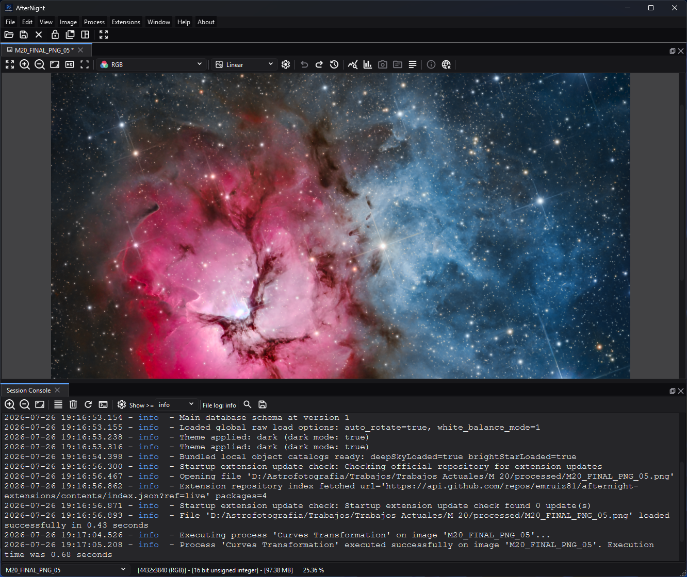
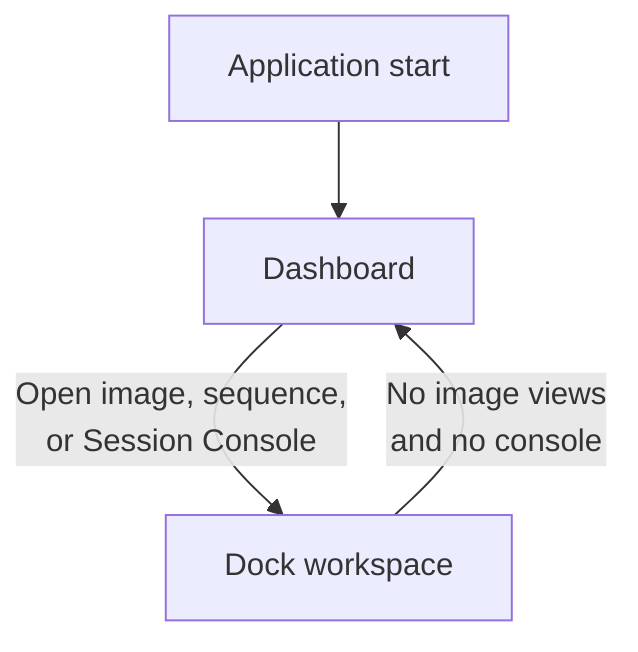

# Interface Overview

## Purpose, audience, prerequisites, and expected result

Use this page to understand which AfterNight surface you are on, why an action
is enabled or disabled, and what causes the application to move between the
dashboard and image workspace. It is for new and returning users who need a
map before following a process-specific procedure.

Prerequisites are only a running AfterNight application. To exercise the full
map, have one supported still image or sequence available. The expected result
is that you can identify the current surface, select the intended active view,
and predict whether opening or closing something changes the central workspace.

*The workspace combines the active image viewer and its display controls with
the docked Session Console for session feedback.*

## Reachability and availability

| Item | Current behavior |
| --- | --- |
| Path | Start AfterNight for the dashboard. Use **File > Open**, `Ctrl+O`, a dashboard file action, a recent item, or a local-file drop to create a standard image/sequence view. Use **View > Session Console** for the console workspace. |
| Enabled/visible when | Dashboard utilities and no-image workflows are available without an active image. Image actions are recomputed from the focused view, its image, color state, sample type, sequence kind, metadata, mask, history, and process launch contract. |
| Supported inputs/state | Dashboard with no recents or recents; standard still and sequence views; docked, floating, and maximized views; optional Session Console; process windows and dialogs. |
| Outputs/side effects | File loading can create views, history entries, thumbnails, and recents. Process actions can create top-level or image-bound windows. Surface changes do not modify image samples. |
| Persistence | Theme, animation, layout-lock default, main-window size and position (while **Remember window size and position** is on), recent files/thumbnails, dashboard preferences, and many component settings persist. The dock layout is not saved. The application initializes dashboard-first; the current central surface is not restored as a session choice. |
| External dependencies | None for the shell itself. Individual codecs, catalogs, solvers, and extension processes declare their own requirements. |

## Before you start

- Distinguish an image's stored samples and metadata from the viewer's display
  controls. Zoom, channel display, and autostretch do not by themselves rewrite
  the image.
- For image-dependent commands, click the intended image tab or dock panel
  first. The focused view is the active target.
- File opening is asynchronous and may show **File Open**, the **Open CFA file**
  question for a colour-filter-array mosaic (**Yes** demosaics it by the Raw
  Images **Demosaic Algorithm**, **No** shows the mosaic as recorded), error, or
  cancellation UI before a usable view exists.
- A suffix accepted by the file chooser or drop filter is only a dispatch hint;
  decoding can still fail. Consult [File Formats](../reference/file-formats.md).
- Save important branches before applying unfamiliar processes. History and
  view duplication are not substitutes for an external backup.

## Procedure

1. Start AfterNight. Checkpoint: the dashboard owns the central stack; the
   status bar is hidden, the dock toolbar and image selector are disabled, and
   the **Window** menu is disabled.
2. Open one supported still through **File > Open**, `Ctrl+O`, **Open file**, a
   recent thumbnail, or a local-file drop. Checkpoint: **File Open** reports the
   load; a successful standard view switches the central stack to the dock
   workspace. Cancelling or failing before view creation leaves no usable view.
3. Click the new image view. Checkpoint: image actions are recomputed; the image
   selector, status bar, dock toolbar, and **Window** menu are available.
4. Inspect the view without changing data. Use viewer display controls, then
   open an information panel appropriate to the image. **FITS Header** and
   **EXIF Viewer** remain disabled when their records are absent. Main-menu
   **Astrometry Info** remains available for any active image and reports
   **No astrometric solution** when no WCS exists; the image-view toolbar
   version is WCS-gated and hidden for sequences.
5. Open a process. A single-image process binds to the active image and may be
   rejected when the active view is missing or incompatible. A top-level
   workflow such as Image Integration can open from the dashboard and does not
   itself prove a dashboard-to-workspace transition.
6. Optionally enable **View > Session Console**. From the dashboard this action
   switches to the dock workspace because the console is a dock widget; it does
   not create a dummy image.
7. Close the only image view. Checkpoint: AfterNight returns to the dashboard
   only when no Session Console remains open. If the console is open, the dock
   workspace remains available for it. Closing the console after the final
   image allows the dashboard to return.

## Complete control and action reference

| UI label/action | Type and unit | Default | Valid values/constraints | Effect | Enabled, hidden, or ignored rules | Trade-off or side effect | Scope | Persistence |
| --- | --- | --- | --- | --- | --- | --- | --- | --- |
| Dashboard central surface | Central stacked page | Initial surface | Running application | Provides onboarding, recents, quick actions, and file drop | Selected at startup and when the final image and Session Console are closed | Hides workspace-only status/layout controls | Application window | Startup is dashboard-first |
| Dock workspace | Central stacked page | Initialized but not selected | Standard view or Session Console | Hosts docked image views and console | Selected when a standard view is created or console is opened | Large images and multiple docks consume memory/screen space | Application window | Only the dock-lock default persists; the dock layout is not saved |
| Active image view | Focused target | None | Loaded/created view with an image | Supplies the target for image actions and single-image processes | Image actions disable without an active image | Choosing the wrong view targets the wrong image | Current focus | Selection lasts for the session |
| Main image selector | Status-bar combo box | Empty and disabled on dashboard | Registered image views; the console-only dock workspace can have no entries | Selects the active image by unique view name | Disabled on dashboard. Enabled in the dock workspace, and also when the Session Console was opened from the dashboard with no image; after the last image closes while the console keeps the workspace open, it is disabled | Selection changes the target of later actions; the enabled selector is empty in the console-from-dashboard case | Application session | Not restored across launches |
| Status bar and image information | Workspace status surface | Hidden on dashboard | Dock workspace | Shows image/view information and the image selector | Visible and enabled in dock workspace | Display only | Active view/session | No image-data persistence |
| Dock toolbar | Layout toolbar | Disabled on dashboard | Dock workspace | Locks/unlocks, groups/splits, and fits image docks | Disabled on dashboard; action details belong to Docking Panels | Rearranges display, not image data | Workspace layout | Only the lock default persists |
| Window menu | Menu family | Disabled on dashboard | Dock workspace | Provides dock-layout actions | Enabled when dock workspace is selected | Rearranges display only | Workspace layout | Separate layout state |
| File opening paths | Menu, shortcut, dashboard, recent, or drop action | No pending load | Supported local path(s) | Loads in background and creates standard views | File/drop filtering and decoder validation apply | May ask **Open CFA file**; uses memory and I/O. **File > Open** refuses the whole selection with **Unsupported File Type** when any suffix is unrecognized; a drop skips such files; a recent open applies no suffix filter | Selected files | Successful loads update recents and thumbnails; a dialog or drop open stores its folder when it starts and when it ends, a recent open when its view is made |
| View > Session Console | Checkable menu action | Unchecked | Application available | Opens/closes the console dock; from dashboard switches to dock workspace | Remains enabled on dashboard | Can keep workspace open after the final image closes | Application session | Console display settings persist separately |
| File/Edit image-action families | Menu/actions | Disabled without image | Active view/image and action-specific state | Save, close, history, view, conversion, geometry, information, mask, and sequence operations | Recomputed on active-view changes | Many actions change data or create outputs | Active view | Action-specific |
| Process menu actions | Registry-backed actions | Descriptor-specific | Launch mode, active image, still/sequence compatibility, exclusivity, and extension readiness | Opens a single-image or top-level process | Top-level/multi-image actions may remain available without an active image; single-image actions do not | Processes can allocate memory/disk and create history/output | Descriptor-specific | Process-specific |
| Color-dependent actions | Action subset | No-image state disabled | RGB versus mono active image | Enables RGB component/color tools or the applicable conversion | `Convert to RGB` is available for mono; color extraction/adjustment requires RGB | Can change channels/color representation | Active view | Output/history-specific |
| Sequence actions | Menu/action subset | Disabled without sequence | Active sequence view; format-specific conversions | Navigates, extracts, converts, or exports sequences | Sequence menu disables for stills; some sample conversions disable for SER/video | May read/write many frames | Active sequence | Output-specific |
| FITS Header / EXIF Viewer | Information actions | Disabled without required metadata | Corresponding FITS or EXIF records on active image | Opens the corresponding metadata viewer | Each action has its own metadata gate | Display only unless another action edits metadata | Active image | None |
| Astrometry Info (main menu) | Information action | Disabled without an active image | Active image; WCS is optional | Opens the astrometry panel, which reports either a solution or **No astrometric solution** | Enabled for every active image rather than gated by WCS | Display only | Active image | None |
| Astrometry Info (image-view toolbar) | Information action | Disabled without WCS | WCS-resolved still image | Opens the astrometry panel | Hidden for sequences; visible for stills and enabled only when WCS is available | Entry-point availability differs from the main-menu action | Active image view | None |
| Mask controls | Menu/action subset | Disabled without active image; rendering disabled without mask | Compatible assigned mask | Selects, removes, enables, shows, inverts, or changes mask rendering | Rendering actions require a mask; process use is process-specific | A mask can change processing output while overlay rendering remains display-only | Active image | View/image state |
| Close / Close All / Close All Others | File/image actions | Disabled without image | Open views; unsaved confirmation policy may apply | Destroys selected view(s) after allowed confirmation | Final-view transition also checks Session Console state | Unsaved changes can be lost if confirmation is disabled/accepted | Selected/open views | Views do not persist as a session |

## Behavior and state model

The dashboard and dock workspace are sibling pages in the main central stack.
Switching between them is a presentation-state change, not an image operation.
Standard view creation requests the dock workspace before the view is
registered. A file is read, and demosaiced when asked, on a worker before any
view exists, so a failed read makes no view; a view that cannot be made is
reported and stops the rest of the open.

Action state follows the active view rather than merely the selected central
page. The coordinator first requires an active control with an image, then
applies image-type, color, sequence, FITS/EXIF, history, and mask gates.
Main-menu **Astrometry Info** is the exception among the three information
actions: it requires an active image but not WCS. Its image-view toolbar entry
has a separate solved-still gate. Registry descriptors supply process launch
mode, image compatibility, exclusivity, and readiness; a top-level process can
therefore remain usable without an active image.

Successful file loading adds or promotes the path in recents, persists a
display thumbnail, and refreshes the selector; a successful save also adds each
file it wrote. A file on another machine - a Windows network (UNC) path in any
spelling, backslashes or slashes, or a file URL naming a host - is never added
to recents, and its folder is not remembered as the last-open directory. On a
recent open, every failure other than a
stop you asked for - a file the engine refuses to read, a demosaic failure, or a
view that cannot be made - reports **File open error** and removes the path.
Cancellation leaves the entry and does not establish a successful
recent/workspace result.

## Inputs, outputs, and metadata

The shell accepts no pixel parameters. Its inputs are application settings,
recent-path state, active-view focus, opened images/sequences, metadata, masks,
and process descriptors. It creates UI state, view registrations, history
containers, recent records, and thumbnail files. It does not change samples,
pixel type, channels, WCS, FITS/EXIF metadata, or masks merely by switching
surfaces or selecting a view.

File and process operations reached through the shell own their outputs and
metadata effects. Use their linked pages before assuming that preview, Apply,
Save, Export, or Close has a particular persistence or recovery contract.

## Performance and responsiveness

Central-surface and action-state changes are GUI-thread work and should be
immediate. File decoding and dashboard thumbnail/metadata work use background
paths; view creation and UI updates return to the GUI thread. Multiple large
views, sequences, masks, histories, processes, and console messages increase
memory and layout cost. Reduce load by opening one representative file first,
closing unused views/process windows, and avoiding a large multi-file drop until
the first input is verified.

## Worked example

- Evidence mode: Source-and-test-derived.
- Starting state: dashboard, no active image, Session Console closed, and one
  known supported local still available.
- Actions and checkpoints: use **Open file**; observe **File Open**; on successful
  view creation confirm the dock workspace, enabled image selector, status bar,
  and image-action state; select the view; close it; confirm dashboard return.
- Result and limitations: source and focused tests establish the transition and
  action-state contracts. No approved astronomical image was opened, so actual
  codec output, platform layout, visual quality, timing, and memory are not
  claimed.

## Warnings and limitations

- Opening a top-level process or dialog from the dashboard does not by itself
  switch the central page. Only a standard view or dock surface establishes the
  workspace transition described here.
- The Session Console keeps the dock workspace relevant after the last image is
  closed. Close the console to return to an image-free dashboard.
- Opening Session Console from the dashboard enables the dock-workspace image
  selector even though the selector has no entries until an image view exists.
- Every recent-open failure other than a stop removes the entry from recents,
  including a view that could not be made; open the file again through
  **File > Open** to retry it.
- A visible process action is not necessarily launchable. Registry readiness,
  active target, still/sequence support, exclusivity, and external tools can
  disable it or reject launch.
- Display controls are not proof of stored-data changes. Conversely, Apply,
  conversion, save/export, and some history operations can change or create data.
- The captured workspace layout was validated on the designated demo PC. This
  does not establish identical placement on every platform, scale factor, or
  window size.

## Troubleshooting

| Symptom or exact error | Verified cause/enablement path | Recovery | Evidence source |
| --- | --- | --- | --- |
| **Window** is disabled | The dashboard is the selected central page. | Open a supported image/sequence successfully, or open **View > Session Console**. | `WindowLayoutCoordinator.cpp`; `UiBootstrapCoordinator.cpp` |
| Image actions remain disabled | No active control/image exists, or the selected action has a more specific type/metadata gate. | Click the intended image view; verify image, color, sequence, metadata, and mask state. | `ActionStateCoordinator.cpp` |
| A process is disabled or refuses to open | Its registry descriptor requires an active compatible image, has an exclusivity conflict, or is not ready. | Select a compatible view, close conflicting processes, or satisfy the process-specific prerequisite. | `ProcessRegistry.cpp`; `ProcessRegistryBuiltins.cpp`; `ActionStateCoordinator.cpp`; `ProcessLauncherTest.cpp` |
| Closing the final image does not show the dashboard | The Session Console is still open. | Close **View > Session Console**. | `ViewControlCoordinator.cpp`; `AfterNightApp.cpp` |
| File Open closes without a new view | The load was cancelled, decoding failed, or view creation failed. | Check the error/console, verify File Formats, and retry one known small local file. | `FileWorkflowRunner.cpp` |
| **FITS Header** or **EXIF Viewer** is unavailable | The active image lacks the corresponding FITS or EXIF record. | Select an image with that metadata or generate the required record through the documented workflow. | `ActionStateCoordinator.cpp` |
| Astrometry Info availability differs between the menu and image toolbar | The main-menu action requires only an active image and can report **No astrometric solution**; the toolbar action requires WCS and is hidden for sequences. | Use the main-menu action to inspect the unsolved state, or plate-solve a still before using the toolbar entry. | `ActionStateCoordinator.cpp`; `ImageViewControl.cpp`; `ImageAstrometryInfoFormatter.h`; `test_astrometry_info_formatter.cpp` |
| The wrong image received a process | Another view was active when the process launched. | Cancel/close the process, focus the correct image, and relaunch. | `ViewControlCoordinator.cpp`; process launch guards |

## Related workflow steps

- Begin with [First Launch](../getting-started/first-launch.md), then use
  [Dashboard](dashboard.md) to choose an input or no-image workflow.
- Continue to [Image Viewer](image-viewer.md) and [Process Windows](process-windows.md)
  after a standard view exists. Those pages hold the exhaustive behavior.
- Use [Docking Panels](docking-panels.md) and [Toolbar and Menus](toolbar-and-menus.md)
  for layout and complete menu/action families; those pages hold the exhaustive
  inventory.
- Use [Session Console](log-viewer.md) and [Image History](image-history.md) for
  diagnostics and lineage.
- Use [Saving And Exporting](saving-and-exporting.md) before closing work that
  must survive the session.

## References and provenance

- AfterNight application/UI sources and focused tests.
- [Dashboard](dashboard.md) owns exhaustive dashboard controls, state, and
  persistence.
- [File Formats](../reference/file-formats.md) is the authority for codec,
  precision, metadata, and sequence compatibility.
- No external standard is required to describe the application shell.
