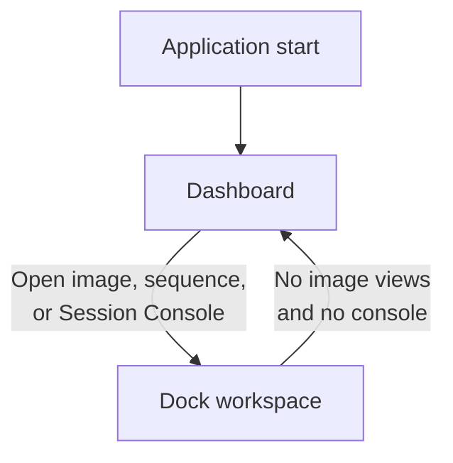

# Interface Overview

AfterNight works in one main window. When it starts, the middle of the window shows the [Dashboard](dashboard.md),
where you open files and pick up recent work. As soon as an image opens, the middle becomes the workspace: every
image or [sequence](../reference/glossary.md#sequence) gets a view there, and panels such as the Session Console dock beside the views. The menus, the
toolbar and the status bar frame both.

This page names each part and says what it is for. The page each part links to describes it in full.

```figure
image: ../assets/images/interface/overview.webp
alt: >-
  The AfterNight main window. Along the top, the menu bar reads File, Edit, View, Image, Process, Extensions, Window,
  Help and About, and under it a row of toolbar icons. The middle holds one image view: a tab named after the Carina
  Nebula master, a toolbar of zoom, channel, display mode, history, analysis and astrometry buttons, and the red and
  white clouds of the nebula on a dark background. Below the view, the Session Console panel, with its own toolbar
  over an empty log. Along the bottom, the status bar shows a box with the image's name, then its size, color, sample
  type and memory, the zoom and the sky coordinates under the pointer.
caption: >-
  The main window with the linear Carina master open in the Autostretch display mode and the Session Console docked
  below it.
pins:
  - {n: 1, x: 28.0, y: 4.2}
  - {n: 2, x: 16.0, y: 6.8}
  - {n: 3, x: 50.0, y: 30.0}
  - {n: 4, x: 6.5, y: 9.8}
  - {n: 5, x: 10.0, y: 54.5}
  - {n: 6, x: 8.0, y: 97.8}
  - {n: 7, x: 11.5, y: 2.6}
```

## What you see

1. **The menu bar.** Every command of the application, by kind. **File** opens, saves and closes images and starts
   a new sequence. **Edit** has undo and redo, the image's [history](../reference/glossary.md#history) in **Image
   History**, and **Settings...**. **View** shows the Session Console. **Image** holds what acts on the
   [active image](../reference/glossary.md#active-image), **Process** opens the processes, and **Extensions**, **Window**,
   **Help** and **About** follow. [Toolbar & Menus](toolbar-and-menus.md) lists every entry.
2. **The main toolbar.** **Open**, **Save as...** and **Close** for files, then the buttons that lock, group, split
   and fit the views of the workspace.
3. **The Dashboard or the workspace.** The middle of the window. It shows the Dashboard while no image view and no
   Session Console is open, and the workspace otherwise. The workspace holds views and panels in tabs and splits you
   arrange: see [Docking Panels](docking-panels.md).
4. **An image view.** One open image or sequence: a tab with its name, a toolbar of its own and the picture. Its
   zoom, channel and display mode change only what you see, never the image. See [Image Viewer](image-viewer.md).
5. **A docked panel.** The [Session Console](log-viewer.md), which lists what the application did and what went
   wrong. It docks, tabs and floats as a view does.
6. **The status bar.** Its box chooses the active image. Beside it stand the active image's size, color, sample
   type, memory and zoom, and, on a plate-solved image, the sky coordinates under the pointer.
7. **The Process menu.** It opens each process in a window of its own, beside the main window, with its
   parameters, its preview and its **Apply** button. What every process window shares is in
   [Process Windows](process-windows.md).

## What you can do

### Move between the Dashboard and the workspace

The middle of the window switches by itself:

- Opening an image or a sequence shows the workspace, with the new view in it.
- **View > Session Console** shows the workspace too, with the console docked at the bottom and no image.
- Closing the last view brings the Dashboard back, unless the Session Console is still open. Close it as well.
- Opening a window does not switch. Image Integration, which the Dashboard opens, leaves the Dashboard where it is.



While the Dashboard shows, the status bar is hidden, and the layout buttons and the **Window** menu are disabled.
AfterNight always starts on the Dashboard: it reopens no image and no layout of the session before. With **Remember
window size and position** on, in [Settings](settings-dialog.md), the window itself comes back where it was.

### Choose the image you work on

The active image is the one the menus, the main toolbar and a newly opened process act on. Click its view or its
tab, or choose its name in the status bar's box. The menus then offer what suits that image: the color commands for
an RGB image and **Convert to RGB** for a grayscale one, the **Sequence** menu for a sequence, and the header viewers
only for an image whose file stated [FITS](../reference/glossary.md#fits) cards or an
[EXIF](../reference/glossary.md#exif) record. **Undo** and **Redo** name the step they would take back or do again.

A process that cannot open on the active image says why in a message when you choose it: no image, an image of the
wrong kind, a window of the same process already open on it, or a window that needs the image to itself. A process an
extension adds is greyed in the **Process** menu instead, with the reason as its tooltip, and so is one that needs a
color image while a grayscale image is active. A process such as Image Integration needs no image.

### Find a command

The **Image** menu holds what acts on the active image: its actions, format conversions, channel extraction,
mirrors and turns, information windows, [mask](../reference/glossary.md#mask), sequence and zoom. A right-click on a view opens the same submenus
with **Process** among them, and **Current Window**, which groups, splits or fits every view. **Process > Favorite
Processes** and **Recent Processes** shorten the way to the processes you use most.

### Close images and quit

Choose **File > Close**, **Close All** or **Close All Others**, or the cross on a view's tab. A view with unsaved
changes has an asterisk after its name, and closing it asks first: "The image '...' has unsaved changes, are you sure
you want to close it?" Quitting with such a view open asks too. **Confirm before closing unsaved images**, on the
General page of Settings, turns both questions off.

An image's history and its duplicates last only while AfterNight runs. Save what you need to keep, and keep a copy
of a [master](../reference/glossary.md#master) before you try a process you do not know.

## Controls

```controls
window: The main window
controls:
  - name: Open
    kind: toolbutton
    default: ""
    effect: Opens one or more image, raw or sequence files, each in a view of its own. The same as **File > Open** and the Dashboard's **Open file**.
    enabled: Always, with or without an image. ++ctrl+o++ does the same.
    note: The file is read in the background and its view appears only once it is read. The Dashboard page says what the open shows and asks.
  - name: Save as...
    kind: toolbutton
    default: ""
    effect: Saves the active image or sequence to a file you name. See Saving And Exporting.
    enabled: With an active image. ++ctrl+shift+s++ does the same.
  - name: Close
    kind: toolbutton
    default: ""
    effect: Closes the active view, after the question about unsaved changes when it has some.
    enabled: With an active image.
  - name: Lock layout
    kind: toolbutton
    default: ""
    effect: Locks the views and panels where they are, or unlocks them. Group All Images, Split All Images and Fit Images To Window follow it on the toolbar.
    enabled: In the workspace. Disabled on the Dashboard, as the whole layout group and the **Window** menu are.
    persistence: The lock lasts for the session. **Lock dock layout by default**, on the Interface page of Settings, locks it at every start. The arrangement of the views is not saved.
    note: Docking Panels describes the four buttons.
  - name: Session Console
    kind: check
    default: "Off"
    effect: "**View > Session Console** shows or closes the console panel, docked at the bottom of the workspace."
    enabled: Always, on the Dashboard too, where it switches to the workspace without opening an image.
    tradeoff: While the console is open, closing the last image keeps the workspace on the screen.
    persistence: It is off at every start.
  - name: Active image
    kind: combo
    default: The active image
    options: [The active image, Every other open image or sequence]
    effect: Makes the image you choose the active one and brings its view forward. Clicking a view or its tab changes it too.
    enabled: In the workspace. Disabled on the Dashboard. Opened from the Dashboard, the console's workspace enables it with nothing to list. After the last image closes with the console open, it is disabled again.
    scope: Every menu, the main toolbar and every process opened afterwards.
    persistence: The views are not reopened at the next start, so neither is the choice.
  - name: Image information
    kind: readout
    default: ""
    effect: Shows the active image's size, color, sample type, memory and zoom, and the sky coordinates under the pointer on a plate-solved image.
    enabled: Hidden with the status bar while the Dashboard shows.
    note: Image Viewer says what each field means.
```

## When it goes wrong

The **Window** menu and the layout buttons are greyed
:   **Cause.** The Dashboard is showing, and they act only on the workspace.
:   **Fix.** Open an image, or choose **View > Session Console**.

Closing the last image does not bring the Dashboard back
:   **Cause.** The Session Console is still open, and it keeps the workspace.
:   **Fix.** Close the console with **View > Session Console** or the cross on its tab.

The image commands or a process are greyed
:   **Cause.** No view is active, the active image is not of the kind the command needs, or a process window already
    open on the image holds it.
:   **Fix.** Click the view of the image you mean, and read the message a process gives, or the tooltip of a process
    an extension adds. When it speaks of another process on the image, close that process window first.

A process worked on the wrong image
:   **Cause.** Another view was active when the process window opened.
:   **Fix.** Undo the step with ++ctrl+z++ in that view, close the process window, click the right view and open the
    process again.

The File Open window closes and no view appears
:   **Cause.** The open was cancelled, the file could not be read, or no view could be made for it; a message titled
    "File open error" says which.
:   **Fix.** Read the message and the Session Console, check the format in [Supported Formats](../getting-started/supported-formats.md),
    and open the file alone.

**FITS Header** or **EXIF Viewer** is greyed
:   **Cause.** The image's file stated no [header cards](../reference/glossary.md#header-card), or no camera
    record.
:   **Fix.** Open the image's **Summary** instead, or open a file that carries the record.

## Related

- [Dashboard](dashboard.md), to open files and return to recent work.
- [Image Viewer](image-viewer.md), for everything a view's toolbar and the status bar show.
- [Docking Panels](docking-panels.md), to arrange, group, split, float and maximize views.
- [Toolbar & Menus](toolbar-and-menus.md), for every menu entry and shortcut.
- [Process Windows](process-windows.md), for what every process window shares.
- [Saving And Exporting](saving-and-exporting.md), before you close work you need to keep.
