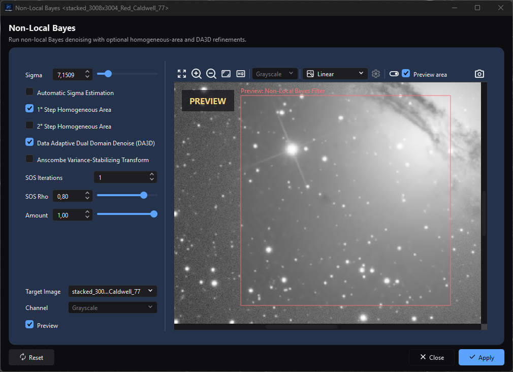

# Process Windows

*A target-bound process keeps its parameters and target selection beside the
preview while **Reset**, **Close**, and **Apply** remain in a consistent footer.*

## Purpose, audience, prerequisites, and expected result

Process windows expose parameters and execution controls for AfterNight operations. This page explains the shared window contract: how a process selects a target/channel, previews without committing, applies to a still or sequence, uses masks, reports progress, handles cancellation, records history, and restores settings.

Use it before following an individual process page. Start with an eligible active image or sequence unless the process is a top-level workflow. The expected result is that you can distinguish preview state from committed image state and predict whether closing, resetting, cancelling, applying, or creating a result changes the target.

## Reachability and availability

Most processes are launched from **Process** or a Dashboard/recent-process action. Registry rules decide the launch mode and whether an active image, still-only target, channel count, or exclusive access is required:

- **Single-image process:** attaches to the active eligible view and normally titles itself `Process Name <target name>`.
- **Top-level process:** opens without an active-image attachment when its workflow permits; its controls and execution model can be specialized.
- **Non-interactive action:** runs directly or hands off to another dialog and does not use the shared parameter window; see [Non-Interactive Processes](../processes/utility/non-interactive-processes.md).

Opening a top-level process window does not switch the application's central Dashboard/dock surface. An attached process listens for target rename/update/close events. If the target closes, or changes into a form the process no longer supports, the framework warns and closes the process.

## Before you start

- Read the individual process page for exact parameters, defaults, input types, output mode, mask support, sequence support, and known defects.
- Confirm the target in the title or **Target** selector. The active dock changes independently after a process opens.
- Treat RT preview and histogram preview as inspection aids. Neither is a committed target result.
- Save or duplicate important data before an in-place Apply. The shared typed/RT path protects the still until processing succeeds, but custom paths have process-specific commit behavior and every successful Apply intentionally changes image state.
- An assigned, enabled target mask is applied after the process result and any Amount/modulation blend when the process supports masking.

## Procedure

1. Make the intended image/sequence active and launch an eligible process.
2. Confirm `Process <target>` in the title. If the process offers **Target**, choose the intended supported view.
3. If offered, choose a processing **Channel**. This selector changes what the algorithm processes; it is not the viewer's display-only **View Channel**.
4. Set process parameters. Typed/RT-framework processes snapshot them for preview/full execution. A custom process may read live widget state instead, so finish edits before starting and follow its process page.
5. Enable **Preview** when available. Compare **Original** and **Preview**; optionally limit preview computation with **Preview area**.
6. Use **Reset** to return that process's current controls to its implemented defaults, or **Close/Cancel** to leave without applying.
7. Select **Apply** or **OK** only after checking the target, channel, mask, output mode, and process page. Shared typed/RT execution locks relevant controls, but a custom process may leave mutable controls enabled; do not edit any process during an active run unless its page explicitly permits it.
8. If a progress dialog appears, wait for success or choose **Cancel**. Cancellation is cooperative, so the current operation may need time to stop.
9. On success, verify the changed target or new result and its history. On failure/cancellation, verify that no success history step was added.

## Complete control and action reference

### Shared shell and execution actions

| Control / action | Type | Default | Range / choices | Step | Enabled when | Side effect | Scope | Persistence |
| --- | --- | --- | --- | --- | --- | --- | --- | --- |
| Process header/title | Read-only identity | Process name; attached windows add `<target>` | Current process/target | Live | Window exists | Identifies attachment; target rename updates title | Window | Session only |
| Description | Read-only text | Process-specific or absent | Process summary | — | Process supplies it | No data effect | Window | None |
| Message/progress banner | Read-only status | Hidden | Info / Warning / Error; optional 0–100% | Live | Process publishes a message | Reports state without committing data | Window/run | Session only |
| Target | Optional selector | Launch target | Currently open supported views | Discrete | Process exposes retargeting and is not executing | Detaches/attaches listeners, refreshes source/channel/preview/title | Process instance | Selection is session only |
| Channel | Optional selector | RGB for color; disabled Grayscale for mono | 21 color choices listed below | Discrete | Process supports per-channel work and is not executing | Converts/extracts one component, processes it, reconstructs color, and copies source metadata | Preview/full execution | Selection is session only |
| Process parameters | Process-specific widgets | Process-specific | See process page | Process-specific | Input valid and not locked | Updates current values; typed/RT processes use the next captured snapshot, while custom processes may read live widgets; may queue preview | Process instance | Only fields implemented by that process's JSON persistence persist |
| Preview | Optional checkbox | Process-specific | Off / On | Toggle | Process supports RT/histogram preview | Creates/destroys preview pane; off cancels active preview work | Process instance | Usually process/session state; check process page |
| Apply | Standard action | Initially disabled until process enables valid execution | In place or process-selected new output | One execution | Parameters/target are valid and the process permits execution | Runs the process's full-execution path; commit, control locking, and post-success reset are framework/process-specific | Target or new result | Image/sequence and history state |
| OK | Optional standard action | Process-specific | Same shared full-execution path as Apply | One execution | Same as Apply | May execute and/or close according to process configuration | Process-specific | Process-specific |
| Reset | Standard action | — | Implemented process defaults | One action | Window is open; re-enabled after run | Calls that process's reset implementation and refreshes controls/preview | Current process instance | Saved on later close only if process serializes those fields |
| Close / Cancel | Standard action | — | Close | One action | Window is open | Uses the process close path; the shared path requests cancellation and, while a run is still ending, hides the window until it ends; it then persists supported settings, detaches, and closes; custom paths may differ | Process instance | Does not Apply |
| `Esc` | Window shortcut | — | Close | One action | Process window has focus | Uses the close path | Process instance | Does not Apply |
| Resize/maximize | Window controls | Resizable unless process marks fixed-size | Available-screen bounds; fixed-size processes disable maximize | Continuous | Window policy permits | Changes geometry only | Exact process name | Persists when Interface **Remember window size and position** is on |
| Create new image/sequence | Optional output option | Process-specific | In place / new result | Discrete | Process exposes batch output choice | Chooses commit destination | Full execution | Process-specific |
| New result name | Optional text | Process-specific | Valid view name | Text | New-result mode is active | Names the created view/sequence | New result | Result state |
| Close at end/background mode | Optional execution options | Process-specific | Off / On | Toggle | Process exposes them | Chooses post-success window behavior/execution scheduling | Current run | Process-specific |

### Preview and analysis controls

| Control / action | Type | Default | Range / choices | Step | Enabled when | Side effect | Scope | Persistence |
| --- | --- | --- | --- | --- | --- | --- | --- | --- |
| Switch image | RT-preview action; `Space`, right-click, or `Ctrl+Shift+O` | Preview result | Original / Preview | Toggle or press/release | Alternate source/result exists | Changes comparison presentation only | Preview pane | Session only |
| Preview area | Optional RT-preview checkbox | Off unless process configures it | Off / On | Toggle | Process supports area selection | Processes a bounded crop and composites it into a full-frame presentation; full Apply remains full target | Preview only | Session only |
| Take snapshot | Optional RT-preview action; `Ctrl+Shift+K` | — | New standard image | One execution | Process enables snapshot | Re-executes with the captured parameters at source depth and creates a new result/history; target is unchanged | New image | Result/history state |
| Display Mode | Optional preview selector | Process-specific | Linear / Autostretch | Discrete | Process enables execution autostretch | Changes preview presentation only | Preview pane | Session only |
| Autostretch Settings | Optional preview action | Viewer defaults | See [Image Viewer](image-viewer.md) | Open/edit | Autostretch support and mode are enabled | Changes preview display transfer | Preview pane | Session only |
| Fit/Zoom/Pan | Preview viewer actions/gestures | Initial fit after preview settles | Viewer 1%–6400% range | Viewer rules | Image preview exists | Changes preview navigation only | Preview pane | Session only |
| Plot resolution | Optional histogram selector | Process-specific | 6, 7, 8, 9, 10, 12, 14, 16 bit; 100, 1000, 10000 levels | Discrete | Histogram preview exists | Changes histogram binning/display work; a 12-bit or finer plot fills its width again when the dialog is resized | Histogram preview | Session only |
| Histogram Zoom In / Zoom Out / Fit | Optional actions | Fit | Histogram extent | Discrete | Histogram preview exists | Changes plot navigation only | Histogram preview | Session only |
| Grid | Optional histogram toggle | Process-specific | Off / On | Toggle | Histogram preview exists | Shows/hides plot grid | Histogram preview | Session only |
| Local Channel Normalization | Optional histogram toggle | Process-specific | Off / On | Toggle | Process histogram supports it | Changes comparative plot normalization, not image pixels | Histogram preview | Session only |
| Show Clipping Info | Optional histogram toggle | Process-specific | Off / On | Toggle | Histogram preview exists | Shows/hides clipping readout | Histogram preview | Session only |
| Show Histogram | Optional histogram toggle | Process-specific | Off / On | Toggle | Histogram preview exists | Shows/hides histogram curves | Histogram preview | Session only |
| Show Histogram Areas | Optional histogram toggle | Process-specific | Off / On | Toggle | Histogram preview exists | Shows/hides filled histogram areas | Histogram preview | Session only |
| Progress text/bar | Read-only run state | Preparing execution / 0% | Current task and percent; sequence may use two progress cards | Live | Full execution supplies progress | Reports work; close button is removed | Current run | None |
| Cancel (progress dialog) | Button | Enabled | Cooperative cancellation request | One action | Full execution is active | Changes text to **Canceling execution...**, requests cancellation, disables itself | Current run | No success commit/history after honored cancellation |

The optional per-channel selector for a color target contains exactly: **RGB**, **Red**, **Green**, **Blue**; **CIE L\* (Lightness)**, **CIE a\***, **CIE b\***, **CIE c\***, **CIE h\***; **CIE X**, **CIE Y (Luminance)**, **CIE Z**; **HSL Hue**, **HSL Saturation**, **HSL Lightness**; **HSV Hue**, **HSV Saturation**, **HSV Value**; and **YCbCr Luma**, **YCbCr Blue Chroma**, **YCbCr Red Chroma**. Unlike the viewer's display selector, this list has no HSI modes or combined CIE a\*/b\* chrominance display.

## Behavior and state model

### Launch, attachment, and target changes

The launch guard checks active-image presence, still/sequence rules, channel filters, duplicate process attachment, and exclusive-access conflicts, all as the process's registry entry states them. A process that needs its target to itself - Crop, Rotate, Background Extraction, Auto Gradient Removal, Background Neutralization, Color Calibration, Photometric and Spectrophotometric Color Calibration and both Star Profilers - does not open beside another process, and while one is open no other process opens on its target. An attached window registers with its target. A supported **Target** selector is populated from open compatible views and follows create, rename, update, and destroy events. Switching target refreshes the source and resets the channel selector to RGB/Grayscale.

Processes without a Target selector stay bound to their launch target. If that target is closed, the process warns and closes. If a mutable target becomes unsupported, a retargetable process also warns and closes rather than applying to invalid data.

### Parameter snapshots and preview pipeline

Processes built on `TypedProcessControl` and the shared RT/full-execution pipeline snapshot typed parameters before preview, snapshot, still Apply, or sequence Apply, so that background work uses one coherent parameter set. Other current processes use custom paths. The own-thread windows - Pixel Math, Crop, Resize, Rotate, the colour-calibration tools and the external tools among them - read their dialog, the references it names and the view's mask into one settings value on the GUI thread when **Apply** or **OK** is pressed, so an edit made during the run does not reach it; a custom path may still leave mutable controls enabled during execution. The individual process page is authoritative for snapshot, locking, and reset behavior.

RT preview runs each preview on a worker. While one runs, or while the rate **Edit > Settings > Processing > Updates per second while dragging** sets - 30 a second unless you change it - holds the next back, further changes collapse into one more preview that starts with the parameters the window holds when the running one ends. While you drag one of the window's sliders, or a point of the curve in Curves Transformation, its previews run on the threads kept for previews; letting go, or holding the slider still for a moment, runs one more preview with every thread a preview may use, and that is the preview the window rests on. A change made without dragging - a value typed, a box ticked - runs one such preview at once. Adjust Brightness/Contrast, Gamma Correction, Exposure Correction, Color Saturation, Adjust HSL, Adjust LCh, Curves Transformation, Gaussian Blur, Unsharp Mask and High Pass Filter work, while you drag, on what the preview view shows - the image reduced to the view's size, or the part of it the view shows at 1:1 and closer - so a drag keeps up on a large frame; the preview you rest on is computed on the whole image, exactly as **Apply** computes it. Over the reduced image, Unsharp Mask and High Pass Filter come close to the reduction of their final result rather than matching it, because their clip does not commute with averaging; and beyond a Sigma or Radius of 32 in the dragged preview, Gaussian Blur and High Pass Filter blur it with three box passes, whose cost does not grow with Sigma or Radius. Their histogram stays the whole image's during the drag, its peaks where the final preview puts them, and in them a change made without dragging shows a quick preview first and the full one a moment later. The histogram behind the curve in Curves Transformation keeps the last full preview's counts until you let the point go. Median Filter, Bilateral Filter, Cosmetic Correction, Morphological Transformation, Tighten Edges, Star Reduction, Starmask Recombination and Profiled Starmask Recombination, whose results depend on the image's own pixel spacing, work while you drag on the part of the image the preview view shows, at the image's own scale and at any zoom, when no preview area is drawn - exactly the pixels **Apply** writes there - and, like every other process, on the whole image while the view shows all of it; their histogram keeps the last full preview's counts until you let go. Dragging again while the full preview of the last drag is still being computed stops that preview, so the new drag is shown at once. In autostretch their preview is stretched as the target is, measured once, so the stretch does not move while you adjust. Every other process previews the whole image at every step; Histogram Transformation and Generalized Hyperbolic Transformation do it in one pass over an 8- or 16-bit image, and the other stretch-based processes go on stretching each preview in autostretch by its own statistics. Parameters that change nothing - Brightness and Contrast, Exposure, HSL or LCh at zero, Gamma at 1, the identity curve - run nothing: the preview shows the target itself. A preview whose target or mask changed while it ran, or whose window turned Preview off, is discarded rather than shown, and a preview that fails says why in the window's message strip, once for each cause and never in a dialog box; the next preview shown clears it. **Apply** clicked while a preview runs stops that preview and applies; after an Apply, and after **Reset**, one preview runs with the parameters the reset leaves. The waiting indicator over the preview appears only once a preview has run for about a third of a second. Enabling Preview embeds a preview view that shows the target itself, without a copy, until the first preview lands. Disabling it cancels active preview work, removes the preview control, collapses the pane, and preserves window/splitter sizing for restoration. An exclusive preview disables conflicting exclusive previews attached to the same target.

The internal modes are no preview/full execution, synchronous preview, asynchronous preview, and snapshot. Preview output stays separate from the target. **Preview area** crops only preview computation, then places the processed patch into a full-size presentation. The cropped area carries the target's samples but not its header cards or plate solution, so a process that reads them sees none while it previews an area; **Apply** runs over the whole target with them. **Switch image** changes presentation. **Take snapshot** is a new full-depth execution and can therefore differ from an 8-bit screen rendering.

### Masks, modulation, and channel processing

For a compatible process, the shared order is:

1. run the algorithm using the captured parameters;
2. blend the source and result by the process's modulation/Amount value when it is not 1;
3. blend source/result with the assigned enabled mask, respecting inversion;
4. publish preview or commit full execution.

Preview-area masks are cropped to the same area. A mask overlay's visibility is independent of mask enablement. Processes can opt out of masking; the individual process page is authoritative.

For per-channel processing, which the shared framework runs through the engine's channel scope, RGB/Grayscale runs the normal path. A selected RGB component is replaced after scalar processing; CIE, HSL, HSV, or YCbCr selections convert, process one component, and reconstruct RGB with the other components. CIE components use the exact inverse of the XYZ conversion and YCbCr components unrounded coefficients. A CIE, HSL, HSV or YCbCr component is processed as a Float32 working plane (Float64 for a Float64 image) packed into the unit interval, so a process that changes nothing returns a 16-bit image within one code, while a stored channel keeps the image's own representation; and a channel or component of an image described as sensor codes or a physical quantity is taken as fractions of its full scale. A pixel the image's validity rejects is handed to the process as NaN and recomposed exactly as the source held it. The shared channel path keeps the target's metadata - header cards, plate solution and acquisition record - for every component, CIE, HSL, HSV and YCbCr included. A floating-point result's reconstructed RGB is not clamped to `[0,1]`, so a process that pushes a component out of gamut leaves samples outside the unit interval; an integer result saturates at its representation's range. Do not confuse this with display-only channel inspection.

### Full Apply, sequence work, progress, and cancellation

When a process uses the shared typed/RT full-execution path, it requests the target's processing lock before Apply. If another process owns it, execution is refused with a busy warning. That path disables target, channel, and process controls while the run is active. Custom execution paths can implement a narrower lock and may leave parameter widgets enabled.

For an in-place still using the shared path, the algorithm writes a copy of the target, so a run that writes nothing leaves the image as it was. Only after processing completes and was not cancelled does the framework add the history step and then show the complete result in the target; a result the history cannot record is not shown. A new-image mode publishes a separate standard view instead. The shared RT framework resets settings after success; custom processes can retain or reset values differently.

For a sequence using the shared path, the framework processes frames into a temporary sequence, can apply per-frame modulation/mask and configured auto-debayer behavior, and publishes either a replacement sequence or a new view only when every frame was read, processed and written. A frame that fails, a cancellation, or an output that cannot be finished publishes nothing and leaves no temporary sequence behind. The sequence player holds still while the run reads its frames. The sequence progress dialog can show overall and per-frame work. An honored cancellation closes/removes the temporary sequence and adds no success history step.

On the shared path, progress cancellation is cooperative: **Cancel** requests a stop and disables itself, but the current algorithm must observe its controller. Closing during work requests cancellation; the window hides at once and closes when the run has ended, without blocking the application. Shared-path exceptions close progress, report **Error executing the process**, restore controls/release the lock, and do not record a successful commit. Custom processes define their own cancellation and failure cleanup.

### Results and history

| Outcome | Target pixels/sequence | New view | History | Parameter state |
| --- | --- | --- | --- | --- |
| RT/histogram preview | Unchanged | No | No step | Current controls remain |
| Take snapshot | Unchanged | New still | New result carries process step/lineage | Current controls remain |
| Shared typed/RT in-place Apply success | Replaced after complete success | No | Target receives process step | Reset by shared RT framework |
| Shared typed/RT new-result Apply success | Unchanged | New still/sequence | New result receives process provenance | Reset by shared RT framework |
| Custom-process Apply | Process-specific | Process-specific | Process-specific | May remain live, be retained, or reset; see process page |
| Cancel before commit | Unchanged for shared still path; unpublished temporary sequence removed when cancellation is honored | No | No success step | Controls are restored; values remain process-dependent |
| Failure before commit | Shared still target unchanged | No successful result | No success step | Controls restored; process-specific cleanup applies |
| Reset | Unchanged | No | No step | Current controls return to process defaults |
| Close/Cancel action while idle | Unchanged | No | No step | Supported settings are serialized on close |

### Persistence

The application stores one `process_settings` record per exact process name. On close, the shared shell stores the process's JSON serialization and—when **Settings > Interface > Remember window size and position** is enabled—normal width/height and maximized state. That Interface option defaults on. Restored geometry is clamped to the current available screen.

Process JSON is restored even when geometry remembering is off. The base implementation serializes no parameters, so only controls explicitly implemented by each process persist. Target selection, active preview images, masks, processing locks, progress, and uncommitted preview output are not restored as a running process session.

## Inputs, outputs, and metadata

An attached typed/RT image process consumes the selected target, captured parameters, optional selected component, optional assigned/enabled mask, and optional Preview area. A custom process may read current widgets instead of a captured parameter object. A top-level workflow can instead consume its own file/project inputs.

Outputs are process-specific: an in-place target, new still, new sequence, files/reports, or no output for analysis-only tools. The shared per-channel path copies source metadata, but individual algorithms, top-level workflows, CFA/WCS state, and container metadata have their own rules. Use the process page rather than assuming universal preservation.

## Performance and responsiveness

Shared RT preview work runs asynchronously and coalesces rapid requests at the rate the Processing page sets, 30 a second unless you change it (5 to 60); that rate is a ceiling, not a promise that an algorithm reaches it. While a slider is dragged a preview uses only the threads kept for previews, so a drag leaves the rest of the computer to other work; the preview after the release uses as many as a preview may. Processes whose drag works on what the preview view shows cost a preview-sized image a step whatever the frame's size; the others cost a pass over the whole image, and show the rate that pass allows. Shared full work with a progress control runs away from the UI thread. Custom processes define their own threading and responsiveness behavior. Sequence processing through the shared path avoids nesting process-internal parallel work inside an outer parallel frame loop.

Preview area can reduce preview latency but does not reduce full Apply work. Masks, color-space conversion, snapshots, and sequences add work/memory. A preview is shown as soon as it lands, whatever else reads the image the preview view shows - the Statistics window, the lens - which goes on reading the image it was reading. No production timing, memory, or responsiveness claim is made without an approved target and runtime evidence.

## Worked example

This is a source-and-test-derived typed/RT-framework walkthrough. Choose an individual process page that explicitly documents an eligible target, shared Preview, Preview area, and in-place Apply.

1. Activate a disposable or duplicated supported still and launch the process. **Expected:** the title is `Process <target>` and Apply remains disabled until the process considers its inputs valid.
2. Enable **Preview** and change one safe parameter. **Expected:** the preview updates asynchronously; target history and pending-save state do not change.
3. Use **Switch image**, then enable **Preview area** and place it over a recognizable region. **Expected:** only that region is computed, but it is shown in a full-frame comparison.
4. Select **Reset**. **Expected:** current parameters return to that process's defaults and any enabled preview refreshes; target history remains unchanged.
5. Set the desired parameters again, confirm Target/Channel/mask/output mode, and choose **Apply**. **Expected for the shared typed/RT path:** controls lock; progress appears if the process supplies it; success commits the full target (not only Preview area), adds history, and resets controls.
6. For a separate cancellation check, start a sufficiently long run on another disposable copy and choose progress **Cancel**. **Expected:** the dialog says **Canceling execution...** until the process honors the request; no successful result/history step is published.

This walkthrough proves the shared typed/RT state transitions from source and focused tests. It is not evidence of a custom process's behavior or a specific process's image quality, timing, or cancellation latency.

## Warnings and limitations

!!! warning "Preview is not Apply"
    Preview, original/result switching, histogram controls, display autostretch, and Preview area do not commit the target. **Apply/OK** runs the full target according to the process's output mode.

- **Channel** in a process changes the data component processed; **View Channel** in the Image Viewer changes only presentation.
- Target locking prevents concurrent full runs on the same target, but parameter validity and output safety remain process-specific.
- Typed/RT-framework processes snapshot parameters and lock their controls. Custom processes may read live widgets and leave them enabled; never assume mid-run edits are isolated unless the individual process page says so.
- Cancellation is cooperative and may not be immediate. A process page can document additional cancellation gaps.
- On the shared path, closing during execution requests cancellation, hides the window and closes it when the run ends; custom close behavior is process-specific. Do not force-terminate the application to imitate Cancel.
- Reset behavior and JSON persistence are implemented by each process. A visible parameter is not automatically persistent.
- Sequence exception cleanup and metadata behavior can be process/container-specific; only the honored shared cancellation path explicitly removes its temporary output here.
- Top-level workflows and extension process windows can use specialized controls and execution pipelines; apply this shared contract only where the page says it is used.
- This page does not claim exact appearance, sizing, or cross-platform equivalence.

## Troubleshooting

| Symptom | Likely cause | What to do |
| --- | --- | --- |
| Process action is disabled or launch is refused | No active eligible image, wrong still/sequence/channel type, duplicate process, or exclusive-access conflict | Activate a supported target and read the process page/launch warning. |
| Window title shows the wrong target | Active view changed after launch or Target was changed | Use the process **Target** selector if available; otherwise close and relaunch from the intended active view. |
| Target selector lacks an open image | Process compatibility filter rejected it | Check still/sequence, channel, dimensions, and process-specific requirements. |
| Channel selector is absent | Process does not opt into shared per-channel processing | Use the process's own channel controls or RGB/full-image path. |
| Preview does not appear | Preview is off, unsupported, or failed to obtain a source | Enable Preview; inspect the warning/Session Console; verify target is still open. |
| Preview lags while dragging controls | Algorithm is slower than queued updates, or **Updates per second while dragging** is low | Pause input; use Preview area; raise the rate on the Processing page; the queue will coalesce toward the latest request, and one more preview runs when you let go. |
| Preview area changes only part of comparison | Expected area-composite behavior | Apply still runs full target; disable Preview area for a full preview if needed. |
| Apply remains disabled | Required process input is invalid/incomplete | Check that process page's validation conditions. |
| Busy warning appears | Another process owns the target processing lock | Cancel/wait for that run, then retry. |
| Cancel button disables but work continues briefly | Cancellation request has been sent and is cooperative | Wait for the current algorithm to observe it; consult process limitations. |
| Window reopens at an unexpected size | Geometry memory off, screen changed, or fixed-size policy | Enable **Remember window size and position**; geometry is clamped to available screen. |
| Parameters did not restore | That process does not serialize them, or Reset was saved on close | Check the process page; configure again and close normally if persistence is supported. |
| No history step after preview/reset/cancel | Those paths are non-committing | This is expected. Verify history only after successful Apply/snapshot/new-result creation. |
| A preview or Apply shows nothing and the log names the process | The process's work failed in an unexpected way on its worker; the log says `'<process>': work on a worker threw and its result was dropped`, and nothing is shown or recorded | Read the message in the Session Console, then try again; report it with the log if it repeats. |

## Related workflow steps

- [Image Viewer](image-viewer.md) — display-only channel/autostretch behavior and embedded RT-preview controls.
- [Processes](../processes/index.md) — choose the individual process and its exact parameter/output contract.
- [Masks](masks.md) — assignment, enablement, inversion, overlay, and persistence.
- [Image History](image-history.md) — committed steps and result lineage.
- [Sequences](sequences.md) — sequence containers, playback, temporary output, and export.
- [Settings](settings-dialog.md) — process-window geometry preference and broader application settings.
- [Session Console](log-viewer.md) — inspect process warnings, errors, and timing messages.

## References and provenance

This page is derived from AfterNight's source and its focused tests. In each deployed MSVC Release and Debug configuration, focused tests passed 16/16 for preview throttling/cancellation/exclusivity/autostretch/area/guards, 14/14 for shared image-process type/lifecycle/channel/error/close/title contracts, and 10/10 for typed parameters and geometry/persistence (40/40 total per configuration). These tests establish the shared typed/RT contracts, not the behavior of every custom process. They do not execute an approved astronomical target, every registered process, a long production sequence, runtime visual/layout behavior, or cross-platform cancellation; those claims remain unmade.
