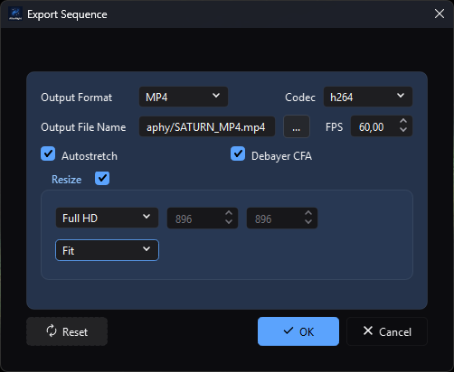

# Saving And Exporting

*Sequence Export exposes codec-dependent delivery settings together with CFA,
display-stretch, and resize choices before any output is written.*

## Purpose, audience, prerequisites, and expected result

Saving writes the active still image or sequence to a user-selected path.
Sequence Export instead renders every decoded frame into a chosen delivery
format and can change frame rate, displayed intensity, and geometry. Use saving
for a faithful processing copy in a compatible format; use Export for a
deliberately transformed SER, raw AVI, MP4, or WebM handoff.

After a successful save, the destination is added to recent files and, when the
view still shows what was written, its pending-changes marker is cleared and the
view takes the new file as its source. An edit made while the save ran keeps the
changes pending, because the view no longer shows what is in the file.
AfterNight performs no automatic readback or checksum verification. After a successful sequence export, a success message
appears and the export dialog closes; the active sequence and its pending state
are unchanged.

## Reachability and availability

| Item | Current behavior |
| --- | --- |
| Path | **File > Save as...** or its toolbar icon; **Image > Actions > Save File...**; sequence-only **Image > Sequence > Export...**. |
| Enabled/visible when | Both save actions require an active view containing an image. Export requires an active sequence view. There is no separate plain **Save** action that writes back without prompting. |
| Supported inputs/state | Save handles a still image, native SER, AfterNight image list, or FFmpeg-backed sequence according to the active view. Export handles any active sequence whose frames can be decoded. Masks and display overlays are not composited into still saves. |
| Outputs/side effects | Save creates or replaces one still file, one SER/video file, or an `.anseq` plus its sibling frame directory. Export creates one SER, raw AVI, MP4, or WebM file. Successful save adds the destination to recent files and, when the view still shows what was written, clears its pending-change marker. |
| Persistence | Save starts in the shared last-open directory and uses **General > Default Save Format** for a still's initial filter/suffix. Export remembers format, codec, resolution mode, and a separate last directory; it does not remember FPS, autostretch, resize enablement, fill mode, dimensions, or output name. |
| External dependencies | Built-in still/SER/image-list codecs; bundled FFmpeg with the software encoders libx264, libx265 and libvpx-vp9 for video input and H.264/H.265/VP9 output. No network or catalog is required. |

## Before you start

- Keep an astronomy-native FITS or XISF master before creating an 8-bit or
  lossy delivery copy. PNG converts signed, 32-bit integer, and floating data
  to unsigned 16-bit; JPEG converts every non-8-bit image to unsigned 8-bit.
- Save a colour filter array mosaic as FITS, XISF, or TIFF, which record the
  filter array, or demosaic it first. PNG and JPEG cannot record one, and the
  save refuses them before anything is written. An X-Trans (Fujifilm) mosaic is
  kept by XISF and TIFF only: FITS states one two-by-two pattern, so a FITS save
  of one is refused too, the message naming XISF and TIFF.
- Check the active image's pixel type, linear state, geometry, and metadata.
  Saving writes underlying image data, not the viewer's autostretch, selected
  display channel, zoom, grid, star overlay, or mask overlay.
- A still save is written whole or not at all: the file is written beside the
  destination and moved into place only when it is complete, so a failed or
  stopped save leaves an existing destination as it was.
- For an image-list sequence, reserve space for both the `.anseq` file and a
  sibling `<name>-frames` directory containing FITS frames.
- Saving a video sequence decodes and re-encodes every frame at 8 bits; it is
  not a file copy. A video read from `.mpg` or `.mpeg` cannot be saved under
  that suffix, because AfterNight writes no MPEG program stream; choose `.mp4`,
  `.mkv`, `.webm` or `.avi`, or use **Image > Sequence > Export...**.

## Procedure

### Save a still image

1. Activate the image to save. Choose **File > Save as...**, press the Save
   toolbar icon, or choose **Image > Actions > Save File...**. All three routes
   run the same workflow; `Ctrl+Shift+S` is assigned to **Save as...**.
2. Confirm the proposed view name and folder. Select TIFF, FITS, PNG, XISF, or
   JPEG and give the file the matching extension. If an extension and selected
   filter disagree, the extension chooses the engine codec.
3. If the destination exists, review the file dialog's overwrite confirmation.
   Accepting it permits replacement; AfterNight does not create a backup.
4. Confirm the dialog. A **Save File** progress window appears while a worker
   writes the image as it was when you confirmed, with the Export settings as
   they were then. You can keep working meanwhile.
5. Treat completion as an encode result, not a round-trip guarantee. Reopen the
   destination, confirm dimensions/channels/pixel type in Image Summary, and
   inspect FITS/XISF metadata with the relevant metadata viewer before deleting
   a master or source file.

### Save a sequence copy

1. Activate a sequence and use either save path. The dialog offers the current
   family's suffix: SER `.ser`, image list `.anseq`, and a video its own
   container suffix. The save reads every frame from the sequence's file and
   writes it into the container the chosen path names - `.ser`, `.anseq`,
   `.avi`, `.mp4` (or `.mov`, written as MP4), `.mkv` or `.webm` - so a path
   with another of those suffixes converts the sequence.
2. Every frame is written as its file holds it, whatever the view shows: a
   mosaic stays a mosaic in SER and in an image list's frames, and is written as
   its grey samples to AVI or video. Demosaic through a process first if colour
   frames are wanted.
3. Select a new destination and confirm. A copy is written privately and
   published only when its last frame is in, so a failed or cancelled copy
   leaves nothing. Image-list copies write each frame as a FITS file with its
   header cards, in the first frame's representation, in its `<name>-frames`
   directory.
4. Reopen the result and check family, frame count, geometry, pixel type, FPS,
   and first/last frame. A SER header has no frame-rate field: a SER AfterNight
   writes keeps each frame's exposure start in its timestamp trailer, and a
   reopened SER plays at the rate those timestamps give, rounded to a whole 1 to
   60 frames per second - 1 frame per second when its frames state no exposure
   start. For `.anseq`, also confirm that the
   sibling frame directory was created and remains beside the list file.

### Export a sequence

1. Activate a sequence and choose **Image > Sequence > Export...**.
2. Choose **Output Format**. Use SER for a high-fidelity native sequence, **AVI
   (RAW)** for uncompressed 8-bit DIB frames, or MP4 with H.264/H.265/WEBM
   (VP9) for delivery. **Codec** is enabled only for MP4.
3. Choose `...` beside **Output File Name**. The selected format/codec normalizes
   the destination to `.ser`, `.avi`, `.mp4`, or `.webm`; the destination field
   is read-only and **OK** remains disabled until a path is chosen.
4. Set **FPS**. This changes playback timing only; it does not interpolate,
   duplicate, or remove frames.
5. For a CFA source, leave **Debayer CFA** off to preserve mosaic samples - a
   SER keeps the mosaic, AVI and video store its samples as grey - or turn it on
   to demosaic every exported frame to RGB by the sequence's demosaic method. The
   option is hidden for a non-CFA source.
6. Leave **Autostretch** off for data preservation. Turn it on only for a
   display-ready export: it applies the source view's current autostretch
   parameters and optional saturation/brightness/contrast to every frame.
7. Leave **Resize** off to request source geometry. When it is on, choose a
   resolution and review the resulting width/height plus the fill rule. A video
   frame's odd width or height is cropped by one column or row even when Resize
   is off.
8. Choose **OK** and watch **Exporting Sequence...**. The configuration controls
   remain locked while the worker uses the submitted settings snapshot. The
   progress dialog's Cancel stops the export, and nothing is written: an export
   is published only when its last frame is in. Closing the window during an
   export stops it, and the window closes when the stop lands. On success,
   AfterNight reports **Sequence exported successfully!** and closes the dialog;
   a failure shows **Export Sequence Error** with the reason and keeps the
   dialog open.
9. Reopen or inspect the file externally. Check container/codec, frame count,
   geometry, FPS, first/last frame, and whether expected stretch/letterbox/crop
   choices are visible. Export success does not perform that readback.

## Complete control and action reference

### Save actions and file dialog

| UI label/action | Type and unit | Default | Valid values/constraints | Effect | Enabled, hidden, or ignored rules | Trade-off or side effect | Scope | Persistence |
| --- | --- | --- | --- | --- | --- | --- | --- | --- |
| Save as... | Menu/toolbar action; `Ctrl+Shift+S` | Disabled without an active image | One active still or sequence view | Opens the standard save dialog and writes the active data. | Same handler as **Save File...**; there is no write-back-without-prompt action. | Successful save clears pending changes and makes the new file the view's source, when the view still shows what was written. | Active view | Last directory is shared and persisted. |
| Save File... | **Image > Actions** action | Disabled without active image content | Same as Save as | Runs exactly the same save workflow. | Enabled with the Image Actions menu. | Same output and pending-state effects as Save as. | Active view | Same shared last directory. |
| File name and destination | Save-file dialog | Active view name in the last-open directory | Writable path; still extension must be FITS/XISF/TIFF/PNG/JPEG; sequence suffix should match current family | Selects output and engine codec/family. | Sequence filters depend on current family. The dialog's all-formats entry is not a promise that cross-family renaming converts data. | Existing destinations are replaced only once the new file is complete. | One output | Selected directory becomes the next shared open/save directory. |
| File type filter | Selector | Still: **General > Default Save Format** (TIFF on a clean profile); sequence: family-specific | Still: TIFF, FITS, PNG, XISF, JPEG. Sequence: SER, `.anseq`, or the source video's recognized container suffix. | Supplies the default suffix and narrows file choices. | Video save preserves `.avi`, `.mp4`, `.mpg`, `.mpeg`, `.mov`, `.mkv`, or `.webm`; an unrecognized source suffix falls back to `.mp4`. The actual filename extension controls still-codec dispatch. RAW is never offered for still save. | A display format may convert precision or discard astronomy metadata. | One output | Still default persists as `general/defaultSaveFormat`; current filter selection itself is dialog-local. |
| Confirm/Save | Dialog action | — | Valid selected path | Starts background save and shows progress. | A still write may finish before a stop is observed; a stopped still write leaves nothing. Sequence copy checks cancellation where implemented. A mosaic is refused for PNG and JPEG, and an X-Trans mosaic for FITS too, before anything is written. | Adds successful destination to recent files and clears pending state when the view still shows what was written. | Active view | The new file becomes the view's source. |
| Cancel | Dialog/progress action | — | Click/close | Before start, writes nothing. During a sequence copy or export, stops it; nothing is published. | A cancelled save is only logged; it does not add a recent file or clear the active view's pending-change marker. A still write may finish before the cancellation check. | A failed or cancelled write leaves an existing destination as it was and nothing beside it. | Current operation | None. |

### Sequence Export dialog

| UI label/action | Type and unit | Default | Valid values/constraints | Effect | Enabled, hidden, or ignored rules | Trade-off or side effect | Scope | Persistence |
| --- | --- | --- | --- | --- | --- | --- | --- | --- |
| Output Format | Selector | SER on first use; last saved value later | SER; AVI (RAW); MP4 | Creates the destination writer and adjusts suffix/filter behavior. | Changes **Codec** enablement and rewrites an already selected filename's suffix. | SER keeps 8-bit frames at 8 bits and writes every other at 16; raw AVI converts to 8-bit; MP4/WebM are delivery encodings. | Whole export | Stored in process setting `__EXPORT_SEQUENCE__` on dialog close. |
| Codec | Selector | h264 on first use; last saved value later | h264; h265; WEBM | Selects H.264 MP4, H.265 MP4, or VP9 WebM encoding. | Enabled only when Output Format is MP4; ignored for SER/AVI. | Video encoding is lossy and drops astronomy metadata/history. | Whole export | Stored on dialog close. |
| Output File Name / ... | Read-only path and browse action | Empty | `.ser`, `.avi`, `.mp4`, or `.webm` selected by current output mode | Chooses destination and enables OK. | Manual typing is unavailable; OK stays disabled until browse returns a path. | Existing file replacement is confirmed by the file dialog; no backup/readback follows. | One output | Directory stored under `__EXPORT_SEQUENCE_CONTROL__`; filename not persisted. |
| FPS | Decimal frames/second | Source sequence FPS (1.0 when it states none), clamped to control range | 1.0-60.0; step 0.3 | Sets the destination playback rate. | Values outside the UI range clamp when loaded. | Timing changes without frame interpolation. AVI and video store the exact fraction asked; a SER stores no frame rate of its own, only each frame's exposure start in its trailer. | Whole export | Not persisted. |
| Debayer CFA | Checkbox | Off | Off/On | Off preserves CFA mosaic frames; on requests demosaiced RGB frames. | Visible and enabled only when the source sequence reports CFA data. | Demosaicing changes channel layout and pixel values and cannot reconstruct the original mosaic from the export. | Every exported frame | Not persisted. |
| Autostretch | Checkbox | Off | Off/On | Stretches every frame as Apply Stretch does, through the presentation the view shows, with the source view's current shadows clipping, target background, linked-channel, neutralization, calibration, saturation and brightness/contrast settings. | Export-only; the normal save path never applies viewer autostretch. | Permanently changes exported pixels and adds per-frame CPU cost; it is not reversible from the output. | Every exported frame | Not persisted. |
| Resize | Checkable group | Off | Off/On | Enables output geometry controls; off requests source dimensions. | A video still crops an odd width or height by one column or row with Resize off. | Resampling changes pixels/WCS applicability and costs CPU/memory. | Every exported frame | Enablement not persisted. |
| Resolution | Selector | Preserve Ratio on first use; last saved value later | Preserve Ratio; Free Ratio; Full HD; 4K; 8K | Selects source-linked dimensions or nominal preset dimensions (1920 x 1080, 3840 x 2160, 7680 x 4320). | Width/height controls range from 4 to twice the source dimension or to 7680 (width) / 4320 (height), whichever is larger, so a preset is never clamped. A video only crops an odd width or height by one. | Upsampling cannot add source detail. | Resize target | Selector persists; dimensions do not. |
| Width / Height | Integer pixels | Source width/height | 4 through twice the corresponding source dimension, or 7680 / 4320 when that is larger | Defines target canvas. In Preserve Ratio, editing one recalculates the other from source aspect. | Disabled for Full HD/4K/8K; enabled for Preserve/Free Ratio. | A video frame's odd width or height is cropped by one column or row. | Resize target | Not persisted. |
| Fill mode | Selector | Fit | Fit; Fill; Stretch; Center | Chooses Lanczos4 scaling/canvas behavior for preset targets. | Enabled only for Full HD/4K/8K. Preserve/Free Ratio keep the current Fit value internally. | Fit letterboxes; Fill crops; Stretch distorts aspect; Center adds black canvas and can crop content larger than target. | Every resized frame | Not persisted. |
| Reset | Button | — | Click action | Restores Preserve Ratio, source width/height, and Resize off. | Does not reset format, codec, FPS, autostretch, output path, or fill mode. | A previously chosen path remains active. | Current dialog | Persisted selectors remain until dialog close writes current values. |
| OK | Button | Disabled until output path exists | Valid chosen path | Snapshots the selected path, format, codec, FPS, CFA/autostretch/resize settings, dimensions, and fill mode, then starts a worker with percentage progress. | Configuration controls and the dialog button box are disabled until cancellation, failure, or completion. The dialog remains open after cancellation/failure and closes after success. | Full-sequence decode/transform/write; a failed or cancelled export leaves nothing at the destination. | Whole sequence | Format/codec/resolution are saved when the dialog later closes. |
| Cancel / window close | Dialog action | Enabled before export | Click/close | Closes without starting a new export. While an export runs, closing the window stops it and the window closes when the stop lands; cancellation is also available from the progress dialog. | Closing the configuration dialog before/after a run stores format, codec, and resolution. | Does not remove an earlier completed output. | Current dialog | Stores the three selectors. |

## Behavior and state model

### Save dispatch and precision

Saving and Sequence Export write through the engine's output transaction and
sinks. The standard still path decides, when the save is confirmed, how the
image is written: the representation each container below holds nearest the
image's own, the compression the Export settings give, and the metadata it
carries. When the image's representation is not one the container holds, a copy
is converted at corresponding full scales in double precision to the nearest
value, ties to even, as the processes and the command-line tool round; floating
data in physical units is converted as a fraction of full scale, as the viewer
shows it. Codec selection is extension-based and case-insensitive; the
file-dialog filter does not override a conflicting extension.

| Output | Pixel/sample behavior | Compression |
| --- | --- | --- |
| FITS | Writes supported signed/unsigned 8/16/32-bit integer and 32/64-bit floating samples through matching fixed-width FITS sample types. Signed 8-bit and full-range unsigned 32-bit round trips are regression-tested. RGB is stored as three planes. A Bayer mosaic keeps its pattern; an X-Trans mosaic is refused. A 64-bit integer FITS file whose stored values exceed 2^53 is refused when it is opened. | No user-facing FITS compression in this path. The stored `export/fitsFloatFormat` preference is not consumed. |
| XISF | Preserves unsigned 8/16/32-bit and float 32/64-bit samples. A signed image is written as the unsigned representation of its own width. | None (the default), or lossless zlib, LZ4, LZ4-HC or Zstandard, with the bytes of each sample shuffled unless that is turned off, and an optional SHA-256 checksum, as **Settings > Export** gives them. Zstandard is read only by readers of Revision 1 of the XISF specification. |
| TIFF | Writes and reloads the active sample bit width and unsigned/signed/floating sample format, including signed 8-bit. The payload is divided into strips of about a quarter of a megabyte. | None, lossless LZW, lossless ZIP/Deflate, or JPEG. JPEG applies only to 8-bit TIFF; higher-depth input is written with LZW, and the session console says so. |
| PNG | Preserves unsigned 8/16-bit samples. Signed 8/16-bit data converts to matching unsigned depth; 32-bit integer and floating data converts to unsigned 16-bit. A colour filter array mosaic is refused. | Lossless DEFLATE level 0-9; level affects size/time, not decoded pixels. |
| JPEG | Converts all data to unsigned 8-bit grayscale or RGB before encoding. A colour filter array mosaic is refused. | Lossy JPEG quality 1-100. |

Saving does not flatten a display stretch. If the image itself was stretched by
a process, those changed pixels are saved; if only viewer Autostretch is on,
the original underlying samples are saved.

### Metadata and processing history

- FITS and XISF always carry the header cards the image was read with, its
  world coordinates among them, while the structural keywords are written
  afresh. A long processing-state string is stored across `CONTINUE` cards.
  Geometry-changing work drops the cards that no longer describe the image, so
  a turned or resized image carries no stale WCS.
- With **Embed EXIF** enabled, a JPEG, TIFF, or PNG carries the image's EXIF
  record - each format's allowed subset - as part of the same write, so a save
  that succeeds wrote it. With it disabled, a raster file carries none. The
  record is not stamped with the time of the write, and a FITS `GAIN` card is not
  written as the Exif gain-control field.
- **Embed processing history in FITS header** is kept as a setting and writes
  nothing: no file carries an image's processing history. Existing FITS
  HISTORY records the image was read with are carried as its other cards are.
- Sequence Export does not embed AfterNight image history. SER carries its
  native sequence/image fields and each frame's exposure start in its timestamp
  trailer; an image list's frames carry their header cards; raw AVI/MP4/WebM
  are display containers and
  should not be treated as astronomy-metadata archives.

### Sequence save versus export

Save reads every frame from the sequence's file and writes it, as the file holds
it, through the writer of the container the chosen path names: SER (8-bit
frames at 8 bits, every other at 16, each frame's exposure start in the
timestamp trailer), an image list (each frame a FITS file with its header cards
in the first frame's representation, beside a new `.anseq`), uncompressed AVI,
or MP4,
Matroska or WebM by the software encoder (8-bit frames, a mosaic as its grey
samples). A `.mov` path is written as an MP4 container; `.mpg` and `.mpeg` are
not written. Every container is written privately and published only when the
last frame is in.

Export reads every frame from the sequence's file, demosaics it when asked,
stretches it, resizes it and writes it privately, publishing the file only when
the last frame is in. Autostretch runs before resize. Resize uses Lanczos4; Fit
scales inside a black canvas, Fill scales then center-crops, Stretch changes
aspect ratio, and Center places unscaled data on a black canvas. A video frame's
odd width or height is cropped by one column or row, and H.264 and H.265 are
encoded by the software encoders, VP9 into WebM. Colour frames are encoded
through the BT.709 matrix, and AVI and video frames are stored upright. An AVI
that would need more index sections than its writer reserves is refused rather
than continued in a second file.

## Inputs, outputs, and metadata

| Operation | Input | Output/naming | Metadata/history | Overwrite and recovery |
| --- | --- | --- | --- | --- |
| Save still | Active underlying image | One extension-selected file, proposed name is the view's unique name | Format behavior above; no display overlays/stretch; successful save clears pending state | File dialog confirms replacement. Written beside the destination and moved into place only when complete; reopen and verify. |
| Save SER | Active SER | New `.ser`; every frame rewritten as the file holds it, a mosaic kept | Native SER fields; each frame's exposure start in the timestamp trailer, an unknown entry for a frame that states none; no frame-rate field; no image-history embedding | Published whole or not at all; a failed or cancelled copy leaves nothing. |
| Save Image List | Active `.anseq` | New `.anseq` plus `<name>-frames` FITS directory | First frame supplies sequence metadata; frames are rewritten as FITS with their header cards, in the first frame's representation | Treat list and directory as one artifact. A failed copy leaves nothing. |
| Save FFmpeg video | Active video sequence | Frames decoded and written to the container the path names: uncompressed AVI, or MP4 (also for `.mov`), Matroska or WebM by the software encoder; `.mpg`/`.mpeg` are refused | Frames re-encoded at 8 bits; no astronomy metadata | Published whole or not at all. |
| Export SER | Decoded whole sequence | Selected `.ser` | Supported native SER frame layout; each exported frame's exposure start in the timestamp trailer, an unknown entry for a frame that states none; no frame-rate field; no AfterNight image history | Published whole or not at all; a failed or cancelled export leaves nothing. |
| Export AVI (RAW) | Decoded whole sequence | Selected `.avi` with raw DIB frames | Converts frames to unsigned 8-bit; the exact FPS fraction | Large uncompressed output; no astronomy metadata archive. |
| Export MP4/WebM | Decoded whole sequence | H.264/H.265 `.mp4` or VP9 `.webm` | Delivery video, the exact FPS fraction, every frame including the last; astronomy metadata/history not preserved | Lossy; inspect actual output. |

## Performance and responsiveness

Still save runs on a worker while a progress dialog is shown, from the image as
it was when the save was confirmed. FITS, TIFF, PNG, JPEG, and XISF encode the
whole image; a conversion, compression and metadata work add CPU and disk time.
You can keep working, edit, or close the view meanwhile: the file holds what was
confirmed, and an edit made in the meantime keeps the view's changes pending.

Sequence copy/export scales with frame count, decoded pixels, channels, and
destination encoding. Every sequence save decodes and rewrites each frame, one
admitted step at a time. Image-list save writes one FITS file per frame. The
video encoder runs on one thread. Autostretch measures each frame as the view does; resize
adds Lanczos4 work and temporary images; raw AVI can be very large; H.264/H.265/
VP9 trade CPU for smaller delivery files. Use a short representative sequence
and a new output path before committing a long export.

## Worked example

- Evidence mode: Source-and-test-derived.
- Starting state, actions, settings, checkpoints, result, and limitations: for
  a floating-point RGB processing master, keep **General > Default Save
  Format** at TIFF or choose FITS/XISF explicitly, then save to a new name.
  Reopen it and verify geometry, three channels, floating sample type for
  FITS/TIFF/XISF, and required astronomy metadata. For a delivery copy, choose
  PNG only after accepting unsigned-16 conversion, or JPEG only after accepting
  unsigned-8 conversion and lossy quality 95. For a sequence delivery, choose
  Export, retain source FPS, leave Autostretch/Resize off for a control export,
  and verify frame count, dimensions, FPS, and boundary frames after writing.
  Focused tests cover codec round trips, FITS overwrite/header behavior, XISF
  header behavior, invalid extensions, the mosaic refusal, whole-or-nothing
  publication, and each export container's frame rate and geometry. This example
  does not claim a measured compression ratio, external-player compatibility,
  EXIF round trip, or visual equivalence for lossy output.

## Warnings and limitations

- **No plain Save/write-back exists.** Every standard save opens a destination
  dialog. Save as and Save File are aliases.
- **Successful save clears the pending marker only when the view still shows
  what was written,** and then makes the new file the view's source.
- **A still save is whole or absent.** A failed or stopped write leaves an
  existing destination as it was and no partial file beside it.
- **Saving a video re-encodes it.** Every frame is decoded and written again at
  8 bits through the software encoder; `.mpg` and `.mpeg` cannot be written.
  Keep the original.
- A selected filter cannot force a codec. The final extension controls still
  dispatch; missing or unsupported extensions fail.
- TIFF JPEG compression becomes LZW for non-8-bit samples, as the session
  console says. PNG and JPEG perform the precision conversions listed above.
  XISF writes a signed image as the unsigned representation of its width.
- A colour filter array mosaic cannot be saved as PNG or JPEG, and an X-Trans
  mosaic cannot be saved as FITS either.
- A SER file stores no frame rate of its own: reopened, it plays at the rate its
  frames' timestamps give, and at 1 frame per second when they state none - a
  SER exported from a video, for one, whose frames carry no exposure start.
- An image list's frames are written in the first frame's representation; a
  frame of a deeper one is narrowed to it.
- **Embed processing history** writes nothing; keep provenance separately.
- Viewer autostretch, masks, overlays, selected display channel, zoom, and
  annotations are not included in still saves. Sequence Export Autostretch is
  different: it permanently transforms exported pixels.
- Sequence Export resolution presets can be clamped by the UI range, and a video
  frame's odd width or height is cropped by one. Inspect the dimensions of the
  actual output.
- A sequence export or copy that fails or is cancelled leaves nothing at its
  destination; a frame the encoder refuses fails the export with its error.

## Troubleshooting

| Symptom or exact error | Verified cause/enablement path | Recovery | Evidence source |
| --- | --- | --- | --- |
| Save actions are disabled | No active view contains image data. | Activate an image/sequence view and retry. | `ActionStateCoordinator.cpp`; `FileManager::saveFile()`. |
| `No selected image to save` | The action reached FileManager without a current active view. | Select the intended view; wait for it to finish opening. | `FileManager::saveFile()`. |
| **File save error**: `the product writes FITS, XISF, TIFF, PNG and JPEG files only` | The still filename has no recognized output extension or a mismatched unsupported suffix. | Choose `.fit/.fits/.fts`, `.xisf`, `.tif/.tiff`, `.png`, `.jpg/.jpeg/.jpe`; use the matching filter. | `FilePolicies.cpp` (`buildExportIntent`); `FileSaveTest.cpp`. |
| **File save error**: `no sequence container the product writes is named by ...` | A sequence was saved to a suffix AfterNight does not write, such as `.mpg` or `.mpeg`. | Save to `.ser`, `.anseq`, `.avi`, `.mp4`, `.mkv` or `.webm`. | `SequenceCompanions.cpp` (`writeSequenceFile`); `SequenceContainers.cpp`. |
| `a colour filter array mosaic cannot be written as PNG or JPEG, which cannot state its filter array; write it as FITS, XISF or TIFF, or demosaic it first` | The active image is an undemosaiced mosaic. | Save as FITS, XISF, or TIFF, or demosaic the image first. | `FilePolicies.cpp`; `ImageViewFiles.cpp`. |
| `an X-Trans mosaic cannot be written as FITS, PNG or JPEG, none of which can state its six-by-six filter array; write it as XISF or TIFF, or demosaic it first` | The active image is an undemosaiced X-Trans mosaic. | Save as XISF or TIFF, or demosaic the image first. | `FilePolicies.cpp`; `ImageViewFiles.cpp`; `FilePoliciesTest.AnXTransMosaicIsRefusedForFitsWhichStatesATwoByTwoPatternOnly`. |
| TIFF is larger/different than expected | Compression setting differs, or JPEG was requested for non-8-bit input and LZW was written instead. | Inspect pixel depth and Export settings; use None/LZW/ZIP for lossless work. | `FilePolicies.cpp`. |
| Processing history is absent from saved FITS | No file carries processing history; the setting writes nothing. | Preserve provenance separately and inspect existing FITS HISTORY. | `FilePolicies.h`. |
| EXIF is absent although enabled | The format-specific allowed set excluded it, or the image carried none. | Verify with EXIF viewer; keep the source/master metadata and use FITS/XISF for astronomy fields. | `FilePolicies.cpp`. |
| Exported MP4 dimensions differ | A video stores even sizes, so an odd width or height was cropped by one. | Choose even dimensions and verify output geometry. | `SequenceContainers.cpp`; Export dialog source. |
| A reopened SER plays at 1 FPS | A SER has no frame-rate field, and its frames' timestamps give no rate: its frames stated no exposure start, as a video's do not, or fewer than two distinct ones. | Keep the rate with the file's notes, or export AVI/video, which store it. | `SequenceContainers.cpp` (`serTimestampRate`); `SequenceContainersTest.ASerWrittenKeepsEachFramesExposureStartAndItsRate`. |
| Exported result is stretched/cropped/letterboxed | Autostretch or Resize was enabled; fill mode defines scaling/canvas behavior. | Reset Resize, turn Autostretch off, or deliberately choose Fit/Fill/Stretch/Center and retry to a new file. | `ExportSequenceControl.cpp`. |

## Related workflow steps

- Use [Sequences](sequences.md) to create, inspect, extract, or convert the
  active sequence before deciding between a same-family save and export.
- Use [Supported Formats](../getting-started/supported-formats.md) for a concise
  input/output matrix and [File Formats](../reference/file-formats.md) for the
  authoritative precision, compression, and metadata reference.
- Configure still defaults under [Settings](settings-dialog.md), then verify
  the actual output rather than inferring it from a preference.
- Inspect [Image Summary](image-summary.md) and
  [FITS Header, EXIF, And Astrometry Metadata](fits-header-viewer.md) after
  reopening an important output.
- Continue to [Extract Sequence](../processes/utility/extract-sequence.md) when
  only an inclusive frame range should be written or processed.

## References and provenance

- [FITS Standard 4.0](https://fits.gsfc.nasa.gov/fits_standard.html), official
  IAU FITS Working Group reference, accessed 2026-07-11.
- [XISF 1.0 Specification](https://pixinsight.com/doc/docs/XISF-1.0-spec/XISF-1.0-spec.html),
  PixInsight's primary format specification, accessed 2026-07-11.
- [TIFF 6.0 specification index](https://libtiff.gitlab.io/libtiff/specification/index.html)
  and [TIFF/JPEG Technical Note 2](https://libtiff.gitlab.io/libtiff/specification/technote2.html),
  primary LibTIFF-hosted references, accessed 2026-07-11.
- [PNG Specification, Second Edition](https://www.libpng.org/pub/png/spec/iso/index-object.html),
  primary format specification, accessed 2026-07-11.
- [Independent JPEG Group](https://ijg.org/) and
  [JPEG Still Picture Compression Standard](https://www.ijg.org/files/Wallace.JPEG.pdf),
  primary implementation/technical references, accessed 2026-07-11.
- [FFmpeg Formats Documentation](https://ffmpeg.org/ffmpeg-formats.html), primary
  libavformat documentation, accessed 2026-07-11.
- [SER format description, version 3b](https://free-astro.org/images/5/51/SER_Doc_V3b.pdf),
  primary format description, accessed 2026-07-11.
- AfterNight source and focused tests.
