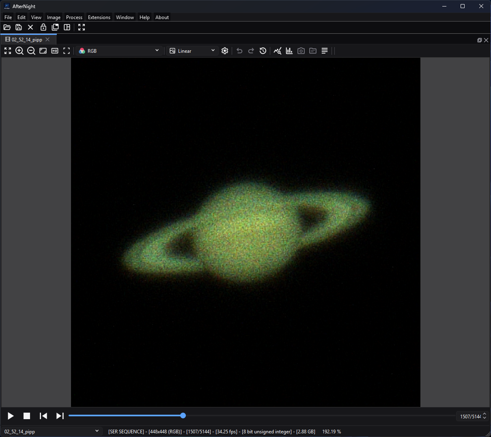

# Sequences

*Sequence controls remain below the image; this paused Saturn capture is on
frame 1507 of 5144, making both navigation state and stored frame rate visible.*

## Purpose, audience, prerequisites, and expected result

A sequence workspace presents an ordered set of frames as one docked view. It
is for inspecting SER or video captures, reopening an AfterNight image list,
building an ordered sequence from still images, extracting a useful frame or
range, and converting the in-memory workspace to another supported sequence
type.

After opening or creating a sequence, the first frame appears in an image view,
the player toolbar shows the current 1-based frame position, and the status bar
identifies the sequence family, geometry, current/total frame count, stored
frame rate, pixel type, and estimated decoded size. Creation, extraction, and
conversion make a new temporary sequence or replace the current workspace
sequence; they do not overwrite the original input files.

## Reachability and availability

| Item | Current behavior |
| --- | --- |
| Path | Create from stills with **File > New Sequence...** or dashboard **New sequence**. Open an existing sequence with **File > Open...** or the Open toolbar button. Use player controls below a sequence image. Use **Image > Sequence** for conversion, extraction, and export. |
| Enabled/visible when | New Sequence is available without an open image. The player and **Image > Sequence** menu require an active sequence view. Conversion to the sequence's current type is disabled; **Convert to FITS** is visible but disabled. |
| Supported inputs/state | New Sequence accepts supported still-image files. Open accepts SER (`.ser`), AfterNight image-list (`.anseq`), and FFmpeg-backed AVI/MP4/MPG/MPEG/MOV/MKV/WEBM files. The New Sequence list must contain at least two frames with identical width, height, pixel type, and channel count before Apply is enabled and execution can succeed. |
| Outputs/side effects | A docked sequence view; optional current-frame still view; extracted range as a new sequence view; converted sequence replacing the current view's sequence; or an exported file through **Export...**. A successful conversion adds an Image History step. |
| Persistence | Opened files remain on disk. New, extracted, and converted sequences use AfterNight temporary storage and remain marked as unsaved workspace changes until saved. New Sequence settings are not persisted. Sequence export remembers format, codec, and resolution mode; its last directory is remembered separately. |
| External dependencies | Bundled image codecs; bundled FFmpeg libraries for AVI/MP4/MPG/MPEG/MOV/MKV/WEBM decoding and AVI/MP4/WebM export. SER and `.anseq` use native engine implementations. No network or catalog is required. |

!!! warning "The displayed Ctrl+N hint is not currently wired"
    The dashboard advertises `Ctrl+N`, but the current `actionNew_Sequence`
    has no shortcut assigned. Use **File > New
    Sequence...** or the dashboard action until the product wiring is fixed.

## Before you start

- Keep original captures and still frames unchanged. New Sequence and range
  extraction work through temporary files; close an unsaved result only when it
  is safe to discard.
- For New Sequence, use frames with identical geometry, channel count, and
  pixel type. ISO/gain and exposure are displayed but are not currently
  validated for consistency.
- An `.anseq` file is an XML list of frame paths, not a self-contained movie.
  Its referenced images must remain reachable. Moving only the `.anseq` file can
  break it.
- Video-container support is decided by three gates: AfterNight's extension
  allowlist, the engine's fixed lists of admitted containers and video decoders,
  and the codecs present in the deployed FFmpeg build. A recognized suffix does
  not guarantee that every codec, damaged stream, or unusual layout will decode.
- A sequence view reads one frame at a time; nothing keeps every frame of a
  list in memory.

## Procedure

### Create a sequence from still images

1. Choose **File > New Sequence...** or dashboard **New sequence**. Confirm
   that **Main Settings** opens with an empty table and disabled **Apply**.
2. Select **Add Files** and choose two or more supported still images. Metadata
   is loaded in the background; duplicate paths are skipped. Confirm the table,
   **Total Frames**, selected-frame preview, histogram, and summary update.
3. Select a row to inspect it. Use the up/down icon buttons to change frame
   order, **Remove Selected** to remove selected rows, or **Clear All** to start
   again. The final table order becomes sequence order.
4. Open **Advanced Settings**. Choose **Image List** for a lightweight list of
   source paths or **SER Sequence** for a native sequence file in temporary
   storage. Set FPS and a sequence name. Review the CFA rules in the control
   table before changing them.
5. Select **Apply**. A progress dialog appears while AfterNight validates and
   creates the sequence. On success, the dialog closes and a new sequence view
   opens on frame 1. A sequence is published only when its last frame is in, so
   on cancellation nothing is written and the creation dialog remains
   available.

### Open and inspect an existing sequence

1. Choose **File > Open...** and select one supported sequence file. The file is
   decoded on a worker and opens in a sequence view.
2. Read the status bar to confirm type, geometry, frame count, FPS, pixel type,
   and estimated decoded size.
3. Use **Previous frame**, **Next frame**, the frame slider, or the `current /
   total` spin box to inspect individual frames. The visible UI is 1-based;
   engine access is 0-based internally.
4. Select **Play sequence** to advance at the stored FPS, rounded to a whole
   number from 1 to 60 frames per second. The same action pauses playback. Playback stops at the last frame; it does not loop. Select **Stop
   sequence** to stop and request frame 1 again. Starting Play while already at
   the last frame also restarts from frame 1.

### Extract or convert

1. To make a still from the displayed frame, choose **Image > Sequence >
   Extract Frame**. A new unsaved still-image view opens; the source sequence is
   unchanged.
2. To retain an inclusive range, choose **Image > Sequence > Extract Sequence**
   and follow [Extract Sequence](../processes/utility/extract-sequence.md).
3. To change the active sequence representation, choose **Image > Sequence >
   Convert > Convert to SER** or **Convert to Image List**. Conversion processes
   all frames into temporary storage, persists FPS before finalizing the
   destination, replaces the sequence in
   the current view, and records a history step. Cancellation deletes the
   partial destination.
4. Use **Image > Sequence > Export...** when the handoff must be SER, raw AVI,
   MP4/H.264, MP4/H.265, or WebM/VP9 with optional autostretch/resize. Follow
   [Saving And Exporting](saving-and-exporting.md) for the complete controls,
   precision/metadata effects, overwrite behavior, and verification checklist.

## Complete control and action reference

### New Sequence — Main Settings

| UI label/action | Type and unit | Default | Valid values/constraints | Effect | Enabled, hidden, or ignored rules | Trade-off or side effect | Scope | Persistence |
| --- | --- | --- | --- | --- | --- | --- | --- | --- |
| Frame table | Multi-row metadata table | Empty | Supported still-image files; duplicate paths are skipped | Defines source files and exact frame order; columns show Path, File, Date, Size, ISO/Gain, Offset, Exposure, CFA, and Depth. Selecting a row loads its preview, histogram, and report. | Apply requires more than one row. Each file's header is probed on a worker without decoding its pixels; probing stops at the first file that cannot be read. | Large lists take metadata/preview IO; the table itself does not copy source files. | New sequence input | Window lifetime only. |
| Add Files | Button | Enabled | One or more supported still images | Adds unique paths asynchronously in batches. | Unreadable metadata reports **Error loading image metadata** and stops that add operation. | Disk IO and metadata decoding. | Input list | File dialog remembers its path token. |
| Remove Selected | Button | Disabled | Selected table rows | Removes selected paths. | Enabled when the list is nonempty and rows are selected through the table workflow. | Changes output count/order only. | Input list | Window lifetime. |
| Move frame up / Move frame down | Icon buttons | Disabled | One selected row; bounded by first/last row | Swaps the selected frame with its neighbour. | Up is disabled on the first row; Down on the last. | Changes playback and processing order. | Input list | Window lifetime. |
| Current Frame / Total Frames | Read-only integer labels | `0 / 0` | Derived from selection and row count | Reports the selected 1-based row and total source count. | Updates with selection/list changes. | No data change. | Input list | Not persisted. |
| Clear All | Button | Disabled | Click action | Removes every candidate and clears preview/histogram/summary. | Enabled when the list is nonempty. | Discards the assembled list, not source files. | Input list | Window lifetime. |
| Preview / histogram / image summary | Read-only inspection views | Empty-state artwork/report | Selected readable frame | Shows the selected source frame, histogram, and metadata report. | Quick zoom and clipping information enable after a frame loads. | Loading/decoding cost; display does not change output pixels. | Inspection only | Not persisted. |
| Apply | Button | Disabled | At least two rows; identical dimensions, pixel type, and channels | Validates and creates the selected sequence type in temporary storage, then opens it. | Disabled with 0-1 rows and during execution. | Can consume substantial disk/RAM; partial output is removed on normal cancellation. | Whole candidate list | No parameter persistence; output remains an unsaved workspace result. |
| Close | Button | Enabled | Click action | Closes the creator. | Disabled after Apply starts. | Discards the assembled list when no output was created. | Process window | None. |

### New Sequence — Advanced Settings

| UI label/action | Type and unit | Default | Valid values/constraints | Effect | Enabled, hidden, or ignored rules | Trade-off or side effect | Scope | Persistence |
| --- | --- | --- | --- | --- | --- | --- | --- | --- |
| Debayer CFA images | Checkbox | On | Off/On | For SER creation, demosaics CFA frames before append by the method the Raw Images demosaic setting names. For Image List, sets the new view to request debayered frames on access, by the same setting. | Non-CFA frames are unchanged, unless a manual Bayer Pattern is chosen for a SER, which demosaics every single-channel frame under it. | RGB triples per-frame samples and removes the original mosaic representation from created SER frames. On-demand image-list debayering adds decode cost. | CFA frames | Window lifetime. |
| Bayer Pattern | Selector | Auto | Auto, RGGB, BGGR, GBRG, GRBG | Selects the filter array SER frames are demosaiced under; Auto uses the one each file states and leaves a file that states none undemosaiced; a manual choice demosaics every single-channel frame under the named pattern. | Starts disabled even though **Debayer CFA images** starts on; clicking the checkbox off and on again enables it, and clearing the checkbox disables it. The current Image List creation path does not store this selector; Auto/manual selection is therefore ignored for the `.anseq` itself and its new view uses frame metadata/default sequence settings. | A wrong manual pattern produces wrong color placement. | SER creation only in current implementation | Window lifetime. |
| Sequence Type | Selector | Image List | Image List; SER Sequence; visible disabled FITS Sequence | Chooses temporary output representation. | FITS Sequence is intentionally disabled; AVI creation is not exposed. | Image List retains dependencies on source paths; SER copies decoded frames into one potentially large file. | Whole output | Window lifetime. |
| FPS | Decimal frames/second | 1.0 | 0.1-200.0 | Stores the playback/export frame rate. | Normal sequence player has no visible FPS editor; the stored value, rounded to a whole number from 1 to 60, drives playback. | Higher values increase playback/decode demand; it does not add or interpolate frames. | Output sequence | Written into the `.anseq` manifest. A SER file stores no frame rate: the new SER view keeps the value while it is open, and the file reopened states none. The New Sequence UI value is not persisted. |
| Sequence Name | Text | `NEW_SEQUENCE` | Any text; empty falls back to `NEW_SEQUENCE` | Sets the view/sequence name. | Used after validation. | A non-unique name receives the normal view-name disambiguation suffix. | Output view | Stored for current session/output representation as supported. |

### Sequence player and Image > Sequence

| UI label/action | Type and unit | Default | Valid values/constraints | Effect | Enabled, hidden, or ignored rules | Trade-off or side effect | Scope | Persistence |
| --- | --- | --- | --- | --- | --- | --- | --- | --- |
| Play sequence / Pause | Toolbar action | Stopped on frame 1 | Active nonempty sequence | Starts a timed advance at the stored FPS rounded to a whole number from 1 to 60 (1 when the sequence states none); each frame is read on a worker and the next is asked for once it is shown. While playing, the same icon pauses. At end, playback stops without looping. | Sequence view only; disabled while the view is locked for processing. | Decode/cache/UI cost rises with frame size and FPS. | Displayed sequence | Current view session. |
| Stop sequence | Toolbar action | Disabled | Playing playback state | Stops playback and shows frame 1. | Enabled only while playback runs; Pause, a frame step and Stop disable it. | Frame display update is asynchronous. | Displayed sequence | Current view session. |
| Previous frame / Next frame | Toolbar actions | Previous disabled; Next enabled for multi-frame sequence | One frame step within bounds | Pauses active playback and moves one frame. | Disabled at first/last bound respectively. | Random video seeks can be slower than sequential playback. | Displayed sequence | Current frame only. |
| Frame slider and `current/total` spin box | Integer frame selector | 1 | 1-total; step 1 | Requests the selected 1-based frame and coalesces queued requests to the newest. | Disabled for an empty sequence and while processing holds the view lock. | Rapid random access can trigger repeated decode/seek work. | Displayed sequence | Current frame only. |
| Extract Frame | Immediate menu action | — | Active sequence | Copies the currently shown frame, on a worker, into a new still view and names it with the 1-based frame number. | **Image > Sequence** only. A failure is reported in an **Extract Frame** message and in the log. | Adds a full decoded frame in memory; source is unchanged. | Current frame | New still is unsaved/pending. |
| Extract Sequence | Process action | — | Active sequence | Opens the inclusive range extractor. | Sequence views only. | Reads and writes every selected decoded frame. | Selected range | New sequence is temporary/unsaved. |
| Convert to SER | Immediate menu action | Enabled unless already SER | Active non-SER sequence | Writes every frame as its file holds it into a temporary native SER - 8-bit frames as 8 bits, every other as 16 - and replaces the active view sequence. | Disabled for SER; busy view shows a warning. | Full sequence IO; a mosaic stays a mosaic, whatever the view shows. The SER keeps each frame's exposure start in its timestamp trailer, an unknown entry for a frame that states none, and states the rate those timestamps give; a video's frames state none, so a video converted to SER shows `0.00 fps` and plays at 1 frame per second. | Whole sequence | Frame rate not stored (a SER has no frame-rate field); history step recorded; result unsaved. |
| Convert to Image List | Immediate menu action | Enabled unless already Image List | Active non-image-list sequence | Writes each frame, with its header cards and in the first frame's representation, as a FITS file `<stem>-<n>.fits` in a sibling `<stem>-frames` directory plus a temporary `.anseq`, then replaces the active view sequence. | Disabled for Image List; busy view shows a warning. | Potentially many FITS files and high disk use. | Whole sequence | FPS preserved; history step recorded; result unsaved. |
| Convert to FITS | Immediate menu action | Disabled | No current executable path | None in the current UI. | Always disabled for an active sequence by action-state code; coordinator contains no conversion implementation. | Do not plan a workflow around it. | None | None. |
| Export... | Dialog action | Enabled for sequence | Active sequence | Opens sequence file export for SER, raw AVI, MP4/H.264, MP4/H.265, or WebM/VP9, with FPS, optional autostretch, and resize controls. | Sequence only; requires a chosen output path. | Can alter pixel values/geometry and use lossy video encoding; see [Saving And Exporting](saving-and-exporting.md). | Whole sequence | Format/codec/resolution and last directory persist. |

## Behavior and state model

### Sequence dispatch and decoded frames

File opening dispatches strictly by suffix. `.ser` uses the engine's SER reader;
`.anseq` uses the engine's XML image-list reader; and AVI, MP4, MPG, MPEG, MOV,
MKV, and WEBM use the engine's FFmpeg source. A video is read in presentation
order and converted to RGB through the colour matrix and range its stream
states; a stream that states neither is converted as BT.601 at limited range,
and a palette a recording never sent is read as grey. An 8-bit stream becomes
8-bit RGB and a wider one 16-bit RGB; a grey-palette AVI is read as RGB. Every
frame is held in planes. SER preserves supported mono/CFA/RGB/BGR layout and 8-
or 16-bit unsigned samples, and a SER recording that stopped before its frame
count was written opens with the complete frames it holds. A SER header has no
frame-rate field: a SER states the rate its timestamp trailer gives - one frame
per mean interval between the trailer's earliest and latest instants, in whole
100 ns ticks - and the player rounds it to a whole number from 1 to 60 frames
per second. A SER whose trailer names fewer than two distinct instants states no
rate, so its view shows `0.00 fps` and plays at 1 frame per second. The
`.anseq` reader reads its manifest, resolves each frame path against the
manifest's own directory, decodes the referenced still images at access time
and takes its frame rate from the manifest, which states it the same way in
every locale.

Container recognition and codec decoding are separate gates. AfterNight's
extension list decides whether a file is offered as a sequence; the engine
admits only AVI, MOV/MP4, Matroska/WebM, MPEG program/transport streams and NUT
containers and an explicit list of video decoders, refusing any other even when
the installed FFmpeg could decode it; and FFmpeg's deployed demuxer/decoder
decides whether the streams inside an admitted video can be opened. A video is
decoded on the processor. Audio is not presented in the sequence workspace.

### Frame position and playback

The engine indexes frames from 0 through `N - 1`, while all visible player and
range controls show 1 through `N`. The player subtracts one on UI requests and
adds one for display. Playback asks for a frame every `1 / FPS` seconds; each is
read on a worker and shown on the GUI thread, and a tick that comes while a frame
is still on its way is skipped. Only the frame last asked for is shown, which keeps
rapid slider movement responsive but means intermediate frames may not be
displayed. The player keeps the sequence's file open while the view shows it and
lets it go when the view closes.

An FFmpeg-backed sequence reads every packet header of its stream once when it
opens and keeps an index in presentation order, so a seek by frame lands
exactly; no decoded frames are cached. Image-list frames are decoded when
they are read. SER reads one frame at a time by position. These differences explain why sequential playback and random seeking can
have different costs across formats.

### Temporary results, history, and source safety

New Sequence, range extraction, and conversions request a path under
AfterNight's configured temporary directory. Image-list results include an
`.anseq`; conversions to Image List also create a sibling `<stem>-frames`
directory of FITS frames named `<stem>-<n>.fits`. Closing the view closes its sequence handle, but a
workspace result is not an archival copy until a user saves or exports it.

Extract Frame makes a copied still buffer. Extract Sequence creates a separate
sequence view. Type conversion replaces the sequence object in the current view
and adds a **Convert Sequence Type** history step. None of these operations
overwrites the original opened sequence or original New Sequence source files.

## Inputs, outputs, and metadata

| Operation | Input | Output and naming | Samples/metadata/history | Source modification |
| --- | --- | --- | --- | --- |
| Open | One `.ser`, `.anseq`, or allowed video container | One sequence view named from the file | Type-specific frame metadata; video decoded to 8-bit RGB | None. |
| New Image List | Two or more compatible stills | Temporary `.anseq`, view uses Sequence Name | References original paths; FPS stored; first frame supplies sequence metadata | None; referenced files remain required. |
| New SER | Two or more compatible stills | Temporary `.ser`, view uses Sequence Name | Supported data is encoded to SER (8-bit frames as 8 bits, every other as 16); optional demosaic by the Raw Images setting creates RGB before append; FPS stated by the view only, not by the file, which keeps each frame's exposure start in its timestamp trailer (an unknown entry for a frame that states none) | None. |
| Extract Frame | Current displayed buffer | New still named `<sequence> - FRAME_<1-based>` | Deep image copy; history states source frame and sequence | None. |
| Extract Sequence | Inclusive range | New temporary sequence view with normal unique-name suffix | Decoded selected frames; no debayer request; same sequence family where supported | None. |
| Convert to SER/Image List | Whole active sequence | Replaces current view's sequence with a temporary destination | FPS copied into an Image List's manifest; a SER keeps each frame's exposure start in its trailer and no frame-rate field; history records source/destination type; Image List writes FITS frame files with their header cards, in the first frame's representation | Original remains unchanged. |

## Performance and responsiveness

- Decoding and conversion scale with frame count multiplied by decoded pixels
  and channels. SER and `.anseq` may preserve high-bit-depth data; video inputs
  decode to 8-bit RGB in the current FFmpeg path.
- New Sequence metadata loading is asynchronous and batched. Previewing a row
  still decodes that image.
- Playback reads each frame on a worker and shows it on the GUI thread.
  Expensive decode, high FPS, autostretch, or large views make playback skip
  ticks even though source frames are not removed.
- Extraction and conversion write temporary data. Check both free space in the
  configured temporary location and the estimated decoded sequence size.

## Worked example

- Starting state, actions, settings, checkpoints, result, and limitations:
  three same-size copies of the project-owned 512x512 RGB documentation logo at
  `docs/user-guide/docs/en/assets/images/interface/logo.png` (each SHA-256
  `CCBECC37012F8BDB0A583BB7D76F9B34C0B6EC86785046623463BD3D0A8807F0`) were
  added to New Sequence in a Windows MSVC Release build of the application.
  Defaults were **Image List**, Debayer on, Auto pattern, 1.0 FPS, with the name
  changed. Apply produced a 3-frame Image List workspace whose status reported
  512x512 RGB, frame 1/3, 1.00 FPS, unsigned 8-bit, and 2.25 MB. Next moved to
  2/3; Play reached 3/3. Extract Frame created a still view. Extract Sequence
  with Start 2 and End 3 reported 2 selected frames / 1.50 MB and created a
  2-frame view. Converting that view to SER changed the live status to SER;
  converting back restored Image List while keeping two frames and 1.00 FPS. The
  2026-10-18 review did not repeat the run. A SER conversion stores no frame
  rate, only the frames' exposure starts, which still images made with New
  Sequence may not state.
- Limitation: identical logo frames prove ordering, counts, control wiring,
  decoded geometry/type, extraction, and conversion mechanics only. They do not
  prove CFA color quality, timestamps, astronomy metadata retention, large-file
  performance, or every FFmpeg codec/container combination.

## Warnings and limitations

- The dashboard's `Ctrl+N` hint is stale; there is no current shortcut binding.
- New Sequence Apply is enabled only after two rows. The execution path also
  validates equal width/height, pixel type, and channel count, but does not
  preflight free space or validate consistent ISO/gain/exposure.
- New Sequence exposes a disabled **FITS Sequence** item. **Convert to FITS** is
  also disabled and has no conversion implementation.
- The manual Bayer Pattern choice is applied to New SER creation only. It is not
  written into a New Image List sequence by the current code.
- `.anseq` is path-dependent and can break if referenced files move or become
  unreadable.
- FFmpeg video decoding is 8-bit RGB in the current implementation. Do not use a
  lossy/video round trip as a substitute for a high-bit-depth science master.
- Playback does not rank, align, reject, or stack frames. Use Image Integration
  or Image Stacking for supported integration workflows; AfterNight does not
  currently provide a complete lucky-imaging quality-selection pipeline here.
- New Sequence failures show an error dialog; type-conversion failures show a
  **Convert sequence type** message and are logged; a cancelled conversion is
  only logged. A sequence is written privately and published only when complete, so a
  failed or cancelled run leaves no partial sequence or Image List frame
  directory behind.
- Closing a New Sequence dialog stops its background reading, preview and
  creation work without waiting for it. During Apply the dialog disables Close.

## Troubleshooting

| Symptom | Cause | Fix |
| --- | --- | --- |
| `Ctrl+N` does nothing | Dashboard text advertises it, but `actionNew_Sequence` has no shortcut. | Use **File > New Sequence...** or dashboard **New sequence**. |
| Apply stays disabled | The list has fewer than two rows. | Add at least two unique supported still-image paths. |
| **Some images in the list have different size** | Width or height differs from the first frame. | Resize/crop the sources to identical geometry before creating the sequence. |
| **Some images in the list have different color depth** | Pixel type or channel count differs. | Convert frames to one sample type and mono/RGB channel layout first. |
| **Could NOT load image ...** | Metadata or image decoding failed; the add loop stops on the first failure. | Remove/convert the unreadable file, then add the remaining files again. |
| An `.anseq` opens but a frame fails later | The XML references a missing/unreadable still image. | Restore the referenced paths or rebuild the sequence list. |
| An `.anseq` does not open | The manifest is malformed: a version other than 1, nesting deeper than 4,096 elements, or a frame path that is not UTF-8, holds a NUL or is too long. | Rebuild the list with **File > New Sequence...**. |
| Recognized video will not open | Container suffix passed the filter, but the container or decoder is outside the engine's admitted lists, or FFmpeg could not open/probe/decode the stream. | Verify the file externally; transcode a copy to a simpler supported stream (for example H.264 in MP4) or SER, retaining the original. |
| A SER plays at 1 FPS and the status bar shows `0.00 fps` | A SER has no frame-rate field, and its timestamp trailer names fewer than two distinct instants - none at all for a SER converted from a video, whose frames state no exposure start. | Step frames manually, or convert to Image List and set the rate when making a new sequence. |
| Player is slow or appears to skip display updates | Decode/random seek, frame size, FPS, or view rendering exceeds the display interval; queued requests coalesce. | Pause, step frames, reduce view cost, or convert to SER/Image List for inspection. |
| Conversion progress closes but the type does not change | Conversion failed before the destination could replace the active sequence; a **Convert sequence type** message says why and the log records it. | Check the message and log, free temp space, source frame readability, and destination-format compatibility; retry on a copy. |
| Extract/convert says the sequence is busy | Another process holds the view's processing lock. | Wait for it to finish or cancel that process, then retry. |

## Related workflow steps

- Start from [Supported Formats](../getting-started/supported-formats.md) when
  deciding whether to open SER, `.anseq`, or a video container.
- Use [Extract Sequence](../processes/utility/extract-sequence.md) to make a
  smaller inclusive range before analysis, registration, or stacking.
- Continue to [Image Stacking](../processes/stacking-integration/image-stacking.md)
  or [Image Integration](../processes/stacking-integration/image-integration.md)
  when the objective is a combined image rather than frame inspection.
- See [Planetary Imaging](../workflows/planetary-imaging.md) for the current
  limits of sequence-based planetary work.
- Use [File Formats](../reference/file-formats.md) for the current format matrix.
  Use [Saving And Exporting](saving-and-exporting.md) for complete save/export
  semantics and output verification.

## Credits

- [FFmpeg Formats Documentation](https://ffmpeg.org/ffmpeg-formats.html),
  current upstream libavformat muxer/demuxer documentation.
- [SER format description, version
  3b](https://free-astro.org/images/5/51/SER_Doc_V3b.pdf), primary format
  description.
