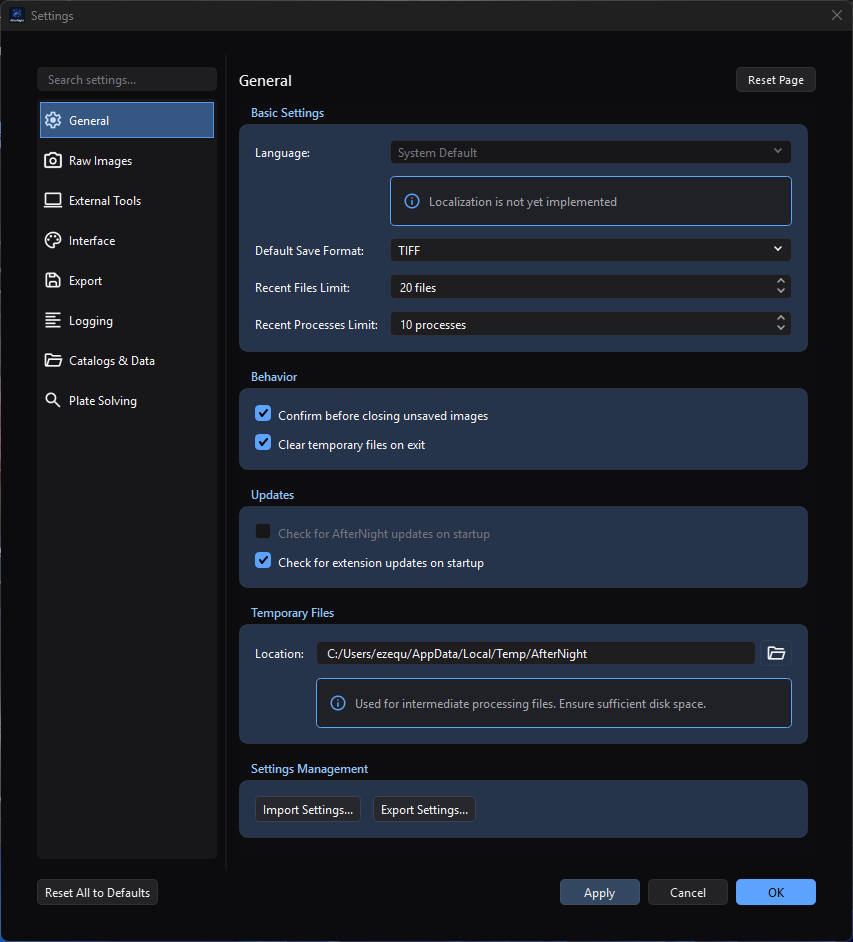
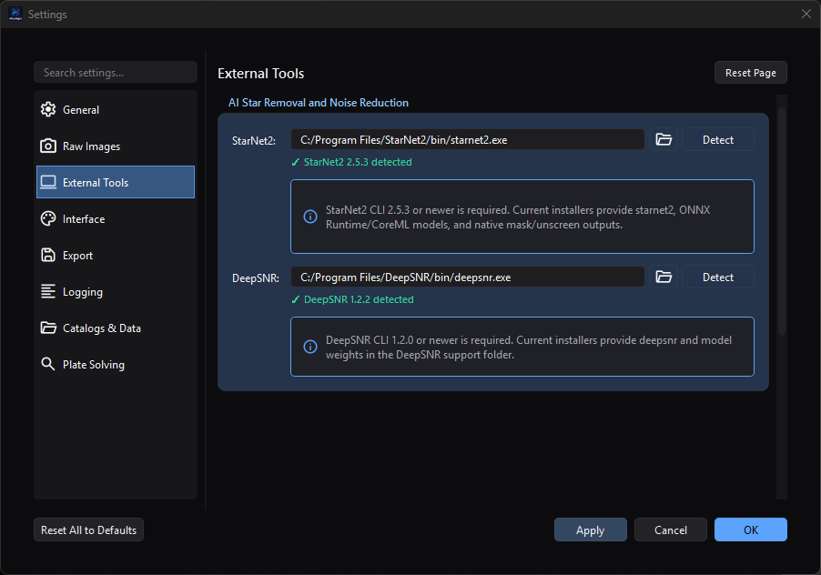
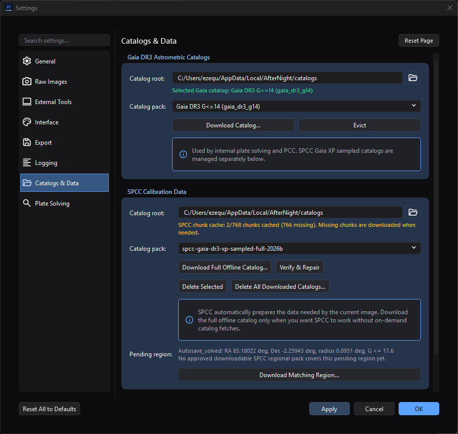

# Settings

*The General page demonstrates the shared Settings layout and commit controls.
The visible temporary directory is an approved path from the maintainer's
documentation capture PC.*

*Detected versions appear directly below their configured executables. The
visible installation directories are approved capture-machine paths.*

*Catalog status is per pack: Gaia is selected and ready here, while SPCC reports
missing chunks and a pending region. The visible cache directory is an approved
capture-machine path.*

## Purpose, audience, prerequisites, and expected result

Settings stores application-wide preferences. This page is for anyone who wants
to change AfterNight's general behavior or interface defaults, and for users
checking which settings categories are actually available in the current build.
No image or sequence needs to be open.

After **Apply** or **OK**, saved General preferences affect later file, process,
startup, shutdown, and temporary-storage operations. Interface theme,
animations, and mouse-wheel zoom behavior are also refreshed in the running
application. Raw Images choices affect camera-RAW files read after they are
applied, on every open path and in image previews; the demosaic choice is the
method every open path demosaics a colour-filter-array image with. Processing
limits are stored and take effect the next time AfterNight starts. Export
choices affect later still-image saves, and Logging choices reconfigure file
logging immediately. External Tools paths gate StarNet2 and DeepSNR processes;
Catalogs & Data chooses persistent Gaia/SPCC repositories and can download or
delete large data sets; Plate Solving selects configured solver backends and
their limits. Editing ordinary values does not itself modify open image pixels,
metadata, history, masks, or sequence frames, but catalog-management actions can
write or delete data immediately.

## Reachability and availability

| Item | Current behavior |
| --- | --- |
| Path | **Edit > Settings...**; `Ctrl+,`; the dashboard identity-bar Settings button; or a visible dashboard **Settings** quick action. |
| Enabled/visible when | Available without an active image. The dashboard quick action can be hidden by dashboard customization; the Edit-menu action and shortcut remain available. |
| Supported inputs/state | Global application state. No Settings page requires an open image, sequence, mask, or selection. A pending SPCC regional request appears only after an owning workflow stores a solved-image footprint. |
| Outputs/side effects | Persistent preferences, possible recent-list trimming, runtime theme/animation/zoom refresh, future RAW/debayer/save/tool/solver behavior, immediate file-log reconfiguration, directory creation during validation or **Open Log Directory**, JSON import/export files, external version probes, network catalog transfers, verified catalog/response files, and immediate catalog deletion. |
| Persistence | Database-backed global settings survive restarts; Logging uses a separate platform-local `logging.conf`. **Reset Page** and **Reset All to Defaults** stage values; they persist only after **Apply** or **OK**. |
| External dependencies | Optional StarNet2 2.5.3+, DeepSNR 1.2.0+, ASTAP, Linux `solve-field` plus matching index files, an Astrometry.net web account/API key, Gaia/SPCC catalog and response repositories, network access for managed downloads/web solving, and supported image codecs. **Check for extension updates on startup** separately uses the configured official extension repository on the next startup. |

The main Settings dialog registers exactly these nine pages, in this order:

1. **General**
2. **Raw Images**
3. **External Tools**
4. **Interface**
5. **Export**
6. **Processing**
7. **Logging**
8. **Catalogs & Data**
9. **Plate Solving**

**Processing** holds the thread and memory limits. They are fixed while
AfterNight runs, so the page shows what the running session uses beside what is
stored, and says when a stored change waits for the next start. It also holds
how often a process window's preview updates while you drag one of its
sliders, which applies at once.

## Before you start

- Decide whether a change should affect the current session, later operations,
  or the next startup; the timing differs by setting.
- Before changing the temporary directory, make sure the location is writable
  and has enough free space for intermediate processing files.
- Treat white balance changes as defaults for camera-RAW files read later. An
  image already open, or one still being read when you apply the change, keeps
  the balance it was read with. The demosaic selection is the method every open
  path uses when a colour-filter-array image is demosaiced. Preserve the
  original RAW and compare representative fine color detail before
  standardizing a new choice.
- Plan thread and memory limit changes around a restart: they are stored at once
  and used from the next start.
- Use lossless TIFF/PNG or FITS/XISF for scientific intermediates. JPEG and
  JPEG-compressed TIFF are lossy output choices.
- Choose a writable log directory with enough space for the selected file size
  and retained-file count. Logs can contain local paths and diagnostic details.
- Install StarNet2 and DeepSNR from sources you trust. Keep each executable with
  the runtime libraries and model files supplied by the same package. The
  Settings check launches the selected program with `--machine-info`, and with
  `--version` when that answer is not machine information; it does not inspect
  model provenance or prove that an inference run will succeed.
- Before selecting a catalog pack, compare its displayed download/installed size
  with free space on the destination. The built-in Gaia choices range from about
  188 MiB to 18 GiB; the built-in SPCC local-full descriptor is about 42.4 GiB
  downloaded and 44.4 GiB installed. A repair can also require staging space.
- Catalog downloads contact the configured mirror and persist verified data.
  Astrometry.net web solving later uploads the image being solved to
  `nova.astrometry.net`. Use Internal Gaia, ASTAP, or Linux local
  Astrometry.net when the image must remain offline.
- Back up or reselect custom catalog folders before using **Evict**, **Delete
  Selected**, or **Delete All Downloaded Catalogs...**. These actions remove
  directories immediately; **Cancel** cannot restore them.
- On Linux local Astrometry.net, configure both `solve-field` and a directory of
  matching index files. Settings currently checks only whether `solve-field` is
  executable; it does not validate the index directory.
- Treat exported settings JSON as private. It can contain local paths, recent
  and favorite process identifiers, and the astrometry.net API key in plain
  text.
- Use a newly opened Settings dialog for import, remain on **General**, and save
  the import before visiting another page. A page that was already loaded can
  save its old visible values over imported values from the same category.

## Procedure

1. Open **Edit > Settings...** or press `Ctrl+,`. **General** is selected and
   loaded first.
2. Select a page in the navigation list. Pages load lazily when first selected;
   returning to an unmodified page reloads its persisted values.
3. To find a page, type part of its title or one of its control keywords in
   **Search settings...**. Clear the field to restore all nine pages.
4. Change the required values. An asterisk in the window title means at least
   one loaded page has staged changes.
5. Choose one of these completion paths:

    - **Apply** saves all enabled, loaded pages, emits the runtime refresh, and
      keeps the dialog open. It does not run page validation.
    - **OK** validates every loaded page, switches to the first failing page if
      needed, then saves and closes.
    - **Cancel**, the window close button, or `Esc` asks whether to discard
      staged changes when the dialog is dirty. Discarding does not reverse an
      immediate side effect already performed by an action such as importing a
      Logging section.

6. Reopen Settings when you need to verify the persisted value rather than a
   still-staged control.

For executable and catalog setup, use the page-specific checkpoints:

1. On **External Tools**, browse to or **Detect** each executable. Wait for the
   version status; a green result must report StarNet2 2.5.3 or newer or DeepSNR
   1.2.0 or newer. Save the paths before opening the dependent process.
2. On **Catalogs & Data**, choose a root and pack. A ready Gaia status names the
   selected catalog. SPCC can instead report an empty on-demand cache, a partial
   chunk cache, incomplete metadata, or a ready pack. Each download assistant
   starts at the platform-local catalog root rather than copying the root shown
   on the Settings page, so verify its pack, size, and **Install to** directory.
3. During a catalog transfer, observe manifest, download, and verification
   phases. **Cancel Download** aborts the active transfer. A completed assistant
   updates the page's root/pack controls, but those selections still need
   **Apply** or **OK**; the downloaded files themselves already exist.
4. On **Plate Solving**, configure at least one backend. Only configured choices
   are enabled in **Default solver**. If the preferred backend becomes
   unavailable, the page selects the first configured backend in the order
   Internal Gaia, ASTAP, local Astrometry.net, then web Astrometry.net.

## Complete control and action reference

### Dialog-wide controls

| UI label/action | Type and unit | Default | Valid values/constraints | Effect | Enabled, hidden, or ignored rules | Trade-off or side effect | Scope | Persistence |
| --- | --- | --- | --- | --- | --- | --- | --- | --- |
| Search settings... | Text search | Empty | Page-title and page-keyword substrings | Filters the navigation list and selects the first visible page if the current page is filtered out. | Always available. An unmatched search can leave no visible navigation item. | Filtering changes no setting. | Current dialog | Not persisted |
| Navigation list | Page selector | General | The nine registered pages listed above | Lazily loads and shows a page. Returning to an unmodified page reloads persisted values. | A page can be disabled by its implementation; all nine registered page classes are added by the dialog. | Loading another page makes it eligible for **Apply**/**OK** saving. | Current dialog | Selection is not persisted |
| Reset Page | Confirmation action | N/A | Current enabled page | Replaces that page's controls with implementation defaults and marks it modified. | Enabled when the current page is enabled. | The reset is staged, not an immediate database wipe. | Current page | Saved by **Apply** or **OK** |
| Reset All to Defaults | Confirmation action | N/A | All enabled registered pages | Loads default values into every enabled registered page and marks them loaded. | Enabled when at least one page exists. | The confirmation says the action cannot be undone, but the new values are still staged until **Apply** or **OK**; **Cancel** can discard ordinary staged values. | All nine registered pages | Saved by **Apply** or **OK** |
| Apply | Commit action | Disabled until a page is modified | Enabled, loaded pages | Saves without closing and refreshes runtime consumers. | Enabled only while there are staged changes. | Does **not** call page validation; in particular, it can persist an unchecked temporary-directory path. | All enabled, loaded pages | Immediate persistent write |
| OK | Validate-and-commit action | Enabled | Loaded pages must validate | Validates loaded pages, saves them, refreshes runtime consumers, and closes. | A validation failure keeps the dialog open on the failing page. | General validation may create the temporary directory and a short-lived write-test file. | All enabled, loaded pages | Immediate persistent write |
| Cancel / window close / Esc | Discard action | N/A | Discard or return to editing when prompted | Closes without saving ordinary staged edits. | Prompts only when a page reports unsaved changes. | Cannot undo an already immediate action, including a Logging configuration applied during JSON import. | Current dialog | No new persistent write |

### General settings

| UI label/action | Type and unit | Default | Valid values/constraints | Effect | Enabled, hidden, or ignored rules | Trade-off or side effect | Scope | Persistence |
| --- | --- | --- | --- | --- | --- | --- | --- | --- |
| Language | Selector | System Default | System Default, English | Reserved for localization. | Disabled; tooltip states that language selection is not implemented. | No current UI effect. | Application | `general/language`; reset returns System Default |
| Default Save Format | Selector | TIFF | TIFF, FITS, PNG, XISF, JPEG | Selects the initial suffix and format filter for later still-image save dialogs. | Does not override sequence-specific SER/ANSEQ save dialogs or an explicit format selected by the user. | Format capabilities and options still depend on the save path and codec. | Later save dialogs | `general/defaultSaveFormat` |
| Recent Files Limit | Integer, files | 20 | 1–100 | Caps the recent-file list. On **Apply** or **OK**, excess oldest entries and their thumbnails are removed and menus/dashboard are refreshed. | No dependency. | Lowering the limit discards older recent-list entries, not the files themselves. | Global recent files | `general/recentFilesLimit` |
| Recent Processes Limit | Integer, processes | 10 | 1–100 | Caps the ordered recent-process list. The list is reloaded, trimmed, saved, and its menu refreshed when the Settings dialog closes. | No dependency. | Lowering the limit forgets older process history, not process presets or favorites. | Global recent processes | `general/recentProcessesLimit` |
| Confirm before closing unsaved images | Checkbox | On | On/off | Controls unsaved-image confirmation during image or application close. | Read after the preference is saved. | Turning it off makes accidental loss of unsaved image changes easier. | All image views | `general/confirmCloseUnsaved` |
| Clear temporary files on exit | Checkbox | On | On/off | Requests temporary cleanup at application exit. The same persisted value also controls asynchronous cleanup during the next startup. | Cleanup occurs only at the lifecycle points that read the setting. | Turning it off retains intermediates and can consume disk; turning it on removes AfterNight temporary data at startup/exit. | Runtime temporary directories | `general/clearTempOnExit` |
| Check for AfterNight updates on startup | Checkbox | Off | Off only in the current UI | Reserved for application-update checks. | Disabled because application update checks are not implemented. | No current network or update effect. | Application startup | `general/checkAppUpdatesOnStartup`; reset Off |
| Check for extension updates on startup | Checkbox | On | On/off | Schedules a background official-extension-repository check after a later application startup. | Requires repository/network availability at startup; disabling it suppresses that automatic check. | Can use network access and surface an update notification. | Application startup | `general/checkExtensionUpdatesOnStartup` |
| Location | Directory picker | Platform temporary location plus `AfterNight` | Empty or a directory path; **OK** tries to create a missing non-empty directory and verifies writability | Selects where later intermediate processing files are created. | **OK** validates only if General was loaded; **Apply** bypasses validation. An empty stored value falls back to AfterNight's runtime storage path. | A slow, small, unavailable, or unwritable volume can break disk-heavy work. | Subsequent temporary files | `general/tempFilesLocation`; reset uses the current platform temp location |
| Import Settings... | JSON open action | Last settings import/export folder, otherwise Documents | JSON Files (`*.json`): a settings file that states format `1.0`, as **Export Settings...** writes it | Stages recognized General and database-backed values; a Logging-only document is recognized, written, and applied immediately. Shows explicit open, JSON, format, and no-recognized-settings errors. | A file that states another format, or none, is refused with a message naming the file, the format it states and the one this version reads, and nothing is staged. Use a fresh dialog and save before loading another settings page. | Imported values can overwrite paths and credentials. Loaded pages can overwrite imported category values when the dialog saves. | Recognized `general`, `raw`, `tools`, `processing`, `interface`, `export`, `logging`, and `platesolve` sections | Most values persist on **Apply**/**OK**; Logging persists immediately |
| Export Settings... | Atomic JSON save action | `afternight_settings.json` in the last settings import/export folder or Documents | JSON file; `.json` is appended when missing | Writes an indented version `1.0` document with export time, current General controls, selected persisted settings categories, and current Logging configuration. The success message appears only after the complete temporary write is committed to the destination. | This is not a complete backup: it omits catalogs, extension settings, and some Interface/Plate Solving values. | The file includes the astrometry.net API key and local paths in plain text; protect it before sharing. An open, write, or commit failure reports **Export Failed** and leaves the previous destination intact when one existed. | Settings snapshot file | Standalone JSON file; does not change preferences |

### Interface settings

| UI label/action | Type and unit | Default | Valid values/constraints | Effect | Enabled, hidden, or ignored rules | Trade-off or side effect | Scope | Persistence |
| --- | --- | --- | --- | --- | --- | --- | --- | --- |
| Theme | Selector | Dark | Follow System, Light, Dark | Applies the selected application theme after a successful save of the appearance settings. | **Follow System** resolves from the operating-system appearance. Explicit Light disables OLED contrast. | Theme changes repaint the running application. | Application UI | `interface/theme` |
| Theme Contrast | Selector | Balanced (Recommended) | Balanced, Soft, High, OLED | Adjusts the dark-theme contrast profile: Soft reduces contrast/saturation, High increases them, and OLED uses pure-black backgrounds. | OLED is disabled when Theme is explicitly Light; selecting Light while OLED is active falls back to Balanced. | Stronger contrast or pure black can change perceived separation of panels and controls. | Theme tokens/application UI | `interface/themeContrastProfile` |
| Accent Family | Selector | Blue (Default) | Blue, Teal, Amber, Amethyst, Rose | Chooses the primary color family for interactive accents. | No dependency. | Changes emphasis color, not image data or display transfer functions. | Theme tokens/application UI | `interface/themeAccentFamily` |
| Card Surface Tint | Selector | Neutral (Default) | Neutral, Ocean, Mint, Amethyst, Rose, Amber | Adds a subtle color family to card and group-box surfaces. | No dependency. | A tint can alter perceived UI color context but never image pixels. | Theme tokens/application UI | `interface/themeSurfaceTintFamily` |
| Enable UI animations | Checkbox | On | On/off | Enables or disables registered UI animation durations immediately after **Apply** or **OK**. | No dependency. | Disable for reduced motion or to avoid animation overhead. | Open and future UI components using `AnimationUtils` | `interface/animationsEnabled` |
| Mouse Wheel Zoom Sensitivity | Slider, displayed percent | 50% | 1–100% in steps of 1 | Higher values produce a larger zoom factor per wheel step; lower values make finer changes. All open image controls refresh their cached wheel settings after save. | No dependency. | Very high values traverse scale quickly; very low values require more wheel input. | Mouse-wheel zoom in open and future image views | `interface/zoomSensitivity` |
| Hold Ctrl key to zoom with mouse wheel | Checkbox | Off | On/off | When on, wheel zoom is accepted only while `Ctrl` is held; when off, the wheel always zooms. Open image controls refresh after save. | No dependency. | Requiring `Ctrl` reduces accidental zooming but adds a modifier to every wheel zoom. | Mouse-wheel zoom in open and future image views | `interface/zoomRequiresCtrl` |
| Use system file browser | Checkbox | On on Windows/Linux; Off on other platforms | On/off | Selects native operating-system file dialogs when on and AfterNight/Qt non-native dialogs when off, for subsequent file-dialog requests that honor this setting. | Platform default differs. On Linux, some native KDE/GTK dialogs can have difficulty navigating hidden folders. | Native integration versus consistent in-app behavior. | Subsequent supported open/save/directory dialogs | `interface/useSystemFileBrowser` |
| Lock dock layout by default | Checkbox | Off | On/off | When on, requests a locked dock layout during the next application startup. | Saving the setting does not immediately lock or unlock the current layout. | Prevents accidental panel movement but requires the normal layout command to rearrange panels. | Main dock layout at startup | `interface/lockLayoutByDefault` |
| Remember window size and position | Checkbox | On | On/off | When on, saves main-window geometry at close and restores it next startup; it also permits top-level process windows to save and restore their sizes. When off, main startup defaults to maximized and process geometry is not retained. | Geometry must intersect an available screen; otherwise the main window starts maximized. | Saved geometry can be inappropriate after monitor changes, for which the off/maximized fallback is safer. | Main window and top-level process windows | `interface/rememberWindowSize` plus stored geometry/process records |

The source also defines a material-backdrop setting, recent/favorite process
lists, dashboard preferences, and stored window geometry under the Interface
key family. None is a visible control on the current **Interface** Settings
page, so it is not presented above as reachable.

### Raw Images settings

These preferences apply to camera-RAW files read after they are applied, on
every open path - **Open File**, drag/drop, a recent item and an image preview.
They do not re-decode an already open image, and a file still being read when
the change is applied keeps the settings it was asked for with. On a
colour-filter-array (Bayer) sensor the white balance is applied to the mosaic
when the file is read; on a full-colour sensor the RAW decoder applies it, and a
full-colour frame, such as a linear DNG, opens with each colour in its own
plane. A RAW read never brightens a frame; the page has no auto-brightness
control. The demosaic choice is separate: it is the method every open path uses
when a colour-filter-array image is demosaiced.

Every listed method is written for a two-by-two Bayer mosaic. An X-Trans RAW
(Fujifilm) is decoded as a six-by-six mosaic, and answering **Yes** to the
open's demosaic question demosaics it in colour, in camera RGB, by the chosen
method's X-Trans counterpart: **Bilinear** by the engine's fast X-Trans
estimate, every other method by three-pass Markesteijn. The image's history
names the method that ran. **No** opens the undemosaiced mosaic.

| UI label/action | Type and unit | Default | Valid values/constraints | Effect | Enabled, hidden, or ignored rules | Trade-off or side effect | Scope | Persistence |
| --- | --- | --- | --- | --- | --- | --- | --- | --- |
| Mode | Selector | Fresh profile: Daylight; **Reset Page**: None (No correction) | None (No correction), Daylight, Camera As-Shot, Auto White Balance, Custom | None uses unit channel gains; Daylight uses the camera's daylight multipliers; Camera As-Shot uses the multipliers the camera recorded for the shot, or the daylight multipliers, and says so, when it recorded none; Auto White Balance measures the frame (a grey-world measurement on a mosaic, with both greens summed into one channel); Custom uses the three values below. Every mode stretches a code at the sensor's white level to full scale, and the balance is computed in double precision. | Only Custom shows the R/G/B fields. An unknown persisted value is loaded as Daylight, as every open reads it. A stored multiplier of zero or less reads as 1. | Every mode except None can change RAW color balance. Auto and camera-derived results depend on the file's sensor data and metadata. | Camera-RAW files read after the change | `raw/whiteBalanceMode` |
| R | Decimal channel multiplier | 1.000 | 0.100–10.000; step 0.100; three displayed decimals | Multiplies the custom red balance relative to the decoded data. | Visible and used only when Mode is Custom. **OK** checks 0.1–10.0; the spin box already enforces the same range. Values below 0.2 or above 5.0 are accepted without a warning dialog. | Larger values strengthen red; smaller values weaken it and extreme ratios can create a strong cast or clipping later in the workflow. | Future custom-balanced RAW loads | `raw/customWbR`, persisted with six decimal places |
| G | Decimal channel multiplier | 1.000 | 0.100–10.000; step 0.100; three displayed decimals | Multiplies the custom green balance relative to the decoded data. | Same Custom-only visibility and validation as R. | Green is the reference-like channel in many camera workflows; changing it alters both color and relative brightness. | Future custom-balanced RAW loads | `raw/customWbG`, persisted with six decimal places |
| B | Decimal channel multiplier | 1.000 | 0.100–10.000; step 0.100; three displayed decimals | Multiplies the custom blue balance relative to the decoded data. | Same Custom-only visibility and validation as R. | Larger values strengthen blue; smaller values weaken it and extreme ratios can create a strong cast or clipping later in the workflow. | Future custom-balanced RAW loads | `raw/customWbB`, persisted with six decimal places |
| Auto-rotate based on EXIF orientation | Checkbox | On | On/off | When on, a camera-RAW frame is turned by the orientation its camera recorded - any of the eight, the mirrored ones included - on a colour-filter-array and a full-colour sensor alike. | Has no effect on non-RAW codecs or already open images. When off, the frame keeps the decoder's unrotated orientation. | Automatic rotation changes image dimensions for quarter turns and can affect later coordinate-based work. | Camera-RAW files read after the change | `raw/autoRotate` |
| Demosaic Algorithm | Selector | RCD (Ratio Corrected Demosaicing) - Recommended | RCD, AMaZE, LMMSE, AHD, VNG4, Bilinear | The method every open path - **Open File**, drag/drop, a recent item, a new sequence - uses when a colour-filter-array image is demosaiced. | Ignored for non-CFA inputs and when demosaicing is declined. | Bilinear is fast and soft; the others trade time for fine colour detail. | Later demosaicing on open | `raw/demosaicAlgorithm` |

### Export settings

Export preferences are read when a standard image view saves a still image.
Sequence save/copy paths do not use this option bundle. The destination suffix
still chooses the codec; these controls do not convert a TIFF request into JPEG
or PNG.

| UI label/action | Type and unit | Default | Valid values/constraints | Effect | Enabled, hidden, or ignored rules | Trade-off or side effect | Scope | Persistence |
| --- | --- | --- | --- | --- | --- | --- | --- | --- |
| Default Compression | Selector | None (Fastest, Largest Files) | None, LZW, ZIP/Deflate, JPEG | Selects the compression of later TIFF still-image saves. LZW and ZIP/Deflate are lossless. JPEG is lossy and reuses the JPEG Quality value below. | TIFF only. JPEG-in-TIFF is used only for 8-bit samples; other sample depths are written with LZW, and the save says so. A stored value the page does not list is shown, and written, as LZW. | None favors write speed and compatibility at larger size; lossless compression costs CPU; JPEG can lose image information. | Later TIFF still-image saves | `export/tiffCompression` |
| Default Compression (**XISF Settings**) | Selector | None (Read by Every XISF Reader) | None, zlib, LZ4, LZ4-HC, Zstandard | Selects the compression of the pixel data of later XISF still-image saves. Every choice is lossless; a compressed file is written in pieces of 4 MiB that a reader decodes one at a time. | XISF only. A stored value the page does not list is shown, and written, as None. | zlib and LZ4 are read by every XISF reader, Zstandard only by readers of Revision 1 of the specification. Compression costs time when the file is saved and opened; LZ4 is the fastest, Zstandard usually the smallest. | Later XISF still-image saves | `export/xisfCompression` |
| Shuffle the bytes of each sample before compressing | Checkbox | On | On/off | Stores every sample's first byte, then every sample's second, before compressing, which makes 16-bit and floating-point images compress better. Decoded pixels are unchanged. | Enabled only beside a compression. 8-bit samples are never shuffled. | Off usually writes a larger file. | Later compressed XISF still-image saves | `export/xisfByteShuffle` |
| Checksum | Selector | None | None, SHA-256 | Writes a SHA-256 checksum of the pixel data, which a reader verifies before it uses them. | XISF only. No SHA-3 checksum is offered, because PixInsight refuses an XISF unit checksummed with SHA-3. | A file whose pixels fail their checksum is refused when it is opened rather than read wrong; the hash costs time on every save and open. | Later XISF still-image saves | `export/xisfChecksum` |
| Quality | Integer slider, percent shown | 95% | 1–100; step 1 | Sets JPEG encoder quality. Higher values preserve more detail and produce larger files. | Used for JPEG files and 8-bit JPEG-compressed TIFF. It has no effect on PNG, lossless TIFF modes, FITS, or XISF. | JPEG is lossy even at high quality and is unsuitable as the only scientific master. | Later JPEG and eligible JPEG-in-TIFF still-image saves | `export/jpegQuality` |
| Compression Level | Integer slider | 6 | 0–9; step 1 | Sets the PNG encoder compression level. Higher values normally spend more CPU to reduce file size without changing decoded pixels. | PNG only. | Level 0 is fastest/largest; level 9 is slowest/smallest for a given encoder/data set. No size or speed ratio is guaranteed. | Later PNG still-image saves | `export/pngCompression` |
| Embed EXIF metadata in exported files | Checkbox | On | On/off | A TIFF, PNG or JPEG save carries the camera's EXIF record and the other header cards the image was read with. | A FITS or XISF save always carries the image's header, whatever this says. | On preserves useful acquisition context but can disclose camera, time, and other source metadata. | Later JPEG/TIFF/PNG still-image saves | `export/embedExif` |
| Embed processing history in FITS header | Checkbox | Off | On/off | Kept for a later release: no file is written with a processing history, and the page says so. | Stored and read back; no save consumes it. | Do not use this checkbox as proof that a FITS file contains AfterNight history. | None | `export/embedHistory` |

The Export key family and settings JSON also retain `fitsFloatFormat` and
`defaultDirectory`, but the current Export page exposes neither control and the
standard still-image save-options builder does not consume either value. They
are not presented as reachable settings. Export page validation otherwise has
no additional rejection path because its selector, sliders, and checkboxes
constrain all visible values.

### Processing settings

The thread ceiling and the memory limit are fixed while AfterNight runs. Saving
the page stores them for the next start. Beside each limit the page shows what
the running session uses, and a notice appears as soon as the stated value
differs from it - and stays after saving, until AfterNight is restarted. Open
images, their history and work in progress are not affected. **Updates per
second while dragging** is not a limit: a process window reads it when it paces
its next preview, so a change applies to the next drag with no restart.

| UI label/action | Type and unit | Default | Valid values/constraints | Effect | Enabled, hidden, or ignored rules | Trade-off or side effect | Scope | Persistence |
| --- | --- | --- | --- | --- | --- | --- | --- | --- |
| Max Threads: Auto | Checkbox | On | On/off | On uses every logical core of the computer. | When on, the thread count is disabled. | More threads finish batch work sooner and leave less of the computer to other programs. | Next start | `processing/maxThreadsBatch` = `0` |
| Max Threads | Integer, threads | Logical core count | 1 to the logical core count | The most threads AfterNight's processing uses at once. | Enabled when Auto is off. | Fewer threads keep the computer responsive during long runs. | Next start | `processing/maxThreadsBatch` |
| In use now (threads) | Read-only text | N/A | N/A | The threads the running session uses. | Says that no engine session runs when none does. | None. | Current session | Not persisted |
| Previews | Read-only text | N/A | N/A | While a preview is open, threads are kept for previews - one when the session has two to four threads, a quarter of them (rounded down) when it has more - and a preview also uses every thread no other work needs; when none is open, every thread is available to processing. With one thread a preview waits its turn. | Not a setting: the session decides it from its threads. | None. | Current session | Not persisted |
| Updates per second while dragging (Real-time Preview) | Integer, previews a second | 30 | 5 to 60 | The most previews a process window shows in a second while you drag one of its sliders. A preview of a drag runs on the threads kept for previews; letting go of the slider, or holding it still for a moment, runs one more preview with every thread a preview may use. | Always enabled. | Lower values use less CPU and battery while you drag; higher ones follow the slider more closely. A slow process shows fewer previews than the rate allows. | From the next drag once you return to the process window; an open Full hosted extension window keeps the rate it opened with, and one opened after the change takes the new rate | `processing/previewFrameRate` |
| GPU Acceleration, Preferred GPU | Checkbox and selector | Disabled | N/A | Planned for a later release. | Always disabled. | None. | None | `processing/gpuEnabled`, `processing/preferredGpu` |
| Memory Limit: Auto | Checkbox | On | On/off | On sets no memory limit of AfterNight's own. | When on, the limit is disabled. | Without a limit a large stack can use much of the computer's memory. | Next start | `processing/memoryLimitMb` = `0` |
| Memory Limit | Integer, MB | Shown as three quarters of the computer's memory while Auto is on - only the field's starting value, not a limit | 512 MB to the computer's memory, the arrows stepping by 1024 MB; **OK** refuses less than 1024 MB with **Memory limit of N MB is too low. Recommended minimum is 1024 MB.** | The most memory the engine holds for images at once. Work that would exceed it is refused with a message naming what it asked for and the limit. | Enabled when Auto is off. | Too low a limit refuses large stacks and images. | Next start | `processing/memoryLimitMb` |
| In use now (memory) | Read-only text | N/A | N/A | The memory limit the running session uses, or that it has none. | None. | None. | Current session | Not persisted |

### Logging settings

Logging uses a separate `logging.conf` text file so the application can read it
before the main Qt interface and engine finish initialization. Saving this page
rewrites that file and reconfigures the rotating file sink in the current
session.

| UI label/action | Type and unit | Default | Valid values/constraints | Effect | Enabled, hidden, or ignored rules | Trade-off or side effect | Scope | Persistence |
| --- | --- | --- | --- | --- | --- | --- | --- | --- |
| Directory / Browse... | Editable directory path plus icon button | Windows: `%LOCALAPPDATA%\AfterNight\logs`; Linux: `$HOME/.local/share/AfterNight/logs` | Empty or a directory path. Browse opens **Select Log Directory**, starting at the current path, its closest existing parent, or the home directory. **OK** creates a missing non-empty directory and verifies it with a temporary `.afternight_log_test` file. | Selects the directory containing the active `AfterNight.log` rotating-file set. | **Apply** bypasses validation. An empty value passes validation, is stored empty, and makes the runtime file path relative (`AfterNight.log`). On the next Settings open, the page displays the platform default in place of that stored empty value without changing the active sink; a later **Apply**/**OK** then persists the displayed default and moves the sink. Use **Reset Page** when the platform default is intended. | Moving the sink can create a new directory and split diagnostics across locations. Logs can contain paths and operational details. | Current file sink immediately after save; next startup | `log_directory` in the platform-local `logging.conf` |
| Open Log Directory | File-manager action | N/A | Current staged Directory, or the platform default when empty | Attempts to create the directory and opens it in the operating-system file manager. | Available before saving. Directory-creation failure is not reported by this action. | Directory creation and launching the file manager are immediate side effects; **Cancel** does not undo them. | Current dialog/path | Not persisted by the action |
| Minimum Level | Selector | Info (Recommended) | Trace, Debug, Info, Warning, Error, Critical, Off | Sets the least-severe message retained by the rotating file sink; a more verbose choice includes the more severe levels too. | Applied immediately after **Apply** or **OK**. Off disables the file sink, but the current in-memory ring buffer/session-console path remains configured separately. | Trace/Debug can increase disk traffic and reveal more operational detail; higher thresholds reduce diagnostic coverage. | Rotating log files, not the Session Console filter | `log_level` in `logging.conf` |
| Maximum File Size | Integer, MB | 10 MB | 1–1000 MB; step 1 | Rotates `AfterNight.log` when the configured size threshold is reached. | Reconfiguring the sink applies the new threshold immediately. | Larger files retain more contiguous detail but consume more space per file; smaller files rotate more often. | Rotating file sink | `max_file_size_mb` in `logging.conf` |
| Maximum Files to Keep | Integer, files | 5 | 1–100; step 1 | Sets the rotating sink's retained-file limit. Reconfiguration also removes numbered rotated files beyond the new limit. | Applied immediately after save. | More files retain a longer diagnostic window and use more disk; lowering the value can delete older rotated logs immediately. | Rotating file sink | `max_files` in `logging.conf` |

If `logging.conf` is missing, unreadable, or contains invalid numeric rotation
values, the loader supplies Info, 10 MB, and 5 files and clamps parsed numeric
values to the UI ranges. An unknown stored level appears as Info in Settings.
The page ignores the boolean result of the config-file write, so a write failure
does not currently produce a Settings error message even though runtime
reconfiguration is still attempted.

### External Tools settings

Both path rows contain an editable path, a folder-icon **Browse...** action, a
**Detect** action, and a status line. Loading the page starts version probes on
the global thread pool; editing a valid executable path starts another probe.
The result is applied only if the path is still the one that was checked.

| UI label/action | Type and unit | Default | Valid values/constraints | Effect | Enabled, hidden, or ignored rules | Trade-off or side effect | Scope | Persistence |
| --- | --- | --- | --- | --- | --- | --- | --- | --- |
| StarNet2 / Browse... / Detect | Executable path and actions | Empty | Existing executable that returns a parseable version from `--machine-info` or, when that answer is not machine information, from `--version`; StarNet2 2.5.3 or newer | Saves the executable used by StarNet, StarNet Star Mask, and registered starless-generation consumers. **Browse...** selects one file. **Detect** checks `PATH`, then platform-specific common install folders, and accepts only a supported version. | An empty, missing, non-executable, unparseable, timed-out, or pre-2.5.3 path may still be saved, but dependent processes remain unavailable. On Windows the expected name is `starnet2.exe`; elsewhere it is `starnet2`. | Loading/editing can launch the executable for a version probe. Passing proves only the CLI version contract, not model/runtime readiness or output quality. | Global StarNet2 consumers | `tools/starnetPath`; reset clears the path |
| DeepSNR / Browse... / Detect | Executable path and actions | Empty | Existing executable that returns a parseable version from `--machine-info` or, when that answer is not machine information, from `--version`; DeepSNR 1.2.0 or newer | Saves the executable used by DeepSNR. **Browse...** selects one file. **Detect** checks `PATH`, then platform-specific common install folders, and accepts only a supported version. | An empty, missing, non-executable, unparseable, timed-out, or pre-1.2.0 path may still be saved, but DeepSNR remains unavailable. On Windows the expected name is `deepsnr.exe`; elsewhere it is `deepsnr`. | Loading/editing can launch the executable for a version probe. The Settings page does not select or validate the ONNX weights used by the process. | Global DeepSNR consumer | `tools/deepsnrPath`; reset clears the path |

The page's **OK** validation always returns valid. Treat the status text—not a
successful Settings commit—as the readiness checkpoint. The normal asynchronous
probe uses the CLI helper's five-second budget; **Detect** uses a three-second
budget for each candidate it considers. The budget covers both probes, and a
probe that runs out waits up to one more second while the program is stopped.
Machine information that names another product fails with **The configured
executable returned machine information for a product other than StarNet2.**
(or **...other than DeepSNR.**).

### Catalogs & Data settings

The catalog root can be either a direct pack directory or a root containing pack
subdirectories. When discovered packs exist, the selector lists them; otherwise
it lists download descriptors - for Gaia the four built-in packs, whose base URL
a mirror file can change, and for SPCC the approved built-in or configured
descriptors. Leaving a stored root empty resolves to the platform-local
AfterNight `catalogs` directory.

| UI label/action | Type and unit | Default | Valid values/constraints | Effect | Enabled, hidden, or ignored rules | Trade-off or side effect | Scope | Persistence |
| --- | --- | --- | --- | --- | --- | --- | --- | --- |
| Gaia DR3 Astrometric Catalogs — Catalog root | Directory path and **Browse...** action | Platform-local AfterNight `catalogs` directory | Direct valid Gaia chunk-pack directory or a root containing packs | Chooses where the selected astrometric catalog is resolved. Status distinguishes ready, incomplete, invalid, and missing states, and a catalog in a layout this version does not read, which it asks you to download again. | No **OK** validation; an invalid/missing path can be saved. A direct usable pack is preserved; otherwise the selected child pack is resolved. | Reads manifests and pack files while refreshing. Moving the root can make Internal Gaia/PCC unavailable until a valid pack is selected. | Internal Gaia plate solving and PCC | `platesolve/gaiaCatalogDirectory`; reset uses the platform-local catalog root |
| Gaia DR3 Astrometric Catalogs — Catalog pack | Selector | Gaia DR3 G<=14 (`gaia_dr3_g14`) | Discovered pack IDs or built-ins: G<=12 (~188 MiB), G<=14 (~1,028 MiB, recommended), G<=16 (~4,758 MiB), G<=18 (~18 GiB) | Chooses the magnitude-depth pack under the root. Deeper packs contain more/fainter stars for sparse or narrow fields. | Available choices follow discovered packs or approved descriptors. Selection alone does not install data. | Deeper packs increase download size, disk use, verification time, and catalog query cost. | Internal Gaia/PCC catalog | `platesolve/gaiaCatalogPack`; reset returns G<=14 |
| Download Catalog... | Download-assistant action | Platform-local AfterNight `catalogs` root for **Install to** | Requires at least one descriptor with a usable manifest URL and a writable **Install to** root | Opens the pack/size/description/destination assistant. It fetches a manifest, verifies existing files, downloads missing/mismatched chunks, writes an install marker, and stages/promotes the completed pack. | The four built-in Gaia packs are always offered, so the action is enabled; the assistant's own **Download** button is disabled for a pack whose manifest URL is unusable. The assistant does not inherit the Settings-page root and initially selects its first listed descriptor, not necessarily the Settings-page pack; verify both **Install to** and **Catalog pack** before downloading. During transfer the pack list, the **Install to** field and **Close** are disabled - the assistant's **Browse** button is not - and **Cancel Download** is shown; closing the assistant with `Esc` or its title bar cancels the transfer. Existing ready or incomplete packs, and a catalog in a layout this version does not read, use **Verify && Repair** in the assistant, which downloads the last again to replace it. | Uses network, CPU for SHA-256 verification, and potentially large staging/disk space. On success the Settings root/pack is staged for save; installed files already persist. | Pack selected inside the assistant | Files under the chosen root; selected root/pack persist only after **Apply**/**OK** |
| Evict | Immediate destructive action | Disabled when selected pack is missing | Selected resolved Gaia pack directory | Recursively removes the resolved selected pack, refreshes choices/status, and marks the page modified. | Enabled for any selected state other than missing. There is no confirmation dialog and no success/error message beyond refreshed status. | Irreversible local deletion; a mistaken root/pack selection can remove that resolved directory. Failure is only reflected by the status remaining present. | Selected Gaia pack only | Immediate filesystem deletion; later save retains the resulting selection |
| SPCC Calibration Data — Catalog root | Directory path and **Browse...** action | Platform-local AfterNight `catalogs` directory | Direct SPCC pack directory or a root containing valid local-full/regional/cache packs | Chooses the SPCC Gaia XP sampled catalog/cache. Status distinguishes ready, partial chunk cache, incomplete, invalid, and empty/missing states. | No **OK** validation; the fast page inspection skips full chunk checksums. Empty cache can still support later on-demand acquisition when an approved descriptor exists. | Manifest scanning and file metadata checks occur on refresh. A partial cache can require network during a later SPCC run. | SPCC catalog data | `catalogs/spccCatalogDirectory`; reset uses platform-local catalog root |
| SPCC Calibration Data — Catalog pack | Selector | Resolved configured pack; otherwise the first/default approved descriptor | Discovered current pack IDs or rights-approved/current descriptors | Selects a local-full or installed-regional catalog identity. The built-in fallback local-full descriptor contains 29,648,017 sampled-XP records and advertises about 42.4 GiB download / 44.4 GiB installed. | Superseded, unsafe, unapproved, invalid-URL, or non-current descriptors are filtered out. | Full offline data avoids on-demand catalog fetches but uses substantial disk; regional/partial data may not cover another image. | SPCC catalog | `catalogs/spccCatalogPack`; an empty default resolves through available descriptors |
| Download Full Offline Catalog... | Download-assistant action | Platform-local AfterNight `catalogs` root for **Install to** | Requires an approved downloadable SPCC descriptor and writable destination | Opens the SPCC-aware assistant. Ready/incomplete installs are verified/repaired; partial caches download missing chunks. A successful local-full selection also queues installation of the first approved SPCC response repository when the configured repository is not ready. | Disabled when no approved downloadable descriptors exist. Configured mirror files can add approved regional descriptors despite the button label. The assistant does not inherit the Settings-page root and initially selects its first listed descriptor, not necessarily the Settings-page pack; verify **Install to**, identity, and access profile. Transfer controls and cancellation match the Gaia assistant. | Large network/disk/verification cost. The response-repository download is automatic only for a local-full choice and has no separate visible Settings progress/error surface. | Pack selected inside the assistant; managed responses only for local-full | Downloaded files persist immediately; selected pack/root persist after **Apply**/**OK**; response directory is persisted on successful background install |
| Verify & Repair | Download-assistant action | N/A | Same descriptors and destination requirements as full download | Opens the same SPCC assistant; its action becomes **Download Missing**, **Verify && Repair**, or **Download** according to the inspected installation state. | Disabled when no approved downloadable descriptor exists. The intended page selection is not preselected automatically; choose it explicitly in the assistant. | May redownload missing or checksum-mismatched files and consume network/disk/CPU. | Pack selected inside the assistant | Files persist immediately; selection save rules are unchanged |
| Delete Selected | Confirmed destructive action | Disabled when selected pack is missing | Selected resolved SPCC directory | Recursively removes the selected SPCC pack, then refreshes state. Managed-cache paths require a Yes/Cancel warning; an external custom directory requires typing its exact normalized path. | Enabled for any state other than missing. No explicit error dialog appears when recursive removal fails. | Irreversible. The exact-path challenge protects custom directories but is not a backup. | Selected SPCC pack only | Immediate filesystem deletion |
| Delete All Downloaded Catalogs... | Confirmed destructive action | Disabled when no SPCC packs are scanned under the default managed root | All scanned SPCC pack directories under the platform-local managed catalog root | Shows the pack count/root, then recursively removes each scanned managed SPCC pack. It does not remove the separate Gaia pack or a selected external SPCC pack outside the managed root. | Enabled only when the default managed root contains at least one scanned SPCC pack. | Partial failures are not itemized; any successful removal refreshes the page. Response repositories are not removed by this action. | Managed SPCC packs under default root | Immediate filesystem deletion |
| Pending region | Conditional read-only status | Hidden when no request exists | Stored solved-image footprint: target, center RA/Dec, radius, magnitude limit | Shows a pending SPCC regional request and whether an approved descriptor covers it. | Created by an owning SPCC workflow, not by this page. Hidden when absent. | Coordinates/target name are stored globally until a satisfying selection is saved or the request is otherwise cleared. | One pending SPCC footprint | `catalogs/spccRegionalCacheRequest` |
| Download Matching Region... | Conditional download-assistant action | Hidden/disabled without a request or matching descriptor | Best approved regional descriptor covering the pending WCS footprint | Opens the assistant filtered to matching regional packs. After a satisfying installed selection is saved, the pending request is cleared. | Visible only with a pending request; enabled only when at least one approved descriptor covers it. | Uses network/disk and supplies only declared regional coverage, not an all-sky catalog. | Pending SPCC region | Installed files persist immediately; selection and request clearing occur on save |

Managed downloads accept only safe pack/file identities and usable manifest URLs.
They write `.part` files, compare declared sizes and SHA-256 hashes, and use an
`.installing` staging directory for non-incremental installs. A completed staged
pack replaces the old directory through a backup/rename sequence. Cancellation
removes the active partial file; non-incremental staging is removed, while an
incremental SPCC cache keeps already verified chunks for later resumption.

### Plate Solving settings

The **Default solver** selector does not merely store an arbitrary preference.
It disables unconfigured backends and selects the requested backend only when
its minimal configuration test passes. Otherwise it chooses the first configured
backend in the fixed fallback order shown below. Runtime solving tries the
preferred backend first, then the remaining backends.

| UI label/action | Type and unit | Default | Valid values/constraints | Effect | Enabled, hidden, or ignored rules | Trade-off or side effect | Scope | Persistence |
| --- | --- | --- | --- | --- | --- | --- | --- | --- |
| Default solver | Configured-backend selector | No selection on a clean profile; otherwise preferred configured backend | Internal Gaia, ASTAP, Astrometry.net (local, non-Windows only), Astrometry.net (web) | Sets which configured solver is tried first. If unavailable, saving normalizes to the first configured backend in order: Internal Gaia, ASTAP, local, web. | Internal Gaia requires a ready selected Gaia pack; ASTAP/local require an existing executable file with executable permission; web requires any non-empty API key. Unconfigured entries are disabled. | Minimal configuration does not prove catalog/index/runtime/network readiness. A failed solver automatically hands off to other configured backends. | Plate Solve dialog, registration, PCC, and integration solve consumers | `platesolve/defaultSolver`; reset recomputes from configured backends |
| Search radius | Decimal degrees | 10.0 deg | 1.0–180.0 deg; one decimal | Limits the positional search around available RA/Dec hints. Internal Gaia searches within it; ASTAP receives `-r`; `solve-field` receives `--radius`; the web API receives `radius` when position hints are supplied. With a hint, any backend's solution whose centre lies farther from the hint than the radius is rejected and the next backend is tried. | Always editable. Without usable position hints, a backend can interpret or ignore the radius according to its own blind-solve behavior. | Larger values broaden search and can increase solve time/false candidates; smaller values fail when the hint error exceeds the radius. | Each later solve attempt | `platesolve/searchRadius` |
| Downsample | Integer factor | 2 | 1–8 | Reduces the solver input for speed: ASTAP receives `-z`, local Astrometry.net `--downsample`, and web Astrometry.net `downsample_factor` only when greater than 1. | Always editable. Internal Gaia uses its own detection path and does not consume this setting. | Higher factors reduce data and can speed large images but may remove small/faint stars and reduce solving reliability. | External solver attempts | `platesolve/downsample` |
| Timeout | Integer seconds | 120 s | 10–600 s | Sets the whole-process limit for ASTAP/local, the limit of an Internal Gaia solve - which then stops with **Internal Gaia solver timed out after N seconds.** - and the timeout of each web API request. Web requests enforce at least 30 seconds. | Always editable. Web job assignment and solve completion each use a separate fixed polling loop of up to 120 checks at five-second intervals, so this value does not bound the total web wait. | Short values can abort viable ASTAP/local attempts or web requests; long values delay fallback after a stalled request. Web polling can still take about ten minutes for assignment plus ten minutes for completion before other request time. | External solver attempt | `platesolve/timeout` |
| ASTAP — Executable / Browse... / Detect | Executable path and actions | Empty | Existing executable file; **Detect** searches `PATH`, then Windows Program Files/home or common Unix locations | Enables ASTAP in the default selector and runtime fallback. Status reports detected/not found. | The Settings page checks existence/executable permission only; it does not run ASTAP, check its version, or verify its required ASTAP star database. | Local/offline solving avoids image upload but needs a compatible ASTAP installation/database and writes temporary working/FITS/WCS files during solving. | ASTAP backend | `tools/astapPath`; reset clears path |
| Astrometry.net — Local solve-field / Browse... / Detect | Executable path and actions | Empty | Existing `solve-field`; visible only on non-Windows builds | Enables the local backend. **Detect** checks `PATH`, `/usr/bin`, `/usr/local/bin`, and `/opt/astrometry/bin`. | Hidden on Windows. The executable check does not validate version or indexes. Ignored by the web solver. | Local solving keeps the image off the web but requires compatible index packs and can use significant disk/CPU. | Linux/local backend | `tools/astrometryLocalPath`; reset clears path |
| Astrometry.net — Local index files / Browse... | Directory path | Empty | Directory intended to contain matching Astrometry.net index files; visible only on non-Windows builds | Writes a temporary `solve-field` config with `add_path <directory>` and `autoindex` for later local attempts. | Hidden on Windows. Settings always accepts the path; it is ignored by ASTAP/web and omitted from the temporary config when empty. | Wrong/missing indexes can make local solving fail despite the backend appearing configured. Index packs can consume substantial disk. | Linux/local backend | `platesolve/indexPath`; reset clears path |
| Astrometry.net — Web API key | Password text | Empty | Any non-empty text enables the web backend; obtain from `nova.astrometry.net` | Authenticates, uploads the image, submits hints, polls job status, and downloads a WCS solution during a later solve. | No syntax/live-auth validation. Not required or used by local `solve-field`. | Sensitive secret stored in global settings and included in Settings JSON export as plain text. Web solving discloses the submitted image and hints to the service and requires network. Workflow archives/run-state redact the key and retain a hash instead. | Astrometry.net web backend | `tools/astrometryApiKey`; reset clears key |

Plate Solving **OK** validation always returns valid. A green ASTAP/local path or
enabled web entry is therefore a minimal configuration state, not a successful
solver test. The Gaia catalog itself is managed on **Catalogs & Data**; changing
that page can enable or disable **Internal Gaia** when Plate Solving is revisited
or reloaded.

## Behavior and state model

Settings pages are created when the modal dialog opens but load their values
only when selected. A selected page owns a modified flag. Switching away does
not save it; switching back preserves its staged values. An unmodified page is
reloaded from persistence whenever it is activated, which keeps it synchronized
after another action writes settings.

**Apply** saves every enabled page that has been loaded, not only the current or
modified page. **OK** first validates every loaded page and then uses the same
save path. This distinction matters for General's temporary-directory check,
Logging's directory check, and JSON import. Raw Images validation has only the
Custom multiplier range check already enforced by its spin boxes; Export always
returns valid. There is no automatic rollback transaction spanning all pages.
Because all loaded pages save together, applying a change elsewhere can also
rewrite and reconfigure an already loaded, otherwise untouched Logging page.

After Interface saves its four visible theme choices successfully, AfterNight
updates contrast, accent, surface tint, and the selected Light/Dark/System theme
in the running application. It then applies animation enablement and refreshes
wheel-zoom settings in all existing image views. File-dialog, layout-lock, and
geometry choices are read later by their respective consumers rather than
forcing every open component to change immediately.

Saving Raw Images stores the settings and publishes them at once for every
camera-RAW read asked for afterwards, including an image preview; a read already
on its way keeps the settings it was asked with. A running Image Integration
workflow's RAW balance does not reach the images the viewer opens meanwhile;
each open reads under the settings this page published. Importing a settings
file that states any RAW value publishes the white balance, the multipliers and
auto-rotate together when the import is saved. Processing limits are stored and
used from the next start; the running session keeps the limits it started with.
The preview update rate is read when a process window paces its next preview,
so a saved or imported rate applies to the next drag.
Export values remain passive until a standard image view builds save options for a
later still-image save. Logging differs from both: it rewrites `logging.conf`,
replaces the active rotating file sink, applies its threshold and rotation
limits in the current session, and is also read at the next startup. A stored
empty log directory remains active as a relative path even though reopening the
page displays the platform default until the page is saved again.

External Tools loads saved paths without marking the page dirty, then checks
both CLIs asynchronously. Those checks execute only `--machine-info` and, when
needed, `--version`; process launch
performs its own readiness check again. The Settings status can therefore change
after the page appears, and saving a failing path is allowed. StarNet2 and
DeepSNR process availability follows the persisted path plus the same supported
version gate, not the last color of the Settings status label.

Catalogs & Data resolves each selected pack from a direct directory or child of
the chosen root. Gaia readiness requires a current chunk-catalog manifest and
all declared chunks with the expected sizes. SPCC readiness distinguishes
local-full/installed-regional packs, incomplete metadata, and partial caches;
the page intentionally uses a fast inspection that does not hash every existing
SPCC chunk. Managed transfers perform their own size/hash verification and
retain verified incremental SPCC chunks across cancellation. Download, repair,
eviction, and deletion are filesystem actions outside the Settings transaction.
Only the selected roots/IDs and response-repository path follow the page's
Apply/OK persistence cycle. Settings JSON includes the Gaia root/pack through
its `platesolve` section, but it omits SPCC catalog, pending-region, response
repository, and response-profile-mapping settings; JSON is not a catalog backup.

Plate Solving derives its selector from the current controls plus the persisted
Gaia selection. Its minimal configured tests are intentionally different: Gaia
needs a ready catalog; ASTAP/local need an executable file; web needs non-empty
key text. Runtime solving tries the preferred configured backend first, then
falls back through Internal Gaia, ASTAP, local `solve-field`, and the web API.
Search radius and timeout are consumed by Internal Gaia and the external
backends, and downsample by the external backends, as described in the table;
they do not configure catalog downloads. Successful
solves update image WCS metadata in the owning Plate Solve/process workflow, not
while Settings is open.

## Inputs, outputs, and metadata

General, Raw Images, Interface, and Export consume control values and write
global preference records. Logging writes `logging.conf`. Merely saving these
pages produces no image, sequence, mask, or catalog and does not reprocess an
open image. Lower recent-list limits can delete only stored history entries and
cached recent-file thumbnails; source files are untouched.

Temporary-directory validation under **OK** may create the selected directory
and briefly create then remove `.afternight_test_write`. JSON export uses an
atomic temporary write and replaces the user-selected destination only after
the complete document is committed. JSON import reads the whole selected file
into memory and can update multiple preference domains; it never imports an
image.

Later RAW loads can change decoded channel balance and orientation. Later still
saves can change compression and metadata output according to format, subject
to the FITS-history and EXIF limitations above. Logging save/validation can
create the log directory, replace the active `AfterNight.log` sink, rotate log
files, and delete surplus numbered rotations after a lower retention limit is
applied. **Open Log Directory** may create and open the staged path before any
Settings commit.

External-tool detection reads merged process output and stores no image or
result. Catalog management reads/writes manifests, chunk data, install markers,
temporary `.part` files, staging/backup directories, and a separate managed
SPCC response repository. It does not alter open image metadata. A later web
plate solve uploads the source image file and downloads WCS content; local
ASTAP/`solve-field` work on temporary copies and WCS/FITS artifacts, then the
owning workflow merges solved WCS while preserving non-WCS metadata.

## Performance and responsiveness

General, Raw Images, Interface, and Export saves are small preference writes.
Runtime theme changes repaint open widgets, and zoom refresh visits open image
controls, so **Apply** can briefly refresh the interface. Logging save flushes
and replaces the file sink; a verbose level and large retention limits increase
later disk traffic and use.

Temporary-directory location can materially affect later workflows: prefer a
fast local volume with enough free space for calibration, integration, sequence,
and external-tool intermediates. Automatic extension update checks perform
background network work after startup rather than blocking Settings.

Executable checks run off the UI thread after page load or path edits, but
**Detect** searches candidates synchronously and can spend up to about four
seconds - the three-second budget and the second a timed-out probe waits - per
executable candidate that reaches a version probe. Catalog directory
refresh scans pack manifests on the UI thread; very large or slow/network-mounted
roots can make page changes feel delayed. The page avoids full SPCC chunk hashes,
while the download assistant performs SHA-256 verification and up to eight chunk
downloads concurrently. Full Gaia/SPCC repair can be disk-, CPU-, and
network-intensive. Keep the laptop awake and avoid disconnecting the target
volume during staging/promotion.

Solver settings themselves are cheap preference writes. Later solve time is
driven by image size/star field, hint accuracy, search radius, downsample,
catalog/index depth, backend startup, and network/server latency. Start with the
default radius/downsample and a shallow-enough catalog; increase search breadth
or catalog depth only when the field requires it.

RAW white-balance work occurs while decoding later files. Demosaic cost depends
on the chosen method, CFA frame size, and sequence use; Bilinear is the explicit
fast/low-quality choice in the UI. TIFF/PNG compression and JPEG quality affect
later encoding time and output size. Prototype output choices on a copy and
inspect the actual saved file rather than relying on an unverified size ratio.

## Worked example

- Starting state: Open Settings from **Edit > Settings...** with no image open.
- Actions: On **General**, leave **Default Save Format** at TIFF and verify both
  the temporary directory and Logging **Directory** are writable. On **Raw
  Images**, select Custom long enough to inspect the three 1.000 multipliers,
  then return to Daylight; leave Auto-rotate on and RCD selected. On **Export**,
  leave TIFF compression at None, XISF compression and checksum at None, JPEG
  quality at 95, PNG compression at 6, EXIF on, and processing history off. On **Logging**, leave Info, 10 MB, and 5
  files. On **External Tools**, verify the installed StarNet2 and DeepSNR paths
  report supported versions. On **Catalogs & Data**, inspect the selected Gaia
  and SPCC states without starting a download or deletion. On **Plate Solving**,
  confirm that only configured backends are selectable and retain 10.0 degrees,
  downsample 2, and 120 seconds. Choose **OK** so loaded-page validation runs.
- Checkpoints: The Custom fields appear only in Custom mode; **OK** checks both
  directories and closes after saving. A later supported camera RAW would use
  Daylight/Auto-rotate. Every open path - **Open File**, drag/drop and a recent
  item - that accepts automatic debayer of a Bayer CFA image demosaics it with
  the selected RCD. A later still save
  would read the Export defaults, and file logging is reconfigured immediately.
  Installed Windows CLIs reported StarNet2 2.5.3 and DeepSNR 1.2.2. Local data
  inspection found a ready Gaia G<=14 pack, a partial SPCC local-full cache, and
  an installed SPCC response repository. These checkpoints prove configuration
  and local state only; they are not observed image, solve, download-duration,
  or file-size results.
- Limitation: This example verifies Settings state flow and the visible-control
  gate, not RAW color quality, metadata round trips, compression ratios, a JSON
  round trip, a catalog transfer, a plate solve, web-service behavior, or output
  performance.

## Warnings and limitations

- **Apply bypasses validation.** Use **OK** when changing the temporary
  directory so the existence and writability checks run before saving.
- JSON export is partial and contains sensitive plain-text values. It is not a
  complete backup, a secret vault, or a portable guarantee across versions.
- JSON import has no all-page transaction. Import in a fresh dialog from
  **General**, save immediately, close, and reopen before reviewing other pages.
- Importing a Logging section applies that logging configuration immediately;
  **Cancel** does not undo it.
- Fresh profiles initialize RAW white balance to Daylight, while **Reset Page**
  selects None. Recheck the visible mode after resetting or importing.
- **Processing limits need a restart.** The page says when a stored limit is
  not yet the one in use.
- **Embed processing history in FITS header** writes nothing. Verify the saved
  FITS header; do not infer provenance from the checkbox alone.
- **Off (Disable Logging)** disables rotating file output, not the separate
  in-memory Session Console stream.
- A saved external-tool path is not necessarily ready. Settings permits missing,
  non-executable, old, and version-unparseable StarNet2/DeepSNR paths; require a
  supported-version status and keep the matching runtime/models together.
- **Catalog deletion is immediate.** Gaia **Evict**, SPCC **Delete Selected**,
  and **Delete All Downloaded Catalogs...** are not rolled back by **Cancel**.
  Gaia eviction has no confirmation dialog.
- Managed catalog sizes are descriptor estimates. Keep additional free space for
  `.part`, `.installing`, and backup directories during download/repair.
- Settings JSON can restore visible tool paths and Plate Solving values plus the
  Gaia root/pack, but it omits SPCC catalog/response state and never contains the
  catalog files themselves.
- A green ASTAP or local Astrometry.net executable status does not validate the
  external solver's version, ASTAP star database, local index directory, or a
  real solve. Plate Solving page validation never blocks **OK**.
- The Astrometry.net web key is only obscured on screen. It is stored in global
  settings and included in Settings JSON export as plain text. A later web solve
  uploads the image and hints to `nova.astrometry.net`.
- Catalog mirror JSON files in the platform-local application data directory can
  override download descriptors/URLs. Only approved/current/safe SPCC
  descriptors are offered; for Gaia a mirror file changes the four built-in
  packs' base URL without an approval check. Administrators should protect
  those configuration files from untrusted modification.
- No X-Trans method can be chosen by name: an X-Trans RAW is demosaiced by the
  fast X-Trans estimate under **Bilinear** and by three-pass Markesteijn under
  every other method.
- The hidden Interface/Export keys are implementation details, not reachable
  Settings controls.
- Interface appearance changes affect UI rendering only. They never alter the
  underlying astronomical image, pixel precision, metadata, or saved output.
- The three captures show the General, External Tools, and Catalogs & Data
  pages; the other pages have no capture.

## Troubleshooting

| Symptom | Cause | Fix |
| --- | --- | --- |
| Settings is not under File | The registered action is in the Edit menu. | Use **Edit > Settings...**, `Ctrl+,`, or a dashboard Settings action. |
| A Processing change made no difference | Thread and memory limits are fixed while AfterNight runs; the page shows a restart notice while a stored limit is not the one in use. | Restart AfterNight. |
| A preview follows a dragged slider in steps, or a drag keeps the computer busy | **Updates per second while dragging** caps how often the preview updates during a drag. | Raise it to follow the slider more closely, lower it to use less CPU and battery; one more preview runs when you let go. |
| **Apply** accepted an unusable temporary path | **Apply** calls save directly and does not call `validateSettings()`. | Correct the path, then use **OK** so General can create/check the directory; an already persisted bad value may need replacement first. |
| “The temporary files directory does not exist and could not be created: ...” | General **OK** validation could not create the selected non-empty directory. | Choose an existing writable local directory or fix permissions/path availability. |
| “The temporary files directory is not writable: ...” | The validation write-test could not create `.afternight_test_write`. | Choose a writable directory with adequate space. |
| “Invalid JSON file: ...” or “Invalid settings file format.” | Import parsing failed or the JSON root was not an object. | Use a valid object-based AfterNight settings JSON; do not rename arbitrary data to `.json`. |
| “No recognized settings were found in the selected file.” | The object contained none of the recognized settings sections/values. | Export from the current build as a structural reference and review sensitive values before reuse. |
| “Could not write the settings file: ...” | The export destination could not be opened, written completely, or atomically committed. | Check destination permissions and free space, then retry. An existing destination is left intact when the atomic write fails. |
| Imported values did not match after saving | Another settings page was loaded with old visible values and saved after General's pending import values. | Reopen Settings, import from General without visiting other pages, save, close, and reopen to verify. |
| Custom R/G/B controls are missing | Raw Images shows the multiplier fields only for Custom white balance. | Set **Mode** to Custom; return to a metadata/decoder mode when manual multipliers are not intended. |
| Changing Raw Images did not alter the open image | White balance, auto-rotate and the demosaic method are used by camera-RAW files read after the change. | Close without overwriting the source, save the setting, and reopen the original supported RAW input. For explicit CFA interpolation, use the Debayer process. |
| Camera As-Shot behaved like Daylight | Usable camera multipliers are absent from the file. | Inspect source metadata and compare another mode; do not assume every RAW contains usable as-shot multipliers. |
| An X-Trans (Fujifilm) RAW looks the same under every Demosaic Algorithm except Bilinear | Over an X-Trans mosaic every listed method other than **Bilinear** runs as three-pass Markesteijn, and **Bilinear** as the fast X-Trans estimate. | Expected; the image's history names the method that ran. |
| Demosaic Algorithm made no difference | The setting is ignored for non-CFA input or when demosaicing is declined. | Accept the demosaic prompt when opening a CFA image, or use the dedicated Debayer process for explicit control. |
| JPEG-compressed TIFF was saved losslessly | JPEG-in-TIFF is restricted to 8-bit samples; other depths are written with LZW. | Confirm the image sample depth and inspect the saved TIFF compression tag. Use explicit LZW/ZIP when lossless output is required. |
| FITS has no newly embedded processing HISTORY | No file is written with a processing history. | Treat this as a current limitation and verify provenance separately. |
| Expected EXIF is absent | Embed EXIF is off, or the source stated none. | Inspect the saved metadata and the setting. FITS and XISF always carry the image's header. |
| “The log directory does not exist and could not be created: ...” | Logging **OK** validation could not create the selected non-empty path. | Choose an existing writable directory or fix the parent path/permissions, then retry **OK**. |
| “The log directory is not writable: ...” | Logging could not create its `.afternight_log_test` file. | Choose a writable directory with sufficient space. |
| Session Console still shows messages after Minimum Level is Off | The setting filters the rotating file sink; the in-memory ring buffer is separate. | Use the Session Console's own controls for its view, and check the log directory to verify file output. |
| Logging changes were not retained but no error appeared | The page ignores the boolean result from writing `logging.conf`. | Check permissions on the platform-local AfterNight data directory, reopen Settings, and verify the loaded values. |
| An empty log directory reopened as the platform default | The loader substitutes the default path for a stored empty `log_directory`, but the active sink remains the relative `AfterNight.log` location until the page is saved again. | Use **Reset Page**, then **OK**, to persist the platform default deliberately; inspect the current working directory if logs were written while the empty value was active. |
| `Could not detect StarNet2 version...` or `Could not detect DeepSNR version...` | The configured program did not answer `--machine-info` or `--version` within the probe budget, or returned no parseable version. | Run the exact executable with `--machine-info` and `--version`, restore a complete current package, and select the executable again. |
| StarNet2/DeepSNR is still unavailable after saving | The path is empty, missing, not executable, too old, or failed its version check. Settings validation deliberately allows such paths. | Wait for the status, require StarNet2 2.5.3+ or DeepSNR 1.2.0+, then **Apply**/**OK** and reopen the dependent process. |
| **Detect** says it could not auto-detect an installed tool | The executable name/location is outside `PATH` and the implementation's common install directories, or the candidate failed its version gate. | Use **Browse...** to select the actual executable. Do not select a model/runtime library. |
| “Gaia catalog not installed” | The resolved selected pack is missing, or no valid current manifest/chunks were found. | Select the correct root/pack, or use **Download Catalog...** with enough disk and network access. |
| Gaia status reports a catalog this version does not read and asks you to download it again | The selected directory holds a Gaia catalog in a layout this version does not read: tile directories, or a manifest that does not describe chunk storage. | Use **Download Catalog...** / assistant **Verify && Repair** to install a current chunk pack, then save the new root/pack. |
| “Gaia catalog manifest was found, but one or more chunk files are missing or incomplete” | A declared chunk is absent or has a wrong size. | Reopen **Download Catalog...** and repair; do not use **Evict** unless you intend to redownload the whole pack. |
| SPCC reports a partial chunk cache | Metadata is usable but not every declared chunk is present. | Stay online for on-demand SPCC acquisition, use **Verify & Repair**/**Download Missing**, or install the full offline catalog. |
| SPCC full download is ready but response profiles are missing | The automatic response-repository install was unavailable, already busy, failed, or its descriptor was not approved/current. Its failure is not surfaced by the page. | Reopen the SPCC process/readiness panel and inspect response-data diagnostics; verify the managed response repository/mirror configuration before retrying the full-catalog action. |
| Catalog download button is disabled | For SPCC, no approved/current descriptor with a usable manifest URL is available; for Gaia, the assistant's **Download** button is disabled for a pack whose manifest URL is unusable. | Select an existing local catalog manually or repair the administrator-managed mirror configuration. |
| “Catalog download failed: Hugging Face requires authentication...” | The configured manifest/chunk returned HTTP 401/403 and neither supported environment variable supplied a token. | For an authorized private staging mirror only, restart AfterNight with `HF_TOKEN` or `HUGGINGFACE_HUB_TOKEN` set. The downloader does not read a cached-token file. Public production descriptors should not require private credentials. |
| A catalog deletion appeared to do nothing | Recursive removal failed, or the chosen resolved pack was already missing. The page has no deletion error dialog. | Check permissions/locks and the exact resolved directory, close processes using it, then retry or remove it with normal filesystem tools after confirming the path. |
| **Default solver** shows “No configured solver” | No ready Gaia pack, executable ASTAP/local path, or non-empty web key passes the minimal configured test. | Configure Catalogs & Data or one Plate Solving backend, then revisit the page. |
| ASTAP is selectable but solving fails | Settings checks only that the file exists and is executable; the ASTAP version/database and real command were not validated. | Run ASTAP independently, install its compatible star database, confirm it can solve the input, then retry with accurate hints and sufficient timeout. |
| Local Astrometry.net is selectable but solving fails | `solve-field` exists, but index files are missing/wrong or **Local index files** is invalid. The page does not validate indexes. | Install matching Astrometry.net indexes, select their directory on a non-Windows build, and test `solve-field` outside AfterNight. |
| Web solving is enabled but login/upload fails | Any non-empty key enables the backend; syntax/authentication and network access are checked only during a solve. | Verify the key at `nova.astrometry.net`, network/proxy policy, and whether image upload is permitted. Re-enter the key; do not share exported Settings JSON. |
| Preferred solver changed after reopening | The stored choice was no longer minimally configured, so Settings/runtime selected the first configured fallback. | Restore that backend's catalog/path/key or deliberately choose another enabled backend and save. |
| OLED cannot be selected | Theme is explicitly Light, for which OLED is disabled. | Choose Dark or Follow System, or use Balanced/Soft/High with Light. |
| Dock layout did not lock immediately | The preference is consumed at application startup. | Restart AfterNight, or use the current-session layout command separately. |

## Related workflow steps

Configure General temporary storage before disk-heavy work such as
[Image Integration](../processes/stacking-integration/image-integration.md).
The Interface zoom defaults hand off to the
[Image Viewer](image-viewer.md), while layout and geometry settings hand off to
[Docking Panels](docking-panels.md) and [Process Windows](process-windows.md).

Raw Images settings hand off to the supported camera-RAW path summarized in
[Supported Formats](../getting-started/supported-formats.md) and to the explicit
[Debayer](../processes/calibration/debayer.md) process when open-time automatic
debayer is not appropriate. Export settings should be read with
[File Formats](../reference/file-formats.md), which remains the authority for
format precision and metadata behavior. Logging settings connect to the
[Session Console](log-viewer.md), with the file-sink distinction described
above.

External Tools supplies the global executable paths used by
[DeepSNR](../processes/noise-reduction/deepsnr.md),
[Starnet++](../processes/star-operations/starnet.md), and
[StarNet++ Star Mask](../processes/star-operations/starnet-star-mask.md).
Catalogs & Data supplies the Gaia/SPCC repositories consumed by
[Plate Solving](../processes/registration-alignment/plate-solving.md),
[Photometric Color Calibration](../processes/color-calibration/photometric-cc.md),
and [Spectrophotometric Color Calibration](../processes/color-calibration/spectrophotometric-cc.md).
Configure the repository/backend here, then perform and verify the image-changing
operation in the owning process page.

## Credits

- [StarNet Software command-line tools](https://starnetastro.com/cli-tools/):
  the StarNet2 and DeepSNR packages and their versions.
- [Gaia DR3 credit and citation requirements](https://gea.esac.esa.int/archive/documentation/GDR3/Miscellaneous/sec_credit_and_citation_instructions/):
  the credit that Gaia-derived data keeps.
- [ASTAP official solver/command-line documentation](https://www.hnsky.org/astap.htm),
  [Astrometry.net local/web usage overview](https://astrometry.net/use.html), and
  [Nova Astrometry.net API documentation](https://astrometry.net/doc/net/api.html):
  the external solvers this page configures.
