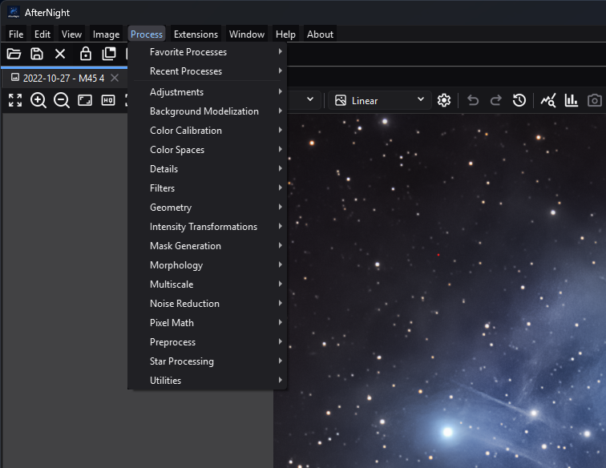

# Toolbar & Menus

<!-- Frozen template, 2026-07-10. Keep every heading and field. -->

AfterNight's menu bar is the main catalog for file, image, process, extension, workspace, help, and application-information commands. The main toolbar repeats only **Open**, **Save as...**, and **Close**; dock-layout and image-view tools have separate toolbars.

*The Process menu groups built-in workflows by category and keeps favorite and
recent processes at the top.*

## Purpose, audience, prerequisites, and expected result

Use this page when you need to find a command, understand why it is disabled, or predict which image or window it will affect. It assumes AfterNight is open; image-dependent commands additionally require an active image view. The expected result is that you can choose the correct menu, toolbar button, context action, or shortcut without changing the wrong target.

The process catalog itself is documented in [Process Index](../processes/index.md), and image-view-only controls are documented in [Image Viewer](image-viewer.md). This page documents how those commands are exposed and gated.

## Reachability and availability

| Item | Current behavior |
| --- | --- |
| Path | Menu bar: **File**, **Edit**, **View**, **Image**, **Process**, **Extensions**, **Window**, **Help**, **About**. Main toolbar: **Open**, **Save as...**, **Close**. Image context menu: right-click a standard image view. |
| Enabled/visible when | Application-level commands remain available without an image. Image commands follow the active view and its image, sequence, channels, pixel type, mask, metadata, history, and process-launch state. **Window** is disabled on the dashboard and enabled in the dock workspace. |
| Supported inputs/state | Still images and sequences; grayscale and RGB images; supported integer and floating-point types; optional FITS/EXIF metadata, astrometry eligibility, masks, and undo history. |
| Outputs/side effects | Commands can open or close views, write files, change pixels or display state, launch processes/dialogs, rearrange docks, modify preferences, open local help, or open external extension links. |
| Persistence | Recent files and processes, favorite process IDs, their configured limits, and the default dock-lock preference persist in settings. Most enablement, selection, check states, and the active target are runtime state. Current source does not serialize the dock layout. |
| External dependencies | File-system access for open/save/help; installed and compatible extensions for dynamic entries; browser and network for extension Homepage/Repository/Support links and online-help fallback. Other menu navigation is local. |

## Before you start

- Activate the intended image view before using a shared menu action or global shortcut. Pressing any mouse button on a standard image view makes it the active view, so the image context menu - whose **Process** entry is the main **Process** menu, with the same entries and state - targets the clicked view.
- Save important work before pixel-changing operations or bulk close/exit actions. Close prompts follow the configured close-confirmation behavior.
- Check the active view's channels, pixel type, sequence type, metadata, and mask when an action is disabled.
- Treat **Extensions > _family_ > Homepage/Repository/Support** as external navigation: it sends the selected URL to the operating system's browser and may use the network.
- Fixed shortcuts are not currently user-configurable. Focused-view handlers can depend on keyboard focus even when a menu action is unavailable.

## Procedure

1. Open or activate the intended image. Confirm its name is the selected image in the status bar.
2. Choose the narrowest command path:
   - use the main toolbar for **Open**, **Save as...**, or **Close**;
   - use the menu bar for the complete application catalog;
   - right-click the image for an explicit image target;
   - use the dock toolbar or **Window** menu for workspace layout.
3. Inspect the action state before selecting it. A disabled action means its current target or dependency does not satisfy a source-enforced rule; see the reference and troubleshooting tables below.
4. For a process, open **Process**, then **Favorite Processes**, **Recent Processes**, or one of the 16 category submenus. A registered action opens through the same availability and single-image guards from any launch point.
5. Complete or cancel the resulting dialog, process window, file chooser, or confirmation. Cancelling leaves that operation unapplied; a close-group operation stops at the first view whose close is cancelled.
6. Verify the observable result: a new/closed view, changed menu state, launched process, changed dock arrangement, written file, updated recent/favorite menu, or opened help/about window.

An empty dynamic list is represented by a disabled **Open Recent** or **Recent Processes** menu. **Favorite Processes** remains usable when empty because **Manage Favorites...** is always present. A process that is still being discovered can appear disabled with a loading explanation; genuinely unavailable or incompatible entries remain disabled and provide the registry's reason.

## Complete control and action reference

### Application and image menus

The following inventory preserves every current static label from the UI
builder. Detailed action behavior follows the inventory; process algorithms and
parameters remain authoritative on their linked process pages.

| Top-level menu | Submenu | Exact current entries, in order |
| --- | --- | --- |
| **File** | Direct | **Open**; **Open Recent** (dynamic paths, then **Clear recent files list**); **New Sequence...**; **Save as...**; **Close**; **Close All**; **Close All Others**; **Exit** |
| **Edit** | Direct | **Undo**; **Redo**; **Image History**; **Settings...** |
| **View** | Direct | **Session Console** |
| **Image** | **Actions** | **Duplicate**; **Rename**; **Close**; **Save File...** |
| **Image** | **Convert Format** | **Convert to 8 bit**; **Convert to signed 16 bit**; **Convert to unsigned 16 bit**; **Convert to signed 32 bit**; **Convert to unsigned 32 bit**; **Convert to 32 bit float**; **Convert to 64 bit float** |
| **Image** | **Extract Channel** | **Extract Red Channel**; **Extract Green Channel**; **Extract Blue Channel**; **Extract RGB Channels**; **Extract CIE L\***; **Extract CIE a\***; **Extract CIE b\***; **Extract CIE c\***; **Extract CIE h\***; **Extract CIE a\*=R / b\*=G**; **Extract CIE L\*a\*b\***; **Extract CIE L\*c\*h\***; **Extract CIE X**; **Extract CIE Y**; **Extract CIE Z**; **Extract CIE XYZ**; **Extract HSL Hue**; **Extract HSL Saturation**; **Extract HSL Lightness**; **Extract HSL**; **Extract HSV Hue**; **Extract HSV Saturation**; **Extract HSV Value**; **Extract HSV**; **Extract HSI Hue**; **Extract HSI Saturation**; **Extract HSI Intensity**; **Extract HSI**; **Extract YCbCr Luma**; **Extract YCbCr Blue Chroma**; **Extract YCbCr Red Chroma**; **Extract YCbCr** |
| **Image** | **Fast Geometry** | **Horizontal Mirror**; **Vertical Mirror**; **Rotate 180º**; **Rotate 90º Left**; **Rotate 90º Right** (the labels use the `º` ordinal sign) |
| **Image** | **Information** | **Statistics**; **Histogram**; **EXIF Viewer**; **FITS Header**; **Astrometry Info**; **Plate Solve**; **Summary** |
| **Image** | **Mask** | **Select Mask**; **Remove Mask**; **Invert Mask**; **Enable Mask**; **Show Mask**; **Rendering Mode** |
| **Image > Mask** | **Rendering Mode** | **Overlay Red**; **Overlay Green**; **Overlay Blue**; **Overlay Yellow**; **Overlay Magenta**; **Overlay Cyan**; **Replace**; **Multiply** |
| **Image** | **Sequence** | **Convert**; **Extract Frame**; **Extract Sequence**; **Export...** |
| **Image > Sequence** | **Convert** | **Convert to SER**; **Convert to Image List**; **Convert to FITS** |
| **Image** | **View** | **Zoom In**; **Zoom Out**; **Zoom 100%**; **Fit To Window**; **Maximize View** / **Restore View** |
| **Image** | Direct | **Show in File Browser** |

| UI label/action | Type and unit | Default | Valid values/constraints | Effect | Enabled, hidden, or ignored rules | Trade-off or side effect | Scope | Persistence |
| --- | --- | --- | --- | --- | --- | --- | --- | --- |
| Main toolbar: **Open**, **Save as...**, **Close** | Three buttons | Visible | Same commands as **File** | Opens data, saves the active image under a chosen path, or closes it | **Save as...** and **Close** require active data | File I/O or possible unsaved-work prompt | Application/active view | Recent path/list settings where applicable |
| **File > Open** / **Open Recent** | Action / dynamic submenu | Recent submenu disabled when empty | Supported readable paths; recent entries are stored paths | Opens a chooser or a recorded path; **Clear recent files list** removes the list | Open remains available; a missing recent path fails through normal open handling | File I/O; paths are stored locally | Application | Recent file list and configured limit |
| **File > New Sequence...** | Action | Available | Supported sequence sources/options | Opens the new-sequence workflow | Application-level | May read many source frames | Application | Workflow-specific |
| **File > Save as...** | Action | Disabled without data | Writable supported output path | Saves the active image with a chosen name/format | Active data required | Writes a file; format conversion can affect representation | Active view | Last-location behavior is file-workflow-specific |
| **File > Close / Close All / Close All Others** | Actions | Disabled without data | Active view; all views; all except active | Requests the corresponding close set | Active data required; each view can reject close | May prompt for unsaved work; group close stops on cancellation | Active/all image views | No |
| **File > Exit** | Action | Available | Application window | Requests application shutdown | Always reachable | Can prompt while closing open work | Application | Normal settings are retained |
| **Edit > Undo / Redo** | Actions | Disabled until available | Active image history | Applies the previous or next history step; labels include the step name when known | Requires a corresponding history entry | Changes image state | Active image | Image-history lifetime |
| **Edit > Image History** | Action | Disabled without active history tracker | Active image | Opens image history | Active image/tracker required | Read-only inspection unless its UI offers navigation | Active image | Runtime/image lifetime |
| **Edit > Settings...** | Action | Available | Settings pages | Opens application settings | Application-level | Changes may affect later actions/sessions | Application | Settings store |
| Top-level **View > Session Console** | Checkable action | Runtime view state | Shown/hidden | Shows or hides the Session Console dock | Available on dashboard and workspace | Consumes dock space; does not change images | Main window | Visibility/layout is not serialized |
| **Image > Actions** | Submenu | Disabled without data | **Duplicate**, **Rename**, **Close**, **Save File...** | Performs active-image lifecycle/file operations | Active data required | Duplicate uses memory; save writes a file | Active image | Names/files only |
| **Image > Convert Format** | Submenu | Disabled without data | 8-bit; signed/unsigned 16-bit; signed/unsigned 32-bit; 32-bit float; 64-bit float | Converts the active image's sample type | Current type is disabled (**Convert to 8 bit** for both unsigned and signed 8-bit images). SER/video sequences also disable signed 16-bit, both 32-bit integer, and both float targets | Conversion can clip, quantize, or increase memory | Active image/sequence | Image lifetime; save to retain |
| **Image > Extract Channel** | Submenu | Disabled unless RGB | Red/green/blue/RGB; CIE Lab/LCh/XYZ; HSL; HSV; HSI; YCbCr variants | Creates channel-derived image data | RGB/color image required | Creates additional views/data and uses memory | Active image | New-image lifetime |
| **Image > Fast Geometry** | Submenu | Disabled without data | **Horizontal Mirror**, **Vertical Mirror**, **Rotate 180º**, **Rotate 90º Left/Right** | Applies a fixed geometry transform | Active data required | Changes pixels/dimensions or orientation; may add history | Active image | Image/history lifetime |
| **Image > Information** | Submenu | Disabled without data | **Statistics**, **Histogram**, **EXIF Viewer**, **FITS Header**, **Astrometry Info**, **Plate Solve**, **Summary** | Opens inspection or astrometry tools | Statistics/histogram follow view support; EXIF/FITS require their metadata; Astrometry Info and Summary require only active data; Plate Solve requires an eligible image | Analysis can use CPU; plate solving can have workflow dependencies | Active image | Mostly runtime; solution behavior is tool-specific |
| **Image > Mask** | Submenu | Disabled without data | Select/remove/invert/enable/show; rendering modes | Assigns and controls the active mask | **Select Mask** is enabled with active data; other controls require an assigned mask | A mask changes process/display effect, not the source merely by being shown | Active image | Runtime/image state |
| **Mask > Rendering Mode** | Exclusive checkable choices | Current renderer state | **Overlay Red/Green/Blue/Yellow/Magenta/Cyan**, **Replace**, **Multiply** | Changes mask visualization | Assigned mask required | Display-only visualization can obscure image detail | Active image view | Runtime |
| **Image > Sequence** | Submenu | Disabled for still images | **Convert to SER**, **Convert to Image List**, **Convert to FITS**, **Extract Frame**, **Extract Sequence**, **Export...** | Converts, extracts, or exports sequence content | Sequence required; current SER/image-list target is disabled; **Convert to FITS** is always disabled in current source | Potentially substantial disk I/O and output volume | Active sequence | Output files only |
| **Image > View** | Submenu | Disabled without data | **Zoom In**, **Zoom Out**, **Zoom 100%**, **Fit To Window**, **Maximize/Restore View** | Changes display scale or workspace presentation | Maximize menu action is disabled for a floating view | Display-only, except maximize temporarily changes dock state | Active view/main dock | Runtime; current source does not serialize layout |
| **Image > Show in File Browser** | Action | Disabled unless the active image is a file | Active image's file: the one it was read from or last saved to; a sequence's file for a sequence | Opens the platform file manager with the file selected | Disabled for an image a process created and nobody saved, enabled once it is saved; a file moved or deleted since shows **File Not Found** | External file-manager action exposes the path | Active image | None |

### Process, extension, window, help, and about menus

The Process menu begins with **Favorite Processes** and **Recent Processes**,
then exposes these exact built-in entries. Installed compatible extension
processes are appended to the supported Process category declared by their
manifest; they are not added to the extension-family submenu.

| Process category | Exact current built-in entries, in order |
| --- | --- |
| **Adjustments** | **Brightness/Contrast**; **Gamma Correction**; **Exposure**; **Hue/Saturation/Lightness**; **Lightness/Chroma/Hue**; **Negative Transformation**; **Convert to RGB**; **Convert to Grayscale** |
| **Background Modelization** | **Background Extraction**; **Auto Gradient Removal** |
| **Color Calibration** | **Background Neutralization**; **SCNR Filter**; **Color Calibration**; **Photometric Color Calibration**; **Spectrophotometric Color Calibration**; **Linear Match** |
| **Color Spaces** | **Channel Composition**; **Colorize**; **Debayer**; **LRGB Combination**; **NBRGB Combination**; **NB Color Mapper**; **Narrowband Palette Composer**; **Merge CFA**; **Split CFA** |
| **Details** | **Gaussian Blur**; **High Pass**; **Local Contrast Enhancement**; **Dark Structure Enhance**; **Multiscale Alpha Sharpen**; **Unsharp Mask** |
| **Filters** | **Gaussian Blur**; **Median Filter**; **Bilateral Filter**; **Banding Reduction Filter**; **Cosmetic Correction Filter** |
| **Geometry** | **Resize**; **Crop**; **Rotate**; **Integer Resample**; **CFA Integer Resample** |
| **Intensity Transformations** | **ArcSinh Stretch**; **Binarize**; **CLA Histogram Equalization**; **Color Saturation**; **Curves Transformation**; **Generalized Hyperbolic Transformation**; **Histogram Transformation**; **Local Histogram Equalization**; **Statistical Stretch** |
| **Mask Generation** | **Mask Drawing**; **Range Selection**; **Star Mask**; **Starnet++ Star Mask** |
| **Morphology** | **Morphological Transformation**; **Tighten Edges** |
| **Multiscale** | **Multiscale Linear Transform** |
| **Noise Reduction** | **DeepSNR**; **GRAYCstoration Filter**; **Non-Local Bayes Filter**; **Patch PCA Denoise Filter**; **Total Variation Denoise Filter**; **Wavelet Denoise Filter** |
| **Pixel Math** | **Pixel Math** |
| **Preprocess** | **Image Calibration**; **Image Registration**; **Image Stacking**; **Image Integration**; **Image Integration Lite** |
| **Star Processing** | **Profiled Starmask Recombination**; **Starmask Recombination**; **Star Reduction**; **Starnet++**; **Star Profiler v1**; **Star Profiler v2** |
| **Utilities** | **Image Blend**; **Image Compare**; **Noise Generator**; **Image List Analyzer** |

| UI label/action | Type and unit | Default | Valid values/constraints | Effect | Enabled, hidden, or ignored rules | Trade-off or side effect | Scope | Persistence |
| --- | --- | --- | --- | --- | --- | --- | --- | --- |
| **Process > Favorite Processes** | Dynamic submenu | Management commands present | Valid registered process IDs | Lists favorites alphabetically, case-insensitive; launches through registry | Missing descriptors are filtered; **Clear favorites list** disabled when empty | Launch effects depend on process | Application/active image | `interface/favoriteProcessIds` |
| **Manage Favorites...** | Dialog action | Current favorites checked | Search by display name or ID; check/uncheck entries | Saves checked IDs on **OK**; **Cancel** leaves them unchanged | Always present in Favorite Processes | Changes a local menu list | Application | `interface/favoriteProcessIds` |
| **Clear favorites list** | Confirmed action | Disabled when empty | **Yes/No**, default **Yes** | Removes all favorite IDs after confirmation | Favorites required | Cannot undo except by reselecting favorites | Application | `interface/favoriteProcessIds` |
| **Process > Recent Processes** | Dynamic submenu | Disabled when empty | Successful registered launches; configured maximum 1–100, default 10 | Shows most recent first, removes duplicates, and launches the selected process | Unknown extension IDs may remain disabled while discovery is pending; missing IDs are pruned after discovery | Stores process IDs locally | Application/active image | `interface/recentProcessIds`; limit `general/recentProcessesLimit` |
| **Clear recent processes list** | Confirmed action | Present when list has entries | **Yes/No**, default **Yes** | Removes all recent-process IDs | Entries required | Cannot undo except by launching processes again | Application | `interface/recentProcessIds` |
| Process category submenus | 16 submenus | Built from registry | **Adjustments**, **Background Modelization**, **Color Calibration**, **Color Spaces**, **Details**, **Filters**, **Geometry**, **Intensity Transformations**, **Mask Generation**, **Morphology**, **Multiscale**, **Noise Reduction**, **Pixel Math**, **Preprocess**, **Star Processing**, **Utilities** | Exposes registered built-in and mapped extension processes | Category submenus are disabled with no image, except **Color Spaces** and **Preprocess** (and **Image List Analyzer** under **Utilities**). A built-in entry is disabled only when its descriptor is unavailable or its color rule fails; a wrong channel/type, a sequence for a still-only process, a duplicate attached instance, or an exclusive conflict is refused when you launch, with a titled message. An extension entry is also disabled by those guards and by bootstrapping, installing, repairing, validating, or incompatible states, with the guard's message | Process-specific CPU, memory, disk, and image changes | Application/active target | Recent list updates only after successful launch |
| **Extensions** > **Manage Extensions...** | Action | Available | Installed/discoverable extension packages | Opens extension management | Application-level | Installation/update/remove can change local code and available actions | Application | Extension manager/package state |
| **Extensions > _family_** | Dynamic submenus | Valid discovered families only | **Manage...**; optional **Homepage**, **Repository**, **Support** | Opens the general installed-extension status page or a declared URL; these submenus do not contain process launch actions | Invalid manifests are excluded; families sort case-insensitively | URLs open externally and can disclose network/browser activity | Extension/application | Extension state; external browser state |
| **Window** > **Lock Layout** / **Unlock Layout** | Two actions, both always shown | Interface preference | Locked/unlocked | Blocks or allows interactive dock drag/drop and double-click layout changes | Window menu requires dock workspace; the action for the current state is disabled, and both are disabled while a view is maximized | Does not block programmatic group/split/fit/close | Main dock workspace | `interface/lockLayoutByDefault` is startup preference, not current layout serialization |
| **Window > Group All Images / Split All Images / Fit Images To Window** | Actions | Disabled on dashboard | Registered image views | Groups globally, creates deterministic global splits, or fits every image view | Dock workspace required; Group/Split disabled while a view is maximized | Moves floating views into main dock for Group/Split; fit changes display scale | All registered image views | No |
| **Help** > **User Guide** | Action | Available | Bundled guide, then online fallback | Opens offline guide first; uses published guide only if needed and permitted | `AFTERNIGHT_DISABLE_ONLINE_USER_GUIDE=1` disables fallback | Online fallback opens external browser/network | Application | Environment policy only |
| **About** > **About Qt** / **About AfterNight** / **System Information** | Actions | Available | Local application/runtime information | **About Qt** opens Qt's own dialog. **About AfterNight** shows **Version** with the version the application states (1.0.1; **dev** when none is stated) and has **About**, **Libraries**, and **License** tabs; **Libraries** lists Qt, KDDockWidgets, and SQLite, then the engine's version and interface generation and the libraries the engine reports - CFITSIO, Exiv2, FFmpeg, FFTW, GNU Scientific Library, Highway, libjpeg-turbo, libpng, LibRaw, LibTIFF, JSON for Modern C++, oneTBB, and OpenXISF, each with the version its headers declared and the loaded one when it differs - then Crashpad and cmark-gfm, and notes that the extension host runs Python and that G'MIC is reached through an optional adapter. **System Information** shows the same engine and library list in its Dependencies section | Application-level | No network required by these dialogs | Application | No |

### Image context menu and shortcuts

Right-clicking a standard image view creates these families in order: **Actions**, **Process**, **Convert Format**, **Extract Channel**, **Fast Geometry**, **Information**, **Mask**, **Sequence**, **View**, **Current Window**, and, last, **Show in File Browser**. The shared families use the same actions and enablement as the menu bar; **Process** is the main window's own **Process** menu. **Current Window** contains **Group All Images**, **Split All Images**, and **Fit All Images to Window**, but limits them to image views owned by the clicked view's main or floating window; its Group and Split are disabled while the clicked view is maximized. That differs from the global **Window** commands.

| UI label/action | Type and unit | Default | Valid values/constraints | Effect | Enabled, hidden, or ignored rules | Trade-off or side effect | Scope | Persistence |
| --- | --- | --- | --- | --- | --- | --- | --- | --- |
| Context **Process** | Main **Process** menu | Current registry state | Same entries and state as the menu bar | Launches for the clicked view, which the mouse press made active | Same registry guards as menu bar | Process-specific | Clicked image | Successful launch updates recent list |
| Context **Show in File Browser** | Action | Disabled unless the clicked image is a file | Same action as **Image > Show in File Browser** | Opens the platform file manager with the clicked image's file selected | Same rule as the menu bar: enabled only for an image read from or saved to a file | External file-manager action exposes the path | Clicked image | None |
| Context **Current Window > Group All Images / Split All Images / Fit All Images to Window** | Actions | Available for containing window | Views sharing clicked view's main/floating owner | Rearranges or fits only that containing window | Requires standard image-view context; Group and Split disabled while the clicked view is maximized | Layout/scale change limited to one window | Containing window | No |
| Main action shortcuts | Fixed shortcuts | Built in | `Ctrl+O` Open; `Ctrl+Shift+S` Save as; `Ctrl+Z` Undo; `Ctrl+Y` Redo; `Ctrl++` Zoom In; `Ctrl+-` Zoom Out; `Ctrl+0` Zoom 100%; `Ctrl+,` Settings; `F1` User Guide | Invokes the corresponding shared action | Normal action enablement applies | Keyboard layout/focus can affect recognition | Application/active view | Not configurable |
| Focused-view shortcuts | Direct view handlers | Built in | `F11` Maximize/restore; `Ctrl+Shift+F` Fit; `Ctrl+H` Histogram; `Ctrl+Shift+T` Statistics; `Ctrl+Shift+X` EXIF; `Ctrl+Shift+H` FITS header; `Ctrl+Shift+M` Summary; `Ctrl+Shift+Z` Image history; `Ctrl+Shift+P` Astrometry info; `Ctrl+P` Plate Solve | Dispatches from the focused image view | Focus and handler-specific prerequisites apply; direct `F11` can invoke restore/maximize even though the visible menu action is disabled for a floating view | Shortcut can conflict with desktop/application bindings | Focused image view | Not configurable |

## Behavior and state model

AfterNight keeps one active `ImageViewControl`. Shared menu and toolbar actions query that control, so changing the active view recomputes image, channel, sequence, pixel-type, metadata, history, mask, process, and layout state. The mouse press that opens a context menu first makes its image view active, preventing a process from silently targeting the previously active view.

Process actions are descriptors in a live registry. Each launch checks availability and, for single-image processes, the active image, allowed channels, still-versus-sequence requirement, duplicate attached instances, and exclusive-process conflicts; a built-in entry is refused at launch with a titled message such as **This process supports still images only, not sequences.**, while an extension entry is also disabled in the menu by the same guards. Extension discovery refreshes registry actions and stored recent/favorite menus. A process is added to the front of the recent list only after launch succeeds.

The RGB flag enables channel extraction and RGB-only color actions. **Convert to RGB** (under **Adjustments**) is enabled only for a non-color image and **Convert to Grayscale** only for a color one; **Adjustments** itself is disabled without an image. The **Color Spaces** category remains enabled even with no image, as do **Preprocess** and **Image List Analyzer**, while individual entries enforce their own rules. Sequence and current-pixel-type rules then further disable invalid conversion targets. Metadata gates are independent: FITS records enable **FITS Header**, EXIF data enables **EXIF Viewer**, and plate-solve eligibility controls **Plate Solve**; **Astrometry Info** and **Summary** are enabled for any active image.

Undo, redo, mask toggles, and the Session Console use live check/label state. These are not documentation promises of saved layout or image state. Only documented settings keys and explicit file outputs persist beyond the relevant image/session.

## Inputs, outputs, and metadata

File commands accept paths through their workflows and can create or overwrite files after normal prompts. Image conversions, geometry operations, masks, and processes act on or derive from the active image; their exact output type, naming, metadata propagation, history, and overwrite rules belong to their linked process pages. Display zoom, fit, mask rendering, console visibility, and maximize do not by themselves rewrite source pixels.

Recent files store local paths. Recent and favorite processes store stable process IDs, not processed pixels or parameter values. Menu navigation sends no data to a service, but external extension links and online-help fallback hand a URL to the browser. The **System Information** dialog is local.

## Performance and responsiveness

Opening ordinary menus is local and lightweight. Dynamic process/extension menus rebuild from the current registry, and recent/favorite collections are bounded or small; the tested helper behavior is deterministic. Large image duplication and extraction increase memory, sequence conversion/export can create substantial disk traffic, and process execution can be CPU-, memory-, or disk-intensive. Those operations are launched by the menu but are not performed by menu navigation itself.

Avoid repeated duplication of large images, confirm available disk space before sequence export/conversion, and use the dedicated process progress/cancel controls once a long-running process starts. External links and online help inherit browser/network latency without blocking the meaning of local menu state.

## Worked example

- Evidence mode: Source-and-test-derived.
- Starting state, actions, settings, checkpoints, result, and limitations: Open an RGB FITS still image with EXIF records and activate its view. **Save as...**, **Image > Extract Channel**, **FITS Header**, **EXIF Viewer**, **Astrometry Info**, **Summary**, and eligible process entries become enabled; **Image > Sequence** remains disabled. Launch a valid process successfully and reopen **Process > Recent Processes**: its entry is first, with older duplicates removed and the list limited by **Settings > General > Recent Processes Limit**. Add it through **Manage Favorites...** and accept: it appears in **Favorite Processes** in case-insensitive alphabetical order. Right-click the image to confirm the same process families target that view and that **Current Window** layout actions are local to its containing window. This evidence verifies state transitions and ordering only; it does not claim GUI geometry, a processing result, timing, or persisted dock layout.

## Warnings and limitations

- The nine top-level menus are **File**, **Edit**, **View**, **Image**, **Process**, **Extensions**, **Window**, **Help**, and **About**. **Actions** and the image-oriented **View** are submenus under **Image**, not extra top-level menus.
- The main toolbar has only **Open**, **Save as...**, and **Close**. Dock commands are on the dock toolbar; zoom/maximize controls also appear with the image viewer.
- **Convert to FITS** for sequences is always disabled in current source. Do not treat its visible label as implemented availability.
- Pixel-type conversion can clip or quantize data. Sequence conversion/export can consume substantial disk space.
- **Group All Images** and **Split All Images** are global and can pull floating image views into the main dock. Context **Current Window** commands are the scoped alternative.
- The current source persists the startup lock preference but does not contain a dock-layout serialization/restore path.
- The visible maximize action is disabled for a floating view, but the focused-view `F11` handler is direct. Use it deliberately.
- Extension links and online help can leave AfterNight and use the network. Extension processes can change after install, update, removal, or discovery.
- Current fixed shortcuts are not user-configurable and can conflict with operating-system or desktop shortcuts.

## Troubleshooting

| Symptom or exact error | Verified cause/enablement path | Recovery | Evidence source |
| --- | --- | --- | --- |
| **Save as...**, **Close**, or Image submenus are disabled | No active data/view | Open an image or select an existing image view | `ActionStateCoordinator.cpp` |
| Extract Channel or RGB color actions are disabled | Active image is not RGB | Choose an RGB image or use an enabled conversion process such as **Convert to RGB** | `ActionStateCoordinator.cpp` |
| A conversion target is disabled | It is the current pixel/sequence type, or the active SER/video sequence disallows that sample type | Select a different supported target; export/convert through a supported workflow | `ActionStateCoordinator.cpp` |
| **Convert to FITS** is visible but disabled | Current source explicitly disables this sequence action | Use a documented supported sequence export/conversion path | `ActionStateCoordinator.cpp` |
| FITS Header or EXIF Viewer is disabled | Required metadata is absent | Select an image containing FITS records or EXIF metadata | `ActionStateCoordinator.cpp` |
| A process is disabled, missing, or refused at launch | Registry is loading, installing, repairing, validating, incompatible, unavailable, or category-unmapped; or the launch guard rejects the active target or a conflict (a built-in entry is refused with a titled message, an extension entry is disabled) | Read its disabled reason or the message; finish extension discovery/repair, select compatible data, or close the conflicting instance | `ProcessRegistry.cpp`; `MenuActionManager.cpp`; `ActionStateCoordinator.cpp`; `ProcessLauncherTest.cpp` |
| Recent Processes is empty or an entry says it is still loading | No successful launches are stored, or a stored extension ID is awaiting discovery | Launch a process successfully or let extension discovery finish | `AfterNightApp.cpp`; `ProcessMenuState.h` |
| A favorite disappeared | Its descriptor is no longer registered after discovery | Restore/enable its extension or choose it again after the descriptor returns | `AfterNightApp.cpp`; `ProcessMenuState.h` |
| Window commands are disabled | Dashboard is active, or maximize temporarily disabled global Group/Split | Open/activate an image workspace or restore the maximized view | `ActionStateCoordinator.cpp`; `WindowLayoutCoordinator.cpp` |
| A shortcut does nothing or affects an unexpected view | Required action state or image-view focus is absent | Click the intended image view, inspect the menu's enabled state, and retry | `AfterNightAppUiBuilder.h`; `ImageViewControl.cpp` |
| `F1` opens online help or reports it cannot open the guide | Bundled guide is absent/unopenable; online fallback is used unless policy disables it | Install a package containing the guide; check `AFTERNIGHT_DISABLE_ONLINE_USER_GUIDE` policy | `DialogOrchestrationCoordinator.cpp` |

## Related workflow steps

- [Saving and Exporting](saving-and-exporting.md) provides file-workflow details; [Dashboard](dashboard.md) covers recent-file behavior.
- [Image Viewer](image-viewer.md) documents image-view tools and display behavior.
- [Docking Panels](docking-panels.md) defines global versus containing-window layout scope and lock/maximize behavior.
- [Masks](masks.md) explains mask compatibility and visualization.
- [Sequences](sequences.md) covers sequence workflows behind the menu actions.
- [Process Windows](process-windows.md) explains process launch and execution behavior; [Process Index](../processes/index.md) is the catalog.
- [Using Extensions](../extensions/using-extensions.md) covers extension management and dynamic processes.
- [Keyboard Shortcuts](../reference/keyboard-shortcuts.md) is the consolidated shortcut reference.

## References and provenance

- AfterNight source and focused tests.
- Process availability, category mapping, and launch guards are project-defined behavior in `ProcessRegistry` and `MenuActionManager`; extension-provided labels and URLs originate in installed manifests.
- Qt `QAction`, `QMenu`, shortcut, settings, and desktop-services behavior is provided under the Qt licensing terms included with AfterNight distributions.
- The validated menu capture is tracked as `UG-MEDIA-009` in the canonical media
  manifest.
