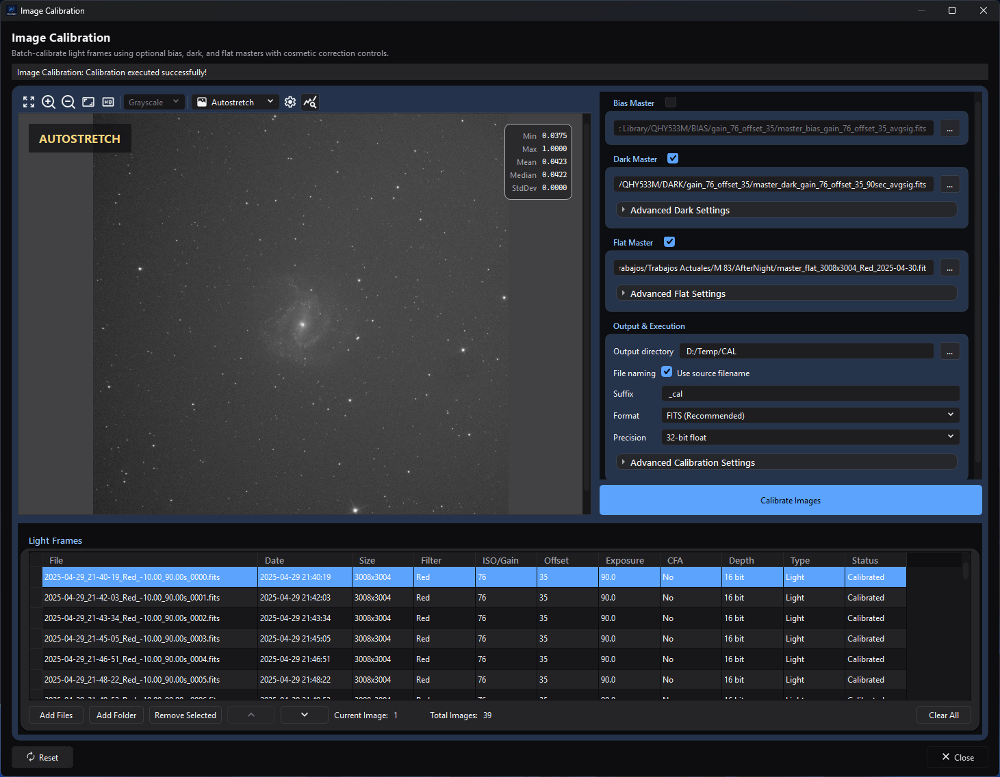

# Image Calibration

## Purpose and expected result

*The completed calibration state shows the selected bias, dark, and flat masters,
the populated light list, and the output controls together.*

Image Calibration is the focused batch tool for correcting uncalibrated linear
still frames with optional prepared bias, dark, and flat masters. It can scale
the dark, normalize the flat, replace deviant pixels found from the dark, add a
pedestal, and write one calibrated file for every successful input. It does not
build masters, match different masters to different light groups, register,
debayer, stack, or generate a workflow report.

Use this page when you already have appropriate master files and want a
calibration-only handoff. A successful run leaves the source files unchanged
and reports each row as **Calibrated** or
**Failed**. Use [Image Integration](../stacking-integration/image-integration.md)
when master construction, metadata-based matching, registration, stacking, and
reporting should be managed together.

## At a glance

| Item | Current behavior |
| --- | --- |
| Menu path | **Process > Preprocess > Image Calibration** |
| Enabled when | The window is always available; no active image or sequence is required. **Calibrate Images** requires at least one listed file and either a complete enabled master selection or a positive pedestal. A missing output directory is checked when the action is selected. While files are still being read or **Auto-estimate** is counting, the action asks you to wait and starts nothing. |
| Inputs | Supported still-image files plus at most one manually selected bias, dark, and flat master for the whole batch. The process does not build or automatically match masters. |
| Outputs | One still file per successful input in FITS, TIFF, or the light's own container and representation. Earlier successes remain when a later file fails or the run is stopped; a light stopped or failed part-way leaves no partial file. Source files are not modified. |
| Recommended image state | Uncalibrated linear mono, CFA, or RGB stills. Prepared masters must already contain the corrections appropriate to their role. Calibrate CFA before debayering. |
| Preview support | Static preview of the selected source only. CFA sources are debayered automatically for display. Settings do not calculate a calibrated preview. |
| Sequence support | No direct SER, video, or image-list sequence input. Extract/export to still files first. |
| Mask support | Not supported. No application mask is read or blended. |
| External dependencies | No external executable, catalog, or network service. Saving uses the deployed AfterNight codecs; camera RAW is readable but cannot be written back as RAW. |

## Before you start

- Use compatible lights. At execution the batch must have one width/height,
  pixel type, and channel count. The table displays gain/ISO, offset, exposure,
  filter, CFA, and depth, but the process does not match or validate gain/ISO,
  offset, exposure, temperature, filter, session, or camera model.
- Prepare the masters first. The selected bias is subtracted from each light;
  it is not used to calibrate the selected dark or flat. Likewise, this window
  does not subtract dark-flat/bias signal from a flat. Do not supply an
  unprepared master expecting the batch to construct or calibrate it.
- Use one compatible master set for the entire list. Each master is read once
  per run and checked against the first light: a master of a different size,
  then of a different channel count, stops the run before any light is read, and
  the message names the master. A bias or dark whose filter-array layout (mosaic
  or not, and its pattern) differs from the lights' is refused by the
  calibration itself, so every light fails.
- Keep raw CFA samples mosaiced until calibration is complete. The selected-row
  preview may look RGB because it is debayered for display only.
- Choose a new or expendable output location. Existing destinations are written
  without an overwrite prompt, and two source files with the same stem can
  resolve to the same destination.
- Prefer floating-point FITS for a processing master. **Original input format**
  writes the light's own sample type, converting each calibrated value to the
  nearest code, so an integer type cannot keep negative residuals or fractional
  values; a camera-RAW suffix fails because RAW writing is unsupported.

## Procedure

1. Open **Process > Preprocess > Image Calibration**. Confirm that the
   **Light Frames** list is empty and the master/output controls are disabled.
2. Select **Add Files**, or use **Add Folder** and choose recursive, frame-type,
   and exact filter-name criteria. Confirm every intended still appears once in
   the table. File headers are read in the background; when some files could
   not be read, the window says how many, how many loaded, and the first error.
   Remove unrelated or incompatible rows; the title
   **Light Frames** does not enforce that the metadata type is LIGHT.
3. Inspect a representative source in **Image Preview** and review the Size,
   Filter, ISO/Gain, Offset, Exposure, CFA, and Depth columns. This is an input
   preview, not a calibration preview.
4. Enable only the masters to apply and select or drop one file into each path.
   Apply the same prepared master set to every listed light.
5. For the dark, leave **Enable dark optimization** off and **Dark scaling** at
   `1.00` for an already matched master. Enable optimization only for a scale
   mismatch on grey (monochrome) lights; a colour light, or one smaller than
   512 × 512 pixels, is calibrated with the fixed **Dark scaling** factor
   instead, and the log says so. If needed, enable
   cosmetic correction and use **Auto-estimate** to count, in the background, the
   cold and hot pixels the current thresholds detect in the dark; it does not
   choose or change the thresholds.
6. Keep **Normalize flat master automatically** on unless the master is already
   normalized for direct division. Confirm that its size, channel count, and
   CFA layout agree with the lights.
7. Select **Output directory**, naming, format, and precision. Use a unique
   suffix and check for same-stem collisions. Add a pedestal only when the
   desired positive baseline is understood.
8. Select **Calibrate Images**. The run snapshots the current list and settings,
   checks the masters before any light is read, processes files sequentially in
   the background, and reports progress; the window does not freeze. Every row
   returns to **Pending** when the run starts and then shows **Calibrated** or
   **Failed** as the run reaches it, so a stopped run leaves the rows it did not
   reach **Pending**. A mixed-success run shows a
   warning with how many lights succeeded and the first error; a zero-success run
   reports an error.
9. Reopen representative outputs and inspect them at 100%, in
   [Image Statistics](../../interface/image-statistics.md), and in the FITS
   header/metadata viewer. Confirm file count, names, sample precision, CFA
   state, black point, dust correction, and remaining deviant
   pixels before registration.

## Complete parameter and action reference

### Source list, preview, and folder import

| UI label/action | Type and unit | Runtime default | Persisted-default exception | Valid values, step, or constraints | Effect of increasing, decreasing, or selecting | Dependencies and enable/visibility rules | Quality, artifact, runtime, memory, or disk trade-off | Scope: preview/apply, channel, mask, still/sequence | Persistence |
| --- | --- | --- | --- | --- | --- | --- | --- | --- | --- |
| Fit To Window | Preview toolbar action | First loaded image is fit automatically | None | One action | Rescales the selected source to the available preview area | Requires a readable selected source | Display-only resampling; no output effect | Selected source preview | Not persisted |
| Zoom In | Preview toolbar action | Fit-to-window scale after first load | None | Repeated action up to the shared viewer's maximum scale | Increases preview magnification | Requires a readable selected source | Higher magnification exposes pixels but shows less of the frame | Selected source preview | View-local; not calibration JSON |
| Zoom Out | Preview toolbar action | Fit-to-window scale after first load | None | Repeated action down to the shared viewer's minimum scale | Decreases preview magnification | Requires a readable selected source | Lower magnification hides pixel-scale defects | Selected source preview | View-local; not calibration JSON |
| Zoom 100% | Preview toolbar action | Fit-to-window scale after first load | None | One action | Displays one image pixel per screen pixel | Requires a readable selected source | Useful for defect inspection; may require panning | Selected source preview | View-local; not calibration JSON |
| View Channel | Preview selector | Grayscale for mono; RGB for the debayered CFA/RGB preview | None | Mono: Grayscale. RGB: RGB, Red, Green, Blue, CIE L* (Lightness), CIE a*, CIE b*, CIE a*=R / b*=G (Chrominance), CIE c*, CIE h*, CIE X, CIE Y (Luminance), CIE Z, HSL Hue/Saturation/Lightness, HSV Hue/Saturation/Value, HSI Hue/Saturation/Intensity, YCbCr Luma/Blue Chroma/Red Chroma | Selects a display composition or component without changing the image | Empty without an image; mono has one disabled choice; RGB choices are enabled | Component conversions are display-only and can emphasize artifacts differently | Selected source preview | View-local; not calibration JSON |
| Display Mode | Preview selector | Linear | None | Linear, Autostretch | Linear displays source values; Autostretch applies a display transform | Populated after a readable source loads | Autostretch can reveal faint structure but is not calibrated output data | Selected source preview | View-local; not calibration JSON |
| Autostretch Settings | Preview dialog action | Disabled in Linear mode | Current shared-view autostretch state is loaded when opened | Opens the shared autostretch settings dialog | Adjusts display stretch only | Enabled only in Autostretch mode; disabled while its dialog is open | Aggressive display settings can exaggerate background/noise without changing saved pixels | Selected source preview | Viewer-scoped; not calibration JSON |
| Show statistics | Checkable preview action | On | None | On/off | Shows or hides the precomputed static-preview statistics overlay | Requires a readable selected source for values | Display/I/O diagnostic only; no calibration effect | Selected source preview | View-local; not persisted |
| Image preview canvas | Mouse interaction | Quick zoom enabled | Wheel zoom follows global Interface zoom-modifier/sensitivity settings | Left press/drag shows the quick-zoom lens; middle drag pans; wheel zooms when the configured modifier condition is met | Navigates and inspects the displayed source | Requires a readable selected source | Quick zoom and panning help inspect pixels but do not preview calibration | Selected source preview | Global zoom preferences apply; canvas position/lens state is not calibration JSON |
| Add Files | File-picker action | No files | Last picker path may be remembered | Any still extension recognized by the image codec; duplicate full paths are skipped | Reads file headers in the background; the window stays responsive | Disabled while calibrating | I/O can be substantial; unreadable files do not stop the others, and when an import does not add every file the window reports how many it added, passed over (already listed or kept out by the filter) and could not read, with the first error | Still-file list only | The list is saved with the window's settings and read again, in the order it was saved, when it reopens; picker path uses application path memory |
| Add Folder | Folder-picker and options action | No folder | Last folder is remembered | Existing directory followed by the options below | Scans recognized image extensions asynchronously | Disabled while calibrating | Recursive scans may be I/O-heavy and may mix frame roles | Still-file list only | Folder path is remembered; options are per invocation |
| Include subfolders (recursive) | Checkbox | On | None | On/off | Includes or excludes descendant folders | Add Folder options only | Broader scans cost more and can mix sessions | Folder import | Per invocation |
| Frame Type | Selector | All | None | All, Light, Dark, Flat, Bias, Dark Flat | Filters by the frame type the header states: Light needs LIGHT, Dark needs DARK without FLAT, Flat needs FLAT without DARK, Dark Flat needs both, Bias accepts BIAS or OFFSET; a file stating no type counts as LIGHT | Add Folder options only | Metadata can be missing or noncanonical; All and Add Files do not enforce LIGHT | Folder import | Per invocation |
| Filter Name | Text | Empty | None | Case-insensitive exact metadata match after trimming | Empty accepts all filters; text restricts import | Add Folder options only | Missing/incorrect filter metadata can exclude intended frames | Folder import | Per invocation |
| Light Frames table | Sortable selection table | Empty; Status becomes Pending on import | None | File, Date, Size, Filter, ISO/Gain, Offset, Exposure, CFA, Depth, Type, Status; Size is not sortable | Selecting loads the source preview; supported headers reorder batch execution | Populated after metadata import | Order affects which file is processed first but not calibration math. Type is currently displayed as Light for every row, regardless of source metadata | Whole still batch; all channels/CFA samples | The list is saved with the window's settings and restored on reopen in the order it was saved; statuses are not saved |
| Remove Selected / Remove | Button/context action | Disabled | None | Selected rows | Removes paths from this window only | Requires a row/selection | No source-file loss | List and later apply | Not serialized |
| Move Up / Move Down | Buttons/context actions | Disabled | None | Selected row within bounds | Changes list and batch order | Enabled only when movement is possible | Can choose which files finish before a later failure/cancellation | List/apply order | The order is saved with the list |
| Delete From Disk | Context action | No | None | Selected row plus confirmation | Removes the row, then requests permanent file deletion | Row context menu only | Destructive; if the file cannot be deleted after the row is removed, an error message says so | Source file and list | Not serialized |
| Clear All | Button | Disabled | None | All rows | Clears list, statuses, preview, and counters, and stops files still being read: none of them is added afterwards | Enabled with rows; does nothing while calibrating | Does not delete source files | List/preview | Not serialized |
| Current Image / Total Images | Read-only counters | `0` / `0` | None | Derived integers | Reports selected 1-based row and list size | Always visible | No processing effect | Preview/list | Not persisted |

### Masters, dark optimization, flat normalization, and cosmetic correction

| UI label/action | Type and unit | Runtime default | Persisted-default exception | Valid values, step, or constraints | Effect of increasing, decreasing, or selecting | Dependencies and enable/visibility rules | Quality, artifact, runtime, memory, or disk trade-off | Scope: preview/apply, channel, mask, still/sequence | Persistence |
| --- | --- | --- | --- | --- | --- | --- | --- | --- | --- |
| Bias Master | Checkable group | Off, empty path | Restored from process JSON | One readable supported still file selected with **...** or dropped on the read-only path | Subtracts the selected bias from every light | Group enabled after rows exist; checked with empty path disables Calibrate | Wrong master shifts/patterns every output | Apply to whole batch, every channel/CFA sample | `bias_enabled`, `bias_path`; Reset clears/off |
| Dark Master | Checkable group | Off, empty path | Restored | One readable supported still file | Subtracts one scaled dark from every light | Group enabled after rows exist; checked with empty path disables Calibrate | Wrong exposure/temperature/gain/offset can over/under-correct thermal structure | Apply to whole batch | `dark_enabled`, `dark_path`; Reset clears/off |
| Advanced Dark Settings | Collapsible action | Collapsed | Expansion is not serialized | Expanded/collapsed | Reveals dark scaling and cosmetic controls | Content enabled only with rows and Dark Master checked; cosmetic controls additionally need a nonempty dark path | No pixel effect by itself | Settings only | Not persisted |
| Enable dark optimization | Checkbox | Off | Restored | On/off | On finds, for each grey (monochrome) light, the dark factor between 0 and 2 that minimizes the variance of the light minus the scaled dark over its central 512 × 512 square; a colour light, or one smaller than that square, uses the fixed **Dark scaling** factor instead, and the log says so. Off uses **Dark scaling** | Dark master required; when on, **Dark scaling** stays offered: grey lights of at least 512 × 512 ignore it and every other light is scaled by it | Adds work per light; the factor found can differ from the true exposure ratio, so compare against a fixed factor | Apply; grey lights only | `dark_optimization`; Reset off |
| Dark scaling | Scalar multiplier | `1.00` | Restored | 0.10–10.00, step 0.10, 2 decimals | Multiplies the dark before subtraction | Enabled with rows and a checked, nonempty Dark Master, with optimization on or off | Below 1 subtracts less; above 1 subtracts more. Excess creates dark clipping/negative residuals. Also used for colour lights when optimization is on | Apply to whole batch | `dark_multiplication_factor`; Reset 1.0 |
| Enable cosmetic correction | Checkable group | Off | Restored | On/off | Maps cold and hot pixels in every channel of the dark once per run, then replaces those samples in every light after calibration; with both sigma checkboxes off nothing is corrected, and the run's completion message and the log say so | Requires rows plus checked/nonempty Dark Master | Full-frame detection and replacement cost CPU/memory; aggressive thresholds can replace compact real signal | Apply; every channel | `cosmetic_correction_enabled`; Reset off |
| Cold sigma | Checkbox plus sigma value | On, `3.000` | Restored | Checkbox on/off; 0.000–99.990, step 0.1 | Lower enabled values classify more dark samples at or below `median - value × sigma` of their channel (sigma is the channel's population standard deviation), provided they did not already match the enabled hot predicate; off looks for no cold pixels | Cosmetic group only; hot classification is evaluated first | Too low replaces many pixels; too high leaves cold defects; overlapping thresholds classify as hot | Detection and correction per channel | `cold_sigma_enabled`, `cold_sigma`; Reset on/3.0 |
| Hot sigma | Checkbox plus sigma value | On, `3.000` | Restored | Checkbox on/off; 0.000–99.990, step 0.1 | Lower enabled values classify more dark samples at or above `median + value × sigma` of their channel; off looks for no hot pixels | Cosmetic group only; evaluated before Cold sigma | Too low can classify many bright samples; too high leaves hot pixels; zero/overlapping thresholds win over cold | Detection and correction per channel | `hot_sigma_enabled`, `hot_sigma`; Reset on/3.0 |
| Auto-estimate | Asynchronous report action | No stored result | None | Uses the current dark and enabled sigma values | Counts the dark's cold and hot pixels, summed over its channels, in the background and reports **Detected N cold pixels and M hot pixels**; with both sigma checkboxes off it reports an error. It does not calculate, change, or persist threshold values | Cosmetic group enabled and a nonempty dark path; button disables while counting | Reads and scans the dark; the actual calibration scans again | Diagnostic only | Not persisted |
| Flat Master | Checkable group | Off, empty path | Restored | One readable supported still file | Divides every light by the selected flat, optionally after normalization | Group enabled after rows exist; checked with empty path disables Calibrate | Wrong optics/filter/focus/CFA layout imprints gradients, color structure, or dust artifacts | Apply to whole batch | `flat_enabled`, `flat_path`; Reset clears/off |
| Advanced Flat Settings | Collapsible action | Collapsed | Expansion is not serialized | Expanded/collapsed | Reveals flat normalization | Enabled with rows and checked Flat Master | No pixel effect by itself | Settings only | Not persisted |
| Normalize flat master automatically | Checkbox | On in a fresh/reset process | Restored value overrides reset default | On/off | On divides the flat by the mean of its central third (per channel, or per filter-array site for a mosaic) before division | Flat master required | Usually preserves overall level; a nonrepresentative central region can bias normalization | Apply to the flat, read once per run, then whole batch | `normalize_flats`; Reset on |

### Output, execution, reset, and close

| UI label/action | Type and unit | Runtime default | Persisted-default exception | Valid values, step, or constraints | Effect of increasing, decreasing, or selecting | Dependencies and enable/visibility rules | Quality, artifact, runtime, memory, or disk trade-off | Scope: preview/apply, channel, mask, still/sequence | Persistence |
| --- | --- | --- | --- | --- | --- | --- | --- | --- | --- |
| Output directory | Read-only path plus **...** action | Empty | A nonempty saved path is restored even if it later disappears | Existing directory selected in the UI; a missing restored path is created when the run starts, if permissions allow | Chooses destination for every result | Control enabled after rows exist; clicking Calibrate with empty path shows the required-directory message | Needs space for all outputs; a light stopped or failed part-way leaves no partial file | Whole batch | `output_directory`; path memory also remembers picker location; Reset clears |
| Use source filename | Checkbox under **File naming** | On | Restored | On/off | On uses each source stem; off uses zero-based `image_0000`, `image_0001`, ... | Always visible | Source stems from different folders can collide; index naming avoids stem collision within one run | Whole batch naming | `preserve_original_name`; Reset on |
| Suffix | Text | `_cal` | Restored | Any text accepted; no sanitization or nonempty requirement | Appends before the extension | Always visible | Empty/unsafe/path-like text or duplicate stems can overwrite or fail | Whole batch naming | `filename_suffix`; Reset `_cal` |
| Format | Selector | FITS (Recommended) | Restored; unknown stored value falls back to FITS | FITS (Recommended), TIFF, Original input format | Selects output codec/extension policy | Always visible | FITS/TIFF support floating output; original can be lower precision or unwritable | Whole batch | `output_format`; Reset FITS |
| Precision | Selector | 32-bit float | Restored | 32-bit float, 64-bit double | Selects final FITS/TIFF sample type | Disabled for Original input format | 64-bit roughly doubles pixel storage and working memory. Calibration runs in fractions of full scale for every format: in 64-bit floating point when the output is 64-bit (or Original format of a 64-bit float or 32-bit integer light), otherwise in 32-bit | Whole batch output; no preview | `use_32bit_float`; Reset 32-bit |
| Advanced Calibration Settings | Collapsible action | Collapsed | Expansion is not serialized | Expanded/collapsed | Reveals pedestal | Enabled after rows exist | No pixel effect by itself | Settings only | Not persisted |
| Pedestal (16-bit codes) | Nonnegative scalar, 16-bit codes | `0.0` | Restored | 0.0–10000.0, step 10.0, 1 decimal | Adds the value, read as 16-bit codes (value / 65535 of full scale, whatever the light's own depth), to each light before bias/dark subtraction and flat division | A positive value alone can enable Calibrate when rows exist | Raises the baseline; the pedestal is added as stated and is not clamped to the light's range. It cannot restore values already clipped in a prior file | Apply to all pixels/channels | `pedestal_adu`; Reset 0 |
| Calibrate Images | Batch action | Disabled | None | Requires rows; every checked master needs a path; at least one master or positive pedestal; output path checked on click; while files are still being read or Auto-estimate is counting it asks you to wait and starts nothing | Snapshots UI/list state, checks the masters, opens progress, and processes files sequentially in the background | Disabled during execution | Reads/writes full images; stopping retains completed outputs and leaves no partial file for the light in progress | Apply to whole still batch | Action itself not persisted |
| Reset | Dialog action | Available | None | One action | Restores master/output/calibration defaults and clears saved master/output paths from the current UI; does not clear the Light Frames list | Disabled while calibrating | Can discard unsaved tuning but does not delete files | Settings only | New state is saved when the window later closes |
| Close | Dialog action | Available | None | One action/Escape/window close | Stops any import or calibration work in progress, stores settings, and closes at once without waiting for background work | Available during calibration | Completed outputs remain; the light being calibrated leaves no partial file | Window/settings | Saves window/process JSON on close |

## How the algorithm works

### Conceptual pipeline

1. The process snapshots the ordered input list, masters, calibration values,
   naming, format, precision, and destination. It rejects mixed light dimensions
   or mixed pixel type/channel count, then reads each enabled master once and
   checks it against the first light: a master of a different size, then of a
   different channel count, stops the run before any light is read, naming the
   master.
2. For each light, working in fractions of full scale, it adds the optional
   pedestal, subtracts bias, scales and subtracts dark, then divides by the
   optional flat (normalized to its mean when **Normalize flat master
   automatically** is on). Every missing master term is skipped.
3. Optional cosmetic correction maps the cold and hot pixels once from the dark
   and replaces those coordinates after flat division. Calibration stays in the
   existing mono/RGB/CFA sampling geometry; it does not debayer.
4. The light's metadata and header cards are kept. The chosen codec writes the
   result in the output's sample type, and a
   light stopped or failed part-way leaves no file. A per-image failure marks
   that row failed and the batch proceeds.

### Model and equations

For each pixel/sample, the core transform is

\[
C = \mathcal{R}\!\left(\frac{P(L)-B-kD}{F_n}\right),
\]

where \(L\) is the light, \(P(L)\) is the light after optional pedestal,
\(B\) is the optional bias, \(D\) is the optional dark, \(k\) is the dark
scale, \(F_n\) is the optional normalized flat, and \(\mathcal{R}\) is optional
cosmetic replacement. A missing subtraction term is zero and a missing flat is
equivalent to one.

Pedestal \(p\) is entered as 16-bit codes and converted to a fraction of full
scale, \(p/65535\), whatever the light's own bit depth, before it is added; the
process first applies

\[
P(L)=L+p/65535.
\]

It is therefore added before subtraction, not after it, and it is not clamped to
the light's range. Every light and master is read as fractions of full scale, so
bias and dark subtraction can retain negative residuals, and flat division can
retain values above one.

An integer file's codes are divided by their largest value to make those
fractions, while a floating-point file's samples are taken as they are. A
floating-point light must therefore already hold fractions of full scale: one
written in ADU, with samples up to 65,535 rather than up to 1, is calibrated
without a warning but 65,535 times off the scale of an integer master and of the
pedestal. Convert such lights to fractions first, or calibrate them only with
masters in the same units and no pedestal.

The compact equation above holds for every output format: calibration always
runs on that floating working copy, and the result is converted only when it is
written. When **Original input format** writes an integer light type, each value
is converted to the nearest code (not truncated), so negative residuals and
values above full scale cannot be kept in that file.

With optimization off, \(k\) is **Dark scaling**. With optimization on, \(k\)
is chosen for each grey (monochrome) light between 0 and 2 to minimize the
variance of \(P(L)-B-kD\) over the central 512 × 512 square, and the displayed
manual factor is ignored. A colour light, or one smaller than that square, is
calibrated with the fixed **Dark scaling** factor instead, and the log says so.
The chosen value is not shown in the table or written into the output file.

Automatic flat normalization divides the flat by the mean of its central third
(per channel, or per filter-array site for a mosaic) before it is used. Masters are read once per run, so the flat is
prepared once and used for every light.

Cosmetic detection measures, for each channel of the dark, its median \(m\) and
population standard deviation \(\sigma\). A sample with \(x\ge m+s_h\sigma\) is
hot; otherwise one with \(x\le m-s_c\sigma\) is cold. The thresholds are not
clamped, and hot wins if they overlap, so with a zero threshold or a
zero-variance dark a value at a shared threshold is hot, not cold. Each marked
sample of a light is replaced by the median of its neighbours, the centre
excluded: radius 1 for hot, radius 2 for cold. Mosaic neighbourhoods step by two
pixels to sample the same filter, and edges use only in-bounds neighbours.

### Boundary and failure behavior

- Lights are validated as one uniform batch. Masters are manual, batch-wide
  selections; no metadata matcher or per-light master map is exposed here.
- Master dimensions and channel count must match the first light. A master of
  a different size, then of a different channel count, stops the run before any
  light is read, and the message names the master. A master that cannot be read
  stops the run the same way.
- A bias or dark whose filter-array layout (mosaic or not, and its pattern)
  differs from the lights' is refused by the calibration, so every light fails.
- Dark optimization works only for grey (monochrome) lights of at least
  512 × 512 pixels. Any other light is calibrated with the fixed **Dark
  scaling** factor, and the log says so.
- A zero flat sample produces a non-finite (NaN) output sample, and the result
  states non-finite samples as invalid. There is no invalid-pixel interpolation
  or flat floor in calibration.
- Every light is calibrated in fractions of full scale. FITS and TIFF write the
  result at the selected precision; Original format writes the light's own
  type, converted to the nearest code, and disables the precision selector.
- A floating-point light is calibrated with its samples as they are: one written
  in ADU rather than as fractions of full scale is not brought to its masters'
  scale or the pedestal's, and nothing warns of it.
- Stopping the run, or closing the window, keeps the files already written; the
  light in progress leaves no partial file, and the remaining rows are not
  calibrated.
- Missing/unreadable inputs, codec errors, and write failures are recorded per
  image where possible. A mixed batch continues, and the window reports how many
  lights succeeded and the first error; no output at all raises **Calibration
  did not produce any output images**.

## Parameter interactions and starting points

| Combination | Conservative starting point | Too weak looks like | Too strong looks like | Adjustment order |
| --- | --- | --- | --- | --- |
| Prepared matched masters | All applicable masters; optimization off; dark scaling 1.0; flat normalization on | Fixed pattern, thermal signal, dust, or vignetting remains | Dark residuals invert, background falls too low, or flat overcorrects | Verify master preparation/compatibility -> bias -> dark -> flat -> only then scaling |
| Moderate dark scale mismatch | First compare fixed 1.0; then optimization on for grey (monochrome) lights | Thermal pattern remains correlated with the dark | The found factor is misleading; negative residuals increase | Verify exposure/gain/temperature -> fixed factor -> inspect logs/result -> optimization last |
| Hot/cold defects | Cosmetic on; cold/hot 3.0; use Auto-estimate only as a count check | Isolated defects remain | Compact signal or many ordinary pixels are replaced | Verify dark -> inspect count -> change one threshold -> inspect every channel at 100% |
| Flat correction | Normalize on with a prepared same-CFA/same-channel flat | Vignetting/dust remains | Corners brighten excessively, gradients/color structure appear, or zeros become invalid | Verify optical match -> inspect central-region suitability -> compare normalized/direct division |
| Low-end clipping | Float FITS first; pedestal 0, then only a justified small positive value | Negative residuals are unacceptable to the next tool/format | Baseline is unnecessarily raised, or high samples exceed full scale and clip in an integer output | Fix dark/bias mismatch -> keep float -> inspect statistics -> pedestal last |
| Large batch | One representative light first; FITS 32-bit; optimization/cosmetic off for baseline | Later per-file compatibility/write errors remain undiscovered | Enabling every expensive option multiplies runtime without diagnosing the source | Validate one -> small subset -> enable flat/dark options -> full batch |

## Inputs, outputs, and metadata

Each successful input produces one output. With **Use source filename** on,
`light.fit` plus suffix `_cal` becomes `light_cal.fit`; FITS preserves an input
`.fit`, `.fits`, or `.fts` suffix and otherwise uses `.fits`. TIFF always uses
`.tiff`. **Original input format** reuses the source suffix. With source naming
off, the zero-based input index becomes `image_0000`, `image_0001`, and so on,
before the suffix.

There is no filename sanitization, collision resolver, overwrite confirmation,
report, rejection map, or automatic reopen. Inputs with the same stem from
different directories can overwrite one another. A light stopped or failed
part-way leaves no partial file; keep raw/master data separate from the output
directory.

FITS/TIFF output is 32-bit float by default or 64-bit double when selected.
Original format preserves the input pixel type, each value converted to the
nearest code. This window states only the output sample type; global Export
settings are not applied.

The calibrated image keeps the light's metadata, including CFA information.
FITS structural fields are regenerated by the codec. The process does not write
calibration-master paths, scale factor, sigma settings, or HISTORY entries into
the file, so the output is not a self-contained calibration provenance report;
the log names the masters used. Retain settings/logs separately.

## Performance

The batch processes images sequentially, while pixel subtraction, scaling,
division, pedestal, and cosmetic replacement run in parallel inside the engine. Base work
scales with width × height × channels × images. File decoding/encoding and
floating-point output buffers add memory and disk cost.

Masters are read once per run, so flat normalization is done once. Cosmetic
correction scans the dark once to map the cold and hot pixels and keeps a
reference copy during replacement; **Auto-estimate** is an additional scan. Dark
optimization adds a scan of each grey light's central 512 × 512 square. 64-bit FITS approximately doubles pixel storage versus 32-bit.
Prototype one representative file before enabling expensive options for the
whole batch.

## Worked example

- Input condition/provenance and settings: a small set of same-size, same-type
  synthetic/known linear stills with one prepared compatible bias, dark, and
  flat; FITS, 32-bit float, source filename, `_cal`, dark scaling 1.0,
  optimization off, flat normalization on, cosmetic off, pedestal 0.
- Expected checkpoint: every readable compatible input produces one floating
  FITS result in list order, its row becomes **Calibrated**, its source metadata
  is retained subject to codec structural updates.
- Inspect at 100%/statistics/history: compare black level, fixed-pattern signal,
  dust/vignetting, deviant pixels, CFA pattern, output precision, filename, and
  metadata. Do not infer success from the source preview.
- Limitations: this predicts the implementation contract only. It does not claim
  improvement on project data, a safe pedestal/dark factor for a camera,
  production-scale timing/memory, or third-party codec interoperability.

## Warnings and limitations

- This window is not a master builder or matcher. One manual bias/dark/flat set
  applies to every input, even when table metadata differs.
- The **Light Frames** label and Type column do not enforce LIGHT metadata.
  Remove imported dark/flat/bias files from the target list deliberately.
- Bias/dark/flat corrections operate in the input sampling geometry. Debayering
  first mixes CFA samples and is normally the wrong order.
- A bias or dark with a different filter-array layout fails every light.
- **Auto-estimate** is a count report, not a threshold estimator.
- Dark optimization works only for grey (monochrome) lights of at least
  512 × 512 pixels; other lights use the fixed **Dark scaling** factor. It estimates the factor from the frame's
  central region, not from the metadata exposure ratio or a physical
  dark-current calibration.
- Original-format RAW output fails. PNG/JPEG/original integer output is not a
  high-precision processing master: calibration runs in floating point, but the
  result is converted to the nearest code when it is written. See
  [File Formats](../../reference/file-formats.md).
- Existing destinations can be replaced without confirmation, and completed
  files survive stopping, closing the window, or a later failure.

## Troubleshooting

| Symptom | Cause | Fix |
| --- | --- | --- |
| Calibrate Images is disabled | No rows; no enabled correction/pedestal; or a checked master has an empty path | Add rows, select every checked master path, and enable a real correction or positive pedestal |
| **You need to define an output directory before executing image calibration** | Output path is empty when Calibrate is selected | Choose a writable output directory |
| **Some images in the list have different size** | Target widths/heights differ | Split batches or resample upstream |
| **Some images in the list have different color depth** | Target pixel type or channel count differs | Split/convert into compatible batches |
| **Could NOT load calibration ... frame** | A selected master could not be read; the run stops before any light is read | Check the path and that the file opens in AfterNight |
| **Calibration ... file size/depth is different than the target images** | A master's size, then channel count, differs from the first light; the run stops before any light is read and the message names the master | Select a compatible master |
| Every light fails with an incompatibility error | A bias or dark differs from the lights in filter-array layout (mosaic or not, or its pattern) | Choose a master made from the same kind of frames and rerun |
| Output is too dark or has negative residuals | Bias/dark mismatch, excessive manual scaling, or misleading optimization factor | Verify master preparation and metadata; return scaling to 1.0; inspect float statistics/logged factor before adding pedestal |
| Flat produces bright corners, gradients, or invalid pixels | Wrong optical flat, unsuitable central-region normalization, or zero/near-zero flat samples | Rebuild/select the correct flat; inspect the master; compare normalization only after compatibility is proven |
| Auto-estimate did not change sigma | By design it only counts detections using current values | Adjust one sigma value manually, rerun the count, then verify an output |
| Cosmetic correction changed nothing | Both **Cold sigma** and **Hot sigma** are off, or the thresholds select no dark pixel | Enable at least one polarity and check the count with **Auto-estimate** |
| Every light fails to write with **Original input format** | The lights are camera RAW files, which cannot be written back as RAW | Select FITS or TIFF |
| Calibration completed with warnings | At least one image failed while others succeeded; the message gives how many succeeded and the first error | Inspect Failed rows/log errors, preserve good outputs, correct only failing inputs, and rerun with collision-safe names |
| Stopping or closing left some rows uncalibrated | Completed outputs remain; the light in progress leaves no partial file and later rows are not calibrated | Verify the completed outputs, then rerun the remaining rows |

## Related workflow steps

- Build and match masters, or run a complete persistent workflow, with
  [Image Integration](../stacking-integration/image-integration.md).
- Use [Debayer](debayer.md) after calibrating CFA data and before RGB-only work.
- Use [Cosmetic Correction](cosmetic-correction.md) for the separate interactive
  correction process; do not assume its controls/preview equal this batch path.
- Continue with [Image Registration](../registration-alignment/image-registration.md)
  and then [Image Stacking](../stacking-integration/image-stacking.md) when using
  focused standalone stages.
- Verify sample/container behavior in
  [File Formats](../../reference/file-formats.md) and inspect results with
  [Image Statistics](../../interface/image-statistics.md).
