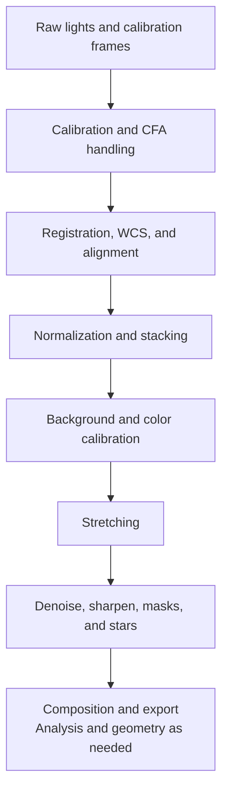

# Process Catalog

## Purpose, scope, audience, prerequisites, expected result, and authority

Use this catalog to choose the right built-in process or tool, find its current
menu route, and check when it normally belongs in a linear or nonlinear
workflow. It covers all 77 navigated process/tool destinations, including the
consolidated immediate actions reached mainly through the **Image** menu.

The catalog is authoritative for discoverability, current menu category,
workflow role, and high-level timing. The linked destination page is
authoritative for exact inputs, controls, algorithms, previews, masks,
sequences, outputs, metadata, persistence, failures, and performance.

## Reachability or applicability

- Open **Process** to use **Favorite Processes**, **Recent Processes**, or one
  of the 16 current category submenus.
- Right-click a standard image/sequence view and open **Process**. It is the
  main **Process** menu with the same entries and state; the mouse press made
  the clicked view active, so a launch targets it.
- Use the **Image** menu for channel extraction, precision conversion, fast
  geometry, sequence operations, masks, and several inspection/tool actions.
- Dashboard quick actions, recent/favorite lists, and extension-provided actions
  can reach registered descriptors, but they use the same availability and
  launch guards as the normal Process route.

An item can be visible but disabled because no active image exists, its color
rule fails, or its descriptor (an external or extension one included) is
unavailable. For a built-in single-image process, an unsupported source
channel/type or still/sequence state, the same process already attached, or an
exclusive conflict is refused when you launch, with a titled message; an
extension entry is disabled in the menu by those guards as well. A top-level process can open
without the single-image active-target guard and performs its own source
selection or validation.

## Complete reference matrix

The matrix groups destinations by workflow role, not merely by menu placement.
Every linked page appears at least once; several menu categories deliberately
contain tools from different workflow roles, and **Gaussian Blur** is exposed
from both **Details** and **Filters**.

| Item/exact label | Type/unit/category | Default/current value | Valid values/constraints | Meaning/effect | Dependencies/applicability | Trade-off/side effect | Scope | Persistence/metadata |
| --- | --- | --- | --- | --- | --- | --- | --- | --- |
| [Image Calibration](calibration/image-calibration.md) | Calibration | **Process > Preprocess > Image Calibration** | Raw/CFA/mono/RGB compatibility and master matching are page-specific | Calibrate sensor data with bias/dark/flat correction | Compatible source and prepared masters | Wrong masters or settings invalidate later work | Uncalibrated linear frames | Files, views, metadata, and state markers are page-defined |
| [Cosmetic Correction](calibration/cosmetic-correction.md) | Calibration | **Process > Filters > Cosmetic Correction Filter** | Defect-list and detection constraints are page-specific | Repair hot/cold pixels and defects | Compatible source or sequence | Aggressive correction can replace real signal | Usually pre-registration linear data | Output, history, sequence, and state behavior are page-defined |
| [Debayer](calibration/debayer.md) | Calibration | **Process > Color Spaces > Debayer** | Requires compatible CFA data and correct pattern/method | Reconstruct RGB from CFA samples | Known CFA layout | Wrong pattern or early conversion damages color | Calibrated CFA data before registration/integration | Output type, metadata, and state are page-defined |
| [Split CFA](calibration/split-cfa.md) | Calibration | **Process > Color Spaces > Split CFA** | Requires compatible CFA geometry | Extract the four positional CFA planes | Known CFA layout | Planes are positional, not universally named colors | Raw or calibrated CFA data | New views, naming, and metadata are page-defined |
| [Merge CFA](calibration/merge-cfa.md) | Calibration | **Process > Color Spaces > Merge CFA** | Requires four compatible positional planes | Interleave CFA planes into one mosaic | Matching geometry/type and intended phase | Wrong plane order corrupts the mosaic | Prepared CFA component planes | Output view, pattern metadata, and state are page-defined |
| [CFA Integer Resample](calibration/cfa-integer-resample.md) | Calibration | **Process > Geometry > CFA Integer Resample** | Integer factor and compatible CFA layout | Resample each CFA position without mixing phases | Known CFA phase and valid factor | Changes sampling, dimensions, and stored-value behavior | Linear CFA data | WCS/SIP, metadata, and output behavior are page-defined |
| [Image Registration](registration-alignment/image-registration.md) | Registration and alignment | **Process > Preprocess > Image Registration** | Star content, geometry, and still/sequence rules are page-specific | Match and warp frames to a reference | Compatible frames and reference | Resampling changes samples and edges | Normally calibrated linear data | Transform, output, WCS/SIP, and sequence behavior are page-defined |
| [Plate Solving](registration-alignment/plate-solving.md) | Registration and alignment | **Image > Information > Plate Solve** | Needs detectable stars and configured catalog/solver inputs | Derive sky-coordinate metadata | Solver/catalog readiness | A wrong solution misleads downstream WCS use | Suitable still image | WCS/SIP metadata and diagnostics are page-defined |
| [Star Profiler](registration-alignment/star-profiler.md) | Registration and alignment | **Process > Star Processing > Star Profiler v1**; **Process > Star Processing > Star Profiler v2** | Star detection/profile rules differ by version | Measure stars and save reusable profiles | Suitable stars and compatible target | Poor profiles mislead profile-driven work | Analysis at the documented state | Profile files, overlays, and outputs are page-defined |
| [Image Integration](stacking-integration/image-integration.md) | Stacking and integration | **Process > Preprocess > Image Integration** | Related frames and valid project settings | Run the full calibration-to-report workflow | Input storage, codecs, and optional solver/catalog data | High disk, memory, and runtime cost | Multi-frame linear workflow | Project, manifest, report, artifacts, and metrics are page-defined |
| [Image Integration Lite](stacking-integration/image-integration-lite.md) | Stacking and integration | **Process > Preprocess > Image Integration Lite** | Lite front-end scope and accepted frames are page-specific | Configure and launch the simplified integration path | Valid source frames and output location | Fewer controls than the full workflow | Multi-frame linear workflow | Project handoff and outputs are page-defined |
| [Image Stacking](stacking-integration/image-stacking.md) | Stacking and integration | **Process > Preprocess > Image Stacking** | Registered compatible inputs and rejection settings | Normalize, reject, and combine frames | Related registered frames | Memory/runtime and rejection choices affect signal | Calibrated registered linear frames | Master, maps, metrics, and metadata are page-defined |
| [Image List Analyzer](stacking-integration/image-list-analyzer.md) | Stacking and integration | **Process > Utilities > Image List Analyzer** | Input-list and metric constraints are page-specific | Inspect/rank a frame list | Readable compatible images | Analysis cost scales with frame count | Pre-integration assessment | Lists, metrics, and persistence are page-defined |
| [Color Calibration](color-calibration/color-calibration.md) | Color calibration | **Process > Color Calibration > Color Calibration** | RGB and sample/reference requirements are page-specific | Balance image channels | Suitable linear target and samples | Bad samples or clipping bias the result | Usually gradient-corrected linear master | Diagnostics, history, and state are page-defined |
| [Photometric Color Calibration](color-calibration/photometric-cc.md) | Color calibration | **Process > Color Calibration > Photometric Color Calibration** | Requires documented WCS/catalog readiness | Fit catalog photometry to image color | Valid solution, catalog, and detected stars | Bad matches or nonlinear data bias calibration | Linear master before stretch | WCS, diagnostics, and provenance are page-defined |
| [Spectrophotometric Color Calibration](color-calibration/spectrophotometric-cc.md) | Color calibration | **Process > Color Calibration > Spectrophotometric Color Calibration** | Requires documented spectra and response inputs | Fit measured colors to synthetic photometry | Catalog spectra and response profile | Wrong response/reference biases color | Linear master before stretch | Profiles, diagnostics, and provenance are page-defined |
| [Background Neutralization](color-calibration/background-neutralization.md) | Color calibration | **Process > Color Calibration > Background Neutralization** | Needs a representative neutral background sample | Remove channel offsets from background | Suitable sample/preview | Object-contaminated samples shift color | Linear master before primary stretch | Target, history, masks, and state are page-defined |
| [SCNR](color-calibration/scnr.md) | Color calibration | **Process > Color Calibration > SCNR Filter** | Channel/amount constraints are page-specific | Suppress a residual color cast | Compatible color image | Strong removal can damage valid color | Usually calibrated image near color workflow | Target, masks, history, and state are page-defined |
| [Linear Match](color-calibration/linear-match.md) | Color calibration | **Process > Color Calibration > Linear Match** | Requires a compatible registered reference | Match target scale/offset to reference | Matching geometry and intended reference | Bad reference or clipping biases the match | Linear registered images | Target/output, diagnostics, and state are page-defined |
| [Histogram Transformation](stretching/histogram-transformation.md) | Stretching | **Process > Intensity Transformations > Histogram Transformation** | Transfer/channel constraints are page-specific | Set shadows, midtones, and highlights | Histogram and compatible source | Clipping or poor black point loses data | Primary linear-to-nonlinear transition | History, masks, sequence, and state are page-defined |
| [Curves Transformation](stretching/curves-transformation.md) | Stretching | **Process > Intensity Transformations > Curves Transformation** | Component/spline constraints are page-specific | Apply shaped tone/color transfer curves | Compatible source and selected components | Can clip, shift color, or quantize output | Stretching or nonlinear finishing | History, masks, sequence, and state are page-defined |
| [Generalized Hyperbolic Transformation](stretching/gh-transformation.md) | Stretching | **Process > Intensity Transformations > Generalized Hyperbolic Transformation** | Transfer-family and protection-point constraints | Apply a configurable nonlinear stretch | Valid ordered parameters and source | Strong settings compress or clip tonal regions | Primary or corrective stretch | History, masks, and state are page-defined |
| [ArcSinh Stretch](stretching/arcsinh-stretch.md) | Stretching | **Process > Intensity Transformations > ArcSinh Stretch** | Black/strength and channel constraints are page-specific | Lift faint signal with an arcsinh mapping | Compatible mono/RGB input | Individual clipping can alter color ratios | Linear-to-nonlinear stretch | Target, history, sequence, and state are page-defined |
| [Statistical Stretch](stretching/statistical-stretch.md) | Stretching | **Process > Intensity Transformations > Statistical Stretch** | Finite image statistics and parameter limits | Derive a stretch from measured statistics | Compatible source statistics | Outliers or aggressive targets can clip | Usually primary stretch | Target, history, masks, and state are page-defined |
| [Gamma Correction](stretching/gamma-correction.md) | Stretching | **Process > Adjustments > Gamma Correction** | Positive gamma and compatible channels | Apply a normalized power-law tone map | Compatible source | Changes midtones and nonlinear state | Tone adjustment, normally nonlinear finishing | Target, history, sequence, and state are page-defined |
| [Exposure Correction](stretching/exposure-correction.md) | Stretching | **Process > Adjustments > Exposure** | Current multiplier/clamp model is not stop scaling | Multiply and clamp stored values | Compatible source | Highlights can clip; label differs from standard stops | Tone adjustment, not the primary stretch contract | Target, history, sequence, and state are page-defined |
| [DeepSNR](noise-reduction/deepsnr.md) | Noise reduction | **Process > Noise Reduction > DeepSNR** | External model/runtime and image constraints apply | Run learned astronomical denoising | Installed compatible DeepSNR package | External inference is costly and can remove signal | Usually linear or early nonlinear | Outputs, temporary files, history, and state are page-defined |
| [Wavelet Denoise](noise-reduction/wavelet-denoise.md) | Noise reduction | **Process > Noise Reduction > Wavelet Denoise Filter** | Scale/threshold/channel constraints are page-specific | Reduce noise in Haar-wavelet bands | Representative noise/scale choices | Strong thresholds remove detail or block structure | Usually linear or early nonlinear | Target, masks, history, and state are page-defined |
| [Total Variation Denoise](noise-reduction/total-variation-denoise.md) | Noise reduction | **Process > Noise Reduction > Total Variation Denoise Filter** | Solver/weight/channel constraints are page-specific | Reduce total variation while retaining structure | Compatible input and finite settings | Can produce piecewise-smooth stair stepping | Usually linear or early nonlinear | Target, masks, history, and state are page-defined |
| [NL-Bayes](noise-reduction/nl-bayes.md) | Noise reduction | **Process > Noise Reduction > Non-Local Bayes Filter** | Patch/noise/pass constraints are page-specific | Group and shrink similar local patches | Representative noise and enough neighborhoods | High runtime and oversmoothing at strong settings | Usually linear data | Target, diagnostics, history, and state are page-defined |
| [Patch PCA Denoise](noise-reduction/patch-pca-denoise.md) | Noise reduction | **Process > Noise Reduction > Patch PCA Denoise Filter** | Patch/window/strength constraints are page-specific | Suppress low-variance patch components | Adequate neighborhoods and noise estimate | Expensive settings can erase faint texture | Usually linear data | Target, history, and state are page-defined |
| [Bilateral Filter](noise-reduction/bilateral-filter.md) | Noise reduction | **Process > Filters > Bilateral Filter** | Spatial/range settings and channel support are page-specific | Smooth while limiting cross-edge mixing | Compatible source | Can flatten low-contrast structure | Linear or early nonlinear | Target, masks, sequence, history, and state are page-defined |
| [Gaussian Blur](noise-reduction/gaussian-blur.md) | Noise reduction | **Process > Details > Gaussian Blur**; **Process > Filters > Gaussian Blur** | Radius/channel/sequence constraints are page-specific | Apply Gaussian smoothing | Compatible source | Removes fine detail and correlates noise | Any state for deliberate smoothing | Target, masks, history, sequence, and state are page-defined |
| [Median Filter](noise-reduction/median-filter.md) | Noise reduction | **Process > Filters > Median Filter** | Kernel/channel constraints are page-specific | Replace samples by neighborhood median | Compatible source | Alters fine structure and edges | Repair or denoise at documented state | Target, masks, history, sequence, and state are page-defined |
| [GRAYCstoration](noise-reduction/graycstoration.md) | Noise reduction | **Process > Noise Reduction > GRAYCstoration Filter** | Diffusion parameters and the G'MIC adapter's constraints apply | Perform anisotropic structure-aware smoothing | G'MIC adapter (optional; Preview and Apply are disabled where the library is absent) | High cost or strong diffusion can soften detail | Usually linear or early nonlinear | Target, temporary data, history, and state are page-defined |
| [Banding Reduction](noise-reduction/banding-reduction.md) | Noise reduction | **Process > Filters > Banding Reduction Filter** | Row/column model and channel constraints are page-specific | Remove one offset per row or column | Axis-aligned banding | Cannot model diagonal or within-line variation | Sensor-artifact correction before strong stretch | Target, masks, history, sequence, and state are page-defined |
| [Unsharp Mask](sharpening/unsharp-mask.md) | Sharpening and detail | **Process > Details > Unsharp Mask** | Radius/amount/channel constraints are page-specific | Add a Gaussian detail residual | Controlled noise and representative scale | Can amplify noise, halos, and clipping | Usually after denoise, often nonlinear | Target, masks, history, and state are page-defined |
| [Sharpen Alpha](sharpening/sharpen-alpha.md) | Sharpening and detail | **Process > Details > Multiscale Alpha Sharpen** | Multiscale opacity settings and the G'MIC adapter's limits apply | Alpha-composite enhanced detail scales | Compatible source | Can amplify noise and halos at high strength | Usually after denoise | Target, temporary data, history, and state are page-defined |
| [High Pass Filter](sharpening/high-pass-filter.md) | Sharpening and detail | **Process > Details > High Pass** | Blur scale/channel constraints are page-specific | Create a neutral high-pass detail layer | Compatible source | Output is a layer, not finished sharpening | Layer preparation at suitable state | New view, metadata, history, and state are page-defined |
| [Local Contrast Enhancement](sharpening/local-contrast-enhancement.md) | Sharpening and detail | **Process > Details > Local Contrast Enhancement** | Scale/amount/channel constraints are page-specific | Increase contrast over a local scale | Representative structure scale | Can create halos and amplify noise | Often nonlinear finishing | Target, masks, history, and state are page-defined |
| [Local Histogram Equalization](sharpening/local-histogram-equalization.md) | Sharpening and detail | **Process > Intensity Transformations > Local Histogram Equalization** | Local window and contrast limits are page-specific | Redistribute local intensity histograms | Compatible source | Can exaggerate noise and local artifacts | Usually nonlinear detail work | Target, masks, history, and state are page-defined |
| [CLAHE](sharpening/clahe.md) | Sharpening and detail | **Process > Intensity Transformations > CLA Histogram Equalization** | Tile/clip/channel constraints are page-specific | Apply contrast-limited local equalization | Compatible source | Can change color, noise, or tile appearance | Usually nonlinear detail work | Target, masks, history, and state are page-defined |
| [Auto Gradient Removal](background-extraction/auto-gradient-removal.md) | Background extraction | **Process > Background Modelization > Auto Gradient Removal** | Needs representative background coverage | Fit and remove an automatic background model | Suitable sky/background | Object-heavy fields can bias the model | Registered cropped linear master | Corrected target/model and metadata are page-defined |
| [Background Extraction](background-extraction/background-extraction.md) | Background extraction | **Process > Background Modelization > Background Extraction** | Needs valid manual samples and model settings | Fit and subtract/divide a sampled background | Representative samples | Poor samples remove real structure or create division artifacts | Registered cropped linear master | Corrected target/model, samples, and metadata are page-defined |
| [Star Mask](star-operations/star-mask.md) | Star operations | **Process > Mask Generation > Star Mask** | Detection/scale/morphology constraints are page-specific | Generate a mask from detected stars | Suitable star field | Settings can miss stars or include non-star structures | Mask preparation at documented state | New mask view, history, and metadata are page-defined |
| [Starnet++](star-operations/starnet.md) | Star operations | **Process > Star Processing > Starnet++** | Requires compatible StarNet2 CLI/model | Produce starless and optional star products | Installed supported external tool | Mismatches or strong preprocessing can create halos/seams | Often branch from a stretched working copy | Starless/star outputs, temp files, and state are page-defined |
| [StarNet++ Star Mask](star-operations/starnet-star-mask.md) | Star operations | **Process > Mask Generation > Starnet++ Star Mask** | Requires compatible StarNet2 CLI/model | Produce the external tool's star-mask product | Installed supported external tool | Mask semantics differ from unscreen stars | Mask branch at documented state | Mask output, temp files, and state are page-defined |
| [Star Reduction](star-operations/star-reduction.md) | Star operations | **Process > Star Processing > Star Reduction** | Requires matching target/starless inputs | Reduce stars through a derived protection mask | Same geometry and compatible branches | Mismatches create halos or seams | Usually nonlinear star branch | Target, mask, history, and state are page-defined |
| [Starmask Recombination](star-operations/starmask-recombination.md) | Star operations | **Process > Star Processing > Starmask Recombination** | Requires compatible target/starless/mask inputs | Recombine star and starless branches | Matching geometry and prepared mask | Mismatched processing causes seams or clipping | Nonlinear composition branch | Output, masks, history, and state are page-defined |
| [Profiled Starmask Recombination](star-operations/profiled-starmask-recomb.md) | Star operations | **Process > Star Processing > Profiled Starmask Recombination** | Requires compatible images and saved profile list | Recombine through rasterized star profiles | Matching geometry and valid profiles | Bad profiles leave artifacts or wrong coverage | Nonlinear composition branch | Profile files, outputs, history, and state are page-defined |
| [Dark Structure Enhance](star-operations/dark-structure-enhance.md) | Star operations | **Process > Details > Dark Structure Enhance** | Scale/kernel/amount constraints are page-specific | Build a dark-structure mask and enhance selected detail | Suitable source structure | Strong settings exaggerate noise or dark artifacts | Often nonlinear detail work | Target/mask outputs, history, and state are page-defined |
| [Channel Composition](color-composition/channel-composition.md) | Color composition | **Process > Color Spaces > Channel Composition** | Requires compatible component planes and model choice | Assemble components into a color image | Matching geometry and intended encodings | No implicit registration, normalization, or calibration | Usually registered linear components | New output, naming, metadata, and state are page-defined |
| [LRGB Combination](color-composition/lrgb-combination.md) | Color composition | **Process > Color Spaces > LRGB Combination** | Requires compatible L and RGB inputs | Blend/replace lightness in an RGB image | Matching geometry and intended scale | Unmatched data creates color/detail artifacts | Usually registered linear masters | Output, masks, history, and state are page-defined |
| [NBRGB Combination](color-composition/nbrgb-combination.md) | Color composition | **Process > Color Spaces > NBRGB Combination** | Requires compatible broadband/narrowband inputs and widths | Inject line signal into RGB channels | Matching geometry and intended normalization | Simplified continuum model can bias color/signal | Usually registered linear masters | Output, diagnostics, and state are page-defined |
| [NB Color Mapper](color-composition/nb-color-mapper.md) | Color composition | **Process > Color Spaces > NB Color Mapper** | Layer/mapping/expression constraints are page-specific | Map narrowband layers into custom color | Compatible mono layers | Mapping is artistic/computational, not spectral calibration | Usually registered linear masters | New output, presets, metadata, and state are page-defined |
| [Narrowband Palette Composer](color-composition/narrowband-palette-composer.md) | Color composition | **Process > Color Spaces > Narrowband Palette Composer** | Input-role and preset/formula constraints are page-specific | Explore fixed narrowband palette formulas | Compatible direct/OSC inputs | Clipping and global normalization alter scale | Linear or exploratory palette work | Outputs, presets, and state are page-defined |
| [Colorize](color-composition/colorize.md) | Color composition | **Process > Color Spaces > Colorize** | Scalar source and color-model constraints are page-specific | Assign hue/saturation around a scalar intensity | Compatible mono/source component | Does not guarantee perceptual lightness preservation | Page-defined linear/nonlinear use | Output, masks, history, and state are page-defined |
| [Crop](geometry/crop.md) | Geometry | **Process > Geometry > Crop** | Bounds and still/sequence constraints are page-specific | Change framing and dimensions | Valid retained rectangle | Removes data and may invalidate WCS/SIP | Linear or nonlinear working copy | Geometry, WCS/SIP, sequence, and history are page-defined |
| [Resize](geometry/resize.md) | Geometry | **Process > Geometry > Resize** | Dimensions/interpolation/channel constraints are page-specific | Resample to new dimensions | Appropriate interpolation and enough memory | Changes sampling, noise correlation, and edges | Any state with page-specific scientific caution | WCS/SIP, metadata, history, and sequence are page-defined |
| [Rotate](geometry/rotate.md) | Geometry | **Process > Geometry > Rotate** | Angle/interpolation/canvas constraints are page-specific | Rotate into selected output geometry | Appropriate interpolation and canvas | Resampling changes samples and border content | Any state with page-specific scientific caution | WCS/SIP, metadata, history, and sequence are page-defined |
| [Integer Resample](geometry/integer-resample.md) | Geometry | **Process > Geometry > Integer Resample** | Integer factors and reducer constraints are page-specific | Reduce dimensions by source blocks | Compatible dimensions/factor | Reducers do not preserve integrated stored-value sums | Linear or nonlinear, preferably a duplicate | WCS/SIP, metadata, history, and sequence are page-defined |
| [Pixel Math](pixel-math/pixel-math.md) | Pixel Math | **Process > Pixel Math > Pixel Math** | Valid expression, symbols, references, dimensions, and output settings | Evaluate explicit per-sample formulas | Referenced open images and valid grammar | No preview; clipping/domain/stateful-global effects are expression-dependent | Any state; the expression determines physical linearity | Output view/type, metadata, `.anpm`, and sequence are page-defined |
| [Image Compare](analysis/image-compare.md) | Analysis | **Process > Utilities > Image Compare** | Requires compatible images for visual comparison | Present two images for inspection | Suitable open views | Provides no quantitative comparison metrics | Compare like processing states | Snapshot and viewer behavior are page-defined |
| [Image Blend](analysis/image-blend.md) | Analysis | **Process > Utilities > Image Blend** | Requires compatible inputs and selected blend equation | Combine base and blend samples | Same-size/aligned inputs; no implicit matching | Clipping and state changes depend on blend mode | Any compatible state; arithmetic may remain linear | Output, history, masks, and state are page-defined |
| [Range Selection](analysis/range-selection.md) | Analysis | **Process > Mask Generation > Range Selection** | Finite normalized range and smoothing settings | Derive a hard/fuzzy interval mask | Compatible source | Fuzziness/smoothing can broaden selection | Mask preparation at needed workflow stage | New mask output, history, and state are page-defined |
| [Mask Drawing](masking/mask-drawing.md) | Masking | **Process > Mask Generation > Mask Drawing** | Drawing canvas/tool constraints are page-specific | Draw and save/assign a mask | Compatible target/view | Manual shapes may omit or over-cover structures | Mask preparation at needed workflow stage | Generated view, assignment, file, and history are page-defined |
| [Binarize](masking/binarize.md) | Masking | **Process > Intensity Transformations > Binarize** | Inclusive threshold and channel behavior are page-specific | Convert samples to type minimum/maximum | Compatible source | Destructive threshold erases intermediate values | Usually a grayscale/binary working copy | Target, history, sequence, and state are page-defined |
| [Morphological Transformation](masking/morphological-transformation.md) | Masking | **Process > Morphology > Morphological Transformation** | Operation/kernel/iteration constraints are page-specific | Erode, dilate, open, or close structures | Suitable mask/working copy | Can erase small features or expand unwanted regions | Mask cleanup at needed stage | Target, history, sequence, and state are page-defined |
| [Multiscale Linear Transform](multiscale/multiscale-linear.md) | Multiscale | **Process > Multiscale > Multiscale Linear Transform** | Layer/kernel/threshold/deringing/channel constraints | Process separated detail scales and residual | Scale choices matching target/noise | Wide/many layers increase cost and artifacts | Commonly linear or early nonlinear | Reconstructed target, maps, history, and state are page-defined |
| [Adjust HSL](color-adjustment/adjust-hsl.md) | Color adjustment | **Process > Adjustments > Hue/Saturation/Lightness** | RGB/HSL range and component constraints are page-specific | Adjust hue, saturation, and HSL lightness | Compatible color image | Gamut clipping and hue behavior can alter color | Mostly nonlinear finishing | Target, masks, history, sequence, and state are page-defined |
| [Adjust LCh](color-adjustment/adjust-lch.md) | Color adjustment | **Process > Adjustments > Lightness/Chroma/Hue** | RGB/LCh range and gamut constraints are page-specific | Adjust CIE lightness, chroma, and hue | Compatible color image | Reconstruction clips out-of-gamut RGB | Mostly nonlinear finishing | Target, masks, history, sequence, and state are page-defined |
| [Adjust Brightness/Contrast](color-adjustment/adjust-brightness-contrast.md) | Color adjustment | **Process > Adjustments > Brightness/Contrast** | Current additive/contrast transfer ranges are page-specific | Change normalized brightness and contrast | Compatible source | Clamping can lose shadows/highlights | Nonlinear finishing | Target, masks, history, sequence, and state are page-defined |
| [Color Saturation](color-adjustment/color-saturation.md) | Color adjustment | **Process > Intensity Transformations > Color Saturation** | Hue-band/lightness/amount constraints are page-specific | Change HSL saturation in selected hue bands | Compatible RGB image | Hard bands and clipping can create color transitions | Nonlinear color finishing | Target, masks, history, and state are page-defined |
| [Tighten Edges](color-adjustment/tighten-edges.md) | Color adjustment | **Process > Morphology > Tighten Edges** | Amount and current fixed-edge model constraints apply | Darken Value around a modified Sobel map | Compatible source | Can create border/noise artifacts; not mathematical morphology | Linear or nonlinear; recorded state is preserved | Target, history, and state are page-defined |
| [Noise Generator](utility/noise-generator.md) | Utility | **Process > Utilities > Noise Generator** | Distribution/amount/channel constraints are page-specific | Add synthetic noise for testing from a seed each window draws afresh | Compatible source | Not reproducible (the seed cannot be set) and destructive to signal | Controlled test working copy | Target/output, history, sequence, and state are page-defined |
| [Extract Sequence](utility/extract-sequence.md) | Utility | **Image > Sequence > Extract Sequence** | Active sequence and inclusive contiguous range required | Write selected frames to a new sequence | Output path, codec, and readable frames | Writes data and can consume substantial storage | Sequence utility at any compatible state | User files, naming, overwrite, and cancellation are page-defined |
| [Non-Interactive Processes](utility/non-interactive-processes.md) | Utility | **Image > Actions**; **Image > Extract Channel**; **Image > Convert Format**; **Image > Fast Geometry**; **Image > Mask**; **Image > Sequence**; **Process > Adjustments** | Action-specific active-view/type/channel/still/sequence gates | Resolve 67 immediate actions and one declared unreachable action | Compatible active view and action-specific prerequisites | Some actions are destructive or lose precision/metadata | Any compatible state; each action row states its data effect | New/replaced views, history, masks, files, and metadata are action-defined |

### Consolidated immediate actions

The [Non-Interactive Processes](utility/non-interactive-processes.md) page is the
single action matrix for 67 reachable actions plus the declared but currently
unreachable **Automatic MTF Transform**. Use these families to find the exact
row rather than assuming every tool opens a process window.

| Family | Current route | What the consolidated page resolves |
| --- | --- | --- |
| Duplicate | **Image > Actions > Duplicate** | Still deep copy versus sequence backing-file reopen, identity, metadata, and history |
| Channel extraction | **Image > Extract Channel** | RGB, CIE Lab/LCh/XYZ, HSL, HSV, HSI, and YCbCr component outputs |
| Precision conversion | **Image > Convert Format** | Seven sample-type targets, enablement, quantization, and storage |
| Fast geometry | **Image > Fast Geometry** | Horizontal/vertical mirror and 90°/180° rotations, including WCS/SIP removal |
| Sequence actions | **Image > Sequence** | Extract Frame, Extract Sequence, Export, SER/Image List conversion, and the disabled FITS conversion |
| Direct adjustments | **Process > Adjustments** | Negative Transformation, Convert to RGB, and Convert to Grayscale |
| Mask actions and rendering | **Image > Mask** | Selection/removal plus enable/show/invert and eight rendering modes; [Masks](../interface/masks.md) is the detailed authority |

### Linearity and timing

| Stage | Recommended recorded/data state | Typical destinations | Checkpoint before moving on |
| --- | --- | --- | --- |
| Prepare sensor data | Raw/CFA or uncalibrated linear frames | Calibration and CFA destinations | Correct masters/pattern; calibrated output remains geometrically valid |
| Register and integrate | Calibrated linear frames | Registration, Integration, Stacking | Common geometry/reference; inspect rejection/normalization and master outputs |
| Correct the linear master | Integrated linear master | Background extraction, linear color calibration/matching, early denoise | Background and color are stable without irreversible stretch clipping |
| Stretch | Linear input becoming nonlinear | Histogram, GHT, ArcSinh, Statistical, Curves | Inspect black point, highlights, color, and history on a duplicate |
| Finish and compose | Tool-specific linear or nonlinear working copy | Denoise, detail, stars, masks, composition, analysis, geometry, color adjustment | Follow the destination page; do not infer safe timing from the menu category alone |

## How to use this reference

1. Start from the job or artifact you have, then choose its workflow-role row.
2. Check the **Type/unit/category** cell for the current route. If the action is
   an Image-menu operation, open the consolidated immediate-action matrix.
3. Check the row's normal timing, then open the destination page and confirm its
   exact recommended image state, inputs, masks, sequence support, external
   prerequisites, and destructive/output behavior.
4. Activate or select the intended source immediately before launch. A Process
   category or favorite is a route, not proof that the current target is valid.
5. For strong or irreversible work, use a duplicate/working copy and inspect the
   destination's Preview, history, output, and save guidance.

## Implementation behavior and model

AfterNight registers built-ins as **SingleImage**, **TopLevel**, or
**NonInteractive** descriptors. Single-image launches use the active view and
enforce availability, channel, still/sequence, duplicate-attached, and exclusive
process guards. Top-level launches open an application-level process window and
perform their own source selection/validation. Non-interactive descriptors or
direct menu connections act from the active view and may still open an export or
extraction dialog or run a background sequence job.

Three classifications serve different purposes. A built-in descriptor's
registry category is an internal registration/lookup grouping and does not
define exact menu placement; an extension process's manifest category does
choose its Process submenu. The generated UI builder defines the user-visible Process-menu
category and label. This catalog's workflow role is documentation guidance about
task and timing; it is not registry data and can cross menu categories.

The 77 documentation destinations are not a one-to-one count of QAction or
registry descriptors. The current parity audit maps 122 registered built-in
actions, three direct-wired Process actions, and 32 direct-wired Image actions.
Many immediate actions intentionally share one destination; Star Profiler v1/v2
share one page; and a few pages cover application tools outside the Process
menu. Recent/favorite lists store stable registered IDs and use the same launch
guards; a successful launch, not merely opening a menu, advances the recent list.

Recorded linear/nonlinear state is useful provenance, not a universal launch
gate. Some processes validate it, some only recommend it, and some preserve a
possibly stale state marker. The destination page states the actual behavior.

## Inputs, outputs, persistence, and metadata

The catalog itself reads no image and changes no application state. Launching a
destination can modify the active image, create new views/sequences/files, open
a top-level project, or change runtime mask/history state. The destination page
defines naming, precision, metadata/WCS/SIP, history, temporary files, overwrite,
and recovery.

Process favorites and recents persist as application settings; process
parameters persist only where the individual process says so. Viewer display
state, catalog navigation, and merely opening a menu do not change stored image
samples or metadata.

## Performance and resource implications

Catalog lookup and menu construction are small application operations. Actual
cost ranges from one image pass to multi-frame registration/integration,
external inference, catalog access, or large temporary outputs. Use Preview or a
representative crop only where the process page says it is equivalent enough for
tuning. For project workflows, check disk space and cancellation/partial-output
behavior before execution; for sequence work, expect cost to scale with frame
count as well as dimensions and algorithm complexity.

## Worked lookup example

- Evidence mode: Source-and-test-derived.
- Question: “I have a calibrated, registered linear master with a gradient; what
  should I open, and where is it?”
- Lookup: The **Background extraction** row points to **Process > Background
  Modelization > Auto Gradient Removal** for automatic all-pixel modeling and
  **Background Extraction** for a manually controlled sample model. Both pages
  place correction before color calibration and the primary stretch. If the
  intended task were only channel extraction or precision conversion, the
  **Consolidated immediate actions** table would instead route to the Image menu
  and the 68-row action matrix.
- Limitation: This verifies source/menu/page mapping and workflow timing only;
  no gradient image, output quality, runtime, GUI layout, or platform behavior
  was executed.

## Warnings and limitations

- Menu category describes reachability, not safe workflow order. For example,
  the **Intensity Transformations** menu mixes the main stretch family with mask,
  saturation, and local-histogram tools.
- Do not treat a recorded “linear” marker as proof that every prior operation
  preserved scene-linear data; some processes do not update that provenance.
- Immediate actions can be destructive, precision-reducing, metadata-changing,
  or sequence-wide even though they open no parameter window.
- A Preview can be display-only, ROI-based, cached, approximate, or unsupported.
  The individual page defines what Apply actually commits.
- External tools/catalogs and extension processes have readiness and trust
  boundaries not implied by a visible menu entry.
- The catalog does not replace File Formats, Process Windows, Masks, or the
  detailed destination page.

## Troubleshooting

| Symptom/question | Verified interpretation or cause | Resolution/next page | Evidence source |
| --- | --- | --- | --- |
| A process entry is disabled or refused at launch | No active image, a color rule, or descriptor availability disabled it; a channel/type, still/sequence, or duplicate/exclusive guard refused the launch with a titled message (an extension entry is disabled by those guards) | Activate a compatible view and read the destination's **At a glance** and troubleshooting sections | `ActionStateCoordinator.cpp`; `ProcessRegistry.cpp`; `ProcessLauncherTest.cpp` |
| A documented tool is not under Process | Several complete tool families are Image-menu actions | Use **Consolidated immediate actions** and [Toolbar & Menus](../interface/toolbar-and-menus.md) | generated menu wiring and parity audit |
| The same tool appears in two menu categories | Gaussian Blur is intentionally placed in both Details and Filters | Use its one [Gaussian Blur](noise-reduction/gaussian-blur.md) authority page | `AfterNightAppUiBuilder.h` |
| Recent Processes did not change | The list advances only after a successful registered launch | Resolve the launch error, then launch again; see [Toolbar & Menus](../interface/toolbar-and-menus.md) | `ProcessMenuState.h`; menu tests |
| Output linearity or metadata is unclear | Category-level timing cannot describe every process exception | Open the destination's inputs/outputs/metadata and warnings sections before committing | completed process pages |

## Related pages

- [Process Windows](../interface/process-windows.md) — shared targets, channels,
  previews, masks, Apply/Reset/Close, cancellation, history, and persistence.
- [Toolbar & Menus](../interface/toolbar-and-menus.md) — exhaustive menu/action,
  recent/favorite, context-menu, state, and shortcut behavior.
- [Masks](../interface/masks.md) — assignment, enable/show/invert, rendering, and
  process interaction.
- [File Formats](../reference/file-formats.md) — authoritative precision,
  compression, metadata, sequence, and save/export behavior.
- [Broadband Imaging](../workflows/broadband-imaging.md), [Narrowband Imaging](../workflows/narrowband-imaging.md),
  [Planetary Imaging](../workflows/planetary-imaging.md), and
  [Mosaic Workflow](../workflows/mosaic-workflow.md) — end-to-end decision paths.
- [Glossary](../reference/glossary.md) — linearity, launch, color, integration,
  mask, multiscale, file, and extension terminology.

## References and provenance

- `src/AfterNightProcesses/app/ProcessRegistryBuiltins.cpp` — registered built-in
  descriptors, internal registry categories/IDs, launch modes, and guards.
- `src/AfterNightControls/app/AfterNightAppUiBuilder.h` — exact Process/Image
  category/action placement and labels.
- `src/AfterNightControls/app/MenuActionManager.cpp` and
  `src/AfterNightControls/app/ActionStateCoordinator.cpp` — registry binding,
  direct actions, and enablement.
- `src/AfterNightApp/app/AfterNightApp.cpp` — successful-launch recording and
  recent/favorite settings persistence.
- `src/AfterNightControls/app/ProcessRegistry.h`,
  `src/AfterNightControls/app/ProcessRegistry.cpp`, and
  `src/AfterNightControls/app/ProcessMenuState.h` — availability/launch guards
  and recent/favorite rules.
- `src/AfterNightTests/Test_ProcessFramework/test_process_registry_rules.cpp`,
  `src/AfterNightTests/Test_ProcessesShared/ProcessLauncherTest.cpp`,
  `src/AfterNightTests/Test_ProcessesShared/ProcessRegistryTest.cpp`,
  `src/AfterNightTests/Test_ProcessFramework/test_process_menu_wiring.cpp`,
  `src/AfterNightTests/Test_AfterNightApp/ApplicationMenuTest.cpp`, and
  `src/AfterNightTests/Test_AfterNightApp/test_process_menu_state.cpp` —
  focused descriptor/category/launch/menu-state coverage; `ProcessRegistryTest`
  opens every registered action's real window.
- Each of the 77 linked destination pages remains authoritative for its
  detailed process/tool behavior.
