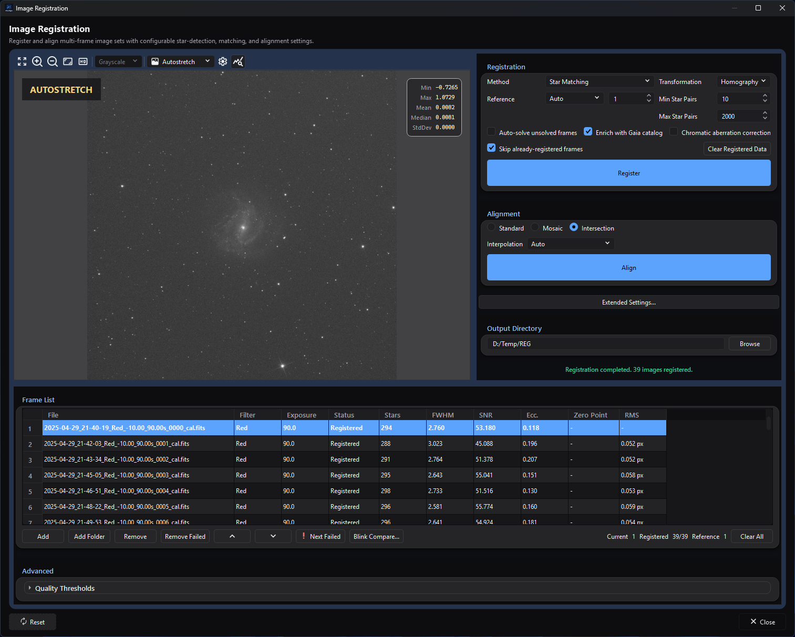

# Image Registration

## Purpose and expected result

*The populated frame list shows the reference and completed registration metrics
alongside the registration, alignment, and output controls.*

Image Registration is the focused batch tool for measuring transforms between
compatible still frames and, in a separate step, resampling included successful
frames onto one output geometry. Use it after calibration when you want to
inspect per-frame registration metrics, choose a reference and transform family,
exclude weak frames, or align files without running the complete
[Image Integration](../stacking-integration/image-integration.md) workflow.

**Register** detects or correlates features, computes transforms, and writes
`registration_metrics.db`; it normally does not write aligned science images.
**Align** consumes current matching registration state and writes new
`<source-stem>_reg.fits` files. Original inputs are not modified. Comet/Asteroid
Tracking is the exception: **Register** also materializes comet-aligned products
after a valid track is fitted.

## At a glance

| Item | Current behavior |
| --- | --- |
| Menu path | **Process > Preprocess > Image Registration** |
| Enabled when | The top-level window is always available; no active image is required. The Registration card is usable with at least two listed frames, and **Register** reports an error until an **Output Directory** is selected. Alignment needs the output directory, current recorded registration state and at least two included successful frames. |
| Inputs | Supported still-image files with identical width, height, pixel type, and channel count. Calibrated linear mono, CFA, or RGB lights are the intended input. A fixed reference, an embedded WCS solution or one found with **Solve...**, a configured solver, and a local Gaia catalog can contribute to particular paths. |
| Outputs | `registration_metrics.db` containing group state, star cache, metrics, and transforms, shared with Image Integration; and one 32-bit floating FITS `<source-stem>_reg.fits` per included aligned frame. No chromatic-aberration cache files are written. Comet mode writes role-qualified products under `comet_aligned/<run-id>/`. Sources remain unchanged. |
| Recommended image state | Calibrated linear stills before normalization and stacking. Do not register stretched display exports when calibrated linear sources exist. |
| Preview support | Static preview of the selected source only. Registration and alignment settings do not render a calculated preview. **Blink Compare...** provides a separate source-comparison view. |
| Sequence support | No direct SER, video, or image-list sequence input. Extract/export sequence frames to still files first. |
| Mask support | Not supported. No active application mask is read, transformed, or blended. |
| External dependencies | Star matching and phase correlation are native engine paths. **Auto-solve unsolved frames** needs a configured ASTAP, local/online Astrometry.net, or internal Gaia solver route. **Enrich with Gaia catalog** needs a ready local Gaia catalog and valid WCS. No external service is contacted unless the selected plate-solver configuration does so. |

## Before you start

- Calibrate the frames first and keep them linear. This window does not select
  or apply bias, dark, flat, cosmetic-correction, or normalization settings.
- Use one compatible batch. Registration and alignment stop when width/height,
  pixel type, or channel count differs; gain/ISO, offset, exposure, filter,
  camera, CFA pattern, and session are displayed or hashed but are not batch
  compatibility gates here.
- Overlap is counted in stars, not as a share of the frame. A frame - a mosaic
  panel, or one that drifted - that shares at least **Min Star Pairs** stars
  with the reference, or with a frame registered near it, is registered by
  them, however small a part of its stars they are.
- Choose a dedicated output directory; it is created if it does not exist. It
  owns `registration_metrics.db`, registration cache state, and aligned outputs.
  Existing destinations are overwritten without a prompt, and sources from
  different folders with the same stem collide.
- For CFA data, confirm **CFA Pattern** and the demosaicing **Method** in
  **Extended Settings... > Advanced Settings...**. Star detection and alignment
  debayer CFA inputs on load; saved registered outputs are RGB rather than CFA.
- Configure [Plate Solving settings](../../interface/settings-dialog.md#plate-solving-settings) before
  enabling auto-solve, and install a local Gaia pack before enabling catalog
  enrichment. A frame's solution - from its own cards, **Solve...**, or the
  automatic solve - is used for Gaia enrichment and never replaces a transform.
  A SIP distortion the frame's own cards state is used: star matching corrects
  the frame's stars by it, and **Align** undoes it while resampling.
- Expect no WCS on standalone aligned outputs. **Align** keeps each source's
  acquisition record, its observing context - optics, site, pointing, camera
  settings, filter, object, frame type and date - and the light it holds, its
  `EXPTIME`, `TOTEXP`, `LIVETIME`, `STACKCNT` and `NCOMBINE` cards as it states
  them, which a later stack groups and weighs the frames by. It drops the
  plate solution (WCS) cards, because the warp invalidates them, and the
  source's other header cards; plate solve an aligned or final product when
  you need sky coordinates.

## Procedure

1. Open **Process > Preprocess > Image Registration**. The empty top-level
   window is available without an active document.
2. Select **Add** or **Add Folder**, then inspect the **File**, **Filter**,
   **Exposure**, and preview for every intended still. The folder dialog's
   **Frame Type** and **Filter Name** narrow the files it adds; remove any other
   unintended rows manually. File headers are read in the
   background, and the window then reports how many files were added, skipped
   (already listed or filtered out) and could not be read.
3. Select **Browse** to choose a dedicated **Output
   Directory**. If that directory contains a matching recorded registration in
   `registration_metrics.db`, the process restores metrics/transforms; otherwise
   the table remains **Not registered**.
4. Leave **Method** at **Star Matching**, **Transformation** at **Homography**,
   **Reference** at **Manual**, **Min Star Pairs** at `10`, and **Max Stars
   per Frame** at `2000` for a first source-derived trial. Pick a sharp,
   representative reference row.
5. Open **Extended Settings...** only if detection, CFA/demosaic, chromatic
   aberration, phase-correlation, or comet settings need adjustment. Select
   **OK** to copy accepted dialog values back to the main window.
6. Select **Register**. Confirm that successful rows show **Registered** plus
   Stars, FWHM, SNR, Ecc., Zero Point where Gaia enrichment succeeded, and RMS.
   A frame matched by fewer star pairs than **Min Star Pairs** is retried through the frames
   already registered nearest it, and is marked failed only when none of them matches it either;
   a match of fewer than ten candidate pairs is also refused when under four fifths of them agree.
   Failed rows remain inspectable and can be reached with **Next Failed**.
7. Select at least two questionable rows (Ctrl-click or Shift-click) and use
   **Blink Compare...**. Press `X` on a weak current frame, which excludes it in
   the window when the comparator closes, or use **Exclude selected frames** in the table context
   menu. Alternatively set quality limits and select **Apply
   Thresholds**. Exclusions affect subsequent reuse/reference/alignment but do
   not delete files.
8. Choose **Standard**, **Mosaic**, or **Intersection**, then select an
   **Interpolation** method. **Auto** resolves to **Lanczos4** in this window.
   Changing the interpolation, or between **Standard** and **Intersection**,
   after **Register** keeps the recorded registration; switching to or from
   **Mosaic** makes it stale, so **Align** stays disabled until you register
   again. Decide on **Mosaic** before registering.
9. Select **Align**. Confirm `<source-stem>_reg.fits` exists for every included,
   successfully registered frame. Reopen representative outputs at 100% and
   verify common geometry, borders, star shape, 32-bit floating precision, and
   linear state, and plate solve where sky coordinates are needed, before [Image Stacking](../stacking-integration/image-stacking.md).

## Complete parameter and action reference

### Preview, import, frame list, and inspection

| UI label/action | Type and unit | Runtime default | Persisted-default exception | Valid values, step, or constraints | Effect of increasing, decreasing, or selecting | Dependencies and enable/visibility rules | Quality, artifact, runtime, memory, or disk trade-off | Scope: preview/apply, channel, mask, still/sequence | Persistence |
| --- | --- | --- | --- | --- | --- | --- | --- | --- | --- |
| Fit To Window | Preview toolbar action | First loaded image is fit automatically | None | One action | Rescales the selected source to the preview area | Requires a readable selected source | Display-only resampling; no registration effect | Selected source preview | View-local |
| Zoom In | Preview toolbar action | Fit-to-window scale after first load | None | Repeated action up to the shared viewer maximum | Increases display magnification | Requires a readable source | Helps inspect stars but shows less field | Selected source preview | View-local |
| Zoom Out | Preview toolbar action | Fit-to-window scale after first load | None | Repeated action down to the shared viewer minimum | Decreases display magnification | Requires a readable source | Hides pixel-scale defects at low scale | Selected source preview | View-local |
| Zoom 100% | Preview toolbar action | Fit-to-window scale after first load | None | One action | Displays one image pixel per screen pixel | Requires a readable source | Preferred for judging interpolation artifacts | Selected source preview | View-local |
| View Channel | Preview selector | Grayscale for mono; RGB for RGB/debayered CFA | None | Shared mono/RGB/component channel list | Changes display composition only | Populated after load | Different components expose different star/color artifacts | Selected source preview | View-local |
| Display Mode | Preview selector | Linear | None | Linear, Autostretch | Applies a display-only stretch when Autostretch is selected | Populated after load | Autostretch can reveal faint stars but does not change registration input | Selected source preview | View-local |
| Autostretch Settings | Preview dialog action | Disabled in Linear mode | Shared viewer state loads when opened | Opens shared settings | Tunes display stretch | Autostretch mode only | Aggressive display settings can exaggerate noise | Selected source preview | Viewer-scoped |
| Show statistics | Checkable preview action | On | None | On/off | Shows or hides selected-source statistics | Values need a loaded source | Diagnostic only | Selected source preview | View-local |
| Image Preview canvas | Mouse interaction | Quick zoom enabled | Global zoom modifier/sensitivity may differ | Left-drag quick zoom; middle-drag pan; configured wheel zoom | Navigates the selected source | Requires a readable source | No transform or output effect | Selected source preview | View position is not process JSON |
| Add | File-picker action | Empty list | Last picker directory may be remembered | Any supported still-image codec; duplicate full paths are skipped | Reads file headers in the background; the window stays responsive | Always available while the window is open | Large lists cost metadata I/O; unreadable files do not stop the others, and the window reports how many files were added, skipped (already listed or filtered out) and could not be read | Still-file list only | The list is saved with the window's settings; picker path may be remembered |
| Add Folder | Folder picker and options action | No folder | Last directory is remembered | Existing directory followed by options below | Scans supported image extensions | Always available | Recursive scans can be I/O-heavy | Still-file list only | Folder path remembered; options per invocation |
| Include subfolders (recursive) | Checkbox | On | None | On/off | Includes descendant directories in the scan | Add Folder dialog only | Broader scans can import mixed sessions/roles | Folder import | Per invocation |
| Frame Type | Selector | All | None | All, Light, Dark, Flat, Bias, Dark Flat | Keeps only files whose frame-type metadata matches; Bias also accepts OFFSET, Dark excludes Flat, Flat excludes Dark, and Dark Flat needs both | Add Folder dialog only | A file whose metadata states no type is read as Light | Folder import | Per invocation |
| Filter Name | Text | Empty | None | Case-insensitive exact match after trimming | Empty accepts all filters; text keeps only files whose filter metadata equals it | Add Folder dialog only | Missing or misspelled filter metadata excludes a file | Folder import | Per invocation |
| Frame List table | Sortable multi-row selection table (Ctrl-click/Shift-click) | Empty | None | File, Filter, Exposure, Status, Stars, FWHM, SNR, Ecc., Zero Point, RMS | Selecting loads the source preview; clicking a supported header reorders the list and reference index | Populated after import | Reordering changes the 1-based reference row and execution order; source files are unchanged | Whole still batch | The list is saved with the window's settings and imported again, in the order it was saved, when it reopens; status comes from the registration database |
| Remove / Remove | Button/context action | Disabled | None | Selected rows | Removes every selected row from this window only | Needs a selection | No source-file loss; changes registration identity | List and later execution | Not serialized |
| Remove Failed | Button | Disabled | None | All rows whose registration failed | Removes failed rows from the table, not disk | Enabled after failures exist | Convenient cleanup but hides diagnostics and changes the persisted group hash | List only | Not serialized |
| Move Up / Move Down | Buttons/context actions | Disabled | None | Current row within bounds | Reorders the list and keeps reference tracking synchronized | Enabled when movement is possible | Affects current row/reference numbering, not pixel math | List/execution order | Not serialized |
| Next Failed | Button | Disabled | None | Cycles failed rows | Selects the next failed source for preview | Enabled after a failed registration | Diagnostic only | Frame list/preview | Not persisted |
| Blink Compare... | Button/context action | Disabled | Dialog size may restore | At least two selected rows | Opens a blinking comparison over the selected frames; `Space` plays/pauses, arrows navigate, `X` excludes current, `1`–`9` assigns a dialog-only rating | Needs at least two selected files | Loading/display can cost I/O/memory; frames excluded in the comparator are excluded in the window when it closes | Selected still sources | Exclusions remain process-session only; ratings are not returned |
| Current / Registered / Reference | Read-only counters | `0`, `0/0`, `0` | Restored matching DB state can repopulate registered/reference values | Derived 1-based values and summary | Reports selected row, success/failure/exclusion counts, and reference row | Always visible | No processing effect | List state | Derived, not serialized |
| Clear All | Button | Disabled | None | All rows | Clears the list, the preview, and the counters, stops files still being read - none of them is added afterwards - and forgets the frames' exclusions and registration results; a registration recorded in the output directory is read back when frames are listed again | Enabled with rows | Does not delete sources, aligned outputs, or the on-disk metrics DB | Current window | Not serialized |
| Set as reference | Context action | Current reference disabled | None | One row | Changes the manual reference spin box | Row context menu | Makes current transforms stale until Register runs again | Registration reference | Session only |
| Exclude selected frames / Include selected frames | Context actions | Included | None | Selected rows; Include is enabled when any selection is manually/threshold excluded | Exclusion removes rows from reuse scoring and alignment; Include clears both manual and threshold exclusion for selected rows | Context menu | Too few included successes disables alignment | Session/list only | Not serialized or stored in DB |
| Solve... | Context action | Available | Plate-solver settings are global | One selected source | Opens Plate Solve over the frame in the static preview; when that window closes, the solution it applied is kept for this frame's registration in this window | Needs a readable row | May invoke the configured local/online solver; the source file is not rewritten; the solution is used for Gaia enrichment, not for the transform | Selected still | Held by the window for this session only |
| Delete From Disk | Context action | No | None | Selected row plus confirmation | Removes the row, then requests permanent file deletion | Context menu only | Destructive; a failed deletion is reported | Source file and list | Not serialized |

### Registration, alignment, quality, output, and window actions

| UI label/action | Type and unit | Runtime default | Persisted-default exception | Valid values, step, or constraints | Effect of increasing, decreasing, or selecting | Dependencies and enable/visibility rules | Quality, artifact, runtime, memory, or disk trade-off | Scope: preview/apply, channel, mask, still/sequence | Persistence |
| --- | --- | --- | --- | --- | --- | --- | --- | --- | --- |
| Method | Selector | Star Matching | Restored process JSON can select a prior method | Star Matching, Phase Correlation, Comet / Asteroid Tracking | Chooses triangle/star fitting, translation-only phase correlation, or moving-object track fitting | Phase Correlation and comet require a fixed reference; transformation is disabled for Phase Correlation | Star matching handles rotation/scale; phase correlation is useful for translation-dominant structured images; comet mode has strict timestamp/observation needs | Whole still batch | Saved with the window's settings; Reset -> Star Matching |
| Transformation | Selector | Homography | Restored | Similarity, Affine, Homography, Polynomial 2, Polynomial 3, Polynomial 4, Auto | Adds degrees of geometric freedom; polynomial choices add residual distortion terms, and a fixed order needs as many star pairs as it has terms - 6, 10 and 15 for orders 2, 3 and 4 - so a frame matched by fewer keeps the linear transform its stars matched | Star Matching uses it; Phase Correlation disables it; main UI leaves it enabled for comet but comet execution ignores it | Extra freedom needs more well-distributed inliers and can overfit weak matches | Registration transforms | Saved; Reset -> Homography |
| Reference | Selector | Manual | Restored process JSON can select Auto | Manual, Auto | Manual uses the 1-based row; Auto picks the reference from the star-detection figures before matching, in a single pass | Auto is disabled for Phase Correlation/comet | A weak reference degrades all relative transforms | Registration batch | `referenceMode`; resolved frame is persisted in DB |
| Reference frame number | Integer row | `1` after rows load | Matching DB state restores its resolved frame | `1` to current row count, step 1 | Selects fixed reference | Disabled in Auto mode; required by Phase Correlation/comet | Reference framing and quality affect every transform/canvas | Registration batch | Session; resolved path stored in DB |
| Min Star Pairs | Integer | `10` | Restored | `5`–`10000`, step 1 | The fewest matched star pairs a frame needs, against the reference or a frame registered near it, however small a part of its stars they are; a frame matched by fewer is marked failed. A match of fewer than ten candidate pairs also needs four fifths of them to agree, unless either frame holds 1000 stars or more | Star Matching uses it; it stays enabled for Phase Correlation, which ignores it | Too high rejects sparse/narrowband frames; too low accepts weaker matches | Star-matching acceptance | Saved; Reset -> 10 |
| Max Stars per Frame | Integer | `2000` | Restored | `10`–`20000`, step 1 | Caps the stars detected in each frame, which are the candidates for matching; a changed cap detects the frames again | Detection runs in standalone Star Matching and, currently, before Phase Correlation | Higher values increase detection/matching time and triangle workload; lower values can lose spatial coverage | Star detection/matching | Saved; Reset -> 2000 |
| Auto-solve unsolved frames | Checkbox | Off | Restored, then forced Off when no solver route is configured | On/off | Runs the configured solver, one frame at a time, for included frames whose cards hold no solution and that were not solved with **Solve...**, before detection | Enabled only when ASTAP, Astrometry.net/API, or internal Gaia solver configuration is available | Adds external/runtime/network cost; individual solve failure logs a warning and registration continues | Included still frames | Saved; Reset -> Off; solver settings global |
| Enrich with Gaia catalog | Checkbox | On when a ready catalog is configured; otherwise forced Off/disabled | Process JSON restores the preference, then readiness can force it Off | On/off | Matches successful detected stars through each frame's solution to populate G zero point, scatter, limiting magnitude, and catalog-match count, and states the RMS residual in arcseconds | Needs a ready local Gaia catalog and a solution per frame; only frames whose stars were detected in this run are enriched | Adds catalog I/O/query work; no solution means no enrichment for that frame | Successful registered frames | Saved; Reset -> On when the catalog is ready; catalog path/pack global |
| Chromatic aberration correction | Checkbox | Off | Restored process JSON can enable it | On/off | Enables RGB red/blue-to-green preprocessing using detailed Extended Settings | Mono is skipped; failures warn and registration continues on the original path | Adds detect/fit/warp work, applied in memory to the frame being registered; no cache files are written. Detection reads only the green channel, which the correction does not move, and **Align** reads the original files, so the correction currently changes neither the transforms nor the aligned images | Registration detection inputs only | Saved with its Extended Settings values; Reset -> Off |
| Skip already-registered frames | Checkbox | On | Restored | On/off | Reuses a matching recorded registration in `registration_metrics.db`, whole or just the frames' stars, while the frames and settings match | Needs same output root and compatible hashes/mtimes; exclusions can permit reuse around ignored failures | Saves detection/fit time; stale/mismatched state is rejected | Registration state/cache | Saved; Reset -> On; DB persists |
| Clear Registered Data | Button | Disabled | None | Current derived group | Deletes this group's persisted metrics/star-cache/transform rows and clears in-memory registration | Enabled with registration data | Does not delete aligned FITS or comet role files | Current group in `registration_metrics.db` | Destructive to reusable group state |
| Register | Primary action | Enabled with at least two rows; without an output directory it reports an error | None | One background job | Validates compatibility, optionally solves/corrects/detects/enriches, fits transforms, persists metrics, and updates rows, in the background | One execution at a time; method-specific prerequisites apply | CPU/I/O heavy; cancellation stops remaining work. Comet mode also writes outputs | Whole still batch; all channels/CFA debayer path | Writes/replaces current group state in DB |
| Cancel (progress dialog) | Background-job action | Available while Register or Align is running | None | One action | Requests cooperative cancellation and closes the progress dialog after the worker reaches a cancellation point | Visible only during execution | A cancelled registration records nothing: the window shows no registration and the DB is not replaced; Align keeps files written before cancellation, and the frame in progress leaves no partial file | Current Register or Align job | Cancellation is not persisted |
| Standard | Radio button | On | Restored | Mutually exclusive | Uses the transformed reference frame bounds as output plane | Alignment only; current registration and two included successes required. Switching between Standard and Intersection after Register keeps the recorded registration; switching to or from Mosaic makes it stale, so Align is disabled until you register again | Predictable reference-sized field; shifted content can fall outside | Aligned outputs | Saved; Reset -> Standard |
| Mosaic | Radio button | Off | Restored | Mutually exclusive | Uses the union of transformed bounds | Same alignment gates | Largest canvas and highest memory/disk cost; preserves combined coverage | Aligned outputs | Saved |
| Intersection | Radio button | Off | Restored | Mutually exclusive | Uses the common intersection of transformed bounds, with floored output dimensions | Same alignment gates; empty intersection is an alignment error in this direct engine path | Smallest clean shared field; can discard substantial edge coverage | Aligned outputs | Saved |
| Interpolation | Selector | Auto | Restored | Auto, Nearest Neighbor, Bilinear, Bicubic, Pixel Area Relation, Lanczos4, Bit Exact Bilinear, Bit Exact Nearest Neighbor | Chooses resampling kernel; Auto resolves to Lanczos4 | Alignment and CA have separate selectors. Changing it after Register keeps the recorded registration | Nearest is blocky; Bilinear is softer/faster; Bicubic/Lanczos preserve detail but can ring; bit-exact modes favor reproducibility | Every aligned output channel | Saved; Reset -> Auto |
| Align | Primary action | Disabled | None | One background job | Filters failures/exclusions, derives one canvas, inverse-maps each destination pixel, and writes each included frame as `<source-stem>_reg.fits` (32-bit float); areas a frame does not reach are zero and marked invalid | Needs current matching persisted state, compatible active inputs, output directory, and at least two included successes | Canvas size and interpolation determine time and memory; earlier files remain after cancellation/failure, and the frame in progress leaves no partial file | Included successful stills | Writes files; does not update process JSON |
| Output Directory / Browse | Read-only path and folder action | Empty | The saved path is restored and shown when the window reopens | Directory chosen with Browse; created if it does not exist | Selects the DB/cache/output root and looks for a recorded registration there | Required by Register and Align | Shared/reused folders risk name collisions and confusing state | Whole process | Saved with the window's settings; Reset keeps it |
| Quality Thresholds | Collapsible section | Collapsed | Expansion not restored | Expanded/collapsed | Reveals post-registration exclusion controls | Enabled only after all listed frames have current registration result rows | No pixel processing | Current metrics/list | Expansion not persisted |
| Min Stars | Integer | `0` | Value restored and applied | `0`–`100000`, step 1; `0` disables | Excludes every frame below the value, the reference included | Current registration required | High values can remove valid sparse/narrowband frames | Reference scoring/alignment inclusion | `qualityMinStars` |
| Max FWHM | Floating pixels | `0.000` | Value restored and applied | `0.000`–`999.000`, step `0.1`; `0` disables | Excludes every frame above the value, the reference included | Current registration required | Lower values favor tighter stars but can reject different filters/seeing | Reference scoring/alignment inclusion | `qualityMaxFwhm` |
| Max Eccentricity | Normalized float | `0.000` | Value restored and applied | `0.000`–`1.000`, step `0.01`; `0` disables | Excludes every frame above the value, the reference included | Current registration required | Lower values favor rounder stars but can over-prune | Reference scoring/alignment inclusion | `qualityMaxEccentricity` |
| Apply Thresholds | Button | No active thresholds | None | Current three values | Recomputes threshold exclusions from persisted metrics | Current registration required | May disable alignment when fewer than two successes remain | Reference scoring/alignment inclusion | Session only |
| Reset (Quality Thresholds) | Button | N/A | None | One action | Sets all three fields to zero and clears threshold exclusions | Quality section | Restores inclusion except manual exclusions | Current list | Updates serialized values on later process save |
| Reset (bottom button) | Dialog button | Visible | None | One action | Restores the registration and alignment defaults - Star Matching, Homography, Manual reference, Min `10`/Max `2000`, Skip on, auto-solve Off, Gaia enrichment On when ready, chromatic-aberration correction Off, Standard, Auto interpolation, and the Extended Settings defaults - and clears the quality thresholds | Disabled while Register or Align runs | Keeps the list and the output directory | Process settings | The new values are saved with the window's settings |
| Close | Dialog button | Visible | None | One action/Escape/window close | Stops any import, registration, or alignment in progress and closes at once without waiting for background work | Available while work runs | Does not delete output artifacts; an aligned frame stopped part-way leaves no partial file | Window | Current serialized subset is saved by process framework |

### Extended Registration Settings and Advanced Registration Settings

The modal **Registration Settings** dialog mirrors several main-window values.
Accepted values copy back only after **OK**; **Cancel** restores the pre-dialog
state. **Advanced Settings...** opens a second modal dialog and restores its
snapshot when cancelled. Accepted values are saved with the window's settings.

| UI label/action | Type and unit | Runtime default | Persisted-default exception | Valid values, step, or constraints | Effect of increasing, decreasing, or selecting | Dependencies and enable/visibility rules | Quality, artifact, runtime, memory, or disk trade-off | Scope: preview/apply, channel, mask, still/sequence | Persistence |
| --- | --- | --- | --- | --- | --- | --- | --- | --- | --- |
| Minimum Star Pairs / Maximum Stars per Frame | Integer mirrors | `10` / `2000` | Main-window current values seed dialog | `5`–`10000` / `10`–`20000` | Mirrors the main detection-count gate/cap | Visible only for Star Matching in this dialog | Same trade-offs as main controls | Registration | Copied to main on OK; saved |
| Reference Image / Auto-select / Best | Editable frame selector, checkbox, action | Current row; Auto-select follows main Reference mode; Best visible in standalone | Existing loaded metrics can provide Best | Listed paths; Best runs source metrics or temporary detection | Selects fixed path or requests automatic scoring | Auto disabled for Phase Correlation/comet; Best disabled while Auto is effective and for comet | Best uses the window's registration figures, detects stars on a worker for any frame without them, and picks as Auto does; it writes nothing | Registration reference | Copied to main/DB on OK/run |
| Registration Method | Selector mirror | Current main method | Main JSON can seed it | Star Matching, Phase Correlation, Comet Tracking; Manual Points is removed by standalone caller | Chooses method and dynamic panels | Method controls star/transform/comet visibility | Same method trade-offs as main control | Registration | Copied to main on OK |
| Transform Model | Selector mirror | Current main transform | None | Similarity, Affine, Homography, Polynomial 2–4, Auto | Mirrors transform contract | Visible for Star Matching; hidden for Phase Correlation/comet | Same transform trade-offs | Registration | Copied to main on OK |
| Auto-solve unsolved frames during Registration | Checkbox mirror | Current main value | None | On/off | Mirrors main auto-solve | Disabled and forced Off without configured solver. Mosaic leaves it as it is here: this window solves a frame only when it is on, where Image Integration's Mosaic always may | External solver cost | Registration inputs | Copied to main on OK; saved |
| Enrich with Gaia catalog | Checkbox mirror | Current main value | None | On/off | Mirrors main Gaia enrichment | Always offered in this dialog; the main window's checkbox still turns it off and disables it while no catalog is ready | Same catalog work as the main control | Successful registered frames | Copied to main on OK; saved |
| Alignment / Interpolation | Three radio mirrors and selector | Standard / current main interpolation | None | Same main values | Mirrors main alignment choices; the Mosaic tooltip says that each frame is placed by its registration's transform and is plate-solved only when Auto-solve is on | Always shown | Same geometry/kernel trade-offs | Alignment | Copied to main on OK; saved |
| Correct chromatic aberration before registration | Checkbox | Off | Main current enabled state seeds it | On/off | Enables detailed CA controls below | Detailed controls enabled only when checked | Adds per-channel detection, fit, and warp work in memory | RGB registration preprocessing | Saved |
| Edge Fraction | Normalized float | `0.55` | None | `0.30`–`0.80`, step `0.05` | Chooses the outer field fraction emphasized for channel-shift measurement | CA enabled | Larger edge focus can better expose lateral color but reduces central support | RGB CA analysis | Saved |
| CA Fit Type | Selector | Similarity | None | Similarity, Affine | Chooses red/blue-to-green channel model | CA enabled | Affine allows shear/nonuniform scale and needs stronger matches | RGB CA analysis | Saved |
| Min Matched Stars | Integer | `6` | None | `3`–`50`, step 1 | Requires this many channel matches, and never fewer than five, before applying correction; a match of fewer than ten candidate pairs also needs three fifths of them to agree | CA enabled | Higher is safer but skips sparse channels | RGB CA analysis | Saved |
| CA Interpolation | Selector | Lanczos4 | None | Bilinear, Bicubic, Lanczos4, Pixel Area Relation, Nearest Neighbor, Bit Exact Bilinear, Bit Exact Nearest Neighbor | Resamples corrected red/blue channels | CA enabled | Same sharpness/ringing/runtime trade-offs | RGB preprocessing | Saved |
| Advanced Settings... | Button | Closed | None | Opens modal dialog | Exposes detection, PSF, CFA, and debayer values | Star Detection group is disabled outside Star Matching; Miscellaneous remains relevant to loading/alignment | Strong detection filters can leave too few stars | Registration/alignment loading | Accepted snapshot copied to parent dialog |
| Radius | Integer pixels | `5` | Current session value seeds dialog | `3`–`32`, step 1 | Sets star-profile neighborhood radius; a stored value above 32, the largest the detector takes, runs at 32 and the application log file says so - the window shows nothing | Star Matching | Too small truncates broad stars; too large blends neighbors and costs work | Detection channel | Saved |
| Threshold | Floating sigma | `1.00` | Current session value seeds dialog | `0.01`–`15.00`, step `0.05` | Raises/lowers detection significance | Star Matching | Low finds noise; high misses faint stars | Detection channel | Saved |
| Enable Amplitude Range / Minimum / Maximum | Checkbox and normalized bounds | Off / `0.00` / `1.00` | Current session values seed dialog | Min `0.00`–`0.99`; max `0.01`–`1.00`; step `0.05` | When enabled, rejects fitted amplitudes outside the interval | Star Matching; bounds ignored when Off | Narrow bounds reject saturated/weak candidates but can starve matching | Detection channel | Saved |
| Roundness Threshold | Normalized float | `0.50` | Current session value seeds dialog | `0.01`–`0.95`, step `0.05` | Requires minimum fitted roundness; a stored value of zero or below, which the detector refuses, runs at `0.01` and the application log file says so - the window shows nothing | Star Matching | High favors round stars but can reject trailed/edge stars | Detection channel | Saved |
| Enable Roundness Range / Maximum | Checkbox and normalized upper bound | Off / `1.00` | Current session values seed dialog | Max `0.01`–`1.00`, step `0.05` | Adds an upper roundness bound when enabled | Star Matching | Narrow range reduces candidates | Detection channel | Saved |
| Convergence | Integer | `1` | Current session value seeds dialog | `1`–`3`, step 1 | Sets star-profile fitting convergence effort | Star Matching | Higher can cost more fitting work | Detection channel | Saved |
| Relax PSF Checks | Checkbox | Off | Current session value seeds dialog | On/off | Accepts profiles that fail stricter PSF checks | Star Matching | Can recover difficult fields at higher false-star risk | Detection channel | Saved |
| Profile Type / Minimum Beta | Selector and float | Gaussian / `1.50` | Current session values seed dialog | Gaussian, Moffat; beta `0.05`–`10.00`, step `0.05` | Chooses fitted profile; beta constrains Moffat wings; a stored beta of zero or below, which the detector refuses under either profile, runs at `0.05` | Beta is meaningful for Moffat | Moffat can represent broader wings but adds fit sensitivity | Detection channel | Saved |
| CFA Pattern | Selector | Auto | Current session value seeds dialog | Auto, RGGB, BGGR, GBRG, GRBG | Chooses mosaic interpretation for CFA inputs | Used only when loaded image is CFA | Wrong pattern produces wrong color and star measurements | CFA detection/alignment loading | Saved |
| Method (Miscellaneous) | Debayer selector | Default (current global demosaic choice) | Global demosaic setting labels Default | Default, Bilinear, VNG4, AHD, AMAZE, LMMSE, RCD | Chooses CFA-to-RGB conversion for detection/alignment; Default uses the demosaic setting in preferences | CFA inputs only | Quality/runtime/artifact behavior depends on method | CFA detection/alignment loading | Saved |
| Reset to Defaults | Dialog action | N/A | None | One action | Resets dialog registration/alignment/detection/CA values | Does not close dialog | Discards current dialog edits | Dialog state | Copied only if later OK |
| Apply to All Groups | Dialog action | Enabled except comet | None | One action | Emits a shared workflow signal, but standalone Image Registration has no receiver, so it has no effect here | Disabled for comet | Can appear successful while changing nothing | Standalone dialog | Inert in standalone |
| OK / Cancel | Dialog actions | N/A | None | Accept or reject | OK copies dialog state to main; Cancel discards it. Advanced-dialog Cancel restores its snapshot | Modal dialogs | No processing until Register/Align | Settings only | Session/main subset as described |

### Comet / Asteroid Tracking controls

Standalone comet tracking currently supports a manually marked pure-comet
role. It requires a fixed reference, valid `DATE-OBS` on every input, and at
least two enabled observations. The shared automatic tracking/search handlers
are not installed by this window. The Track Comet dialog's **Tracking and Fit
Options** section sets the nucleus search radius (32 px), minimum SNR (3.0),
track model (Linear), outlier rejection (on) and outlier sigma (3.0) the
registration runs with, and the summary under **Track Comet...** states them;
its bootstrap frames (8) serve only Auto Track, which this window does not
offer.

| UI label/action | Type and unit | Runtime default | Persisted-default exception | Valid values, step, or constraints | Effect of increasing, decreasing, or selecting | Dependencies and enable/visibility rules | Quality, artifact, runtime, memory, or disk trade-off | Scope: preview/apply, channel, mask, still/sequence | Persistence |
| --- | --- | --- | --- | --- | --- | --- | --- | --- | --- |
| Comet Output | Selector | Comet only | None | Comet only; experimental Stars+Comet is hidden | Selects pure moving-object alignment role | Comet method only | Stars trail in pure-comet alignment | Comet outputs | Stored in comet settings/session |
| Track Comet... | Button | No observations | None | Opens Track Comet dialog | Collects frame observations | Comet method only | Preview I/O for each selected frame | Comet registration | Accepted settings retained in parent dialog/session |
| Frame / preview | Table and clickable preview | First frame selected | None | Listed frames and source-image coordinates | Select a frame and click the comet core to create a pending point | Readable sources required | Accurate core placement improves fit | One source at a time | Pending point not saved until Mark |
| Mark / Clear Point | Actions | Mark needs pending point; Clear Point disabled without one | None | One pending coordinate | Adds a manual observation or clears pending point | Selected frame/source coordinate required | Misplaced points bias the track | Observation list | Session until dialog accepted |
| Use | Observation checkbox column | On for new observations | None | On/off per observation | Includes/excludes the point from fit | At least two enabled points required | Excluding weak marks can improve robustness but may underconstrain fit | Comet fit | Session |
| Refine | Button | Disabled | None | No working standalone path | No effect; no handler is connected | Remains unavailable | None | Pending point | Inert |
| Auto Track / Find Moving Object | Buttons | Disabled | None | No working standalone path | Shared dialog can support handlers, but standalone supplies neither | Unavailable in this window | Manual marking is required | Diagnostics/observations | Inert in standalone |
| Diagnostics / Accept | Table and action | Empty/disabled | None | Candidate rows only | Would accept automatic candidates | No automatic handler produces candidates in standalone | None in current path | Observation list | Inert without diagnostics |
| Clear | Button | Empty list | None | All observations | Clears saved observations in the dialog | Comet dialog | Requires re-marking points | Comet fit | Session |
| Tracking and Fit Options: Search radius, Minimum SNR, Bootstrap frames, Track model, Reject outlier observations, Outlier sigma | Folded section: pixels, ratio, frames, selector, checkbox, multiple | 32 px; 3.0; 8; Linear; on; 3.0 | A value stored more finely than its control shows is kept while the control shows what it runs as | Search radius 1–64 px; minimum SNR 0.1–100.0; bootstrap frames 0–4096; Linear, Automatic, Prefer quadratic; outlier sigma 1.0–100.0 | The nucleus is measured within the search radius of where the track places it, a nucleus below the minimum SNR is not taken and its frame is aligned where the track places it, and the track model and rejection choose how the track is fitted, as in Image Integration's Track Comet | Outlier sigma only while outliers are rejected; bootstrap frames only for Auto Track, which this window does not offer | A larger radius tolerates a poorer prediction but can take a star beside the nucleus for it | Comet fit | Accepted with the observations |
| OK / Cancel | Dialog actions | N/A | None | Accept/reject; OK needs at least two enabled observations | Accepts manual observations or reports that a second is required; Cancel keeps prior parent state | Valid positions and timestamps are checked again during Register | Poor temporal/positional coverage can produce failed or weak predicted transforms | Whole comet batch | Accepted observations remain session settings |

## How the algorithm works

### Conceptual pipeline

1. The process loads metadata for the still list, requires a nonempty output
   root, and hashes frame identities plus detection/registration settings.
   Matching `registration_metrics.db` state can be reused; registration/reference
   changes may reuse star blobs while changed detection settings or input mtimes
   force new detection.
2. Optional auto-solve runs only on included frames whose cards hold no solution
   and that were not solved with **Solve...**. Optional chromatic-aberration
   preprocessing detects stars independently in red, green, and blue, keeps
   those beyond **Edge Fraction** of the half-diagonal from the centre, fits
   red/blue to green - a channel's match held to the rule step 4 states, with
   three fifths for a small match and **Min Matched Stars** as its pairs - and
   corrects the frame being registered in memory; no
   cache files are written, every frame keeps its own name, and the chosen
   reference is kept. Detection then reads the green channel, which the
   correction does not move, and **Align** reads the original files, so the
   correction currently changes neither the transforms nor the aligned images.
3. Frames are read as 32-bit floating fractions of full scale, a CFA frame
   demosaiced with the stated pattern and method. Detection uses green (`G`, channel 1) for RGB
   detection and channel 0 for mono, fits Gaussian or Moffat profiles, and
   records Stars, FWHM, roundness/eccentricity, SNR, background/scale, and
   optional Gaia photometry. Phase Correlation currently still performs this
   detection stage, although its transform does not use the star list.
4. Star positions form a bounded catalogue of triangles, whose side-ratio
   invariants vote for one-to-one star pairs; a deterministic RANSAC keeps the
   pairs consistent within 3 pixels. Nearly every star of the smaller field
   pairs with one of the other's, so the consistent pairs of a frame that shares
   part of its stars are that part of the candidates: a match of ten candidate
   pairs or more is accepted on its consistent pairs alone - at least **Min Star
   Pairs**, and never fewer than five - and one of fewer, which a few spurious
   pairs could pass for, also needs four fifths of its candidates consistent
   unless either frame holds 1000 stars or more.
   A frame whose own cards state a SIP
   distortion, the reference included, has its stars matched where the
   distortion's forward polynomials correct them to. A frame matched by fewer
   pairs than **Min Star Pairs** is then retried through the frames already
   registered nearest it in file-path order - the reference aside, at most 24,
   the nearer first and the earlier of two at one distance first: its stars are
   matched to that frame's by at least **Min Star Pairs** pairs, that frame's
   matched stars are carried onto the reference through its transform, and the
   frame's transform is fitted to those pairs with the chosen model. A frame
   registered so is one the rest are tried through, and the retries repeat
   while one registers another, so a frame that overlaps its neighbours but too
   little of the reference is still registered. A frame no attempt registers is
   marked failed.
5. The retained pairs fit Similarity, Affine, or Homography. Fixed polynomial
   modes refine the homography with order 2–4 residual terms and iterative
   residual rejection; Auto keeps the linear model unless a supported polynomial
   fit is materially better.
6. Phase Correlation instead measures one subpixel translation between the
   reference's and each frame's green (or only) channel, through a Hann window.
   This standalone process rejects dimension mismatches before invoking it, and
   it does not judge the correlation response: any translation measured is
   accepted.
7. Optional Gaia enrichment projects detected stars through valid per-frame WCS
   into the local catalog, at an observation epoch counted in Julian years from
   J2000.0 (2000-01-01 12:00), and stores photometric zero point/scatter, limiting
   magnitude, catalog match count, and the residual in arcseconds. It does not replace the star/phase
   transform with a WCS-derived transform.
8. Alignment transforms each valid frame's bounds, derives Standard/reference,
   Mosaic/union, or Intersection/common geometry, and inverse-maps destination
   pixels through the frame's linear or polynomial transform and then through
   the inverse of the SIP distortion its record states, sampling with the chosen
   interpolation, so a frame with SIP terms lands on the reference's
   undistorted plane. Areas a frame does not
   reach are zero and marked invalid, and the frame is saved without its WCS
   cards.

### Model and equations

For a detected star at source position \(p=(x,y)\), a linear registration maps
it to the reference position \(p'\):

\[
\begin{bmatrix}x'\\y'\\1\end{bmatrix}
= H\begin{bmatrix}x\\y\\1\end{bmatrix}.
\]

**Similarity** restricts \(H\) to translation, rotation, and one uniform scale
(4 degrees of freedom). **Affine** permits independent scale and shear (6).
**Homography** is projective (8) and divides the first two homogeneous results
by the third. A transform's inverse is the inverse of its whole matrix, and its
axis scales are the lengths its axes are mapped to; this window shows neither.

Polynomial orders add normalized residuals after the homography. For order
\(n\), each axis uses \((n+1)(n+2)/2\) terms: 6, 10, or 15 for orders 2, 3, or
4. Up to four refinement iterations discard residuals beyond
\(\max(3Q_{75}, 0.25\text{ px})\), where \(Q_{75}\) is the 75th percentile of
current residual distances; when every pass still discards a pair, the last fit
is kept. A frame matched by fewer pairs than a fixed order's terms, or whose
pairs that order's fit refuses, keeps the linear transform its stars matched -
through a frame registered near it, the linear fit to the pairs carried onto the
reference - and the application log file says so for the frame; the window shows nothing. Auto considers orders 2–4 only when linear RMS is
above `0.5` pixels, requires respectively 10/16/25 inliers, and accepts the
first fit whose RMS is at most 80% of linear RMS.

The table's **Ecc.** is
\(e=1-\operatorname{clamp}(r,0,1)\), where \(r\) is median fitted-star
roundness. **RMS** is the pixel root-mean-square residual of the matched pairs
under the fitted transform (`px`); when the frame has a solution and Gaia
enrichment ran for it, it is shown in arcseconds (`″`), the pixel residual times
the solution's mean pixel scale. The Auto reference is picked in a single pass, before
matching, from the star-detection figures: it rewards more stars and higher
SNR and penalizes FWHM and eccentricity. Multiple named filters use
filter-relative normalization; manual and threshold-excluded frames are not
candidates.

Star positions, transforms and comet observations are in engine pixel
coordinates: the first pixel's centre is at (0.5, 0.5).

SIP (Simple Imaging Polynomial) distortion is separate from the fitted
Polynomial 2–4 transform. Star matching reads each frame's SIP coefficients from
its own cards: a detected star at \(p\) is matched at
\(p + (A(u,v), B(u,v))\), \((u,v)\) its offset from the SIP reference pixel,
so the transform maps the frame's undistorted positions onto the reference's,
and alignment inverts that correction - with the inverse polynomials when the
cards state them, by Newton iteration otherwise - after the transform's inverse.
The frame's record states the distortion its transform was solved over; cards
that state the inverse polynomials (AP/BP) alone correct no star, so such a frame
is matched and aligned as it was detected. Phase
Correlation measures the frames as they are and applies none, and a solution
found with **Solve...** or the automatic solve contributes no distortion.

### Boundary and failure behavior

- Registration rejects an empty list, mismatched dimensions, pixel types, or
  channel counts. Star Matching rejects an insufficient-star reference and
  marks individual sources failed when detection/matching/fitting fails.
- Phase Correlation requires images at least 8×8 pixels of one size;
  standalone Image Registration rejects mismatched sizes during batch
  validation. The correlation response is not judged.
- Polynomial fitting rejects mismatched/insufficient/degenerate point sets and
  non-finite residuals; a fixed order then gives way to the linear transform the
  frame's stars matched, and the frame is marked failed only when that too is
  refused.
- A non-finite (NaN) sample, which calibration writes wherever a flat is zero,
  is not data to star detection: the background is measured without it and the
  search reads the background in its place, so the frame's stars are still
  found. Phase Correlation refuses a frame holding one and marks it failed.
- Quality/manual exclusions are applied only after current metrics exist.
  Quality thresholds exclude every frame that fails them, the reference
  included, so check the reference against the limits you apply.
- Areas of the canvas a frame does not reach are zero and marked invalid. Intersection with no positive common area
  is an error. Output dimensions use ceiling for Standard/Mosaic and floor for
  Intersection.
- Registration cancellation discards the run: the window shows no registration
  and `registration_metrics.db` is not replaced. A registration that cannot be
  recorded in `registration_metrics.db` (an unwritable output directory, for
  example) is reported as an error and also leaves no registration, so **Align**
  stays disabled until a registration is recorded.
  Alignment writes sequentially; already-written files remain after a later
  failure, cancellation, or closing the window, and the frame in progress
  leaves no partial file.

## Parameter interactions and starting points

| Combination | Conservative starting point | Too weak looks like | Too strong looks like | Adjustment order |
| --- | --- | --- | --- | --- |
| Detection threshold/radius/profile | Gaussian, radius `5`, threshold `1.0`, ranges Off | Too few consistent stars; sparse coverage | Noise peaks, blended stars, unstable metrics | Verify CFA/debayer, then threshold, radius, PSF profile/checks, and only then amplitude/roundness ranges |
| Min Star Pairs / Max Stars per Frame | `10` / `2000` | Too few candidates or unreliable sparse pattern | Excess detection/triangle time without better fit | Keep minimum low enough for the sparsest valid frame; raise maximum only when spatial coverage is inadequate |
| Transform freedom | Homography first; Similarity for simple dither/rotation; Polynomial only for demonstrated residual distortion | Systematic residuals toward edges; failed wide-field matches | Polynomial edge warping or unstable fit from sparse stars | Improve detection/reference, try simpler linear models, then fixed Polynomial 2 before higher order/Auto |
| Reference choice | Manually choose a sharp, representative frame | All relative fits inherit a weak/atypical anchor | N/A | Inspect metrics/Blink, set manual row, and Register; Auto picks from the star-detection figures before matching |
| Quality thresholds | All zero initially | Poor focus/trailing remains included | Fewer than two included successes; filter-biased pruning | Compare within filter, then apply Min Stars, Max FWHM, and Max Eccentricity one at a time |
| Alignment mode/interpolation | Standard + Auto (Lanczos4) | Bilinear/nearest can soften or block detail | Lanczos/Bicubic can ring at bright edges; Mosaic can explode canvas size | Decide on Mosaic before Register (switching to or from it afterwards needs a new registration; the kernel and Standard/Intersection can change without one), prototype a few frames, then compare kernels at 100% |
| WCS/Gaia | Reuse valid WCS; leave auto-solve/enrichment Off until dependencies are ready | Missing zero point/catalog metrics | Solver/catalog time without transform benefit | Validate WCS, enable auto-solve only for unsolved frames, then Gaia enrichment |
| Chromatic aberration | Off: the correction currently changes neither the transforms nor the aligned images | Color channels remain radially displaced in the aligned images whatever the setting | Only extra registration time | Leave it off: it adds registration time and changes no output |

## Inputs, outputs, and metadata

- **Registration state:** the selected output root receives
  `registration_metrics.db`. The current group stores input identities/mtimes,
  detection and registration hashes, resolved reference, star cache blobs,
  per-frame success/metrics, and transforms. Compatible
  resolution/object metadata can produce an Image Integration-compatible group
  key; mixed grouping falls back to a standalone hash key. The database is
  shared with Image Integration, the output directory is created if it does
  not exist, and a recorded registration is reused, whole or just the frames'
  stars, while the frames and settings match. A database in a format this
  version does not read is refused with a message and left unchanged.
- **Aligned images:** ordinary **Align** always uses default output options:
  32-bit floating FITS, original stem plus `_reg`, overwrite without a prompt, and
  list order. A source named `light.fit` produces
  `light_reg.fits`. Inputs from different directories with the same stem map to
  one destination.
- **Pixel/color state:** mono remains mono. CFA is debayered before warping and
  produces RGB. RGB channels are warped together. Areas a frame does not reach
  are zero and marked invalid.
- **Metadata/WCS:** ordinary alignment keeps each source's acquisition record
  and, as FITS cards, its observing context and integration cards; it drops the
  plate solution (WCS) cards, because the warp invalidates them, and the
  source's other header cards. Re-solve final products when accurate sky
  coordinates are required.
- **SIP:** a SIP distortion a frame's own cards state is corrected before its
  stars are matched and undone while it is aligned; Phase Correlation applies
  none.
- **Chromatic-aberration correction:** applied in memory to the frame being
  registered; no `registration_ca_cache` folder or files are written. It does
  not reach the transforms or the aligned images (see **Conceptual pipeline**).
- **Comet products:** a valid pure-comet Register writes
  `comet_aligned/<run-id>/<stem>_comet_reg.<ext>`. All-FITS batches preserve
  their FITS extension; if any input is non-FITS, all comet outputs
  become `.fits`, and every comet output is a 32-bit floating FITS file. Comet outputs strip inherited WCS because their
  moving-object plane is not a sidereal sky plane. Comet alignment demosaics
  with the CFA pattern and method of Extended Settings and resamples with the
  chosen interpolation (Auto is Lanczos4). Sidecar transform/output/
  readiness records are stored in the same DB.

## Performance

- Star detection loads and profiles every non-reused frame. CFA demosaicing,
  high **Max Stars per Frame**, Moffat fitting, relaxed checks, and Gaia enrichment
  add work. The triangle catalogue is capped at 30,000 retained triangles per
  field.
- Alignment allocates a 32-bit canvas and its validity mask for each frame.
  Mosaic union can be far larger than any input; Intersection is smaller.
- Auto-solve is sequential in this standalone workflow and can dominate time,
  especially with online solvers. Gaia enrichment adds local catalog loading and
  WCS queries.
- Chromatic-aberration correction detects stars in all three channels and
  warps the red and blue channels in memory before ordinary detection.
- Prototype with a few representative compatible frames, Standard geometry,
  CA/auto-solve/Gaia Off, and current defaults. No production-scale timing or
  memory claim is made.

## Worked example

- **Evidence mode:** Source-and-test-derived; not executed on approved
  astrophotography data.
- **Input condition/provenance and settings:** Three compatible calibrated
  linear stills with a repeatable synthetic star pattern; dedicated empty
  output root; Star Matching, Homography, Manual reference row 1, Min `10`, Max
  `2000`, CA/auto-solve/Gaia Off; Standard + Auto interpolation.
- **Expected checkpoint:** Register produces current success/metric rows and a
  matching `registration_metrics.db`. Align then attempts one
  `<stem>_reg.fits` per included successful frame, all on the reference bounds.
- **Inspect at 100%/statistics/history:** verify identical dimensions, 32-bit
  floating linear outputs, common star positions, zero uncovered borders marked
  invalid, ringing/softness, and that the WCS cards were dropped.
- **Limitations:** Synthetic engine tests establish transform, RANSAC,
  phase-correlation, polynomial, Gaia-enrichment, geometry, persistence,
  and UI contracts. They do not establish visual quality, solver/catalog
  readiness, real-data success rate, encoded compatibility, or performance for
  a production dataset.

## Warnings and limitations

- The standalone page does not claim approved-data execution. Real mono/OSC/RGB,
  WCS, Gaia, visual quality, and production performance remain unverified.
- **Min Star Pairs** is the fewest matched star pairs a frame needs, however
  small a part of its stars they are; a frame matched by fewer, against the
  reference and through each frame registered near it, is marked failed, and so
  is one whose match of fewer than ten candidate pairs keeps under four fifths
  of them.
- **Apply to All Groups** in Extended Settings is visible but inert in
  standalone Image Registration.
- **Reference > Auto** picks the reference from the star-detection figures
  before matching, in a single pass. Set the reference manually when you want a
  particular frame.
- Switching to or from **Mosaic** makes a recorded registration stale, so
  **Align** is disabled until you register again; changing the interpolation,
  or between **Standard** and **Intersection**, keeps it.
- **Chromatic aberration correction** currently changes neither the transforms
  nor the aligned images: detection reads only the green channel and **Align**
  reads the original files.
- Phase Correlation is translation-only and still pays the current standalone
  star-detection cost. Its main-window Min/Max fields remain visible even though
  they do not control the phase transform.
- Ordinary standalone alignment does not compute output-plane WCS; the aligned
  files drop the source's WCS cards, so plate solve them when coordinates are
  needed.
- Source files are not modified; a solution found with **Solve...** is held in
  the window for that frame. **Delete From Disk** is the only destructive source
  action and is permanent after confirmation.
- Aligned writes have no overwrite/collision prompt. Keep unique source stems
  or separate output directories. A frame stopped part-way leaves no partial
  file.
- No mask or direct sequence is supported. CFA is debayered; preserve original
  CFA sources if another workflow still needs mosaiced samples.
- Standalone comet automatic tracking, blind moving-object search, and Refine
  are unavailable; mark at least two observations manually. Every frame needs a
  usable `DATE-OBS`, and only pure-comet output is exposed.

## Troubleshooting

| Symptom or exact error | Verified cause/validation path | Recovery | Evidence source |
| --- | --- | --- | --- |
| Registration controls stay disabled | Fewer than two rows | Add at least two compatible stills | Process enablement state |
| `Could not build registration persistence context: Registration output directory is empty.` | Register was selected without an output directory | Select **Browse** and choose a directory | Register path |
| `The registration could not be recorded in '<output>/registration_metrics.db': ...` | The database in the output directory could not be opened or written: a read-only folder, a locked database, or a non-database file of that name | Choose a writable output directory, or close what holds the database, and register again | Register path |
| `Some images in the list have different size or color depth` | Width/height, pixel type, or channel-count mismatch | Split into same-geometry batches or convert to a consistent precision/channel state before registration | Image-list validation |
| `The reference frame holds too few stars to match` | The reference's detected stars cannot form the triangles the matcher needs | Verify CFA/debayer and linear data; lower the detection threshold or choose a stronger reference | Detection/register path |
| Rows fail despite many visible stars | Fewer matched pairs than Min Star Pairs with the reference and with every frame registered near it, a match of fewer than ten candidate pairs under four fifths of them consistent, or triangle voting/RANSAC or the transform fit rejected inconsistent/degenerate matches | Try a better reference, simpler transform, improved detection, or a lower Min Star Pairs; inspect RMS and Blink | Star-alignment and transform tests |
| Phase Correlation shifts look unreliable | Low correlation response, rotation/scale difference, or feature-poor/constant data | Use translation-dominant frames; otherwise use Star Matching or external planetary alignment | Phase-correlation source/tests |
| Auto reference picked an unexpected frame | Auto picks from the star-detection figures before matching | Set the chosen reference manually and Register again | Standalone execution flow |
| Auto-solve or Gaia checkbox is disabled | No configured solver route or no ready local Gaia catalog | Configure [Plate Solving settings](../../interface/settings-dialog.md#plate-solving-settings) and catalog readiness | Readiness gates |
| Zero Point remains `-` | Gaia disabled/unready, catalog load failed, WCS invalid, or no catalog matches | Validate WCS and local pack; registration success alone does not guarantee photometric enrichment | Gaia enrichment path |
| RMS shows `px` instead of arcseconds | The frame has no solution or Gaia enrichment did not run for it, so the transform residual in pixels is shown | Use it as relative registration fit error; enable Gaia enrichment with a ready catalog and valid WCS for an arcsecond residual | Metrics bridge/table formatter |
| Align is disabled or says registration needs update | Frame order/list, reference, transform, a switch to or from Mosaic, CA, solve/enrichment, or hashed settings no longer match persisted state | Register again with final settings and exclusions | Persistence context comparison |
| Aligned images have large black borders | Standard bounds plus translation/rotation, or Mosaic union | Use Intersection for shared overlap or crop later; keep Mosaic only for combined coverage | Output-plane geometry |
| Aligned images have no WCS | Standalone Align drops the WCS cards because the warp invalidates them | Plate solve the aligned/final product | Alignment metadata path |
| `Comet tracking requires accepted observations, finite timestamps, and an explicit reference frame.` | Fewer than two enabled marks, missing fixed reference, or missing/unparseable `DATE-OBS` | Mark two or more frames, choose a fixed reference, and repair timing metadata | Comet validation/engine path |
| Existing state is not reused | DB absent, hashes/mtimes/frame list changed, cache missing, or a nonignored metric failed | Confirm output root and inputs; rerun registration; use Clear Registered Data only when deliberately rebuilding | Standalone persistence tests |

## Related workflow steps

- Prepare sources with [Image Calibration](../calibration/image-calibration.md)
  or the calibration stages in [Image Integration](../stacking-integration/image-integration.md).
- Use [Plate Solving](plate-solving.md) to create/repair WCS and SIP, or to
  solve standalone aligned outputs, which carry no WCS.
- Use [Image Stacking](../stacking-integration/image-stacking.md) after checking
  registered files and exclusions; it does not perform registration itself.
- Use [Image Integration](../stacking-integration/image-integration.md) when
  calibration matching, WCS fallback/shared mosaic planes, registration,
  normalization, stacking/drizzle, artifacts, and reports should be coordinated.
- Review Stars/FWHM/SNR/Ecc. in [Image Statistics](../../interface/image-statistics.md)
  and inspect copied headers with [FITS Header And Metadata Viewer](../../interface/fits-header-viewer.md).

## References and provenance

- AfterNight production and focused test sources are the primary behavior
  source for this standalone page.
- [Fischler and Bolles, “Random Sample Consensus,” 1981](https://doi.org/10.1145/358669.358692)
  is the primary RANSAC reference; AfterNight's actual thresholds and acceptance
  rules are its own source-verified implementation contract.
- [OpenCV geometric-transform and robust-estimation documentation](https://docs.opencv.org/4.x/d9/d0c/group__calib3d.html)
  is background for affine/homography estimation; AfterNight does not use
  OpenCV for registration, and its matcher and estimator are its own
  deterministic implementation.
- [OpenCV motion-analysis documentation](https://docs.opencv.org/4.x/d7/df3/group__imgproc__motion.html)
  is background for phase correlation; AfterNight's measurement and its Hann
  window are its own.
- [The SIP Convention for Representing Distortion in FITS Image Headers](https://fits.gsfc.nasa.gov/registry/sip/SIP_distortion_v1_0.pdf)
  defines the A/B/AP/BP FITS convention, which ordinary standalone registration
  does not apply.
- [Gaia DR3 documentation](https://gea.esac.esa.int/archive/documentation/GDR3/)
  is the catalog provenance reference. The installed pack format, readiness,
  epoch correction, and enrichment fields are defined by AfterNight source.
