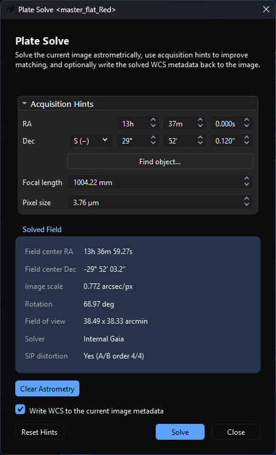

# Plate Solving

## Purpose and expected result

*The solved-field panel records the successful Internal Gaia solution while the
acquisition hints remain available for review or adjustment.*

Plate Solving finds the sky-coordinate model for the active still image. It is
for users who need WCS metadata for coordinate readout, overlays, catalog-aware
color calibration, or astrometric registration. A successful solve displays the
field center, image scale, rotation, field of view, backend, and SIP status. If
**Write WCS to the current image metadata** is checked, it also writes the
solution into the image as a step of its history - **Undo** restores the image
as it was - and marks the image as having unsaved changes.

Plate solving changes metadata, not pixels. Saving the image afterward is a
separate step required to preserve the new metadata in a file.

## At a glance

| Item | Current behavior |
| --- | --- |
| Menu path | **Image > Information > Plate Solve**; the focused image toolbar also has **Plate Solve**; `Ctrl+P` works while that toolbar action is visible and enabled. |
| Enabled when | A standard still-image view has a loaded image. The menu action is disabled and the toolbar action is hidden for sequences. The dialog can open without a configured backend, but **Solve** is then disabled. |
| Inputs | The active in-memory still image; optional FITS position/equipment metadata; optional RA/Dec, focal-length, and pixel-size hints; global solver, catalog, index, and timeout settings. |
| Outputs | A displayed solution and optional replacement WCS/SIP metadata on the same image. No new image, map, report, or user-selected output file is created. |
| Recommended image state | Guidance: use the calibrated image whose geometry later steps will consume, with detectable, unsaturated stars. The implementation accepts linear or nonlinear pixels but does not validate processing state. Re-solve after geometry-changing edits that invalidate WCS. |
| Preview support | No RT or static preview. **Solve** analyzes the complete current in-memory image through a temporary FITS. |
| Sequence support | Unsupported by this dialog. Use a still or the owning registration/integration workflow for batch behavior. |
| Mask support | Unsupported. An attached/enabled mask is not read or blended. |
| External dependencies | One minimally configured route: a ready local Gaia chunk catalog, ASTAP plus its compatible star database, local `solve-field` plus matching indexes on supported non-Windows builds, or a Nova Astrometry.net API key and network access. |

## Before you start

1. Open the exact still image whose current geometry needs WCS. Crop, rotate, or
   resize first if that operation can invalidate the old solution.
2. Open [Settings > Catalogs & Data and Plate Solving](../../interface/settings-dialog.md#plate-solving-settings).
   Configure at least one backend. A selectable backend proves only minimal
   configuration: it does not test ASTAP's database, Astrometry.net indexes or
   credentials, network policy, or a real image solve.
3. Prefer a position hint for a narrow field. The dialog and the solve read the
   image's position by one rule, the first pair that reads in the order
   `CRVAL1/CRVAL2`, `RA/DEC`, `OBJCTRA/OBJCTDEC`, `OBJRA/OBJDEC`, then
   `TELRA/TELDEC`. One decimal number is read as degrees; two or three fields
   are hours (or degrees), minutes and seconds, separated by blanks, colons, the
   unit letters in either case, the degree sign or the arcminute and arcsecond
   marks. A right ascension of 24 hours or 360 decimal degrees reads as `0`,
   and a fraction in a field another field follows, such as `12.5 30`, is
   refused and gives no hint. **Find object...** can fill RA/Dec from bundled
   local catalogs without network, or from a selected online resolver.
4. Supply both focal length and pixel size when known. The solve service can
   derive approximate scale as
   \[
   s = 206.264806\frac{p}{f},
   \]
   where \(s\) is arcseconds per pixel, \(p\) is pixel size in micrometres,
   \(f\) is focal length in millimetres, and the constant is the arcseconds in a
   radian, \(180 \times 3600/\pi\), divided by 1000. One value without the
   other cannot provide this scale hint.
5. Keep a metadata-safe copy. **Clear Astrometry** and a checked **Write WCS**
   are edits of the image recorded in its history, so **Undo** reverses them;
   neither changes pixels or saves the file automatically.
6. Before using the web backend, confirm that policy permits sending the current
   image and hints to `nova.astrometry.net`. Protect the API key stored in
   Settings and any Settings JSON export.

## Procedure

1. Focus a still image and choose **Image > Information > Plate Solve**, its
   image-toolbar action, or `Ctrl+P`. The title identifies the bound image view;
   reopening the action raises that view's existing modeless dialog.
2. Check **Acquisition Hints**. The section expands automatically when position
   or the complete focal-length/pixel-size pair is missing. Confirm the values
   rather than assuming every numeric FITS RA keyword uses the same convention.
3. If needed, choose **Find object...**. **Local Catalog** is the initial server;
   selecting an online resolver sends the entered object name over HTTPS. Select
   one returned row and choose **OK** to copy its coordinates into the hint fields.
4. Leave **Write WCS to the current image metadata** checked when later
   AfterNight steps should consume the solution. Uncheck it for display-only
   diagnosis.
5. Choose **Solve**. The controls lock, the indeterminate progress bar appears,
   and **Close** becomes **Cancel**. The current in-memory pixels are first saved
   to a temporary FITS, so an unsaved pixel edit is what the solver analyzes.
   With no RA/Dec in the dialog or in the image's cards, a warning banner says
   the solve is blind and stays up while it runs.
6. On success, verify **Field center RA**, **Field center Dec**, **Image scale**,
   **Rotation**, **Field of view**, **Solver**, and **SIP distortion**. The status
   line reports total fallback-chain time; a solved scale plus a known pixel
   size also replaces the **Focal length** hint field with the derived focal
   length. The stored `platesolve/focalLengthMm` value is not changed.
7. If metadata writing was enabled, inspect
   [Astrometry Info and FITS metadata](../../interface/fits-header-viewer.md),
   then [save or export](../../interface/saving-and-exporting.md) the image in a
   format/path that retains the required metadata. The image is merely pending
   until that save succeeds.

## Complete parameter and action reference

The Settings page owns backend paths, catalog selection, search radius,
downsample, timeout, and default solver. This table covers the Plate Solve entry
points and dialog only.

| UI label/action | Type and unit | Runtime default | Persisted-default exception | Valid values, step, or constraints | Effect of increasing, decreasing, or selecting | Dependencies and enable/visibility rules | Quality, artifact, runtime, memory, or disk trade-off | Scope: preview/apply, channel, mask, still/sequence | Persistence |
| --- | --- | --- | --- | --- | --- | --- | --- | --- | --- |
| Plate Solve (menu) | Menu action | Disabled without an active image | None | One click | Opens/raises the dialog for the active view | Enabled only for an active loaded still | Opening does not prove a backend can solve | Active still | None |
| Plate Solve (toolbar) | Toolbar action | Visible/enabled for a loaded still | None | Click; `Ctrl+P` while available | Opens/raises the same dialog | Hidden for a sequence; shortcut checks visible/enabled state | Same solve cost once started | Focused still view | None |
| Status line | Read-only text | Empty for a solvable idle image | May show an input error, launch/progress text, cancellation, or solver/time success | Display only | Reports current dialog/service state | Updated by image changes and the active solve | Not a complete log; use Session Console for the backend chain | Bound still | Dialog lifetime |
| No plate solving tool is configured... | Warning banner | Hidden when any route is minimally configured | None | Display only | Explains why **Solve** is disabled | Shown only while idle with no minimally configured route | Its text mentions External Tools, but the button actually opens **Plate Solving** Settings; Gaia is managed in **Catalogs & Data** | Application configuration | Recomputed from global settings |
| Configure... | Button | Hidden | None | Click action | Opens Settings at **Plate Solving** and rechecks readiness on return | Visible only with no configured route and while idle | Configuration can still fail at runtime | Application configuration | Settings owns persistence |
| No RA/Dec coordinates provided... | Warning banner | Hidden | None | Display only | Says that a blind solve of a narrow-field image is very slow and may fail, and suggests filling in RA and Dec or using **Find object...** | Shown when **Solve** starts with no RA or no Dec in the dialog and no pointing in the image's cards, and logged; it stays up while the solve runs, until the solve's answer replaces it | A blind solve searches without a position | Whole solve | None |
| Progress | Indeterminate progress bar | Hidden | None | Busy/idle | Shows that solve work is active | Visible only while solving | Does not show backend-specific percentage | Whole solve chain | None |
| Acquisition Hints | Collapsible section | Collapsed, then auto-expanded if position or complete scale hints are missing | None | Expanded/collapsed | Shows or hides hint controls without changing values | Disabled while solving | Hiding does not disable hints | Whole solve | Dialog lifetime; the fields are read again from the image's cards when the image changes while no result is shown |
| RA — hours | Integer hours | 0 or metadata-derived | None | 0–23, step 1 | Changes right ascension by 15 degrees per hour | Used with RA minutes/seconds only when global `platesolve/useHints` remains true. When every RA and Dec field is zero the dialog states no position and the solve reads the image's cards; when any is not zero the dialog's RA and Dec are both used, a field left at zero meaning zero | Wrong position can prolong/fail the search | Whole solve | Dialog lifetime; **Reset Hints** clears |
| RA — minutes | Integer minutes | 0 or metadata-derived | None | 0–59, step 1 | Refines RA within the selected hour | Same as RA hours | Same position trade-off | Whole solve | Dialog lifetime |
| RA — seconds | Decimal seconds | 0.000 or metadata-derived | None | 0.000–59.999, 0.001 display precision; a value rounds to a thousandth and carries into the minutes | Refines RA within the selected minute | Same as RA hours | Precision beyond the source hint does not improve a poor acquisition position | Whole solve | Dialog lifetime |
| Dec — N (+) / S (−) | Hemisphere selector | N (+) or metadata-derived | None | North or South | Selects declination sign | Used with Dec degrees/minutes/seconds when hints are active | Wrong hemisphere sends the search to the wrong sky region | Whole solve | Dialog lifetime |
| Dec — degrees | Integer degrees | 0 or metadata-derived | None | 0–90, step 1 | Changes absolute declination | Same as Dec hemisphere | At 90 degrees, minutes/seconds can still be entered even though that is not a meaningful sky coordinate | Whole solve | Dialog lifetime |
| Dec — arcminutes | Integer arcminutes | 0 or metadata-derived | None | 0–59, step 1 | Refines declination | Same as Dec hemisphere | Same position trade-off | Whole solve | Dialog lifetime |
| Dec — arcseconds | Decimal arcseconds | 0.000 or metadata-derived | None | 0.000–59.999, 0.001 display precision; a value rounds to a thousandth and carries into the arcminutes | Refines declination | Same as Dec hemisphere | Same position trade-off | Whole solve | Dialog lifetime |
| Find object... | Button | Available | Query may be prefilled from `OBJECT`; accepted names populate a recent list | Non-empty object name; one selected result | Opens **Find Object** and copies the selected RA/Dec | Local Catalog works offline; SIMBAD/CDS Sesame/VizieR Sesame need TLS/network and use a 15 s request timeout | Online choices disclose the object query; accepted history stores up to 20 names locally | Position hints only | Recent accepted object names persist globally |
| Server: | **Find Object** selector | Local Catalog | None | Local Catalog, SIMBAD, CDS Sesame, or VizieR Sesame | Chooses the offline bundled catalogs or an online name resolver | Disabled during a search | Online choices require TLS/network and disclose the query; Local Catalog avoids network | Object lookup only | Dialog lifetime |
| Object: | **Find Object** text input with recent-history completion | Empty or prefilled from `OBJECT` | Up to 20 previously accepted names appear as case-insensitive completion choices | Non-empty object name | Supplies the lookup term; Return starts Search when enabled | Disabled during a search; Search remains disabled while empty | Online lookup discloses this text; accepted selection stores the resolved name locally | Object lookup only | Accepted names persist globally |
| Search | **Find Object** button/action | Disabled while Object is empty | None | Click or Return from Object | Starts the selected resolver and clears the prior selection/details | Disabled while busy or when Object is empty | Local search uses bundled data; online search has network/TLS latency and a 15 s request timeout | Object lookup only | None |
| Find Object progress | Indeterminate progress bar | Hidden | None | Busy/idle | Shows that a lookup is active | Visible only while searching | No resolver-specific percentage is available | Current lookup | None |
| Name / Type / RA / Dec | **Find Object** single-selection result table | Empty | None | One returned row; double-click accepts it | Selects a candidate and populates its details; double-click performs **OK** | Disabled while searching; selection is required for **OK** | Similar names can resolve to different objects, so verify coordinates before accepting | Position hint candidate | Dialog lifetime |
| Description / Notes: | **Find Object** read-only text | Empty | None | Display only | Shows magnitude, size, type notes, or resolver details when available | Populated by the selected result | Completeness varies by catalog/resolver | Selected lookup result | Dialog lifetime |
| Other names: | **Find Object** read-only text | Empty | None | Display only | Shows aliases returned for the selected result | Populated by the selected result | Alias coverage varies by catalog/resolver | Selected lookup result | Dialog lifetime |
| Find Object status | Read-only text | Enter an object name and choose a server. | May show searching, result count, no-result, timeout, TLS, HTTP, parse, or cancellation state | Display only | Reports lookup state and validation errors | Updated by input, server, and search completion | Use the exact error to distinguish local-data, TLS/network, and response failures | Current lookup | Dialog lifetime |
| OK / result double-click | **Find Object** accept action | Disabled | None | One selected result | Stores the accepted object name in recent history, closes the dialog, and copies its RA/Dec into Acquisition Hints | Enabled only with a selected result and while idle | Confirm the selected coordinates before accepting | Position hints only | Accepted name persists; coordinates remain dialog-local hints |
| Cancel | **Find Object** close action | Enabled | None | Click | Closes without changing Plate Solve hints; an active request is aborted by dialog teardown | Available while idle or busy | Does not retain an unaccepted query in recent history | Current lookup | None |
| Focal length | Decimal millimetres | 0.00 or `FOCALLEN`/`FOCAL` metadata | A stored global `platesolve/focalLengthMm` is a service fallback but is not populated into a new dialog field; a solve does not write it | 0.00–50000.00 mm | With pixel size, smaller focal length means a wider scale hint; success can replace this field with the solved derived focal length | Requires positive pixel size for scale; global use-hints key must be true for external hint arguments | Incorrect scale can exclude the true external-solver solution; 0 omits this part of the visible hint | Whole solve | Dialog lifetime; written to `FOCALLEN` when WCS is applied |
| Pixel size | Decimal micrometres | 0.00 or `XPIXSZ`/`PIXSIZE`/`PIXSIZE1` metadata | Global `platesolve/pixelSizeUm` is a service fallback but is not populated into a new dialog field | 0.00–100.00 µm | With focal length, larger pixels mean a larger arcseconds-per-pixel hint | Requires positive focal length for scale | Wrong physical pixel size biases scale; drizzle metadata can alter the effective scale used by the service | Whole solve | Dialog lifetime; positive value is written to `XPIXSZ`/`YPIXSZ` when WCS is applied |
| Focal/pixel warning | Read-only warning | Visible if either visible field is 0 | Global fallback values are not reflected in this warning | Display only | Identifies which visible scale fields are missing | Recomputed from the two visible controls | A warning does not make **Solve** unavailable; blind/default-scale paths may still run slowly or fail | Whole solve | None |
| Field center RA | Read-only result | `-` or existing-WCS value | None | Sexagesimal result, seconds to hundredths, rounded once and carried into the minutes and hours | Shows WCS at the image midpoint, not necessarily raw `CRVAL1` | Populated from parseable existing metadata or a successful solve | A plausible value alone does not validate the fit | Display/result | Dialog lifetime or image metadata |
| Field center Dec | Read-only result | `-` or existing-WCS value | None | Signed sexagesimal result | Shows WCS at the image midpoint | Same as Field center RA | Same validation boundary | Display/result | Dialog lifetime or image metadata |
| Image scale | Read-only arcsec/px | `-` or existing-WCS value | None | Positive solved value | Reports scale derived from WCS | Requires parseable WCS | Verify against equipment expectations; it can drive derived focal length | Display/result | Dialog lifetime or image metadata |
| Rotation | Read-only degrees | `-` or existing-WCS value | None | `0`–`360` degrees, two decimals | Reports the position angle of celestial north at the reference pixel, measured from the image's up direction (increasing y, the first row drawn at the bottom) toward the left: `0` means north up, `90` north to the left | Requires parseable WCS | Compare with Astrometry Info, which reads the same angle | Display/result | Dialog lifetime or image metadata |
| Field of view | Read-only arcminutes | `-` or existing-WCS value | None | Positive width × height | Reports WCS field size for current dimensions | Requires parseable WCS | Incorrect dimensions/WCS produce incorrect field size | Display/result | Dialog lifetime or image metadata |
| Solver | Read-only text | `-` or metadata tag | Existing WCS without `PLTSOLVR` displays Unknown through the metadata summary | Backend name | Identifies the successful route | Populated on solve and written with WCS when enabled | It does not include backend version or database/index version | Display/result | `PLTSOLVR` only when WCS is applied/saved |
| SIP distortion | Read-only text | `-`, metadata summary, or No | None | No or A/B order summary | Indicates a parsed forward distortion model | Internal Gaia fits A/B only when supported by matches/residuals; external output is accepted if its WCS contains SIP | No SIP does not make an ordinary TAN WCS invalid | Display/result | WCS/SIP metadata when applied |
| Clear Astrometry | Metadata edit | Disabled without a readable solution | None | Confirmation defaults to No | Removes every world-coordinate card - projection, reference, matrix, frame and equinox keywords, and the SIP orders, bounds and coefficients - and `PLTSOLVR`, as one history step; clears the detected-star profile | Disabled during solve; requires a solution the image's cards state | Leaves pixels and equipment hints such as `FOCALLEN`/`XPIXSZ` intact | Current still metadata | A history step; marks pending; save required for file persistence |
| Write WCS to the current image metadata | Checkbox | On for each new dialog | Not restored from settings | On/off | On writes the solution into the image as a history step when the solve succeeds for the image still shown, marks pending, and starts post-solve star detection; Off keeps only the displayed result | Disabled during solve | On replaces an earlier solution's cards and keeps every other card, whichever solver answered | Current still metadata | Dialog lifetime only; applied metadata persists only after save |
| Reset Hints | Button | Enabled | Does not restore global or metadata values | Click action | Sets all RA/Dec/focal/pixel controls to zero/North and expands hints | Disabled while solving | Removes visible request hints; stored global focal/pixel fallbacks and the hidden use-hints key still affect the service | Dialog hint fields | Dialog lifetime only |
| Solve | Primary action | Enabled only for a loaded still plus a minimally configured route | None | One asynchronous solve chain | Saves current pixels to temporary FITS and forces a fresh backend solve even if valid WCS already exists | Disabled without backend, without still image, or while busy | Can use CPU, catalog/index disk I/O, external processes, network upload, and long fallback waits | Whole still; no mask/sequence/preview | Result is display-only unless Write WCS is checked |
| Close / Cancel | Button and window close action | Close | Text becomes Cancel while busy | Click or window close | Close dismisses idle dialog; Cancel requests stop; closing while busy requests stop and closes the dialog when the cancelled solve reports | Busy cancellation is cooperative except local processes are killed by the runner and a web request in flight is aborted | A solve that had already finished when the stop arrived is shown, and the dialog stays open; a submitted remote job is not revoked by local cancellation | Whole solve chain | None |

## How the algorithm works

### Conceptual pipeline

1. The dialog snapshots the current image dimensions, metadata, revision, and
   hint fields; the solve's worker then writes the image as it was when **Solve**
   was pressed, samples and header cards, as 32-bit floating-point FITS to a
   uniquely named `.afternight/plate_solve/temp/solve_input_<UUID>.fits` under
   the runtime temporary root. This deliberately ignores any already embedded
   WCS and forces a new solve of the displayed image state. Separate dialogs receive
   separate staging paths, and the dialog removes its staging FITS when the
   solve finishes or the dialog is destroyed.
2. Readiness normalizes the preferred solver. The preferred configured route is
   attempted first; remaining candidates retain the order Internal Gaia, ASTAP,
   local `solve-field`, then Astrometry.net web. A failed candidate contributes
   a diagnostic and the service continues; cancellation stops the chain.
3. Position hints prefer the dialog's RA/Dec, then the first metadata pair that
   reads (see **Before you start**). Scale prefers drizzle `D001SCAL`,
   otherwise positive focal length and pixel size from the request, global
   fallback, or FITS keys. `DRIZMULT`, or a ratio
   derived from `D001SCAL`, can convert physical pixel size to effective
   post-drizzle pixel size.
4. The selected backend produces WCS metadata. AfterNight parses it, derives the
   displayed center/scale/rotation/FOV/SIP, derives focal length when pixel size
   is known, and returns the first valid solution.
5. With metadata writing enabled, the solution's cards replace the image's
   world-coordinate cards and `FOCALLEN`, `XPIXSZ`, `YPIXSZ`, and `PLTSOLVR` are
   added when applicable, as one step of the image's history; the image becomes
   pending, and asynchronous post-solve star detection populates the
   detected-star overlay profile. The step is named **Plate Solve** and described
   `Plate solved with <solver>`. An answer for an image that changed while the
   solve ran - edited, undone, or replaced - is neither shown nor applied.

### Internal Gaia solver

The native route opens the selected ready Gaia DR3 chunk catalog and reads the
temporary FITS, demosaicing a colour filter array mosaic first. It tries every
image plane in order, passing over a plane that detects fewer than three stars
or does not solve, with fixed detection settings (search radius 5, sigma 2.5,
roundness 0.45, relaxed checks, one fit iteration, at most 512 stars), and
matches at most 256 image stars against at most 512 catalog stars. The catalog
stars are those of the search region, read from the tiles the region touches
under the standard HEALPix numbering, carried to the observation epoch - the
Julian epoch of the exposure start, `DATE-OBS`, counted from J2000.0 at noon,
when it is known, otherwise the catalog's own epoch - and held to the pack's
magnitude limit. The scale hint is the one the optics give, or, without one, the
scale of a solution the image's cards already state; without either the solve
assumes 2 arcseconds per pixel. The internal solver stops after the
**Timeout** setting, as the external ones do.

Gaia coordinates are projected about a trial center with a gnomonic tangent
plane. The matcher builds triangle correspondences, fits an affine
tangent-plane-to-pixel transform, then converts its inverse linear terms into a
TAN CD matrix. The center is iterated up to five times, stopping when the change
is at most 0.05 arcseconds. With a position hint, the catalog of the hint's
region - **Search radius** plus one and a half query cones - is read once, and the
hint is tried first, followed by three rings of 12 trial centers out to
**Search radius**, each ring at an angular distance on the sky, so a radius of
180 degrees reaches the opposite point of the sky. Every trial the solve
accepts has at least 8 matches and a final residual of at most two pixels. A
blind solve visits HEALPix centers chosen from the estimated field size, each
with a catalog of two query cones around it; it stops
at the first center with at least 12 matches and a residual of at most one
pixel, and otherwise keeps the trial with the most matches. The query cone is
the image half-diagonal plus 25%, with a 0.05 degree floor.

The native solver may fit forward SIP A/B polynomials from matched-star
residuals. It chooses order 2 for at least 6 matches, order 3 for at least 10,
and order 4 for at least 24. The model is retained only when finite, nonzero,
and its RMS improves over the linear fit by more than 0.001 pixel. It writes
`RA---TAN-SIP`/`DEC--TAN-SIP`, A/B orders and nonzero coefficients; it does not
fit AP/BP inverse coefficients in this solve path.

### ASTAP, local Astrometry.net, and web Astrometry.net

- **ASTAP:** receives a working copy, search radius, downsample, and `-wcs`.
  When hints are enabled, RA is sent in hours, Dec as south-pole distance, and
  horizontal field size from scale/image width. AfterNight reads ASTAP's `.wcs`
  header, stating the ICRS frame ASTAP solves in because the header names only
  its equinox, and writes only the solution's cards into the image. Every
  solver's header-only answer is read the same way: it must end with an `END`
  record, nothing after `END` is read, and a keyword stated twice with two
  values is refused. The executable process is killed on timeout/cancel and the
  per-solver work directory is normally removed.
- **Local Astrometry.net:** receives `--radius` and downsample (at least 1)
  always, and `--ra/--dec` and a ±20% arcseconds-per-pixel interval when hints
  exist. If an index directory is set, AfterNight writes a temporary config
  containing `inparallel`, `cpulimit 0`, `add_path` and `autoindex`. It reads
  `solution.wcs`, then the header of `solution.new.fits`.
  The configured indexes must cover the field scale.
- **Web Astrometry.net:** logs in with the API key, uploads the complete
  temporary FITS with private/noncommercial/no-modification request flags,
  polls for a job and completion, then downloads the WCS. Hints add the centre
  and **Search radius**, a ±20% scale interval, and a downsample factor above
  one. Each step starts when the reply before it arrives or its poll interval
  ends, in one event loop on the solve's worker that never sleeps between polls,
  and the downloaded header is read like the local solvers' answers: only its
  solution is written into the image.

### Model and equations

The tangent plane maps sky coordinates near trial center \((\alpha_0,\delta_0)\)
to gnomonic coordinates \((\xi,\eta)\). After matching, AfterNight fits

\[
\begin{bmatrix}x\\y\end{bmatrix} =
\begin{bmatrix}a & b\\c & d\end{bmatrix}
\begin{bmatrix}\xi\\\eta\end{bmatrix} +
\begin{bmatrix}x_0\\y_0\end{bmatrix}.
\]

Here \((x,y)\) is image position in AfterNight's pixel convention, where the
centre of the first pixel is at one half, \((x_0,y_0)\) is the reference pixel,
and the inverse of the 2×2 matrix becomes the WCS CD matrix. The header counts
pixels from one at the first pixel's centre, so the card bridge writes
`CRPIX1 = x_0 + 0.5` and `CRPIX2 = y_0 + 0.5`, and reads them back the same
way. The field center is the WCS world coordinate at the image midpoint,
\((w/2,h/2)\), so it can differ from `CRVAL1/2` when the reference pixel is not
centered.

Forward SIP expresses distortion relative to `CRPIX`:

\[
u' = u + A(u,v), \qquad v' = v + B(u,v),
\]

where \(u=x+0.5-\mathrm{CRPIX1}=x-x_0\),
\(v=y+0.5-\mathrm{CRPIX2}=y-y_0\), and \(A\) and \(B\) contain polynomial terms of
total degree 2 through the fitted order. It is an optional improvement to the
TAN solution, not a requirement for valid WCS.

### Boundary and failure behavior

- No image, a sequence, no configured backend, temporary-FITS save failure,
  missing input, or unreadable metadata stops before or at service entry.
- Internal Gaia distinguishes a missing, invalid or incomplete catalog from a
  catalog directory in a layout this version does not read; insufficient
  detected stars and unmatched fields are separate diagnostics. Random/too-few synthetic stars return no solution rather than a
  partial WCS.
- ASTAP/local timeout is clamped by the runner to 1–3600 seconds, while the
  reachable Settings range is 10–600 seconds. Process stdout/stderr can appear
  in the combined failure dialog. The internal solver stops at the same
  **Timeout** with `Internal Gaia solver timed out after <N> seconds.`, and the
  chain goes on to the next solver.
- A solver's answer is refused when its header has no `END` record, or states one
  keyword twice with two values; the refusal is that solver's diagnostic and the
  chain goes on.
- Each web HTTP request gets at least 30 seconds. Job assignment and job solve
  each poll up to 120 times at five-second intervals, so the 120-second default is
  not a whole-web-solve deadline; the two polling phases alone can each approach
  ten minutes, plus requests and fallback.
- **Cancel** kills an active ASTAP/local process at the next 250 ms runner poll.
  The internal solver observes it inside its engine work and between image
  planes and blind trial centres. The web solve checks for it every tenth of a
  second and aborts the request in flight, but does not revoke a job already
  submitted to the remote service.
- Failure shows one critical **Plate Solve Failed** message, `Plate solving
  failed for <staging file>.` followed by the per-backend diagnostic chain,
  separated by `|`. No failed/cancelled solution is written.
- An edit, an undo or another image in the bound view does not cancel the solve,
  but the answer is checked against the image revision the solve started from:
  an answer for an image that changed meanwhile is neither shown nor written,
  and the status says `Plate solve finished, but the active image changed.`

## Parameter interactions and starting points

| Combination | Conservative starting point | Too weak looks like | Too strong looks like | Adjustment order |
| --- | --- | --- | --- | --- |
| RA/Dec + Search radius | Use trustworthy acquisition coordinates and the 10° default | Correct field lies outside the trial centers | More trial centers, longer runtime, or a plausible wrong match | Verify hemisphere/RA units, then widen radius only as needed |
| Focal length + Pixel size | Enter both from the acquisition setup; verify drizzle scale metadata | External solver must infer/blind-search scale | Wrong narrow ±20% scale interval can exclude the field | Verify pixel size and drizzle factor, then focal length, then omit both if unreliable |
| Downsample + stars | Keep global default 2 for an ordinary field | Large image may solve slowly | Small/faint stars disappear at high factors | Keep 2, increase one step for large well-sampled stars, reduce after a failure |
| Preferred solver + fallback | Prefer a verified local route; keep only policy-approved alternatives configured | No usable route or early catalog/index failure | Unexpected network upload after local fallbacks fail | Inspect Settings readiness/order, then logs; remove/disallow a route when policy forbids fallback |
| WCS + SIP | Accept valid TAN WCS first; treat SIP as optional distortion refinement | Wide-field residual distortion can remain | Unsupported/noisy fit is not retained by the native threshold | Validate WCS center/scale, then inspect SIP at image edges/overlay |
| Write WCS + Save | Keep checked only after preserving the source/critical metadata | Downstream process still sees old/no WCS | Unverified solution replaces the current metadata and may be saved | Solve, inspect fields/headers, then save a copy |

## Inputs, outputs, and metadata

- The dialog operates on one loaded still image and always solves the current
  in-memory pixels through a temporary FITS. Original file format and unsaved
  pixel changes do not redirect the solve to stale on-disk pixels.
- With **Write WCS** off, the solution is transient display state. With it on,
  the image receives the solution as a step of its history - the same pixels and
  sample type, new metadata - is marked pending, and triggers post-solve star
  detection. **Undo** restores the image as it was.
- Whichever solver answered, every world-coordinate card of the image is
  replaced by the solution's: `RADESYS = 'ICRS'` and no `EQUINOX`, the TAN or
  TAN-SIP projection, `CUNIT1/2 = 'deg'`, the reference pixel and value, the CD
  matrix and, when present, the SIP orders and coefficients, each number the
  shortest decimal that reads back as itself. Every other card is kept in its
  order; the solver's own comments are not copied. Astrometry Info shows `ICRS`
  in place of an equinox for such a solution.
- Positive derived focal length becomes `FOCALLEN`; positive visible pixel size
  becomes both `XPIXSZ` and `YPIXSZ`, the three written to six decimals; the
  backend label becomes `PLTSOLVR`. The solve creates no separate report.
- **Clear Astrometry** removes every world-coordinate card - the same set a
  written solution replaces - and `PLTSOLVR` as one history step named
  **Clear Astrometry**, then marks the image pending. It does not clear pixel data, file path, ordinary acquisition
  metadata, focal length, or pixel size.
- An image whose header states the J2000 equinox and no reference frame - what
  astrometry.net and ASTAP write - is read in the ICRS. One that states FK5, or
  another equinox and no frame, shows no solution until it is solved again.
- Backend work directories are intended to be temporary and normally cleaned.
  Each dialog also uses a unique staging FITS and removes it on solve completion
  or destruction. The configured temporary location still needs normal privacy
  protection while a solve is active.
- Saving/exporting controls file persistence and overwrite behavior. Verify the
  destination headers; do not infer persistence from a successful in-memory
  result.

## Performance

Internal Gaia time grows with image size/channel count, star detection, catalog
queries, and the number of hint/blind trial centers. A blind solve reads a small
catalog around each trial center and stops at the first convincing match. A
trustworthy position and scale are the
largest safe reductions in search work; the internal route ignores the external
**Downsample** setting.

ASTAP and local Astrometry.net use separate processes, temporary copies, their
own databases/indexes, and the configured downsample/timeout. Web solving adds
full-image upload, service queue time, two polling phases, and WCS download.
Fallback adds the elapsed cost of every failed prior route. Test on a
representative copy with a narrow trustworthy hint before relying on the solve
inside a large registration/integration run. No production timing or memory
number is claimed by this page.

## Worked example

- **Retained execution record:** The private output path, a distinct post-save
  hash, and raw console transcript were not retained.
- **Input and provenance:** The project maintainer supplied and approved a
  2965×2967, 32-bit floating-point M83 luminance master for AfterNight testing
  and documentation. The retained FITS has SHA-256
  `39285FD24E4E8660232EC11C5374C8978DABC92868A65ADA67F6ED3855EF7E77`.
  Its acquisition metadata records 60 s exposure, 3.76 µm pixels, and an
  approximately 1000 mm focal length. The supplied target hint was RA 204.25°,
  Dec −29.8667°.
- **Build and settings:** Windows MSVC Release executable SHA-256
  `05BCA7B490E32E568170E14EB1F04F081EA1C5AAEDB094209148B3A5FE182E93`.
  **Internal Gaia** was first, the ready Gaia DR3 G≤14 pack was used, embedded
  WCS was ignored for solving, and the dialog supplied RA/Dec, 1000 mm focal
  length, and 3.76 µm pixel hints.
- **Observed checkpoint:** The full-image path detected 512 stars, matched from
  up to 256 image stars and 512 catalog stars, retained 63 matches at 0.291 px
  RMS, and completed with Internal Gaia in 490 ms. It solved center RA
  204.2544978°, Dec −29.8716965°, 22.819 arcsec from the approximate supplied
  object hint, at 0.772144 arcsec/px. The derived focal length was 1004.420 mm.
- **Output inspection:** The saved and reopened FITS contains
  `RA---TAN-SIP`/`DEC--TAN-SIP`, CRPIX near the image center, the solved CRVAL
  and CD matrix, fourth-order forward A/B SIP terms, and both Internal Gaia
  solver tags. The CD matrix yields an approximately 0.636°×0.636° field.
  `OBJECT`, `FILTER`, `EXPTIME`, `XPIXSZ`, `YPIXSZ`, and `DATE-OBS` are present
  after reopening. Saving took 0.14 s and reopening took 0.01 s in this run.
- **Interpretation and limitations:** This established, for the build it ran
  on, Windows runtime integration, full-image detection, the installed Gaia
  pack, WCS/SIP output, and save/reopen behavior for one luminance field. The
  current build writes the solution with `RADESYS = 'ICRS'`, shortest decimals
  and one `PLTSOLVR` card, and reports Rotation as the position angle of north; the figures above are the earlier build's. It is not a general timing
  guarantee, an ASTAP or web-solver result, a comparison against every catalog
  pack, or a visual distortion-quality assessment. Existing deterministic and
  mock-adapter tests remain the evidence for failure, fallback, cancellation,
  and other backend contracts. The validated capture records the dialog layout.

## Warnings and limitations

- Plate solving is metadata-changing and potentially destructive to the old WCS.
  Solve and save a copy when the previous header must remain available.
- Geometry edits can invalidate WCS. Solve the final geometry that downstream
  overlays, registration, PCC, or SPCC will consume.
- A configured backend is not a validated backend. ASTAP database presence,
  local index coverage, web-key authentication, catalog completeness, and
  network policy are checked only partially or at runtime.
- The hidden persisted `platesolve/useHints` key defaults On. If a Settings JSON
  import sets it Off, the dialog still displays editable hints but the service
  omits the position hint from every backend and the scale hint from the
  external ones; the internal solver still takes its scale from the focal length
  and pixel size. This key has no visible Plate Solving Settings control.
- The no-solver warning/tooltip says External Tools even though the current
  **Configure...** action opens **Plate Solving** and Gaia is configured under
  **Catalogs & Data**. Follow the actual current Settings pages.
- Web solving sends the complete temporary FITS, not merely extracted stars.
  AfterNight requests non-public, no-commercial-use, no-modification handling,
  but remote service retention/terms remain external. Local cancellation does
  not revoke an already submitted remote job.
- The API key is stored in global settings and exported as plain text by Settings
  JSON. The solver does not write it to its diagnostic chain, but protect logs,
  settings files, paths, target names, and captures.
- Online **Find Object** sends the object name to the selected CDS service and
  stores accepted object names locally in recent history. Use Local Catalog when
  the query itself is sensitive.
- Internal Gaia uses all image channels in order, not a computed luminance
  composite. The first channel that yields a valid solve wins.
- Do not edit, undo or replace the bound view's image until the solve
  completes. The solve reads the image as it was when **Solve** was pressed, and
  an answer for an image that changed meanwhile is set aside, not written.
- With no RA/Dec in the dialog or the image's cards, every solver searches
  without a position, which is slow and may fail for a narrow field. The
  dialog says so in a warning banner while the solve runs; it does not stop the
  solve or ask before it starts.
- No numerical fit quality or match count is shown in the dialog. A successful
  result still needs plausibility/header/overlay verification.
- The approved M83 run validates one installed Internal Gaia configuration only.
  It does not establish ASTAP/local Astrometry.net index coverage, web-key
  authentication, other Gaia packs, or production timing across other fields.

## Troubleshooting

| Symptom | Cause | Fix |
| --- | --- | --- |
| Plate Solve is disabled/absent | No loaded still is focused; sequences fail the view/action gate | Focus a single still-image view |
| **Solve** is disabled and warning appears | No ready Gaia pack, executable ASTAP/local path, or non-empty web key passes minimal configuration | Use **Configure...**, then Catalogs & Data/Plate Solving Settings; verify the real dependency separately |
| Warning says to use External Tools | The warning's text names External Tools, while the solvers are configured on the **Plate Solving** and **Catalogs & Data** Settings pages | Click **Configure...** or use **Edit > Settings... > Plate Solving**; manage Gaia under Catalogs & Data |
| “Failed to save image for plate solving: ...” | Current in-memory image could not be staged as temporary FITS | Check runtime temporary path, permissions, free disk, and codec error; retry without overwriting the source |
| “Failed to create a temporary path for plate solving.” | The configured temporary root or staging directory could not be created | Check the temporary path, permissions, and directory availability, then retry |
| “Internal Gaia catalog ...” missing, invalid, incomplete, or in a layout this version does not read | Selected pack is not a ready chunk catalog | Select/repair/download a chunk catalog pack in Catalogs & Data |
| “Internal Gaia solver could not detect enough stars.” | Every image channel produced fewer than three usable detections | Use an image with better stellar signal/focus, verify pixels are not clipped, or choose another configured backend |
| “Internal Gaia solver failed to match the field.” | Stars were detected, but no catalog/trial-center match succeeded | Verify position/scale, widen search radius carefully, confirm catalog depth/epoch, or use another backend |
| “Internal Gaia solver timed out after N seconds.” | The internal solve outlasted the **Timeout** setting, typically a blind or wide-radius search | Supply a position and scale hint, narrow **Search radius**, or raise **Timeout** |
| “Internal Gaia solver failed: the region holds more catalog stars than one solve reads...” | The hint's region - **Search radius** plus the catalog margin - holds more stars than one solve reads | Narrow **Search radius** or select a shallower catalog pack |
| “ASTAP timed out.” / no `.wcs` | Process exceeded timeout or ASTAP did not emit the expected solution file | Test ASTAP and its star database independently; verify hints/downsample/timeout and input support |
| A solver's diagnostic ends “the header ends without an END record”, or names a keyword stated twice | The solver's header-only answer was truncated or states one keyword twice | Run the solver again; check the solver's output and disk space |
| “solve-field timed out.” / no valid WCS | Process exceeded timeout or indexes/config/output did not cover the field | Install matching indexes, check local path/config, test `solve-field`, and verify scale bounds |
| Web login/upload/network error | Non-empty key passed minimal configuration but auth/TLS/network/upload failed | Verify key and service access; review proxy/policy; use a local route when upload is prohibited |
| Web waits far beyond **Timeout** | Timeout applies per request; assignment and solve each have fixed 120×5 s polling | Cancel, inspect service state/log, or use a local route; do not treat Timeout as a total web deadline |
| Cancel seems delayed | Internal cancellation is cooperative; the runner kills an external process; the web solve notices a cancellation within a tenth of a second and aborts its request in flight | Wait for the current check boundary; close triggers cancel then closes after finish |
| All solvers failed | Every route contributed one diagnostic; no result is partially applied | Read the complete message and Session Console in attempted order; fix the first intended route or disable an unapproved fallback |
| Solved result was not written | **Write WCS** was Off or the solve failed/cancelled | Re-solve on the intended active image with writing On, do not edit, undo or replace its image until the solve completes, then inspect metadata before saving |
| A finished solve was not applied: “Plate solve finished for an image that is no longer active. The result was not applied.” | The view's image changed - an edit, an undo, another image - while the solve ran; an answer is applied only to the image it solved | Solve again on the image now shown |
| SPCC/overlays still report no WCS after success | Result remained display-only or pending metadata was never saved/reloaded in the intended file | Check Astrometry Info/FITS cards, write WCS, save a metadata-capable output, and reopen it |
| An image solved elsewhere shows no solution | Its header states FK5, or an equinox other than J2000 and no frame, which AfterNight does not convert | Solve it again; a header with the J2000 equinox and no frame is read in the ICRS |
| SIP says No | Valid WCS contains no accepted forward A/B model | Use ordinary TAN WCS if adequate; inspect external header or internal match quality rather than fabricating SIP |
| **Clear Astrometry** left a card | Only world-coordinate cards and `PLTSOLVR` are removed; equipment, acquisition and other cards stay | Remove other cards with a metadata-aware workflow |

## Related workflow steps

- Configure catalogs and backends first in
  [Settings](../../interface/settings-dialog.md#plate-solving-settings).
- Solve the calibrated/final-geometry master before
  [Astrometry Overlays](../../interface/astrometry-overlays.md),
  [Photometric Color Calibration](../color-calibration/photometric-cc.md), or
  [Spectrophotometric Color Calibration](../color-calibration/spectrophotometric-cc.md).
- [Image Registration](image-registration.md) and
  [Image Integration](../stacking-integration/image-integration.md) can invoke
  the same service automatically; their pages own batch policy, partial failure,
  and workflow/report behavior.
- Inspect the handoff with
  [Astrometry Info/FITS metadata](../../interface/fits-header-viewer.md), then
  preserve it using [Saving and Exporting](../../interface/saving-and-exporting.md).

## Credits

- H. Shupe and R. Hook, [The SIP Convention for Representing Distortion in FITS
  Image Headers, version
  1.0](https://fits.gsfc.nasa.gov/registry/sip/SIP_distortion_v1_0.pdf),
  official FITS registry document.
- NASA/GSFC, [FITS World Coordinate System
  references](https://fits.gsfc.nasa.gov/fits_wcs.html), including Greisen &
  Calabretta's WCS Paper I and Calabretta & Greisen's celestial-coordinate Paper
  II. AfterNight's behavior is defined by its image engine's own implementation
  of the TAN projection and the SIP convention, not by a WCS library.
- [ASTAP official solver and command-line
  documentation](https://www.hnsky.org/astap.htm), including `-f`, `-r`, `-fov`,
  `-ra`, `-spd`, downsample, and `.wcs` output.
- [Astrometry.net local usage and output
  documentation](https://astrometrynet.readthedocs.io/en/stable/readme.html),
  including `solve-field`, index configuration, scale/position hints,
  downsampling, `.wcs`, and `.new` outputs.
- [Nova Astrometry.net API
  documentation](https://astrometry.net/doc/net/api.html), including API-key
  login, image upload, privacy/licensing flags, submission/job polling, and WCS
  download.
- [Gaia Data Release 3
  documentation](https://gea.esac.esa.int/archive/documentation/GDR3/) and
  [credit/citation
  instructions](https://gea.esac.esa.int/archive/documentation/GDR3/Miscellaneous/sec_credit_and_citation_instructions/),
  release 1.3. AfterNight uses a project-managed local chunk-pack representation
  rather than the Gaia Archive service at solve time.
