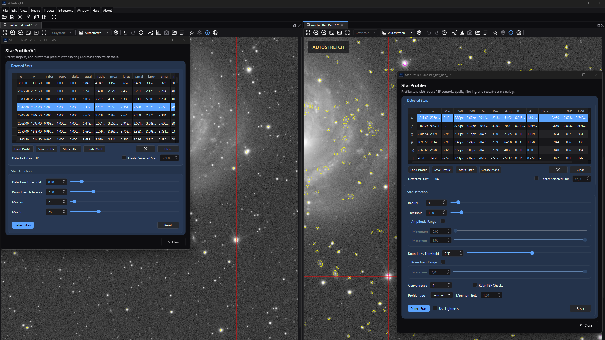

# Star Profiler v1 and v2

## Purpose and expected result

*The paired windows use byte-identical copies of one field to compare the
detected-star tables and version-specific controls without competing for a
single target.*

Both Star Profiler windows analyze the image a view shows without modifying it.
They draw selectable detections over the image, expose a sortable measurement
table, can curate that list, save it for later use, and create a new grey star
mask. Both find their stars with **one** fitted detector: each candidate is fitted
with a rotated Gaussian or Moffat profile, and a poor fit is rejected. The two
windows differ in what they ask and show:

- **v1** asks for a threshold, a roundness tolerance and a size window, and
  shows thirteen columns, each stated from the fitted star. It reads and writes
  `.anspv1` profiles.
- **v2** offers the detector's own controls, shows its fitted figures, places
  every star on the sky through the image's plate solution and matches it
  against a configured local Gaia catalog. It reads and writes `.anspv2`
  profiles.

For new measurement and registration work, start with v2. Keep v1 for
`.anspv1` workflows.

## At a glance

| Item | Star Profiler v1 | Star Profiler v2 |
| --- | --- | --- |
| Menu path | **Process > Star Processing > Star Profiler v1** | **Process > Star Processing > Star Profiler v2** |
| Input | The image the view shows: a still image, or the frame a sequence view shows. | Same. |
| Detection data | A colour image's green channel; a grey image's only channel. | Green by default; **Use Lightness** detects on CIE L*. A grey image's only channel. |
| Core model | The fitted detector at its defaults, keeping stars whose amplitude stands the threshold above the sky, whose two fitted standard deviations differ by less than the roundness tolerance and whose mean full width lies in the size window. | The fitted detector at the dialog's request: background-noise threshold, candidate scan, rotated Gaussian or free-beta Moffat fit. |
| Units | Every representation is read as fractions of its full scale, so amplitudes and backgrounds are fractions of full scale. | Same. |
| Positions | Engine pixel coordinates: the first pixel's centre is at one half. | Same. |
| Astrometry/catalog | None. | RA/Dec where the image's cards state a plate solution; Gaia matches, zero point and limiting magnitude when a local catalog is configured. |
| Profile format | JSON schema 1, extension `.anspv1`, engine `v1`. | JSON schema 2, extension `.anspv2`, engine `v2`. |
| Interoperability | Refuses a v2 profile by name. | Refuses a v1 profile by name. **Profiled Starmask Recombination** reads either. |
| Output | Saved profile or a new grey mask; the image is unchanged. | Same. |
| Preview/history | No preview and no history step. | Same. |

## Before you start

1. Use a calibrated, linear image. Strong gradients, hot pixels, clipping, and
   nonlinear stretching alter detection and fitted widths.
2. Keep display stretch fixed while comparing images; measurements come from the
   image's samples, not the displayed stretch.
3. Decide whether compatibility requires `.anspv1`. A profile cannot be converted
   by renaming its suffix.
4. For v2 astrometry, plate solve the image first. Configure a local Gaia catalog
   only if catalog matches and the zero point are needed.

## Procedure

1. Activate the image and open the required version from **Process > Star
   Processing**. The window is bound to that view; there is no target selector.
2. For v2, start with **Gaussian**, **Radius** `5`, **Threshold** `1.0`, and
   **Roundness Threshold** `0.5`. On RGB, decide whether green or **Use
   Lightness** is the representative detection plane. For v1, start from its
   four defaults.
3. Click **Detect Stars**. The detection runs in the background behind a
   progress window whose **Cancel** stops it; the application stays responsive.
   Select rows or click an overlay to cross-highlight a star. Click a column
   header to sort; enable **Center Selected Star** only when automatic recentering
   is useful.
4. Inspect missed stars, hot pixels, saturated cores, and elongated detections.
   Change one detection control at a time and run detection again.
5. Use **Stars Filter** for post-detection curation. Preview is non-destructive;
   **OK** asks before discarding excluded stars.
6. **Save Profile** before closing if another process or session needs the list.
   Use **Create Mask** when a grey mask is the required output.

## Complete parameter and action reference

### Star Profiler v1 window

| UI label/action | Type and unit | Runtime default | Persisted-default exception | Valid values, step, or constraints | Effect of increasing, decreasing, or selecting | Dependencies and enable/visibility rules | Quality, artifact, runtime, memory, or disk trade-off | Scope: preview/apply, channel, mask, still/sequence | Persistence |
| --- | --- | --- | --- | --- | --- | --- | --- | --- | --- |
| Detection Threshold | Fraction of full scale above the sky | `0.10` | Loaded profiles do not repopulate this control | `0.01`–`1.00`; step `0.01` | The smallest fitted amplitude a star may have. Higher keeps only brighter stars. | Used on the next **Detect Stars**. | Low values keep faint stars and the fits of noise; high values miss faint stars. | Green or grey plane | Window lifetime only; Reset/reopen returns `0.10`; recorded in saved profiles. |
| Roundness Tolerance | Pixels | `2.00` | Loaded profiles do not repopulate this control | `0.00`–`10.00`; step `0.01` | The largest difference of a star's two fitted standard deviations. Lower requires rounder stars. | Used on the next detection. | High values admit elongated or nonstellar objects; very low values reject real stars. | Detection | Window lifetime; recorded in profiles. |
| Min Size | Pixels | `2` | None | `0`–`99`; integer | The smallest mean full width kept. | Must not exceed Max Size for useful output; the dialog does not enforce the order. | High values reject small or faint stars; low values admit hot pixels. | After the fit | Window lifetime; recorded in profiles. |
| Max Size | Pixels | `25` | None | `0`–`99`; integer | The largest mean full width kept. | Must be at least Min Size for useful output. | High values keep large or saturated structures; low values reject large stars. | After the fit | Window lifetime; recorded in profiles. |
| Detected Stars table | Sortable read-only table | Empty | A loaded profile fills it | Columns: x, y, intensity, percentage, deltaRadius, quality, radius, meanRadius, four axis radii, majorAxisAngle | Select a row to highlight its overlay; click a header to sort, largest first and then smallest. A detection shows the brightest first. | Available after detection or load. | Sorting changes the list's order, not its measurements. | Current curated list | The order is saved, because stars are written in the current order. |
| Detect Stars | Button | — | — | One detection at a time | Replaces the current list from the view's image using the controls as they were when it was pressed. | Disabled while a detection runs. | Runs on a worker; Cancel, Clear, a Load the window accepts or closing the window stops it and nothing is shown. A Load the window refuses leaves it running. | Analysis only; the image is unchanged | The result remains until replaced, cleared or closed. |
| Reset | Button | — | — | Click action | Restores the four detection defaults. | Does not clear the stars. | No computation. | Controls only | No preset persistence. |

The v1 columns are stated from the fitted star: **intensity** is the fitted
amplitude; **quality** the brightness-weighted roundness figure `C` below;
**radius** half the mean full width; **meanRadius** the radius times `1.5/2.35`;
the four axis radii half the major and minor full widths; **deltaRadius** half
their difference; **majorAxisAngle** the fitted position angle; and
**percentage** `1` for every star.

### Star Profiler v2 window

| UI label/action | Type and unit | Runtime default | Persisted-default exception | Valid values, step, or constraints | Effect of increasing, decreasing, or selecting | Dependencies and enable/visibility rules | Quality, artifact, runtime, memory, or disk trade-off | Scope: preview/apply, channel, mask, still/sequence | Persistence |
| --- | --- | --- | --- | --- | --- | --- | --- | --- | --- |
| Radius | Candidate-search half-window; pixels | `5` | Loaded profiles do not repopulate this control | `3`–`32`; integer | Larger requires a candidate to dominate a wider box; smaller separates compact, crowded stars. | Used on the next detection. | Large values merge crowded structures and need a larger frame; small values admit more candidates. | Candidate scan | Window lifetime; saved in profile. |
| Threshold | Background-noise multiplier | `1.00` | None | `0.01`–`15.00`; step `0.05` | The detection threshold is the sky plus `5 × Threshold × background noise`. | Used on the next detection. | Lower finds fainter, noisier candidates and costs more; higher misses faint stars. | Selected detection plane | Window lifetime; saved as `sigma`. |
| Amplitude Range | Checkable group | Off after initialization/reset | — | Off/On | On rejects fitted amplitudes outside the Minimum/Maximum interval, as fractions of full scale; off applies no amplitude window. | Bounds matter only when checked. | Narrow bounds can remove valid or saturated stars. | Post-fit rejection | Check state window-only; bounds saved when it is on. |
| Amplitude Range > Minumum | Fraction of full scale; UI spelling | `0.00` | None | `0.00`–`0.99`; step `0.05` | Higher removes lower-amplitude fits. | Amplitude Range on. | Suppresses weak candidates and faint stars alike. | Post-fit rejection | Saved as `min_A`. |
| Amplitude Range > Maximum | Fraction of full scale | `1.00` | None | `0.01`–`1.00`; step `0.05` | Lower removes higher-amplitude fits. | Amplitude Range on; a Maximum below the Minimum refuses the detection with a message. | Can reject bright stars needed for alignment. | Post-fit rejection | Saved as `max_A`. |
| Roundness Threshold | Minimum axis ratio | `0.50` | None | `0.01`–`0.95`; step `0.05` | Higher requires `FWHMy/FWHMx` closer to one. | Always used. | High values reject elongated stars but can leave too few. | Post-fit rejection | Saved as `roundness`. |
| Roundness Range > Maximum | Optional maximum axis ratio | Group off; value `1.00` | None | `0.01`–`1.00`; step `0.05` | When enabled, lower rejects fits rounder than the bound. | Checkable group; off is a maximum of `1.0`. | Usually leave off; a narrow band can empty the list. | Post-fit rejection | Effective maximum saved as `max_r`. |
| Convergence | Solver iteration multiplier | `1` | None | `1`–`3`; integer | Multiplies the fit's iteration budget. | Used on the next detection. | Higher can rescue difficult fits at CPU cost. | Per-candidate fit | Saved in profile. |
| Relax PSF Checks | Checkbox | Off | None | Off/On | Skips the scan's symmetry and local-contrast tests and the width-estimate and residual checks; amplitude, beta, geometry, magnitude and roundness checks remain. | Used on the next detection. | Finds more difficult stars and more blends and poor fits. | Candidate and fit validation | Saved in profile. |
| Profile Type | Selector | **Gaussian** | None | **Gaussian**, **Moffat** | Gaussian fits exponential wings; Moffat fits power-law wings with a free exponent. | **Minimum Beta** is enabled only for Moffat. | Moffat has one more parameter. | Per-star model | Saved as `gaussian` or `moffat_bfree`. |
| Minimum Beta | Dimensionless | `1.50`; disabled for Gaussian | None | `0.05`–`10.00`; step `0.05` | Higher rejects broad-wing, low-beta fits. | Moffat only. | Too high rejects valid winged stars. | Moffat rejection | Saved in profile. |
| Use Lightness | Checkbox | Off | Reset does not change it | Off/On | On detects a colour image's stars on CIE L*; off on green. A grey image is always its only channel. | Meaningful for colour images. | L* is less tied to one channel; green may have the best signal on OSC data. | Detection plane | Window lifetime; not stored in `.anspv2`. |
| Detected Stars table | Sortable read-only table | Empty | A loaded profile fills it | Columns, in order: x, y, Mag, FWHMx, FWHMy, Ra, Dec, Angle, B, A, Beta, r, RMSE, FWHM, Circularity; the widths are shown in pixels | Select or click an overlay to cross-highlight; click a header to sort. `Mag` is an instrumental `-2.5 log10(background-subtracted box sum)`, not a calibrated magnitude. | RA/Dec need a plate solution; Beta is `-` for Gaussian. | — | Current curated list | The order and every field are saved. |
| Detect Stars | Button | — | — | One detection at a time | Replaces the list, then places it on the sky and matches it against the local Gaia catalog. | Disabled while a detection runs. | Runs on a worker behind a progress window whose Cancel stops it. | Analysis only; the image is unchanged | The result remains until replaced, cleared or closed. |
| Reset | Button | — | — | Click action | Restores the detection controls and turns both range groups off. | Does not change Use Lightness or clear the stars. | No computation. | Controls only | No preset persistence. |

### Actions shared by both versions

| UI label/action | Type and unit | Runtime default | Persisted-default exception | Valid values, step, or constraints | Effect of increasing, decreasing, or selecting | Dependencies and enable/visibility rules | Quality, artifact, runtime, memory, or disk trade-off | Scope: preview/apply, channel, mask, still/sequence | Persistence |
| --- | --- | --- | --- | --- | --- | --- | --- | --- | --- |
| Load Profile | File action | — | Remembers a version-specific folder | v1 reads `.anspv1` documents, v2 `.anspv2` ones; the schema is read from the document | Reads the document in the background; only once the window accepts it does it replace the list and stop a detection on its way. A document of the other generation, or one that cannot be read, is refused by name and changes nothing: the list stays, and a detection on its way runs on and shows its stars as usual. It does not apply the saved detector settings to the controls or check the document against the image. | Always available. | Bounded to 64 MB and one million stars. | Current window only | The folder persists; the profile comes from the file. |
| Save Profile | File action | Disabled initially | Remembers a version-specific folder | Requires a nonempty list | Writes the document in the background - the detector settings, the frame's figures and the stars, and in a v1 document the edited-by-hand flag, which the v2 schema does not hold - to a pending file renamed into place when complete. | Enabled after detection or load. | v2 files carry fits, uncertainties, astrometry and catalog fields. | Curated list only; no pixels | The file persists. |
| Stars Filter | Button/dialog | Disabled initially | — | Requires a populated list | Opens the version-specific filter preview below. It is shown beside the window, not modal. | Enabled after detection or load. | Applying removes excluded stars after confirmation. | Overlay, list, profile, mask input | An applied filter marks the profile edited by hand; save to keep it. |
| Create Mask | Button/dialog | Disabled initially | — | Requires a populated list | Opens **Profiled Mask Generation** beside the window, not modal, over the current list. | Enabled after detection or load. | The mask is painted in the background. | New image only | The new view is not saved automatically. |
| Remove selected star | Icon button | Disabled until a selection | — | One selected row | Removes that star from the list and the overlay and marks the profile edited by hand. | Disabled with no selection. | Deletion does not recalculate the profile's frame figures. | Current list | Save afterward to keep it. |
| Clear | Button | Disabled initially | — | Confirmation required | Removes every star after **Yes**, and stops a detection or read on its way. | Enabled for a populated list. | Destructive in memory. | Current list | Reload or redetect to recover. |
| Detected Stars | Count display | `0` | — | Read-only | The current list's size. | Always visible. | — | Current list | Not separately persisted. |
| Center Selected Star | Checkbox | Off; disabled initially | — | Off/On | Centers the view on a selected star. | Enabled for a populated list; enables the zoom factor. | Display only. | Viewer navigation | Window lifetime. |
| x Zoom | Numeric zoom factor | `2` | — | `1`–`20` | Higher zooms further when centering. | Enabled with Center Selected Star. | Display only. | Viewer navigation | Window lifetime. |
| Image overlay/click | Viewer interaction | No overlay | Saturated fits are drawn apart | Left-click inside a drawn star selects its row | Each star's fitted ellipse is drawn at its engine pixel coordinate; a click selects the star it lands in, found in the list by its position, so a filter's preview selects the right row. | Populated list required. | Dense fields can be crowded. | Display only | Not saved in the image. |
| Close | Button/window action | — | — | Confirmation appears whenever the list is nonempty | Closes after confirmation and stops a detection on its way; the window closes once it has landed. | Can be refused with **No**. | Unsaved curation is lost. | Process window | Saved profiles and new masks survive. |

### Stars Filter dialog

| UI label/action | Type and unit | Runtime default | Persisted-default exception | Valid values, step, or constraints | Effect of increasing, decreasing, or selecting | Dependencies and enable/visibility rules | Quality, artifact, runtime, memory, or disk trade-off | Scope: preview/apply, channel, mask, still/sequence | Persistence |
| --- | --- | --- | --- | --- | --- | --- | --- | --- | --- |
| v1 Intensity Min/Max | Data-derived range | Full observed range | — | Current list extrema | Narrows the fitted amplitude kept. | v1 only. | Can remove faint or bright stars. | Current list | Dialog only until OK. |
| v1 Quality Min/Max | Data-derived range | Full observed range | — | Current list extrema | Narrows the brightness-weighted roundness figure kept. | v1 only. | Combines brightness and shape. | Current list | Dialog only until OK. |
| v1 Radius Min/Max | Data-derived pixels | Full observed range | — | Current list extrema | Narrows half the mean full width kept. | v1 only. | Excludes hot pixels or very large structures. | Current list | Dialog only until OK. |
| v2 Mag Min/Max | Data-derived instrumental magnitude | Full observed range, faint end in **Min** | — | Current list extrema | Keeps the magnitudes between the two ends; a star with no magnitude is not kept. | v2 only. | Uncalibrated box magnitude. | Current list | Dialog only until OK. |
| v2 FWHMx Min/Max | Data-derived pixels | Full observed range | — | Current list extrema | Narrows the major full width. | v2 only. | Isolates sharp stars or rejects broad fits. | Current list | Dialog only until OK. |
| v2 FWHMy Min/Max | Data-derived pixels | Full observed range | — | Current list extrema | Narrows the minor full width. | v2 only. | Combine with FWHMx to avoid shape bias. | Current list | Dialog only until OK. |
| Random selection | Percentage | `100%` | — | `0`–`100%` | Keeps that share of the stars the ranges kept, chosen from a seed the dialog draws when it opens: the same request keeps the same stars until it is opened again. | Both versions. | For sparse masks and testing. | Current list | Dialog only until OK. |
| Include Neighbors | Checkbox | Off | — | Off/On | Adds the stars whose boxes overlap a kept star's, and so on from them. | Effective when a range or the random share leaves stars out. | Grows the selection in dense fields. | Current list | Dialog only until OK. |
| Preview | Checkbox | On | — | Off/On | Updates the overlay and count while tuning; closing or Cancel restores the original list. | Both versions. | — | Overlay only until OK | Not persisted. |
| OK / Reset / Cancel | Buttons | — | — | — | OK replaces the list after confirmation; Reset restores the full ranges and 100%; Cancel restores the original list. | — | — | Current list | Save the profile to keep it. |

### Profiled Mask Generation dialog

The dialog paints the current list, on a worker, into a new grey 32-bit float
mask of the image's size in the unit interval, whatever the source's
representation, and opens it beside the view as `<source> - STARMASK` whether
the dialog is still open or not. **Binary Areas** paints each star's fitted ellipse, scaled
by **Scale Factor** and blurred by **Soften Edges**, an exact Gaussian;
**Shaped Areas** paints a radial falloff of **Shape**, its radius
multiplied by **% Pixel Increase** (a multiplier, `0.5` halves it) and grown by
**Pixel Increase** pixels. Its defaults are Binary, scale `1`, soften `0`,
multiplier `0.5`, additive `0` and Truncated Bell.

## How the algorithm works

### The one detector

1. The image is copied and read as fractions of its representation's full
   scale. Samples the image's validity rule rejects, and samples that hold no
   number, are left out; the stars are found in a colour image's green channel,
   or its CIE L* when v2 asks, or a grey image's only channel.
2. The detector measures the sky `B`, the background noise `n` and the largest
   sample, smooths the plane with an exact Gaussian, and scans for candidates
   above

   \[
   T=B+5sn,
   \]

   where `s` is v2's **Threshold** (one for v1). A candidate must dominate a box
   of **Radius** (five for v1); symmetry, local contrast, duplicates and saturated
   plateaus are assessed before fitting.
3. Each candidate is fitted by nonlinear least squares. In rotated coordinates
   `(x',y')`, the Gaussian and Moffat models are

   \[
   G=B+A\exp\!\left[-\left(\frac{x'^2}{S_x}+\frac{y'^2}{S_y}\right)\right],
   \]

   \[
   M=B+A\left(1+\frac{x'^2}{S_x}+\frac{y'^2}{S_y}\right)^{-\beta}.
   \]

   A position is measured with every sample at its pixel's centre, so the first
   pixel's centre is at one half. A fit that does not converge, a nonpositive
   width, poor roundness, an excessive width or residual, an amplitude outside
   the window and a low Moffat beta are rejected.
4. Per-star metrics are

   \[
   r=\frac{\mathrm{FWHM}_y}{\mathrm{FWHM}_x},\quad
   \mathrm{FWHM}=\frac{\mathrm{FWHM}_x+\mathrm{FWHM}_y}{2},\quad
   C=\frac{A}{0.1+|\mathrm{FWHM}_x-\mathrm{FWHM}_y|}.
   \]

   `C` is **Circularity** in v2 and **quality** in v1; it is not a dimensionless
   shape ratio. The frame's figures are medians, and its quality is
   `count × median roundness / median FWHM` over unsaturated stars.
5. v1 then keeps the stars whose amplitude is at least **Detection Threshold**,
   whose standard deviations `FWHM_x/2.35482` and `FWHM_y/2.35482` differ by less
   than **Roundness Tolerance**, and whose mean full width lies between **Min
   Size** and **Max Size**.

### v2: the sky and the catalog

If the image's header states a plate solution, each star's position is projected
through it to RA/Dec. If a configured local Gaia catalog is installed, its stars
inside the field, carried to the image's observation epoch - counted in Julian
years from J2000.0 (2000-01-01 12:00) - are matched one to one with the stars
within five arcseconds, to G magnitude 16. The matched stars' box sums fit the G
zero point, and the faintest match is the limiting magnitude.

## Parameter interactions and starting points

| Combination | Conservative starting point | Too weak looks like | Too strong looks like | Adjustment order |
| --- | --- | --- | --- | --- |
| v2 Threshold + Radius | `1.0`, radius `5` | Faint stars missing | Noise, blends, slow fitting | Choose the radius for the field's crowding -> lower the threshold gradually |
| v2 Roundness + Relax checks | Roundness `0.5`, Relax off | Elongated usable stars rejected | Trails, blends, poor fits retained | Tune roundness first -> enable Relax only for a diagnosed rejection |
| Gaussian + Moffat/beta | Gaussian first | Winged stars show larger RMSE | Free-beta fits rejected | Compare the same stars -> switch to Moffat -> tune minimum beta last |
| v1 Threshold + Size window | `0.10`, `2`–`25` | Faint stars missing or large stars excluded | Hot pixels and nebular knots kept | Fix the size window -> lower the threshold |
| Detection + post-filter | Broad but credible detection, then a narrow filter | Useful stars absent before curation | The filter biases the frame's figures | Fix detection -> inspect the table -> preview the filter -> save |

## Inputs, outputs, and metadata

- Neither version changes the image or adds a history step. A profile is a JSON
  file holding measurements, detector parameters and the list's order; it holds
  no pixels, image size or image identity.
- Positions are engine pixel coordinates; a profile is read and written as it
  stands, with no half-pixel shift.
- A v1 profile writes every column as the table shows it, except that its
  `radius` and `meanRadius` fields are four times the table's figures. Read
  back, a v1 window keeps only each star's position, amplitude and mean width:
  the star is round, of the width it was written with, with quality `1` and no
  angle.
- A v2 profile holds every fitted figure, the RA/Dec and the catalog match of
  each star - the entry's identifier, G magnitude, BP-RP colour and separation;
  the BP and RP magnitudes apart are written as zero - and the frame's figures.
- A loaded profile is drawn over the window's view. Loading another image's
  profile produces plausible table data with meaningless overlay positions.

## Performance

Detection scales with image area and candidate count. A larger Radius, lower
Threshold, Moffat, higher Convergence, Relax checks and dense fields cost more; a
Gaia match reads only the catalog's tiles inside the field. Detection, loading,
saving and mask painting run in the background, so the application stays
responsive.

## Worked example

- Input and settings: a plate-solved field of round Gaussian stars planted at
  stated engine pixel coordinates over a speckled sky, with a local Gaia catalog
  of those stars.
- Expected checkpoint: with either window's defaults every planted star is found
  within a tenth of a pixel of where it was planted; with v2 each star's RA/Dec is
  the solution's projection of its position and it matches its catalog entry; a
  saved profile is read back at the same positions.
- Limitation: no approved acquisition data was run, so no real-image detection
  completeness, mask quality or timing claim is made.

## Warnings and limitations

- A v1 list is the fitted detector's: its columns are figures of the fit.
- A loaded `.anspv1` profile keeps each star's position, intensity and radius
  and reads it as a round star of that radius: its stored quality, four axes,
  delta radius and angle are not kept, so saving it again writes a round star in
  their place.
- v2 **Mag** is uncalibrated. Gaia matches and the zero point do not replace that
  column with a catalog magnitude.
- The frame's figures are computed before manual deletion or filtering and are
  not recomputed afterward.
- Profiles do not bind themselves to an image. Verify the image before loading.
- Close does not track whether the list was saved; it asks whenever the list is
  nonempty.

## Troubleshooting

| Symptom | Cause | Fix |
| --- | --- | --- |
| No stars detected | Threshold too high, v1's size window excludes every star, or the chosen v2 plane is weak. | Reset, verify the plane, start at defaults, then lower the threshold or widen the size window. |
| `Error running Star Profiler` | The detector refused the image - a frame too small to search, or a v2 amplitude or roundness range whose maximum is below its minimum. | Use a larger image or correct the range. |
| Many hot pixels or noise detections | Threshold or size too permissive, or Relax checks on. | Raise the threshold; v1 raise Min Size; v2 disable Relax and inspect amplitude and FWHM. |
| RA/Dec show `-` | The image's header states no plate solution. | Plate solve the image and detect again. |
| Gaia fields absent from a saved v2 profile | The image states no plate solution, or the local catalog is not configured, not ready or not readable; a catalog that cannot be read is logged with the reason. | Configure a local Gaia catalog, verify the solution, and detect again. |
| `Load Star Profile` refusal | Wrong generation, malformed JSON, unsupported schema or a missing v2 field. | Open it in the matching window; restore an unedited profile. |
| Loaded overlays do not align | Profiles carry positions but no image identity. | Load against the original image, or detect again. |
| Mask too small with `% Pixel Increase 0.5` | The value is a `0.5×` multiplier. | Increase toward `1.0` and/or add Pixel Increase. |

## Related workflow steps

Use [Plate Solving](plate-solving.md) before v2 when RA/Dec or catalog matches
matter. Profiles feed [Profiled Starmask Recombination](../star-operations/profiled-starmask-recomb.md),
while generated masks can be used anywhere an image mask is accepted. For a
direct mask workflow see [Star Mask](../star-operations/star-mask.md). Use
[Image Registration](image-registration.md) for transforming images rather than
measuring detections.

## Credits

- The fitted detector's candidate scan and fit derive from
  [Siril](https://gitlab.com/free-astro/siril)'s star finder and PSF
  implementation, by Francois Meyer and team free-astro (GPL-3.0-or-later).
- The radial profiles of the generated masks are adapted from
  [DeepSkyStacker](https://github.com/deepskystacker/DSS)'s star-mask shapes, under
  the BSD 3-Clause License of Luc Coiffier and the DeepSkyStacker contributors;
  **About > About AfterNight** credits both works.
