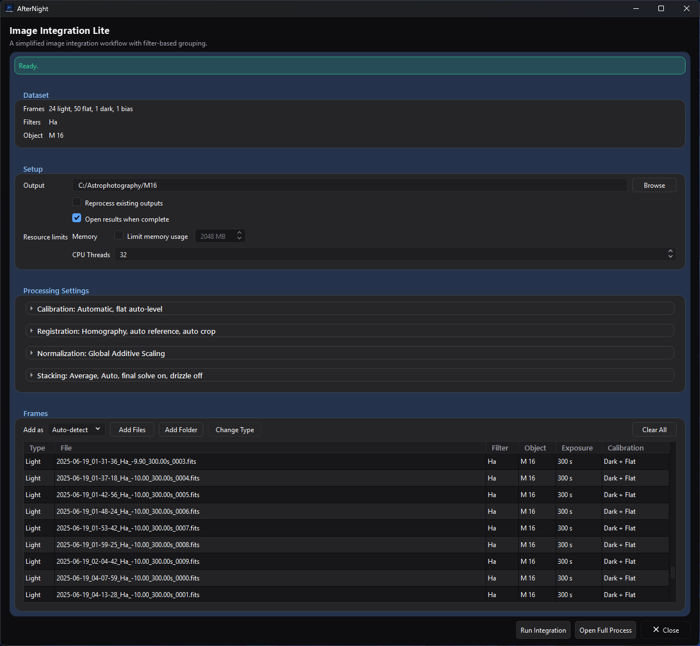
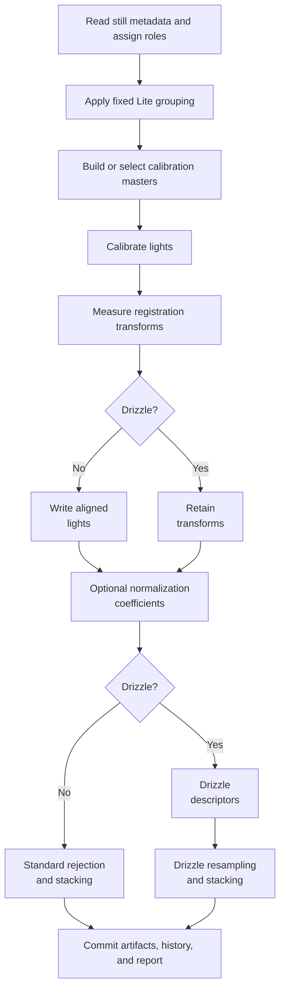

# Image Integration Lite

*The ready-to-run state shows the dataset summary, the planned calibration for
each frame, and the enabled **Run Integration** action.*

Source and focused tests establish the claims made here. The retained ready-state capture illustrates the current layout, but does not establish output quality or production runtime.

## Purpose and expected result

Image Integration Lite turns one simple, single-target set of still light and optional calibration frames into one linear stacked master per resolution, filter, and object group. It exposes the common decisions in one window, then delegates planning, calibration, registration, alignment, normalization, stacking, reporting, cancellation, and result opening to the maintained full [Image Integration](image-integration.md) model and workflow.

Lite is not a separate or reduced-quality stacking engine. It is a simplified front end with a fixed policy for choices that the full process exposes. Use the full process when you need multiple targets, manual grouping or calibration assignments, per-group settings, comet tracking, detailed diagnostics, project persistence, scoped reruns, or advanced artifacts.

## At a glance

| Property | Current behavior |
| --- | --- |
| Menu path | **Process > Preprocess > Image Integration Lite** |
| Enabled when | The top-level window is always available; no active image is required. **Run Integration** remains disabled during import and while validation has errors. |
| Inputs | Engine-supported still-image files added individually or recursively from a folder: FITS, TIFF, PNG, JPEG, camera RAW, XISF, and other extensions currently accepted by the image-codec registry. Frames can be Light, Flat, Dark, Dark Flat, or Bias. |
| Outputs | Shared Image Integration products: calibration masters as needed, registered/normalization intermediates, one stacked FITS light master per integration group, workflow state, history archive, logs, and HTML/Markdown report. Optional drizzle artifacts are created when enabled. |
| Recommended image state | Linear acquisition frames. Lite preserves the shared raw-before-demosaic calibration workflow and produces linear masters. |
| Preview support | None. The table shows file metadata and planned calibration use, but there is no image preview or Apply-to-active-image action. |
| Sequence support | Unsupported. SER, video, and image-list sequences are not imported; extract still frames first. |
| Mask support | Unsupported. Lite does not read the active view or its mask. |
| External dependencies | Deployed image codecs for the chosen input formats. A configured plate solver is needed only when **Plate solve final masters** is on and valid WCS cannot be propagated. Gaia enrichment is enabled internally for registration but does not make catalog availability a readiness prerequisite; without an installed catalog, a run whose lights hold a world-coordinate solution warns that it enriched nothing (see Troubleshooting). |
| Source modification | Never. Input files and headers are not rewritten. |

## Before you start

- Keep all source files at stable paths and choose a dedicated writable output directory with enough space for calibration masters, registered lights, optional drizzle data, final masters, and history.
- Use one target object. Lite treats more than one nonblank effective object name as a blocking error and directs multi-object projects to the full process.
- Prefer complete and correct dimensions, frame type, filter, object, exposure, and capture metadata. **Auto-detect** falls back to Light when type discovery cannot establish another role; use **Add as** or **Change Type** to correct it.
- Supply matching calibration frames when possible. A lights-only run is allowed but is explicitly warned as uncalibrated. Flats without Bias or Dark Flat frames also produce a warning.
- Do not mix geometrically incompatible frames in one effective object group. Registration is hidden, but it still needs enough usable stars and compatible geometry.
- Use **Open Full Process** before running if the table's automatic calibration plan is not appropriate. That handoff copies the current model; it does not turn Lite into a persistent full-process project.

## Procedure

1. Open **Process > Preprocess > Image Integration Lite**.
2. Set **Output** to a writable folder. The last valid output folder is restored on later openings.
3. Choose **Add as: Auto-detect** for reliable headers, or force a role for the next import. Select **Add Files** or **Add Folder**; folder import is recursive.
4. Review **Frames**, **Filters**, and **Object**, then inspect every row's Type, Exposure, and **Calibration** plan. Hover a Calibration cell for the actual master filenames and uses.
5. Select misclassified rows and choose **Change Type**, or right-click and choose **Set as Light/Flat/Dark/Dark Flat/Bias**.
6. Expand the four processing sections. Start with the defaults, changing only settings justified by the dataset.
7. Resolve every red readiness message. Warnings permit execution, but review them before continuing.
8. Optionally select **Open Full Process** for manual assignments or advanced settings. Otherwise select **Run Integration**.
9. If the output folder holds registration records in a format this version does not read, the run does not start and they are left unchanged. Follow the shared workflow progress dialog. A successful run reports the number of generated light masters and, when requested, opens them in AfterNight.

## Complete parameter and action reference

### Dataset, setup, and resources

The tables in this section account for the same ten evidence fields. Later compact tables combine effect with dependencies and trade-off with scope where that keeps closely related behavior readable; a control has no persisted-default exception unless its Persistence cell says it is restored.

| UI label/action | Type and unit | Runtime default | Persisted-default exception | Valid values, step, or constraints | Effect of increasing, decreasing, or selecting | Dependencies and enable/visibility rules | Quality, artifact, runtime, memory, or disk trade-off | Scope: preview/apply, channel, mask, still/sequence | Persistence |
| --- | --- | --- | --- | --- | --- | --- | --- | --- | --- |
| Readiness banner | Derived status | Blocking validation text with an empty dataset | None | Error, warning, success, import/preparation/result messages | Reports current model/run state | Errors disable **Run Integration**; warning details are in the tooltip | Diagnostic only | One Lite still-file model; no preview/apply/mask | Run only |
| **Frames**, **Filters**, **Object** | Read-only summary | No frames; `-`; `-` | None | Counts all role buckets; filter/object lists use included Lights and unique case-insensitive sort | Summarizes loaded data | Multiple real object names block execution; Lite exposes no include/exclude action | Diagnostic only | Loaded still records | Derived from Model |
| **Output** / **Browse** | Directory text/action | Last valid remembered Lite output, otherwise empty | A valid prior output is restored | Existing or new writable workflow directory; model validation checks suitability | Selects every generated path and incremental/history root | Required for execution | Existing matching products can be reused unless reprocessing is requested | Whole workflow; no active-image scope | Saved with window state and remembered for chooser |
| **Reprocess existing outputs** | Checkbox | Off | None; resets off on each window | On/off | Forces required stages despite matching files | Enabled outside import | More time and I/O; useful after replacing inputs or assumptions | Whole workflow | Run only |
| **Open results when complete** | Checkbox | On | None; resets on each window | On/off | Opens generated light masters after success | Enabled outside import | Display convenience only | Successful final still masters | Run only |
| **Limit memory usage** | Checkbox | Off | None | On/off | Selects tiled stacking and enables Maximum memory | Enabled outside import | Lower peak stacking RAM can increase overhead | All stack groups | Run only |
| Maximum memory | Integer MB | 2048 MB, disabled | None | 512–1,048,576 MB, step 1 | Raises or lowers the stacker's memory ceiling | Enabled with **Limit memory usage** outside import | Too low can slow tiling; it does not cap every codec/registration allocation | All stack groups | Run only |
| **CPU Threads** | Integer thread count | Detected parallel core count | None | 1 through detected parallel core count | Caps shared parallel stage admission | Enabled outside import | Lower values reduce CPU pressure and may increase runtime | Whole workflow | Run only |

### Calibration and registration

| UI label/action | Type and unit | Runtime default | Valid values or constraints | Effect and dependencies | Trade-off and scope | Persistence |
| --- | --- | --- | --- | --- | --- | --- |
| **Matching** | Selector | **Automatic** | Automatic; Strict metadata match; Adaptive | Automatic allows Dark exposure fallback within 20%; Strict disables that fallback; Adaptive uses the same matching policy as Automatic and also forces dark optimization on. Although the shared policy carries a 30-day Flat-session fallback flag, Lite disables session grouping, so that flag is inert and all three choices match Flats without date/session separation | Strict can leave Dark groups unmatched; Flat matching is unchanged because Lite ignores Flat sessions | Run/model only |
| **Optimize dark frames** | Checkbox | Off | On/off | Enables Light dark scaling; Adaptive forces it on internally even if this checkbox is off. Only a single-channel light of at least 512×512 pixels whose dark varies over its central 512×512 square is optimized; any other light is scaled by the fixed factor 1 instead, and the run's warnings say so once per dark | Useful for near-matching dark signal; inappropriate scaling can distort calibration | Run/model only |
| **Normalize master flat** | Checkbox | On | On/off | Divides each channel of the selected/built master flat - each colour of a filter-array mosaic - by its mean over the central third of the frame before applying it to Lights, as the full process's **Enable flat auto-level** does | Prevents the flat from changing the overall level; disabling is specialized | Run/model only |
| **Transform** | Selector | **Homography** | Similarity; Affine; Homography; Polynomial 2; Polynomial 3; Polynomial 4; Auto | Similarity permits shift/rotation/scale; Affine adds shear; Homography is projective; Polynomial choices run a homography base plus the chosen refinement; Auto starts at homography and conditionally refines | More flexible transforms need more reliable matched stars and cost more; over-flexible fits can model bad matches | Run/model only |
| **Auto-select reference** | Checkbox | On | On/off | Lets registration choose its reference. Off does not expose a manual reference control in Lite | Turn it off only after handing off to the full process and setting references there; otherwise registration may lack an intended anchor | Run/model only |
| **Auto crop to common area** | Checkbox | Off | On/off | Changes alignment from standard geometry to the intersection common to all registered Lights; when no area is common to every light, the run uses the standard geometry instead and says so | Removes border wedges but reduces field of view | Run/model only |

### Normalization and stacking

| UI label/action | Type and unit | Runtime default | Valid values or constraints | Effect and dependencies | Trade-off and scope | Persistence |
| --- | --- | --- | --- | --- | --- | --- |
| **Lights** normalization | Selector | **Global Additive Scaling** | Global Additive Scaling; Global Additive; Global Multiplicative Scaling; Global Multiplicative; Local Normalization; None | Maps directly to the shared normalization mode; Local enables the shared local model with its hidden defaults | Local is slower and easier to overfit; None assumes already consistent frames | Every Light integration group; run/model only |
| **Calibration** normalization | Read-only policy | Bias/Dark: none, Flat: multiplicative scaling | Fixed | Calibration-master stacks ignore the Lights selector | Flat scaling equalizes flat levels; Bias/Dark retain their native scale | Hidden Lite policy |
| **Method** | Selector | **Average** | Average; Sum; Maximum; Minimum; Median; Auto-Adaptive Weighted Average | Selects the shared pixel combination. Only Average enables rejection | Average normally gives the best noise reduction; extrema and Sum are specialized and disable outlier rejection | Every group; run/model only |
| **Rejection** | Selector | **Auto** | Auto; None; Sigma Clipping; MAD Clipping; Median Sigma; Winsorized Sigma Clipping; Percentile; GESDT; Linear Fit | Enabled only for Average. Auto resolves separately for each group from frame type/count | Robust methods need enough frames; rejection adds compute and can remove real signal when thresholds are too aggressive | Every group; run/model only |
| Dynamic rejection low/high fields | Floating thresholds | Hidden for Auto/None; defaults depend on selected method | Sigma/MAD/Median/Winsorized: 0.01–10, step 0.1, default 3/3; Linear Fit: 5/4; Percentile: 0.20/0.10; GESDT: max-outlier fraction 0.30/significance 0.05; fraction controls range 0.01–1, step 0.01 | Labels become **Sigma Low/High**, **Linear Low/High**, **Low/High Fraction of Median**, or **ESD Outliers/Significance**; Percentile rejects a sample further below the median than the low fraction of the median, or further above it than the high fraction - a fraction of the median, not a percentile rank | Lower sigma-style thresholds reject more; fraction semantics are method-specific. Changing method resets both values | Every group; run/model only |
| **Weighting** | Selector | **None** | None; Number of stars; Weighted FWHM; Noise | Chooses shared per-frame weighting for Light stacks; calibration stacks always use None. A group where some light lacks the figure the weighting reads is stacked unweighted, with a warning | Quality weighting can improve a heterogeneous stack but depends on valid measurements | Light groups; run/model only |
| **Plate solve final masters** | Checkbox | Off | On/off | Propagates valid WCS when possible; otherwise invokes the configured solver on final masters only | Adds solver time and any configured catalog/network requirements; never solves every input frame | Final Light masters; run/model only |
| **Enable drizzle** | Checkbox | Off | On/off | Replaces normal registered-image stacking with the shared drizzle stage and drizzle stacking; the stage writes one small drizzle descriptor per light, and dense coordinates only when checkpoints are kept | Needs reliable registration and dithering; greatly increases disk, RAM, and runtime | Light groups; run/model only |
| **Drizzle scale** | Selector | 2x, disabled | 2x or 3x; enabled with drizzle | Multiplies output width and height; the drizzled master keeps its lights' level at either scale, and the group's normalization applies at that level | 3x has about 2.25 times the pixel count of 2x and requires stronger sampling/resources | Light groups; run/model only |
| **Drizzle pixfrac** | Selector | 0.9, disabled | 0.9; 0.8; 1.0; enabled with drizzle | Sets the square input-pixel footprint fraction | Lower values can preserve detail but need stronger dither coverage to avoid holes; 1.0 is smoother | Light groups; run/model only |

### Frames and window actions

| UI label/action | Type and unit | Runtime default | Valid values or constraints | Effect and dependencies | Trade-off and scope | Persistence |
| --- | --- | --- | --- | --- | --- | --- |
| **Add as** | Selector | Auto-detect | Auto-detect; Light; Flat; Dark; Dark Flat; Bias | Applies to the next import. **Auto-detect** reads the frame type from the file's header cards (`IMAGETYP`, or INDI's `FRAME` card when `IMAGETYP` names no kind; `OFFSET` anywhere in the value, as in `MasterOffset`, names a bias), then from a folder on its path named for a frame type (flat(s), dark(s), bias(es) or offset(s), light(s)), and adds any other file as a Light; it never reads a file name. Its tooltip says the same. Forced roles override detected type; Dark Flat is stored as Dark plus a hidden `Dark Flat` tag | Forcing the wrong role causes bad grouping/calibration | Run only |
| **Add Files** | Multi-file action | — | Supported still-image extensions | Reads metadata asynchronously; remembers chooser directory; duplicate absolute paths in one batch are ignored | Large batches take time; unsupported/unreadable files are skipped and reported | Adds to Model |
| **Add Folder** | Directory action | — | One directory; recursive scan | Adds every supported still file in the folder tree | May import unrelated supported images; review the table | Adds to Model; chooser directory remembered |
| **Change Type** | Selection menu | Disabled without selected rows | Light; Flat; Dark; Dark Flat; Bias | Reclassifies selected rows, rebuilds groups/defaults, and reruns single-frame master detection | Can change calibration routing and invalidate assumptions | Model for this window only |
| Frames context menu | Selection action | — | Set as Light/Flat/Dark/Dark Flat/Bias | Same role reassignment as **Change Type** | Same trade-off | Model for this window only |
| **Clear All** | Confirmed action | Disabled for an empty model | Yes/No confirmation | Removes all loaded frames while preserving Output and resetting Lite defaults | Does not delete source or output files | Model for this window only |
| Frames table | Read-only sortable table | Empty | Type, File, Filter, Object, Exposure, Calibration | Calibration shows the planned Bias/Dark/Flat use for Lights and calibration-frame use/build relationships; filenames/details are in tooltips | A plan is not proof that the selected data are scientifically suitable | Derived from Model/manifest |
| **Run Integration** | Primary action | Disabled | Requires no validation errors and no import in progress | Snapshots the model/options, reapplies Lite defaults, auto-detects one-frame calibration masters, builds the shared manifest, and starts asynchronous execution | Writes outputs and can be resource-intensive; cancellation is cooperative | Run/artifacts |
| **Open Full Process** | Action | Enabled outside import | Current model | Opens a new full Image Integration window, copies the model JSON, and names it `Lite handoff` | Lite-only UI flags such as Open Results are not transferred; use the full process for further changes | New full-process model |
| **Close** | Window action | — | — | Closes without starting a new run | An already running shared workflow follows its controller/window ownership behavior | Window size and Output persist; other Lite controls reset next launch |

## Hidden Lite policy

The following choices are not editable in Lite. They are the principal behavioral difference from the full process.

| Area | Fixed behavior |
| --- | --- |
| Source grouping | Resolution is always used. Bias groups have no filter/object/exposure/temperature split. Darks also split by exposure and the hidden custom tag used for Dark Flats. Flats split by filter. Lights split by filter, object, and exposure. Session and temperature are ignored. ISO/Gain is off, so the internally enabled Offset flag is also ineffective. |
| Final integration grouping | Resolution, filter, and object are mandatory. Session, exposure, temperature, and custom tag are ignored. This can produce multiple masters for multiple filters, but more than one real object blocks Lite readiness. |
| Calibration matching | Lite ignores session while grouping Flats, so Flat matching is by the remaining enabled compatibility keys and the shared 30-day session-fallback flag is never consulted. Dark exposure fallback is allowed within 20%, fallback warnings are off, and Bias is not subtracted from Dark masters, so a Flat with a matching Dark Flat is calibrated by the Dark Flat alone - it already holds the bias - and a Flat with none by the Bias. Strict Matching disables Dark-exposure fallback; it does not change Flat matching. |
| Single calibration frame | A group with exactly one included Bias, Dark, or Flat is automatically treated as an existing master instead of being stacked. |
| Dark Flats | Stored as a tagged Dark group, built/reused in the Dark stage, routed only into matching Flat groups, removed from Light dark assignments, and inserted before Flat processing. Ordinary Darks do not calibrate Flats in Lite. |
| Light calibration | Cosmetic correction is on with hidden cold/hot sigma defaults of 3/3; pedestal is 0; dark multiplication factor is 1; in-memory calibrated-light cache is used; flat auto-level follows the visible checkbox. |
| Registration | Star matching; no per-frame auto plate solving; Gaia enrichment on; Auto interpolation; no comet tracking; chromatic-aberration correction off. Polynomial and Auto choices use a two-pass refinement; Similarity/Affine/Homography use a linear pass. **Minimum Star Pairs** is 10 and **Maximum Stars per Frame** 2000, the full process's defaults. Star detection runs at the full process's defaults (radius 5, threshold 1.0, roundness 0.5, Gaussian profile), and the CFA pattern is read from each light's header (Auto) with the default demosaic. |
| Normalization | IKSS is the hidden scale estimator. The reference is chosen automatically and overlap normalization is off. Local Normalization uses the shared full-process defaults because Lite exposes no local-model controls. |
| Calibration stacking | Same visible combination/rejection/resource policy as appropriate, but no weighting, drizzle, final solve, local normalization, rejection maps, or quality maps. Flat masters use global multiplicative normalization; Bias and Dark masters use none. |
| Light stacking | Rejection maps, merged rejection maps, and quality maps are off, as are the spatial rejection-cluster analysis and the re-stack that excludes flagged frames. Registered images are always kept. There is no HDR exposure merge and no comet stack: every master is a stack of the stars. The weighting's options stay at their defaults: Quadratic star-count scaling, a minimum weight floor of 0.01, and no per-pixel weighting. Drizzle uses the Square kernel and is never CFA-aware. Final-master solving follows the visible checkbox. |
| Workflow/project features | Lite uses the full manifest, executor, artifact state, history, report, and cancellation pipeline, but exposes no project open/save, presets, undo, per-group run, session notes, history browser, or plan editor. Only Output/window state persist in the Lite UI. |

### Automatic rejection tiers

**Auto** resolves per generated group after counting frames:

| Group | Frame count | Actual method and parameters |
| --- | ---: | --- |
| Light | Fewer than 8 | Percentile, low 0.20 / high 0.10 |
| Light | 8–14 | Sigma Clipping, dynamic equal low/high sigma |
| Light | 15–24 | Winsorized Sigma Clipping, dynamic equal low/high sigma |
| Light | 25–39 | Linear Fit, low 5 / high 4 |
| Light | 40 or more | GESDT, max outlier fraction 0.30 / significance 0.05 |
| Bias or Dark | Fewer than 8 | None |
| Bias or Dark | 8–19 | Sigma Clipping, dynamic equal low/high sigma |
| Bias or Dark | 20 or more | Winsorized Sigma Clipping, dynamic equal low/high sigma |
| Flat | Fewer than 8 | None |
| Flat | 8 or more | Sigma Clipping, dynamic equal low/high sigma |

For groups with fewer than 10 frames, the dynamic threshold is fixed at 3.0. Otherwise it is `clamp(round10(base - 0.5 log10(N)), 2.0, 3.5)`, where `N` is the group frame count, `base` is 3.5 for Bias/Dark/Light and 3.8 for Flat, and `round10` rounds to one decimal place. The special branch therefore gives 8- and 9-frame Flat groups a 3.0/3.0 threshold. If **Method** is not Average, Auto becomes None regardless of frame count.

## How the algorithm works

1. Import accepts supported still files, canonicalizes paths, reads metadata off the UI thread, applies a forced role when selected, sorts detected frames, and adds them to the shared `IntegrationDataModel`.
2. Lite applies its hidden grouping, matching, calibration, registration, and stacking settings to every current group. The Frames table constructs the same manifest used for execution to show planned master relationships.
3. On Run, Lite snapshots the model so later UI changes cannot mutate the in-flight preparation. It reapplies the policy, marks one-frame calibration groups as supplied masters, validates again, and calls the shared `ManifestBuilder` with rejection-map generation disabled.
4. The shared executor builds/reuses Bias, Dark, Dark Flat, and Flat masters; calibrates Lights; and measures registration transforms. Non-drizzle groups materialize aligned lights before standard stacking. Drizzle groups retain transforms, prepare or reuse one drizzle descriptor per light, and perform resampling during stacking. Optional normalization precedes either stacking path. Pixel equations, invalid-sample rules, metadata propagation, partial-commit behavior, and exact stage details are the same as documented in [Image Integration](image-integration.md#how-the-algorithm-works).
5. Successful stages update artifact state. A successful run or a failed/cancelled run with completed Light groups can produce a history archive and report under the output root. Cancellation is cooperative; completed groups are not described as rolled back.

## Parameter interactions and starting points

- Begin with Automatic matching, Homography, auto reference, Global Additive Scaling, Average, Auto rejection, no weighting, and drizzle off. These are implementation defaults, not a guarantee of best scientific output.
- Select Strict metadata match when fallback calibration would be worse than leaving a group visibly unmatched. Inspect the Calibration column before running.
- Adaptive currently differs from Automatic mainly by forcing dark optimization. Do not select it merely to obtain a broader fallback policy: Automatic already enables the same Dark-exposure fallback, while Lite disables session grouping so no matching choice provides an effective Flat-session fallback.
- Non-Average combinations force rejection off. If outlier removal matters, return to Average or use the full process for a more deliberate plan.
- Weighting requires reliable registration measurements. If star counts/FWHM/noise are untrustworthy, None avoids turning a bad metric into a strong frame weight.
- Enable Local Normalization only for frames that need spatial correction; Lite hides the local-model diagnostics and tuning available in the full process.
- Enable drizzle only for well-dithered data with reliable transforms. Try 2x/0.9 before 3x or a smaller pixfrac, and set a realistic memory cap.

## Inputs, outputs, and metadata

Lite consumes still files only. Metadata determines automatic roles, grouping, matching, registration context, and output metadata, but source headers are unchanged. Reclassifying a row changes only the in-memory model.

Its shared output naming contract includes:

- `<output>/master_bias_<group>.fit`, `master_dark_<group>.fit`, and `master_flat_<group>.fit` for generated calibration masters, each a 32-bit floating-point file stamped with the manifest entry it satisfies and the run that wrote it;
- `<output>/registered_lights/<registration-group>/..._reg.fit[s]` where standard alignment materializes registered frames;
- `<output>/.afternight/image_integration/artifacts/normalization/` and optional `artifacts/drizzle/` intermediates;
- `<output>/stacked_<integration-group>.fit` for each successful Light integration group, with a stable short hash added on filename collision;
- `<output>/.afternight/image_integration/` state, `registration_metrics.db`, and `artifacts.db` as required; and
- `<output>/history/<execution-id>/` with the manifest, Markdown/HTML report, log, group summaries, and retained outputs for an archived run.

Lite disables rejection maps and quality maps. It does not modify, rename, or delete source files. See [Image Integration outputs](image-integration.md#output-names-and-locations) for the full shared naming and report contract.

## Performance

- Import metadata reading is asynchronous; recursive folders and slow storage increase discovery time.
- Calibration, registration, alignment, normalization, and stacking scale with frame count and pixel count. Polynomial transforms, Local Normalization, drizzle, and plate solving add work.
- Drizzle output memory and disk grow approximately with the square of scale: 3x contains 2.25 times as many pixels as 2x for the same field.
- **CPU Threads** limits shared parallel admission. **Limit memory usage** selects tiled stacking but does not cap every allocation in codecs, registration, or reporting.
- Prototype with a representative subset and a separate output directory. This is guidance only; this guide records no production-scale timing result.

## Worked example

**Source-and-test-derived; not an approved-data execution.** Consider one object with two filters, several Lights per filter, matching Flats, mixed-exposure Darks, and Bias frames. Import with Auto-detect, correct any roles, retain the defaults, and inspect the table. The model tests establish that Lights remain separated by exposure for calibration source groups but final stacks split only by resolution/filter/object; mixed-exposure Dark groups produce separate masters; Flats match Lights by filter without object/date grouping; a one-frame calibration group is treated as a supplied master; and Dark Flats calibrate Flats rather than Lights.

Before a real run, expect the readiness banner to allow execution only when shared validation has no errors. After an executed run, inspect final masters at 100% zoom, compare background statistics between filters, check corners and dust correction, inspect star shape and registered borders, and read the generated report's calibration, registration, normalization, rejection, and warning sections. No visual result or numeric improvement is asserted by this source/test example.

## Warnings and limitations

- Lite blocks multiple real object names but permits multiple filters and produces a master per final group.
- A Ready banner proves structural validation, not good calibration matches, star registration, or scientific quality.
- Automatic and Adaptive both allow the same fallback policy; Adaptive additionally forces dark optimization.
- Turning off **Auto-select reference** supplies no alternate reference control in Lite.
- Local Normalization, weighting, high-order transforms, and drizzle expose only a small common subset. Use the full process for diagnostics and per-group tuning.
- Lite has no include/exclude, manual master assignment, pre-calibrated-group, comet, rejection-map, quality-map, calibrated-preview, project, preset, or history UI.
- The captured ready state and opened linear-result presentation are validated. They do not establish scientific output quality, representative performance, or identical rendering on every platform.

## Troubleshooting

| Symptom | Source-backed cause | Action |
| --- | --- | --- |
| Run Integration is disabled | Import is active or shared validation has an error such as missing Lights, invalid output, incompatible data, or multiple objects | Read the red banner, correct roles/paths/object metadata, or use **Open Full Process** for a complex project |
| No calibration warning | Lights exist but Bias, Dark, and Flat buckets are all empty | Add calibration frames or knowingly continue with an uncalibrated Light stack |
| Flats have no Bias or Dark Flat warning | Flats are present, Bias is empty, and no tagged Dark Flat exists | Add Bias/Dark Flat frames, reclassify them correctly, or evaluate an intentionally uncalibrated Flat master |
| Calibration cell says None or shows an unexpected master | Hidden grouping/matching found no compatible group or used fallback | Verify Type, Filter, Exposure, dimensions, and role; select Strict matching to forbid fallbacks or hand off for manual assignment |
| Imported files were skipped | Unsupported extension, duplicate path, unreadable metadata/image, or another import issue | Read the banner detail, verify codec support and file integrity, then retry the affected files |
| Rejection controls disappeared | Method is not Average, or Rejection is Auto/None | Select Average and an explicit parameterized rejection method if manual thresholds are required |
| Drizzle controls are disabled | **Enable drizzle** is off | Enable it only for dithered, reliably registered data |
| The run warns that cosmetic correction corrects nothing | Lite always asks for cosmetic correction, which finds its defective pixels in a dark master, and no dark matched the lights | Add darks that match the lights, or use **Open Full Process** to turn cosmetic correction off; the stack is otherwise unaffected |
| The run warns that Gaia enrichment enriched nothing | Lite turns Gaia enrichment on, and no Gaia catalog is installed; the warning names the full process's **Enrich with Gaia catalog** control, which Lite does not offer | Install a catalog in **Settings > Plate Solving**, or use **Open Full Process** to turn enrichment off; Lite reads no photometric figure, so its stack is unaffected |
| Final master was not plate solved | Valid WCS could not be propagated and the configured solver was unavailable or failed, or the checkbox was off | Review the workflow report and configure Plate Solving; the stack itself may still be usable |
| The run does not start and names the registration records | The output folder's `registration_metrics.db` is in a format this version does not read; it is left unchanged | Choose another output folder |
| Existing output was reused unexpectedly | Reprocess is off and matching workflow state/artifacts exist | Enable **Reprocess existing outputs** or use a fresh output directory |
| Need a manual reference, per-group settings, or diagnostics | Lite intentionally hides those controls | Select **Open Full Process** before execution |
| Run failed or was cancelled | A shared stage returned a structured error or cancellation was requested | Read the progress/error message and archived report/log; preserve any completed-group outputs and rerun after correction |

## Related workflow steps

- Use [Image Integration](image-integration.md) for persistent projects, advanced diagnostics, manual matching, and per-group control.
- Review shared stacking mathematics and advanced options in [Image Stacking](image-stacking.md).
- Prepare calibration frames with [Image Calibration](../calibration/image-calibration.md).
- Extract stills from a sequence with [Extract Sequence](../utility/extract-sequence.md).
- Inspect a still list before integration with [Image List Analyzer](image-list-analyzer.md).
- Continue with [Image Viewer](../../interface/image-viewer.md) and [Image Statistics](../../interface/image-statistics.md) after opening a master.

## References and provenance

- The maintained Lite contract is defined by `ImageIntegrationLiteProcess` and `ImageIntegration/lite/LiteIntegrationProfile`.
- Delegated workflow, engine, output, and boundary behavior is documented in [Image Integration](image-integration.md), which records its exhaustive shared source/test inventory.
- Registration transform and drizzle terminology follows the corresponding AfterNight engine implementations; no external quantitative claim is made here.
