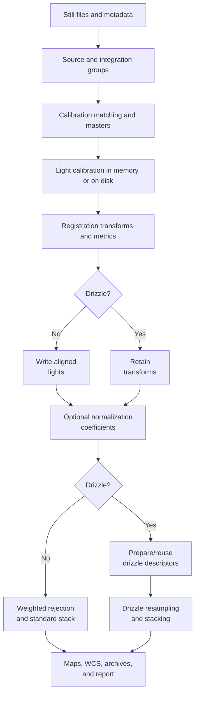

# Image Integration Reference

This page holds what [Image Integration](image-integration.md) leaves out to stay readable beside its window. Its
sections follow a run: the stages, the frames and their groups, the matching of
[masters](../../reference/glossary.md#master), the calibration, the registration, the stack and the
[drizzle](../../reference/glossary.md#drizzle), then the files a run writes, how a later run reuses them, what happens when a run stops, what the window keeps and what a run
costs. The messages a reader may meet come last, with places to start for each kind of setting. Each section can be
read on its own.

## The stages of a run

The stages run in this order, and the plan leaves out those a run does not need:

| Stage | What it does | When it runs |
| --- | --- | --- |
| Bias, Dark, Flat | Stacks the calibration masters | For each calibration group a light or a flat uses, and whose master is not supplied |
| Lights Calibration | Writes the calibrated lights to disk | Only with **Save calibrated frames to disk (for debugging)**. Otherwise each light is calibrated in memory as it is read |
| Lights Registration | Detects and matches the stars, and records each light's transform and figures | For each [registration group](../../reference/glossary.md#registration-group) |
| Lights Alignment | Writes each light onto its group's canvas | For a group that is not drizzled and keeps its registered images |
| Lights Normalization | Measures the coefficients that bring the lights to the reference | For a group with a normalization reference |
| Lights Drizzle | Prepares one drizzle descriptor for each light | For a drizzled group |
| Lights Stacking | Combines the lights into the master, with its maps and its sky solution | For each [integration group](../../reference/glossary.md#integration-group) |

A comet stack places the alignment before the normalization.

1. The import reads the headers of the files in parallel, refuses a format the engine does not read, and adds each
   file once, by its full path. The frames are kept in the order of their paths.
2. Before anything runs, the run fixes its record: every input with its size and dates, the group keys, the
   settings, the masters assigned, the references, the stages, the output names, the groups asked for, the thread cap
   and the color combination. A run whose inputs changed after the plan was prepared stops with "Workflow inputs or
   persisted state changed after the execution plan was prepared. Review the plan and run again."
3. A camera's [RAW](../../reference/glossary.md#raw) file is read without white balance: the log's line **RAW white
   balance** reads "None (forced for workflow calibration)". A mosaic is calibrated before any
   [debayer](../../reference/glossary.md#debayer).
4. Each stage reports its progress and its errors. A stage that fails stops the stages after it, and a stage may go
   on with the frames and groups that remain.
5. What succeeded is archived, and the run's record becomes the one the next run compares with.

## Frames and their headers

Each added file gives its frame these facts, from its header and, failing that, from the file:

Session
:   The UTC date of the exposure's start, `DATE-OBS`, or of the time the file was written, `DATE`, when it states no
    start, or of the file's modification time when it states neither.

Exposure, temperature, gain and offset
:   The exposure in seconds and the sensor's temperature as stated. The gain is a camera's ISO speed, or else its gain
    setting, and the offset its offset setting.

Filter and object
:   As stated, without the spaces around them. A value of `-` or `N/A` counts as none. A light with no object name is
    grouped as `(Unknown Object)`.

Size and pattern
:   The width and height, the channels, and the [CFA](../../reference/glossary.md#cfa) pattern of a mosaic.

Sky solution
:   The [WCS](../../reference/glossary.md#wcs) and [SIP](../../reference/glossary.md#sip) cards, which the
    registration may use.

A file in a format the engine does not read is refused with "Unsupported file format". A file whose header cannot be
read is still added, with "Metadata read failed:" and the reason: its type comes from its folder or its tab, its size
is unknown and its file time stands for its capture time. The formats are [FITS](../../reference/glossary.md#fits),
TIFF, PNG, JPEG, camera RAW and [XISF](../../reference/glossary.md#xisf).

## Groups

| Frames | Always split by | The tab offers | On when the window opens |
| --- | --- | --- | --- |
| Bias | Resolution | **ISO / Gain**, **Offset**, **Custom Tag** | **Offset** |
| Darks | Resolution | **ISO / Gain**, **Offset**, **Exposure** with **Tol (s)**, **Temperature** with **Tol (C)**, **Custom Tag** | **Offset**, **Exposure** at 3.0 s |
| Flats | Resolution | **Filter**, **Object**, **Session**, **ISO / Gain**, **Offset**, **Custom Tag** | **Filter**, **Session**, **Offset** |
| Lights | Resolution | **Filter**, **Object**, **Session**, **ISO / Gain**, **Offset**, **Exposure** with **Tol (s)**, **Custom Tag** | **Filter**, **Object**, **Session**, **Offset** |

Two more kinds of group are formed from the included lights, whatever their tab says:

Registration group
:   The lights of one resolution and one object, whatever their filter, channels or binning. They share one reference
    and one canvas, so the masters of their filters line up. Split lights that cannot share a reference yourself: the
    run checks the frames' sizes, not their channel counts.

Integration group
:   The lights of one resolution, filter and object, split further by **Group by Session**, **Group by Custom Tag**
    and **Group by Exposure** on the **Stacking** tab. Each gives one master.

A group's label joins what its frames share with ` | `: the resolution, `ISO 11` and `Offset 30` while those are
grouped, an exposure as `180s`, or `~180s` with a tolerance, a temperature as `Temp ~-10C`, then the filter, the
object, the session and the tag. A fact the header lacks is left out, and a group that shares nothing is called
`Group`. With a tolerance, each exposure or temperature is rounded to the nearest multiple of it before it is
compared: with 3 s, an exposure of 179 s and one of 181 s both read 180.

An override of session, object or tag changes the groups and never the files. A change of grouping changes the
groups' keys, so the settings and masters chosen for a group may be reset: check them afterwards. A frame you exclude
is in no group of the run.

## How masters are matched to lights

For each light group, a master chosen by hand, or **Do not use**, comes first. A choice holds for the lights whose
first frame has the same resolution, gain, offset, exposure, filter, object, session and tag. Otherwise the policy
matches:

| Master | An exact match needs | Several exact matches | Fallback, when no exact match exists |
| --- | --- | --- | --- |
| Bias | The resolution, and the gain, offset and tag while the bias tab groups by them | The first in the order of the groups' keys, marked as needing a check | None |
| Dark | The resolution, the gain, offset and tag as grouped, and the exposure while the darks are grouped by it, each rounded to the dark tolerance | The nearest temperature: a dark more than 0.25 °C nearer replaces the one found, and nearer by less is a tie, settled by key | With **Allow dark exposure fallback**: the nearest exposure within **Exposure tolerance** of the light's, then the nearest temperature, then the key |
| Flat | The resolution, and the gain, offset, filter, object, session and tag as the flats are grouped | The first by key, marked as needing a check | With **Allow flat session fallback**: the nearest night within **Max session gap**, both dates written as `yyyy-MM-dd`; a tie takes the newer with **Prefer newer flats**, the older otherwise |

- The temperature grouping of the darks forms groups only, and sets no limit on the distance of a dark from a light.
  In the dark fallback, exposures within 0.000001 s of each other count as equally near. Without a light
  temperature, several matching darks always need a check.
- In the flat fallback, a flat group with no object name, or `-`, matches lights of any object. A date that is not
  written `yyyy-MM-dd` has no fallback, and the dark fallback needs a light exposure above zero.
- **Warn on fallback matches** changes what is shown, never which master is taken.
- A light normally takes its dark and no bias, since the dark holds the bias. CCD mode takes both and takes the bias
  out of the dark first.
- A flat group's dark is matched as a light's of the flat's exposure and temperature would be, in the run as in the
  flat table. With a dark it takes no bias, in CCD mode too, where the result would be the same. With no dark it takes
  the bias.
- A calibration group is stacked when a light shares its key, or when a light or a flat of the run is matched to it.
  So a dark of the flats' exposure, and a dark the fallback finds, are made too.
- With no [calibration frame](../../reference/glossary.md#calibration-frame) loaded at all, a run of lights alone
  gives no calibration warning. No missing, fallback or manual warning blocks a run.
- The Summary lists at most five warnings of a missing dark or bias, five of a missing flat and five of a fallback. A
  flat set to **Do not use** gives both "Missing flat calibration match" and "Manually disabled flat calibration".
  Several equal candidates are marked in the light table only, and never in **Issues**.
- **Smart Match** counts a cell showing `-` as matched, counts a cell set to **Do not use** nowhere, and counts a
  dark cell that falls back on the bias as missing.

The texts of the matching are "Multiple BIAS matches found; using deterministic selection.", "Multiple DARK matches
found; review temperature and metadata.", "Using DARK with exposure difference" and the seconds, "Multiple FLAT
matches found; using deterministic selection." and "Using FLAT with session" with the date and the days. They show
while **Warn on fallback matches** is on. A fallback dark is listed as "Using fallback dark from nearby session", for
an exposure fallback too.

## Calibration

- Every light and master is calibrated as [fractions of full scale](../../reference/glossary.md#fraction-of-full-scale).
  An integer file's codes are divided by their largest value, and a floating-point file's samples are taken as they
  are. A floating-point light in [ADU](../../reference/glossary.md#adu) can take masters stacked from floating-point
  frames in the same units, with no [pedestal](../../reference/glossary.md#pedestal).
- [Dark optimization](../../reference/glossary.md#dark-optimization) searches the factor over 0 to 2 by golden-section
  steps to a width of 0.001, at most 64 tries, on the light's central 512 × 512 square. With it off, the flat's means
  are computed once for each master and used for every light. With it on, each light's calibration is prepared on its
  own.
- Cosmetic correction finds its [hot pixels](../../reference/glossary.md#hot-pixel) and
  [cold pixels](../../reference/glossary.md#cold-pixel) against each dark channel's median and population standard
  deviation over the whole image, once for each dark and pair of thresholds, in the bias-subtracted dark in CCD mode.
  It replaces them after the flat division.
- A master dark holds the bias, whether the run stacks it or you supply it: the darks are stacked as they are. A
  master flat is stacked from flats less the dark matched to their exposure, or less the bias with no dark.
- The calibrated light keeps the light's header and is recorded as linear.
- With calibrated frames saved to disk, each light is written as `calibrated_lights\<name>_cal` with its own `.fit`,
  `.fits` or `.fts` suffix, or `.fits` for another format. A run removes the copy of a light it no longer calibrates,
  because its group became **Pre-Calibrated** or no master is left for it, so the light is read as it is.
- With no master and no pedestal, the log says "No master or pedestal is assigned" and the lights "are used as they
  are".

The warnings of a calibration are given once, in memory or on disk: "Cosmetic correction is on for the lights
calibrated with" a bias, a flat or a pedestal alone, "which have no dark master to find defective pixels in, so none
is corrected.", and "The dark scale of the lights calibrated with the dark" its name "could not be optimized", with
the fixed factor used.

## Registration

A light is registered by the star pairs it shares with the
[reference frame](../../reference/glossary.md#reference-frame): at least **Minimum Star Pairs**, never fewer
than five, however small a part of its stars they are. A mosaic panel, or a light that drifted, is registered by the
stars it shares. Nearly every star of the smaller field pairs with one of the other's, so a match of fewer than ten
candidate pairs also needs four fifths of them to agree on one transform within 3 pixels, unless either light holds
1,000 stars or more.

A light with too few pairs is tried again through the lights of its group already registered nearest it, in the
order of their paths: at most 24, the reference aside, the nearest first. Its stars are matched with that light's,
that light's matched stars are carried onto the reference through its transform, and the transform is fitted to those
pairs. A light registered this way is one the others are tried through, and the retries repeat while one registers
another. A light none of them registers is left to its sky solution.

- A reference of four stars or fewer cannot match its lights by their stars, and the log says so with "and a star
  match needs at least 5 pairs". A reference with fewer stars than **Minimum Star Pairs**
  lowers it to its own count for the run, and the log says so.
- With SIP cards in the headers, the stars are matched as each frame holds them, so the transform carries the frames'
  relative distortion and the alignment resamples through it alone. A light registered from its own solution is
  registered by sampling both solutions, distortion included, and fitting a projective model with the polynomial the
  residual asks for. Only a registration recorded to undo a frame's distortion inverts it, and the aligned image's
  world coordinates then carry none. The report counts such frames.
- The color correction matches edge stars of red and of blue with green and moves those channels before the
  registration. Where a moved channel does not reach, the pixel or two its shift moves off the frame, the channel
  keeps its own samples. A color light whose channels match too few edge stars is written as it was read, and a group
  where no channel moved says so once.
- **Mosaic** places every light on the reference's plane, with the reference's projection. When no area is common to
  every light, **Intersection** gives way to the **Standard** canvas in the alignment, in a stack that warps the lights
  as it reads them, and in the drizzle, each saying "No area is common to every light". The registration then records
  the reference's world coordinates for that canvas, so the master carries them.
- A registered light is zero wherever it lies off the light, which the normalization and the stack leave out. Near
  its edge it is interpolated from its own edge pixels, so Bicubic and Lanczos4 do not ring there. When the reference
  is solved, its world coordinates, moved onto the canvas, are written into every aligned light.
- A change of **Interpolation**, or between **Standard** and **Intersection**, aligns the lights again without
  registering them. Only a change to or from **Mosaic** registers them again, as does a changed detection setting.
- A transform model stored in a project is read by its mode. **Auto** is stored as a
  [homography](../../reference/glossary.md#homography) that a polynomial may refine. An order stored beside a linear
  mode is dropped, and **Polynomial** and **Auto** fit in two passes.
- A light only a solve could place is solved by the internal solver against an installed
  [Gaia](../../reference/glossary.md#gaia) catalog, or by the configured external solver. Without one, it is left
  unregistered with the reason.
- With **Enrich with Gaia catalog** on and a catalog installed, every solved light gets its catalog figures, and so do
  the matched sources Spectrophotometric Color Calibration reads.
- `registration_metrics.db` keeps each light's stars, figures and transform by group and settings version. Positions
  are stored with the first pixel's center at (0.5, 0.5). The **Registration** tab shows the latest settings version
  that has records. A database in a format this version does not read is never changed: a run refuses it, and so does
  **Clear Registration...**.
- With no reference chosen and **Auto-select** off, the group's first light is the reference, which the log names
  with "(first in group)".

## Normalization, weighting and the stack

The coefficients are measured where the stack reads the lights: on the registered lights when every light the
registration accepted is current, on the registration's inputs warped onto its canvas in memory when they are not, on
a drizzled group's lights warped onto its drizzle canvas, and on the lights as they are read for a group with no
registration. A light the registration refused is left out, as the stack leaves it out.

- The reference is the group's normalization reference, or its first light. Several references are combined, each
  channel's level and spread being the median of theirs.
- Local normalization fits each light's background surface, then its
  scale against the reference, then the global match over the corrected light. The offset is a grid, and the scale is
  one number for each light, or each channel, unless **Use local scale k(x,y)** makes it a grid too. **Single Best
  Frame** makes its light the stack's reference as well, so the noise and width weights are relative to it. A
  reference of several lights brings every light to the combined surfaces and to the level of the group's reference.
- With drizzle, the coefficients are measured on the drizzle canvas before its scale, where each light is warped as
  it is read, and applied where each drizzled pixel lies on that plane. They hold at any **Scale** and are not measured
  again when only the scale changes.
- The coefficients and their `.meta.json` are written whole or not at all, and reused while the record still describes
  the inputs and every setting. The stack applies only coefficients measured under the group's settings; otherwise it
  measures its own and says so. The report's quality section names what brought the lights to the reference, and which
  light that was.
- A sample its frame marks as no data stays as it was. A normalized sample that would land exactly on zero, in a frame
  where zero means no data, is written as the smallest normal number instead, so it stays data.

The weights come from the registration's figures, and **Number of images** from each light's `STACKCNT` or `NCOMBINE`
card, a light stating neither counting once. Lights that all count once are stacked unweighted, which the warnings
say once. A group without the figures its weighting needs is stacked unweighted, with a warning. **Weighted FWHM**
weighs every channel of a color light by the one star width measured in its green channel. A light whose stars have no
measured roundness is weighed with the others. The floor of **Min Weight Floor** is held to 0 to 1, and for
**Photometric** it is a floor on the model's raw weight, on which the most opaque light counts one. **Noise** and
**Number of images** weights are ratios that keep every light, and take no floor. A per-pixel weighting plan that does
not fit in memory is refused by name, and a stored value it refuses runs at the nearest one it takes, with a warning.

- No combination clamps the master to 0 to 1, so a master can hold samples above 1 where hot pixels average above one.
  **Auto-Adaptive Weighted Average** weighs every pixel, one above 1 after normalization included, and a pixel whose
  samples are all zero or below is their robust mean. A **Sum** with no positive peak to scale by is written as the raw
  sums, with a warning.
- The HDR merge stacks each exposure apart. A bucket of one light is that light as a stack reads it, so a sample its
  calibration left not a number is no sample. Where one exposure holds no sample, the other's is used, the shorter
  brought to the longer's scale. It needs two distinct exposures and a positive exposure for every light.
- The [rejection](../../reference/glossary.md#rejection) maps record, for each pixel, the lights rejected there. The
  coverage map holds the number of lights contributing to each pixel, and the variance, SNR-gain and weight-sum maps
  their raw values. A map shows with its
  master only while both carry the same identity and are the files recorded.
- The spatial analysis keeps the pixels in rejection clusters and the elements either map rejected as two separate
  figures. A second stack without the flagged lights keeps the reference's
  [header cards](../../reference/glossary.md#header-card), or the first light kept when
  the reference was left out, and the report names each flagged light.
- The stack reads each group's lights where the registration put them: the registered lights while each is the file
  the registration recorded, or the registration's inputs warped as they are read, the drizzled lights, or the
  comet-aligned ones. A registered light changed since stops the group with "A registered light output changed after
  it was persisted. Run alignment again before stacking." A light whose registered file is missing before the stack
  starts is left out and listed. A light the stack cannot read once it has started fails the group, naming it.
- A setting the stack cannot honour, such as a weighting a median takes no weights from, a rejection a group has too
  few frames for or maps of a stack that rejects nothing, is said in the warnings rather than replaced silently. A
  calibration group takes no weighting or local normalization, and a bias or dark group no normalization, each said
  in the warnings too.
- A calibration group of one frame is stacked into a master like any other group, and a flat group of one frame is
  calibrated by its masters.
- The stars-plus-comet output is hidden, and cannot be drizzled. A comet output that cannot be written is recorded as
  failed, and the stage names its lights.

Each light master states in `STACKCNT` the frames it combines: the sum of its lights' counts, so a master of masters
states every frame beneath it, and a color master its reference channel's count. `EXPTIME` and `TOTEXP` hold the sum
of the lights' exposures. A calibration master states no `STACKCNT`. The master's other observation cards state only
what the reference holds. A frame type is a quoted string, and a text that does not begin with a number is not
written as 0. An exposure, gain or offset of exactly -1 is written as it is. A number that is not finite, or a date
that names no instant, is left out.

The master's sky solution is decided before it is written: from the registration's canvas, moved onto the drizzle
canvas for a drizzled master, or by a solve of a copy when **Plate-Solve Final Master If Needed** is on. A
comet-aligned master carries none from the registration and is solved only with that option. A mosaic's pointing
cards `RA`, `DEC`, `OBJCTRA` and `OBJCTDEC` state the solution's field center or, without a solution, the spherical
mean of its lights' own cards. Those are read as angles: a card with a fraction followed by another field is not
read, a full turn folds to zero, and a declination that rounds to zero is written with a plus sign. **Combine RGB
images** writes `stacked_RGB_<registration group>.fit`.

## Drizzle

Drizzle drops each light's pixel footprint onto the finer grid through its registration, with its distortion, through
the chosen kernel and pixel fraction. With \(s\) the scale, the engine divides each footprint's
[flux](../../reference/glossary.md#flux) by \(s^2\), and the stack multiplies each drizzled light by \(s^2\) as it
reads it, so the master keeps its lights' level at every scale. The output is about \(s\) times wider and higher, \(s^2\) times the
pixels, memory and disk. The drizzle adds in 64-bit floating point in a fixed order of lights, rows and columns, so
its result does not depend on the threads or the band height.

- Each light gets one small descriptor, `.drizzle`, holding its geometry and identity, with dense `.drizzlemap`
  coordinates beside it only when checkpoints are kept, and the group a `.meta.json`.
- Drizzle never falls back. A light without a transform is skipped and named, and a group left with fewer than two
  fails with "Drizzle stacking requires at least two input frames with successful registration transforms. Run
  registration again before stacking."
- An output pixel no footprint reaches has no data, and a master pixel no light reaches is written as zero. A finite
  sample of exactly zero is data, and a Lanczos kernel's negative lobes are kept, so a truly black calibrated sample is
  not taken for missing coverage. Under **Intersection** the drizzle keeps a guard band round its canvas, which the
  stack crops from the master and its maps. An intersection no whole output pixel is common to is drizzled on the
  **Standard** canvas, without the band.
- The master states `DRIZZLE`, `DRIZMULT` for the scale, `DRIZPIXF`, `DRIZKERN` and `NDRIZIM` for the lights
  drizzled, and the step in `D001SCAL`, `D001PIXF` and `D001KERN`. The kernel cards hold the kernel's key in lower
  case, such as `square` or `lanczos3`.
- A project or preset may state a filter-array drizzle, `drizzle.cfaAware` and `drizzle.cfaPattern`, which no control
  offers, off and RGGB unless stated. It drizzles each light's mosaic samples into three color planes, under the
  stated pattern placed at each light's origin, or under each light's own `BAYERPAT` with **Auto**. It needs
  one-channel lights. With **Auto**, a light with no `BAYERPAT` card is refused, naming the card, and a pattern this
  version does not know is refused before the run with "Drizzle CFA pattern is invalid.". A stated pattern that is not
  the sensor's sends every sample to the wrong color.

## Samples without data

- A light the alignment wrote, the stack warps as it reads or a comet stack aligns is read with exact zero meaning no
  data. Those samples are left out before the rejection, so a truly black sample does not count there. A group
  stacked as its lights are read treats every finite sample as data, zero included.
- Calibration writes a sample that is not a number wherever the flat is zero, in memory and on disk alike, and a
  registered light carries it onto the canvas. The star detection measures the background without it and searches
  around it, so the light is still registered by its stars. The normalization, the stack, the canvas and the drizzle
  all leave it out, and the master's pixel there comes from the other lights.
- A failed image, transform, setting or stage is an error of its stage. These rules are how samples are handled, not
  a way round a failed stage.

## What a run writes

| Output | Name, under the output directory | Written when |
| --- | --- | --- |
| Calibration masters | `master_bias_<group>.fit`, `master_dark_<group>.fit`, `master_flat_<group>.fit` | For each group whose master the run makes |
| Calibrated lights | `calibrated_lights\<name>_cal.<suffix>` | With calibrated frames saved to disk |
| Color-corrected lights | `ca_corrected_lights\<name>_ca.<suffix>` | With the chromatic aberration correction |
| Registration records | `registration_metrics.db` | At every registration |
| Registered lights | `registered_lights\reg_<group>\<stem>_reg.<suffix>` | For a group that keeps its registered images |
| Comet-aligned lights | `registered_lights\reg_<group>\comet_aligned\<comet run>\<stem>_comet_reg.<suffix>` | For a comet group |
| Normalization | `.afternight\image_integration\artifacts\normalization\<group>\coefficients.json` and `coefficients.json.meta.json` | With a normalization |
| Drizzle | `.afternight\image_integration\artifacts\drizzle\<group>\pixmaps\` | For a drizzled group |
| Stacked masters | `stacked_<group>.fit` | For each integration group that succeeds |
| Maps | `<master>_rejection.fit`, or `_rejection_low.fit` and `_rejection_high.fit`; `_coverage.fit`, `_variance.fit`, `_snrgain.fit` and `_weightsum.fit` | With the maps asked for |
| Records of reuse | `.afternight\image_integration\artifacts.db`, `last_successful_manifest.json`, `last_successful_run.json` | After a run that committed something |
| Run archive | `history\<run>\` | After a run that succeeded, or stopped with a finished group |

- A group's part of a name is its label with each space and each of `< > : " / \ | ? *` made `_`, and a run of
  underscores made one: `5544x3684 | NGC253` gives `stacked_5544x3684_NGC253.fit`. A name used twice gets a short code
  of eight characters. A group with no object name is written as `(Unknown_Object)`.
- A registered light's stem is the file it was registered from: `<name>_ca` with a color-corrected copy, `<name>_cal`
  with calibrated frames on disk, `<name>` otherwise. A group holding any input that is not FITS is written as
  `.fits`; otherwise each `.fit`, `.fits` or `.fts` suffix is kept. Registered lights an earlier run wrote under
  another of these names stay in the folder until you remove them, and no stage reads them.
- A run for some groups only writes `last_successful_manifest_<groups>_<code>.json`. The records keep no online
  solver key, only a fingerprint of it.
- Every master is a 32-bit floating-point FITS file, also from a group of one frame.
- Each image is written under a temporary name ending in `.antmp` and renamed when complete. It carries in its header
  the identity of the plan entry it satisfies, `ANARTID`, and the run that wrote it, `ANRUNID`.
- The master's preview, `<master>.preview.png`, is moved into the run's archive. The report's previews are the
  viewer's display of the image, shrunk; an image of other than one or three channels has none.

A run's folder under `history`, named by its date and time to the millisecond, can hold `workflow_manifest.json`
with the plan and the results, `workflow_report.md`, `workflow_report.html`, `workflow_log.txt`, a copy of
`registration_metrics.db`, a folder for each group with its summary, its preview, a copy of its master and the master
it replaced, and the report's previews. `history` keeps the newest runs while it holds 20 runs or fewer and 5 GiB or
less. It removes the oldest folders first, by their dates, and never the run just written. A run that cannot fit is
archived without its master and records. The archive is a record of the run, not an export: see
[Saving And Exporting](../../interface/saving-and-exporting.md) for the finished picture.

The report holds the session notes, a summary of the run and of the frames, the equipment, the stages and their
times, the masters, the calibration and the registration, the distortion and comet figures where they apply, every
setting and automatic choice, the quality and weighting of the lights, a comparison with earlier runs, the completeness
of the headers, the identities of the inputs, the failures and warnings, and an appendix with the file lists and the
log. Its statistics are the engine's, as fractions of the display range with clipped samples left out: ASQR and SSQR
are the mean and the sum of squares, location and scale the engine's IKSS, and Sigma and Std Dev both the population
deviation. ISO, gain and offset read as whole numbers, and a FITS card is matched whatever its case. Its weights are
the stack's, shown relative to the heaviest light, the photometric ones at their mean of one. The floor is counted and
marked where the stack raised **Number of stars** or **Weighted FWHM** weights to it. The photometric floor is
applied and not counted. The registration's star cap is
called **Max Stars per Frame**, and the transform row says whether a polynomial is fitted over the linear model.

## How a run reuses work

The plan compares the project with the record of the last run that did the same groups. It reads each choice by its
meaning, so a change of spelling changes nothing.

Recompute
:   The stage does the work, because something it reads changed. A new master is followed by the lights it
    calibrates, their registration and every stack that uses them.

Reuse
:   The stage's files and records are present and still match.

Skip
:   The group does not need the stage, or uses a master you supplied.

A stack's settings are compared by the stages that read them. The method, the rejection and its limits, the
weighting, the maps, the memory limit, **Plate-Solve Final Master If Needed**, the HDR merge and **Combine RGB
images** are read by **Lights Stacking** alone, which runs again while the registered lights and the coefficients are
reused. A normalization setting or reference runs the normalization and the stack. Turning drizzle on or off moves
the plane the normalization measures on, so it runs the normalization, the drizzle and the stack. The drizzle's scale,
pixel fraction, kernel and pattern run the drizzle and the stack. **Allow Registered Images to Be Discarded** decides
whether the alignment writes and how the stack reads, and the comet stacking places the lights at every stage. Each
row of the plan says which change it runs for.

- With no earlier record, the plan looks at the masters, the registration records, the registered lights, the
  coefficients and the stacked masters on disk. It reuses what is valid, or does it all.
- With nothing changed, a missing output is made again. With nothing missing, the plan says "Nothing to Process".
- **Reprocess existing** does everything, and keeps the registered lights even of a group that allows them to be
  discarded. Coefficients and drizzle descriptors written by a newer version are replaced only then; otherwise the
  group fails, saying they "were written by a newer version and are not replaced".

A file the run wrote is reused from its recorded size, modification time and file identity. When it was moved or
restored, the identity its own header carries, `ANARTID`, decides. No pixel is read for this, so preparing a plan
reads no master or light in full. A file rewritten in place by another tool that keeps that card, its size and its
date is reused as it is: to have it made again, rename it or remove the card. A registered light is reused only while
it is the very file the registration recorded. The run records a SHA-256 of each master it writes, as the archive's
record of it, and never compares it.

## When a run stops or fails

Before a run starts, the plan is checked: the output directory, the references, the output names, the comet
observations and reference, the method, rejection, weighting and star count scaling each group names, a drizzle scale
from 1 to 4 and a pixel fraction above 0 and at most 1, the drizzle kernel and pattern, the calibrated lights' paths,
and one size for the frames of each group. The frames' channel counts are not compared. A refusal shows in an
**Execution Error** box, one line for each problem, and nothing runs.

A stage that fails stops the stages after it. A stage may go on with the frames and groups that remain, and the
groups finished stay valid when a later group, a later stage or **Cancel** stops the run. A master that cannot be read
fails the master group that applies it, or only the lights that name it.

- Before a stack writes, it moves the previous master, its preview and its maps aside, with a name ending in
  `.tmp_archive` and a code, and puts them back if the group fails or is stopped. When the run commits, they go into
  its archive.
- A run that stopped with finished groups archives them, and its record of those groups becomes what the next run
  compares with. An archive that cannot be written makes the run fail with "Failed to archive workflow execution:" and
  the reason. A run that stopped before any group finished writes no archive, report or log.
- Each run first removes what a killed run left: the `.antmp` files of the output folders, and the files a stack set
  aside. It does so too when the output directory changes. Cancellation is noticed between units of work, and never
  stops an operation of the engine midway.
- A warning two stages give in the same words is stated, and counted, once.

| Codes | Kind | Examples | What follows |
| --- | --- | --- | --- |
| 100 to 107 | Files | A missing, unreadable or unwritable file, a missing folder, a full disk, a locked file, a format not read | A missing, unreadable or unreadable-format file can be skipped; the others stop the stage |
| 200 to 206 | The project | Missing frames, sizes that differ, a setting refused, a list too short, an output refused | The stage stops, unless it can go on with a smaller group |
| 300 to 306 | Processing | The stack, the registration, the calibration, the normalization, the drizzle, memory, an internal fault | The group or stage fails; finished groups stay |
| 400 to 401 | Stopping | Cancelled, timed out | The run stops and keeps the finished groups |

## What the window keeps

| What | Where | How long |
| --- | --- | --- |
| The project: frames, overrides, every setting, the output directory | `image_integration_sessions.db` in AfterNight's local data | Saved every five seconds while it changes, and on **Close**; restored by the next window |
| A preset | `presets\<name>.json` in AfterNight's local data | Until deleted |
| An exported project | The JSON file you name | Until you delete it; it holds paths, not images |
| The recent projects, each tab's display, columns and **Coverage** | The settings file, `settings\AfterNight.ini` in AfterNight's local data | Across sessions |
| The changes **Undo** can take back, the quality filters, the chart's choices, **Reprocess existing**, **Open integrated files**, **CPU Threads** and the tab shown | The window | Until it closes |
| The session notes, the records of reuse and the runs | The output directory | Until you remove them |

- The project database uses write-ahead logging, and a failed save waits from 1 to 16 seconds before it tries again.
  A failed save says "Autosave failed:" and the reason.
- A project, preset or session stores each choice by a fixed key, so renaming a label changes no saved setting.
- A session database in a format this version does not read is set aside beside itself, with the format in its name,
  and the window says so under **Saved Sessions**. New sessions are saved from then on.
- A session holding a value no dialog writes, or of another session format, is refused: the window opens empty, says
  so, and saves nothing over it. A database that cannot be opened is left as it is, with the same effect.
- A preset holds `presetSchema` 3 and its settings. A preset this version cannot read says "is not a document this
  version can read", and one of another format is refused with "It was not changed."

## What a run costs

The cost grows with the pixels of every input, the number of groups, the stars detected, the canvas's size, the
normalization grid, the rejection method, the maps, the drizzle's scale, and a second stack after the spatial
analysis. The window's **Disk space** estimate is a guide: check the real free space before a long run.

- The import reads the headers in parallel, with **Pause**, **Cancel** and the time left.
- The stages run in their order, each parallel where it can, capped by **CPU Threads**.
- Calibration in memory writes nothing. On disk it writes one FITS file of each light. Below 2 GiB of free memory a
  run calibrates on disk.
- The registration keeps its records, so an unchanged group is reused. The alignment writes one registered light for
  each light kept, and the drizzle one small descriptor instead.
- A drizzle at scale \(s\) holds about \(s^2\) times the pixels, and a **Mosaic** canvas is larger than one light.
  Local normalization, per-pixel weighting, the maps and the report's previews add memory, time and disk.
- **Limit memory usage** bounds what the stack holds. Registered and comet-aligned lights are read a band of rows at
  a time, so the stack holds a few rows of every light and reads each light once, whatever the limit. Lights
  calibrated in memory, warped as they are read, or read from camera files are read whole, and again for each band
  under a limit. Compressed XISF lights are decoded in pieces of many rows, so the stack holds those rows where the
  limit allows, and warns when it does not. The log's **Frame reads** line says how each group was read, and its
  **Stack tiles** line how many rows the stack held at a time.

To try settings safely, register one group, look at its figures, then use **Run This Group** with the maps on.

## Messages

"Import Issues" with "Unsupported file format" or "Metadata read failed:"
:   The files named could not be read as images, or their headers could not be read. A file whose header failed is
    still added: check its type, or remove it and add it again.

"The reference frame has" a count of stars "and a star match needs at least 5 pairs; its lights cannot be matched by their stars."
:   The reference holds four stars or fewer. Choose a reference with more stars, lower **Threshold**, or place the
    lights by their sky solutions under **Mosaic**.

"Manual registration failed for" a light, or "No manual control points defined for" it
:   The light has no point pairs, or fewer than its transform needs. Add well spread pairs in **Manual Registration**.

"Comet registration requires at least two saved enabled comet observations with finite positions and timestamps."
:   The comet group has fewer than two observations, or no fixed reference. Mark or accept two observations of
    different times in **Track Comet**, and choose a reference.

"No registered light frames were found. Drizzle is disabled, so integration requires registered outputs on disk."
:   The registered lights are missing. Register the group again, and do not remove `registered_lights` between the
    plan and the stack.

"Normalization reference frame is not part of the integration group inputs."
:   A **Manual** reference left the group, excluded or renamed, or was copied by **Apply to All Groups**. Choose a
    reference in the group's **Stacking Settings...**.

"weighting is unavailable for" a group, and "stacking this group unweighted"
:   The registration's figures, or the photometric zero points, are missing. Register the group again, with a sky
    solution and a Gaia catalog for **Photometric**, or choose another weighting.

"Drizzle CFA pattern is invalid." or "CFA-aware drizzle requires each light's filter array"
:   The project states a filter-array drizzle with a pattern this version does not know, or a light without
    `BAYERPAT` under **Auto**. Correct the pattern in the project file, or turn the filter-array drizzle off.

"Workflow inputs or persisted state changed after the execution plan was prepared. Review the plan and run again."
:   A frame or a record changed between the plan and the start. Execute again.

Black or thin edges, or a zero that counts in a drizzled stack and not in another
:   The usual stack takes exact zero for no data, and the drizzle takes coverage from the geometry and keeps a finite
    zero. Look at the coverage map, crop the edges where few lights reach, and compare stacks of the same kind.

A master you deleted is made again
:   With nothing changed, a missing output is made again. Let it be made, or restore the exact file.

A run computes again the groups after a change
:   A master, an assignment, a registration setting or reference, or a stack setting changed, and what reads it
    follows. Read **Reason** and **Dependencies** in the plan, and undo a change you did not mean.

A cancelled run left new masters
:   The groups finished before **Cancel** were kept and archived. Read the run's archive before you run again.

The report is missing after a run
:   No group finished, the archive could not be written, or the run stopped before the report. Read the progress
    window's log, and check that the output directory can be written.

**Multiplication Factor** changes nothing
:   Dark optimization is on, and each light it can measure gets its own factor. The run's warnings name each dark
    whose lights the entered factor scaled.

A box titled **Compare Masters** with "Only one available stacked master was found"
:   No other run made a master of that group. Run again for the same group before you compare.

**Delete Workflow Archive** refuses
:   The run's folder is missing, is a link, is outside this output directory's `history`, or cannot be deleted. The
    message says which.

## Places to start for each setting

These are places to start from, not results measured on an image.

| Settings | Start | Too little looks like | Too much looks like | Order to adjust |
| --- | --- | --- | --- | --- |
| Calibration matching | Exact grouping, both fallbacks on, each fallback looked at | Groups without a master, or sensor and flat patterns left | Groups taking masters that do not suit them | Types and headers, grouping, masters, fallback limits, light settings |
| Cosmetic correction | On, both sigmas at 3.0 | Single hot or cold pixels left | Small stars and fine detail replaced | The masters, the defects, one sigma at a time, then a calibrated light |
| Registration | **Star Matching**, **Auto-select**, **Auto**, **Standard**, interpolation **Auto** | Too few matches, or lights off at the corners | A high order bending the edges on poor matches | The detection and the reference, the exclusions, the model, the interpolation last |
| Leaving out lights | Look at the figures first; use the 3-sigma detection or the suggested filters to select | Poor lights still counted | Good exposure thrown away by one figure | Register, compare by filter, blink the lights, then exclude |
| The light stack | **Average**, **Additive With Scaling**, **Winsorized Sigma Clipping** at 3 and 3, no weighting, maps or drizzle | Uneven backgrounds, or trails left | Signal rejected, or too few samples left | Normalization, rejection method, its limits, weighting, maps |
| Local normalization | **Standard (Grid 4)**, **Integrate Best Frames**, **Linked RGB** | Gradients still differ between lights | Real faint structure taken for background, or colors shifted | References, grid, clips and smoothing, the estimator, then per channel only for a reason |
| Drizzle | Off; when it pays, 2×, **Square**, 0.9 | No finer detail than the plain stack | Holes and noise where few drops land, or too much memory and disk | Transforms and [dithering](../../reference/glossary.md#dithering), the maps, the scale, the pixel fraction, the kernel |
| Memory and threads | Calibration in memory, no limit, every thread | The computer half idle, or the disk busy | Memory exhausted, or the computer slow for other work | A memory limit, fewer threads, then calibration on disk |
