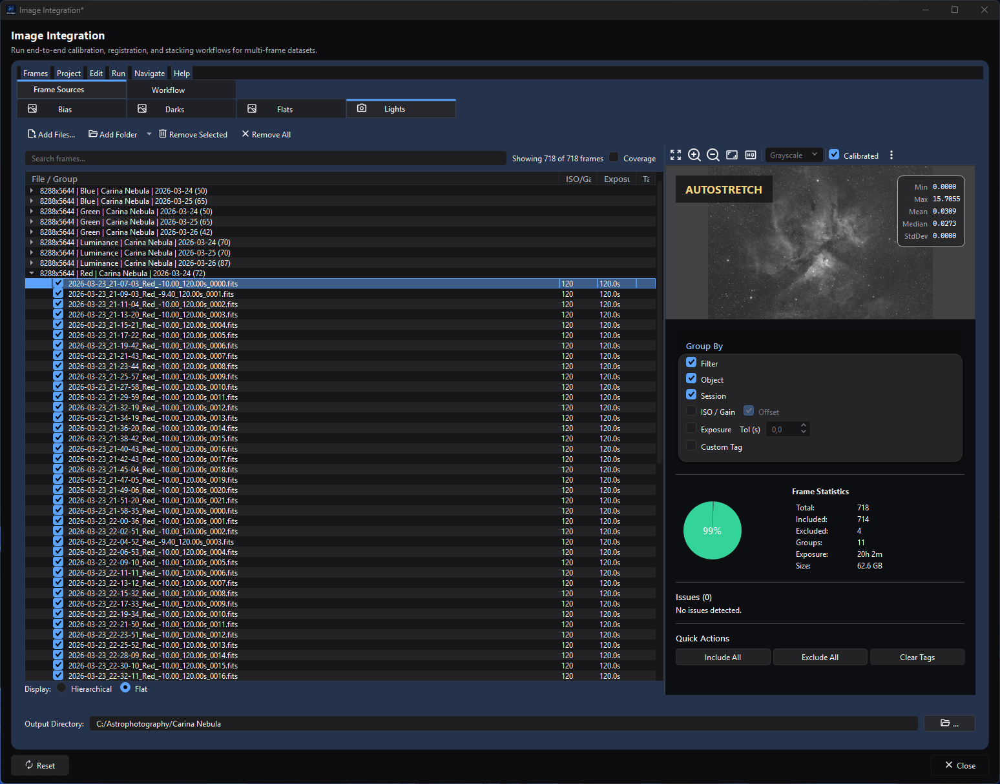
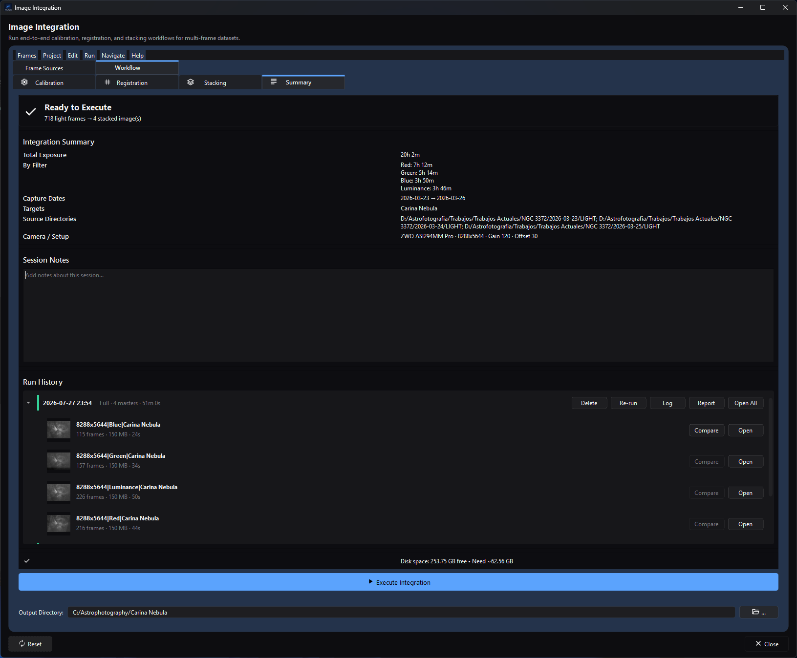
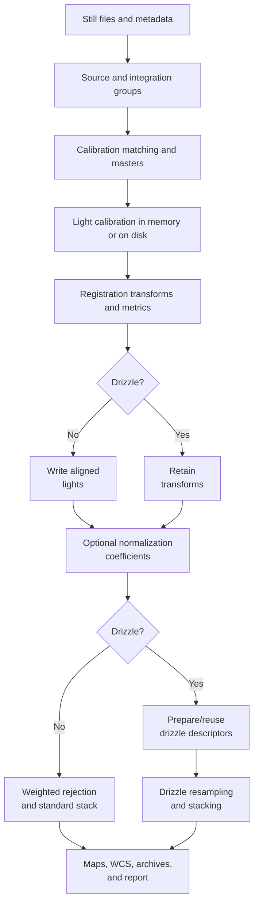

# Image Integration

The table records the primary exact-path inventory. The list below names the remaining files; together, the table and list are the exhaustive source/test inventory:

- Model/core: `src/AfterNightProcesses/processes/ImageIntegration/model/GroupingKeys.h`; `src/AfterNightProcesses/processes/ImageIntegration/model/GroupingKeys.cpp`; `src/AfterNightProcesses/processes/ImageIntegration/model/GroupingEngine.cpp`; `src/AfterNightProcesses/processes/ImageIntegration/model/RegistrationGroupEngine.cpp`; `src/AfterNightProcesses/processes/ImageIntegration/model/IntegrationGroupEngine.cpp`; `src/AfterNightProcesses/processes/ImageIntegration/model/FrameMetadata.cpp`; `src/AfterNightProcesses/processes/ImageIntegration/model/FrameCollection.cpp`; `src/AfterNightProcesses/processes/ImageIntegration/core/FileImport.cpp`; `src/AfterNightProcesses/processes/ImageIntegration/core/FilenameUtils.h`; `src/AfterNightProcesses/processes/ImageIntegration/workflow/stages/CalibrationStackInputs.cpp`; `src/AfterNightProcesses/processes/ImageIntegration/core/StackingParamsUtils.cpp`; `src/AfterNightProcesses/processes/ImageIntegration/core/NormalizationOptionParsing.cpp`; `src/AfterNightProcesses/processes/ImageIntegration/core/RejectionMapUtils.h`.
- UI builders/dialogs: `src/AfterNightProcesses/processes/ImageIntegration/tabs/CalibrationTabUiBuilder.h`; `src/AfterNightProcesses/processes/ImageIntegration/tabs/RegistrationTabUiBuilder.h`; `src/AfterNightProcesses/processes/ImageIntegration/tabs/StackingTabUiBuilder.h`; `src/AfterNightProcesses/processes/ImageIntegration/tabs/SummaryTabUiBuilder.h`; `src/AfterNightProcesses/processes/ImageIntegration/tabs/BiasCalibrationPanel.cpp`; `src/AfterNightProcesses/processes/ImageIntegration/tabs/DarkCalibrationPanel.cpp`; `src/AfterNightProcesses/processes/ImageIntegration/tabs/FlatCalibrationPanel.cpp`; `src/AfterNightProcesses/processes/ImageIntegration/tabs/LightCalibrationPanel.cpp`; `src/AfterNightProcesses/processes/ImageIntegration/controls/RegistrationSettingsDialogUiBuilder.h`; `src/AfterNightProcesses/processes/ImageIntegration/controls/StackingSettingsDialogUiBuilder.h`; `src/AfterNightProcesses/processes/ImageIntegration/controls/LocalNormalizationSettingsDialogUiBuilder.h`; `src/AfterNightProcesses/processes/ImageIntegration/controls/StackingRecommendationDialog.cpp`; `src/AfterNightProcesses/processes/ImageIntegration/dialogs/ManualRegistrationDialog.cpp`; `src/AfterNightProcesses/processes/ImageIntegration/dialogs/CometTrackingDialog.h`; `src/AfterNightProcesses/processes/ImageIntegration/dialogs/BlinkComparatorDialog.cpp`; `src/AfterNightProcesses/processes/ImageIntegration/dialogs/ImportProgressDialog.cpp`; `src/AfterNightProcesses/processes/ImageIntegration/dialogs/WorkflowProgressDialogV2.cpp`.
- Preview/diagnostic/control implementations: `src/AfterNightControls/controls/CalibrationPreviewConfig.h`; `src/AfterNightControls/controls/CalibrationPreviewUtils.h`; `src/AfterNightControls/controls/ImageViewControl.cpp`; `src/AfterNightProcesses/processes/ImageIntegration/widgets/GroupingOptionsWidget.cpp`; `src/AfterNightProcesses/processes/ImageIntegration/widgets/FrameStatisticsDashboard.cpp`; `src/AfterNightProcesses/processes/ImageIntegration/widgets/FrameGroupingIssuesWidget.cpp`; `src/AfterNightProcesses/processes/ImageIntegration/widgets/FrameQuickActionsWidget.cpp`; `src/AfterNightProcesses/processes/ImageIntegration/widgets/CalibrationCoverageWidget.cpp`; `src/AfterNightProcesses/processes/ImageIntegration/widgets/CalibrationIssuesWidget.cpp`; `src/AfterNightProcesses/processes/ImageIntegration/widgets/CalibrationPolicyWidget.cpp`; `src/AfterNightProcesses/processes/ImageIntegration/widgets/CalibrationQuickActionsWidget.cpp`; `src/AfterNightProcesses/processes/ImageIntegration/widgets/FrameQualityDashboard.cpp`; `src/AfterNightProcesses/processes/ImageIntegration/widgets/QualityDistributionWidget.cpp`.
- Workflow/stages: `src/AfterNightProcesses/processes/ImageIntegration/workflow/WorkflowManifest.cpp`; `src/AfterNightProcesses/processes/ImageIntegration/workflow/ManifestDiff.cpp`; `src/AfterNightProcesses/processes/ImageIntegration/workflow/DirtyStateTracker.cpp`; `src/AfterNightProcesses/processes/ImageIntegration/workflow/ManifestHashing.cpp`; `src/AfterNightProcesses/processes/ImageIntegration/workflow/ArtifactTracker.cpp`; `src/AfterNightProcesses/processes/ImageIntegration/workflow/WorkflowRunStateStore.cpp`; `src/AfterNightProcesses/processes/ImageIntegration/workflow/WorkflowExecutionController.cpp`; `src/AfterNightProcesses/processes/ImageIntegration/workflow/RegistrationWorkAnalyzer.cpp`; `src/AfterNightProcesses/processes/ImageIntegration/workflow/stages/BiasStackingStage.cpp`; `src/AfterNightProcesses/processes/ImageIntegration/workflow/stages/DarkStackingStage.cpp`; `src/AfterNightProcesses/processes/ImageIntegration/workflow/stages/FlatStackingStage.cpp`; `src/AfterNightProcesses/processes/ImageIntegration/workflow/stages/LightsCalibrationStage.cpp`; `src/AfterNightProcesses/processes/ImageIntegration/workflow/stages/LightsRegistrationStage.cpp`; `src/AfterNightProcesses/processes/ImageIntegration/workflow/stages/LightsAlignmentStage.cpp`; `src/AfterNightProcesses/processes/ImageIntegration/workflow/stages/LightsNormalizationStage.cpp`; `src/AfterNightProcesses/processes/ImageIntegration/workflow/stages/LightsDrizzleStage.cpp`; `src/AfterNightProcesses/processes/ImageIntegration/workflow/stages/LightsStackingStage.cpp`; `src/AfterNightProcesses/processes/ImageIntegration/workflow/stages/StageUtilities.cpp`.
- Persistence/reporting/engine: `src/AfterNightProcesses/processes/ImageIntegration/persistence/AutosaveManager.cpp`; `src/AfterNightProcesses/processes/ImageIntegration/persistence/IntegrationDatabase.cpp`; `src/AfterNightProcesses/processes/ImageIntegration/persistence/RegistrationMetricsRepository.cpp`; `src/AfterNightProcesses/processes/ImageIntegration/reporting/WorkflowReportSectionBuilders.cpp`; `src/AfterNightProcesses/processes/ImageIntegration/reporting/WorkflowReportArchiveLoader.cpp`; `src/AfterNightEngine/src/algorithms/cosmeticcorrection/CosmeticCorrection.cpp`; `src/AfterNightEngine/src/algorithms/stars/StarAlignment.cpp`; `src/AfterNightProcesses/processes/core/RegistrationRun.cpp`; `src/AfterNightProcesses/processes/core/LinearChannelMatch.cpp`; `src/AfterNightEngine/src/algorithms/drizzle/DrizzleCanvas.cpp`; `src/AfterNightEngine/src/algorithms/drizzle/DrizzleMapDescriptor.cpp`; `src/AfterNightControls/app/PlateSolveService.cpp`; `src/AfterNightEngine/src/algorithms/astrometry/solver/PlateSolver.cpp`; `src/AfterNightProcesses/processes/ImageIntegration/workflow/PreviewThumbnailGenerator.cpp`.
- Additional focused tests: `src/AfterNightTests/Test_ImageIntegration/unit/test_file_import.cpp`; `src/AfterNightTests/Test_ImageIntegration/unit/test_grouping_engine.cpp`; `src/AfterNightTests/Test_ImageIntegration/unit/test_integration_data_model.cpp`; `src/AfterNightTests/Test_ImageIntegration/unit/test_calibration_matcher.cpp`; `src/AfterNightTests/Test_ImageIntegration/persistence/test_autosave_recovery.cpp`; `src/AfterNightTests/Test_ImageIntegration/persistence/test_presets.cpp`; `src/AfterNightTests/Test_ImageIntegration/workflow/test_calibration_stages.cpp`; `src/AfterNightTests/Test_ImageIntegration/workflow/test_dirty_state_tracker.cpp`; `src/AfterNightTests/Test_ImageIntegration/workflow/RegistrationStageTest.cpp`; `src/AfterNightTests/Test_ImageIntegration/workflow/AlignmentStageTest.cpp`; `src/AfterNightTests/Test_ImageIntegration/workflow/NormalizationStageTest.cpp`; `src/AfterNightTests/Test_ImageIntegration/workflow/StackingStageTest.cpp`; `src/AfterNightTests/Test_ImageIntegration/workflow/test_partial_success.cpp`; `src/AfterNightTests/Test_ImageIntegration/workflow/test_workflow_cancellation.cpp`; `src/AfterNightTests/Test_ImageIntegration/workflow/test_workflow_execution_controller.cpp`; `src/AfterNightTests/Test_ImageIntegration/workflow/test_workflow_run_state_store.cpp`; `src/AfterNightTests/Test_ImageIntegration/ui/test_registration_settings_dialog.cpp`; `src/AfterNightTests/Test_ImageIntegration/ui/test_stacking_recommendation_dialog.cpp`; `src/AfterNightTests/Test_ImageIntegration/ui/test_blink_comparator.cpp`; `src/AfterNightTests/Test_ImageIntegration/ui/test_import_progress_dialog.cpp`; `src/AfterNightTests/Test_ImageIntegration/ui/test_workflow_progress_dialog_v2.cpp`.
- Preview/diagnostic surface tests: `src/AfterNightTests/Test_ImageViewControl/test_static_preview_behavior.cpp`; `src/AfterNightTests/Test_ImageViewControl/test_calibration_preview_utils.cpp`; `src/AfterNightTests/Test_ImageIntegration/ui/test_calibration_preview_tooltips.cpp`; `src/AfterNightTests/Test_ImageIntegration/ui/test_frame_source_tab_right_panel.cpp`; `src/AfterNightTests/Test_ImageIntegration/ui/test_frame_statistics_dashboard.cpp`; `src/AfterNightTests/Test_ImageIntegration/ui/test_frame_grouping_issues_widget.cpp`; `src/AfterNightTests/Test_ImageIntegration/ui/test_frame_quick_actions_widget.cpp`; `src/AfterNightTests/Test_ImageIntegration/ui/test_quality_dashboard.cpp`; `src/AfterNightTests/Test_ImageIntegration/ui/test_quality_distribution_widget.cpp`.

## Purpose and expected result

*The Lights source view shows the populated groups, source controls, calibrated
preview, workflow tabs, and selected output directory in one workspace.*

*The Summary view combines the integration details, retained run history,
resource estimate, and report action for the selected project.*

Image Integration is AfterNight's persistent, end-to-end project surface for turning still astrophotography frames into calibrated, registered, aligned, normalized, and stacked linear masters. It is intended for multi-frame projects that benefit from one shared frame inventory, consistent grouping and matching, incremental reruns, and a reproducible report.

You load light frames and any available bias, dark, and flat frames, verify the generated groups and assignments, choose registration and stacking settings, review the execution plan, and run it. A successful full run leaves one stacked FITS master per integration group, intermediate products required by the selected options, registration metrics, incremental state, and a run archive with an HTML/Markdown report. Source frames are never modified.

Implementation facts below are distinguished from suggested starting points. In particular, the guide does not claim that a warning-free plan guarantees scientifically good calibration or registration.

## At a glance

| Item | Current behavior |
| --- | --- |
| Menu path | **Process > Preprocess > Image Integration**. The Dashboard **Image Integration** card is a second entry point. |
| Enabled when | Always available as a top-level process; no active image or sequence is required. **Execute Integration** is enabled only when model validation has no blocking errors. |
| Inputs | Still FITS, TIFF, PNG, JPEG, camera RAW, and XISF files accepted by the engine image-codec extension check; optional existing FITS/XISF calibration masters; metadata such as dimensions, frame type, filter, object, session, gain/ISO, offset, exposure, temperature, capture time, CFA, WCS, and SIP. |
| Outputs | Generated master bias/dark/flat FITS files, optional calibrated and CA-corrected lights, registration metrics, registered lights or drizzle descriptors, normalization coefficients, stacked FITS masters, optional rejection/quality maps and RGB/comet products, incremental-state databases/JSON, session notes, run archives, logs, and HTML/Markdown reports. Source files remain unchanged. |
| Recommended image state | Linear acquisition data. RAW white balance is forcibly disabled and workflow calibration is performed in the raw-before-demosaic domain. Final masters remain linear. |
| Preview support | The source tabs provide a read-only static frame preview, and the Lights preview adds an off-by-default **Calibrated** toggle that applies the currently matched, already available bias/dark/flat masters and Light Calibration Settings to the preview only. It can preview a usable subset of calibration; complete coverage is not implied. There is no real-time process preview and no Apply-to-active-image action. Manual Registration, Track Comet, and Blink Comparator provide additional task-specific inspection. Execution writes files. |
| Sequence support | Unsupported. Import accepts engine-supported still-image extensions, not SER, image-list, or video sequences. Extract frames first. |
| Mask support | Unsupported. The process is file/project based and does not read the active image's mask. |
| External dependencies | No external tool is required for basic star matching and stacking. Auto-solving, placing a Mosaic panel star matching cannot register, or solving a final master needs a configured local/online plate solver; Gaia enrichment needs an installed catalog. Network use depends on the chosen solver, and Mosaic alignment calls it whatever **Auto-solve unsolved frames** says. |

## Before you start

- Put original frames somewhere stable. Project JSON and autosave records paths; they do not embed image data.
- Supply at least two usable light frames for a normal stack. The UI requires lights and a writable output directory; downstream stages can still fail when too few compatible frames remain.
- Prefer complete metadata. File import takes a frame's type from its header - `IMAGETYP`, then INDI's `FRAME` when `IMAGETYP` names no kind, or an XISF image's type; `OFFSET` anywhere in the value, as in `MasterOffset`, names a bias - and only when the header states none from a recognizable directory name (`bias`, `darks`, `flats`, `lights`, and related plural/offset names); a light frame in a folder named `darks` stays a light. Unknown auto-sorted files fall back to the current source type. A frame's session is the UTC date of its exposure start (`DATE-OBS`), or of the time the file was written (`DATE`) when it states no start, or of the file's modification time when it states neither.
- Confirm that frames intended for one registration group share usable geometry and channels. The current registration key is resolution plus effective object name; channel count and binning are not part of that key.
- Decide whether calibration masters should be built or supplied. Marking one included calibration file as a master makes that group use the file directly and skip master stacking.
- Select a dedicated writable output directory with enough free space. Existing products can be staged and replaced; the previous copies go into run history when the run commits.
- Treat changes to source grouping carefully. Regrouping changes group keys and clears or remaps group-specific settings and selections.
- For CFA/RAW data, verify the CFA pattern and demosaic method in Registration settings. The workflow's raw load policy uses no white balance before calibration.
- Configure plate solving in Settings before enabling **Auto-solve unsolved frames during Registration**, choosing **Mosaic** alignment - which sends the panels star matching cannot register to the configured solver whatever Auto-solve says - or relying on **Plate-Solve Final Master If Needed**.
- Capture requests are pending; screenshots on this page are not runtime evidence.

## Procedure

1. Open **Process > Preprocess > Image Integration** or the Dashboard card. Confirm that the window shows **Frame Sources** and **Workflow**, with source tabs **Bias**, **Darks**, **Flats**, and **Lights**.
2. Add files with the per-tab **Add Files...**/**Add Folder...** buttons or the **Frames** menu. Use a typed action when the files must be treated as that type; use **Auto-sort by file type...** when metadata/folder detection should decide. The checkpoint is a populated tree with the expected file types and no import issue you intend to fix.
3. In each source tab, inspect metadata, inclusion checkboxes, and grouping. Use **Hierarchical** to inspect group membership and **Flat** to inspect individual files. In **Lights**, enable **Coverage** to isolate lights without calibration coverage. After a matching generated or existing master is available, select a light and toggle **Calibrated** to compare its raw and calibrated static previews; the toggle never modifies the source. The checkpoint is that each intended frame belongs to the correct source type and group.
4. Choose **Output Directory** with the `...` button or type a path. The Summary status must no longer report an invalid or unwritable output path.
5. Open **Workflow > Calibration**. Review master sources, matching assignments, fallback warnings, **Matching Policy**, and per-light calibration settings. A missing calibration assignment is a warning when calibration frames exist, not automatically a blocker; decide whether that is intentional.
6. Open **Workflow > Registration**. Select a registration group, open **Registration Settings**, choose the method/reference/transform/alignment/interpolation, and configure manual points or comet observations if that method requires them. Run registration early if you need quality metrics, photometric weighting, or drizzle recommendations. The checkpoint is a group status of Complete or usable Partial with metrics for retained frames.
7. Review **Frame Quality** and the optional **Quality Filters**. Exclude only frames you have inspected. Global exclusion removes a frame from registration and every stack; the Stacking-tab dashboard can exclude it from only the selected stack.
8. Open **Workflow > Stacking**. Verify mandatory grouping by resolution, filter, and object; optionally split by session, custom tag, or exposure. Select each group and open **Stacking Settings...** to choose normalization, rejection, weighting, maps, and drizzle. The checkpoint is one intended output row per final master.
9. Review **Execution Options**. Leave in-memory light calibration enabled unless you need intermediate calibrated files or the workflow selects its low-memory fallback. Set **CPU Threads** and a memory limit appropriate for the machine.
10. Open **Workflow > Summary**. Resolve every error reached through **Go to** and review warnings. Confirm the Integration Summary, estimated disk use, and output-specific Session Notes.
11. Select **Execute Integration** or press `Ctrl+Enter`. In **Execution Plan**, inspect Stage, Group, Decision, Reason, Dependencies, ETA, and Outputs. **Recompute** performs work, **Reuse** keeps valid work, and **Skip** means the stage is not applicable. Select **Run** only when the plan matches the intended scope. A `registration_metrics.db` in a format this version does not read is never changed: the run does not start and the window says why.
12. Monitor the stage timeline, current operation/file, progress, and **Process Output**. **Cancel** is cooperative; it changes to **Cancelling...** while the worker reaches a safe stop.
13. On completion, use **Open Report**, **Run History > Report**, or **Run History > Open All**. Confirm the expected master files and report. A completed-with-warnings run can contain valid products plus recoverable per-frame/group failures; read the warnings before using the masters.

## Complete parameter and action reference

Persistence abbreviations used below:

- **Model** — saved by the five-second app-local autosave and by JSON project export/import.
- **Preset** — included in configuration-only presets when it belongs to grouping, calibration policy/overrides, registration, stacking, or light-calibration settings; frames and output directory are not included.
- **UI** — saved separately in `QSettings` as view layout state.
- **Run** — only the current open window/run unless an output artifact records it.
- **Artifact** — written under the selected output directory and available to later runs.

### Window, project, and source-frame actions

| UI label/action | Type and unit | Runtime default | Persisted-default exception | Valid values, step, or constraints | Effect of increasing, decreasing, or selecting | Dependencies and enable/visibility rules | Quality, artifact, runtime, memory, or disk trade-off | Scope: preview/apply, channel, mask, still/sequence | Persistence |
| --- | --- | --- | --- | --- | --- | --- | --- | --- | --- |
| **Frame Sources** / **Workflow** | Main tab selector | Frame Sources | Last logical tab is not restored as model data | Frame Sources contains Bias/Darks/Flats/Lights; Workflow contains Calibration/Registration/Stacking/Summary | Changes the visible editor only | Always visible | None | Project UI only | Run |
| **Output Directory** / `...` | Path field / folder chooser | Restored autosave value or empty | New state is empty | Existing writable directory, or a creatable path whose parent is writable | Sets the root for all workflow products, state, notes, and history | Execution blocks on empty/invalid/unwritable paths | Long paths and slow disks affect every stage | File workflow; no mask/sequence | Model; not Preset |
| **Add Files...** | Per-tab button | — | — | Supported still files; multiple selection | Adds files as the current tab's type | Available on every source tab | Metadata reads can take time for large selections | Still files only | Model |
| **Add Folder...** | Split button | Non-recursive default action | — | **This Folder Only** or **Recursive** | Imports supported still files from the chosen tree as the current type | Available on every source tab | Recursive scans and metadata reads scale with file count | Still files only | Model |
| **Frames > Add Files... > Add Bias... / Add Darks... / Add Flats... / Add Lights...** | Menu actions | — | — | Supported still files | Forces the selected type even when metadata differs | Always available | Forced type can create incorrect groups if chosen wrongly | Still files only | Model |
| **Auto-sort by file type...** | Menu action | `Ctrl+O` for files; `Ctrl+Shift+O` for recursive folder | — | Supported still files | Uses the header's frame type first, then directory-name detection; unknown files fall back to the current type | File, this-folder, and recursive variants | Incorrect/missing metadata may need **Change Type to** | Still files only | Model |
| **Search frames...** | Text filter | Empty | Search text is not model data | Matches filename, path, filter, object, session, resolution, tag, exposure, gain, offset, and temperature | Narrows visible rows; does not exclude processing | `Ctrl+F`; source tabs only | No workflow effect | View only | Run |
| **Hierarchical** / **Flat** | Radio display mode | Flat | Stored independently per source tab | Two modes | Hierarchical shows grouping nodes; Flat shows files | Source tabs only | No workflow effect | View only | UI |
| Frame tree checkboxes | Include/exclude action | Included | Loaded state may restore exclusions | Checked/unchecked; groups can be mixed | Unchecked frames are globally excluded from calibration, registration, and stacking | Tree rows | Reduces data and runtime but can weaken rejection/registration | Whole still frame; all channels | Model; undoable |
| **Coverage** | Lights-only filter toggle | Off | Stored independently for Lights | On/off | Shows lights missing required calibration coverage | Lights tab only | Diagnostic only | View only | UI |
| Frame preview | Read-only image view | Flats/Lights auto-stretched; CFA auto-debayered for display | Display state is not processing state | Zoom/pan/view controls supplied by the image viewer | Inspects the selected source; does not change workflow pixels | One selected frame | Preview demosaic/stretch/calibration is not an output guarantee | Selected still only; no mask | UI/view cache |
| **Calibrated** | Lights-preview checkbox | Off | Not persisted | On/off | Reloads the selected Light preview after applying the currently matched bias/dark/flat master paths and that group's cosmetic-correction, dark-optimization, flat-auto-level, pedestal, and CCD-bias settings. The raw file is unchanged. | Visible only on Lights. Enabled for a selected non-Pre-Calibrated light when at least one usable matched master remains and every selected master path already exists. A missing or manually unassigned individual type is omitted, so the preview can be partial; normal dark use suppresses bias, while CCD mode with a Dark requires Bias. No usable calibration, a missing selected master file, or the CCD Dark-without-Bias case disables it with an explanatory tooltip. | Loads/caches masters and runs a background static-preview calibration; useful for inspection but not proof of the eventual batch output | Selected still preview only; before viewer statistics/histogram/autostretch; no Apply/mask/sequence | Run/view cache only |
| **Remove Selected** | Button/menu action | — | — | One or more selected rows; `Delete` | Removes selected records from the project, not disk | Current source tab | Can invalidate group settings/assignments | Project records only | Model; undoable |
| **Remove All** / **Remove All Frames...** | Button/menu action | — | — | Confirmation; menu shortcut `Ctrl+Shift+Delete` | Per-tab button clears that type; menu clears all four types | Requires loaded frames | Does not delete files | Project records only | Model; undoable |
| **Go to Group...** | Search/jump action | — | — | `Ctrl+G`; current tree groups | Selects and reveals a matching group | Current source tab | No workflow effect | View only | Run |
| Frame context actions | Context menu | Selection-dependent | — | **Copy File Path**, **Include in Processing**/**Exclude from Processing**, **Show in File Browser**, **Show in Calibration Table**, Lights: **Show in Registration Table**/**Show in Integration Table**, **Blink Selected**, **Remove Selected**, **Change Type to**, **Set as Master**/**Unset as Master**, Lights: **Set as Registration Reference** | Performs the named navigation, inclusion, type, master, reference, compare, or removal action | Actions appear only for applicable selection/type; Blink needs at least two files | Type/master/reference changes can invalidate downstream work | Selected still records | Model for data changes; Run for navigation |
| Metadata override context actions | Context submenu | Metadata value | — | Set/reset **Session**, **Object**, **Custom Tag**; reset Session + Object; reset all overrides | Replaces effective grouping metadata without editing source headers | Selected frames/groups; prompts for values/confirmation | Can split/merge groups and invalidate per-group settings | Selected still records | Model; undoable |
| Group context actions / drag-and-drop | Context/drag actions | — | — | Show matching calibration table; expand/collapse; include/exclude/remove group; change mixed selection type; drag between groups | Group moves create metadata overrides after confirmation | Hierarchical tree and compatible targets | Regrouping may invalidate settings and assignments | Project records | Model; undoable |
| **Frame Statistics** | Lights-only read-only dashboard | Derived; empty until Lights are loaded | — | Total, Included, Excluded, Groups, Exposure, Size, percentage chart; hover for per-group metadata/details | Summarizes the current Light collection and grouping without changing it | Lights right panel | Diagnostic only; totals update after model/grouping changes | Current Light records; no processing scope | Derived from Model |
| **Issues (n)** | Lights-only read-only issue list | **No issues detected.** when clear | — | Up to five displayed issue types plus an additional-count label and tooltips | Reports missing/fallback/manually disabled calibration, single-frame groups, mixed dimensions, high exclusion ratios, and total exclusions | Lights right panel; derived from validation/grouping | Diagnostic only; use the named source/calibration controls to resolve an issue | Current Light groups | Derived from Model |
| **Include All**, **Exclude All**, **Clear Tags** | Lights Quick Actions | — | — | Buttons; Clear Tags confirms | Bulk inclusion or custom-tag clearing | Lights right panel | Excluding all lights blocks execution | All light records | Model; undoable |
| Import Progress: **Pause/Resume**, **Cancel** | Non-modal progress dialog | Running | — | Pause toggles; Cancel is cooperative | Pauses worker admission or cancels remaining imports | Large/asynchronous imports | Already completed detection work may have occurred; cancelled import is not committed | Import only | Run |
| **Import Project...** | Project menu action | — | — | A project exported as JSON | Replaces model state from the JSON project, read whole: a project holding a value no dialog writes is refused with the field and the text named (“The project file could not be read, and nothing was loaded.”) | `Ctrl+I` | Any other file is refused with a message, and nothing is loaded | Project state | Model; recent path in UI |
| **Export Project...** | Project menu action | — | — | JSON output; `Ctrl+E` | Atomically writes the complete model, including frames/settings/output path | Writable destination | Path-based project, not portable embedded data | Project state | JSON artifact; recent path in UI |
| **Open Recent > Clear Recent Projects** | Project menu actions | Up to 10 paths | Missing entries are removed when opened | Recent JSON paths | Opens a project or clears list | Recent entries only | No image data copied | Project state | UI (`QSettings`) |
| **Presets > Save Preset... / Load Preset... / Delete Preset...** | Project menu actions | No presets | A preset holding a value no dialog writes is refused with the value named, and one in a format this version does not read is refused with a message; either is left as it is | Sanitized JSON filename, max 100 characters; overwrite/delete confirms | Saves/applies/deletes configuration only | Preset directory must be writable | Loading is undoable; frames and output directory stay unchanged | Configuration only | Preset JSON under app-local `presets` |
| **Reset Settings...** / **Reset** | Confirmed action | — | — | Keeps loaded frames and output directory | Resets grouping, calibration, registration, stacking, overrides, and other configuration | Menu or standard Reset button | Destructive to configuration, not files | Project settings | Model; autosaved afterward |
| **Undo** / **Redo** | Menu actions | Empty stack | Stack limit 100 commands | Standard shortcuts supplied by Qt | Reverses supported model edits, including preset load | Enabled when stack has entries | Does not reverse completed disk workflows | Project edits | Run undo stack |
| **Execute Integration** | Menu/button action | Disabled until ready | — | `Ctrl+Enter`; opens Execution Plan | Builds, validates, plans, then executes after **Run** | Requires no blocking model/manifest error | Potentially long and disk-intensive | Whole project or requested group | Creates Artifacts |
| **Navigate > Bias ... Summary** | Menu actions | — | — | `Ctrl+1` through `Ctrl+8` | Opens the corresponding logical tab | Always available | No workflow effect | View only | Run |
| **Keyboard Shortcuts** | Help action | — | — | `F1`/Help | Opens shortcut reference | Always available | No workflow effect | Help only | None |

### Source grouping controls

Resolution is always part of every source group and cannot be disabled. Hidden criteria are normalized out by frame type.

| UI label/action | Type and unit | Runtime default | Persisted-default exception | Valid values, step, or constraints | Effect of increasing, decreasing, or selecting | Dependencies and enable/visibility rules | Quality, artifact, runtime, memory, or disk trade-off | Scope: preview/apply, channel, mask, still/sequence | Persistence |
| --- | --- | --- | --- | --- | --- | --- | --- | --- | --- |
| **Group By: Resolution** | Mandatory criterion | On | None | Exact width × height string | Separates incompatible dimensions | Always applied; not editable | More groups but safer geometry | Current source type | Model + Preset |
| **Filter** | Criterion | On for Flat/Light | Hidden/off for Bias/Dark | On/off | Separates filters | Flat and Light only | Prevents unlike flats/lights from mixing | Current source type | Model + Preset |
| **Object** | Criterion | Off for Flat; on for Light | Hidden/off for Bias/Dark | On/off | Separates effective object names | Flat/Light only | Flat grouping by object is optional; Light registration separately always uses object | Current source type | Model + Preset |
| **Session** | Criterion | On for Flat/Light | Hidden/off for Bias/Dark | On/off | Separates effective sessions | Flat/Light only | More groups and stricter same-session calibration | Current source type | Model + Preset |
| **ISO/Gain** | Criterion | Off | None | On/off | Separates sensor gain/ISO | All source types | Safer sensor matching; more groups | Current source type | Model + Preset |
| **Offset** | Criterion | On internally | Effective only with **ISO/Gain** | On/off | Separates sensor offset | Enabled when ISO/Gain is selected | Safer matching; more groups | Current source type | Model + Preset |
| **Exposure** / **Tol (s)** | Criterion / seconds | Dark: on, 3.0 s; Light: off, tolerance inactive | Off/hidden for Bias/Flat | Toggle; 0–36000 s on source tabs, step 0.1; 0 means exact | Larger tolerance merges nearby exposures; smaller splits them | Dark/Light only; tolerance enabled with Exposure | Wider dark groups improve counts but can mismatch thermal signal | Current source type | Model + Preset |
| **Temperature** / **Tol (°C)** | Criterion / Celsius | Dark: off, tolerance inactive | Hidden for Bias/Flat/Light | Toggle; 0–10 °C, step 0.1; 0 means exact | Larger tolerance merges nearby sensor temperatures | Dark only | Wider groups improve counts but can mix thermal states | Dark source | Model + Preset |
| **Custom Tag** | Criterion | Off | None | On/off; user text from metadata override | Separates manually tagged groups | All source types | Useful for optical train or acquisition distinctions absent from headers | Current source type | Model + Preset |

Grouping changes are debounced before rebuilding the tree. They can change group keys, so review master/reference assignments and group settings afterward.

### Calibration tab and settings

| UI label/action | Type and unit | Runtime default | Persisted-default exception | Valid values, step, or constraints | Effect of increasing, decreasing, or selecting | Dependencies and enable/visibility rules | Quality, artifact, runtime, memory, or disk trade-off | Scope: preview/apply, channel, mask, still/sequence | Persistence |
| --- | --- | --- | --- | --- | --- | --- | --- | --- | --- |
| **Bias Groups**, **Dark Groups**, **Flat Groups**, **Light Groups** | Collapsible tables | Derived from sources | — | One row per current group | Selecting a row cross-highlights matching or affected groups. The Dark table's **Bias Master** column shows `-` for every group, its tooltip saying why: no bias is subtracted when darks are stacked, and CCD mode subtracts it from the master dark where a light is calibrated | Calibration tab | Diagnostic/edit surface | Project groups | Derived from Model |
| **Calibration Coverage** | Read-only coverage chart | Derived; reports that coverage is not computed when no calibration frames are loaded | — | Complete, Warning, Override, and Incomplete Light-group counts/percentage | Summarizes current automatic/manual coverage; Pre-Calibrated groups are omitted | Calibration tab; Light groups required | Diagnostic only; fallback matches count as Warning when **Warn on fallback matches** is on, manual choices count as Override, and missing required matches count as Incomplete | All Light groups | Derived from Model |
| **Issues (n)** | Read-only grouped issue list | **No calibration issues detected.** when clear | — | Up to five displayed issue types plus an additional-count label and per-group tooltips | Groups current calibration validation warnings/errors by code and affected group | Calibration tab | Diagnostic only; it does not change assignments | Calibration validation | Derived from Model |
| Calibration master table cells | Assignment/source controls | Auto-generated unless an existing master is selected | — | **Auto-detect**, **Browse...**, **Do not use**, candidates, batch assignment; existing master status | Chooses a generated, detected, user-defined, or disabled master | Available by calibration type and dependent group | Wrong master produces systematic calibration error; existing master saves time | Group-wide | Model + Preset overrides |
| **Stacking Settings...** | Group dialog action | Type defaults | — | Opens calibration-mode Stacking Settings | Configures how a master is built | Selected Bias/Dark/Flat group; light-only controls hidden | Strong rejection needs enough frames | Selected calibration group | Model + Preset |
| **+ Add Master** | File action | — | — | FIT/FITS/XISF chooser in group panels | Adds and marks an existing master for the group | Calibration groups | Avoids rebuilding; source must be compatible | Group-wide | Model + Preset override |
| **Smart Match** | Light-panel action | Current automatic matches | — | Re-evaluates all light assignments | Applies current grouping/policy to lights | Light groups | Can replace manual assumptions; inspect results | All lights | Model-derived matches |
| **Calibration Settings...** | Light-group dialog action | Cosmetic on; dark optimization off; flat auto-level on; pedestal 0 | — | Opens settings below | Configures per-light calibration | Selected light group | Affects calibrated pixels and every downstream artifact | Group-wide, all channels/CFA samples | Model + Preset |
| **Pre-Calibrated** | Light-group checkbox/action | Off | — | On/off | Skips bias/dark/flat/cosmetic calibration for that group and suppresses missing-calibration warnings; the run's manifest names the group and the report's **Calibration Summary** lists it, so a pre-calibrated group is not read as one no master matched | Light groups | Prevents double calibration; wrong use leaves defects uncorrected | Group-wide | Model + Preset |
| **Matching** | Light-group instant-popup menu | Mirrors the current matching policy | — | **Allow dark exposure fallback**; **Dark exposure tolerance... (n%)**; **Advanced: Subtract bias from darks (CCD sensors)**; **Allow flat session fallback**; **Max flat session days apart... (n)**; **Prefer newer flats**; **Warn on fallback matches**; **Reset matching policy to defaults**; **Clear all calibration overrides**. The last two actions confirm. | Edits the same policy and overrides exposed by **Matching Policy** and **Quick Actions**. Its reset action resets policy and clears every override, unlike the separate **Reset Matching Policy** quick action, which preserves overrides. | Dark fallback/tolerance are disabled unless Dark grouping uses Exposure. Flat fallback/day/preference actions are disabled unless Flat grouping uses Session. | Immediate project-wide rematching can change masters and downstream dirty state | All Light matching | Model + Preset; undoable |
| **Allow flat session fallback** | Matching-policy checkbox | On | — | On/off | Allows closest compatible flat session when exact session is absent | Calibration frames/lights present | Recovers coverage but can use a temporally different optical state | All light matching | Model + Preset |
| **Max session gap (days)** | Integer days | 30 | — | 0–365 | Larger permits more distant flat sessions | Flat fallback on | Wider fallback raises dust/rotation mismatch risk | All light matching | Model + Preset |
| **Prefer newer flats** | Checkbox | Off | — | On/off | Breaks equally distant fallback ties toward newer flats | Flat fallback on | Tie-break only | All light matching | Model + Preset |
| **Allow dark exposure fallback** | Checkbox | On | — | On/off | Permits closest compatible dark exposure | Calibration frames/lights present | Improves coverage but may leave exposure-dependent residuals | All light matching | Model + Preset |
| **Exposure tolerance (%)** | Integer percent | 20% | — | 0–100 | Larger permits a wider dark/light exposure mismatch | Dark fallback on | More coverage, less exact dark subtraction | All light matching | Model + Preset |
| **Warn on fallback matches** | Checkbox | On | — | On/off | Shows fallback and ambiguous multiple matches as warnings; disabling it does not stop the selected match from being used | Fallback/ambiguity diagnostics | Diagnostic only | Summary/issues | Model + Preset |
| **Subtract bias from dark (CCD mode)** | Checkbox | Off | — | On/off | Requires both bias and dark; subtracts bias from the dark before light calibration, once: a master dark the run stacks holds the bias, as a supplied one should, so the dark factor or optimization scales the thermal signal alone | CCD workflow; the Light **Matching** menu labels the same setting **Advanced: Subtract bias from darks (CCD sensors)** | Correct for uncalibrated dark masters; inappropriate for already bias-corrected masters | All matched lights | Model + Preset |
| **Clear All Overrides** | Quick action | — | — | One click; no confirmation | Removes manual master assignments/unassignments | Calibration tab | Returns to policy matching | All groups | Model + Preset; undoable |
| **Reset Matching Policy** | Quick action | — | — | One click; no confirmation | Restores policy defaults above but preserves manual overrides | Calibration tab | Changes fallback results | All groups | Model + Preset; undoable |
| **Disable All Fallbacks** | Quick action | — | — | One click | Disables flat/dark fallback and fallback warnings | Calibration tab | Produces stricter missing-coverage warnings | All groups | Model + Preset |
| **Enable cosmetic correction** | Checkbox | On | — | On/off | Finds hot and cold pixels in the master dark against each dark channel's whole-image median and population standard deviation, and replaces them in each calibrated light with the median of the pixels around them - of the same colour in a filter-array mosaic; only the replacement is local | Light Calibration Settings; the pixels are found in the dark master, so a light with no dark has none corrected, which the run's warnings say once per calibration, in memory or on disk | Detection/preparation costs CPU; aggressive thresholds can alter real compact signal | Selected/all light groups | Model + Preset |
| **Cold Sigma (σ)** / **Hot Sigma (σ)** | Sigma thresholds | 3.0 / 3.0 | — | 0.1–10.0, step 0.1 | A dark sample at or below `median - Cold × deviation` of its channel is cold, and one at or above `median + Hot × deviation` is hot, the median and deviation being the whole channel's; lower detects more, higher is more conservative | Enabled with cosmetic correction | Too low can affect faint detail/bright stars; too high leaves defects | Selected/all light groups | Model + Preset |
| **Enable dark optimization** | Checkbox | Off | — | On/off | Requests automatic dark scaling by noise minimization | Dark master required | Engine search adds work and may compensate moderate mismatch | Selected/all light groups | Model + Preset |
| **Multiplication Factor** | Scalar | 1.00 | — | 0.1–10.0, step 0.1 | Multiplies the dark before it is subtracted whenever the dark is not optimized | Always enabled: it scales every light's dark with optimization off, and the dark of each light the optimization cannot measure with it on | With optimization on, a single-channel light of at least 512×512 gets the engine's own factor on 0–2 over its central 512×512 square and ignores this one; a colour (multi-channel) light, one smaller than 512×512, or one whose dark does not vary over that square, is scaled by the entered value instead, and the run's warnings say so once per calibration, in memory or on disk. With optimization off the entered value is applied as a fixed scale. | Selected/all light groups | Model + Preset |
| **Enable flat auto-level** | Checkbox | On | — | On/off | Divides each channel of the master flat - each colour of a filter-array mosaic - by its mean over the central third of the frame before the light is divided by it, so the light keeps its level and its colour balance there; off divides by the flat as supplied | Flat master used | Usually required unless the supplied master is already normalized | Selected/all light groups | Model + Preset |
| **Pedestal Value** | ADU integer, read as 16-bit codes | 0 | — | 0–10000, step 1 | Adds a positive offset before subtraction/division; the value is divided by 65,535 to a fraction of full scale whatever the light's own bit depth | Always available | Can prevent low-end clipping; changes baseline; added as stated and not clamped to the light's range | Selected/all light groups | Model + Preset |
| **Reset to Defaults**, **Apply to All Groups**, **OK**, **Cancel** | Dialog actions | — | — | Apply-to-all confirms | Reset affects dialog values; Apply-to-all overwrites all Light groups; OK commits selected group; Cancel discards | Calibration Settings dialog | Apply-to-all has broad scope | Settings only | Model after commit |

#### Exact calibration-matching contract

Manual override and explicit **Do not use** state are checked before automatic matching for the exact Light group key. Automatic matching then applies these rules:

| Master | Exact compatibility | Multiple exact candidates | Fallback selection |
| --- | --- | --- | --- |
| Bias | Resolution always; ISO/Gain when enabled for Bias; Offset only when both ISO/Gain and Offset are enabled; Custom Tag when enabled | Uses deterministic group-key order, marks the result ambiguous, and shows a warning when **Warn on fallback matches** is on | None |
| Dark | Resolution always; optional ISO/Gain, dependent Offset, Custom Tag, and Exposure. Exposure is compared after each value is snapped to the nearest configured Dark exposure-tolerance interval. Temperature is deliberately not a compatibility gate. | Prefers a finite absolute Light/Dark temperature difference; improvements greater than 0.25 °C replace the current candidate, while differences within 0.25 °C are tied by deterministic group-key order. With a Light temperature, only finite tied candidates make the result ambiguous; missing Dark temperatures do not. Without a Light temperature, any multiple compatible candidates are ambiguous. | Attempted only when **Allow dark exposure fallback** is on and Dark grouping uses Exposure. Other enabled fields must remain compatible; exposure difference must be no greater than Light exposure × tolerance percent. The matcher minimizes exposure difference with a 0.000001 s tie epsilon, then prefers finite temperature improvements greater than 0.25 °C, then group key. With a finite selected temperature, ambiguity includes exposure-tied candidates within 0.25 °C of it; otherwise every exposure-tied candidate counts. |
| Flat | Resolution always; optional ISO/Gain, dependent Offset, Filter, Object, Session, and Custom Tag | Uses deterministic group-key order, marks the result ambiguous, and optionally warns | Attempted only when **Allow flat session fallback** is on and Flat grouping uses Session. Light and Flat sessions must both parse exactly as `yyyy-MM-dd`; invalid dates do not fall back. Other enabled fields must match, except an empty/`-` Flat object acts as a wildcard. The closest date within **Max session gap (days)** wins; an equal-distance tie chooses newer when **Prefer newer flats** is on, otherwise older, then group key. |

Dark temperature grouping controls how Dark frames form source groups; it does not impose a maximum temperature distance during Light matching. Likewise, **Warn on fallback matches** changes presentation, not which automatic candidate is selected.

Calibration matching is asymmetric: a matched dark normally takes precedence over bias for a light. In CCD mode both are used so the bias is removed from the dark first. A flat group's dark is matched as a light's of the flat's exposure and temperature would be, in the run as in the Flat panel: Bias is not used when a Dark master is available, because the dark holds the bias, so the flat takes the dark alone - in CCD mode too, where taking the bias from the flat and from the dark leaves the same flat; with no matching dark it takes the bias. A calibration group is stacked when a light shares its key or a light or flat of the run is matched to it, so a flat-dark at the flats' exposure and a dark the exposure fallback finds for a light are made too. When no calibration frames of any type are loaded, lights-only processing does not produce missing-calibration warnings. Missing/fallback/manual-unassignment warnings do not by themselves block execution.

### Registration tab, quality, and registration settings

| UI label/action | Type and unit | Runtime default | Persisted-default exception | Valid values, step, or constraints | Effect of increasing, decreasing, or selecting | Dependencies and enable/visibility rules | Quality, artifact, runtime, memory, or disk trade-off | Scope: preview/apply, channel, mask, still/sequence | Persistence |
| --- | --- | --- | --- | --- | --- | --- | --- | --- | --- |
| **Registration Groups** | Table | Resolution + effective object groups | — | Columns: Group, Frames, Filters, Exposures, Alignment, Algorithm, Reference, Status | Selects the group for settings/run actions | Included lights only | One group shares one transform/reference contract | Group-wide | Derived; settings in Model |
| **Registration Settings** | Button | — | — | Opens selected group's dialog | Edits method and detector settings | One group selected | Settings changes invalidate registration and dependent stacks | Group-wide | Model + Preset |
| Group context: **Registration Settings...**, **Run Registration**, **Clear Registration...**, **Select All Frames** | Context actions | — | — | Clear confirms | Opens settings, performs a group run, deletes the group's registration records (star detections, metrics, transforms and comet records in `registration_metrics.db`; the registered image files stay), or selects rows | Group row | Clearing forces recomputation | Group-wide | Artifacts/Model |
| **Run Registration** / **Run Registration (All Groups)** | Action | — | — | Selected group or all groups | Builds a registration-only/incremental plan | Valid group(s) | Produces metrics needed by quality, weights, and drizzle | Registration and dependencies | Artifacts |
| **Set as Registration Reference** | Button/context action | Auto-reference by default | — | One included frame | Fixes the selected reference for its registration group | One frame selected; auto-reference may be disabled by method | Reference quality affects every transform | Group-wide | Model + Preset |
| **Exclude Selected**, **Include Selected**, **Reset Excluded...** | Global frame actions | Included | — | Selection; Reset confirms | Changes global inclusion for registration and stacking | Frame Quality table | Fewer frames reduce work but weaken integration | Whole frames | Model; undoable |
| Quality table | Metrics table | Empty before registration | — | Status, Frame, Filter, Stars, FWHM (px), SNR, Ecc, Score, Quality | Sorts and exposes measured registration quality | Metrics required | Metrics are inputs to selection and weighting, not a guarantee of image quality | Frame records | `registration_metrics.db` + Model cache |
| **Score ≥** | Enabled threshold / score | Off, 0.00 | — | 0–1000, step 1 | Higher rejects more low-score frames | Checkbox enables editor | Aggressive threshold reduces exposure | Global exclusion preview/action | Run until applied; exclusions Model |
| **Stars ≥** | Enabled threshold / count | Off, 0 | — | 0–100000 | Higher rejects sparse detections | Metrics required | Can reject narrowband or cloudy frames | Global exclusion | Run/Model |
| **SNR ≥** | Enabled threshold | Off, 0.00 | — | 0–100000, step 1 | Higher rejects low-SNR metrics | Metrics required | Can bias toward brighter backgrounds/filters | Global exclusion | Run/Model |
| **FWHM ≤** | Enabled threshold / pixels | Off, 0.00 | — | 0–100, step 0.1 | Lower rejects broader stars | Metrics required | Tight threshold reduces exposure | Global exclusion | Run/Model |
| **Ecc ≤** | Enabled threshold | Off, 0.00 | — | 0–1, step 0.05 | Lower rejects elongated stars | Metrics required | Tight threshold can reject tracking/optics variations | Global exclusion | Run/Model |
| **Suggest Filters...** / **Exclude Outliers...** | Analysis/apply actions | — | — | IQR-based suggestion; apply confirms | Fills suggested thresholds, then globally excludes failures | Selected group with metrics | Review visually before applying | Frame records | Suggestions Run; exclusions Model |
| Frame Quality dashboard: **Sigma**, **Detect Outliers**, **Exclude Selected Frames**, **Include Selected Frames** | Statistical preview/actions | 3.0σ | — | Sigma 1.0–5.0 | Lower selects more score outliers; actions commit global or current-stack exclusions according to dashboard mode | Metrics required | Statistical outlier is not automatically a bad exposure | Registration: global; Stacking: selected stack only | Selection Run; exclusions Model |
| Quality chart: **Metric**, **Plot**, **Sort By**, **Norm**, overlays, **Export** | Visualization/export controls | Score; Points; Index; normalization Off | — | Metric: Score/Stars/FWHM/SNR/Ecc; plot: Points/Line/Line+Points/Area/Bars; sort: Index/Value asc/desc/Capture Time; Norm: Off/By Filter; percentile/median/selection/drop-to-baseline toggles; copy/save image/CSV | Changes only diagnostic rendering/export | Metrics required | Large tables/charts add UI cost, not workflow cost | View/export only | Run |
| **Registration Method** | Enum | Star Matching | — | Star Matching, Phase Correlation, Manual Points, Comet Tracking | Selects feature matching, translation-only correlation, user point pairs, or moving-target fit | Method controls visible sections/reference behavior | Phase correlation cannot model rotation/scale; manual/comet require preparation | Selected group | Model + Preset |
| **Minimum Star Pairs** / **Maximum Stars per Frame** | Counts | 10 / 2000 | — | 5–10000 / 10–20000 | Minimum raises acceptance requirement - the star pairs a light must share with the reference or a light registered near it, however small a part of its stars they are; a match of fewer than ten candidate pairs also needs four fifths of them to agree; a reference holding fewer stars than the minimum lowers it to its own stars for the run, never below five, and the log says so - a reference of four stars or fewer cannot match its lights by their stars, which it says too; maximum caps the stars detected in each frame, which are the candidates for matching, and a changed cap detects the group's lights again | Star-based methods | More pairs can improve robustness and cost more | Group | Model + Preset |
| **Auto-select** | Checkbox | On for Star Matching | — | On/off | Performs first-pass quality analysis and chooses the best reference, which the group's record names | Disabled for methods requiring a fixed reference | Adds analysis but avoids an arbitrary reference | Group | Model + Preset |
| **Reference Image** / **Best** | Frame selector/action | First/auto candidate | — | Included frames in group | Chooses fixed reference; Best analyzes candidates; with no reference chosen and auto-select off, the group's first light is the reference, which the log names as "(first in group)" | Enabled when auto-select is off or method requires fixed reference | Reference controls output geometry/relative quality | Group | Model + Preset |
| **Auto-solve unsolved frames during Registration** | Checkbox | Off | Under **Mosaic** it shows on, disabled, with a note: Mosaic sends every panel star matching cannot register - and the reference it is placed against, when its header holds no solution - to the configured solver whatever the choice is. The choice the group stores is kept and comes back with another canvas | On/off | Reuses valid WCS and solves unsolved inputs before registration | Enabled only when a configured solver is available - a ready Gaia catalog, an executable ASTAP or local astrometry.net, or an online key, as the run counts them - and not under Mosaic. Without one it shows off and the run sends nothing to a solver, whatever the group stores, and a light only a solve could place is left unregistered with that reason; the stored choice is kept | Local/online solver cost; online mode can use network, which Mosaic can reach with this off | Group | Model + Preset |
| **Enrich with Gaia catalog** | Checkbox | On | — | On/off | After registration, matches the stars of each light detected in the run whose world coordinates are known - its own or solved - against the Gaia catalog, for its photometric zero point, limiting magnitude and catalog-matched star count, which photometric weighting and spectrophotometric calibration read | Offered with or without a catalog; without one installed, a group with such a light enriches nothing and says so once in its warnings, naming the catalog directory | Adds catalog reads per light; turning it off leaves photometric weighting without zero points | Group | Model + Preset |
| **Transform Model** | Enum | Auto - a Homography, refined by a polynomial when that is measurably better (stored as mode Auto over a Homography, order 0) | A stored choice reads by its mode: an order stored beside a linear mode is dropped, and two-pass refinement is on for Polynomial and Auto | Similarity, Affine, Homography, Polynomial 2/3/4, Auto | Increases geometric degrees of freedom; Auto keeps a linear model unless polynomial residual refinement is measurably better; a stated polynomial needs as many star pairs as it has terms - 6, 10 and 15 for orders 2, 3 and 4 - and a light matched by fewer, or whose pairs the order's fit refuses, keeps the linear transform its stars matched, which the log says for that light; under Manual Points a target with fewer pairs than the stated order's terms fails, with **Manual registration failed for** that light | Star/manual registration | Higher order can fit distortion but overfit weak matches | Group | Model + Preset |
| **Standard**, **Mosaic**, **Intersection** | Alignment radio mode | Standard | — | One mode | Standard uses reference canvas; Mosaic uses union canvas, and places a panel star matching cannot register by its world coordinates - its own, or the configured plate solver's, which Mosaic calls whatever **Auto-solve unsolved frames** says; Intersection crops to common overlap - and when no area is common to every light, the alignment, the stack that warps the lights as it reads them and the drizzle all use the Standard canvas instead and say so | All methods | Mosaic uses more memory/disk, and can send panels to an online solver; Intersection discards borders | Group outputs | Model + Preset |
| **Interpolation** | Enum | Auto | — | Auto, Nearest Neighbor, Bilinear, Bicubic, Pixel Area Relation, Lanczos4, Bit Exact Bilinear, Bit Exact Nearest Neighbor | Selects resampling kernel; Auto is Lanczos-4, and the log names it | Alignment | Sharper kernels cost more and can ring; nearest is fast/blocky | All channels | Model + Preset |
| **Correct chromatic aberration before registration** | Checkbox | Off | — | On/off | Aligns red/blue star positions to green before main registration | Colour lights - RGB, or a filter-array mosaic, which registration reads in colour - and enough edge stars | Adds detection/resampling. A group whose every light has one channel is registered from its lights as they are, writes no copy and says once that nothing was corrected (copies an earlier run left are kept current, since every later stage reads them). A colour light whose channels match too few edge stars is written as it was read, and a group in none of whose lights a channel moved says so once | Group | Model + Preset; outputs `ca_corrected_lights` |
| **Edge Fraction**, **CA Fit Type**, **Min Matched Stars**, **CA Interpolation** | CA controls | 0.55; Similarity; 6; Lanczos4 | — | Edge 0.30–0.80 step 0.05; Similarity/Affine; 3–50; Bilinear/Bicubic/Lanczos4/Pixel Area Relation/Nearest Neighbor/Bit Exact variants | Changes sampled edge region, fit freedom, acceptance - never fewer than five matched stars, and three fifths of a match of fewer than ten candidate pairs - and resampling | CA enabled | Broader region/more complex fit can improve evidence or admit unrelated distortion | RGB group | Model + Preset |
| **Radius**, **Threshold** | Advanced star detector | 5 px; 1.0σ | — | Radius 3–32; threshold 0.01–15 step 0.05 | Larger radius fits wider stars; lower threshold detects fainter candidates; a stored value the detector refuses - a radius above 32, or a roundness threshold or minimum beta of zero or below - runs at the nearest value it takes, and the log says so once per group - the minimum beta only under the Moffat profile, the only one that reads it | **Advanced Settings...** | More candidates/work and false positives at low threshold | Registration analysis | Model + Preset |
| **Enable Amplitude Range**, **Minimum**, **Maximum** | Advanced range filter | Off; 0.0–1.0 | — | Min 0–0.99, max 0.01–1, step 0.05 | Restricts normalized peak amplitude | Enabled range | Can reject saturated or faint detections | Registration analysis | Model + Preset |
| **Roundness Threshold**, **Enable Roundness Range**, **Maximum** | Advanced shape filter | 0.5; Off; 1.0 | — | Min 0.01–0.95, max 0.01–1, step 0.05 | Requires rounder profiles or bounds the allowed range | Advanced dialog | Strict values can remove trailed/aberrated stars and too many matches | Registration analysis | Model + Preset |
| **Convergence**, **Relax PSF Checks** | Advanced detector controls | 1; Off | — | Convergence 1–3; relax on/off | More convergence passes/refinement; relaxed checks accept less ideal fits | Advanced dialog | More work or more false detections | Registration analysis | Model + Preset |
| **Profile Type**, **Minimum Beta** | PSF controls | Gaussian; 1.5 | — | Gaussian/Moffat; beta 0.05–10, step 0.05 | Selects PSF family and Moffat acceptance | Beta relevant to Moffat | Model mismatch affects centroid/quality metrics | Registration analysis | Model + Preset |
| **CFA Pattern**, **Method** | Demosaic controls | Auto; Default (current global method) | Global method label can differ | Auto/RGGB/BGGR/GBRG/GRBG; Bilinear/VNG4/AHD/AMaZE/LMMSE/RCD | Selects CFA interpretation and demosaic algorithm used for registration analysis | CFA input | Higher-quality methods cost more; wrong pattern corrupts color/star structure | CFA groups | Model + Preset |
| **Reset to Defaults**, **Apply to All Groups**, **OK**, **Cancel** | Registration dialog actions | — | — | Apply-to-all disabled for Comet Tracking | Reset changes dialog; apply overwrites compatible groups; OK commits; Cancel restores snapshot, including Advanced changes | Dialog | Broad apply invalidates many groups | Settings | Model after commit |
| **Edit Points...** / Manual Registration controls | Dialog actions | No pairs | — | Target frame; click reference then target; table `#`, Ref X/Y, Target X/Y; **Remove Selected**, **Clear Target Points**, **Clear Pending Reference**; OK/Cancel | Defines reference-to-target pairs | Manual Points requires explicit reference and at least 3 pairs per target - under a stated polynomial order as many as its terms, 6, 10 or 15 for orders 2, 3 and 4 | Manual labor; poorly distributed/incorrect pairs produce bad transforms | Group frames | Model + Preset |
| **Comet Output: Comet only**, **Track Comet...** | Comet controls | Comet only | Experimental Stars+Comet is intentionally hidden | Fixed visible output mode; tracking dialog | Enables moving-target registration/stack mode; the summary under **Track Comet...** states the observations and the tracking and fit options the registration runs with | Comet Tracking method | Requires reliable timestamps/positions; produces comet-specific products | Group frames | Model + Preset/Artifacts |
| Track Comet: **Use**, **Mark**, **Clear Point**, **Refine**, **Auto Track**, **Find Moving Object**, **Clear**, **Accept**, **OK/Cancel** | Observation/diagnostic actions | No accepted observations; Refine disabled | — | Frame preview; X/Y points; origin/confidence/state diagnostics; at least two enabled accepted observations for production fit | Marks points, proposes guided tracks, searches diagnostics, accepts candidates, or clears data. The dialog's fallback preview is demosaiced by the global RAW setting and stretched per channel, and **Find Moving Object** reads frames as fractions of full scale with a residual threshold of one 16-bit code | Auto Track needs accepted seeds; Find Moving Object remains diagnostic until Accept | Tracking accuracy controls comet alignment; incorrect points invalidate the fit | Group frames | Model after OK |
| Track Comet: **Tracking and Fit Options** - **Search radius**, **Minimum SNR**, **Bootstrap frames**, **Track model**, **Reject outlier observations**, **Outlier sigma** | Folded section: pixels, ratio, frames, selector, checkbox, multiple | 32 px; 3.0; 8; Linear; on; 3.0 | A value stored more finely than its control shows - a radius between whole pixels, a threshold with more decimals - is kept while the control shows what it runs as | Search radius 1–64 px, the largest region the nucleus measurement takes; minimum SNR 0.1–100.0; bootstrap frames 0–4096; Linear, Automatic, Prefer quadratic; outlier sigma 1.0–100.0 | The nucleus is measured within the search radius of where the track places it in each frame, or of the marked position when Auto Track searches from one observation; a nucleus whose peak is below the minimum SNR times the noise around it is not taken, and the frame is aligned where the track places it (Auto Track lists it as predicted-only); with one accepted observation Auto Track searches at most the bootstrap frames, which do nothing once two are accepted. Linear fits a constant velocity; Automatic an acceleration only when six or more observations remain and it lowers the track's residual by 30% or more; Prefer quadratic an acceleration whenever six or more remain. With rejection on, an observation further from the track than the outlier sigma times the residual of the fit without it is left out when that at least halves the fit's residual, never one within 3 px of the track | Outlier sigma only while outliers are rejected; Auto Track runs with the values shown, before OK | A larger radius tolerates a poorer prediction but can take a star beside the nucleus for it; a lower SNR keeps faint frames measured but admits noise | Group frames | Model after OK; a changed option registers the group again |
| Blink Comparator: **Previous**, **Play/Pause**, **Next**, **Slow–Fast**, history table | Inspection dialog | Stopped; current interval mapped to slider | Window size is restored | Arrow keys/Space; speed slider 0–100 | Blinks selected frames or compatible historical masters and exposes acquisition/run context; its figures come from each file's header as the engine reads it, and a card that does not read as a number shows nothing | At least two inputs/history comparisons | Visual inspection only | Display only | UI size; no Model change |

### Stacking tab, stacking settings, and local normalization

| UI label/action | Type and unit | Runtime default | Persisted-default exception | Valid values, step, or constraints | Effect of increasing, decreasing, or selecting | Dependencies and enable/visibility rules | Quality, artifact, runtime, memory, or disk trade-off | Scope: preview/apply, channel, mask, still/sequence | Persistence |
| --- | --- | --- | --- | --- | --- | --- | --- | --- | --- |
| **Integration Groups** | Sortable single-selection table | Derived from included Lights and integration grouping | Current group settings/results are restored from the Model/artifacts | Columns: Group, Frames, Calib Groups, Total Time, Stack, Reject, Normalize, Weighting, Drizzle, Output | Selecting a row sets the target for **Stacking Settings...**, **Run This Group**, and the stack-specific **Frame Quality** dashboard; sorting changes display only | Included Light groups; action buttons require a valid selection/model | Selection alone has no processing effect; each row previews the settings and output contract that will affect runtime/disk | One integration group at a time | Selection is Run; group settings are Model + Preset; results are Artifacts |
| **Group by Session**, **Group by Custom Tag**, **Group by Exposure** / tolerance | Integration grouping | Off / Off / Off; tolerance 3.0 s | Resolution, Filter, Object are mandatory | Toggles; exposure tolerance 0–1000 s step 0.1 | Splits final stacks beyond mandatory resolution/filter/object | Stacking tab | More groups reduce frames per stack and produce more files | Light groups | Model + Preset |
| **Stacking Settings...** | Button | — | — | Selected group | Opens group settings | One group selected | Settings invalidate the group and relevant artifacts | Group | Model + Preset |
| **Run This Group** / **Run Integration (All Groups)** | Actions | Disabled until valid | — | Selected group or all groups | Runs the minimum scoped/full workflow | Ready model and group | Scoped state has its own hashed last-successful manifest | Project/group | Artifacts |
| Stacking Frame Quality exclusions | Dashboard actions | Included in stack | — | **Exclude from This Stack**, **Include in This Stack**, sigma detection | Removes contributors only from selected integration group; registration and other stacks remain unchanged | Selected stack | Useful when one filter/group needs different contributors; less exposure | Selected stack | Model + Preset |
| Stacking Frame Quality weights | Dashboard preview: **Weight** column, histogram, **Effective exposure** | The selected group's weighting | — | A weight typed into the column overrides the preview only | The weights the group's stack applies, at a mean of one, which the engine derives from the registration's measurements as the stack does: **Weighted FWHM** penalizes a frame's width for the stars it lacks against the group's reference, **Roundness Weighted** reads each frame's star roundness, and **Number of images** reads each light's header without holding the window, saying so until it has. Where the stack would weigh the frames equally - a figure some frame lacks, lights that all count one - the preview is uniform and its banner says why, and a weighting the stack lets go of - beside a combination that takes no weights, under an exposure merge or for a comet stack - previews none, whatever the group stores. The counts **Number of images** reads are kept until the dashboard is refreshed, so a light replaced on disk while the window is open previews its earlier count until then. **Effective exposure** counts each frame's exposure in proportion to its weight, the heaviest frame's whole | Weighting other than None | Diagnostic only | Selected stack | Run |
| **Generate 64-bit images** | Checkbox | Off | — | On/off | **Current implementation has no execution effect.** No workflow code reads this checkbox, and calibration/master stack parameters request non-64-bit output. | Always visible | Do not use it as a precision guarantee | Current window only | Run; inert |
| **Reprocess existing** | Checkbox | Off | — | On/off | Forces a Full plan and bypasses incremental reuse | Execution option | Recomputes all work and stages existing outputs for archive | Requested run | Run |
| **Open integrated files** | Checkbox | On | — | On/off | Opens successful current master outputs in the main workspace | After run | UI/memory cost proportional to masters | Result opening only | Run |
| **Combine RGB images** | Checkbox | Off/disabled | — | On/off | Combines compatible monochrome R/G/B masters from the same registration group, matching the channels by the ratio of robust scales and the offset of robust locations over samples between 1e-7 and 0.875 of full scale | Enabled only when eligible R/G/B groups exist | Adds final RGB file/work; no effect on source masters | Eligible groups | Run + Artifact |
| **Save calibrated frames to disk (for debugging)** | Checkbox | Off (in-memory) | Low-memory preparation can force disk mode below 2 GiB available memory | On/off | Adds a LightsCalibration stage and writes `_cal` FITS files, which the registration reads, so the registered images are named from them (`<input-stem>_cal_reg`); a light with no master and no pedestal has nothing to calibrate it, gets no `_cal` copy and is registered as it is, as in memory | Lights with calibration | Uses more disk/I/O; makes intermediates inspectable | Light files | Model (`lightCalibrationCacheMode`) + Preset |
| **Limit memory usage** / maximum | Checkbox / MB | Off; 2048 MB | Existing group setting can restore | 512–1,048,576 MB | Uses tiled stacking under the limit | Maximum enabled with checkbox | Lower caps RAM. The registered and comet-aligned images the run writes are read a band of rows at a time and once at any cap; lights calibrated in memory, warped as they are read or read from camera files are read whole again for each tile, so a lower cap raises their I/O and runtime | Light stacking groups | Model + Preset |
| **CPU Threads** | Integer threads | Detected logical parallel count | Hardware-dependent | 1–detected count | Caps the threads each step of the run may use; the viewer and other windows keep the rest | Always visible | Fewer lowers contention/throughput; more uses more CPU/memory bandwidth | Requested run | Run/manifest |
| **Stack Method** | Enum | Average | Calibration groups also Average | Average, Sum, Maximum, Minimum, Median, Auto-Adaptive Weighted Average | Selects pixel combiner | Rejection/weighting enabled only where supported; weighting requires Average | Robust/advanced methods cost more; Sum changes scale | Group, all channels | Model + Preset |
| **Enable HDR Exposure Merge** | Checkbox | Off | Light groups only | On/off | Buckets exposure lengths, stacks buckets, then blends shorter highlights into long-exposure master; a bucket of one light is that light read as a stack reads it, so a sample its calibration left not a number (its flat zero there) is no sample; where one exposure holds no sample the other's is used, the shorter brought to the longer's scale | Disables normalization, drizzle, rejection/quality maps, weighting, and local normalization; a weighting chosen before the merge was turned on is let go of when the dialog is accepted, and the run's warnings name it | Extra stacks/memory; preserves mixed-exposure highlights at the cost of incompatible diagnostics | Light group | Model + Preset |
| **Normalization** | Enum | Lights: Additive With Scaling; Flats: Multiplicative; Bias/Dark: None | Local normalization overrides global choice | None, Additive, Additive With Scaling, Multiplicative, Multiplicative With Scaling | Matches frame offsets/scales before combination | Disabled by HDR; fixed at None and disabled for Bias/Dark groups, whose masters are combined without normalization. While local normalization is on it shows **Additive With Scaling (set by local normalization)**, disabled - the global match local normalization runs - and the stored method comes back when local normalization is turned off | Better matching costs estimation and can alter relative scaling | Group | Model + Preset |
| **Scale Estimator** | Enum | IKSS | — | IKSS, MAD | The dispersion each frame's scale is measured by: the iterative k-sigma estimate (IKSS) or the median absolute deviation (MAD) | Light and Flat groups: enabled for Additive With Scaling and Multiplicative With Scaling, and while local normalization is on, whose global match is Additive With Scaling; disabled by HDR and for Bias/Dark groups, which are not normalized | IKSS is the more efficient robust estimate; MAD costs less | Group | Model + Preset |
| **Reference Selection**, **Reference Frame**, **Best** | Enum/frame/action | Automatic (best quality) | — | Automatic or Manual; included group frame | Chooses normalization anchor(s); Best preselects a manual candidate | Enabled under a global normalization other than None, and under local normalization only with the **Explicit** strategy, which sets Manual; disabled by HDR. A Manual choice stored before local normalization was turned on stays in force while the controls are disabled. A Manual reference the group no longer holds - excluded from this stack, or renamed - stops the group, naming it | Poor reference propagates its background/scale | Group | Model + Preset |
| **Enable Overlap Normalization**, **Min Overlap Pixels**, **Min Overlap Fraction** | Checkbox / pixels / fraction of the smaller light's area | Off; 1000; 0.01 | Light groups only | On/off; pixels 0–100,000,000 step 100; fraction 0–1 step 0.01 | Matches the lights over the areas they share and solves the matches together, so the panels of a mosaic agree where they meet; a pair whose shared rectangle has fewer pixels than the floor, or less than the fraction of the smaller light's area, is left out | Global normalization only - disabled for None, local normalization and HDR; the floors are enabled with the checkbox. Needs registered lights: a group measured as its lights are read, or whose overlaps do not connect, falls back to standard global normalization with a warning | Reads every light once more to find its overlaps; higher floors leave out small overlaps, which can disconnect a mosaic | Group | Model + Preset |
| **Enable Local Normalization**, **Configure...** | Checkbox/action | Off; Standard preset | — | On/off and detailed dialog | Replaces global normalization with spatial coefficient grids | Disabled by HDR; reference settings adjusted. With **Enable Drizzle** on, the coefficients are measured on the drizzle canvas's analysis plane and applied where each drizzled pixel lies on it (see below) | Handles gradients but costs analysis, memory, and artifact storage | Group | Model + Preset/Artifact |
| **Rejection Method** | Enum | Lights: Winsorized Sigma Clipping; calibration: Sigma Clipping | Selection resets low/high values by method | None, Sigma Clipping, MAD Clipping, Median Sigma, Winsorized Sigma Clipping, Percentile, GESDT, Linear Fit | Selects temporal outlier estimator | Average stack only | Stronger estimators need adequate frame count and cost more | Group, per pixel/channel | Model + Preset |
| **Sigma Low**, **Sigma High** | Method parameters | Usually 3/3; Linear Fit 5/4; GESDT 0.30/0.05; Percentile 0.2/0.1 when selected, labelled **Low Fraction of Median** and **High Fraction of Median** | Values change on rejection-method selection; a stored pair is kept | 0.01–10, step 0.1 | Lower rejects more low/high samples. Percentile rejects a sample further below the median than the low fraction of the median, or further above it than the high fraction - a fraction of the median, not a percentile rank | Rejection method that uses thresholds | Too low removes signal; too high leaves artifacts | Group | Model + Preset |
| **Weighting** / **Weighting Options...** | Enum/action | None | Photometric option is unavailable without zero-point coverage | None, Number of stars, Weighted FWHM, Noise, Number of images, Photometric; action opens detailed controls | Converts frame/group metrics to weights and opens the mode-specific options. **Weighted FWHM** weighs the inverse square of each frame's star width after penalizing the width for the stars the frame lacks against the group's reference, so a hazy frame whose few stars measure narrow is not made heavy; every channel of a colour stack is weighed by its light's one star width, measured in its green channel. **Number of images** weighs each light by how many frames its header says it combines - `STACKCNT`, which every light master the stack writes states, or `NCOMBINE` - a light that states neither counting once; lights that all count once are stacked unweighted, which the warnings say once | Light + Average; options action is enabled only for modes with detailed controls; disabled for HDR/comet modes | Can improve effective quality; depends on reliable metrics | Group | Model + Preset |
| **Star Count Scaling**, **Exponential Alpha**, **Min Weight Floor** | Weight options | Quadratic; 2.0; 0.01 | — | Linear/Quadratic/Exponential/Roundness Weighted; alpha 0.1–10 step 0.1; floor 0–1 step 0.01 | Changes the star-count weight curve; the floor raises the weakest frames to that fraction of the best frame's weight, so none is left out; for Photometric it is a floor on the model's raw weight, on which the most opaque frame's transparency counts one, not a fraction of the best frame's | Scaling and alpha for Number of stars; the floor for Number of stars, Weighted FWHM and Photometric (the photometric model's raw weight) only - Noise and Number of images weights are ratios that keep every frame and take no floor, so it is disabled for them and a stored floor is kept | Aggressive curves concentrate exposure in a few frames | Group | Model + Preset |
| **Enable Per-Pixel Weighting**, **Window Size**, **Grid Spacing**, **SNR Exponent** | Local-weight controls | Off; 5 px; 64 px; 2.0 | — | Window 3–31 odd step 2; grid 4–512 step 4; exponent 0.1–8 step 0.1. A stored value the engine refuses - a grid below 4, an even or smaller window, an exponent that is not positive, from an edited session - runs at the nearest value it takes, and the warnings say which | Builds spatial weight grids at the **Grid Spacing** asked for, from the pixels each frame's validity admits, and refuses by name a plan that does not fit in memory; smaller spacing/faster exponent reacts more strongly | Supported Average weighting | Fine grids use more CPU/RAM/disk; strong exponent concentrates weight | Group, per pixel/channel | Model + Preset |
| **Create Rejection Maps**, **Merge Rejection Maps** | Checkboxes | Off / Off | — | On/off | Writes low/high maps or one merged map | Rejection enabled; merge depends on map creation | Extra files and memory reveal rejected pixels | Group | Model + Preset/Artifacts |
| **Analyze Spatial Rejection Clusters**, **Re-Stack Excluding Flagged Frames** | Checkboxes | Off / Off | — | On/off | Measures connected rejection clusters and optionally reruns without extreme-rate frames, with the same rejection; the master keeps the group's reference light's cards - or the first light kept, when the re-stack left the reference out - and the report names each flagged light | Re-stack needs analysis; disabled for drizzle/HDR; a re-stack that would leave fewer than three lights is not made - the first stack is kept and the warnings say so | Extra analysis and potentially a second stack | Group | Model + Preset/Report |
| **Create Quality Maps** | Checkbox | Off | — | On/off | Writes coverage (the number of frames contributing to each pixel), variance, SNR-gain, and where applicable weight-sum maps (their raw values) | Light stacking | Extra memory/disk | Group | Model + Preset/Artifacts |
| **Allow Registered Images to Be Discarded** | Checkbox | Off | — | On/off | The alignment writes no registered images for the group and the stack warps each light with its recorded transform as it reads it, on a full run and on an incremental one alike, so a run that only stacks again warps the lights again rather than writing them; off keeps the `registered_lights` files | Light groups only; a reprocessing run, a drizzled group and a comet group keep their registered images whatever it says | Saves one registered file of disk and write time per light; nothing is left to inspect or to resume from | Group | Model + Preset |
| **Plate-Solve Final Master If Needed** | Checkbox | Off | — | On/off | Propagates WCS when possible; otherwise solves a scratch copy with the configured solver before the master is written. Each master's row in the report says where its solution came from: propagated (and from what), solved, or none and why | Solver needed only if propagated WCS is invalid/missing | Solver time/network according to configuration | Final master metadata | Model + Preset |
| **Enable Drizzle** | Checkbox | Off | — | On/off | Uses registration transforms and one drizzle descriptor per light during stacking | Light groups; registration transforms required | Higher resolution and disk/RAM cost; needs dithered data | Group | Model + Preset/Artifacts |
| **Scale**, **Kernel**, **Pixel Fraction** | Drizzle controls | 2.0×; Square; 0.9 | — | Scale 1.0/1.5/2.0/3.0; Square/Point/Turbo/Gaussian/Lanczos2/Lanczos3; pixfrac 0.1–1 step 0.05 | Raises output dimensions, changes flux footprint, and shrinks input pixels | Drizzle enabled | Scale squares pixel/memory growth; low pixfrac needs better sampling/more frames | Group, per pixel/channel/CFA-aware path | Model + Preset |
| CFA-aware drizzle (`drizzle.cfaAware`, `drizzle.cfaPattern`) | Session and preset fields; no control | Off; RGGB | — | On/off; Auto, RGGB, BGGR, GBRG, GRBG | Drizzles each light's filter-array samples into three colour planes: under the stated pattern, placed at each light's origin over whatever its `BAYERPAT` card says or where it has none, or under each light's own `BAYERPAT` when the pattern is Auto | Drizzle enabled; single-channel lights; with Auto, a light whose header has no `BAYERPAT` card is refused, naming the card; a pattern the program does not know is refused before the run starts with **Drizzle CFA pattern is invalid** | A stated pattern that is not the sensor's routes every sample to the wrong colour | Group | Model + Preset |
| **Recommended Settings...** | Analysis dialog | Disabled until frame count exists | — | Shows current/recommended values, rationale, alternate, drizzle viability; **Apply Recommended Settings**, **Apply Alternative**, **Close** | Derives source-based settings from frame type/count and available registration transforms | Selected group | Recommendation is a starting point, not an observed quality result | Settings only | Model after Apply |
| **Reset to Defaults**, **Apply to All Groups**, **OK**, **Cancel** | Stacking dialog actions | — | — | Apply-to-all same frame type | Reset restores type defaults; Apply overwrites same-type groups; OK commits - a stored value finer than its control shows (a project edited by hand) is kept as stored unless that control is changed; Cancel discards | Dialog | Broad invalidation on Apply | Settings | Model after commit |

**Local Normalization Settings** dialog controls:

| UI label/action | Type and unit | Runtime default | Persisted-default exception | Valid values, step, or constraints | Effect of increasing, decreasing, or selecting | Dependencies and enable/visibility rules | Quality, artifact, runtime, memory, or disk trade-off | Scope: preview/apply, channel, mask, still/sequence | Persistence |
| --- | --- | --- | --- | --- | --- | --- | --- | --- | --- |
| **Preset** | Enum | Standard | — | Quick, Standard, Fine, Custom | Loads grid size 2, 4, or 8; manual edits select Custom | Local normalization dialog | Finer grid tracks smaller-scale variation and costs more | Group | Model + Preset |
| **Strategy** / **Max Frames** | Enum/count under Reference | Integrate Best Frames / 16 | — | Explicit, Single Best, Integrate Best Frames; max 1–256 | Chooses one explicit/best reference or integrates best references | Max Frames is enabled for integrated strategy | More references stabilize the reference but cost more | Group | Model + Preset |
| **Grid Size**, **Interpolation**, **BG Smoothing** | Grid/interpolation controls under Background Model | 4; Bicubic; 1 | — | Grid 1–32; Bilinear/Bicubic; smoothing 0–10 | Finer grid follows smaller gradients; smoothing suppresses local noise | Local normalization | Fine/low smoothing costs more and can fit structure | Group, spatial | Model + Preset |
| **Scale Evaluation: Method, Mode** | Enums | PSF Flux; Linked RGB | — | PSF Flux/Residual Ratio; Linked RGB/Per-channel | Selects scale estimator and shared/channel-specific coefficients | Local normalization | Per-channel may correct color-dependent changes or alter color balance | Group/channels | Model + Preset |
| **Low Clip**, **High Clip** | Normalized thresholds | 0.000045 / 0.85 | — | 0–1; steps 0.00001 / 0.01 | Excludes dark/bright samples from estimation | Local normalization | Too narrow leaves too few samples; too wide admits clipped structure | Group | Model + Preset |
| **Enable Advanced Options** | Checkbox | Off | — | On/off | Enables the Advanced Options controls below | Dialog | Advanced tuning can overfit | Settings | Model + Preset |
| **Evaluation** | Enum under Reference Settings | PSF Signal Weight | — | PSF Signal Weight, Quality Score, PSF SNR, M* Background, Median, Star Count | Ranks reference candidates by the engine's star summary: PSF Signal Weight is the summary's quality, PSF SNR divides by the channel's median absolute deviation, and Quality Score uses the summary's medians | Advanced Options enabled; disabled for the Explicit strategy, which ranks nothing | Different metrics favor different frames | Group | Model + Preset |
| **Estimator**, **Percentile**, **Sigma Clip K**, **Sigma Iterations** | Controls under Background Estimator | Sigma Clipped Median; 0.25; 3.0; 3 | — | Percentile/Sigma Clipped Median/Sigma Clipped Mode; percentile 0–1; K 0.1–10; iterations 1–20 | Changes robust background estimation | Advanced Options enabled; secondary controls depend on Estimator | More iterations cost more; weak clipping admits structure/outliers | Group | Model + Preset |
| PSF Flux Settings: **PSF Type**, **Moffat Beta**, **Max Stars**, **Min SNR**, **Allow Clustered** / **Include clustered sources** | Advanced PSF controls | Auto; 4.0; 24576; 40; On | — | Auto/Gaussian/Moffat; beta 1–10 step 0.5; max stars 0–200000; min SNR 1–1000; toggle | Controls star sampling and fit population. The PSF flux scale is the median ratio of the paired stars' fitted volumes, from the stars the engine's detector finds in each channel asked for, and a Moffat **PSF Type** is fitted with the stated **Moffat Beta**. **Min SNR** leaves stars below that signal-to-noise ratio out of the flux scale; it changes neither which stars are detected nor how reference candidates are ranked | Advanced Options enabled; PSF-based evaluation/scale | Larger populations/lower SNR cost more and may admit bad fits | Group | Model + Preset |
| **Hot Pixel Radius**, **Noise Reduction** | Pixels under Outlier Rejection | 0 / 0 | — | 0–10 | Adds preprocessing radii for samples | Advanced Options enabled | Suppresses defects/noise but can blur small structure used by estimator | Group | Model + Preset |
| Local Scale (Experimental): **Enable** / **Use local scale k(x,y)**, **Smoothing** | Checkbox/pixels | Off / 1 | — | On/off; 0–10 | Enables experimental local-scale smoothing | Advanced Options enabled | Experimental behavior; validate independently | Group | Model + Preset |
| **Reset to Defaults**, **OK**, **Cancel** | Dialog actions | — | — | Standard dialog actions | Reset restores defaults; OK commits; Cancel restores snapshot | Dialog | None until committed | Settings | Model after OK |

With **Enable Drizzle** on, a group's local normalization is measured as any group's is, with every setting of this
dialog, on the drizzle canvas's analysis plane: the canvas before its scale, where each light is warped as it is read.
The drizzled stack then applies those coefficients to each drizzled light, reading every surface where the light's
drizzled pixels lie on that plane, so the coefficients hold at any **Scale** and are not measured again when only the
scale changes.

### Summary, execution plan, progress, and history

| UI label/action | Type and unit | Runtime default | Persisted-default exception | Valid values, step, or constraints | Effect of increasing, decreasing, or selecting | Dependencies and enable/visibility rules | Quality, artifact, runtime, memory, or disk trade-off | Scope: preview/apply, channel, mask, still/sequence | Persistence |
| --- | --- | --- | --- | --- | --- | --- | --- | --- | --- |
| **Ready to Execute / Ready with Warnings / Cannot Execute** | Status card | Derived | — | Errors block; warnings permit run | Summarizes validation | Always visible | Diagnostic only | Project | Derived |
| **Go to** | Issue action | — | — | One per actionable issue | Opens the relevant source/workflow tab/group | Issue metadata available | No workflow effect | Navigation | Run |
| **Integration Summary** | Read-only values | Derived | — | Total Exposure, By Filter, Capture Dates, Targets, Source Directories, Camera / Setup | Summarizes included lights | Lights loaded | Diagnostic only | Project | Derived |
| **Session Notes** | Plain text | Empty per output directory | — | UTF-8 text; hidden until output set | Saves after 350 ms to output-specific notes file | Output directory required | Not atomic; included in report context | Project/output | Artifact `.afternight/image_integration/session_notes.txt` |
| **Run History: Open All, Report, Log, Re-run, Delete** | Run-row actions | History scan | — | Delete permanently confirms and rejects symlink/out-of-root paths | Opens masters/report/log, reruns embedded manifest, or deletes archive | Corresponding archive file/action must exist | Re-run uses archived settings with current output root and checks it as every run does: a registration database in a format this version does not read refuses it; delete is irreversible | Archived run | Artifact |
| Group history: **Open**, **Compare** | Group-row actions | — | — | Compare needs compatible earlier master | Opens master or launches Blink Comparator | Output must exist | Inspection only | Master files | Artifact/UI |
| Resource status | Read-only estimate | `Disk: --` until output | — | Free space and approximate need for stacks/maps/calibrated/registered/drizzle products | Warns about resource pressure | Output and frames | **Estimate does not block execution** | Project | Derived |
| **Execute Integration** / **Fix Issues First** | Primary button | State-derived | — | Same workflow as `Ctrl+Enter` | Opens plan or remains disabled | No validation errors | Long-running/disk writing | Project | Artifacts |
| Execution Plan **Run / Cancel** | Confirmation actions | — | — | Decision table: Stage, Group, Decision, Reason, Dependencies, ETA, Outputs | Starts or abandons the prepared immutable manifest | Valid prepared manifest | ETA is an estimate | Requested plan | Run |
| Progress **Cancel / Close / Open Report** | Progress/completion actions | Cancel enabled while running | — | Cooperative cancel; Close after finish; report only when generated | Requests cancellation, closes dialog, or opens HTML report; stage progress is the stack's own reports and only moves forward | State-dependent | Completed groups may be committed even after later cancellation/failure | Workflow | Artifacts |

## How the algorithm works

### Conceptual pipeline

1. Import canonicalizes paths, rejects unsupported extensions, reads metadata in parallel, and creates deterministic frame records. Duplicate canonical paths are not added twice.
2. Source grouping applies frame-type-specific criteria. Registration groups use resolution plus effective object name. Integration groups always use resolution, filter, and object, plus the optional final-stack criteria.
3. The matcher builds calibration candidates using the exact field, ambiguity, temperature, exposure, date-parsing, and tie-break contract documented above. Manual assignment or explicit **Do not use** wins first; otherwise exact compatible assignments precede enabled flat-session or dark-exposure fallback.
4. The manifest freezes canonical inputs, file stamps/fingerprints, group keys, settings, calibration assignments, registration references, stage sequence, output names, execution scope, thread cap, and optional RGB combination. Validation happens before execution.
5. Bias, dark, and flat groups without an existing master are stacked first. Existing masters are reused. Lights are calibrated in memory by default; disk mode writes `calibrated_lights/*_cal` FITS files, preserving an existing `.fit`, `.fits`, or `.fts` suffix and using `.fits` otherwise, and introduces a visible LightsCalibration stage.
6. Registration detects/matches stars, correlates translation, uses manual pairs, or fits a comet track according to the chosen method. It records transforms and quality metrics in `registration_metrics.db`. Optional CA correction precedes the main transform. Optional WCS solving/enrichment supplies astrometric/catalog metrics.
7. Non-drizzle groups materialize aligned images under `registered_lights/<registration-group>/`, except a group that allows its registered images to be discarded, whose lights the stack warps as it reads them on a full run. Drizzle groups instead keep one reusable drizzle descriptor per light. Local/global normalization coefficients are written before stacking when enabled; a drizzled group's are measured on its drizzle canvas's analysis plane, the canvas before its scale.
8. Stacking reads the effective calibrated/aligned inputs, applies normalization, optional frame/local weights, temporal rejection, and the selected combiner. Drizzle stacks the lights drizzled onto the canvas its descriptors describe. Optional maps, spatial analysis/restack, RGB combination and comet layers follow; the master's solution is decided before it is written.
9. Each stage reports progress and structured errors. A fatal stage stops later stages; partial success can continue with remaining frames/groups. Cancellation is cooperative.
10. Successful and valid partial products are archived. State files become the comparison baseline for the next scoped or full run, and the report expands the manifest and observed result.

The nominal stage sequence is **Bias → Dark → Flat → LightsCalibration (disk mode only) → LightsRegistration → LightsAlignment (non-drizzle outputs) → LightsNormalization → LightsDrizzle → LightsStacking**. The manifest omits empty/not-applicable stages.

### Model and equations

#### Calibration

For one pixel/sample, the implemented order is conceptually:

\[
L_0 = L + P,\qquad
L_1 = L_0 - B,\qquad
L_2 = L_1 - kD,\qquad
L_c = \frac{L_2}{F_n}.
\]

Here (L) is the light, (P\ge0) is the pedestal, read as 16-bit codes and converted to a fraction of full scale (the value divided by 65,535, whatever the light's own bit depth), (B) is an optional bias, (D) is an optional dark, (k) is the dark scale, and (F_n) is the optional normalized flat. Missing terms are skipped. Every light and master is calibrated as fractions of full scale: an integer file's codes are divided by their largest value, and a floating-point file's samples are taken as they are, so a floating-point light must already hold fractions of full scale. One written in ADU - samples up to 65,535 rather than up to 1 - is calibrated without a warning but 65,535 times off the scale of an integer master and of the pedestal; convert it to fractions first, or give it only masters stacked from floating-point frames in the same units, and no pedestal. With dark optimization, (k) minimizes noise in a central 512×512 crop using golden-section search over 0–2 with 0.001 tolerance; only a single-channel light of at least 512×512 pixels whose dark varies over that square is optimized, and any other light is scaled by the entered factor instead. Cosmetic correction is applied after flat division using the prepared deviant-pixel list. Metadata is copied from the light and the result is marked linear.

If **Subtract bias from dark (CCD mode)** is enabled, the workflow prepares (D-B) before the light calibration path. Every master dark (D) holds the bias, whether the run stacks it or it is supplied: the run stacks the darks as they are. A master flat is made from flats calibrated by (F - D), with (D) the dark matched at the flats' exposure, in either mode, and by (F - B) with no dark. Flat auto-level divides each channel of the master flat, or each colour of a filter-array mosaic, by its mean over the central third of the frame; the means are computed once per master and reused across the batch. Cosmetic correction finds its hot and cold pixels in the master dark against each dark channel's whole-image median and population standard deviation, once per dark, and replaces them in each light with the median of the pixels around them, of the same colour in a mosaic.

#### Registration, SIP, CA, and alignment

Star matching estimates a selected transform from matched centroids. Similarity models rotation/translation/uniform scale; affine adds shear/nonuniform scale; homography adds projective terms; polynomial modes add residual distortion terms. Phase Correlation is translation-only. Manual Points solves from user-supplied pairs, and Comet Tracking fits enabled time-stamped positions with robust outlier rejection.

A light is registered by the star pairs it shares with the reference: at least **Min Star Pairs**, and never fewer than five, however small a part of its stars they are, so a mosaic panel or a light that drifted is registered by the stars it shares. Nearly every star of the smaller field pairs with one of the other's, so a match of fewer than ten candidate pairs, which a few spurious pairs could pass for, also needs four fifths of its candidates to agree on one transform within 3 pixels, unless either light holds 1000 stars or more.

A light matched by fewer star pairs than **Min Star Pairs** is retried through the lights of its group already registered nearest it in file-path order - the reference aside, at most 24, the nearer first: its stars are matched to that light's by at least **Min Star Pairs** pairs, that light's matched stars are carried onto the reference through its transform, and the light's transform is fitted to those pairs with the group's model. A light registered so is one the rest are tried through, and the retries repeat while one registers another, so a light that overlaps its neighbours but too little of the reference is still registered. Only a light none of them registers is left to its solution.

When FITS metadata contains SIP A/B coefficients, star matching registers the stars as each frame holds them, so the fitted transform carries the frames' relative distortion and alignment resamples through it alone; a polynomial model holds the curvature a linear one cannot. A frame registered from its own solution - its stars matched neither the reference nor a light registered near it, or a mosaic places it on the sky - is registered by sampling both solutions, distortion included, and fitting a projective model to them, with the polynomial the residual asks for. Only a registration recorded to undo a frame's header distortion has that distortion inverted while aligning, and then the aligned image's world coordinates carry none; the report records how many frames that was.

CA correction detects edge-region stars, fits red→green and blue→green Similarity or Affine transforms, and resamples those channels before main registration; where a moved channel does not reach - the pixel or two at the frame's edge the shift moves it off - the channel keeps its own samples. A channel's match is held to the rule above with **Min Matched Stars** as its pairs and three fifths for a small match. Mono data or insufficient matches is passed through with diagnostics rather than fabricated correction.

Alignment uses the selected interpolation on a Standard reference canvas, Mosaic union canvas - every frame on the reference frame's plane, carrying the reference's projection - or Intersection common canvas; when no area is common to every frame, Intersection falls back to the Standard canvas and says so - in the alignment, in the stack that warps the lights as it reads them and in the drizzle alike, each in the same words - and the registration records the reference's world coordinates for that canvas, so the master carries them. Auto is Lanczos-4, and the log names the interpolation that ran. A registered light is zero wherever its position lies off the light, which the stack and the normalization leave out, and near its edge it is interpolated from its own edge pixels rather than from a zero border, so Bicubic and Lanczos-4 do not ring there. When the reference frame is plate-solved, its world coordinates, moved onto the canvas, are written into every aligned image. Changing the interpolation, or switching between the Standard and Intersection canvases, realigns the frames without registering them again; only switching to or from Mosaic registers them again.

#### Normalization, weighting, rejection, stacking, and drizzle

Global normalization estimates per-frame offset and/or scale relative to the selected reference, from a location and spread computed exactly over the samples. In general form,

\[
x'_i = a_i x_i + b_i,
\]

where (x_i) is a sample from frame (i), (a_i) is a multiplicative scale, and (b_i) is an additive offset. The selected normalization mode constrains which coefficients can vary. Local normalization replaces the offset with a spatial grid (b_i(u,v)), and the scale with a grid (a_i(u,v)) when **Local Scale** is enabled - otherwise the scale stays one constant per frame, or per channel under Per-channel - each interpolated bilinearly or bicubically.

For Average stacking with weights, an accepted sample set (A_p) at output pixel (p) is combined as

\[
I(p)=\frac{\sum_{i\in A_p} w_i(p)x'_i(p)}{\sum_{i\in A_p} w_i(p)}.
\]

Global weights use the chosen registration/photometric/noise metric; per-pixel weighting makes (w_i) spatial. The rejection method determines (A_p). No combination clamps the master to 0-1, so a master can hold samples above 1 where hot pixels average above one. **Auto-Adaptive Weighted Average** weighs every pixel, including one with a sample above 1 after normalization, and a pixel whose samples are all zero or below is their robust mean; a **Sum** with no positive peak to scale by is written as the raw sums, with a warning. Low/high maps record, for each pixel, the fraction of frames rejected there; the coverage map holds the number of frames contributing to each pixel, and the variance, SNR-gain, and weight-sum maps hold their raw values for the accepted stack.

Drizzle maps each input pixel footprint into a scaled output grid using the recorded registration transform, SIP-aware geometry, selected kernel, and pixel fraction. The engine divides each footprint's flux by (s^2); the stacking stage restates each drizzled frame at its lights' level, multiplying its samples by (s^2) as the stack reads them, so a drizzled master keeps its lights' level at every scale and a drizzled group's normalization coefficients, measured at that level, apply at it. The drizzle accumulates in 64-bit floating point in a fixed frame, row and column order, so its result does not depend on the thread count or the tile height. Scale (s) increases output width and height approximately by (s), so pixel count and uncompressed memory/disk approach (s^2). A CFA-aware drizzle (a session or preset field, with no control) drizzles each light's filter-array samples into three colour planes, under the pattern its settings state or, when that is Auto, each light's own `BAYERPAT`.

#### Invalid samples and output boundaries

- Normalization leaves a sample its frame treats as no data exactly as it was, and a normalized sample that would land on exactly zero in a frame that treats zero as no data is written as the smallest normal value instead, so it stays data.
- In the standard non-drizzle stack, a light the alignment wrote, the stack warps as it reads, or a comet stack aligns is read with exact zero meaning no data: those samples are removed before rejection/combination, so a legitimate exactly black sample does not contribute to that output pixel. A group stacked as its lights are read (no registration) treats every finite sample as data, a zero included.
- Calibration writes a non-finite (NaN) sample wherever the flat is zero, in a light calibrated in memory as in a calibrated light written to disk, and a light registered from it carries that sample onto the canvas. No route treats it as data: registration's star detection measures each light's background without it and searches the background in its place, so such a light is registered from its calibrated stars; a group stacked as its lights are read leaves it out, the registration's canvas reads it as the exact-zero marker and removes it with that marker, and drizzle excludes it before mapping. Normalization measures the lights the same way. The master's pixel there is combined from the other frames, and a pixel no frame holds a sample for is written as zero.
- Drizzle distinguishes data from geometric coverage: each light's geometry comes from its drizzle descriptor, and an output pixel no input footprint reaches is marked as having no data, but finite exact-zero image samples remain valid contributors and a Lanczos kernel's negative lobes are kept. This preserves genuinely black calibrated signal instead of treating it as missing drizzle coverage.
- A drizzled output pixel that no valid sample reaches carries no data into the stack, and a master pixel that no frame reaches is written as zero. In Intersection mode the drizzle keeps an edge guard around its canvas, which the stack crops from the master and its maps; an intersection no whole output pixel is common to is drizzled onto the Standard canvas, without a guard. Coverage and quality maps report the contributing-sample distribution; inspect them at transformed edges before accepting a master.
- Invalid images, transforms, settings, or stage-level results still use the structured validation/processing errors below. The sample rules above describe expected per-pixel handling, not silent recovery from a failed stage.

#### Incremental planning

The current manifest is compared with the exact previous manifest for the same scope; its fingerprints read each choice by its meaning, not its spelling. Changes include added/removed/modified calibration groups and file stamps, master dependencies, per-light assignments, registration light sets/settings/reference, integration light sets/settings/assignments, and normalization references.

- **Recompute** propagates from a dirty master to affected lights, registration groups, and dependent integration groups.
- An integration group's settings are compared by the stages that read them, so a change re-runs those stages and the stages that read what they make, and nothing before them. The stacking method, the rejection and its limits, the weighting, the maps, the memory limit, **Plate-Solve Final Master If Needed**, the exposure merge and **Combine RGB images** are read by **Lights Stacking** alone, which runs again while the registered lights and the normalization coefficients are reused. A normalization setting or reference frame runs the normalization and the stack; turning drizzle on or off moves the plane the normalization measures on, so it runs the normalization, the drizzle and the stack, and the drizzle's scale, drop size, kernel and filter array the drizzle and the stack. **Allow Registered Images to Be Discarded** decides whether the alignment writes the registered images and how the stack reads them; the comet stacking mode places the lights at every stage. Each stage's row of the execution plan says which change it runs for.
- **Reuse** keeps unchanged products when the required file/database row and schema are present.
- **Skip** marks an inapplicable stage or an external master.
- With no exact previous manifest, the planner inspects existing masters, `registration_metrics.db`, registered outputs, normalization metadata, and stacked outputs. It uses an artifact-backed incremental plan when some valid work exists; otherwise it chooses Full.
- With an unchanged manifest, missing outputs are still scheduled for regeneration. If nothing is missing, the plan says **Nothing to process**.
- **Reprocess existing** forces Full.

The generated bias, dark and flat masters and the stacked masters are recorded in `artifacts.db` with a SHA-256 digest taken from one full read of the file right after it is committed; the run archive records the same digest as the provenance of what it keeps. The digest is never compared to decide reuse. Preparing a plan reuses such a master when the expected manifest-section hash, file size and modification time match and the file is still the one recorded, or, when it was moved or restored under a new file identity, when its own FITS header still states the identity of the manifest entry it satisfies. Neither preparing the plan nor starting the run reads a master's pixels to decide this.

Generated bias, dark and flat masters and calibrated lights are written whole or not at all, and each carries in its own FITS header (`ANARTID`, `ANRUNID`) the identity of the manifest entry it satisfies and the run that wrote it. Calibrated lights and masters are reused from the recorded file identity or, when the file was moved or restored, from that header, without reading their pixels, so a copy restored with the same bytes and modification time is still reused; a moved master whose header no longer states its identity, or whose record holds no identity to compare with, is made again. A master is always a 32-bit floating-point file, also when its group holds one frame; a group of fewer than three frames is combined without its rejection method, and a calibration group's weighting or local normalization, and a bias or dark group's normalization, is not applied, each said in the stage's warnings. A calibration frame that cannot be read, or whose size, channels, bit depth or CFA differs from the group's first readable frame, is skipped and listed against its own file. A master that cannot be read fails the master group that applies it, or only the lights that name it.

CA-corrected lights, registered lights and comet-aligned lights are written the same way: whole or not at all, each stamped with the manifest entry it satisfies and the run that wrote it, and recorded only once the file is complete. Registration positions - transforms, manual control points and comet observations - are stored with the first pixel's centre at (0.5, 0.5). Gaia enrichment, and the matched sources spectrophotometric calibration reads, are produced for every solved frame when the Gaia catalog is installed and the group's **Enrich with Gaia catalog** setting is on - it is on by default. Where no catalog is installed, a group with a solved light detected in the run says once, in its warnings, that it enriched nothing.

Normalization coefficients are measured where the stack reads the lights: the registered lights, as the alignment wrote them, when every light the registration accepted is current - a light it refused is left out, as the stack leaves it out - the registration inputs warped onto the registration's canvas in memory when they are not, a drizzled group's lights warped onto its drizzle canvas, and a group with no registration as its lights are read. The reference is the group's normalization reference frames, or its first light; several reference frames are combined. A **Manual** reference the group no longer holds - excluded from this stack, or renamed - stops the group with a message naming it. Local normalization fits each light's background surface, its scale against the reference and then the global match over the locally normalized light. When local normalization ranks its own reference - **Single Best Frame** - the stack takes that light as its reference too, so the noise and width weights are relative to it as well; a reference of several integrated lights brings every light to the integrated surfaces and to the levels of the group's normalization reference. The coefficients and their `.meta.json` are written whole or not at all and reused while the sidecar still describes the inputs and every setting - the local normalization values no dialog offers included. The stack applies only coefficients measured under the group's current settings, and otherwise measures its own and says so; a drizzled group's coefficients apply at any drizzle scale, so changing only **Scale** does not measure them again. The report's stacking quality section names what brought the lights to the reference, and which light that was. Coefficients or drizzle descriptors in a format this version does not read are neither read nor replaced, and the group fails with a message, unless **Reprocess existing** is on. Drizzle writes one small descriptor per light, holding its geometry and the engine's identity of it, and dense coordinates beside it only when checkpoints are kept.

Stacking reads each group's lights where its registration put them: the registered lights when the group keeps them and each is still the file the registration recorded - a registered light changed since stops the group with a message naming it - the registration inputs warped as they are read when the group's registered images are discardable, the drizzled lights, the comet-aligned lights for a comet stack, or both layers for a stars-plus-comet composite. A stored stacking method, rejection, weighting or star-count scaling the program does not know - for a calibration group, its method or rejection - is refused before the run starts, with a message naming the setting and the group, and no group runs; and every setting a group's stack cannot honour - a weighting a median takes no weights from, a rejection a group has too few frames for, maps of a stack that rejects nothing - is said in the warnings rather than replaced silently. Weights are read from the registration's metrics - Number of images from each light's own `STACKCNT` or `NCOMBINE` - and a group missing them is stacked unweighted, with a warning; a light whose stars have no measured roundness is weighed with the others; every light master states in `STACKCNT` the frames it combines - the sum of its lights' counts, so a master of masters states every frame beneath it, and a colour master its reference channel's count - and a calibration master states none. The normalization coefficients are applied where they describe the frames the stack reads; otherwise the stack measures its own, with a warning. The master's world-coordinate solution is decided before the master is written - from the registration's canvas, moved onto the drizzled canvas for a drizzled master, or by a fallback solve when **Plate-Solve Final Master If Needed** is on; a comet-aligned master, drizzled or not, carries none from the registration and is solved, like any master without one, only when **Plate-Solve Final Master If Needed** is on - and a mosaic's pointing cards (`RA`, `DEC`, `OBJCTRA`, `OBJCTDEC`) state that solution's field centre or, when the master has no solution, the spherical mean of its lights' own pointing cards. The master, its maps, the composite's layers and the colour master are written whole or not at all, each stamped with the manifest entry it satisfies, so a later run reuses them from a header read; a map is shown with its master only while both carry the same stamp and are the files recorded. The quality report keeps the pixels in rejection clusters and every element either map rejected as two separate figures. A stars-plus-comet group cannot be drizzled.

#### Engine handoffs

| Workflow responsibility | Production handoff | Result returned to the workflow |
| --- | --- | --- |
| Calibration and cosmetic correction | `ImageCalibration.h` (`calibrateImage`), `CosmeticCorrection.h`, and `executeStack` with the masters applied as frames are read | Linear calibrated images or per-frame calibration errors |
| Star matching, phase correlation, metrics, alignment | `StarDetection.h` (`detectStars`), `StarAlignment.h` (`alignStarFields`), `RegistrationFit.h` (`fitRegistrationTransform`), phase correlation, and `RegistrationPlan.h` (`planRegistrationCanvas`, the warp) | Transforms, star/quality/astrometric metrics, aligned outputs |
| SIP geometry and transform bounds | `SipDistortion.h`, `WcsSolution.h`, `computeRegistrationBounds` | Sampled solution-to-solution registrations, inverse warp, output geometry |
| Global/local normalization | `GlobalNormalization.h` (`measureGlobalNormalization`, `estimateGlobalNormalization`, the overlap solve), `LocalNormalization.h` (`fitLocalBackgroundGrid`, `estimateLocalScale`, `fitLocalScaleGrid`), `DrizzleLocalNormalization.h` | Reusable coefficient document and its sidecar |
| Rejection, weighting, combination, HDR | `StackExecutor.h` (`executeStack`) over the workflow's frame source, `StackQuality.h` (`analyzeRejectionClusters`, `countRejectionMaps`), `CometComposite.h` for the stars-plus-comet composite, `ChannelTransfer.h` (`composeImageChannels`) and the channel composition's linear match for the colour master | Master, rejection/quality data, quality report |
| Drizzle reconstruction | `DrizzleCanvas.h` (`planDrizzleCanvas`), `DrizzleMapDescriptor` and its identity, and `DrizzledStackFrameSource` under `executeStack` | Per-light drizzle descriptors, optional dense checkpoints, and a drizzled master |
| Registration's solve of an unsolved frame | `PlateSolveService` (the internal solver against the installed Gaia catalog, or the configured external solver) | A solution the frame is registered from, or a warning |
| Plate-solving fallback | `PlateSolveService` over a scratch copy of the master, before the master is written | The master's solution, or a warning |

### Boundary and failure behavior

- Model validation blocks an empty output directory, a non-directory path, an unwritable/missing uncreatable directory, and an empty light list.
- Calibration coverage problems are warnings when calibration material exists. Pre-calibrated groups are exempt.
- Manifest validation checks positive version, output path, registration/integration references, output filenames, comet observations/reference, the stacking method, rejection, weighting and star-count scaling each group names, drizzle scale (1–4), pixel fraction `(0,1]`, kernel/CFA values, light-calibration paths, and consistent readable dimensions for multi-frame groups. Channel compatibility is not currently a manifest check.
- A light integration group needs at least two usable lights: a group of one light, or one left with fewer than two after lights without a registered product are skipped, fails even when the top-level model was otherwise ready. A calibration group of one frame is stacked into a master like any other group, and a flat group of one frame is calibrated by its masters.
- Invalid images, transforms, settings, and stage-level results are reported by the relevant engine/stage. Individual NaN/zero/boundary samples follow the documented standard-versus-drizzle missing-data rules and do not necessarily create an error. Output conversion is handled by the engine codec; generated workflow masters use `.fit` names and current stage parameters do not request 64-bit output.
- File-not-found, unreadable-file, and invalid-format structured errors are recoverable categories; stages may skip them if enough valid work remains. The light stack itself does not: a light it cannot read once the stack has started fails the group, naming the light, and only a light whose registered product is missing before the stack starts is left out and listed. Other I/O, validation, processing, memory, timeout, and configuration errors are fatal unless a stage explicitly returns partial success.
- An output being overwritten is first renamed with a `.tmp_archive[_uuid]` suffix. A failed in-progress group restores its old files. Completed groups remain valid if a later group/stage fails or cancellation arrives.
- If a cancelled/failed workflow has completed integration groups, those groups and prior staged versions are archived and a committed-subset manifest becomes the next incremental baseline. If archiving cannot commit, warnings are logged; orphan cleanup restores/removes stale staging files on a later run.
- Cancellation does not terminate an external/native operation mid-instruction; it is checked between safe units of work.
- A comet output that cannot be written is recorded as a failed product, and the stage names the lights.
- A warning two stages give in the same words is stated once in the run's warnings and counted once.

Structured error families are:

| Codes | Family | Examples | Default continuation rule |
| --- | --- | --- | --- |
| 100–107 | I/O | Missing/unreadable/unwritable file, missing/unwritable directory, disk full, locked file, invalid format | Only missing, unreadable, and invalid-format are classified recoverable. |
| 200–206 | Validation | Missing frames, incompatible dimensions/channels, invalid configuration, empty/insufficient list, invalid output | Fatal unless the stage returns a smaller valid partial group. |
| 300–306 | Processing | Stacking, registration, calibration, normalization, drizzle, memory, internal failure | Fatal for the affected stage/group; other completed groups can remain. |
| 400–401 | Cancellation | Cancelled, timeout | Stops the requested workflow and preserves committed completed groups. |

## Parameter interactions and starting points

| Combination | Conservative starting point | Too weak looks like | Too strong looks like | Adjustment order |
| --- | --- | --- | --- | --- |
| Calibration matching | Keep exact grouping metadata; leave flat/dark fallbacks on but review every fallback warning | Unmatched groups or obvious residual sensor/flat structure | Over-broad grouping uses incompatible masters | Correct metadata/type → grouping → exact masters → fallback limits → per-light settings |
| Cosmetic correction | On, Hot/Cold Sigma 3.0 | Isolated hot/cold pixels remain | Real small stars/detail are replaced | Confirm masters → inspect defects → change one sigma threshold → compare calibrated frames |
| Registration | Star Matching, Auto-select, Homography/Auto behavior, Standard, Auto interpolation | Too few matches or systematic residuals | High-order model follows bad matches/warps edges | Improve star detection/reference → inspect exclusions → choose transform → change interpolation last |
| Quality exclusion | Inspect metrics first; use 3σ detection or IQR suggestion only as a selection aid | Clearly poor frames remain contributors | Useful exposure is discarded by a metric-only rule | Run registration → normalize by filter → inspect frames/Blink → apply exclusions |
| Light stack | Average, Additive With Scaling, Winsorized Sigma Clipping 3/3, no weighting/maps/drizzle | Background mismatch/outliers remain | Rejection removes real signal or too few samples remain | Normalize → rejection method → thresholds → weighting → maps |
| Local normalization | Standard preset, Integrate Best Frames, Linked RGB | Spatial gradients remain inconsistent | Real extended structure is fitted as background; color balance shifts | Choose references → grid → clipping/smoothing → advanced estimator/PSF → per-channel only if justified |
| Drizzle | Off initially; when justified, 2×, Square, pixfrac 0.9 | No recovery of sub-pixel sampling | Sparse coverage/noisy holes, excessive memory/disk | Verify transforms/dither → enable maps → scale → pixfrac → kernel |
| Memory/parallelism | In-memory calibration, no explicit memory cap, detected threads | Underuses available CPU or adds disk I/O | Memory pressure, swapping, UI/system contention | Set memory cap if needed → reduce threads → enable disk calibration for inspection/low memory |

These are implementation-backed defaults and adjustment orders, not promises about visual improvement.

## Inputs, outputs, and metadata

### Input and grouping contract

- One project may contain any count of bias, dark, and flat stills, plus required light stills.
- Canonical paths identify frames. Metadata overrides affect grouping in the project but do not rewrite source headers.
- Registration groups are resolution + effective object. Integration groups are resolution + filter + effective object, with optional session/custom tag/exposure.
- Globally excluded frames are absent from registration and integration. Stack-only exclusions affect only one integration group.
- The workflow does not consume an active image, mask, or sequence.

### Output names and locations

| Output | Current path/name | Created when |
| --- | --- | --- |
| Master bias/dark/flat | `<output>/master_bias_<sanitized-group>.fit`, `master_dark_...fit`, `master_flat_...fit` | Generated calibration group is processed. |
| Calibrated light | `<output>/calibrated_lights/<input-stem>_cal.<FITS-suffix>` for a FITS input; `<input-stem>_cal.fits` otherwise | Disk calibration mode. Existing `.fit`, `.fits`, or `.fts` suffixes are preserved; non-FITS sources become FITS intermediates. A run removes the copy of a light it no longer calibrates (its group marked Pre-Calibrated, or no master left for it), so the light is read as it is. |
| CA-corrected light | `<output>/ca_corrected_lights/<input-stem>_ca.<FITS-suffix>` for a FITS input; `<input-stem>_ca.fits` otherwise | CA correction enabled and a corrected product is materialized. Existing `.fit`, `.fits`, or `.fts` suffixes are preserved. |
| Registration metrics | `<output>/registration_metrics.db` | Registration runs; rows are keyed by group/settings version and frame. |
| Registered light | `<output>/registered_lights/<sanitized-registration-group>/<stem>_reg.<FITS-suffix>`, the stem being that of the file the light was registered from: `<input-stem>_ca` when chromatic aberration correction wrote a corrected copy, `<input-stem>_cal` when calibrated frames are saved to disk, otherwise `<input-stem>` | Non-drizzle alignment materializes registered images, except for a group that allows them to be discarded on a full run (the stack then warps each light as it reads it). A group containing any non-FITS alignment input is written as `.fits`; otherwise each `.fit`, `.fits`, or `.fts` suffix is preserved. Registered images an earlier run wrote under another of these names - `<input-stem>_reg` from a light whose calibrated copy it did not read - are left in the folder beside the new ones until removed, and no stage reads them. Comet-aligned lights are written as `<stem>_comet_reg.<FITS-suffix>`, from the same stem (`.fits` when any input is not FITS) in `registered_lights/<registration-group>/comet_aligned/<comet-run>/`. |
| Normalization coefficients | `<output>/.afternight/image_integration/artifacts/normalization/<group>/coefficients.json` plus `.meta.json` | Normalization enabled. |
| Drizzle descriptors | `<output>/.afternight/image_integration/artifacts/drizzle/<group>/pixmaps/` - one `.drizzle` descriptor per light, `.drizzlemap` dense checkpoints when kept, and the group's `.meta.json` | Drizzle enabled. |
| Stacked master | `<output>/stacked_<sanitized-integration-group>.fit` | Integration group succeeds. Filename collisions receive a stable short hash. |
| Rejection maps | `<master-stem>_rejection.fit` or `_rejection_low.fit` and `_rejection_high.fit` | Rejection maps enabled. |
| Quality maps | `<master-stem>_coverage.fit`, `_variance.fit`, `_snrgain.fit`, and optionally `_weightsum.fit` | Quality maps and/or weighting request them. |
| RGB/comet auxiliaries | Compatible combined RGB master; comet layer/mask and comet-aligned products beside the group outputs | Corresponding execution/method options. |
| Artifact registry | `<output>/.afternight/image_integration/artifacts.db` | Stack artifact hashes are recorded. |
| Last successful state | `<output>/.afternight/image_integration/last_successful_manifest.json`, scoped `last_successful_manifest_<scope>_<16-char-keyhash>.json`, and `last_successful_run.json` | Full/scoped successful or committed-partial run. Sensitive runtime fields are redacted for persistence. |
| Session notes | `<output>/.afternight/image_integration/session_notes.txt` | Notes are entered. |
| Run archive | `<output>/history/<execution-id>/` | Successful run, or failed/cancelled run with completed integration groups. |

A drizzled master states its drizzle in `DRIZZLE`, `DRIZMULT` (the scale), `DRIZPIXF`, `DRIZKERN` and `NDRIZIM` (the lights drizzled), and the drizzle step in `D001SCAL`, `D001PIXF` and `D001KERN`; the kernel cards hold the kernel's key in lower case - `square`, `lanczos3` - not the dialog's spelling.

The master's observation cards state only facts the reference holds: a frame type is a quoted string, text that does not begin with a number writes no 0, an exposure, gain or offset of exactly -1 is written, and a non-finite number or a date that names no instant is left out. A mosaic master's pointing cards are read by the engine's angle reader - a card whose text has a fractional field followed by another field is not read, and a full turn folds to zero - and a declination that rounds to zero is written with a plus sign.

The archive can contain `workflow_manifest.json` (schema 3 with embedded manifest/results), `workflow_report.md`, `workflow_report.html`, `workflow_log.txt`, a snapshot of `registration_metrics.db`, `groups/<group>/group_summary.json`, archived/staged outputs, and generated report previews. A report or archive preview is the viewer's presentation of the image shrunk by its largest samples; an image of other than one or three channels has none. Each group's preview is written by the viewer's real-time presentation. History retains the newest runs until both limits are met: at most 20 entries and at most 5 GiB total; oldest directories are removed first.

The report includes masthead/provenance/session notes/index; executive and acquisition summaries; equipment/run focus; stage timeline; stacked masters; calibration and registration summaries; SIP and comet/SPCC diagnostics when applicable; full processing parameters and automatic decisions; quality gate/weighting/targets; comparison with previous runs; metadata completeness; reproducibility fingerprints; failure diagnostics; inputs; warnings/errors; and a technical appendix with optional detailed file lists/log.

The report's statistics are the engine's, as fractions of the display range with clipped samples left out: ASQR and SSQR are the mean and sum of squares, location and scale are the engine's IKSS, Sigma and Std Dev are both the population deviation, ISO, gain and offset are read as integers, and a FITS card is matched whatever its case. Its frame weights are the stack's for every weighting, derived by the engine from the measurements the stack reads and shown relative to the heaviest frame, the photometric weights at their mean of one; the floor is held to 0-1, and counted and marked for Number of stars and Weighted FWHM where the stack raises a weight to it, while the photometric floor, on the model's raw weight, is applied but not counted. Its registration parameters call the per-frame star cap **Max Stars per Frame**, as the dialog does, and the transform mode's row says whether a polynomial is fitted over the linear model - for a polynomial mode and for Auto.

### App-local persistence

- On window creation, the model loads session `last_session` from `image_integration_sessions.db` in the platform app-local-data directory. Autosave uses SQLite WAL and writes every 5000 ms while the model is dirty; close triggers an immediate save.
- Sessions, presets and project files store each choice by a fixed key, so renaming a label never changes a saved setting. If the stored session holds a value no dialog writes, the window starts empty, says which value, and does not autosave over the stored session. A session database in a format this version does not read is neither read nor changed: it is set aside beside itself under a new name, which the window names, and new sessions are saved from then on.
- A project's `registration_metrics.db` in a format this version does not read is refused and left unchanged.
- Presets are JSON files in app-local `presets/`. They contain only light-calibration cache mode, calibration policy, source/integration grouping, stacking settings, registration settings, light-calibration settings, and calibration overrides.
- Project export writes the entire model to JSON with `QSaveFile`. Project import reads a project exported as JSON and refuses any other file with a message, loading nothing.
- Recent project paths (maximum 10) and source-tab splitter/header/display/coverage UI state use `QSettings`.
- The undo stack is window-local and does not survive close.

## Performance

Primary cost drivers are total input pixels, number of groups, star count/match cap, alignment canvas size, normalization grid/sample count, rejection method, map generation, drizzle scale/pixfrac/kernel, and any second stack triggered by spatial rejection. Preparing a plan reads no recorded master or light in full: the masters and the lights the workflow writes are checked from file identity, or from a header read when a file was moved or restored.

- Import metadata is parallelized with oneTBB and shows Pause/Cancel/ETA for large sets.
- Workflow stages execute in dependency order; work inside suitable stages is parallel, capped by **CPU Threads**.
- In-memory light calibration avoids intermediate I/O. Disk mode costs roughly one calibrated FITS per light. The preparation path can fall back to disk calibration when available memory is below 2 GiB.
- Registration retains metrics in SQLite so unchanged groups can be reused. Non-drizzle alignment writes one registered image per retained light; drizzle writes one small descriptor per light instead, plus dense coordinates only when checkpoints are kept.
- A drizzle scale of (s) approaches (s^2) output pixels. Mosaic alignment similarly expands canvas area beyond a single frame.
- Local normalization, per-pixel weighting, rejection/quality maps, and report preview generation add memory, CPU, and disk use.
- **Limit memory usage** bounds what the stack holds. The registered and comet-aligned images the run writes are read a band of rows at a time from their files, so the stack holds a few rows of every light and reads each light once whatever the cap. Lights calibrated in memory, warped as they are read or read from camera files are read whole, and under a cap the stack reads them again for each tile, so a lower cap costs those runs more I/O and time. Lights saved as compressed XISF are decompressed in pieces that span many rows, so the stack holds those rows of every light where the cap allows and warns when it does not, since a smaller hold decompresses each piece again. The run log's **Frame reads** line says which way each group was read, and the **Stack tiles** line how many rows the stack held at a time.
- The Summary disk estimate is advisory. Verify real free space before a long run.

For a safe prototype, run registration for one representative group, inspect its metrics, then use **Run This Group** with maps enabled. Do not extrapolate a measured runtime from the synthetic unit/integration fixtures to production data.

## Worked example

- Input condition/provenance and settings: the fixture creates two synthetic 64×64 FITS files for each of Bias, Dark, Flat, and Light; uses one group per calibration type, a fixed first-light registration reference, normalization with the first light, and drizzle artifacts in the full manifest.
- Expected checkpoint: the test asserts successful creation of `master_bias.fit`, `master_dark.fit`, `master_flat.fit`, both calibrated lights in disk mode, `registration_metrics.db`, normalization `coefficients.json` plus metadata, the drizzle group's descriptor sidecar, `stacked_TestObject_L.fit`, and a `history` archive containing a schema-3 manifest and report path. A later identical run exercises reuse; a separate ten-light/five-group test changes one local-normalization group and asserts that the registration database and four unaffected groups retain their modification times.
- Inspect at 100%/statistics/history: no visual 100% or statistics result is claimed because the inputs are synthetic test patterns. The verified inspection point is file/database/history structure and deterministic incremental timestamps. With approved real data, inspect calibrated residuals, registered edges/stars, rejection/quality maps, and the master at 100% before accepting settings.
- Limitations: the fixture proves orchestration and artifact contracts, not real-world calibration quality, photometric fidelity, color accuracy, drizzle resolution gain, or production performance.

## Warnings and limitations

- **Generate 64-bit images is currently inert.** The checkbox is present and tested for visibility only; execution does not read it and current stage parameters request non-64-bit output.
- **A floating-point light must hold fractions of full scale.** Its samples are calibrated as they are, while an integer master's codes and the pedestal are divided to fractions, so a floating-point FITS, TIFF or XISF light written in ADU (samples up to 65,535) is calibrated against masters and a pedestal 65,535 times smaller, and nothing warns of it. See **Calibration** under **Model and equations**.
- **Multiplication Factor does not control an optimized dark.** With dark optimization on, a single-channel light of at least 512×512 pixels gets the engine's own 0–2 factor and the entered value is ignored; a colour light, a smaller one, or one whose dark does not vary over that square is scaled by the entered value instead, and the run's warnings say so once per calibration. With optimization off the entered value is applied as a fixed scale.
- The Registration UI tooltip describes a group as sharing dimensions, channels, and binning, but the current key is only resolution + effective object. The manifest checks multi-frame dimensions, not channel count. Split incompatible data yourself.
- **Import Project...** reads only a project exported as JSON; any other file is refused with a message and nothing is loaded.
- No sequence, active-image mask, real-time process preview, or Apply action is supported. The Lights **Calibrated** control is a static source-preview inspection path, not an RT preview.
- Calibration warnings are non-blocking. A ready status can still represent an intentionally uncalibrated or fallback-calibrated group.
- Source preview stretch/demosaic/calibration is for inspection and is not the saved processing result.
- Changing grouping, master assignment, reference, calibration settings, registration settings, normalization references, or stacking settings invalidates related work and can propagate downstream.
- **Reprocess existing** stages current outputs for replacement. Run history is bounded; it is not a permanent backup.
- A cancelled or failed run may retain and promote already completed groups as the current partial baseline. Read the archive/result before rerunning.
- Low-disk status is an estimate, not a hard validation gate. Disk-full/locked-file failures can still occur mid-run.
- Online plate solving may transmit solve data according to the configured solver; see the Plate Solving page and Settings before enabling it.
- Drizzle and high-order transforms cannot create information absent from sampling/matches. Use them only with suitable dithered data and inspect maps/edges.
- Experimental Stars+Comet output exists internally but is deliberately hidden; the visible Comet Tracking output is **Comet only**.
- **Refine** in Track Comet is currently disabled. **Find Moving Object** creates diagnostics until a candidate is explicitly accepted.
- The five requested screenshots remain deferred; no image on this page should be treated as evidence until capture/provenance is recorded.

## Troubleshooting

| Symptom | Cause | Fix |
| --- | --- | --- |
| **Fix Issues First** / Execute disabled | Empty lights, empty/invalid/unwritable output directory, or another model error | Use each **Go to** action; add lights and select/create a writable directory |
| **Import Project...** refuses the file and loads nothing | The file is not a project exported as JSON | Export/import the project as JSON |
| Import says “Unsupported file format” | No codec the engine registers reads the file's format (its extension is not one of the supported still formats) | Convert/extract to FITS/TIFF/PNG/JPEG/RAW/XISF; do not import a sequence container |
| Import warns “Metadata read failed” | The format is read but the file's header could not be probed | The frame is still imported - its type taken from its folder or the source type you chose, its size unknown and its file modification time as capture time; check the file, or remove the row and add it again |
| **Calibrated** is disabled | No Light is selected; the group is Pre-Calibrated; no usable master remains after matching/manual unassignments; a selected generated/assigned master file does not yet exist; or CCD mode has a Dark but no Bias | Select a Light, review the checkbox tooltip, build/select the required master files, correct matching/overrides, or disable Pre-Calibrated/CCD mode only when that reflects the data |
| Light shows missing calibration | No exact/fallback/manual compatible master, or it was explicitly unassigned | Inspect **Coverage**, grouping metadata, matching policy, and master source; use Pre-Calibrated only when true |
| Dark fallback warning | Exact exposure match absent and fallback is within tolerance | Add matching darks, narrow tolerance, disable fallback, or accept after inspection |
| Registration metrics unavailable | Group has not run for the current settings version, database/schema is missing/stale, or frames failed. A database in a format this version does not read is refused and never changed | Run Registration; inspect Process Output; clear and rerun stale registration if necessary |
| Registration has too few matches | Detection thresholds/reference/method do not produce required pairs | Choose a stronger reference, lower threshold cautiously, raise **Maximum Stars per Frame**, use phase/manual points when appropriate |
| The run does not start: `Unknown <setting> '<text>' in group '<group>'.` | A stored stacking method, rejection, weighting or star-count scaling (for a calibration group, its method or rejection) that this version does not know - a project edited by hand or written by another version | Open the group's **Stacking Settings...**, choose the setting again and accept the dialog |
| `The reference frame has N stars, and a star match needs at least 5 pairs; its lights cannot be matched by their stars.` | The registration reference holds four stars or fewer, so no light can be matched to it by its stars | Choose a reference with more stars, lower the detection threshold, or place the lights by their world coordinates under **Mosaic** |
| A light is left unregistered: `<light> has no world-coordinate solution and no plate solver is configured` | Star matching could not place the light, and it could only be placed by a solve, which needs a configured solver | Configure a solver in **Settings > Plate Solving**, or improve the star match |
| Manual Points cannot be accepted | Reference missing or a target has fewer than three pairs | Select a fixed reference and add at least three well-distributed correct pairs per target |
| Comet workflow rejected | Fewer than two enabled accepted observations, observation outside group, or fixed reference absent | Mark/accept two time-separated points in group and choose a reference |
| Drizzle falls back or fails | Too few usable transforms/drizzle descriptors or incomplete cache | Run registration, retain at least two transformed frames, clear stale registration/drizzle artifacts, rerun |
| Black/low-coverage transformed edges or a zero-valued sample differs between standard and drizzle stacks | Standard rejection treats exact zero as missing to suppress null/alignment-border samples; drizzle uses transform coverage and keeps finite zero data, while drizzled output no footprint reaches carries no data and a master pixel no frame reaches is written as zero | Inspect the coverage map and registered/drizzle geometry; crop low-coverage edges when appropriate and compare like-for-like standard/drizzle settings |
| Non-drizzle stack says no registered outputs | Alignment products are absent for current transforms | Run Registration/Alignment; do not delete `registered_lights` between plan and stack |
| Photometric weighting unavailable | Registration metrics lack usable zero-point coverage | Configure Gaia/WCS as needed and rerun registration, or choose another weighting mode |
| The window starts empty and names a stored value | The saved session holds a value no dialog writes | Open the project from its JSON export after correcting the value, or choose the settings again; the stored session is left as it was |
| A preset is refused | The preset holds a value no dialog writes, or is in a format this version does not read | Save the preset again from the current settings; the file is left as it was |
| “Nothing to process” | Manifest and required artifacts match current state | Use existing outputs, or select **Reprocess existing** only when a full rebuild is intended |
| A deleted master/stack is unexpectedly rebuilt | Unchanged-manifest artifact scan found a required file/database row missing | Allow targeted regeneration or restore the exact valid artifact |
| Rerun recomputes downstream groups | A master/light assignment, registration setting/reference, or integration setting changed and dirty state propagated | Inspect Execution Plan Reason/Dependencies; revert unintended setting changes |
| 64-bit checkbox changes nothing | Current known inert control | Treat output as the engine's default precision; do not claim 64-bit output |
| Dark Multiplication Factor changes nothing | With dark optimization on, a single-channel light of at least 512×512 pixels ignores the entered factor and the engine solves its own value | Leave at default; use matching darks and read the run's warnings, which name each calibration whose lights the entered factor scaled |
| Report missing after a run | No completed integration result to report, archive write failed, or run stopped before report generation | Review Process Output/log; use a completed archive row; verify output/history write access |
| Old history disappeared | 20-entry or 5-GiB retention limit removed oldest runs | Copy important archives elsewhere; run history is not backup |
| Cancelled run left new masters | Earlier groups completed and were committed before cancellation | Inspect the cancelled archive and committed-subset baseline; rerun/reprocess intentionally |

## Related workflow steps

- Before integration, organize/correct source data with [Sequences](../../interface/sequences.md), [Extract Sequence](../utility/extract-sequence.md), or [Debayer](../calibration/debayer.md) only when that separate handoff is required. Image Integration itself expects still files and normally calibrates RAW/CFA before demosaic.
- Use [Image Calibration](../calibration/image-calibration.md) when you need only a calibration batch without the persistent full workflow.
- Use [Image Registration](../registration-alignment/image-registration.md) for a focused registration/alignment job or diagnosis.
- Use [Plate Solving](../registration-alignment/plate-solving.md) to prepare/diagnose WCS and solver configuration.
- Use [Image Stacking](image-stacking.md) when inputs are already calibrated and registered and you only need combination/rejection/drizzle controls.
- Use [Image Integration Lite](image-integration-lite.md) for the simplified front end; it delegates shared workflow behavior with fewer exposed decisions.
- After a linear master is accepted, continue with [Auto Gradient Removal](../background-extraction/auto-gradient-removal.md), [Spectrophotometric Color Calibration](../color-calibration/spectrophotometric-cc.md), and a controlled stretch such as [Histogram Transformation](../stretching/histogram-transformation.md).
- See [Saving And Exporting](../../interface/saving-and-exporting.md) for delivering final images; workflow archives are reproducibility records, not final publication exports.

## Credits

- Color-camera frames are demosaiced by methods adapted from RawTherapee's
  demosaic code as [librtprocess](https://github.com/CarVac/librtprocess)
  packages it, under GPL-3.0-or-later.
- The star detection and its point-spread-function fit are adapted from
  [Siril](https://gitlab.com/free-astro/siril)'s star finder and PSF fit, by
  Francois Meyer and team free-astro, under GPL-3.0-or-later.
- The drizzle corner interpolation is adapted from Siril's routine, which
  follows the [STScI drizzle library](https://github.com/spacetelescope/drizzle)'s,
  under the BSD 3-Clause notice of the Association of Universities for Research
  in Astronomy (AURA).
- The auto-adaptive weighted mean is adapted from
  [DeepSkyStacker](https://github.com/deepskystacker/DSS)'s routine, by David C.
  Partridge with Michael A. Covington and Simon C. Smith, under the BSD 3-Clause
  License of Luc Coiffier and the DeepSkyStacker contributors.
- The median selection networks the normalization analysis uses are
  [RawTherapee](https://github.com/Beep6581/RawTherapee)'s, by Flössie and Ingo
  Weyrich, under GPL-3.0-or-later.
- **About > About AfterNight** credits these works and reproduces the BSD
  notices.
