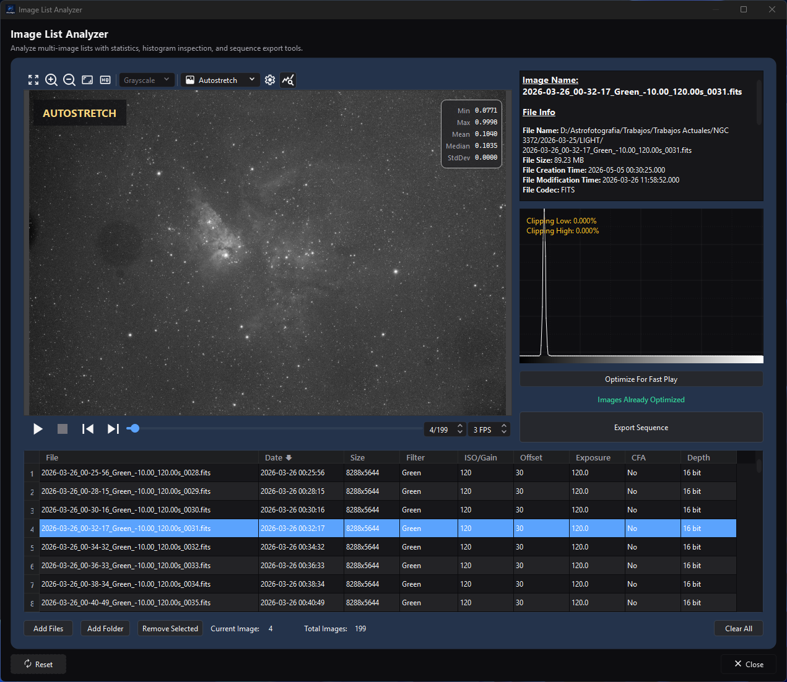
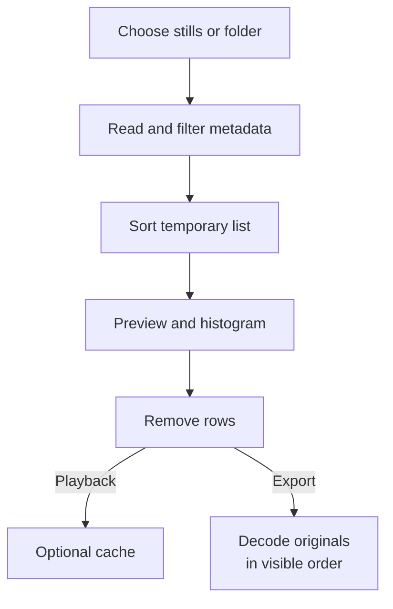

# Image List Analyzer

Source and focused tests establish the behaviors claimed below. Actual rendered layout, representative playback/export performance, output compatibility in external players, and capture evidence remain unclaimed.

## Purpose and expected result

*The selected frame connects the table's measurements to its metadata, histogram,
and optimization status.*

Image List Analyzer is a top-level inspection and sequence-export utility for a temporary list of still-image files. It reads file metadata into a sortable table, previews one frame at a time with a metadata report and histogram, can prepare playback proxies, and exports every retained row in the current order to SER, raw AVI, H.264/H.265 MP4, or VP9 WebM.

The current implementation is not a quality-ranking or integration-planning engine. It does not measure star count, FWHM, eccentricity, registration quality, or background noise for a visible score; it has no numeric acceptance threshold, rating, include/exclude flag, group model, or direct **Send to Image Integration** action. Metadata sorting and manual row removal are the available list-selection operations.

## At a glance

| Property | Current behavior |
| --- | --- |
| Menu path | **Process > Utilities > Image List Analyzer** |
| Enabled when | Always. No active image or sequence is required. List-dependent actions enable after at least one file is loaded. Header reading and optimization run in the background, so the window does not freeze. |
| Inputs | Engine-supported still-image files selected directly or found in a folder. Folder import can filter by metadata frame type and an exact case-insensitive filter name. Native sequence/video files are not Analyzer inputs. |
| Outputs | None for inspection alone. **Export Sequence** writes one SER, raw AVI, H.264/H.265 MP4, or VP9 WebM containing every retained row in current table order. **Delete From Disk** permanently removes one source file. |
| Recommended image state | Any stills the codecs can decode. Linear acquisition frames are appropriate for metadata/histogram inspection; Autostretch export creates display-rendered output and is not a linear scientific archive. |
| Preview support | Read-only static sequence preview that demosaics CFA frames for display, normal Image Viewer display tools, metadata summary, histogram, frame navigation, and FPS control. It does not modify source pixels. |
| Sequence support | Writes a temporary image-list manifest of the files (or their proxies) to play them in the preview, but imports stills only. Export creates SER/AVI/MP4/WebM, not an AfterNight `.anseq` image-list file. |
| Mask support | Unsupported. No active image or mask is consumed. |
| External dependencies | Deployed codecs for inputs; deployed encoder support for H.264, H.265, and VP9 video export. No network or catalog is required. |
| Persistence | Only Analyzer playback FPS (the window's only setting; **Reset** returns it to the default) and window state persist. Export separately remembers format, codec, and resolution mode. The file list, ordering, selection, folder filters, cache, summary, histogram, output name, and most export choices do not persist. |

## Before you start

- Treat the list as temporary. Closing the window stops any import or optimization at once, discards the list, and removes Analyzer playback proxies.
- Keep original files at stable paths. Preview, Open In Editor, Export, and Delete all act on those paths.
- If the list will become a sequence, use compatible geometry, channel layout, and pixel types. Analyzer does not check that the files match before playback or export (the preview's image list is described by the first file), so an incompatibility surfaces only as a preview or export failure.
- Decide whether you need inspection or scientific integration. For integration, keep the original stills and import them into [Image Integration](image-integration.md) or [Image Integration Lite](image-integration-lite.md); an encoded video export is not an integration handoff.
- **Delete From Disk** is irreversible and has no recycle-bin or undo path. Back up valuable frames before using it.

## Procedure

1. Open **Process > Utilities > Image List Analyzer**.
2. Select **Add Files**, or select **Add Folder** and choose recursion plus optional frame-type/filter metadata filters.
3. File headers are read in the background. When an import does not add every file, the window reports how many it added, passed over (already listed or excluded by the folder filters) and could not read, with the first error; review the notification and log.
4. Click a row to load its preview, full metadata report, and histogram. Use previous/next or the frame selector to move through the ordered list.
5. Click table headers to sort on metadata. There is no quality score: use preview/metadata judgment and **Remove Selected** for the current row.
6. Both display modes play the original files with no optimization; the **Autostretch** display mode stretches each frame as it is shown. For faster Autostretch playback, select **Optimize For Fast Play**, which writes an 8-bit proxy of each file, stretched by the preview's Autostretch settings. The proxies play in the Autostretch display mode with those settings; the Linear display, or other Autostretch settings, shows the original files, and choosing the proxies' display again plays them without writing them again. Files added afterwards have no proxy until you optimize again. Inspect individual frames without optimizing when continuous playback is unnecessary.
7. For full-process integration, add the retained original file paths separately to Image Integration. For a delivery/playback sequence, select **Export Sequence**, configure the output, and verify the resulting file after export.

## Complete parameter and action reference

### Preview, measurements, and playback

The tables in this section account for the same ten evidence fields. Later compact tables combine effect with dependencies and trade-off with scope; a control has no persisted-default exception unless its Persistence cell says it is restored.

| UI label/action | Type and unit | Runtime default | Persisted-default exception | Valid values, step, or constraints | Effect of increasing, decreasing, or selecting | Dependencies and enable/visibility rules | Quality, artifact, runtime, memory, or disk trade-off | Scope: preview/apply, channel, mask, still/sequence | Persistence |
| --- | --- | --- | --- | --- | --- | --- | --- | --- | --- | --- |
| Image preview | Static sequence view | Empty | None | One current retained row | Decodes the selected row through a temporary image-list manifest; CFA frames are demosaiced for display by the demosaic setting in preferences. A list is fitted to the preview area when it is first shown, and again when its frames change size; otherwise the zoom you choose is kept. The preview starts in Autostretch mode. Proxies are shown only in Autostretch mode with the settings they were written with, as they are, without stretching them again; in Linear mode, or under other Autostretch settings, the original files are shown, so the picture is always in the mode the **Display Mode** selector names | Requires a retained row; controls disable during background work as applicable | Display transforms do not modify or rank the source | Display only; current still in temporary sequence; no mask/apply | Generic preview state only; list is Run only |
| Image Summary | Read-only HTML report | **The image list is empty** | None | Current row metadata/filesystem values | Displays image/file, geometry, format, CFA, size, camera/acquisition, and software fields | Built from the header read at import; updates when the row changes | Values can be missing/inaccurate; no quality score | Current still; no mask/apply | Derived |
| Histogram | Read-only plot | Empty; clipping info disabled | None | The file whose frame the preview shows | Shows the file's distribution. Each file is counted once, in the background, from the file itself - never from its proxy - and its counts are shown again whenever its frame is, during playback too; nothing is shown while a file is being counted | Clipping info enables with a nonempty list | Not a quality rank | Current displayed still/channels; no mask/apply | Derived/cache |
| Previous / Next / frame selector | Sequence player actions | Disabled/empty | None | Frames 1 through row count | Changes row/frame and synchronizes summary/histogram | Requires a list; table/background state can disable navigation | Navigation decode cost only | Temporary still sequence | Run only |
| Play / Stop | Sequence player actions | Play disabled | None | Current ordered list | Plays/stops at FPS and follows rows | Plays in either display mode with no optimization: the original files, or, in Autostretch mode, the proxies once every retained file has one of the preview's Autostretch settings | Requested FPS may exceed decode/paint throughput | Whole temporary still sequence | Run only |
| FPS | Integer frames/second | 1 FPS on first use | Restored from Analyzer process state | 1–60 FPS | Raises/lowers requested playback rate and restarts active timing; the rate is kept when the preview is rebuilt after files are added, removed, sorted, optimized, or cleared | FPS control is visible in Analyzer preview | No interpolation; higher rates increase decode/UI pressure | Whole temporary sequence | Persisted with Analyzer process state; Reset returns it to 1 FPS |
| **Current Image** / **Total Images** | Read-only integers | 0 / 0 | None | 1-based current row / retained count | Reports table/player position | Derived from list/selection | Diagnostic only | Whole temporary list | Derived |

### Import, ordering, selection, and destructive actions

| UI label/action | Type and unit | Runtime default | Valid values or constraints | Effect and dependencies | Trade-off and scope | Persistence |
| --- | --- | --- | --- | --- | --- | --- |
| **Add Files** | Multi-file chooser | Last shared Analyzer folder | Engine-supported still-image paths | Reads file headers in the background; ignores paths already in the list | Full pixels load only for preview/optimization. Unreadable sources are skipped; when an import does not add every file, the window reports how many it added, passed over and could not read, with the first error | Chooser folder remembered; list Run only |
| **Add Folder** | Directory + options dialog | Last Analyzer folder | One directory | Scans supported still extensions and then imports matching metadata | Recursive scanning can be large; filter choices apply only to this import | Folder remembered; choices not persisted |
| **Include subfolders (recursive)** | Checkbox | On | On/off | Controls recursive folder scan | On can include unrelated nested data | One import |
| **Frame Type** | Selector | All | All; Light; Dark; Flat; Bias; Dark Flat | Filters the folder results by case-insensitive type text; Bias also accepts Offset, Dark excludes Flat, Flat excludes Dark, Dark Flat needs both | Depends on usable type metadata; a file whose header states no frame type counts as Light | One import |
| **Filter Name** | Text | Empty | Exact trimmed text, case-insensitive | Keeps folder results whose metadata filter equals the text | `Ha` does not partially match `Ha 7nm`; missing metadata will not match nonempty text | One import |
| **File** column | Read-only sortable text | Filename only | Tooltip shows the full input path | Sorts case-sensitively by file name; equal keys use ascending effective date | Filename ordering is not quality ranking | Current order is Run only |
| **Date** column | Read-only sortable timestamp | Header creation time, else exposure start, else filesystem modification time | Displayed as `yyyy-MM-dd hh:mm:ss.zzz` in UTC, whichever source it comes from | Initial nonempty list is sorted ascending by effective date despite the downward header glyph; header clicks toggle direction | Missing/ambiguous metadata can make filesystem time determine order | Current order is Run only |
| **Size** column | Read-only `width x height` | Metadata | Dimensions | Header click does not sort; the implementation returns without changing order | It is not a group or compatibility gate | Derived |
| **Filter** column | Read-only sortable text | Metadata or `-` | Any metadata text | Sorts case-sensitively by the shown text with ascending-date tie-break | No filter groups are created | Current order is Run only |
| **ISO/Gain** column | Read-only sortable number/text | Metadata | Metadata accessor result | Sorts by numeric ISO/Gain with ascending-date tie-break | No threshold/group split | Current order is Run only |
| **Offset** column | Read-only sortable number/text | Metadata | Metadata accessor result | Sorts numerically with ascending-date tie-break | No compatibility validation | Current order is Run only |
| **Exposure** column | Read-only sortable seconds/text | Metadata | Metadata accessor result | Sorts numerically with ascending-date tie-break | No exposure threshold/group split | Current order is Run only |
| **CFA** column | Read-only sortable Yes/No | Whether the file is a CFA mosaic | No before Yes | Sorts by mosaic state with ascending-date tie-break | Mixed CFA state is not rejected | Current order is Run only |
| **Depth** column | Read-only sortable label | From pixel type (signed and unsigned integers share a label) | 8 bit; 16 bit; 32 bit int; 32 bit float; 64 bit float | Sorts by pixel type with ascending-date tie-break | Mixed depth is not rejected before export | Current order is Run only |
| Header click | Sort action | Date selected, ascending state | File, Date, Filter, ISO/Gain, Offset, Exposure, CFA, Depth; Size is unsortable | Same column toggles direction; a new sortable column starts descending. Sort rebuilds preview order | Export uses this resulting order | Run only |
| Row selection | Single whole-row selection | First row after initial load | Exactly one primary row | Drives preview and context actions | There is no multi-row rating, checkbox, exclusion flag, or saved selection set | Run only |
| **Remove Selected** | Action | Disabled for empty list | Current selected row | Removes the row and its proxy from Analyzer only; source stays on disk | Manual curation; no undo | Run only |
| **Clear All** | Action | Disabled for empty list | All rows, no confirmation | Stops preview and any files still being read (none of them is added afterwards), clears table/list/cache/temp proxies | Source files remain. There is no undo | Run only |
| **Open In Editor** | Row context action | — | Current row | Opens the original file as a normal AfterNight view | Does not retain Analyzer ordering/group state | New app view |
| **Remove** | Row context action | — | Current row | Same as Remove Selected | No source deletion | Run only |
| **Delete From Disk** | Confirmed row context action | — | Yes/No | Removes the row, then permanently deletes the original file | Irreversible. The row is removed even if the deletion fails; a failure is reported as **Could not delete '...' from the disk.** | External filesystem |
| **Reset** | Dialog action | Visible | — | Returns the playback FPS, the window's only setting, to its default of 1 FPS | It does not clear the list, reset viewer state, or alter sorting | FPS |
| **Close** | Dialog/window action | — | — | Stops any import or optimization in progress and closes at once, without waiting for background work | List/proxies are discarded. Export has its own dialog lifetime | Window state/FPS persist |

### Playback optimization

| UI label/action | Type and unit | Runtime default | Valid values or constraints | Effect and dependencies | Trade-off and scope | Persistence |
| --- | --- | --- | --- | --- | --- | --- |
| Optimization status | Read-only status | **No Optimization Needed** for empty list | No Optimization Needed; Images Not Optimized; Images Already Optimized | Explains whether Autostretch playback uses proxies. Linear mode always reads **No Optimization Needed**; **Images Not Optimized** means the Autostretch display plays the original files, and also follows a change of the Autostretch settings the proxies were written with | Status means cache preparation completed, not that a requested FPS was benchmarked | Run/cache |
| **Optimize For Fast Play** | Background action | Disabled for an empty list and for one whose proxies hold the current Autostretch settings | All retained rows without a proxy of the current Autostretch settings | In the background, reads each file as the viewer reads it (a CFA mosaic demosaiced by the one demosaic setting in preferences), stretches it with the preview's current automatic-stretch settings, and writes it as a full-resolution 8-bit temporary FITS playback proxy with a source-path hash in its filename, in a folder kept for those settings. A proxy of other settings is replaced, and its file removed. Each file read is also measured for its statistics and histogram, unless they are kept already | Can consume CPU, RAM, and temporary disk. The proxies are not resized; hash suffixes prevent equal stems from different folders overwriting one another | Temporary; removed with its row, on clear, and on close |
| Optimization Cancel | Progress action | — | Cooperative | Stops remaining work. Any failure or cancellation leaves the list not fully optimized, so the Autostretch display plays the original files; failures (not a cancellation) are reported as **Image optimization incomplete** | Successfully cached rows remain reusable in the current window | Run/cache |

Every file receives a proxy, FITS files included. Removing a file removes its proxy, and files added after optimizing have no proxy until you optimize again. The preview plays the proxies only in the Autostretch display mode with the settings they were written with, and shows them as they are, without stretching them again. Choosing Linear, or changing the Autostretch settings, shows the original files; choosing the proxies' display again plays them without writing them again. Export never uses optimization proxies.

### Export Sequence

**Export Sequence** is enabled for any nonempty list while no optimization runs, and always exports every retained row in current table order. It writes a fresh temporary image list of the original source paths, specifically excluding optimization proxies. It does not export only the selected row and does not create an `.anseq` image list.

| UI label/action | Type and unit | Runtime default | Valid values or constraints | Effect and dependencies | Trade-off and scope | Persistence |
| --- | --- | --- | --- | --- | --- | --- |
| **Output Format** | Selector | SER on first use; last saved later | SER; AVI (RAW); MP4 | Selects SER, uncompressed raw AVI, or encoded video | SER stores 8-bit frames (signed or unsigned) as unsigned 8-bit and every other representation as unsigned 16-bit; AVI is unsigned 8-bit and large; encoded video is unsigned 8-bit lossy delivery output. Only grey/mosaic and RGB frames can be written | Saved in `__EXPORT_SEQUENCE__` on dialog close |
| **Codec** | Selector | h264 on first use; last saved later | h264; h265; WEBM | Enabled only for MP4; WEBM (VP9) changes normalized suffix to `.webm` | H.264/H.265/VP9 are lossy and need deployed encoders | Saved |
| **Output File Name** / `...` | Read-only path + chooser | Empty | Normalized `.ser`, `.avi`, `.mp4`, or `.webm` path | Required; OK stays disabled until selected | The file is published only when the export completes; no backup or readback is made | Directory remembered separately; filename not saved |
| **FPS** | Decimal frames/second | The playback rate the Analyzer's player shows when Export Sequence is selected (1 after **Reset**) | 1.0–60.0, step 0.3 | Writes playback timing without interpolating frames | No frame interpolation | Not saved by Export; Analyzer FPS persists |
| **Autostretch** | Checkbox | Off | On/off | Applies current preview autostretch parameters per decoded frame; may also apply current saturation/brightness/contrast parameters | Permanently changes exported samples and is display-oriented; sources remain unchanged | Not saved |
| **Debayer CFA** | Checkbox | Off | On/off; visible/enabled only when the first listed file is a CFA mosaic | Demosaics each mosaic frame by the demosaic setting in preferences | Changes channel layout/pixels and is irreversible in the output | Not saved |
| **Resize** | Checkable group | Off | On/off | Enables user-selected geometry conversion. Off keeps source dimensions, but MP4/WebM crop an odd width or height to the even size below | Adds Lanczos4 resampling and temporary work; the even-size crop applies independently of this checkbox | Not saved |
| Resolution | Selector | Preserve Ratio on first use; last saved later | Preserve Ratio; Free Ratio; Full HD; 4K; 8K | Preserve Ratio couples width/height; Free Ratio uncouples; fixed presets request 1920×1080, 3840×2160, or 7680×4320 | Choosing Preserve or Free Ratio returns width/height to the first frame's size | Saved |
| Width / Height | Integer pixels | First-frame source dimensions | Width 4 through the larger of 2× source width and 7680; height 4 through the larger of 2× source height and 4320 | Editable for Preserve/Free; fixed presets disable editing | Free Ratio can distort geometry. Video export crops an odd width or height to even, keeping the top-left part, even when Resize is off | Not saved |
| Fill mode | Selector | Fit | Fit; Fill; Stretch; Center | Enabled for fixed presets; maps source into target canvas | Fit can letterbox, Fill can crop, Stretch distorts, Center can crop/pad | Not saved |
| **OK** | Export action | Disabled until path exists | Current complete request | Snapshots source sequence, autostretch settings, and request, then exports on a worker with progress | Dialog controls lock during export | Output artifact |
| **Reset** | Dialog action | — | — | Restores source width/height, Preserve Ratio, and disables Resize | Does not reset format, codec, FPS, Autostretch, Debayer, path, or all persisted choices | Dialog only |
| **Cancel** | Dialog/progress action | — | — | Before start closes without output. During export, the progress dialog's Cancel stops it; closing the dialog stops it and the dialog closes once the export ends | A stopped or failed export leaves no file | None |

See [Saving and Exporting](../../interface/saving-and-exporting.md#sequence-export-dialog) for the shared encoder, metadata, overwrite, and verification contract.

## Measurements, ranking, grouping, and integration handoff

These boundaries are important because the current process name can suggest more than it implements.

| Capability | Implemented behavior |
| --- | --- |
| Measurements | File/metadata report, table metadata, and, for the file whose frame is shown, its histogram and the preview's statistics card (minimum, maximum, mean, median, and standard deviation of each channel), measured once from the file. |
| Ranking | Sorting by filename/date/filter/ISO-or-Gain/offset/exposure/CFA/pixel type. There is no composite quality score, star count, FWHM, eccentricity, noise score, percentile rank, or best-frame percentage. |
| Selection | Exactly one selected table row plus manual Remove/Clear. Export uses all remaining rows, not the current selection. There are no accept/reject flags, ratings, threshold sliders, or multi-select quality cuts. |
| Grouping | No persistent or visual groups. Add Folder filters one import by frame-type text and exact filter name; table sorting does not create groups. |
| Thresholds | None for science/quality selection. A file whose header cannot be read is skipped at import. |
| Integration handoff | None. Analyzer does not transfer its list/order/removals to Image Integration and Image Integration does not accept the exported sequence. Re-add the retained original still paths to the target integration process. |

## How the algorithm works

1. Add Files supplies chosen paths. Add Folder scans supported extensions, optionally recursively, then filters decoded metadata by frame-type text and exact filter name.
2. Paths already listed are passed over. A worker reads each remaining file's header through the engine and skips a path that is not a file or whose header cannot be read. When the import does not add every file, the window reports how many it added, passed over and could not read, with the first error.
3. The table and the preview share one ordered list. Sorting reorders that list, rewrites the preview's image-list manifest, and therefore changes playback and export order.
4. Selecting a row asynchronously decodes its frame. The summary updates at once from the header. The first time a file's frame is shown, the file is read and measured in the background for the histogram and the statistics card, one file at a time; the result is kept while the file is listed and shown whenever its frame is, so stepping back or playing measures nothing again.
5. Optimization runs in the background over rows without a proxy of the current Autostretch settings. It reads each file as the viewer reads it, demosaicing a CFA mosaic by the one demosaic setting in preferences, stretches it with the viewer's automatic stretch, and writes a full-resolution 8-bit FITS proxy of every file. Proxy filenames combine the source stem with the first sixteen hex digits of a SHA-256 hash of the source path, so equal stems from different folders remain distinct. Individual failures are logged and prevent the global optimized state.
6. Export writes another image list of the original paths, snapshots the request, optionally debayers, autostretches, and/or resizes each decoded frame, and appends every frame to the selected writer. The file is published only when every frame is written; a stopped or failed export leaves no file.

No ranking equation or grouping estimator exists in this process. Histogram/statistics support display and playback optimization; they are not converted into a selection score.

## Parameter interactions and starting points

- Import without folder filters when metadata quality is uncertain, then sort and inspect the table. A restrictive filter can silently exclude valid files with missing/misspelled headers.
- Sort by Date to reconstruct acquisition order, but verify whether each row uses metadata time or filesystem modification fallback.
- Remove only obvious unwanted rows. For objective star/registration quality, use Image Integration's Registration diagnostics rather than treating metadata order as quality.
- Optimize only when continuous playback matters. Single-row inspection can decode on demand without generating proxies.
- Keep Autostretch, Debayer, and Resize off for a control export. Enable one transformation at a time and retain the original stills.
- Use SER for a native sequence handoff when compatible; use raw AVI for uncompressed 8-bit delivery; use MP4/WebM when size/player compatibility matters more than astronomy metadata and exact samples.

## Inputs, outputs, and metadata

The Analyzer model stores original paths and loaded metadata only. It does not rewrite headers, attach ratings, write a sidecar list, or save its table state. Summary values are metadata/filesystem observations; missing values appear blank, `-`, or use the documented fallback.

Optimization outputs live in the window's unique temporary `ImageListAnalyzer_<UUID>` directory, in a folder for each set of Autostretch settings they were written with. They are playback-only, full-resolution, stretched 8-bit FITS proxies of every file; each filename includes a source-path hash to avoid collisions between identical stems. They are removed with their row, by Clear All, or by temporary-directory destruction, are not added to recent files, and are not used by Export.

Export output contains all retained frames in visible order:

- SER stores 8-bit frames as unsigned 8-bit and every other representation as unsigned 16-bit, with the FPS; it does not preserve AfterNight Image History;
- raw AVI converts to unsigned 8-bit frames;
- H.264/H.265 MP4 and VP9 WebM are lossy delivery formats without astronomy metadata/history; and
- optional Autostretch, Debayer, and Resize alter output pixels/geometry only, never sources; MP4/WebM also crop an odd width or height to even when Resize is off.

Analyzer has no direct integration output. To carry a curated set into integration, reselect the retained original files in Image Integration; ordering is generally not an integration grouping contract.

## Performance

- Metadata import scales with file count and storage latency and runs in the background. Folder scanning itself enumerates the directory tree before metadata filtering.
- Preview loads one full frame on demand. Large camera RAW/FITS frames or network storage can make navigation lag. Each file's statistics and histogram are measured once, after its frame is shown, so they never delay the frame.
- Optimization decodes, demosaics, and stretches the files one at a time in the background. Proxy writes add temporary disk; proxies are not resized thumbnails.
- Playback speed depends on decode/proxy speed, display conversion, and UI throughput. The 1–60 FPS control is a requested rate, not a benchmark result.
- Export scales with retained frames, decoded pixels, transforms, and encoder. Autostretch measures every frame; resize adds resampling; raw AVI can be very large; H.264/H.265/VP9 trade CPU for size.

## Worked example

**Source-and-test-derived; not an approved-data execution.** Consider a folder containing Light and Dark stills across L and Ha filters plus one zero-byte file and one truncated FITS file. Add Folder with recursion on, Frame Type Light, and Filter Name `Ha`. The source contract admits only supported files whose metadata type contains Light and whose filter equals `Ha` case-insensitively; the zero-byte and truncated files are skipped as unreadable and counted in the import notification. The first completed import is sorted by effective Date. Select rows to inspect metadata/histograms, manually remove an unwanted row, and sort by Exposure if desired. Export then processes every remaining original path in that order—not only the current row and not an optimized proxy.

For real data, verify the export's frame count, first/last frame, geometry, channel/CFA interpretation, pixel depth, FPS, and playback in AfterNight. No quality ranking, visual improvement, or encoding performance is asserted by this example.

## Warnings and limitations

- The current tool is metadata inspection plus manual curation, not lucky-imaging quality selection.
- Nothing checks that the files share dimensions, channels, or depth before playback or export.
- Size displays but cannot be sorted. Arrow glyph direction and initial ascending Date state can be counterintuitive.
- Folder type/filter controls filter one import; they do not form persistent groups.
- Selection is single-row, and Export always uses all retained rows.
- Optimize status does not prove smooth playback at the selected FPS. Proxies remain full resolution.
- Export offers no `.anseq` Image List destination and no direct integration handoff.
- Delete From Disk removes the row before attempting file deletion; a failed deletion is reported but the row stays removed.
- Reset only returns the playback FPS to its default.

## Troubleshooting

| Symptom | Source-backed cause | Action |
| --- | --- | --- |
| Expected folder files are absent | Unsupported extension, recursion off, type/filter metadata mismatch, duplicate path, missing/empty/truncated/unreadable file | Retry without filters, inspect headers/extensions, and read the **Some files were skipped** or **Some files were passed over** notification and the log |
| A Light filter excluded a valid frame | Unknown/mislabeled frame type did not match the requested metadata text | Import with Frame Type All and inspect the row; Analyzer cannot edit metadata |
| Date order looks wrong | Some rows use header time while missing values fall back to filesystem modification time, which may not be when the frame was taken (both are shown and ordered in UTC) | Inspect Image Summary and sort/use filenames as a secondary manual check |
| Clicking Size does nothing | Size sorting is explicitly unimplemented | Sort another column or inspect dimensions manually |
| Autostretch playback is slow | At least one retained row has no proxy of the current Autostretch settings, for example a file added after optimizing, so the original files play, each read and stretched as it is shown (**Images Not Optimized**) | Select Optimize; if the status stays **Images Not Optimized**, inspect the incomplete-optimization error/log and remove/fix failing rows |
| Preview differs before/after optimization | In Autostretch mode playback switches to the stretched 8-bit temporary FITS proxies, demosaiced by the demosaic setting in preferences; Linear mode shows the original files | Judge scientific pixels in the original file opened in the editor; proxies are display-only |
| No visible quality score or threshold | Current Analyzer does not implement those features | Use Image Integration registration/quality diagnostics or a dedicated quality-analysis workflow |
| Export contains rows you did not intend | Export uses every retained row, not selection | Remove unwanted rows before opening Export and confirm Total Images |
| Export changes brightness/color/geometry | Autostretch, Debayer CFA, or Resize was enabled; MP4/WebM also crop an odd width or height to even with Resize off | Repeat with transformations off, choose codec-compatible dimensions, and verify the source/export settings |
| Export fails on mixed frames | Analyzer did not enforce matching dimensions/channel/depth before writer creation | Curate a compatible list or normalize files through an appropriate conversion workflow |
| Need to integrate the curated list | There is no direct handoff and Image Integration accepts stills, not Analyzer video export | Add the retained original still files to Image Integration/Lite |
| **Could not delete '...' from the disk.** | Filesystem deletion failed after the row was removed | Check the original path in the filesystem and delete with an appropriate file tool if intended |

## Related workflow steps

- Continue still-frame calibration/registration/stacking with [Image Integration](image-integration.md) or [Image Integration Lite](image-integration-lite.md), re-adding original paths.
- Use [Image Statistics](../../interface/image-statistics.md) and [Histogram Analysis](../../interface/image-histogram.md) for explicit numeric inspection of an opened image.
- Read [Sequences](../../interface/sequences.md) for player and container behavior.
- Read [Saving and Exporting](../../interface/saving-and-exporting.md) for the shared Export dialog and output verification.
- Use [Extract Sequence](../utility/extract-sequence.md) to turn a source sequence into still frames.
- Check [File Formats](../../reference/file-formats.md) before choosing a scientific or delivery container.

## References and provenance

- Current Analyzer behavior is defined by `ImageListAnalyzerProcess`, `ImageListProcessHelpers`, `WorkflowToolFiles`, the generic `TableWidget`, and the engine's image-list manifest and frame source at the revision recorded above.
- Shared preview/player and export behavior comes from `ImageViewControl`, `SequencePlayerControl`, and `ExportSequenceControl`; [Saving and Exporting](../../interface/saving-and-exporting.md) records their broader source/test contract.
- No external quality-ranking method or paper applies because the current Analyzer implements no quality score.
