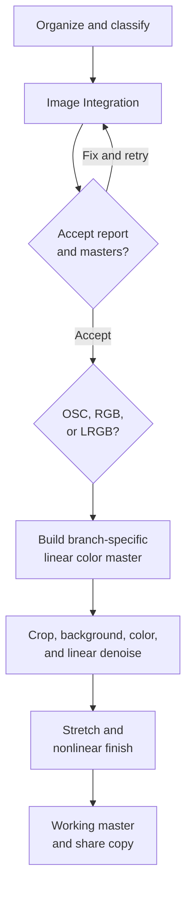

# Broadband Imaging

## Purpose, audience, prerequisites, and expected result

Use this workflow to turn calibrated one-shot-color (OSC), mono RGB, or mono
LRGB exposures into reproducible broadband masters and delivery copies. It is
for users who can identify acquisition frame types and inspect a linear image,
but it does not assume that one set of processing values will suit every target.

You need:

- Light frames with consistent camera mode and usable overlap.
- Calibration frames appropriate to each camera/filter/session, or an explicit
  decision to accept and investigate Image Integration's missing-calibration
  warnings.
- Correct frame-type, filter, exposure, binning, gain/ISO, offset, temperature,
  session, CFA, and object metadata where those fields drive grouping.
- A writable output directory with room for masters, registered lights,
  reports, history, and optional debug products.
- For LRGB, L and RGB data that can be placed on exactly the same pixel grid.

The expected result is one of these branch products:

| Branch | Linear branch product | Later product |
| --- | --- | --- |
| OSC | Registered and stacked three-channel master produced after raw CFA calibration and workflow demosaic | Corrected, color-calibrated, stretched image and a verified share/export copy |
| RGB | Registered R, G, and B masters plus a three-channel RGB composition | Corrected, color-calibrated, stretched image and a verified share/export copy |
| LRGB | Compatible luminance and RGB masters, both prepared before combination | LRGB result, nonlinear finishing, and a verified share/export copy |

Keep the linear OSC/RGB masters and the separate L/R/G/B masters. They are the
safe restart points when a later background, color, noise, stretch, or LRGB
decision needs to be changed.

## Inputs and outputs

### Acquisition and organization

Folder names do not control the workflow after import, but a stable structure
makes mistakes easier to find:

```text
project/
  lights/osc/                 or lights/L, lights/R, lights/G, lights/B
  calibration/bias/
  calibration/dark/<exposure>/
  calibration/flat/<filter>/
  calibration/dark-flat/
  output/                     keep outside the source folders
```

| Input | Match or record | Branch notes |
| --- | --- | --- |
| Lights | Target, geometry, binning, gain/ISO, offset/readout mode, temperature policy, exposure, filter/session, time, CFA when present | Reject obvious cloud, tracking, focus, saturation, or framing failures before they become a weak reference or normalization input |
| Bias | Gain/ISO, offset/readout mode, binning, dimensions | OSC validation used bias for the selected camera mode; mono validation had none and must not be generalized |
| Dark | Light exposure and camera mode; temperature when relevant | Use a matching dark. Treat exposure fallback as a conscious policy, not silent equivalence |
| Flat | Optical train, focus, filter, binning, camera mode, dimensions | Per-filter flats are required for mono filters. Do not reuse flats after an optical change merely because dimensions match |
| Dark-flat or flat calibration | Flat exposure and camera mode | OSC validation calibrated its flat with a matching dark-flat. The mono validation's uncalibrated-flat warnings are a limitation, not advice |

Image Integration reads supported still files and does not modify the source
frames. It writes state under the output directory, generated masters,
registered/aligned intermediates, normalization artifacts, final FITS masters,
previews, logs, and HTML/Markdown reports. Debug-calibrated frames, drizzle
descriptors with their dense checkpoints when kept, rejection maps, and quality
maps add substantial disk use when enabled.

### State and preservation points

- Calibration and integration should begin with linear acquisition data.
- OSC calibration occurs before demosaic; do not debayer raw calibration frames
  first just to make them display in color.
- The RGB composition made from R/G/B masters remains the linear restart point.
- Finish crop, background correction, native color calibration, and intended
  linear denoise before permanent stretching.
- AfterNight's LRGB Combination marks its output nonlinear even with identity
  MTF controls, so prepare L and RGB before combining them.
- **File > Save as...** and **Image > Actions > Save File...** save underlying
  pixels, not viewer autostretch or overlays. Use a separate processed copy for
  PNG/JPEG delivery.

## Workflow map and decision points



| Decision | Choose this path | Check before continuing |
| --- | --- | --- |
| Full Image Integration or Lite | Use full Image Integration for explicit grouping, matching, per-group settings, reports, incremental reruns, RGB combination, or LRGB projects. Use Lite only for a simple supported set whose delegated choices you accept. | The execution plan lists the expected stages/groups/outputs |
| Shared mono registration | Register L/R/G/B to one reference when geometry and sampling match and the field overlaps. Otherwise solve the geometry mismatch before composition. | Blink/inspect stars and edges; dimensions alone do not prove alignment |
| Image Integration RGB output or Channel Composition | Use the workflow RGB product when **Combine RGB images** is enabled and verified. Otherwise use **Process > Color Spaces > Channel Composition** with RGB mode and registered R/G/B masters. | Output is three-channel, same geometry, unclipped, and its channel statistics are plausible |
| Native or catalog color calibration | This native-only workflow uses **Color Calibration** with deliberate white/background references. Use PCC/SPCC only after satisfying their WCS/catalog/response prerequisites. | Reference pixels are representative; diagnostic masks are not sparse/contaminated |
| RGB only or LRGB | Stop at RGB when no compatible luminance exists. Use LRGB only when L and RGB are aligned, cropped, prepared consistently, and type-compatible. | No doubled stars, edge shift, or background discontinuity at the L/RGB handoff |
| Star-separated or direct finish | Direct finishing has no external dependency. Use StarNet only when its separate executable/model prerequisites and validation are satisfied. | Keep an untouched pre-star-processing copy and verify recombination at 100% |

## Step-by-step procedure

### 1. Audit the acquisition set

1. Separate lights, bias, dark, flat, and dark-flat/flat-bias frames. For mono,
   split lights and flats by filter.
2. Compare dimensions, binning, gain/ISO, offset/readout mode, exposure,
   temperature, session, filter, CFA, and object fields. Correct wrong metadata
   or isolate exceptions; do not group incompatible frames to silence a warning.
3. Choose a new output directory outside the source tree. Estimate space for
   at least the input-scale registered files plus masters, reports, and history.
4. Preserve the original acquisition files read-only.

**Checkpoint:** every frame has an intended type/group, and every expected
calibration relationship can be stated before opening the execution plan.

### 2. Import and validate in Image Integration

1. Open **Process > Preprocess > Image Integration** or the Dashboard **Image
   Integration** card.
2. On each Frame Sources tab, use **Add Files...** or **Add Folder...**. Verify
   that Bias, Darks, Flats, and Lights contain the intended files.
3. Set **Output Directory**. Review grouping fields before changing them; filter,
   exposure, session, gain/ISO, offset, resolution, and custom tags can split or
   merge groups.
4. On **Workflow > Calibration**, inspect **Calibration Coverage**, assignments,
   fallback indicators, and **Issues**. A warning is not an approval to ignore
   the missing master.

**Recovery:** if a light or flat matches the wrong master, correct its metadata,
grouping, matching policy, or explicit override. Re-run validation before
execution.

### 3. Build calibration masters and calibrate lights

Use each group's **Stacking Settings...** rather than assuming one rejection
method fits all frame counts. A reproducible native starting profile used in the
worked run was:

| Product | Combination | Rejection | Normalization | Other handoff |
| --- | --- | --- | --- | --- |
| Bias/dark/dark-flat masters | Average | Sigma Clipping, low/high `3.0/3.0` | None | Eight selected frames per group; no weighting |
| Flat masters | Average | Sigma Clipping, low/high `3.0/3.0` | Global | OSC flat used its dark-flat; mono flats had no approved bias/dark and emitted four warnings |
| Light calibration | In-memory | — | Flat auto-level on | OSC: matched dark + flat; mono: per-filter flat only; cosmetic correction off |

These are reproduction settings, not universal prescriptions. With few frames,
inspect whether rejection has enough support; with a large clean set, use the
Image Stacking reference and Image Integration recommendations as starting
guidance.

For OSC, keep raw CFA through calibration. Set the correct CFA pattern manually
when **Auto** cannot establish it. In the worked run the metadata was RGGB and
registration used RCD demosaic after calibration.

**Checkpoint:** generated masters exist; the report identifies their inputs;
calibration coverage is intentional; calibrated previews or registered outputs
show no newly introduced clipping, wrong CFA colors, dust mismatch, or strong
residual amp glow.

### 4. Register, align, normalize, and stack

1. On **Registration**, select a structurally good reference or accept automatic
   reference selection only after comparing its star count, FWHM, SNR, and
   eccentricity with the group.
2. Start with native **Star Matching**, **Homography**, transform mode **Auto**,
   alignment **Standard**, and interpolation **Auto** for an ordinary fixed
   broadband field. Use a simpler transform when evidence supports it; use a
   polynomial only when enough reliable matches demonstrate real distortion.
3. For compatible mono L/R/G/B geometry, use one shared registration reference
   so the channel masters land on one grid. The worked run used a luminance
   reference and registered all 32 selected mono lights in one group.
4. For light stacks, the worked run used **Average**, **Winsorized Sigma
   Clipping** `3.0/3.0`, **Global > Additive Scaling**, **IKSS** scale estimator,
   no weighting, no drizzle, no rejection/quality maps, and no final solve.
5. Set the maximum cores to a value that leaves the system responsive; the
   worked run used `8`.
6. Open **Execution Plan**. Confirm expected calibration, registration,
   alignment, normalization, stacking, reuse/skip decisions, dependencies, and
   output names. Run only after the plan matches the branch.
7. Monitor the timeline and output. Cancellation is cooperative; wait for the
   safe checkpoint and inspect partial/history state before resuming.

**Checkpoint:** the report completes, every required group succeeds, registered
stars align, stack edges are understood, expected masters exist, and every
warning has an explicit accept/fix decision. Do not equate `success=true` with a
finished-looking image.

### 5. Complete the OSC branch

1. Open the integrated OSC master and leave its data linear. Viewer autostretch
   is an inspection aid only.
2. Inspect at 100%, then use [**Image > Information >
   Statistics**](../interface/image-statistics.md) and [**Image > Information >
   Histogram**](../interface/image-histogram.md) to check endpoints and channel
   imbalance. Review the workflow report and preview.
3. Crop registration borders with **Process > Geometry > Crop** before fitting
   a background model.
4. Continue with the shared linear processing in step 8.

**Worked-run checkpoint:** eight OSC lights produced one `5544 x 3684`,
three-channel FITS master after all native stages. The generated report preview
was a nonblank registered astronomical field. That observation is not a final
quality assessment.

### 6. Complete the RGB branch

1. Confirm that R, G, and B integrated masters have the same geometry and are
   registered to the same grid.
2. If Image Integration produced its RGB master, open it and retain the separate
   channel masters. Otherwise open **Process > Color Spaces > Channel
   Composition**, select **RGB**, assign R/G/B, and leave **Linear Match** off
   initially. Linear Match changes temporary channel scale/offset, not geometry;
   use it only after inspecting its sample support and result.
3. Check stars at the center and edges and compare channel statistics. Correct
   alignment, crop, gradient, or scale problems upstream rather than hiding them
   with an aggressive stretch.
4. Continue with the shared linear processing in step 8.

**Worked-run checkpoint:** four eight-light filter groups produced L/R/G/B
masters and a `3008 x 3004`, three-channel RGB FITS master. Its preview contained
the target but also strong channel/background mismatch and stacking borders;
the correct decision was to route it to crop/background/color checkpoints, not
to present it as finished.

### 7. Complete the LRGB branch

1. Prepare the RGB master through crop, background correction, native color
   calibration, and intended linear denoise. Prepare luminance on the same crop
   and geometry, without applying a conflicting permanent stretch.
2. Verify equal width/height, matching stars and edges, compatible pixel type,
   and comparable background/tonal behavior. WCS equality alone is not enough.
3. Activate the RGB image and open **Process > Color Spaces > LRGB
   Combination**. Choose the grayscale luminance image.
4. Start with **Lightness `1.0`**, R/G/B weights `1.0`, **Lightness MTF `0.5`**,
   and **Saturation MTF `0.5`**. If the luminance dominates or backgrounds do
   not join cleanly, fix upstream matching first; otherwise reduce Lightness
   toward `0.5` before changing MTF or RGB multipliers.
5. Keep **Preview area** off; its current crop behavior is incompatible with the
   full luminance input. Compare the full preview at 100%, then Apply.

**Checkpoint:** stars are single, edges/backgrounds join, color does not detach
from structure, and gamut/endpoints remain acceptable. The operation replaces
the target and marks the result nonlinear; keep the separate L and RGB masters.

**Worked-run checkpoint:** the native default LRGB core combined the verified
`3008 x 3004` RGB and luminance masters at identity weights/MTF, saved the FITS
result, and reopened it with three channels and unchanged geometry. This proves
the recorded handoff, not visual optimality.

### 8. Crop, correct the background, and calibrate color while linear

For OSC/RGB, perform this step before stretching. For LRGB, perform it on RGB
and luminance before step 7 whenever possible.

1. Crop invalid stack borders.
2. Open **Process > Background Modelization > Background Extraction**. A
   conservative source-derived start is **Samples per Line `20`**, **Grid
   Tolerance `2.0`**, **RBF**, **Smoothing `0.50`**, **Subtraction**, and **Output
   Background Model** on for diagnosis. Remove samples on the target, dust,
   halos, stars, or nebulosity before Preview.
3. Inspect the gradient model, not only the corrected view. If it contains target
   structure, fix samples before changing smoothing. Use Polynomial order 1,
   then 2 only when a simple surface is demonstrably sufficient.
4. Open **Process > Color Calibration > Color Calibration** for the native-only
   route. Choose a representative unsaturated white reference; start with white
   limits `0.0..0.9`. Choose a clean sky background ROI. Request diagnostic
   masks on the first trial and inspect them before accepting the gain result.
5. If background channel offsets remain, use Background Neutralization according
   to its process page, then recheck Color Calibration. Avoid repeated passes
   that clip endpoints.

**Checkpoint:** the background model contains background rather than target
signal; diagnostic reference masks have useful support; gradients/casts improve
without new black/white clipping.

**Worked-run checkpoint:** the reusable validation filter executed this sequence
on center `1024 x 1024` OSC, RGB, and luminance checkpoints. RBF models used
312/318/322 samples respectively and, after diagnostic normalization, showed
smooth low-frequency structure rather than recognizable target detail. OSC/RGB
automatic Color Calibration used a centered `512 x 512` white-reference ROI, a
clean upper-left `256 x 256` background ROI, and saved both masks. The masks
were neither empty nor full-frame; the OSC white mask nevertheless followed
substantial target structure, so this validates the diagnostic/rejection route,
not photometric truth or a reusable ROI.

### 9. Denoise, stretch, and finish

1. Duplicate or save the linear master before destructive work.
2. If linear denoise is needed, use a representative preview area. For [Wavelet
   Denoise](../processes/noise-reduction/wavelet-denoise.md), a conservative
   source-derived start is Threshold `1.0..1.4`, Scales `4..6`, Iterations `10`,
   and Amount `1.0` while diagnosing; reduce Amount toward `0.5..0.8` rather than
   erasing faint structure. Follow the complete page for padding, channels,
   masks, and cycle-spinning limits.
3. Stretch only after linear work is accepted. In [Histogram
   Transformation](../processes/stretching/histogram-transformation.md), start
   linked RGB at Shadows `0`, Midtones `0.5`, Highlights `1`. Locate the
   background before moving Shadows; make small Midtones changes and leave
   Highlights last. Auto-stretch derived values are hidden, so record the mode
   if applying it permanently.
4. Alternatively use [Generalized Hyperbolic
   Transformation](../processes/stretching/gh-transformation.md): start at
   strength `0`, `b=0`, `LP=0`, `HP=1`, choose SP deliberately, then increase
   strength while checking endpoints and color.
5. Use a few well-spaced nodes in [Curves
   Transformation](../processes/stretching/curves-transformation.md) for modest
   nonlinear contrast/color changes. Inspect at 100% after each step.
6. For a native restrained-star branch, duplicate the stretched image and open
   [**Process > Mask Generation > Star
   Mask**](../processes/star-operations/star-mask.md). Start with
   **StarProfilerV1**, **Detection Threshold `0.45`**, **Roundness Tolerance
   `2.00`**, **Shaped Areas**, **Percent Increase `0.50`**, **Pixel Increase
   `0`**, **Min/Max Size `2/25`**, and **Truncated Bell**. The normal `0.10`
   default selected background noise in this worked checkpoint; raise or lower
   the threshold from the actual mask rather than copying `0.45` blindly.
7. Activate the target and assign the generated mask through [**Image > Mask >
   Select Mask**](../interface/masks.md). With the mask enabled and not inverted,
   white areas receive the process. Open [**Process > Morphology >
   Morphological Transformation**](../processes/masking/morphological-transformation.md),
   choose **Erosion**, **Circle `3`**, **Iterations `1`**, and **Amount `0.20`**.
   Preview at 100%; reduce Amount or remove the mask if cores flatten, dark rings
   appear, or target detail changes. Keep the pre-star duplicate.
8. Star separation remains optional. Use [StarNet++](../processes/star-operations/starnet.md)
   only after its executable/model checks pass, and verify any recombination for
   halos, clipping, missing stars, and color shifts.

**Checkpoint:** no important background/faint signal is clipped, star cores and
color are controlled, noise/detail changes survive a 100% comparison, and Image
History identifies the restart point.

**Worked-run checkpoint:** the same representative crops ran Wavelet Denoise at
Threshold `1.2`, Scales `4`, Iterations `10`, Amount `0.65`; MAD autostretch at
Shadows `-2.8`, target `0.25`, RGB unlinked; and the masked morphology above.
All stages were finite/nonblank and numerically changed their inputs. The
`0.45` masks isolated bright stars rather than background noise, and stretched
versus finished comparisons showed a restrained change without obvious dark
rings or target-structure loss. This is bounded acceptance of the checkpoint,
not a polished full-frame recommendation.

### 10. Save working and delivery outputs

1. Before nonlinear work, save the OSC/RGB linear master and the separate mono
   masters as FITS or XISF. After LRGB combination, keep its FITS/XISF result as
   a separate branch; do not overwrite the RGB restart point.
2. Use **File > Save as...** or **Image > Actions > Save File...**. There is no
   plain write-back Save. Choose a new path when source safety matters.
3. Use lossless TIFF for interchange when needed. Save PNG/JPEG only from a
   deliberately stretched delivery copy; they are not substitutes for the
   linear float master.
4. Reopen every important output. Verify dimensions, channels, visible content,
   precision, and the intended metadata/processing state. A successful dialog
   alone is not readback verification. PNG preserves delivery pixels here but
   not FITS processing metadata.

**Worked-run checkpoint:** the three working FITS files reopened as finite,
nonblank 32-bit-float, three-channel images at their original geometry. OSC/RGB
retained explicit linear processing state; LRGB retained nonlinear state; all
three retained the expected FITS `HISTORY` record. The three delivery PNG files
reopened as finite, nonblank unsigned 16-bit RGB with the same geometry. A save
to a deliberately missing parent failed; creating the parent and retrying then
passed content readback. The PNG transform used MAD autostretch with Shadows
`-2.8`, target background `0.25`, and unlinked RGB, so these are validation
copies rather than recommended final color.

### 11. Archive a reproducible project

1. Preserve the original lights and calibration frames read-only; never treat
   generated masters as replacements for source data.
2. Copy the complete Image Integration output directory, including
   `.afternight/image_integration/`, `history/`, reports, workflow logs, session
   notes, manifests, registration metrics, normalization/drizzle artifacts, and
   accepted masters. Built-in run history retains only the newest 20 runs and
   5 GiB, so it is a working history rather than a backup.
3. Keep the separate linear OSC/RGB and L/R/G/B restart masters, the accepted
   nonlinear working branch, and delivery exports. Record the AfterNight
   revision/version plus critical downstream settings or Image History.
4. Generate a checksum manifest for the archived sources, project state,
   masters, reports, and delivery files. Store it with the archive on separate
   media or storage governed by the project's backup policy.
5. Test restoration: copy the archive to a new location, open the report and at
   least one linear master, verify checksums, and confirm that an archived run's
   manifest/settings can be inspected before deleting working data.

**Checkpoint:** the archive can be restored without its original absolute path,
the source and accepted outputs match their checksums, and the preserved report,
manifest, settings/history, and application revision identify how to resume.

## Parameter handoff matrix

| From step | Output/checkpoint | Decision criterion | To step | Parameters/state carried forward | Recovery |
| --- | --- | --- | --- | --- | --- |
| Acquisition audit | Classified source inventory | Camera mode, geometry, filter/session, exposure, and CFA are coherent | Image Integration import | Original files and corrected metadata | Isolate or correct misclassified/incompatible frames |
| Calibration | Masters and calibrated-light decisions | Every assignment/fallback warning is intentional; no wrong CFA or calibration artifact | Registration | Raw-before-demosaic OSC; calibrated mono by filter | Fix master grouping/matching; rebuild affected dependencies |
| Registration/alignment | Registered lights and metrics | Stars align at center/edges; one accepted reference/grid | Normalization/stacking | Transform, reference, interpolation, included-frame set | Replace reference, filter weak frames, simplify/adjust transform, rerun |
| Stacking | Linear OSC or L/R/G/B masters and report | Required groups succeeded; warnings reviewed; edges/clipping understood | OSC inspection or RGB composition | Geometry, inclusion, normalization/rejection settings, report | Correct upstream stage and let manifest diff recompute affected work |
| RGB composition | Linear three-channel RGB master | R/G/B aligned and plausible; no hidden gradient/scale problem | Linear background/color work or LRGB preparation | R/G/B source mapping; Linear Match choice | Return to channel masters; correct alignment/normalization |
| Crop/background/color | Accepted linear RGB/OSC and prepared L | Model/reference masks contain the intended evidence; no new clipping | Linear denoise/stretch or LRGB | Crop rectangle, samples/model, reference ROIs, calibration result | Restore linear master and rebuild with corrected samples/references |
| LRGB preparation | Same-grid L and RGB | Matching stars, edges, type, crop, and background | LRGB Combination | L/RGB source identities; weights `1/1/1/1`; MTF `0.5/0.5` start | Fix upstream alignment/matching or reduce Lightness before tonal controls |
| Linear denoise | Accepted linear result | Faint structure retained at 100%; no mask seam/padding artifact | Stretch | Process parameters, channel/mask, linear restart file | Restore saved linear master; reduce strength/scales/Amount |
| Stretch/finish | Nonlinear working result | Endpoints, color, stars, noise/detail pass comparison | Export | Exact history/parameters and protected restart branch | Undo/history or reopen linear/nonlinear checkpoint |
| Save/export | Reopened FITS/XISF/TIFF/PNG/JPEG | Dimensions, channels, content, precision/metadata expectations verified | Archive/publish | Destination, format/options, checksum if required | Save to a new path with corrected format/options and reopen |

## Algorithms and why the order matters

Calibration removes additive bias/dark signal before flat division. Applying a
flat in the wrong camera mode or dividing before its offset is handled can turn
calibration error into a spatial pattern. OSC therefore stays CFA through
calibration and is demosaiced only for later registration/alignment/stacking.

Registration estimates a star-based transform to one reference; alignment
resamples each light onto that grid. Resampling early or repeatedly compounds
interpolation. Normalization then estimates compatible location/scale behavior
on registered frames, and stacking combines pixels while rejection attempts to
exclude outliers. The worked profile used additive global scaling and IKSS, then
Winsorized sigma rejection; the complete estimator/rejection contracts and
failure modes are in [Image Stacking](../processes/stacking-integration/image-stacking.md).

RGB composition assigns the registered grayscale masters to R, G, and B.
Optional Linear Match fits `output = a * source + b` for later selected channels
against the first; it does not register images and can fail on weak/degenerate
sample support. Background and color work follow composition because channel
relationships can then be inspected together.

LRGB Combination converts RGB to CIE L\*c\*h\*, optionally maps luminance and
chroma with MTF controls, blends the selected luminance with the RGB L\* plane,
reconstructs RGB, then applies per-channel reduction weights. At the identity
start, selected luminance replaces L\* at Lightness `1`, both MTF controls skip
at `0.5`, and RGB weights remain `1`. The result is marked nonlinear, so linear
measurement/denoise/background/color work belongs before this handoff.

A permanent histogram/GHT/curve maps linear intensities into a nonlinear
display distribution and may clip endpoints. Viewer autostretch changes only
presentation, but saving the underlying linear image does not capture that
display. A delivery PNG must therefore come from an intentionally processed
copy, while the linear FITS/XISF remains the reproducible processing master.

## Performance and resource planning

The dominant cost drivers are full-resolution frame count, channel count,
registration star work, resampling, normalization, stacking buffers, saved
registered/calibrated intermediates, maps, drizzle scale, and report previews.

- Prototype grouping/settings with a deterministic subset, but rerun the final
  plan on the complete accepted acquisition set. Do not turn subset timings into
  production estimates.
- In-memory light calibration reduces intermediate I/O. Low available memory can
  force disk mode; explicit debug-calibrated frames also increase storage.
- Registered-light products can approach one full floating-point image per
  accepted light. OSC demosaic makes them three-channel and much larger than raw
  CFA inputs.
- Drizzle, rejection maps, quality maps, saved models, and history archives add
  products. Enable them only when their diagnostic/scientific value is needed.
- Use **Execution Plan** and the Summary resource estimate before Run. Keep the
  output on a volume with room for retries and history, not merely the final
  master.
- Cancellation is cooperative. Preserve the output/state tree and inspect the
  next plan's **Reuse/Recompute/Skip** decisions rather than deleting valid work.
- Background fits, denoise, LRGB conversion, and stretch allocate additional
  full-size buffers. Tune on a representative preview where the process safely
  supports it, then verify full-frame edges and gradients.

Recorded subset execution took about 39.5 seconds for OSC workflow stages,
25.3 seconds for mono workflow stages, and 10.4 seconds for downstream
combination/save/reopen on the validation machine. These are evidence identifiers
for that run only, not performance promises.

## Verified worked run

- Sample-set provenance: the two project-owned data sets in the
  verification table. The owner approved use; the repository retains no
  absolute path, observer/site field, or device serial.
- Application platform and settings: Windows MSVC x64 Release; native only;
  maximum 8 cores; exact input/output/binary hashes and summaries are in the
  evidence JSON.
- OSC result: 8 each bias, dark, dark-flat, flat, and light. Seven stages
  completed, zero warnings/errors, one `5544 x 3684` RGB master, report written.
- RGB/LRGB input result: 8 each L/R/G/B lights and flats. Five stages completed;
  L/R/G/B plus combined RGB masters written. Four warnings accurately reported
  that the approved mono set supplied no bias/dark calibration for its flats.
- Downstream result: representative OSC/RGB/luminance crops completed native
  background, color where applicable, wavelet-denoise, stretch, star-mask, and
  masked-morphology checkpoints. OSC/RGB working FITS masters and a native
  identity LRGB combination were written; all FITS/PNG files passed finite,
  nonblank, precision, geometry/channel, state/metadata-as-applicable readback.
  The missing-parent save failed and succeeded after the documented recovery.
- Visual checkpoint: OSC and RGB report previews were nonblank astronomical
  fields containing the intended target. The RGB preview also showed strong
  channel/background mismatch and borders, demonstrating why crop/background/
  color checkpoints cannot be skipped.
- Known limits: only selected subsets and representative downstream crops were
  executed; no complete-set quality/timing inference, photometric color claim,
  polished full-frame result, external tool/catalog, Linux, printing, or
  human review.

## Warnings and limitations

- Never treat a successful stack or a warning count of zero as proof that the
  acquisition or processing choices are scientifically/aesthetically correct.
- The mono worked set lacked bias/dark data. Its four uncalibrated-flat warnings
  are retained specifically so this limitation is visible.
- Wrong CFA pattern produces wrong OSC color/interpolation. Confirm metadata or
  set the pattern deliberately.
- Dimensions alone do not establish channel/LRGB alignment. Inspect stars and
  borders at 100%.
- Crop before background modeling. Samples on galaxy, nebulosity, dust, halos,
  or large stars make the model remove real signal.
- Manual Color Calibration depends on the chosen white/background evidence. The
  default whole image is not automatically representative.
- LRGB Apply is destructive to the RGB target and marks it nonlinear. Save RGB
  and L checkpoints first; keep Preview area off for this process.
- Permanent stretches, curves, channel multipliers, clipping, and lossy delivery
  formats are not reversible from the result. Work on copies.
- StarNet, DeepSNR, PCC/SPCC, and plate solving have independent executable,
  model, catalog, WCS, response, privacy/network, and validation requirements.
  They were not part of this native-only worked run.
- Generated outputs and reports can expose paths/metadata. Sanitize evidence
  before sharing it outside the approved project context.

## Troubleshooting and recovery

| Symptom | Cause | Fix | Resume or restart |
| --- | --- | --- | --- |
| Frames enter the wrong group | Missing/wrong metadata or grouping fields | Correct metadata/grouping or isolate the frame; revalidate | Manifest diff should recompute affected masters/downstream groups |
| Light has no or wrong calibration match | No compatible master, fallback policy, ambiguity, or override | Fix camera/exposure/filter/session grouping or assign the intended master; do not hide the warning | Calibration and dependent registration/stacking become dirty |
| Flat reports no bias/dark master | Approved calibration set is incomplete or no match exists | Supply compatible flat calibration and rebuild, or explicitly retain the limitation | Flat master and dependent lights/stacks must be recomputed |
| OSC has implausible color/checker artifacts | Wrong CFA pattern or demosaic before correct raw calibration | Return to raw frames, set verified CFA, rebuild calibration/registration | Recompute OSC downstream stages |
| Registration fails or stars double | Weak/wrong reference, insufficient stars, incompatible field, or over-complex transform | Choose a better reference, filter weak frames, verify overlap, simplify/retune transform | Recompute registration/alignment and dependent stages |
| Stack has borders or color gradients | Resampling canvas plus field drift; gradients/channel levels remain | Crop common region, model background, then color-calibrate before stretch | Keep original linear master and create a corrected branch |
| RGB composition is tinted/black | Wrong R/G/B mapping, channel mismatch, or inappropriate Linear Match | Reopen channel masters; verify assignments/geometry/statistics; retry with Linear Match off | Composition only; channel masters remain reusable |
| LRGB has doubled stars or harsh seams | L/RGB mismatch, mixed crop/type, or Lightness too strong | Fix alignment/crop/type/background upstream; then reduce Lightness if needed | Reopen RGB checkpoint and recombine |
| Background model contains target structure | Samples cover real signal or fit is too flexible | Remove contaminated samples; start RBF 0.5 or low polynomial order; compare model | Restore linear checkpoint and reapply |
| Color calibration creates a cast | Nonrepresentative white/background ROI or sparse/contaminated pixels | Inspect output masks, choose clean ROIs, adjust limits one at a time | Restore pre-calibration linear image |
| Stretch clips shadows/highlights | Endpoint or transfer change is too aggressive | Restore linear/pre-stretch copy; reset `0/0.5/1`; adjust in small steps | Redo nonlinear branch only |
| Saved image looks unstretched | Viewer autostretch is display-only | Apply an intentional stretch to a duplicate, then save the duplicate | Linear working master stays correct |
| Save reports success but output is suspect | Standard still save does not prove readback/content | Reopen; verify geometry/channels/precision/metadata; resave to a new path | No upstream recomputation if working master is intact |

## Related workflows and references

- Start with [Image Integration](../processes/stacking-integration/image-integration.md)
  and use [Image Calibration](../processes/calibration/image-calibration.md),
  [Image Registration](../processes/registration-alignment/image-registration.md),
  and [Image Stacking](../processes/stacking-integration/image-stacking.md) for
  complete parameters and algorithms.
- OSC preparation: [Debayer](../processes/calibration/debayer.md), [Split
  CFA](../processes/calibration/split-cfa.md), and [CFA Integer
  Resample](../processes/calibration/cfa-integer-resample.md).
- Mono composition: [Channel
  Composition](../processes/color-composition/channel-composition.md) and [LRGB
  Combination](../processes/color-composition/lrgb-combination.md).
- Linear correction: [Crop](../processes/geometry/crop.md), [Background
  Extraction](../processes/background-extraction/background-extraction.md),
  [Color Calibration](../processes/color-calibration/color-calibration.md), and
  [Background
  Neutralization](../processes/color-calibration/background-neutralization.md).
- Linear/noise/stretch choices: [Wavelet
  Denoise](../processes/noise-reduction/wavelet-denoise.md), [Generalized
  Hyperbolic Transformation](../processes/stretching/gh-transformation.md),
  [Histogram
  Transformation](../processes/stretching/histogram-transformation.md), and
  [Curves Transformation](../processes/stretching/curves-transformation.md).
- Final output: [Saving And
  Exporting](../interface/saving-and-exporting.md), [File
  Formats](../reference/file-formats.md), and [Troubleshooting And
  Diagnostics](../reference/troubleshooting.md).
- The [Narrowband Imaging](narrowband-imaging.md), [Planetary
  Imaging](planetary-imaging.md), and [Mosaic Workflow](mosaic-workflow.md) pages
  have different acquisition and verification gates; do not substitute this
  broadband recipe for them.

AfterNight source and focused tests are authoritative
for current behavior. The sanitized evidence JSON is authoritative for the
bounded execution observations; recommendations are labeled as starting points
and require project-specific inspection.
